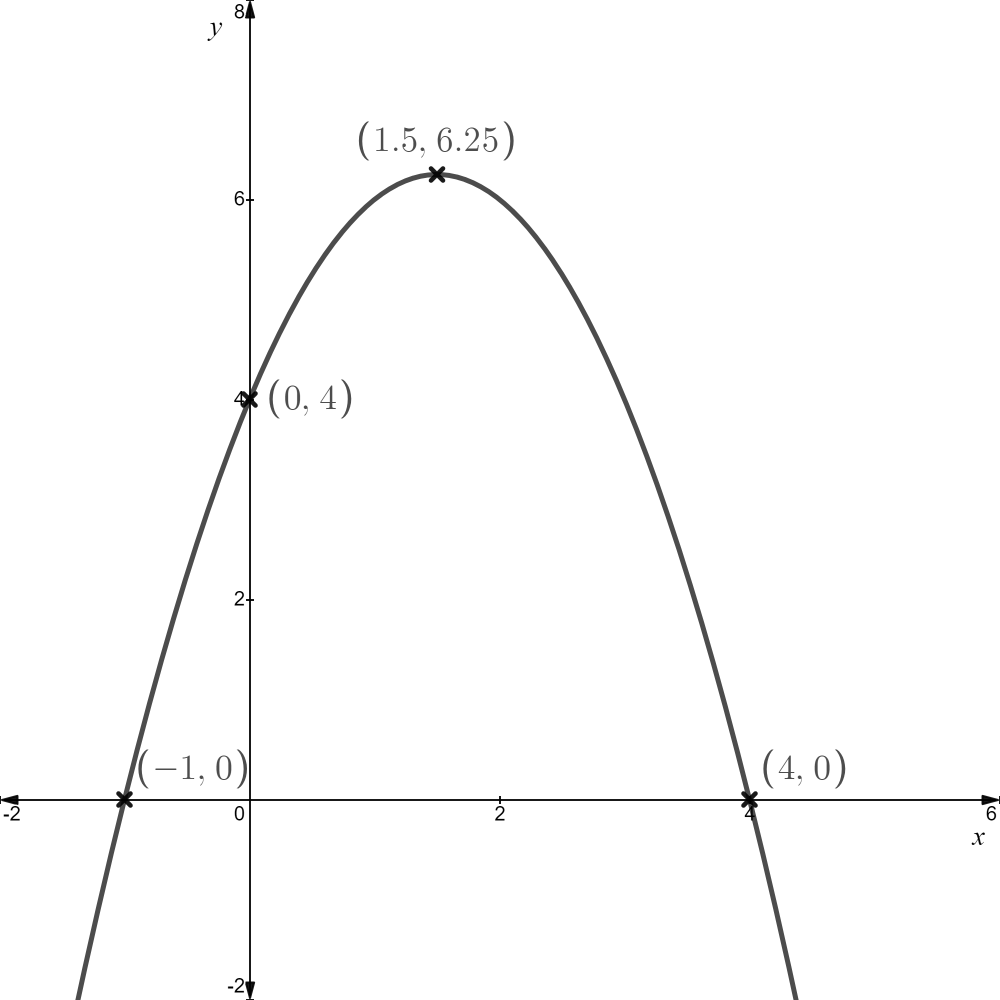
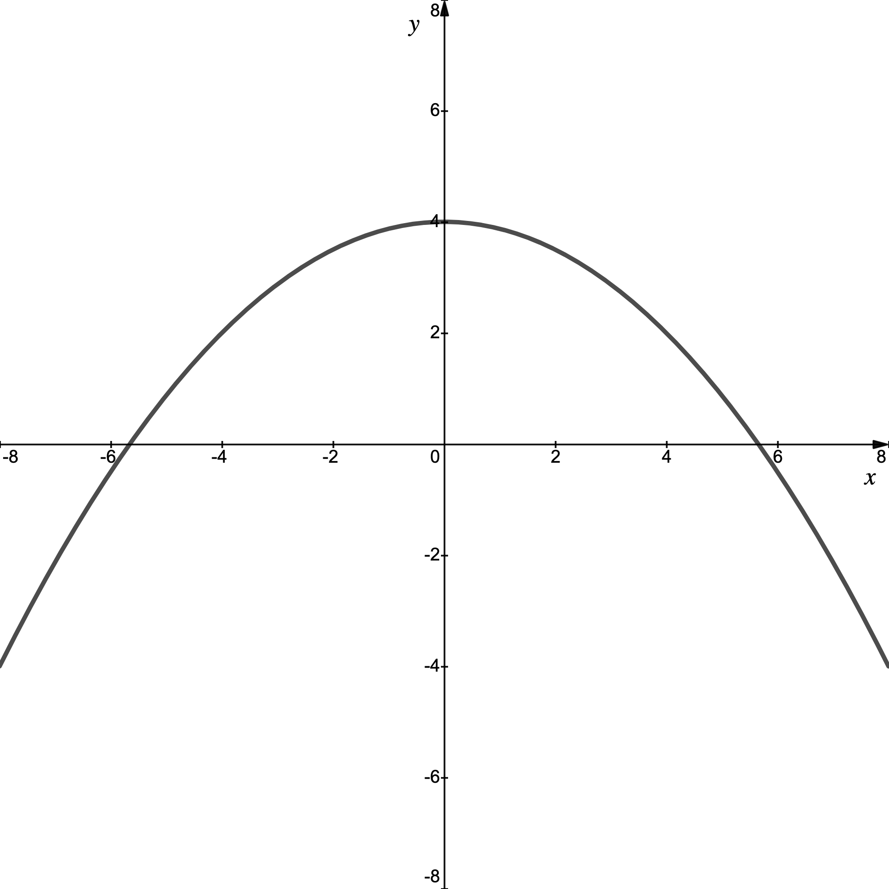
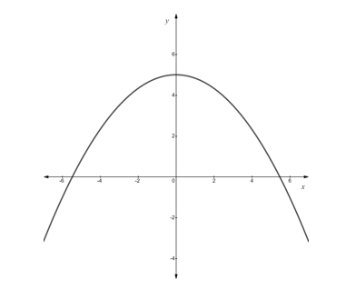
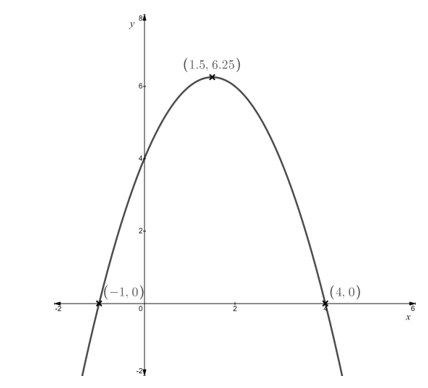

# Exam Questions — Quadratics
**Algebra & Functions** · Cambridge (CIE) A-LEVEL maths (9709)
> Source: [https://www.savemyexams.com/a-level/maths/cie/20/pure-1/topic-questions/](https://www.savemyexams.com/a-level/maths/cie/20/pure-1/topic-questions/) · 45 questions across 1 sets

## Exam Questions (45 questions)

### Q1 — medium — 8 marks

**Q1** [3 marks]

(i) Find the roots of the function $\text{g} ( x ) = 12 + 4 x - x^{2}$.

(ii) Write down the $y$-axis intercept on the graph of $y = \text{g} ( x )$.

**Q1** [3 marks]

(i) Write $\text{g} ( x )$ in the form $a - ( x - b )^{2}$, where $a$ and $b$ are constants to be found.

(ii) Hence write down the coordinates of the turning point on the graph of $y = \text{g} ( x )$.

**Q1** [2 marks]

Sketch the graph of $y = \text{g} ( x )$, labelling all points where the graph intercepts the coordinate axes and the turning point.

### Q2 — easy — 3 marks

**Q2** [3 marks]

Sketch the graph of $y = ( 2 x - 5 )^{2}$, labelling any points where the graph intercepts the coordinate axes.

### Q3 — easy — 2 marks

**Q3** [2 marks]

The function $\text{f} ( x ) = k x^{2} + 2 k x - 3$ has two distinct real roots.

Show that $4 k ( k + 3 ) > 0$.

### Q4 — easy — 3 marks

**Q4** [2 marks]

Write $x^{2} + 10 x + 24$ in the form $( x + a )^{2} + b$, where $a$ and $b$ are constants to be found.

**Q4** [1 mark]

Hence write down the minimum point on the graph of $y = x^{2} + 10 x + 24$.

### Q5 — easy — 3 marks

**Q5** [3 marks]

Complete the square for

(i) $x^{2} + 8 x - 4$

(ii) $2 x^{2} + 12 x - 5$

(iii) $5 x^{2} - 3 x + 2$

### Q6 — easy — 3 marks

**Q6** [3 marks]

Expand and simplify

(i) $( x + 4 ) ( 2 x - 3 )$

(ii) $( 3 x - 4 ) ( 3 x + 4 )$

(iii) $( 2 x + 1 )^{2}$

### Q7 — easy — 3 marks

**Q7** [3 marks]

Write down the value of the discriminant of

(i) $x^{2} - 3 x + 4$

(ii) $4 x + 3 - 2 x^{2}$

(iii) $5 - 8 x + 2 x^{2}$

### Q8 — easy — 6 marks

**Q8** [3 marks]

(i) Write down the $y$-axis intercept on the graph of $y = 2 x^{2} + 5 x - 3$.

(ii) Find the roots of $y = 2 x^{2} + 5 x - 3$.

**Q8** [3 marks]

Sketch the graph of $y = 2 x^{2} + 5 x - 3$, labelling all points where the graph crosses the coordinate axes.

### Q9 — easy — 1 marks

**Q9** [1 mark]

Without showing it algebraically, explain how you know that the function $\text{f} ( x ) = ( a x - b )^{2}$ has a discriminant of zero.

### Q10 — easy — 3 marks

**Q10** [3 marks]

Solve

(i) $x^{2} + 8 x - 9 = 0$

(ii) $3 x^{2} - 13 x + 4 = 0$

(iii) $4 x^{2} - 6 x - 5 = 0$

### Q11 — easy — 2 marks

**Q11** [2 marks]

The function $\text{f} ( x ) = x^{2} + k x + 3$ has no real roots.

Show that $k^{2} < 12$.

### Q12 — easy — 3 marks

**Q12** [3 marks]

Factorise

(i) $x^{2} + 5 x - 14$

(ii) $25 x^{2} - 36$

(iii) $2 x^{2} + 9 x + 9$

### Q13 — hard — 5 marks

**Q13** [1 mark]

Factorise $x^{2} + 6 x + 9$

**Q13** [2 marks]

Factorise $x^{2} + 6 x y + 9 y^{2}$

**Q13** [2 marks]

Find a relationship between *x* and *y* such that $x^{2} + 6 x y + 9 y^{2} = 0$.

### Q14 — very_hard — 4 marks

**Q14** [2 marks]

Show that the equation $a x^{2} + b x + c = 0$ can be written in the form

`a\left(x + \dfrac{b}{2a}\right)^{2} - \dfrac{b^{2} - 4ac}{4a} = 0`

**Q14** [2 marks]

Hence show that $x = \frac{-b\pm\sqrt{b^{2}-4ac}}{2a}$.

### Q15 — very_hard — 2 marks

**Q15** [2 marks]

The equation $k^{2} x^{2} - 4 x + 5 = k^{2}$ has two distinct real roots.

Find the set of values of *k*.

### Q16 — hard — 4 marks

**Q16** [2 marks]

Find the minimum value of the function `f \left( x \right) = x^{2} + 8x + c`, giving your answer in terms of *c*.

**Q16** [2 marks]

Find the values of *c* for which the function `f \left( x \right) = x^{2} + 8x + c` has no real roots.

### Q17 — very_hard — 5 marks

**Q17** [3 marks]

The function `f \left( x \right)` is defined by `f \left( x \right) = \left( k - 1 \right) x^{2} - \left( k - 2 \right) x - 2k`, $x \in ℝ$.

The function `g \left( x \right)` is defined by `g \left( x \right) = \left( k - 1 \right) x^{2} - 3kx + k + 1`, $x \in ℝ$.

*k* is a non-zero constant and $k \neq 1$.

The graphs of `y = f \left( x \right)` and `y = g \left( x \right)` intersect at a single point. Find the *x*-coordinate of the intersection, giving your answer in terms of *k*.

**Q17** [2 marks]

In the case when $k = 3$, find the coordinates of the point of intersection of the two graphs.

### Q18 — hard — 3 marks

**Q18** [3 marks]

The diagram below shows the graph of `y = f \left( x \right)`. The intercepts with the coordinate axes and the turning point have been labelled.

The graph is transformed by the function `y = f \left( x \right) + 6`. One of the new *x*-axis intercepts is (-2, 0).

Sketch the graph of `y = f \left( x \right) + 6`, stating the coordinates of any points that intersect the coordinate axes and the turning point.

### Q19 — very_hard — 5 marks

**Q19** [2 marks]

The equation $4 k - 6 k x - x^{2} = 0$ has two distinct real roots, $α$ and $β$. *k* is a negative constant and $0 < α < β$.

Sketch the graph of $y = 4 k - 6 k x - x^{2}$, labelling the points where the graph crosses the coordinate axes.

**Q19** [3 marks]

Find the possible values of *k*.

### Q20 — very_hard — 4 marks

**Q20** [2 marks]

The equation $y = x^{2} + p x + q$ has no real roots. Show that $p^{2} < 4 q$ and explain why *q* must be a positive value.

**Q20** [2 marks]

Given that the minimum point on the graph of $y = x^{2} + p x + q$ is (3, 1) find the values of *p* and *q*.

### Q21 — very_hard — 7 marks

**Q21** [1 mark]

A stone is thrown vertically upwards from the top of a cliff. The height, *h* metres, of the stone above the sea, *t* seconds after it is thrown, is modelled by `h \left( t \right) = 52 + 3t - 0.5t^{2}`, for $t \geq 0$.

Write down the height of the cliff from which the stone was thrown.

**Q21** [2 marks]

Find the maximum height the stone reaches above the sea.

**Q21** [2 marks]

Find the time it takes for the stone to hit the sea.

**Q21** [2 marks]

Find the length of time for which the stone is above its starting height.

### Q22 — very_hard — 6 marks

**Q22** [2 marks]

The graph below shows the curve `y = f \left( x \right)` where `f \left( x \right) = 4 - \dfrac{x^{2}}{8}`.

The curve is used as the model for the arch on a bridge, where the water level under the bridge is represented by the *x*-axis. All measurements are in metres.

The water level can rise by up to 0.5 m. Determine whether the bridge is still wide enough to span a river of width 11 m when the water is at its peak height, justifying your answer.

**Q22** [2 marks]

A barge in the shape of a cuboid (above water level) has a cross-section measuring 6 m wide by 2.5 m tall. The barge regularly travels along the river where the bridge is to be built. Justifying your answer, determine whether the barge will fit underneath the bridge.

**Q22** [2 marks]

To support the bridge the arch will continue 2.5 m under the water (ground) level.

Find the exact distance between the base of the arch on either side of the river.

### Q23 — very_hard — 6 marks

**Q23** [2 marks]

Write the quadratic function $y = - 6 x^{2} + 8 x - 5$ in the form $y = a - b ( x + c )^{2}$ where *a*, *b* and *c* are constants to be found.

**Q23** [1 mark]

Write down the maximum point on the graph of $y = - 6 x^{2} + 8 x - 5$.

**Q23** [3 marks]

Sketch the graph of $y = - 6 x^{2} + 8 x - 5$, clearly labelling the maximum point and any point where the graph intersects the coordinate axes.

### Q24 — hard — 6 marks

**Q24** [3 marks]

Solve the equation $8 \sqrt{x} = 48 - x$.

**Q24** [3 marks]

Solve the equation `2^{4x} + 64 = 20 \left( 2^{2x} \right)`.

### Q25 — hard — 3 marks

**Q25** [3 marks]

The diagram below shows the graph of `y = f \left( x \right)`, where `f \left( x \right)` is a quadratic function. The intercepts with the coordinate axes and the turning point have been labelled.

Sketch the graph of `y = f \left( x + 3 \right)`, stating the coordinates of any points that intersect the coordinate axes and the turning point.

### Q26 — hard — 3 marks

**Q26** [3 marks]

The functions f and g are defined by `f \left( x \right) = kx^{2} + 2kx - 3` and `g \left( x \right) = kx^{2} + 4kx - 16`, where *k* is a constant.

The equation `f \left( x \right) = 0` has two distinct real roots and the equation `g \left( x \right) = 0` has no real roots.

Find the set of values of *k*.

### Q27 — hard — 5 marks

**Q27** [2 marks]

The equation $2 k - 3 k x - x^{2} = 0$ has two distinct real roots, where *k* is a negative constant.

Find the set of values of *k*.

**Q27** [3 marks]

In the case $k = - 1$ sketch the graph of $y = 2 k - 3 k x - x^{2}$, labelling all points where the graph crosses the coordinate axes.

### Q28 — hard — 4 marks

**Q28** [2 marks]

The function f is defined by `f \left( x \right) = x^{2} + 4x + c`.

Find the minimum value of `f \left( x \right)`, giving your answer in terms of *c*.

**Q28** [2 marks]

Given that $c = 5$, hence, or otherwise, show that the equation `f \left( x \right) = 0` has no real roots.

### Q29 — hard — 6 marks

**Q29** [3 marks]

The curve *C* has equation $y = x^{2} - 3 x + 2$. The line *l* has equation $y = 3 x - 7$.

Find any points of intersection between *C* and *l*.

**Q29** [3 marks]

Sketch the graphs of *C* and *l*, showing clearly any points of intersection with the coordinate axes for both graphs, the minimum point of *C* and any points of intersection found between *C* and *l*.

### Q30 — hard — 6 marks

**Q30** [2 marks]

Write the quadratic function $y = 4 x^{2} + 8 x - 5$ in the form $y = a ( x + b )^{2} + c$ where *a*, *b* and *c* are integers to be found.

**Q30** [1 mark]

Write down the minimum point on the graph of $y = 4 x^{2} + 8 x - 5$.

**Q30** [3 marks]

Sketch the graph of $y = 4 x^{2} + 8 x - 5$, clearly labelling the minimum point and any point where the graph intersects the coordinate axes.

### Q31 — hard — 5 marks

**Q31** [1 mark]

A stone is thrown vertically upwards from the top of a cliff. The height, *h* metres, of the stone above the sea, *t* seconds after it is thrown, is modelled by `h \left( t \right) = 24 + 2t - 0.5t^{2}`, for $t \geq 0$.

Write down the height of the cliff from which the stone was thrown.

**Q31** [2 marks]

Find the maximum height the stone reaches above the sea.

**Q31** [2 marks]

Find the time it takes for the stone to hit the sea.

### Q32 — hard — 5 marks

**Q32** [1 mark]

The graph below shows the curve `y = f \left( x \right)` where `f \left( x \right) = 5 - \dfrac{x^{2}}{6}`.

The curve is used as the model for the arch on a bridge, where the water level under the bridge is represented by the *x*-axis. All measurements are in metres.

Write down the maximum height of the bridge above the water.

**Q32** [2 marks]

Determine whether the bridge is wide enough to span a river of width 11 m, justifying your answer.

**Q32** [2 marks]

A second bridge is modelled by the curve `y = f \left( x \right)` where `f \left( x \right) = 4 - \dfrac{x^{2}}{8}`. To support the bridge the arch will continue 2 m under the water (ground) level.

Find the distance between the base of the arch on either side of the river.

### Q33 — hard — 3 marks

**Q33** [3 marks]

Sketch the graph of $y = 12 x^{2} - 5 x - 72$, labelling any points where the graph crosses the coordinate axes. (You do not need to label the turning point.)

### Q34 — very_hard — 9 marks

**Q34** [3 marks]

Solve the equation $5 \sqrt{x} + 3 = 2 x$.

**Q34** [3 marks]

Solve $x^{\frac{2}{3}} + 2 x^{\frac{1}{3}} = 8$.

**Q34** [3 marks]

Solve the equation `2^{2x} + 64 = 20 \left( 2^{x} \right)`.

### Q35 — hard — 5 marks

**Q35** [2 marks]

The equation of a curve is $y = 3 x^{2} + 2 p x + 4 q$, where $p$ and $q$ are constants.

Given that the equation $3 x^{2} + 2 p x + 4 q = 0$ has no real roots, show that $p^{2} < 12 q$.

**Q35** [3 marks]

Given that the curve passes through $( - 2 , 6 )$ and $( 2 , 6 )$, find the values of $p$ and $q$.

### Q36 — medium — 6 marks

**Q36** [3 marks]

The curve *C* has equation $y = x^{2} - 3 x + 2$.

Find the coordinates of any points where *C* intersects the coordinate axes.

**Q36** [3 marks]

Sketch the graph of *C*, showing clearly all points of intersection with the coordinate axes.

### Q37 — medium — 3 marks

**Q37** [3 marks]

Solve the equation $x^{4} - 13 x^{2} + 36 = 0$.

### Q38 — medium — 4 marks

**Q38** [4 marks]

Solve $x^{\frac{2}{5}} + x^{\frac{1}{5}} = 6$.

### Q39 — medium — 6 marks

**Q39** [2 marks]

Write the quadratic function $y = x^{2} + 8 x - 9$ in the form $y = a ( x + b )^{2} + c$ where *a*, *b* and *c* are integers to be found.

**Q39** [1 mark]

Write down the minimum point on the graph of $y = x^{2} + 8 x - 9$.

**Q39** [3 marks]

Sketch the graph of $y = x^{2} + 8 x - 9$, clearly labelling the minimum point and any point where the graph intersects the coordinate axes.

### Q40 — medium — 5 marks

**Q40** [3 marks]

Find the minimum value of the function `f \left( x \right) = x^{2} + 4x + 5`.

**Q40** [2 marks]

Hence, or otherwise, show that the function `f \left( x \right) = x^{2} + 4x + 5` has no real roots.

### Q41 — medium — 7 marks

**Q41** [2 marks]

Solve the equation $2 x^{2} + x - 6 = 0$.

**Q41** [3 marks]

Find the coordinates of the turning point on the graph of $y = 2 x^{2} + x - 6$.

**Q41** [2 marks]

Sketch the graph of $y = 2 x^{2} + x - 6$, labelling the turning point and any points where the graph crosses the coordinate axes.

### Q42 — medium — 3 marks

**Q42** [3 marks]

The diagram below shows the graph of `y = f \left( x \right)`, where `f \left( x \right)` is a quadratic function. The intercepts with the *x*-axis and the turning point have been labelled.

Sketch the graph of `y = f \left( x + 2 \right)`, stating the coordinates of any points that intersect the *x*-axis and the coordinates of the turning point.

### Q43 — medium — 3 marks

**Q43** [3 marks]

The function $f(x)=kx^{2}+2kx-3$ has two distinct real roots.

Show that $k<-3\mathrm{or}k>0$.

### Q44 — medium — 2 marks

**Q44** [2 marks]

The equation $y = x^{2} + p x + q$ has no real roots. Show that $p^{2} < 4 q$.

### Q45 — medium — 3 marks

**Q45** [3 marks]

Find the set of values of $k$ for which the equation $2 x^{2} - 4 x + 3 - 2 k = 0$ has real roots.
