# Mark Schemes — Transformations of Functions
**Algebra & Functions** · Cambridge (CIE) A-LEVEL maths (9709)

## Exam Questions (32 questions)

### Q1
The factorised form gives the points where the graph crosses the $x$-axis

**Final answer:** $( 2 ,  0 )$** and **$( 6 ,  0 )$

**[B1]**

The $y$-intercept is $\text{f} ( 0 )$

$\text{f} ( 0 ) = ( 0 - 2 ) ( 0 - 6 ) = 12$

$( 0 ,  12 )$

**[B1]**

The turning point is halfway between the roots, at $x = 4$

$\text{f} ( 4 ) = ( 4 - 2 ) ( 4 - 6 ) = - 4$

$( 4 ,  - 4 )$

**[B1]**

Sketch a positive (U-shaped) parabola through these points

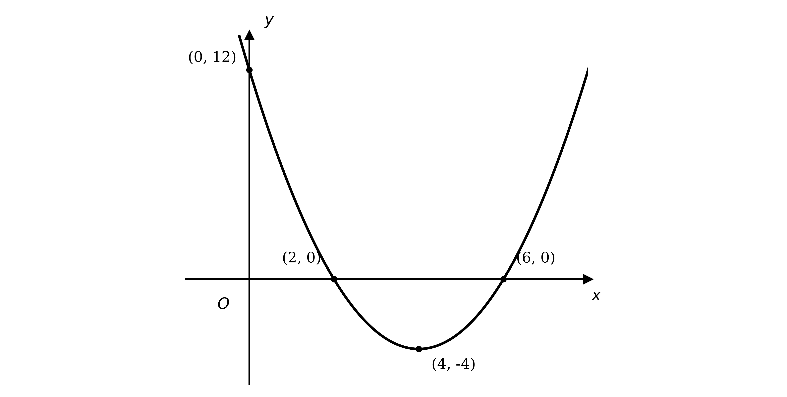

> **[mark-scheme]**
> **B1**: Correct $x$-axis intercepts, $( 2 , 0 )$ and $( 6 , 0 )$.
> 
> **B1**: Correct $y$-axis intercept, $( 0 , 12 )$.
> 
> **B1**: Correct turning point $( 4 , - 4 )$ on a correct positive (U-shaped) parabola.
(i)

$y = \text{f} ( x - 4 )$ translates the curve $4$ units in the positive $x$-direction, so each $x$-coordinate increases by $4$

The roots and turning point become

**Final answer:** $( 6 ,  0 )$**, **$( 10 ,  0 )$** and turning point **$( 8 ,  - 4 )$

**[B1]**

The new $y$-intercept is at $\text{f} ( 0 - 4 ) = ( - 6 ) ( - 10 ) = 60$

$( 0 ,  60 )$

**[B1]**

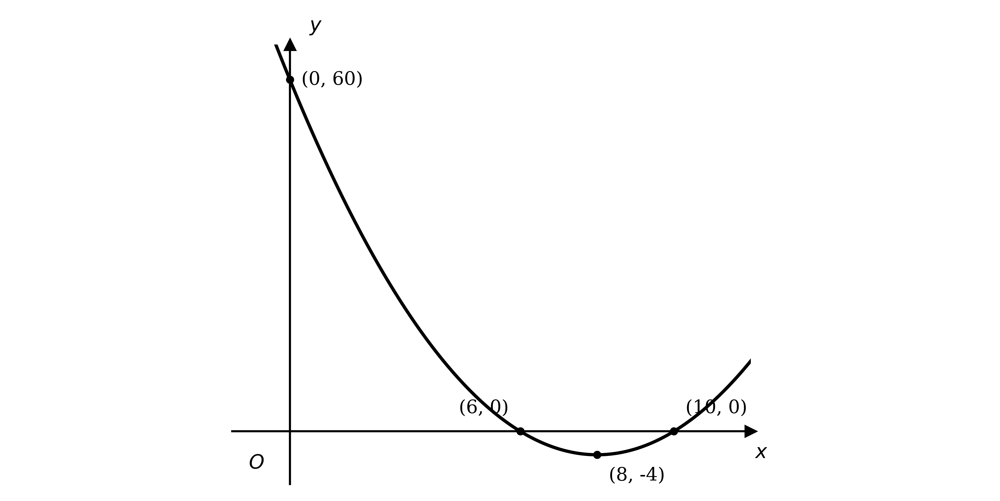

(ii)

$y = \text{f} ( - x )$ reflects the curve in the $y$-axis, so each $x$-coordinate changes sign

The roots and turning point become

**Final answer:** $( - 2 ,  0 )$**, **$( - 6 ,  0 )$** and turning point **$( - 4 ,  - 4 )$

**[B1]**

The $y$-intercept is unchanged

$( 0 ,  12 )$

**[B1]**

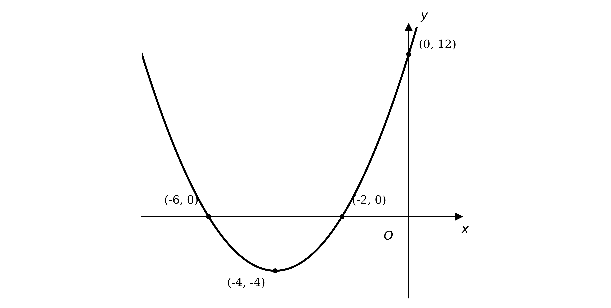

> **[mark-scheme]**
> **B1**: Correct images of the roots and turning point — $( 6 , 0 )$, $( 10 , 0 )$ and $( 8 , - 4 )$ — i.e. the curve translated $4$ units in the positive $x$-direction.
> 
> **B1**: Correct new $y$-intercept $( 0 , 60 )$ on a correct positive parabola.
> 
> **B1**: Correct images of the roots and turning point — $( - 2 , 0 )$, $( - 6 , 0 )$ and $( - 4 , - 4 )$ — i.e. the curve reflected in the $y$-axis.
> 
> **B1**: Correct $y$-intercept $( 0 , 12 )$ on a correct positive parabola.

### Q2
(i)

Only the $y$-coordinate changes, from $8$ to $3$ (a decrease of $5$), so this could be a translation

**Final answer:** **Translation by **`\begin{pmatrix} 0 \\ -5 \end{pmatrix}`

**[B1]**

(ii)

Only the $x$-coordinate changes, from $- 2$ to $- 4$ (multiplied by $2$), so this could be a stretch

**Final answer:** **Stretch, factor **$2$**, parallel to the **$x$**-axis**

**[B1]**

(iii)

Only the $y$-coordinate changes sign, from $8$ to $- 8$, so this could be a reflection

**Final answer:** **Reflection in the **$x$**-axis**

**[B1]**

> **[mark-scheme]**
> **B1**: Any correct single transformation mapping the $y$-coordinate $8 \rightarrow 3$ — e.g. a translation by `\begin{pmatrix} 0 \\ -5 \end{pmatrix}` (5 units in the negative $y$-direction). A stretch of factor $\frac{3}{8}$ parallel to the $y$-axis is also accepted.
> 
> **B1**: Any correct single transformation mapping the $x$-coordinate $- 2 \rightarrow - 4$ — e.g. a stretch of factor $2$ parallel to the $x$-axis. A translation by `\begin{pmatrix} -2 \\ 0 \end{pmatrix}` is also accepted.
> 
> **B1**: Any correct single transformation mapping the $y$-coordinate $8 \rightarrow - 8$ — e.g. a reflection in the $x$-axis. A stretch of factor $- 1$ parallel to the $y$-axis is also accepted.

### Q3
(i)

Adding $2$ to $\text{f} ( x )$ increases every $y$-coordinate by $2$

**Final answer:** **Translation by **`\begin{pmatrix} 0 \\ 2 \end{pmatrix}`

**[B1]**

(ii)

Replacing $x$ with $x - 2$ moves the graph $2$ units in the positive $x$-direction

**Final answer:** **Translation by **`\begin{pmatrix} 2 \\ 0 \end{pmatrix}`

**[B1]**

(iii)

Multiplying $\text{f} ( x )$ by $3$ multiplies every $y$-coordinate by $3$

**Final answer:** **Stretch, factor **$3$**, parallel to the **$y$**-axis**

**[B1]**

(iv)

Replacing $x$ with $2 x$ multiplies every $x$-coordinate by $\frac{1}{2}$

**Final answer:** **Stretch, factor **$\frac{1}{2}$**, parallel to the **$x$**-axis**

**[B1]**

> **[mark-scheme]**
> **B1**: Translation by `\begin{pmatrix} 0 \\ 2 \end{pmatrix}`. Accept "translation of 2 units in the positive $y$-direction" (vertically up). The word "translation" (or "shift") with a correct vector/direction is required.
> 
> **B1**: Translation by `\begin{pmatrix} 2 \\ 0 \end{pmatrix}`. Accept "translation of 2 units in the positive $x$-direction". The direction "2 to the right" on its own is not enough.
> 
> **B1**: Stretch, factor $3$, parallel to the $y$-axis. Accept "in the $y$-direction", "vertically", or "$x$-axis invariant". All three elements (stretch, factor, direction) are required.
> 
> **B1**: Stretch, factor $\frac{1}{2}$, parallel to the $x$-axis. Accept "in the $x$-direction", "horizontally", or "$y$-axis invariant".

### Q4
(i)

A translation by `\begin{pmatrix} 3 \\ 0 \end{pmatrix}` replaces $x$ with $x - 3$

$y = \text{f} ( x - 3 )$

**[B1]**

(ii)

A stretch parallel to the $x$-axis with scale factor $2$ replaces $x$ with $\frac{1}{2} x$

`y = \text{f}\left( \tfrac{1}{2}x \right)`

**[B1]**

(iii)

A stretch parallel to the $y$-axis with scale factor $\frac{1}{3}$ multiplies $\text{f} ( x )$ by $\frac{1}{3}$

$y = \frac{1}{3} \text{f} ( x )$

**[B1]**

(iv)

A reflection in the $y$-axis replaces $x$ with $- x$

$y = \text{f} ( - x )$

**[B1]**

> **[mark-scheme]**
> **B1**: Correct equation, $y = \text{f} ( x - 3 )$.
> 
> **B1**: Correct equation, `y = \text{f}\left( \tfrac{1}{2}x \right)`. Accept `y = \text{f}\left( \tfrac{x}{2} \right)`.
> 
> **B1**: Correct equation, $y = \frac{1}{3} \text{f} ( x )$.
> 
> **B1**: Correct equation, $y = \text{f} ( - x )$.

### Q5
(i)

Adding $1$ raises every point by $1$, so the $y$-coordinate increases by $1$

$( 2 ,  7 )$

**[B1]**

(ii)

$- \text{f} ( x )$ reflects the curve in the $x$-axis, so the $y$-coordinate changes sign

$( 2 ,  - 6 )$

**[B1]**

(iii)

Replacing $x$ with $\frac{1}{4} x$ is a stretch parallel to the $x$-axis of factor $4$, so the $x$-coordinate is multiplied by $4$

$( 8 ,  6 )$

**[B1]**

> **[mark-scheme]**
> **B1**: Correct image, $( 2 ,  7 )$.
> 
> **B1**: Correct image, $( 2 ,  - 6 )$.
> 
> **B1**: Correct image, $( 8 ,  6 )$.

### Q6
(i)

$y = \text{f} ( 2 x )$ is a stretch parallel to the $x$-axis of factor $\frac{1}{2}$, so the $x$-coordinate is halved

`\left( \tfrac{a}{2},\ b \right)`

**[B1]**

(ii)

$y = - \text{f} ( x )$ reflects the curve in the $x$-axis, so the $y$-coordinate changes sign

`\left( a,\ -b \right)`

**[B1]**

(iii)

$y = a  \text{f} ( x )$ is a stretch parallel to the $y$-axis of factor $a$, so the $y$-coordinate is multiplied by $a$

`\left( a,\ ab \right)`

**[B1]**

> **[mark-scheme]**
> **B1**: Correct image, `\left( \tfrac{a}{2},\ b \right)`.
> 
> **B1**: Correct image, `\left( a,\ -b \right)`.
> 
> **B1**: Correct image, `\left( a,\ ab \right)`.

### Q7
(i)

$y = \text{f} ( x + a )$ is a horizontal translation, so the $y$-coordinate is unchanged and the $x$-coordinate satisfies

$3 - a = - 3$

$a = 6$

**[B1]**

(ii)

$y = a  \text{f} ( x )$ multiplies the $y$-coordinate by $a$

$- 4 a = - 12$

$a = 3$

**[B1]**

(iii)

$y = \text{f} ( a x )$ divides the $x$-coordinate by $a$

$\frac{3}{a} = - 3$

$a = - 1$

**[B1]**

> **[mark-scheme]**
> **B1**: Correct value, $a = 6$.
> 
> **B1**: Correct value, $a = 3$.
> 
> **B1**: Correct value, $a = - 1$.

### Q8
(i)

Rearranging, $y = \text{f} ( x ) - 3$, a translation $3$ units in the negative $y$-direction. The horizontal asymptote moves down $3$; the vertical asymptote is unchanged

**Final answer:** $y = - 6$** and **$x = 2$

**[B1 B1]**

(ii)

$y = \text{f} ( x - 2 )$ is a translation $2$ units in the positive $x$-direction. The vertical asymptote moves right $2$; the horizontal asymptote is unchanged

**Final answer:** $x = 4$** and **$y = - 3$

**[B1 B1]**

> **[mark-scheme]**
> **B1**: Horizontal asymptote $y = - 6$.
> 
> **B1**: Vertical asymptote $x = 2$ (unchanged).
> 
> **B1**: Vertical asymptote $x = 4$.
> 
> **B1**: Horizontal asymptote $y = - 3$ (unchanged).

### Q9
(i)

`y = \text{f}\left( \tfrac{1}{3}x \right)` is a stretch parallel to the $x$-axis of factor $3$, so each $x$-coordinate is multiplied by $3$

**Final answer:** $A ' ( - 3 ,  5 )$** and **$B ' ( 9 ,  - 3 )$

**[B1]**

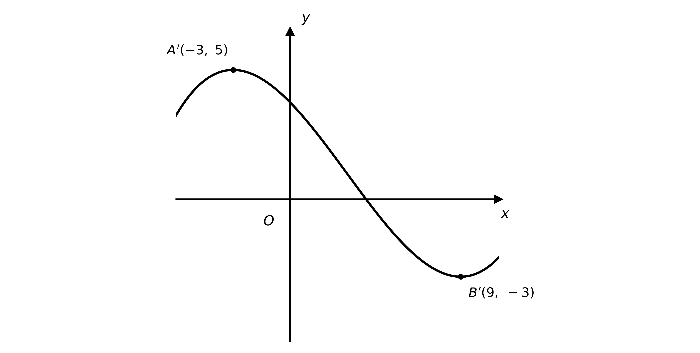

**[B1]**

(ii)

Rearranging, $y = \frac{1}{5} \text{f} ( x )$, a stretch parallel to the $y$-axis of factor $\frac{1}{5}$, so each $y$-coordinate is divided by $5$

**Final answer:** $A ' ( - 1 ,  1 )$** and **`B' \left( 3,\ -\tfrac{3}{5} \right)`

**[B1]**

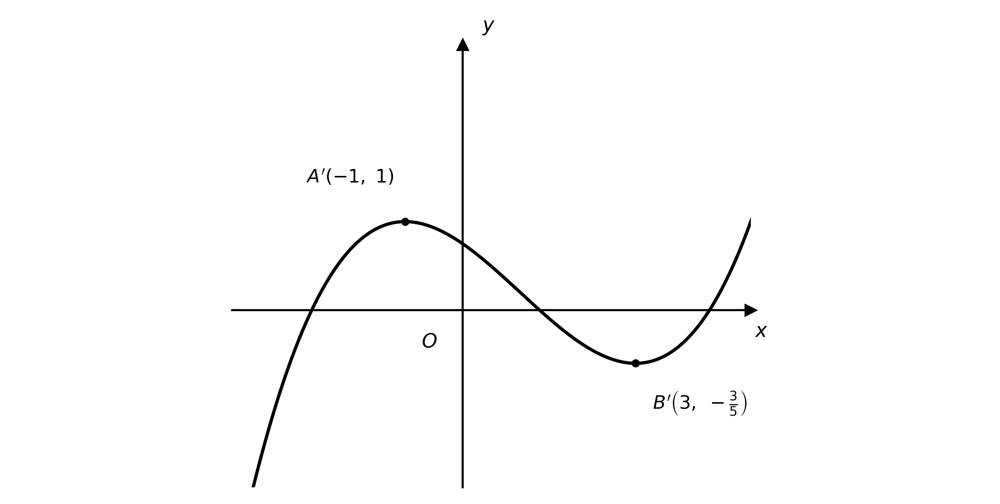

**[B1]**

> **[mark-scheme]**
> **B1**: Correct images $A ' ( - 3 , 5 )$ and $B ' ( 9 , - 3 )$.
> 
> **B1**: Correct shape — the curve stretched parallel to the $x$-axis by factor $3$.
> 
> **B1**: Correct images $A ' ( - 1 , 1 )$ and `B'\left( 3, -\tfrac{3}{5} \right)`.
> 
> **B1**: Correct shape — the curve stretched parallel to the $y$-axis by factor $\frac{1}{5}$.
$y = \text{f} ( a x )$ is a stretch parallel to the $x$-axis of factor $\frac{1}{a}$, so the image of a point with $x$-coordinate $x_{0}$ has $x$-coordinate $\frac{x_{0}}{a}$. Set this equal to $\frac{5}{3}$

Using $B ( 3 , - 3 )$ gives $\frac{3}{a} = \frac{5}{3}$; using $A ( - 1 , 5 )$ gives a negative value, which is rejected since $a > 0$

$\frac{3}{a} = \frac{5}{3}$

**[M1]**

$a = \frac{9}{5}$

**[A1]**

> **[mark-scheme]**
> **M1**: Form $\frac{x_{0}}{a} = \frac{5}{3}$ for a marked point (using $B$, since $A$ gives $a < 0$).
> 
> **A1**: Correct value, $a = \frac{9}{5}$.

### Q10
(i)

Rearranging, $y = 3 \text{f} ( x )$, a stretch parallel to the $y$-axis of factor $3$. The horizontal asymptote is multiplied by $3$; the vertical asymptote is unchanged

**Final answer:** $y = 15$** and **$x = - 4$

**[B1 B1]**

(ii)

`y = \text{f}\left( \tfrac{1}{3}x \right)` is a stretch parallel to the $x$-axis of factor $3$. The vertical asymptote is multiplied by $3$; the horizontal asymptote is unchanged

**Final answer:** $x = - 12$** and **$y = 5$

**[B1 B1]**

> **[mark-scheme]**
> **B1**: Horizontal asymptote $y = 15$.
> 
> **B1**: Vertical asymptote $x = - 4$ (unchanged).
> 
> **B1**: Vertical asymptote $x = - 12$.
> 
> **B1**: Horizontal asymptote $y = 5$ (unchanged).

### Q11
(i)

$y = \text{f} ( - x )$ reflects the curve in the $y$-axis. The vertical asymptote is reflected; the horizontal asymptote is unchanged

**Final answer:** $x = 2$** and **$y = - 1$

**[B1 B1]**

(ii)

Rearranging, $y = - \text{f} ( x )$, a reflection in the $x$-axis. The horizontal asymptote is reflected; the vertical asymptote is unchanged

**Final answer:** $y = 1$** and **$x = - 2$

**[B1 B1]**

> **[mark-scheme]**
> **B1**: Vertical asymptote $x = 2$.
> 
> **B1**: Horizontal asymptote $y = - 1$ (unchanged).
> 
> **B1**: Horizontal asymptote $y = 1$.
> 
> **B1**: Vertical asymptote $x = - 2$ (unchanged).

### Q12
The curve crosses the $x$-axis where $y = 0$

$\frac{16}{(x-2)^{2}} = 9$

$( x - 2 )^{2} = \frac{16}{9}$

**Final answer:** `\left( \tfrac{2}{3},\ 0 \right)`** and **`\left( \tfrac{10}{3},\ 0 \right)`

**[B1]**

The curve crosses the $y$-axis where $x = 0$

$y = 9 - \frac{16}{(-2)^{2}} = 5$

$( 0 ,  5 )$

**[B1]**

The vertical asymptote is where the denominator is zero

$x = 2$

**[B1]**

As $x \rightarrow \pm \infty$, $\frac{16}{(x-2)^{2}} \rightarrow 0$, so the horizontal asymptote is

$y = 9$

**[B1]**

Since $- \frac{16}{(x-2)^{2}} < 0$, both branches lie below $y = 9$ and are symmetric about $x = 2$

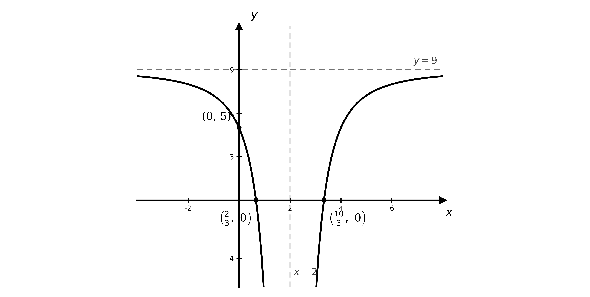

**[B1 B1]**

> **[mark-scheme]**
> **B1**: Correct $x$-intercepts, `\left( \tfrac{2}{3}, 0 \right)` and `\left( \tfrac{10}{3}, 0 \right)`.
> 
> **B1**: Correct $y$-intercept, $( 0 , 5 )$.
> 
> **B1**: Vertical asymptote $x = 2$.
> 
> **B1**: Horizontal asymptote $y = 9$.
> 
> **B1**: Both branches below $y = 9$, tending to $- \infty$ near $x = 2$.
> 
> **B1**: Correct symmetry about $x = 2$, each branch approaching its asymptotes.

The condition is about the value $y = 5$, so first find where $y = \text{f} ( x )$ meets $y = 5$

$9 - \frac{16}{(x-2)^{2}} = 5$

$\frac{16}{(x-2)^{2}} = 4$

$( x - 2 )^{2} = 4$

$x - 2 = 2 \text{or} x - 2 = - 2$

so the curve meets $y = 5$ at $( 0 ,  5 )$ and $( 4 ,  5 )$

Between these points the curve dips below $y = 5$ (down towards the asymptote $x = 2$), and outside them it lies above $5$; so on $y = \text{f} ( x )$ the $y$-coordinate is less than $5$ exactly for

$0 < x < 4$

$y = \text{f} ( x + a )$ is this graph translated $a$ units to the left, so the region where $y < 5$ moves to $- a < x < 4 - a$; its right-hand boundary, once at $x = 4$, is now at $x = 4 - a$

The condition "if $y < 5$ then $x < 0$" means this whole region must lie to the left of the $y$-axis, so its right-hand end can be at most $0$

$4 - a \leq 0$

**[M1]**

$a \geq 4$

**[A1]**

> **[mark-scheme]**
> **M1**: Solve $\text{f} ( x ) = 5$ to find the boundary points ($x = 0$ and $x = 4$), then use the leftward translation to require the right-hand end of the region $y < 5$ to reach the $y$-axis: $4 - a \leq 0$.
> 
> **A1**: Correct range, $a \geq 4$. The boundary $a = 4$ is included: it moves the region to $- 4 < x < 0$, so every point with $y < 5$ has $x < 0$ (the endpoint $( 0 , 5 )$ has $y = 5$, which is not less than 5).

### Q13
(i)

`y = \text{f}\left( \tfrac{20}{3}x \right)` is a stretch parallel to the $x$-axis of factor $\frac{3}{20}$, so each $x$-coordinate is multiplied by $\frac{3}{20}$

**Final answer:** $A ' ( 0 ,  6 )$** and **`B' \left( \tfrac{9}{20},\ 0 \right)`

**[B1]**

The vertical asymptote is multiplied by $\frac{3}{20}$; the horizontal asymptote is unchanged

**Final answer:** $x = \frac{1}{2}$** and **$y = \frac{20}{3}$

**[B1]**

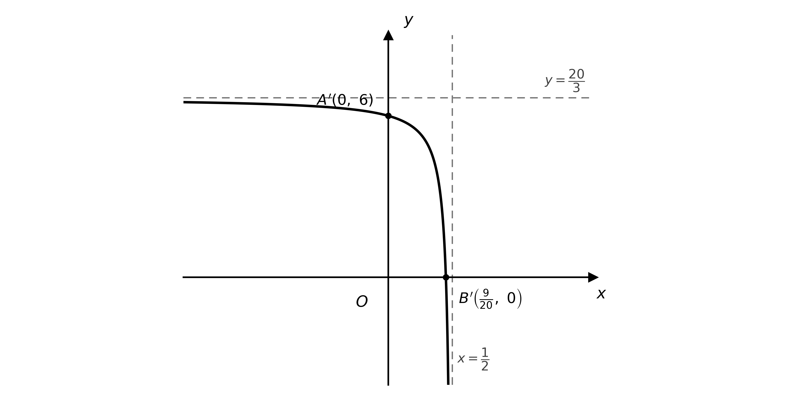

**[B1]**

(ii)

Rearranging, $y = \frac{4}{5} \text{f} ( x )$, a stretch parallel to the $y$-axis of factor $\frac{4}{5}$, so each $y$-coordinate is multiplied by $\frac{4}{5}$

**Final answer:** `A' \left( 0,\ \tfrac{24}{5} \right)`** and **$B ' ( 3 ,  0 )$

**[B1]**

The horizontal asymptote is multiplied by $\frac{4}{5}$; the vertical asymptote is unchanged

**Final answer:** $y = \frac{16}{3}$** and **$x = \frac{10}{3}$

**[B1]**

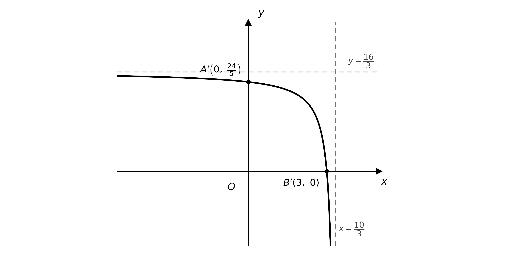

**[B1]**

> **[mark-scheme]**
> **B1**: Correct images $A ' ( 0 , 6 )$ and `B'\left( \tfrac{9}{20}, 0 \right)`.
> 
> **B1**: Correct transformed asymptotes $x = \frac{1}{2}$ and $y = \frac{20}{3}$.
> 
> **B1**: Correct shape — the curve stretched parallel to the $x$-axis by factor $\frac{3}{20}$.
> 
> **B1**: Correct images `A'\left( 0, \tfrac{24}{5} \right)` and $B ' ( 3 , 0 )$.
> 
> **B1**: Correct transformed asymptotes $y = \frac{16}{3}$ and $x = \frac{10}{3}$.
> 
> **B1**: Correct shape — the curve stretched parallel to the $y$-axis by factor $\frac{4}{5}$.
$y = \text{f} ( a x )$ is a stretch parallel to the $x$-axis of factor $\frac{1}{a}$, so the vertical asymptote $x = \frac{10}{3}$ becomes $x = \frac{10}{3a}$. With $1 < \frac{10}{3a} < 100$

$1 < \frac{10}{3a} < 100$

**[M1]**

$\frac{1}{30} < a < \frac{10}{3}$

**[A1]**

> **[mark-scheme]**
> **M1**: Set the transformed vertical asymptote $\frac{10}{3a} = k$ and apply $1 < k < 100$.
> 
> **A1**: Correct range, $\frac{1}{30} < a < \frac{10}{3}$.

### Q14
(i)

Only a vertical translation moves $A$ off the $x$-axis. Under $y = \text{f} ( x ) + b$, $A \rightarrow ( 0 , b )$ and $B \rightarrow ( 4 , 8 + b )$, which lie on opposite sides of the $x$-axis when $b ( 8 + b ) < 0$

$y = \text{f} ( x ) + b$

**[B1]**

$- 8 < b < 0$

**[B1]**

(ii)

The image of $B$ has $x$-coordinate $- 4$ under $y = \text{f} ( - x )$, $\frac{4}{a} > 0$ under $y = \text{f} ( a x )$, and $4$ under $y = \text{f} ( x ) + b$. Only $- 4$ lies in $- 6 < x < - 3$

$y = \text{f} ( - x )$

**[B1]**

(iii)

A value $0 < x < 3$ for the image of $B$ is only possible under $y = \text{f} ( a x )$, where the $x$-coordinate is $\frac{4}{a}$

$0 < \frac{4}{a} < 3$

**Final answer:** $y = \text{f} ( a x )$**, **$a > \frac{4}{3}$

**[B1 B1]**

> **[mark-scheme]**
> **B1**: Identifies $y = \text{f} ( x ) + b$ for condition (i).
> 
> **B1**: Correct range $- 8 < b < 0$.
> 
> **B1**: Identifies $y = \text{f} ( - x )$ for condition (ii).
> 
> **B1**: Identifies $y = \text{f} ( a x )$ for condition (iii).
> 
> **B1**: Correct range $a > \frac{4}{3}$.

### Q15
Factorise, taking out a common factor of $x$

`\text{f}(x) = x \left( x^{2} - 2\sqrt{3}\,x + 3 \right)`

The quadratic factor has discriminant `\left( 2\sqrt{3} \right)^{2} - 4(3) = 0`, so it is a perfect square

`\text{f}(x) = x \left( x - \sqrt{3} \right)^{2}`

**[B1]**

The simple root gives a crossing point

$( 0 ,  0 )$

**[B1]**

The repeated root gives a point where the curve touches the $x$-axis

`\left( \sqrt{3},\ 0 \right)`

**[B1]**

The curve touches (does not cross) the $x$-axis at `\left( \sqrt{3}, 0 \right)`, which is a turning point

**[B1]**

The leading term is $x^{3}$, so the curve is a positive cubic

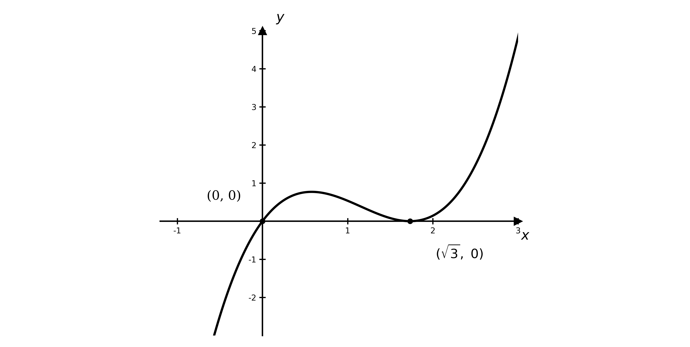

**[B1 B1]**

> **[mark-scheme]**
> **B1**: Correct factorisation, `\text{f}(x) = x \left( x - \sqrt{3} \right)^{2}`.
> 
> **B1**: Crossing point $( 0 , 0 )$.
> 
> **B1**: Touching point `\left( \sqrt{3}, 0 \right)`.
> 
> **B1**: The curve touches (does not cross) the $x$-axis at `\left( \sqrt{3}, 0 \right)`.
> 
> **B1**: Correct positive-cubic shape.
> 
> **B1**: Curve drawn through $( 0 , 0 )$ and touching at `\left( \sqrt{3}, 0 \right)` in the correct relative positions.
$\text{g} ( x ) = \text{f} ( - x )$ reflects the curve in the $y$-axis, so the touching point `\left( \sqrt{3}, 0 \right)` becomes

`\left( -\sqrt{3},\ 0 \right)`

**[B1]**

$\text{h} ( x ) = \text{g} ( x + a )$ translates the curve $a$ units in the negative $x$-direction, so the touching point moves to `\left( -\sqrt{3} - a,\ 0 \right)`. This equals $( 5 , 0 )$

$- \sqrt{3} - a = 5$

**[M1]**

$a = - 5 - \sqrt{3}$

**[A1]**

> **[mark-scheme]**
> **B1**: The reflection $\text{g} ( x ) = \text{f} ( - x )$ has its touching point at `\left( -\sqrt{3}, 0 \right)`.
> 
> **M1**: Apply the translation and set the touching point $- \sqrt{3} - a = 5$.
> 
> **A1**: Correct exact value, $a = - 5 - \sqrt{3}$.

### Q16
(i)

`y = \text{f}\left( \tfrac{1}{3}x \right)` is a stretch parallel to the $x$-axis of factor $3$, so each $x$-coordinate is multiplied by $3$

**Final answer:** $A ' ( 0 ,  0 )$** and **$B ' ( 12 ,  8 )$

**[B1]**

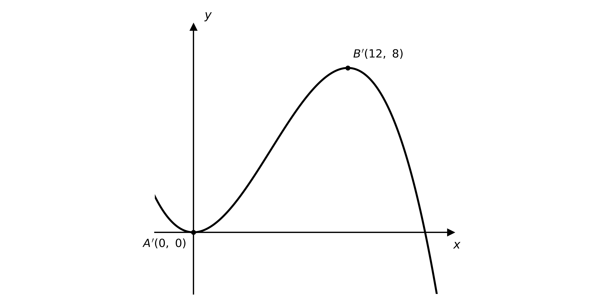

**[B1]**

(ii)

Rearranging, $y = \frac{1}{6} \text{f} ( x )$, a stretch parallel to the $y$-axis of factor $\frac{1}{6}$, so each $y$-coordinate is divided by $6$

**Final answer:** $A ' ( 0 ,  0 )$** and **`B' \left( 4,\ \tfrac{4}{3} \right)`

**[B1]**

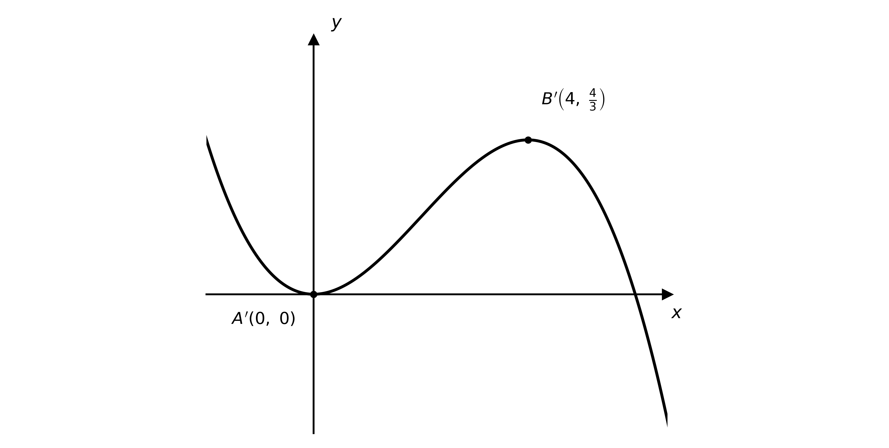

**[B1]**

> **[mark-scheme]**
> **B1**: Correct images $A ' ( 0 , 0 )$ and $B ' ( 12 , 8 )$.
> 
> **B1**: Correct shape — the curve stretched parallel to the $x$-axis by factor $3$.
> 
> **B1**: Correct images $A ' ( 0 , 0 )$ and `B'\left( 4, \tfrac{4}{3} \right)`.
> 
> **B1**: Correct shape — the curve stretched parallel to the $y$-axis by factor $\frac{1}{6}$.

### Q17
The curve crosses the $x$-axis where $y = 0$

$2 - \frac{8}{x^{2}} = 0$

$x^{2} = 4$

**Final answer:** $( - 2 ,  0 )$** and **$( 2 ,  0 )$

**[B1]**

The vertical asymptote is the $y$-axis

$x = 0$

**[B1]**

As $x \rightarrow \pm \infty$, $\frac{8}{x^{2}} \rightarrow 0$, so the horizontal asymptote is

$y = 2$

**[B1]**

Since $- \frac{8}{x^{2}} < 0$ for all $x$, both branches lie below $y = 2$ and open downwards

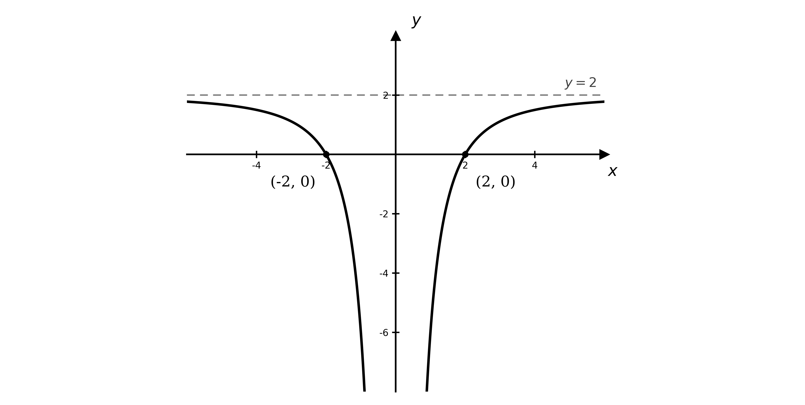

**[B1]**

> **[mark-scheme]**
> **B1**: Correct $x$-intercepts, $( - 2 , 0 )$ and $( 2 , 0 )$.
> 
> **B1**: Vertical asymptote $x = 0$.
> 
> **B1**: Horizontal asymptote $y = 2$.
> 
> **B1**: Correct shape — two branches below $y = 2$, symmetric about the $y$-axis, each tending to $- \infty$ near $x = 0$.
Substitute $( 0 , 0 )$

$0 = 2 - \frac{8}{(0+a)^{2}}$

$a^{2} = 4$

**[M1]**

**Final answer:** $a = 2$** or **$a = - 2$

**[A1]**

> **[mark-scheme]**
> **M1**: Substitute $( 0 , 0 )$ and reach $a^{2} = 4$.
> 
> **A1**: Both correct values, $a = 2$ and $a = - 2$.

### Q18
(i)

$y = \text{f} ( 5 x )$ is a stretch parallel to the $x$-axis of factor $\frac{1}{5}$, so each $x$-coordinate is divided by $5$

**Final answer:** $A ' ( 0 ,  6 )$** and **`B' \left( \tfrac{3}{5},\ 0 \right)`

**[B1]**

The vertical asymptote is divided by $5$; the horizontal asymptote is unchanged

**Final answer:** $x = \frac{2}{3}$** and **$y = \frac{20}{3}$

**[B1]**

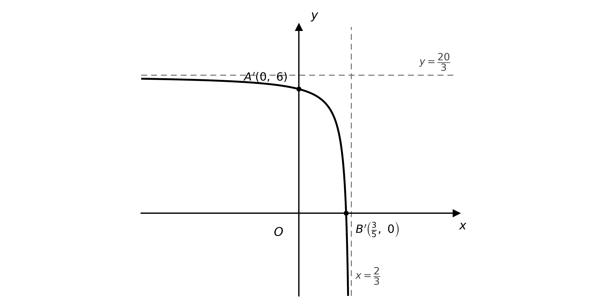

**[B1]**

(ii)

$y = - \text{f} ( x )$ reflects the curve in the $x$-axis, so each $y$-coordinate changes sign

**Final answer:** $A ' ( 0 ,  - 6 )$** and **$B ' ( 3 ,  0 )$

**[B1]**

The horizontal asymptote is reflected; the vertical asymptote is unchanged

**Final answer:** $y = - \frac{20}{3}$** and **$x = \frac{10}{3}$

**[B1]**

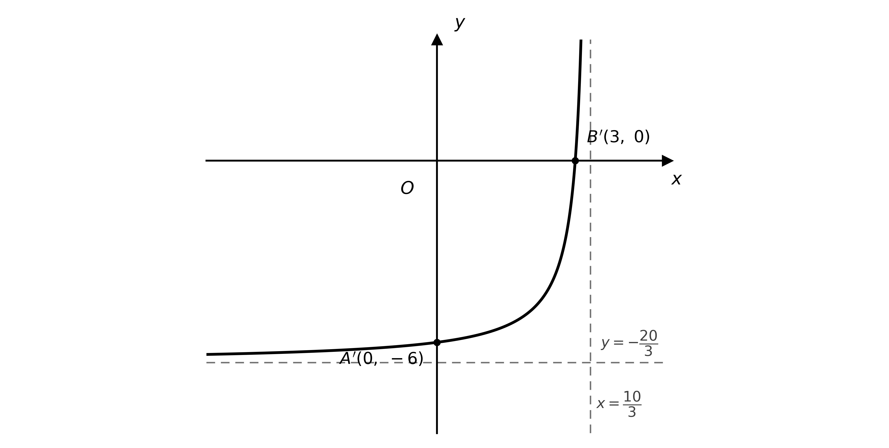

**[B1]**

> **[mark-scheme]**
> **B1**: Correct images $A ' ( 0 , 6 )$ and `B'\left( \tfrac{3}{5}, 0 \right)`.
> 
> **B1**: Correct transformed asymptotes $x = \frac{2}{3}$ and $y = \frac{20}{3}$.
> 
> **B1**: Correct shape — the curve stretched parallel to the $x$-axis by factor $\frac{1}{5}$.
> 
> **B1**: Correct images $A ' ( 0 , - 6 )$ and $B ' ( 3 , 0 )$.
> 
> **B1**: Correct transformed asymptotes $y = - \frac{20}{3}$ and $x = \frac{10}{3}$.
> 
> **B1**: Correct shape — the curve reflected in the $x$-axis.
$y = a  \text{f} ( x )$ is a stretch parallel to the $y$-axis of factor $a$, so the horizontal asymptote $y = \frac{20}{3}$ becomes $y = \frac{20}{3} a$. Set this equal to $2$

$\frac{20}{3} a = 2$

$a = \frac{3}{10}$

**[B1]**

> **[mark-scheme]**
> **B1**: Correct value, $a = \frac{3}{10}$.

### Q19
(i)

$\text{f} ( - x )$ reflects the curve in the $y$-axis. As $P$ lies on the $y$-axis, it is mapped to itself

$( 0 ,  5 )$

**[B1]**

(ii)

Rearranging, $y = - \text{f} ( x )$, a reflection in the $x$-axis, so the $y$-coordinate changes sign

$( 0 ,  - 5 )$

**[B1]**

> **[mark-scheme]**
> **B1**: Correct image, $( 0 , 5 )$.
> 
> **B1**: Correct image, $( 0 , - 5 )$.

### Q20
The $x$-coordinate is unchanged and the $y$-coordinate increases by $12$, so this is a translation $12$ units in the positive $y$-direction — add $12$ to the function

$y = x^{2} + 15 x + 27 + 12$

**[M1]**

$y = x^{2} + 15 x + 39$

**[A1]**

> **[mark-scheme]**
> **M1**: Recognise a vertical translation and add $12$ to the function.
> 
> **A1**: Correct equation, $y = x^{2} + 15 x + 39$.
The $y$-coordinate is unchanged and the $x$-coordinate increases by $2$, so this is a translation $2$ units in the positive $x$-direction — replace $x$ with $x - 2$

$y = ( x - 2 )^{2} + 15 ( x - 2 ) + 27$

**[M1]**

Comparing with $y = ( x + a )^{2} + 15 ( x + a ) + 27$

$a = - 2$

**[A1]**

> **[mark-scheme]**
> **M1**: Recognise a horizontal translation and replace $x$ with $x - 2$.
> 
> **A1**: Correct value, $a = - 2$. Can be implied by $y = ( x - 2 )^{2} + 15 ( x - 2 ) + 27$ seen.

### Q21
(i)

$y = \text{f} ( - x )$ reflects the curve in the $y$-axis, so each $x$-coordinate changes sign

**Final answer:** $A ' ( 1 ,  5 )$** and **$B ' ( - 3 ,  - 3 )$

**[B1]**

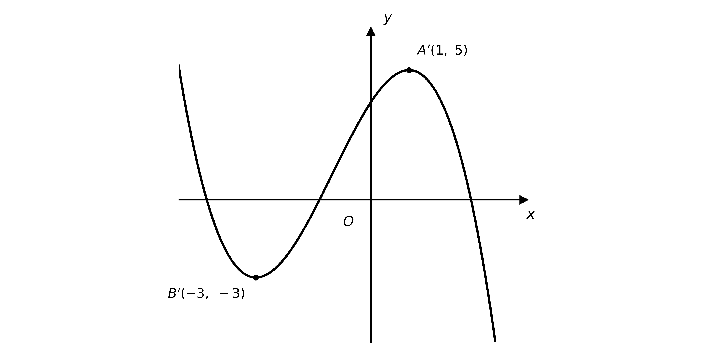

**[B1]**

(ii)

Rearranging, $y = - \text{f} ( x )$, a reflection in the $x$-axis, so each $y$-coordinate changes sign

**Final answer:** $A ' ( - 1 ,  - 5 )$** and **$B ' ( 3 ,  3 )$

**[B1]**

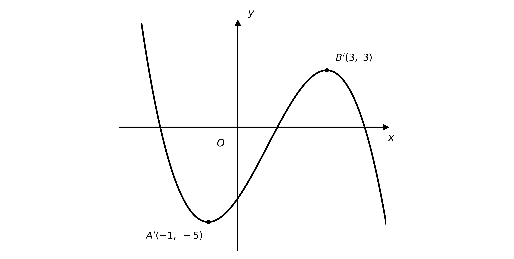

**[B1]**

> **[mark-scheme]**
> **B1**: Correct images $A ' ( 1 , 5 )$ and $B ' ( - 3 , - 3 )$.
> 
> **B1**: Correct shape — the curve reflected in the $y$-axis.
> 
> **B1**: Correct images $A ' ( - 1 , - 5 )$ and $B ' ( 3 , 3 )$.
> 
> **B1**: Correct shape — the curve reflected in the $x$-axis.
$y = \text{f} ( x + a )$ translates the curve $a$ units in the negative $x$-direction, so the images of $A$ and $B$ have $x$-coordinates

$- 1 - a \text{and} 3 - a$

**[M1]**

For both to lie on the same side of the $y$-axis they must have the same sign. Both positive requires $a < - 1$; both negative requires $a > 3$

**[M1]**

**Final answer:** $a < - 1$** or **$a > 3$

**[A1]**

> **[mark-scheme]**
> **M1**: Correct image $x$-coordinates $- 1 - a$ and $3 - a$.
> 
> **M1**: Require the two image $x$-coordinates to have the same sign (consider both positive and both negative).
> 
> **A1**: Correct range, $a < - 1$ or $a > 3$ (strict inequalities; "or", not "and").

### Q22
$y = x ( x - 4 )^{2} + 3$ is the graph of $y = x ( x - 4 )^{2}$ translated $3$ units in the positive $y$-direction

The curve crosses the $y$-axis at

$( 0 ,  3 )$

**[B1]**

$x ( x - 4 )^{2}$ touches the $x$-axis at $x = 4$ (a minimum); raising by $3$ gives the minimum point

$( 4 ,  3 )$

**[B1]**

The leading term is $x^{3}$, so the curve is a positive cubic; it crosses the $x$-axis once, to the left of the $y$-axis

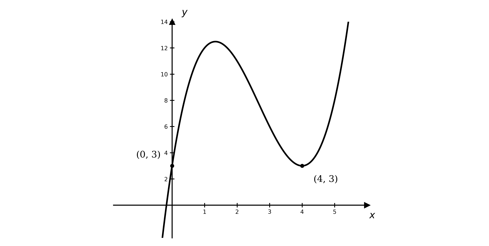

**[B1]**

> **[mark-scheme]**
> **B1**: Correct $y$-intercept, $( 0 , 3 )$.
> 
> **B1**: Correct minimum point, $( 4 , 3 )$.
> 
> **B1**: Correct positive-cubic shape through $( 0 , 3 )$ with a minimum at $( 4 , 3 )$, crossing the $x$-axis once to the left of the $y$-axis. The $x$-intercept is irrational, so you are not expected to find its value — just show the crossing in the correct position.
Rearranging, $y = x ( x - 4 )^{2} - a$, which is $y = x ( x - 4 )^{2}$ translated $a$ units in the negative $y$-direction

$y = x ( x - 4 )^{2}$ has a minimum at $( 4 ,  0 )$ on the $x$-axis and a local maximum between $x = 0$ and $x = 4$; translating it downwards keeps three $x$-axis crossings until the local maximum is lowered onto the $x$-axis

Differentiate to find the local maximum

$\frac{\text{d}y}{\text{d}x} = 3 x^{2} - 16 x + 16 = ( 3 x - 4 ) ( x - 4 ) = 0$

The local maximum is at $x = \frac{4}{3}$, where

`y = \dfrac{4}{3}\left( \dfrac{4}{3} - 4 \right)^{2} = \dfrac{256}{27}`

**[M1]**

Three crossings occur while the local maximum stays above the $x$-axis

$0 < a < \frac{256}{27}$

**[A1]**

> **[mark-scheme]**
> **M1**: Differentiate $x ( x - 4 )^{2}$ and solve $\frac{\text{d}y}{\text{d}x} = 0$ to find the local maximum value, $\frac{256}{27}$ (answers which round to $9 . 48$).
> 
> **A1**: Correct range, $0 < a < \frac{256}{27}$ (or $0 < a < 9 . 48$). The inequalities are strict — at $a = 0$ or $a = \frac{256}{27}$ there is a repeated root, so only two distinct crossings.

### Q23
(i)

Rearranging, $y = \text{f} ( x ) - 4$, a translation $4$ units in the negative $y$-direction

$( - 3 ,  - 6 )$

**[B1]**

(ii)

$\text{f} ( x - 3 )$ translates the curve $3$ units in the positive $x$-direction

$( 0 ,  - 2 )$

**[B1]**

(iii)

Rearranging, $y = \frac{1}{2} \text{f} ( x )$, a stretch parallel to the $y$-axis of factor $\frac{1}{2}$

$( - 3 ,  - 1 )$

**[B1]**

(iv)

`\text{f}\left( \tfrac{1}{2}x \right)` is a stretch parallel to the $x$-axis of factor $2$, so the $x$-coordinate is doubled

$( - 6 ,  - 2 )$

**[B1]**

> **[mark-scheme]**
> **B1**: Correct image, $( - 3 , - 6 )$.
> 
> **B1**: Correct image, $( 0 , - 2 )$.
> 
> **B1**: Correct image, $( - 3 , - 1 )$.
> 
> **B1**: Correct image, $( - 6 , - 2 )$.

### Q24
The $x$-coordinate is unchanged and the $y$-coordinate is multiplied by $\frac{-4}{-12} = \frac{1}{3}$, so this is a stretch parallel to the $y$-axis of factor $\frac{1}{3}$ — multiply the function by $\frac{1}{3}$

`y = \tfrac{1}{3}\left( x^{2} - 12x + 15 \right)`

**[M1]**

$y = \frac{1}{3} x^{2} - 4 x + 5$

**[A1]**

> **[mark-scheme]**
> **M1**: Recognise a vertical stretch of factor $\frac{1}{3}$ and multiply the function by $\frac{1}{3}$.
> 
> **A1**: Correct equation, $y = \frac{1}{3} x^{2} - 4 x + 5$.
The $y$-coordinate is unchanged and the $x$-coordinate is multiplied by $\frac{1}{3}$, so this is a stretch parallel to the $x$-axis of factor $\frac{1}{3}$, i.e. $y = \text{f} ( 3 x )$ — replace $x$ with $3 x$

$y = ( 3 x )^{2} - 12 ( 3 x ) + 15$

**[M1]**

Comparing with $y = ( d x )^{2} - 12 ( d x ) + 15$

$d = 3$

**[A1]**

> **[mark-scheme]**
> **M1**: Recognise a horizontal stretch and replace $x$ with $3 x$ (or solve $\frac{3}{d} = 1$).
> 
> **A1**: Correct value, $d = 3$.

### Q25
The factorised form gives the roots, where the curve crosses the $x$-axis

**Final answer:** $( - 2 ,  0 )$**, **$( 0 ,  0 )$** and **$( 12 ,  0 )$

**[B1]**

The curve crosses the $y$-axis at the origin

$( 0 ,  0 )$

**[B1]**

The leading term is $x^{3}$, so the curve is a positive cubic

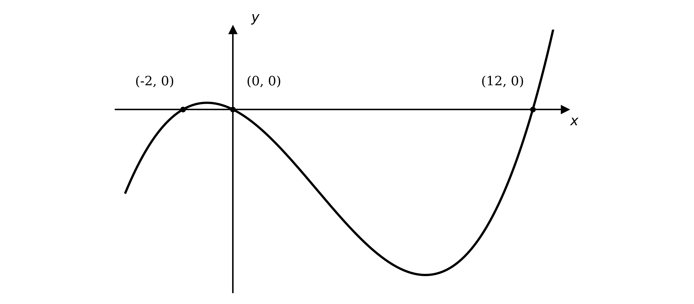

**[B1 B1]**

> **[mark-scheme]**
> **B1**: Correct roots $( - 2 , 0 )$ and $( 12 , 0 )$.
> 
> **B1**: Curve passes through the origin $( 0 , 0 )$.
> 
> **B1**: Correct positive-cubic shape.
> 
> **B1**: Curve drawn through all three intercepts in the correct relative positions.
This graph is $y = \text{f} ( x )$ translated $a$ units in the negative $x$-direction, where $\text{f} ( x ) = x^{3} - 10 x^{2} - 24 x$. Since it passes through $( - 2 , 0 )$

$\text{f} ( - 2 + a ) = 0$

so $- 2 + a$ must be a root of $\text{f}$, i.e. $- 2 + a = - 2 ,  0 \text{or} 12$

**[M1]**

**Final answer:** $a = 0$**, **$a = 2$** or **$a = 14$

**[A1]**

> **[mark-scheme]**
> **M1**: Recognise the graph is a horizontal translation, so $- 2 + a$ equals one of the roots $- 2$, $0$ or $12$.
> 
> **A1**: All three correct values, $a = 0$, $a = 2$ and $a = 14$.

### Q26
(i)

$y = \text{f} ( x ) + a$ adds $a$ to the $y$-coordinate

$2 + a = - 5$

$a = - 7$

**[B1]**

(ii)

$y = \text{f} ( x + b )$ is a horizontal translation, so the $x$-coordinate satisfies

$3 - b = - 1$

$b = 4$

**[B1]**

(iii)

$y = c  \text{f} ( x )$ multiplies the $y$-coordinate by $c$

$2 c = 1$

$c = \frac{1}{2}$

**[B1]**

(iv)

$y = \text{f} ( d x )$ divides the $x$-coordinate by $d$

$\frac{3}{d} = 1$

$d = 3$

**[B1]**

> **[mark-scheme]**
> **B1**: Correct value, $a = - 7$.
> 
> **B1**: Correct value, $b = 4$.
> 
> **B1**: Correct value, $c = \frac{1}{2}$.
> 
> **B1**: Correct value, $d = 3$.

### Q27
(i)

Adding $3$ raises every point by $3$, so the $y$-coordinate increases by $3$

$( - 1 ,  7 )$

**[B1]**

(ii)

$\text{f} ( x + 3 )$ translates the curve $3$ units in the negative $x$-direction, so the $x$-coordinate decreases by $3$

$( - 4 ,  4 )$

**[B1]**

(iii)

$3 \text{f} ( x )$ multiplies every $y$-coordinate by $3$

$( - 1 ,  12 )$

**[B1]**

(iv)

$\text{f} ( 3 x )$ is a stretch parallel to the $x$-axis of factor $\frac{1}{3}$, so the $x$-coordinate is divided by $3$

`\left( -\tfrac{1}{3},\ 4 \right)`

**[B1]**

> **[mark-scheme]**
> **B1**: Correct image, $( - 1 , 7 )$.
> 
> **B1**: Correct image, $( - 4 , 4 )$.
> 
> **B1**: Correct image, $( - 1 , 12 )$.
> 
> **B1**: Correct image, `\left( -\tfrac{1}{3}, 4 \right)`.

### Q28
$y = \frac{1}{x} + 3$ is the graph of $y = \frac{1}{x}$ translated $3$ units in the positive $y$-direction

The curve crosses the $x$-axis where $y = 0$

$\frac{1}{x} + 3 = 0$

$\frac{1}{x} = - 3$

`\left( -\tfrac{1}{3},\ 0 \right)`

**[B1]**

The vertical asymptote is unchanged

$x = 0$

**[B1]**

The horizontal asymptote is raised by $3$

$y = 3$

**[B1]**

Sketch both branches, each approaching the asymptotes

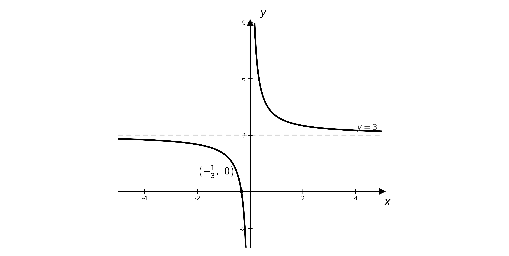

**[B1]**

> **[mark-scheme]**
> **B1**: Correct $x$-intercept, `\left( -\tfrac{1}{3}, 0 \right)`.
> 
> **B1**: Vertical asymptote $x = 0$.
> 
> **B1**: Horizontal asymptote $y = 3$.
> 
> **B1**: Correct shape — two branches approaching the asymptotes, with the upper branch in the region $x > 0$.
Substitute $( 0 , 0 )$

$0 = \frac{1}{0+a} + 3$

$\frac{1}{a} = - 3$

$a = - \frac{1}{3}$

**[B1]**

> **[mark-scheme]**
> **B1**: Correct value, $a = - \frac{1}{3}$.

### Q29
(i)

$y = - \text{f} ( x )$ reflects the curve in the $x$-axis, so each $y$-coordinate changes sign

**Final answer:** $A ' ( 0 ,  0 )$** and **$B ' ( 4 ,  - 8 )$

**[B1]**

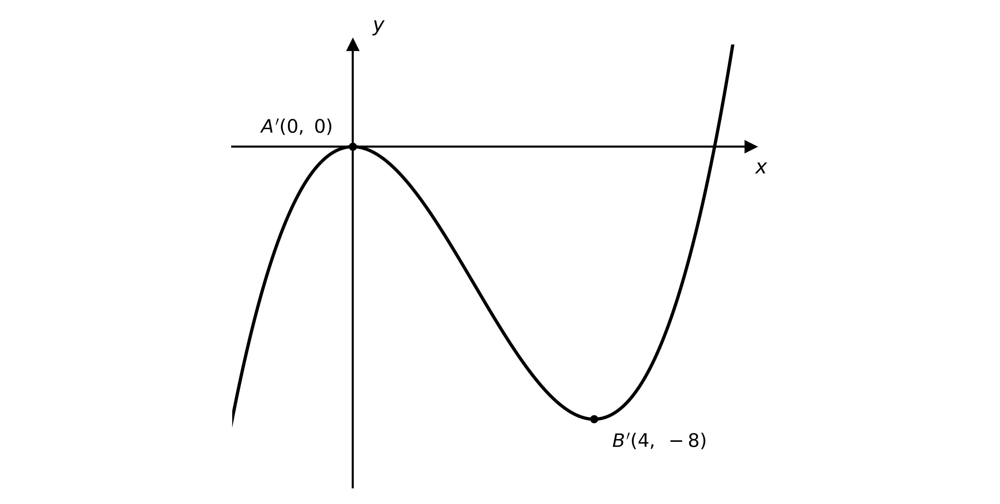

**[B1]**

(ii)

$y = \text{f} ( 4 x )$ is a stretch parallel to the $x$-axis of factor $\frac{1}{4}$, so each $x$-coordinate is divided by $4$

**Final answer:** $A ' ( 0 ,  0 )$** and **$B ' ( 1 ,  8 )$

**[B1]**

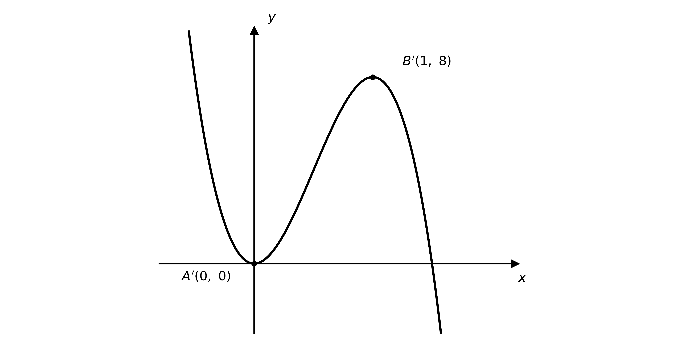

**[B1]**

> **[mark-scheme]**
> **B1**: Correct images $A ' ( 0 , 0 )$ and $B ' ( 4 , - 8 )$.
> 
> **B1**: Correct shape — the curve reflected in the $x$-axis.
> 
> **B1**: Correct images $A ' ( 0 , 0 )$ and $B ' ( 1 , 8 )$.
> 
> **B1**: Correct shape — the curve stretched parallel to the $x$-axis by factor $\frac{1}{4}$.
$y = a  \text{f} ( x )$ multiplies each $y$-coordinate by $a$. Point $A$ is at the origin, so its image always has $y$-coordinate $0$; the point must therefore be $B ( 4 , 8 )$

$8 a = 4$

**[M1]**

$a = \frac{1}{2}$

**[A1]**

> **[mark-scheme]**
> **M1**: Identify that the point is $B$ (since $A$ is at the origin) and form $8 a = 4$.
> 
> **A1**: Correct value, $a = \frac{1}{2}$.

### Q30
(i)

$\text{f} ( - x )$ reflects the curve in the $y$-axis, so the $x$-coordinate changes sign

$( 3 ,  - 4 )$

**[B1]**

(ii)

$- \text{f} ( x )$ reflects the curve in the $x$-axis, so the $y$-coordinate changes sign

$( - 3 ,  4 )$

**[B1]**

> **[mark-scheme]**
> **B1**: Correct image, $( 3 , - 4 )$.
> 
> **B1**: Correct image, $( - 3 , 4 )$.

### Q31
(i)

$y = \text{f} ( x ) - 6$ translates the curve $6$ units in the negative $y$-direction, so each $y$-coordinate decreases by $6$

**Final answer:** $A ' ( 0 ,  0 )$** and **$B ' ( 3 ,  - 6 )$

**[B1]**

The horizontal asymptote moves down $6$; the vertical asymptote is unchanged

**Final answer:** $y = \frac{2}{3}$** and **$x = \frac{10}{3}$

**[B1]**

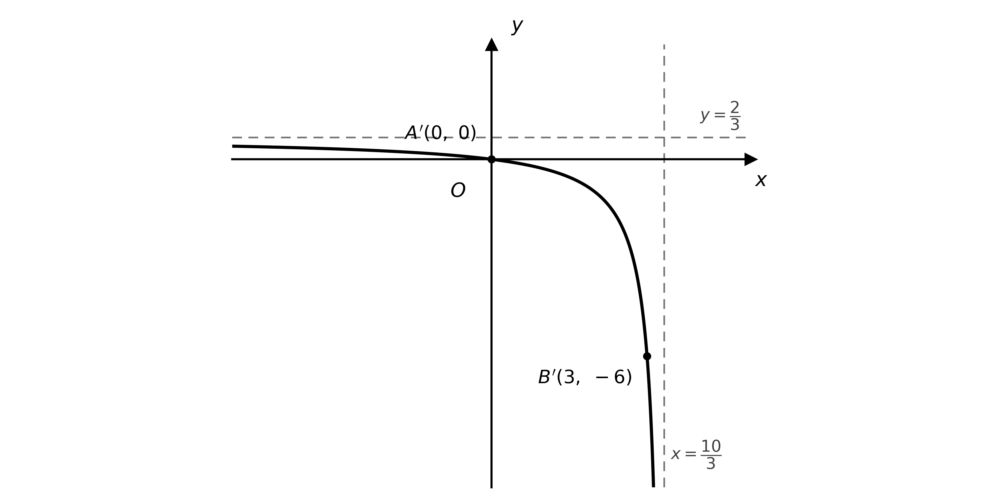

**[B1]**

(ii)

$y = \text{f} ( - x )$ reflects the curve in the $y$-axis, so each $x$-coordinate changes sign

**Final answer:** $A ' ( 0 ,  6 )$** and **$B ' ( - 3 ,  0 )$

**[B1]**

The vertical asymptote is reflected; the horizontal asymptote is unchanged

**Final answer:** $x = - \frac{10}{3}$** and **$y = \frac{20}{3}$

**[B1]**

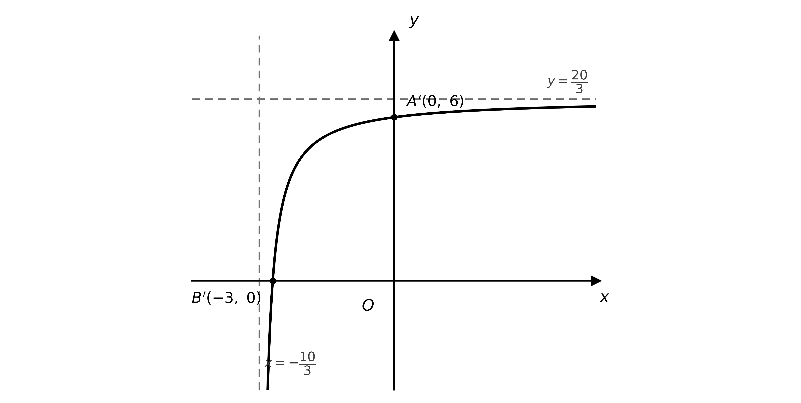

**[B1]**

> **[mark-scheme]**
> **B1**: Correct images $A ' ( 0 , 0 )$ and $B ' ( 3 , - 6 )$.
> 
> **B1**: Correct transformed asymptotes $y = \frac{2}{3}$ and $x = \frac{10}{3}$.
> 
> **B1**: Correct shape — the curve translated $6$ units down, approaching its asymptotes correctly.
> 
> **B1**: Correct images $A ' ( 0 , 6 )$ and $B ' ( - 3 , 0 )$.
> 
> **B1**: Correct transformed asymptotes $x = - \frac{10}{3}$ and $y = \frac{20}{3}$.
> 
> **B1**: Correct shape — the curve reflected in the $y$-axis, approaching its asymptotes correctly.
$y = \text{f} ( x + a )$ translates the curve $a$ units in the negative $x$-direction, so the vertical asymptote moves to $x = \frac{10}{3} - a$

For this asymptote to lie on the $y$-axis, set $x = 0$

$\frac{10}{3} - a = 0$

**[M1]**

$a = \frac{10}{3}$

**[A1]**

> **[mark-scheme]**
> **M1**: Set the transformed vertical asymptote $\frac{10}{3} - a = 0$ (recognising the horizontal translation moves the vertical asymptote onto the $y$-axis).
> 
> **A1**: Correct value, $a = \frac{10}{3}$.

### Q32
(i)

$y = \text{f} ( x - 1 )$ translates the curve $1$ unit in the positive $x$-direction, so each $x$-coordinate increases by $1$

**Final answer:** $A ' ( 0 ,  5 )$** and **$B ' ( 4 ,  - 3 )$

**[B1]**

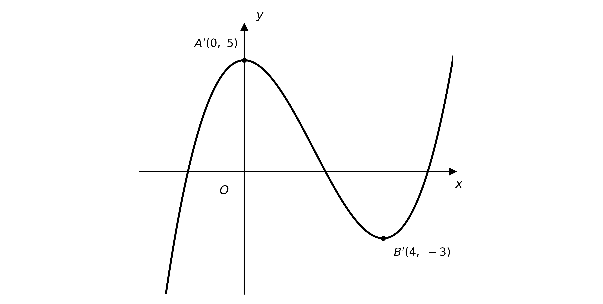

**[B1]**

(ii)

$y = \text{f} ( x ) + 3$ translates the curve $3$ units in the positive $y$-direction, so each $y$-coordinate increases by $3$

**Final answer:** $A ' ( - 1 ,  8 )$** and **$B ' ( 3 ,  0 )$

**[B1]**

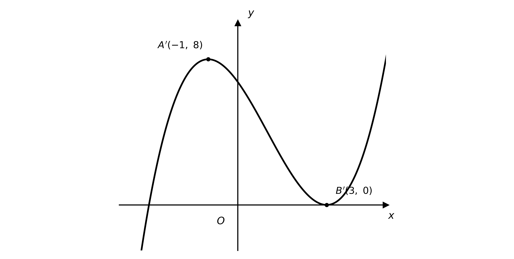

**[B1]**

> **[mark-scheme]**
> **B1**: Correct images $A ' ( 0 , 5 )$ and $B ' ( 4 , - 3 )$.
> 
> **B1**: Correct shape — the curve translated $1$ unit in the positive $x$-direction.
> 
> **B1**: Correct images $A ' ( - 1 , 8 )$ and $B ' ( 3 , 0 )$.
> 
> **B1**: Correct shape — the curve translated $3$ units in the positive $y$-direction.
$y = \text{f} ( x + a )$ translates the curve $a$ units in the negative $x$-direction, so the image of a point with $x$-coordinate $x_{0}$ has $x$-coordinate $x_{0} - a$

Set the image $x$-coordinate equal to $2$, using either marked point

$3 - a = 2 \text{or} - 1 - a = 2$

**[M1]**

Solving each equation

**Final answer:** $a = 1$** or **$a = - 3$

**[A1]**

> **[mark-scheme]**
> **M1**: Set the image $x$-coordinate $x_{0} - a = 2$ for one of the marked points and solve for $a$.
> 
> **A1**: Both correct values, $a = 1$ and $a = - 3$.
