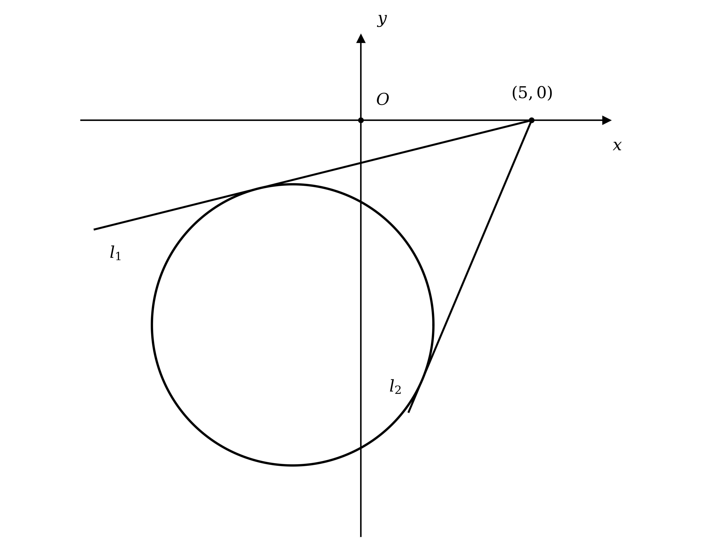
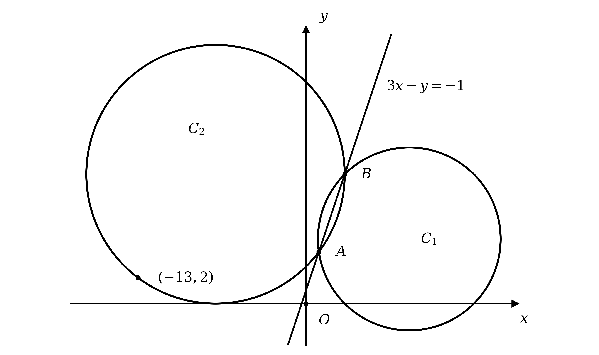
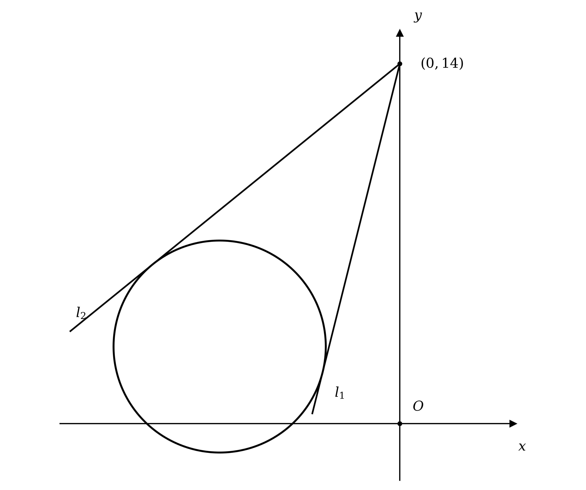
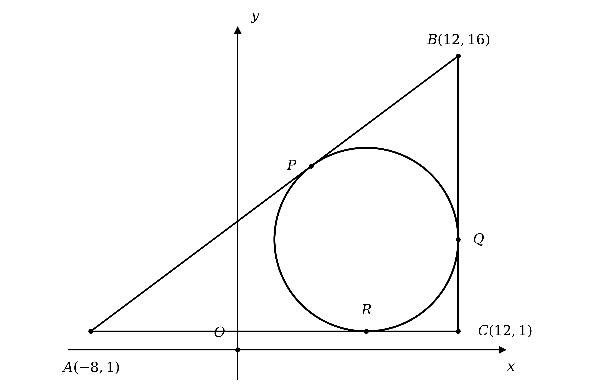
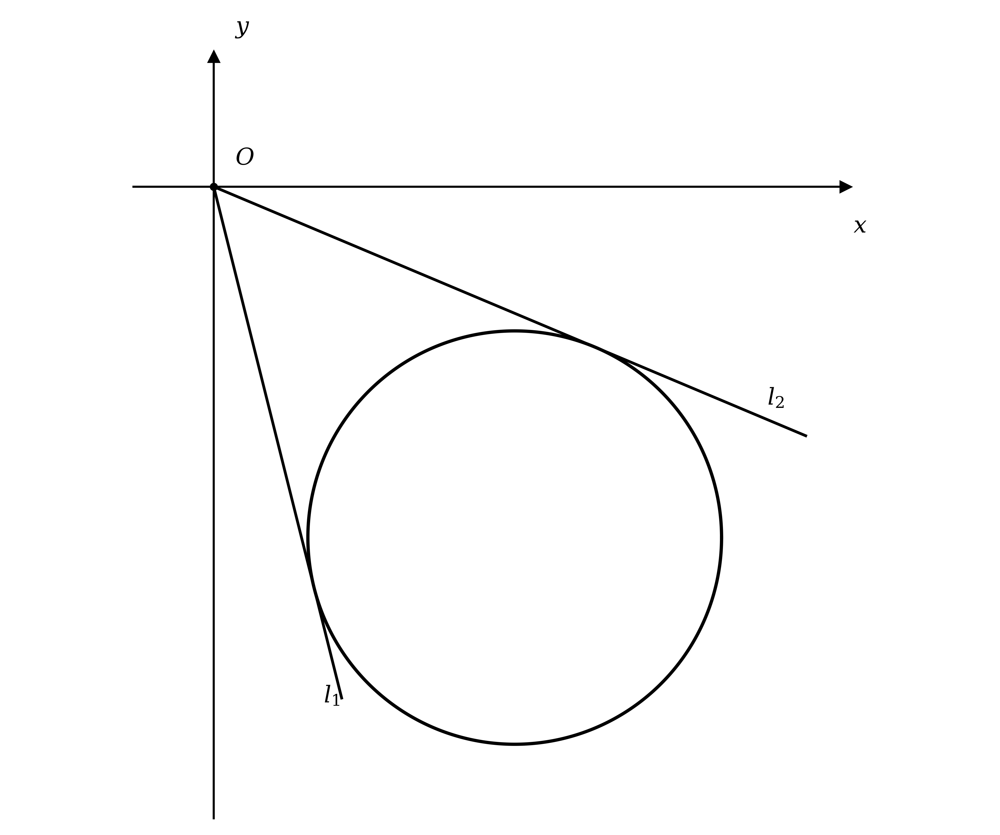
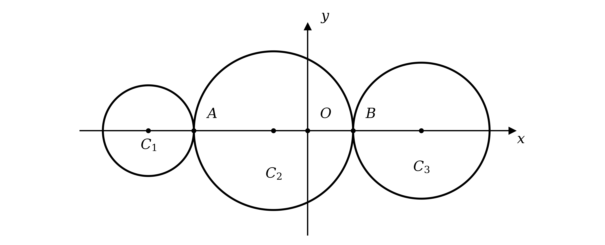

# Exam Questions — Circles
**Coordinate Geometry** · Cambridge (CIE) A-LEVEL maths (9709)
> Source: [https://www.savemyexams.com/a-level/maths/cie/20/pure-1/topic-questions/](https://www.savemyexams.com/a-level/maths/cie/20/pure-1/topic-questions/) · 32 questions across 1 sets

## Exam Questions (32 questions)

### Q1 — medium — 5 marks

**Q1** [5 marks]

The line with equation $y = x - 1$ intersects the circle with equation $( x - 5 )^{2} + ( y - 4 )^{2} = 18$ at two distinct points.

Find the coordinates of the two points of intersection.

### Q2 — easy — 2 marks

**Q2** [2 marks]

On a single sketch, show how a line and a circle can intersect at 0, 1 or 2 points.

### Q3 — easy — 6 marks

**Q3** [2 marks]

(i) Complete the square for $x^{2} + 4 x$.

(ii) Complete the square for $y^{2} - 6 y$.

**Q3** [4 marks]

(i) Use your answers to part (a) to show that the equation $x^{2} + y^{2} + 4 x - 6 y + 4 = 0$ can be written in the form $( x + 2 )^{2} + ( y - 3 )^{2} = 9$.

(ii) Hence write down the centre and the radius of the circle with equation $x^{2} + y^{2} + 4 x - 6 y + 4 = 0$.

### Q4 — easy — 3 marks

**Q4** [3 marks]

Write down the equation of each of the following circles, given its centre and radius.

(i) Centre (0, 0), radius 4

(ii) Centre (3, −4), radius 2

(iii) Centre (−5, 0), radius 5

### Q5 — easy — 3 marks

**Q5** [3 marks]

Determine whether the circles with equations $( x + 4 )^{2} + y^{2} = 9$ and $( x - 2 )^{2} + y^{2} = 9$ intersect once, twice or not at all.

Fully explain your answer.

### Q6 — easy — 3 marks

**Q6** [3 marks]

Write down the centre and the radius of each of the following circles.

(i) $x^{2} + y^{2} = 5^{2}$

(ii) $( x + 3 )^{2} + ( y - 2 )^{2} = 49$

(iii) $x^{2} + ( y + 4 )^{2} = 144$

### Q7 — easy — 4 marks

**Q7** [4 marks]

On separate diagrams, sketch the circles with the following equations.

(i) $x^{2} + y^{2} = 9$

(ii) $( x - 4 )^{2} + ( y - 3 )^{2} = 4^{2}$

### Q8 — easy — 4 marks

**Q8** [4 marks]

The line segment joining the points (1, 0) and (9, 4) is a diameter of a circle.

Find the centre and the radius of the circle.

### Q9 — hard — 4 marks

**Q9** [4 marks]

The points A(−2, 3), B(0, 6) and C(k, −1) lie on a circle, where $B C$ is the diameter of the circle.

Find the value of $k$.

### Q10 — hard — 4 marks

**Q10** [4 marks]

Find the centre and the radius of the circle with equation $x^{2} + y^{2} + x - 3 y + 2 = 0$.

### Q11 — very_hard — 7 marks

**Q11** [7 marks]

The line $x + y = c$ intersects the circle $x^{2} + y^{2} - 6 x + 10 y - 16 = 0$ at exactly two points.

Find the range of possible values of $c$.

### Q12 — very_hard — 6 marks

**Q12** [6 marks]

The points A(2, −21) and B(−5, 3) are the two endpoints of the diameter AB of a circle.

Find the equation of the circle in the form $a x^{2} + a y^{2} + b x + c y + d = 0$, where $a$, $b$, $c$ and $d$ are integers to be found.

### Q13 — very_hard — 8 marks

**Q13** [8 marks]

A circle has equation $x^{2} + y^{2} + 4 x + 12 y = - 23$.

The lines $l_{1}$ and $l_{2}$ are both tangents to the circle, and they intersect at the point (5, 0).

Find the equations of $l_{1}$ and $l_{2}$, giving your answers in the form $y = m x + c$.

### Q14 — very_hard — 11 marks

**Q14** [11 marks]

The diagram below shows circles $C_{1}$ and $C_{2}$ which intersect at the two points $A$ and $B$. Circle $C_{1}$ has equation $x^{2} + y^{2} - 16 x - 10 y + 39 = 0$, and points $A$ and $B$ lie along the line with equation $3 x - y = - 1$. Circle $C_{2}$ also passes through the point (−13, 2).

Find an equation of circle $C_{2}$.

### Q15 — very_hard — 7 marks

**Q15** [7 marks]

The points A(4, 6), B(7, 2) and C(12, 12) lie on a circle.

Find the equation of the circle.

### Q16 — very_hard — 7 marks

**Q16** [7 marks]

A circle $C$ has equation $x^{2} + y^{2} - 10 x - 4 y + 19 = 0$. Point $P$ lies on the circle, and the tangent to the circle at point $P$ has a gradient of −3.

Find the two possible sets of coordinates for point $P$.

### Q17 — medium — 4 marks

**Q17** [4 marks]

The line $x + 5 y + 22 = 0$ intersects the circle $x^{2} + y^{2} + 4 x + 8 y - 6 = 0$ at the points $A$ and $B$.

Find the coordinates of $A$ and $B$.

### Q18 — hard — 5 marks

**Q18** [5 marks]

The points A(−3, 1) and B(3, −7) are the two endpoints of the diameter AB of a circle.

Find the equation of the circle.

### Q19 — hard — 7 marks

**Q19** [4 marks]

A circle $C$ has centre (−2, 3) and passes through the point $P$(6, −3).

Find an equation for the circle $C$.

**Q19** [3 marks]

Find an equation for the tangent to the circle at $P$.

### Q20 — hard — 7 marks

**Q20** [2 marks]

The points $A ( - 3 , 6 )$, $B ( 5 , - 4 )$ and $C ( 6 , 5 )$ lie on a circle.

Show that `\angle ACB = 90°`.

**Q20** [1 mark]

Deduce a geometrical property of the line segment $A B$.

**Q20** [4 marks]

Hence find the equation of the circle.

### Q21 — hard — 7 marks

**Q21** [7 marks]

A circle has equation $x^{2} + y^{2} + 14 x - 6 y = - 41$.

The lines $l_{1}$ and $l_{2}$ are both tangents to the circle, and they intersect at the point (0, 14).

Find the equations of $l_{1}$ and $l_{2}$, giving your answers in the form $y = m x + c$.

### Q22 — hard — 4 marks

**Q22** [4 marks]

The line $y + 2 x = 11$ meets the circle with equation $x^{2} + y^{2} + 6 x - 14 y = - 38$.

(i) Show that the line and the circle meet at exactly one point.

(ii) Find the coordinates of the point of intersection.

### Q23 — hard — 7 marks

**Q23** [2 marks]

Triangle $A B C$ has vertices $A$(−8, 1), $B$(12, 16) and $C$(12, 1). A circle with equation $( x - 7 )^{2} + ( y - 6 )^{2} = 25$ touches triangle $A B C$ at the three points $P$, $Q$ and $R$, as shown in the diagram below.

Write down the coordinates of the points $R$ and $Q$.

**Q23** [5 marks]

Find the coordinates of the point $P$.

### Q24 — hard — 4 marks

**Q24** [2 marks]

Show that $x^{2} + y^{2} + 5 x - 2 y - 5 = 0$ can be written in the form $( x - a )^{2} + ( y - b )^{2} = r^{2}$, where $a$, $b$ and $r$ are constants to be found.

**Q24** [2 marks]

Hence write down the centre and the radius of the circle with equation $x^{2} + y^{2} + 5 x - 2 y - 5 = 0$.

### Q25 — medium — 7 marks

**Q25** [2 marks]

The points $A ( 3 , 5 )$, $B ( 5 , 3 )$ and $C ( 9 , 7 )$ lie on a circle.

Show that triangle $A B C$ is a right-angled triangle.

**Q25** [1 mark]

Explain why the line segment $A C$ must be the diameter of the circle.

**Q25** [4 marks]

Hence find the equation of the circle.

### Q26 — medium — 4 marks

**Q26** [4 marks]

The line $7 x + y = - 6$ intersects the circle $( x - 2 )^{2} + ( y - 5 )^{2} = 25$ at the points $A$ and $B$.

Find the coordinates of $A$ and $B$.

### Q27 — medium — 7 marks

**Q27** [4 marks]

A circle $C$ has centre (−4, 1) and passes through the point $P$(0, 3).

Find an equation for the circle $C$.

**Q27** [3 marks]

Find an equation for the tangent to the circle at $P$.

### Q28 — medium — 4 marks

**Q28** [4 marks]

A circle has centre (6, −5) and passes through the point (1, 7).

Find the equation of the circle.

### Q29 — medium — 7 marks

**Q29** [1 mark]

A circle has equation $x^{2} + y^{2} - 12 x + 14 y = - 68$.

The lines $l_{1}$ and $l_{2}$ are both tangents to the circle, and they intersect at the origin.

Explain why the equations for $l_{1}$ and $l_{2}$ must each be in the form $y = m x$, where $m$ is the gradient of the line.

**Q29** [4 marks]

Show that the gradients of $l_{1}$ and $l_{2}$ must be the solutions to the equation $19 m^{2} + 84 m + 32 = 0$.

**Q29** [2 marks]

Hence find the equations of $l_{1}$ and $l_{2}$, giving your answers in the form $y = m x$.

### Q30 — medium — 4 marks

**Q30** [4 marks]

The line $x + y = - 7$ meets the circle with equation $( x - 1 )^{2} + ( y - 2 )^{2} = 50$.

(i) Show that the line and the circle meet at exactly one point.

(ii) Find the coordinates of the point of intersection.

### Q31 — medium — 4 marks

**Q31** [2 marks]

Show that $x^{2} + y^{2} + 2 x - 6 y + 9 = 0$ can be written in the form $( x - a )^{2} + ( y - b )^{2} = r^{2}$, where $a$, $b$ and $r$ are integers to be found.

**Q31** [2 marks]

Hence write down the centre and the radius of the circle with equation $x^{2} + y^{2} + 2 x - 6 y + 9 = 0$.

### Q32 — medium — 6 marks

**Q32** [6 marks]

Circles $C_{1}$, $C_{2}$ and $C_{3}$ all have their centres on the $x$-axis.

Circle $C_{1}$ has equation $( x + 7 )^{2} + y^{2} = 4$.

Circle $C_{3}$ has equation $x^{2} + y^{2} - 10 x + 16 = 0$.

Circles $C_{1}$ and $C_{2}$ touch at point $A$, and circles $C_{2}$ and $C_{3}$ touch at point $B$.

Find the coordinates of the centre of circle $C_{2}$.
