# Mark Schemes — Equation of a Straight Line
**Coordinate Geometry** · Cambridge (CIE) A-LEVEL maths (9709)

## Exam Questions (40 questions)

### Q1
Use $y - y_{1} = m ( x - x_{1} )$ and rearrange into the form $y = m x + c$

(i)

$y - 5 = 2 ( x - 3 )$

**[M1]**

$y = 2 x - 1$

**[A1]**

(ii)

$y - 3 = - 2 ( x + 1 )$

**[M1]**

$y = - 2 x + 1$

**[A1]**

(iii)

$y + 2 = \frac{1}{2} ( x - 5 )$

**[M1]**

$y = \frac{1}{2} x - \frac{9}{2}$

**[A1]**

> **[mark-scheme]**
> **M1**: Substitutes $m = 2$ and $P ( 3 ,  5 )$ into $y - y_{1} = m ( x - x_{1} )$.
> 
> **A1**: Correct equation $y = 2 x - 1$.
> 
> **M1**: Substitutes $m = - 2$ and $P ( - 1 ,  3 )$ into a valid straight-line equation.
> 
> **A1**: Correct equation $y = - 2 x + 1$.
> 
> **M1**: Substitutes $m = \frac{1}{2}$ and $P ( 5 ,  - 2 )$ into a valid straight-line equation.
> 
> **A1**: Correct equation $y = \frac{1}{2} x - \frac{9}{2}$.

### Q2
When the shrub is first planted no time has passed, so $t = 0$

$h = 3 ( 0 ) + 5$

$h = 5 \text{cm}$

**[B1]**

> **[mark-scheme]**
> **B1**: Correct height of $5$ cm, obtained from substituting $t = 0$ into the model.
Substitute $t = 6$ into the model

$h = 3 ( 6 ) + 5$

**[M1]**

$h = 23 \text{cm}$

**[A1]**

> **[mark-scheme]**
> **M1**: Correct substitution of $t = 6$ into $h = 3 t + 5$.
> 
> **A1**: Correct height of $23$ cm.
Set $h = 29$ and rearrange to solve for $t$

$29 = 3 t + 5$

**[M1]**

$24 = 3 t$

$t = 8 \text{weeks}$

**[A1]**

> **[mark-scheme]**
> **M1**: Correct setting of $h = 29$ and rearranging to make $t$ the subject.
> 
> **A1**: Correct time of $8$ weeks.

### Q3
(i)

Parallel lines have the same gradient, $4$, so any line $y = 4 x + c$ with $c \neq 3$ is parallel to the given line

$y = 4 x - 7$

**[B1]**

(ii)

Perpendicular gradients satisfy $m_{1} m_{2} = - 1$, so the required gradient is the negative reciprocal of $8$

$m_{2} = - \frac{1}{8}$

**[B1]**

Any line with this gradient is perpendicular to the given line

$y = - \frac{1}{8} x + 12$

**[B1]**

> **[mark-scheme]**
> **B1**: A correct equation of a line parallel to $y = 4 x + 3$, that is any line of the form $y = 4 x + c$ with $c \neq 3$.
> 
> **B1**: Correct perpendicular gradient of $- \frac{1}{8}$, using $m_{1} m_{2} = - 1$.
> 
> **B1**: A correct equation of a line perpendicular to $y = 8 x - 5$, that is any line of the form $y = - \frac{1}{8} x + c$ for any value of $c$.

### Q4
Use the midpoint formula `\left( \dfrac{x_1 + x_2}{2},\ \dfrac{y_1 + y_2}{2} \right)`

(i)

`\left( \dfrac{2 + 6}{2},\ \dfrac{4 + 10}{2} \right)`

$( 4 ,  7 )$

**[B1]**

(ii)

`\left( \dfrac{-3 + 5}{2},\ \dfrac{6 + 9}{2} \right)`

**[M1]**

`\left( 1,\ \dfrac{15}{2} \right)`

**[A1]**

(iii)

`\left( \dfrac{0 + 3}{2},\ \dfrac{-8 + 2}{2} \right)`

**[M1]**

`\left( \dfrac{3}{2},\ -3 \right)`

**[A1]**

> **[mark-scheme]**
> **B1**: Correct midpoint $( 4 ,  7 )$.
> 
> **M1**: Correct substitution into the midpoint formula for $( - 3 ,  6 )$ and $( 5 ,  9 )$.
> 
> **A1**: Correct midpoint `\left( 1,\ \dfrac{15}{2} \right)`. Accept the equivalent form $( 1 ,  7 . 5 )$.
> 
> **M1**: Correct substitution into the midpoint formula for $( 0 ,  - 8 )$ and $( 3 ,  2 )$.
> 
> **A1**: Correct midpoint `\left( \dfrac{3}{2},\ -3 \right)`. Accept the equivalent form $( 1 . 5 ,  - 3 )$.

### Q5
(i)

Move all terms to one side

$3 x - y - 5 = 0$

**[B1]**

(ii)

Multiply through by $2$ to clear the fraction, then collect all terms on one side

$2 y = x + 14$

**[M1]**

$x - 2 y + 14 = 0$

**[A1]**

(iii)

Multiply through by $18$ (the lowest common multiple of $3$, $6$ and $9$) to make every coefficient an integer

$6 y = 3 x - 2$

**[M1]**

$3 x - 6 y - 2 = 0$

**[A1]**

> **[mark-scheme]**
> **B1**: Correct form $3 x - y - 5 = 0$, or any integer multiple.
> 
> **M1**: Multiplies $y = \frac{1}{2} x + 7$ through by $2$ to clear the fraction.
> 
> **A1**: Correct integer form $x - 2 y + 14 = 0$, or any integer multiple.
> 
> **M1**: Multiplies $\frac{1}{3} y = \frac{1}{6} x - \frac{1}{9}$ through by a common multiple to clear all three fractions.
> 
> **A1**: Correct integer form $3 x - 6 y - 2 = 0$, or any integer multiple.

### Q6
Rearrange the given equation into the form $y = m x + c$ to find its gradient

$2 x + y - 3 = 0$

$y = - 2 x + 3$

**[B1]**

Parallel lines have the same gradient, so $L$ has gradient $- 2$. Use $y - y_{1} = m ( x - x_{1} )$ with $m = - 2$ and the point $( 1 , 4 )$

$y - 4 = - 2 ( x - 1 )$

**[M1]**

Expand and simplify

$y = - 2 x + 6$

**[A1]**

> **[mark-scheme]**
> **B1**: Correct gradient of $- 2$, obtained by rearranging $2 x + y - 3 = 0$ into the form $y = m x + c$.
> 
> **M1**: Correct use of the parallel gradient with the point $( 1 , 4 )$ in a valid straight-line equation method.
> 
> **A1**: Correct equation $y = - 2 x + 6$. Accept any equivalent form, for example $2 x + y - 6 = 0$.

### Q7
Rearrange the given equation into the form $y = m x + c$ to find its gradient

$y = \frac{1}{3} x - \frac{2}{3}$

**[B1]**

Perpendicular gradients satisfy $m_{1} m_{2} = - 1$, so the gradient of $L$ is the negative reciprocal of $\frac{1}{3}$

$m_{2} = - 3$

**[M1]**

The line passes through the origin, so $c = 0$

$y = - 3 x$

**[A1]**

> **[mark-scheme]**
> **B1**: Correct gradient of $\frac{1}{3}$ for the given line, obtained by rearranging into the form $y = m x + c$.
> 
> **M1**: Correct use of $m_{1} m_{2} = - 1$ to obtain the perpendicular gradient $- 3$.
> 
> **A1**: Correct equation $y = - 3 x$, using that the line passes through the origin.

### Q8
Use the gradient formula $m = \frac{y_{2}-y_{1}}{x_{2}-x_{1}}$

(i)

$m = \frac{12-6}{4-2} = \frac{6}{2}$

**[M1]**

$m = 3$

**[A1]**

(ii)

$m = \frac{24-4}{-8-(-3)} = \frac{20}{-5}$

**[M1]**

$m = - 4$

**[A1]**

(iii)

$m = \frac{6-(-3)}{-3-1} = \frac{9}{-4}$

**[M1]**

$m = - \frac{9}{4}$

**[A1]**

> **[mark-scheme]**
> **M1**: Correct use of $\frac{y_{2}-y_{1}}{x_{2}-x_{1}}$ for $P ( 2 ,  6 )$ and $Q ( 4 ,  12 )$.
> 
> **A1**: Correct gradient $3$.
> 
> **M1**: Correct use of the gradient formula for $P ( - 3 ,  4 )$ and $Q ( - 8 ,  24 )$.
> 
> **A1**: Correct gradient $- 4$.
> 
> **M1**: Correct use of the gradient formula for $P ( 1 ,  - 3 )$ and $Q ( - 3 ,  6 )$.
> 
> **A1**: Correct gradient $- \frac{9}{4}$.

### Q9
(i)

Use $m = \frac{y_{2}-y_{1}}{x_{2}-x_{1}}$ with the two points

$m = \frac{10-8}{-4-4} = \frac{2}{-8}$

**[M1]**

$m = - \frac{1}{4}$

**[A1]**

(ii)

Substitute the gradient and one point, say $( 4 ,  8 )$, into $y - y_{1} = m ( x - x_{1} )$

$y - 8 = - \frac{1}{4} ( x - 4 )$

**[M1]**

Expand and simplify

$y = - \frac{1}{4} x + 9$

**[A1]**

> **[mark-scheme]**
> **M1**: Correct method for the gradient, $\frac{y_{2}-y_{1}}{x_{2}-x_{1}}$, using the two given points.
> 
> **A1**: Correct gradient $- \frac{1}{4}$.
> 
> **M1**: Substitutes the gradient and one of the given points into a valid straight-line equation.
> 
> **A1**: Correct equation $y = - \frac{1}{4} x + 9$ (or any correct equivalent in the form $y = m x + c$).

### Q10
(i)

Comparing with $y = m x + c$, the gradient is the coefficient of $x$

$m = 2$

**[B1]**

(ii)

The line crosses the $y$-axis at the constant term, $c = - 6$

$( 0 ,  - 6 )$

**[B1]**

(iii)

The line crosses the $x$-axis where $y = 0$, so set $2 x - 6 = 0$

$2 x - 6 = 0$

$( 3 ,  0 )$

**[B1]**

> **[mark-scheme]**
> **B1**: Correct gradient $2$.
> 
> **B1**: Correct $y$-intercept $( 0 ,  - 6 )$.
> 
> **B1**: Correct $x$-intercept $( 3 ,  0 )$, obtained by setting $y = 0$.

### Q11
Use the distance formula $\sqrt{(x_{2}-x_{1})^{2}+(y_{2}-y_{1})^{2}}$

(i)

$\sqrt{(5-2)^{2}+(8-4)^{2}} = \sqrt{9+16}$

$\sqrt{25} = 5$

**[B1]**

(ii)

$\sqrt{(-2-3)^{2}+(-14-(-6))^{2}} = \sqrt{25+64}$

**[M1]**

$\sqrt{89}$

**[A1]**

(iii)

$\sqrt{(2-5)^{2}+(-7-(-13))^{2}} = \sqrt{9+36}$

**[M1]**

$\sqrt{45} = 3 \sqrt{5}$

**[A1]**

> **[mark-scheme]**
> **B1**: Correct length $5$, from $\sqrt{25}$.
> 
> **M1**: Correct substitution into the distance formula for $( 3 ,  - 6 )$ and $( - 2 ,  - 14 )$. Condone one sign error.
> 
> **A1**: Correct exact length $\sqrt{89}$. Do not accept a decimal answer.
> 
> **M1**: Correct substitution into the distance formula for $( 5 ,  - 13 )$ and $( 2 ,  - 7 )$. Condone one sign error.
> 
> **A1**: Correct simplified surd $3 \sqrt{5}$, from $\sqrt{45}$. Do not accept a decimal answer.

### Q12
Rearrange $2 x + 3 y - 4 = 0$ to find its gradient, $- \frac{2}{3}$. The perpendicular gradient is the negative reciprocal

$m = \frac{3}{2}$

**[M1]**

Use the gradient $\frac{3}{2}$ with the point $( - 1 ,  - 1 )$, then multiply through by $2$

$y + 1 = \frac{3}{2} ( x + 1 )$

$2 y + 2 = 3 x + 3$

**[M1]**

$3 x - 2 y + 1 = 0$

**[A1]**

> **[mark-scheme]**
> **M1**: Correct perpendicular gradient $\frac{3}{2}$, using $m_{1} m_{2} = - 1$.
> 
> **M1**: Forms the equation through $( - 1 ,  - 1 )$ and clears the fraction.
> 
> **A1**: Correct integer form $3 x - 2 y + 1 = 0$, or any integer multiple.

### Q13
Find $A$, where $l_{1}$ crosses the $x$-axis, by setting $y = 0$ in $3 x - 2 y + 10 = 0$

`3x + 10 = 0 \quad\Rightarrow\quad A\left( -\dfrac{10}{3},\ 0 \right)`

**[B1]**

The gradient of $l_{1}$ is $\frac{3}{2}$, so $l_{2}$ has perpendicular gradient $- \frac{2}{3}$. Using the point $( 9 ,  0 )$, the equation of $l_{2}$ is $y = - \frac{2}{3} x + 6$

**[M1]**

Find $B$, where $l_{2}$ crosses the $y$-axis, by setting $x = 0$

$B ( 0 ,  6 )$

**[A1]**

$O A$ lies along the $x$-axis and $O B$ along the $y$-axis, so take them as the base and height

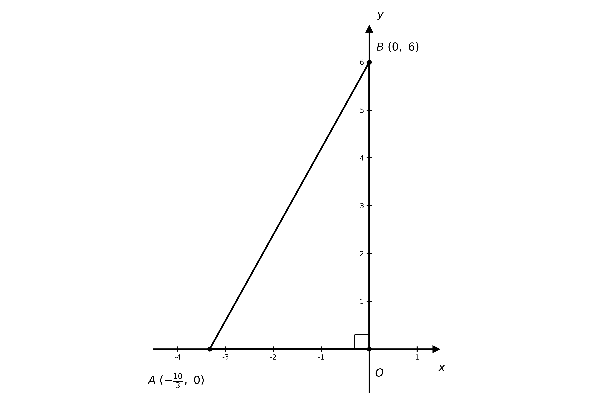

$\text{Area} = \frac{1}{2} \times \frac{10}{3} \times 6$

**[M1]**

$\text{Area} = 10 \text{units}^{2}$

**[A1]**

> **[mark-scheme]**
> **B1**: Correct point `A\left( -\dfrac{10}{3},\ 0 \right)`.
> 
> **M1**: Correct perpendicular gradient $- \frac{2}{3}$ used with $( 9 ,  0 )$ to form $l_{2}$.
> 
> **A1**: Correct point $B ( 0 ,  6 )$.
> 
> **M1**: Correct use of $\frac{1}{2} \times \text{base} \times \text{height}$ with the two intercept lengths.
> 
> **A1**: Correct area $10$ square units.

### Q14
Find the gradient of $l_{2}$ using $P ( - 5 ,  - 2 )$ and $Q ( - 1 ,  0 )$

$m_{2} = \frac{0-(-2)}{-1-(-5)} = \frac{1}{2}$

**[M1]**

As $l_{1}$ is perpendicular to $l_{2}$, its gradient is $- 2$. Using $P ( - 5 ,  - 2 )$, the equation of $l_{1}$ is $y = - 2 x - 12$

$m_{1} = - 2$

**[A1]**

Find $R$, where $l_{1}$ crosses the $x$-axis, by setting $y = 0$

$0 = - 2 x - 12  \Rightarrow  R ( - 6 ,  0 )$

**[M1]**

$Q$ and $R$ both lie on the $x$-axis, so take $Q R$ as the base and the distance of $P$ below the axis as the height

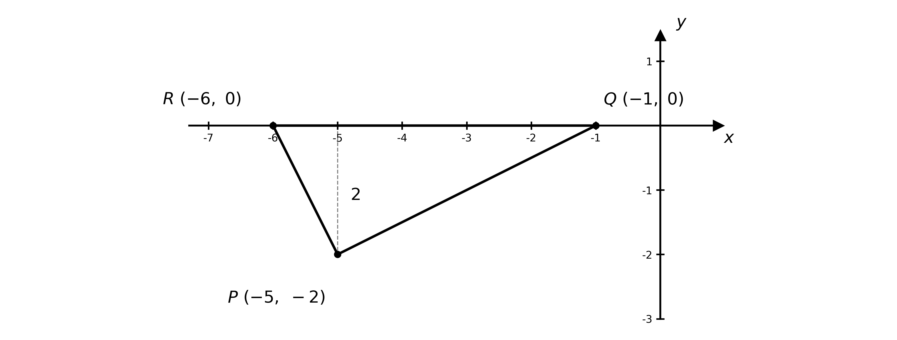

$\text{Area} = \frac{1}{2} \times Q R \times 2 = \frac{1}{2} \times 5 \times 2$

**[M1]**

$\text{Area} = 5 \text{units}^{2}$

**[A1]**

> **[mark-scheme]**
> **M1**: Correct gradient of $l_{2}$ using $P$ and $Q$.
> 
> **A1**: Correct perpendicular gradient of $l_{1}$, $m_{1} = - 2$.
> 
> **M1**: Finds $R$ as the $x$-intercept of $l_{1}$.
> 
> **M1**: Correct use of $\frac{1}{2} \times \text{base} \times \text{height}$ (base $Q R = 5$, height $2$), or $\frac{1}{2} \times P R \times P Q$ using the two perpendicular sides.
> 
> **A1**: Correct area $5$ square units.

### Q15
Find the gradient of $A B$

$m_{AB} = \frac{5-(-16)}{2-(-4)} = \frac{21}{6}$

**[M1]**

$m_{AB} = \frac{7}{2}$

**[A1]**

Find the gradient of $B C$

$m_{BC} = \frac{33-5}{10-2} = \frac{28}{8} = \frac{7}{2}$

**[A1]**

**Final answer:** $A B$** and **$B C$** have the same gradient, **$\frac{7}{2}$**, and share the common point **$B$**, so **$A$**, **$B$** and **$C$** lie on the same straight line**

**[A1]**

> **[mark-scheme]**
> **M1**: Correct gradient method, $\frac{y_{2}-y_{1}}{x_{2}-x_{1}}$, for at least one segment.
> 
> **A1**: Correct gradient $m_{AB} = \frac{7}{2}$.
> 
> **A1**: Correct gradient $m_{BC} = \frac{7}{2}$.
> 
> **A1**: Concludes collinear, stating both that the gradients are equal and that $B$ is a common point.

### Q16
Find the gradient of each side and use a vertex to write its equation

$m_{AB} = \frac{2-6}{-3-(-1)} = 2  m_{CD} = \frac{0-(-4)}{2-0} = 2$

**[M1]**

$A B :  y = 2 x + 8  C D :  y = 2 x - 4$

**[A1]**

$m_{BC} = \frac{-4-2}{0-(-3)} = - 2  m_{DA} = \frac{6-0}{-1-2} = - 2$

$B C :  y = - 2 x - 4  D A :  y = - 2 x + 4$

**[A1]**

$A B$ is parallel to $C D$ and $B C$ is parallel to $D A$ (two pairs of parallel sides), and the gradients are not perpendicular

**[A1]**

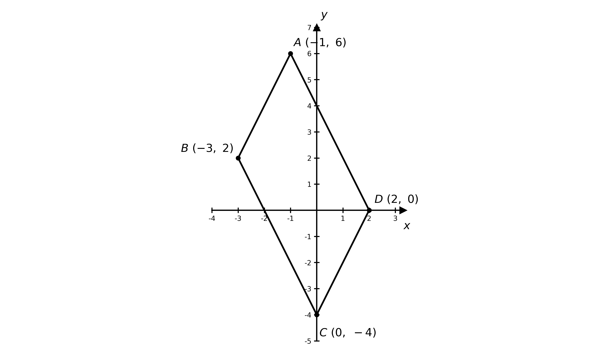

$\text{The quadrilateral is a parallelogram}$

**[B1]**

> **[mark-scheme]**
> **M1**: Correct method for the gradient of at least one side and forming its equation.
> 
> **A1**: Correct equations of $A B$ and $C D$ (the gradient-$2$ pair).
> 
> **A1**: Correct equations of $B C$ and $D A$ (the gradient-$- 2$ pair).
> 
> **A1**: Identifies two pairs of parallel sides (and that they are not perpendicular).
> 
> **B1**: Correctly names the shape as a parallelogram.

### Q17
$M$ is the midpoint of the tangent $A B$

`M = \left( \dfrac{-5 + 5}{2},\ \dfrac{16 + 14}{2} \right) = (0,\ 15)`

**[M1]**

The centre $C$ is the midpoint of the diameter $M N$

`C = \left( \dfrac{0 + (-4)}{2},\ \dfrac{15 + (-5)}{2} \right) = (-2,\ 5)`

**[A1]**

The radius is the distance from $C$ to $M$, so use `r^2 = |CM|^2` in the area $π r^{2}$

$r^{2} = ( 0 - ( - 2 ) )^{2} + ( 15 - 5 )^{2} = 104$

$\text{Area} = 104 π$

**[M1]**

$\text{Area} = 327 \text{units}^{2}$

**[A1]**

> **[mark-scheme]**
> **M1**: Finds $M$ as the midpoint of $A B$, $( 0 ,  15 )$.
> 
> **A1**: Correct centre $C ( - 2 ,  5 )$, as the midpoint of $M N$.
> 
> **M1**: Correct method for the area, using `r^2 = |CM|^2 = 104` in $π r^{2}$.
> 
> **A1**: Correct area, answers which round to $327$ square units (accept $104 π$).

### Q18
Since $A N : N B = 5 : 3$, the point $N$ lies $\frac{5}{8}$ of the way from $A$ to $B$. Add $\frac{5}{8}$ of each coordinate-change to $A$

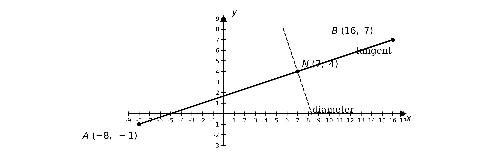

`N = \left( -8 + \dfrac{5}{8}(24),\ \ -1 + \dfrac{5}{8}(8) \right)`

**[M1]**

$N ( 7 ,  4 )$

**[A1]**

Find the gradient of the tangent $A B$

$m_{AB} = \frac{7-(-1)}{16-(-8)} = \frac{1}{3}$

**[M1]**

The diameter $N M$ is perpendicular to the tangent at $N$, so its gradient is $- 3$

$m_{NM} = - 3$

**[A1]**

Use the gradient $- 3$ and the point $N ( 7 ,  4 )$

$y - 4 = - 3 ( x - 7 )$

**[M1]**

$3 x + y - 25 = 0$

**[A1]**

> **[mark-scheme]**
> **M1**: Correct ratio method for $N$ — adds $\frac{5}{8}$ of each coordinate change from $A$ to $B$.
> 
> **A1**: Correct point $N ( 7 ,  4 )$.
> 
> **M1**: Correct gradient of the tangent $A B$.
> 
> **A1**: Correct perpendicular gradient $- 3$ for the diameter, using $m_{1} m_{2} = - 1$.
> 
> **M1**: Forms the equation of the diameter using the perpendicular gradient and $N$.
> 
> **A1**: Correct integer form $3 x + y - 25 = 0$, or any integer multiple.

### Q19
Find the gradient using the two points; the $p$ terms cancel

$m = \frac{9p-2p}{3p-p} = \frac{7p}{2p} = \frac{7}{2}$

**[M1]**

**[A1]**

Substitute the gradient and the point $( p ,  2 p )$ into $y - y_{1} = m ( x - x_{1} )$ and simplify

$y - 2 p = \frac{7}{2} ( x - p )$

$y = \frac{7}{2} x - \frac{3}{2} p$

**[A1]**

> **[mark-scheme]**
> **M1**: Correct gradient method using the two points, with the $p$ terms cancelling.
> 
> **A1**: Correct gradient $\frac{7}{2}$.
> 
> **A1**: Correct equation $y = \frac{7}{2} x - \frac{3}{2} p$ (or equivalent, e.g. $2 y = 7 x - 3 p$).
The $y$-intercept of $l$ is the constant term $- \frac{3}{2} p$. Set this equal to $3$

$- \frac{3}{2} p = 3$

**[M1]**

$p = - 2$

**[A1]**

> **[mark-scheme]**
> **M1**: Sets the $y$-intercept equal to $3$ (or substitutes $( 0 ,  3 )$ into the equation from part (a)).
> 
> **A1**: Correct value $p = - 2$.

### Q20
The two given lines cross the $y$-axis at $( 0 ,  6 )$ and $( 0 ,  - 5 . 6 )$; these lie on the axis of symmetry, so they are the top and bottom vertices. The lines meet at $( - 4 ,  - 4 )$, and by symmetry about the $y$-axis the fourth vertex is $( 4 ,  - 4 )$

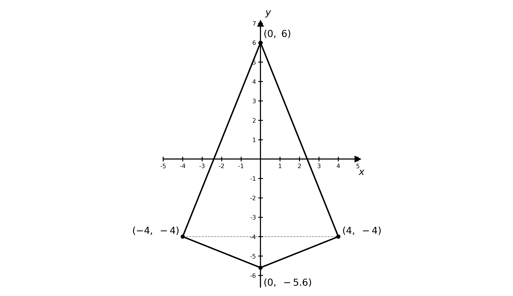

**[M1]**

The diagonals of a kite are perpendicular. The vertical diagonal runs along the $y$-axis and the horizontal diagonal joins $( - 4 ,  - 4 )$ to $( 4 ,  - 4 )$

$d_{1} = 6 - ( - 5 . 6 ) = 11 . 6  d_{2} = 8$

**[A1]**

The area of a kite is half the product of its diagonals (or twice the area of one triangle formed by the diagonals).

$\text{Area} = \frac{1}{2} \times 11 . 6 \times 8$

**[M1]**

$\text{Area} = 46 . 4 \text{units}^{2}$

**[A1]**

> **[mark-scheme]**
> **M1**: Uses the $y$-axis symmetry to identify the four vertices (in particular the fourth vertex $( 4 ,  - 4 )$).
> 
> **A1**: Correct diagonal lengths, $11 . 6$ and $8$.
> 
> **M1**: Correct use of $\frac{1}{2} \times d_{1} \times d_{2}$ (or twice the area of one triangle formed by the diagonals).
> 
> **A1**: Correct area $46 . 4$ square units.

### Q21
**Final answer:** **Let **$P$** be the total cost of a job in pounds and **$h$** the number of hours the job takes**

**[B1]**

The total cost is the fixed fee plus the hourly rate multiplied by the number of hours

$P = 22 h + 45$

**[B1]**

> **[mark-scheme]**
> **B1**: Suitable variables defined (a cost variable and an hours variable).
> 
> **B1**: Fully correct equation $P = 22 h + 45$, including the fixed fee.
Write the rival electrician's cost equation

$P_{2} = 25 h + 36$

**[B1]**

Substitute $h = 4$ into each equation

$P_{1} = 22 ( 4 ) + 45 = 133  P_{2} = 25 ( 4 ) + 36 = 136$

**[M1]**

**[A1]**

Compare the two totals

`\text{The first electrician is cheaper, by } £3`

**[A1]**

> **[mark-scheme]**
> **B1**: Correct cost equation for the rival electrician, $P_{2} = 25 h + 36$.
> 
> **M1**: Substitutes $h = 4$ into both cost equations.
> 
> **A1**: Both costs correct, `£133` and `£136`.
> 
> **A1**: Correct conclusion that the first electrician (fixed fee £45) is cheaper, by £3.

### Q22
$A$ is where $l_{1}$ crosses the $x$-axis, so set $y = 0$ in $3 x - 2 y + 4 = 0$

`3x + 4 = 0 \quad\Rightarrow\quad A\left( -\dfrac{4}{3},\ 0 \right)`

**[B1]**

$B$ is where $l_{2}$ crosses the $y$-axis, so set $x = 0$ in $y = 5 - x$

$y = 5  \Rightarrow  B ( 0 ,  5 )$

**[B1]**

$O A$ lies along the $x$-axis and $O B$ along the $y$-axis, so take them as the base and height

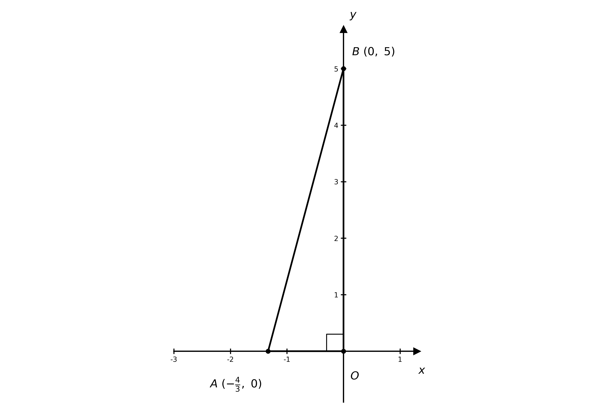

$\text{Area} = \frac{1}{2} \times \frac{4}{3} \times 5$

**[M1]**

$\text{Area} = \frac{10}{3} \text{units}^{2}$

**[A1]**

> **[mark-scheme]**
> **B1**: Correct point `A\left( -\dfrac{4}{3},\ 0 \right)`.
> 
> **B1**: Correct point $B ( 0 ,  5 )$.
> 
> **M1**: Correct use of $\frac{1}{2} \times \text{base} \times \text{height}$ with the two intercept lengths.
> 
> **A1**: Correct area $\frac{10}{3}$ (accept answers which round to $3 . 33$) square units.

### Q23
The line $3 x - y + 4 = 0$ rearranges to $y = 3 x + 4$, so the required gradient is $3$. As $l_{1}$ passes through the origin

$l_{1} :  y = 3 x$

**[B1]**

For $l_{2}$, use gradient $3$ with the point $( - 4 ,  7 )$ in $y - y_{1} = m ( x - x_{1} )$

$y - 7 = 3 ( x + 4 )$

$l_{2} :  y = 3 x + 19$

**[B1]**

> **[mark-scheme]**
> **B1**: Correct equation $l_{1} : y = 3 x$, using gradient $3$ through the origin.
> 
> **B1**: Correct equation $l_{2} : y = 3 x + 19$, using gradient $3$ through $( - 4 ,  7 )$.

### Q24
Use the gradient formula for each segment

$m_{AB} = \frac{4-1}{4-(-8)} = \frac{3}{12}$

**[M1]**

$m_{AB} = \frac{1}{4}$

**[A1]**

$m_{BC} = \frac{6-4}{12-4} = \frac{2}{8}$

$m_{BC} = \frac{1}{4}$

**[A1]**

> **[mark-scheme]**
> **M1**: Correct gradient method, $\frac{y_{2}-y_{1}}{x_{2}-x_{1}}$, for at least one segment.
> 
> **A1**: Correct gradient $m_{AB} = \frac{1}{4}$.
> 
> **A1**: Correct gradient $m_{BC} = \frac{1}{4}$.
**Final answer:** $A B$** and **$B C$** have the same gradient, so they are parallel. As they also share the common point **$B$**, the three points must lie on the same straight line**

**[B1]**

> **[mark-scheme]**
> **B1**: Explains that the equal gradients make $A B$ and $B C$ parallel, and that the shared point $B$ means $A$, $B$ and $C$ are collinear (both ideas needed).

### Q25
The centre of the circle is the midpoint of the diameter $A B$

`\left( \dfrac{-7 + 9}{2},\ \dfrac{-9 + 3}{2} \right)`

$( 1 ,  - 3 )$

**[B1]**

The length of the diameter is the distance from $A$ to $B$

$\sqrt{(9-(-7))^{2}+(3-(-9))^{2}} = \sqrt{16^{2}+12^{2}}$

**[M1]**

$\sqrt{400} = 20$

**[A1]**

> **[mark-scheme]**
> **B1**: Correct centre $( 1 ,  - 3 )$, using the midpoint of $A B$.
> 
> **M1**: Correct substitution into the distance formula for $A$ and $B$. Condone one sign error.
> 
> **A1**: Correct length $20$.

### Q26
Find the gradient of $l$

$m = \frac{5-2}{8-4} = \frac{3}{4}$

**[M1]**

**[A1]**

Substitute the gradient and the point $( 4 ,  2 )$ into $y - y_{1} = m ( x - x_{1} )$, then multiply through by $4$

$y - 2 = \frac{3}{4} ( x - 4 )$

$4 y - 8 = 3 x - 12$

**[M1]**

$3 x - 4 y - 4 = 0$

**[A1]**

> **[mark-scheme]**
> **M1**: Correct gradient method, $\frac{y_{2}-y_{1}}{x_{2}-x_{1}}$, using the two points.
> 
> **A1**: Correct gradient $\frac{3}{4}$.
> 
> **M1**: Substitutes the gradient and a point into a straight-line equation and clears the fraction.
> 
> **A1**: Correct integer form $3 x - 4 y - 4 = 0$, or any integer multiple.

### Q27
Rearrange each line into the form $y = m x + c$

$y = \frac{3}{2} x + 6 ,  y = - \frac{1}{2} x + 4 ,  y = \frac{3}{2} x - 6 ,  y = - \frac{1}{2} x - 2$

**[M1]**

The lines with gradient $\frac{3}{2}$ are parallel, as are the lines with gradient $- \frac{1}{2}$. Each vertex is where one line from each pair meets. Solve each pair simultaneously, for example $y = \frac{3}{2} x + 6$ with $y = - \frac{1}{2} x + 4$

$\frac{3}{2} x + 6 = - \frac{1}{2} x + 4  \Rightarrow  x = - 1$

**[M1]**

Repeating for the other three pairs gives the four vertices

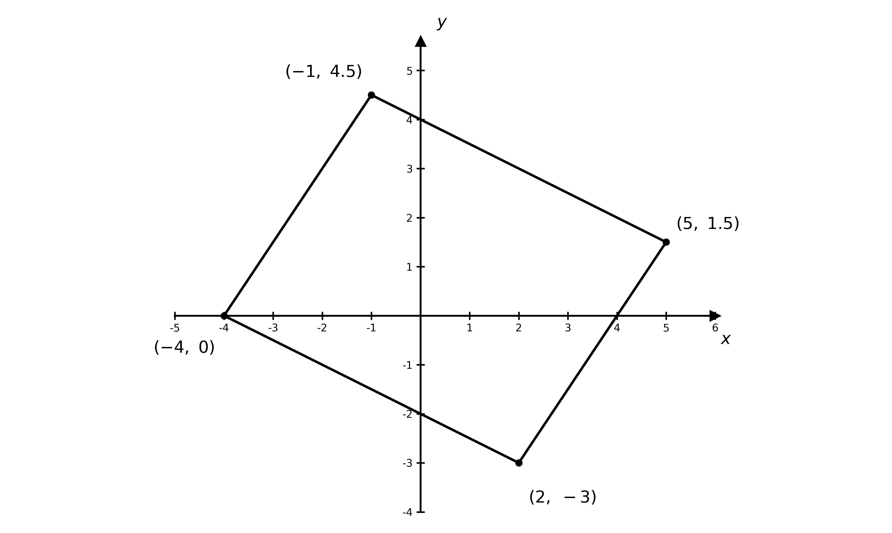

**Final answer:** $( - 1 ,  4 . 5 )$** and **$( 5 ,  1 . 5 )$

**[A1]**

**Final answer:** $( - 4 ,  0 )$** and **$( 2 ,  - 3 )$

**[A1]**

> **[mark-scheme]**
> **M1**: Rearranges all four equations into gradient–intercept form and identifies the two parallel pairs.
> 
> **M1**: Solves a correct pair (one line from each parallel pair) simultaneously to find a vertex.
> 
> **A1**: Two correct vertices.
> 
> **A1**: All four correct vertices $( - 1 ,  4 . 5 )$, $( 5 ,  1 . 5 )$, $( - 4 ,  0 )$ and $( 2 ,  - 3 )$.

### Q28
Find the gradient of $l_{2}$ using $P ( 2 ,  5 )$ and $Q ( - 3 ,  0 )$

$m_{2} = \frac{5-0}{2-(-3)} = 1$

**[M1]**

As $l_{1}$ is perpendicular to $l_{2}$, use $m_{1} m_{2} = - 1$

$m_{1} = - 1$

**[A1]**

Substitute $m_{1} = - 1$ and $P ( 2 ,  5 )$ into $y - y_{1} = m ( x - x_{1} )$

$y - 5 = - ( x - 2 )$

**[M1]**

$y = 7 - x$

**[A1]**

> **[mark-scheme]**
> **M1**: Correct gradient method for $l_{2}$ using the two given points.
> 
> **A1**: Correct perpendicular gradient $m_{1} = - 1$.
> 
> **M1**: Substitutes the perpendicular gradient and $P ( 2 ,  5 )$ into a valid straight-line equation.
> 
> **A1**: Correct equation $y = 7 - x$ (or any correct equivalent).
Find $R$, where $l_{1}$ crosses the $x$-axis, by setting $y = 0$ in $y = 7 - x$

$0 = 7 - x  \Rightarrow  x = 7$

**[M1]**

$R ( 7 ,  0 )$

**[A1]**

$Q$ and $R$ both lie on the $x$-axis, so take $Q R$ as the base and the $y$-coordinate of $P$ as the height

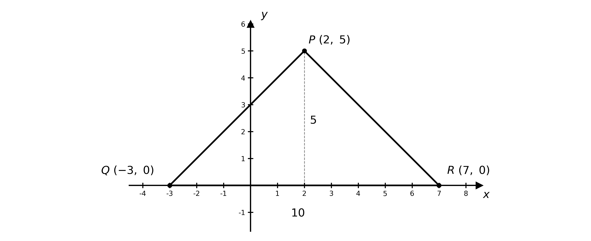

$\text{Area} = \frac{1}{2} \times Q R \times 5 = \frac{1}{2} \times 10 \times 5$

**[M1]**

$\text{Area} = 25 \text{units}^{2}$

**[A1]**

> **[mark-scheme]**
> **M1**: Sets $y = 0$ in the equation of $l_{1}$ to find $R$.
> 
> **A1**: Correct point $R ( 7 ,  0 )$.
> 
> **M1**: Correct use of $\frac{1}{2} \times \text{base} \times \text{height}$, with $Q R = 10$ as the base and $5$ as the height.
> 
> **A1**: Correct area $25$ square units.

### Q29
Rearrange each line to find its gradient

$l_{1} :  y = \frac{5}{2} x + 6  l_{2} :  y = - \frac{2}{5} x - \frac{28}{5}$

**[M1]**

Test the product of the gradients

`\dfrac{5}{2} \times \left( -\dfrac{2}{5} \right) = -1`

$\text{The lines are perpendicular}$

**[A1]**

> **[mark-scheme]**
> **M1**: Correct gradient of each line, from rearranging into the form $y = m x + c$.
> 
> **A1**: Concludes perpendicular, justified by $m_{1} m_{2} = - 1$.
Set the two line equations equal to eliminate $y$

$\frac{5}{2} x + 6 = - \frac{2}{5} x - \frac{28}{5}$

**[M1]**

Multiply through by $10$ and solve for $x$

$25 x + 60 = - 4 x - 56  \Rightarrow  29 x = - 116$

**[A1]**

Solve for $x$ and substitute back to find $y$

$x = - 4 ,  y = \frac{5}{2} ( - 4 ) + 6 = - 4$

**[M1]**

$P ( - 4 ,  - 4 )$

**[A1]**

> **[mark-scheme]**
> **M1**: Correct method to eliminate one variable from the two line equations.
> 
> **A1**: Correct reduction to $29 x = - 116$ (or equivalent).
> 
> **M1**: Solves for $x$ and substitutes back to find $y$.
> 
> **A1**: Correct coordinates $P ( - 4 ,  - 4 )$.
Find $Q$, where $l_{1}$ meets the $y$-axis, by setting $x = 0$ in $5 x - 2 y + 12 = 0$

$- 2 y + 12 = 0  \Rightarrow  Q ( 0 ,  6 )$

**[M1]**

$Q ( 0 ,  6 )$

**[A1]**

Since $P R : R Q = 3 : 1$, the point $R$ lies $\frac{3}{4}$ of the way from $P ( - 4 ,  - 4 )$ to $Q ( 0 ,  6 )$. Add $\frac{3}{4}$ of each coordinate-change to $P$

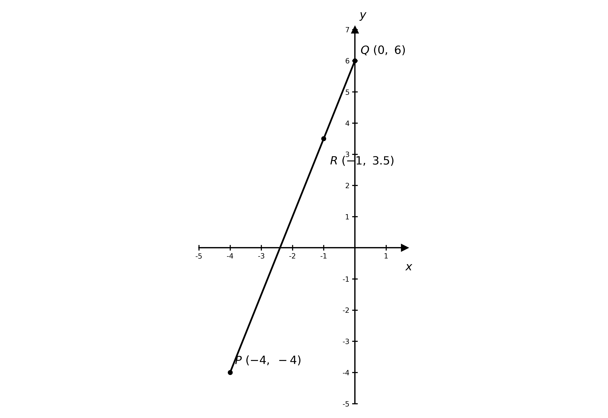

`R = \left( -4 + \dfrac{3}{4}(4),\ \ -4 + \dfrac{3}{4}(10) \right)`

**[M1]**

$R ( - 1 ,  3 . 5 )$

**[A1]**

> **[mark-scheme]**
> **M1**: Sets $x = 0$ in $l_{1}$ to find $Q$.
> 
> **A1**: Correct point $Q ( 0 ,  6 )$.
> 
> **M1**: Correct ratio method — adds $\frac{3}{4}$ of each coordinate change from $P$ to $Q$ (or equivalent step method).
> 
> **A1**: Correct coordinates $R ( - 1 ,  3 . 5 )$.

### Q30
The two data points are $( w ,  L ) = ( 1 . 5 ,  2 . 3 )$ and $( 6 . 5 ,  6 . 3 )$. Find the gradient

$m = \frac{6.3-2.3}{6.5-1.5} = \frac{4}{5}$

**[M1]**

$m = 0 . 8$

**[A1]**

Substitute the point $( 1 . 5 ,  2 . 3 )$ into $L = 0 . 8 w + c$ to find $c$

$2 . 3 = 0 . 8 ( 1 . 5 ) + c  \Rightarrow  c = 1 . 1$

**[M1]**

$L = 0 . 8 w + 1 . 1$

**[A1]**

> **[mark-scheme]**
> **M1**: Correct method for the gradient using the two data points.
> 
> **A1**: Correct gradient $0 . 8$.
> 
> **M1**: Substitutes one of the data points into $L = m w + c$ to find $c$.
> 
> **A1**: Correct model $L = 0 . 8 w + 1 . 1$. A correct simultaneous-equations method scores equally.
Substitute $w = 20$ into the model

$L = 0 . 8 ( 20 ) + 1 . 1$

$L = 17 . 1 \text{cm}$

**[B1]**

> **[mark-scheme]**
> **B1**: Correct length of $17 . 1$ cm.
Set $L = 11 . 9$ and solve for $w$

$11 . 9 = 0 . 8 w + 1 . 1$

**[M1]**

$10 . 8 = 0 . 8 w$

$w = 13 . 5 \text{weeks}$

**[A1]**

> **[mark-scheme]**
> **M1**: Correct setting of $L = 11 . 9$ and rearranging to make $w$ the subject.
> 
> **A1**: Correct age of $13 . 5$ weeks.

### Q31
Parallel lines have the same gradient, so the required gradient is $2$. Substitute $m = 2$ and the point $( 3 ,  12 )$ into $y - y_{1} = m ( x - x_{1} )$

$y - 12 = 2 ( x - 3 )$

**[M1]**

Expand and simplify

$y = 2 x + 6$

**[A1]**

> **[mark-scheme]**
> **M1**: Uses the parallel gradient $2$ with the point $( 3 ,  12 )$ in a valid straight-line equation.
> 
> **A1**: Correct equation $y = 2 x + 6$.

### Q32
The length of the diameter is the distance between the two endpoints

$\sqrt{(3-(-3))^{2}+(-3-5)^{2}} = \sqrt{36+64}$

**[M1]**

$\sqrt{100} = 10$

**[A1]**

> **[mark-scheme]**
> **M1**: Correct substitution into the distance formula for the two endpoints. Condone one sign error.
> 
> **A1**: Correct length $10$.
The centre is the midpoint of the diameter

`\left( \dfrac{-3 + 3}{2},\ \dfrac{5 + (-3)}{2} \right)`

**[M1]**

$( 0 ,  1 )$

**[A1]**

> **[mark-scheme]**
> **M1**: Correct use of the midpoint formula on the two endpoints of the diameter.
> 
> **A1**: Correct centre $( 0 ,  1 )$.

### Q33
Find the gradient of $l$

$m = \frac{2-4}{9-3} = - \frac{1}{3}$

**[M1]**

Substitute the gradient and the point $( 3 ,  4 )$ into $y - y_{1} = m ( x - x_{1} )$ and simplify

$y = - \frac{1}{3} x + 5$

**[A1]**

> **[mark-scheme]**
> **M1**: Correct gradient $- \frac{1}{3}$ from the two points.
> 
> **A1**: Correct equation $y = - \frac{1}{3} x + 5$.
The perpendicular gradient is the negative reciprocal of $- \frac{1}{3}$

$3$

**[B1]**

> **[mark-scheme]**
> **B1**: Correct perpendicular gradient $3$, using $m_{1} m_{2} = - 1$.

### Q34
The two data points are $( w ,  L ) = ( 3 ,  6 )$ and $( 6 ,  8 )$. Find the gradient from these points

$m = \frac{8-6}{6-3}$

**[M1]**

$m = \frac{2}{3}$

**[A1]**

Substitute the point $( 3 ,  6 )$ into $L = \frac{2}{3} w + c$ to find $c$

$6 = \frac{2}{3} ( 3 ) + c  \Rightarrow  c = 4$

**[M1]**

$L = \frac{2}{3} w + 4$

**[A1]**

> **[mark-scheme]**
> **M1**: Correct method for the gradient using the two data points, $\frac{8-6}{6-3}$.
> 
> **A1**: Correct gradient $\frac{2}{3}$.
> 
> **M1**: Substitutes one of the data points into $L = m w + c$ to find $c$.
> 
> **A1**: Correct model $L = \frac{2}{3} w + 4$. A correct simultaneous-equations method scores equally.
The rate of growth is the gradient of the model

$\frac{2}{3} \text{cm per week}$

**[B1]**

> **[mark-scheme]**
> **B1**: Correct rate of $\frac{2}{3}$ cm per week. Accept $0 . 667$ or answers which round to it.
Substitute $w = 15$ into the model

$L = \frac{2}{3} ( 15 ) + 4$

$L = 14 \text{cm}$

**[B1]**

> **[mark-scheme]**
> **B1**: Correct length of $14$ cm.
Set $L = 17$ and solve for $w$

$17 = \frac{2}{3} w + 4$

**[M1]**

$13 = \frac{2}{3} w$

$w = 19 . 5 \text{weeks}$

**[A1]**

> **[mark-scheme]**
> **M1**: Correct setting of $L = 17$ and rearranging to make $w$ the subject.
> 
> **A1**: Correct age of $19 . 5$ weeks.

### Q35
Substitute $m = - 2$ and the point $( 7 ,  - 3 )$ into $y - y_{1} = m ( x - x_{1} )$

$y - ( - 3 ) = - 2 ( x - 7 )$

**[M1]**

Expand and simplify

$y = - 2 x + 11$

**[A1]**

> **[mark-scheme]**
> **M1**: Substitutes the gradient $- 2$ and the point $( 7 ,  - 3 )$ into a valid straight-line equation.
> 
> **A1**: Correct equation $y = - 2 x + 11$.

### Q36
At $A$ the line crosses the $x$-axis, so set $y = 0$

$2 x + 3 = 0  \Rightarrow  x = - \frac{3}{2}$

`A\left( -\dfrac{3}{2},\ 0 \right)`

**[B1]**

At $B$ the line crosses the $y$-axis, so set $x = 0$

$- y + 3 = 0  \Rightarrow  y = 3$

$B ( 0 ,  3 )$

**[B1]**

> **[mark-scheme]**
> **B1**: Correct point `A\left( -\dfrac{3}{2},\ 0 \right)`.
> 
> **B1**: Correct point $B ( 0 ,  3 )$.
$O A$ lies along the $x$-axis and $O B$ along the $y$-axis, so the angle at $O$ is a right angle. Take $O A$ and $O B$ as the base and height, using their lengths

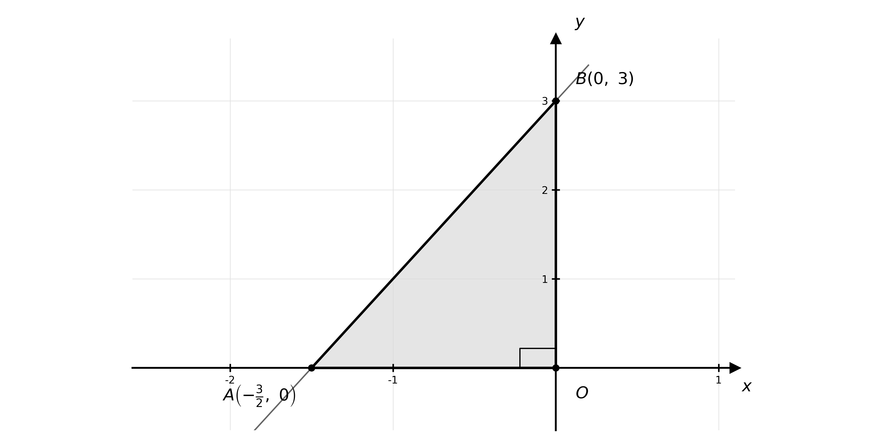

$\text{Area} = \frac{1}{2} \times \frac{3}{2} \times 3$

**[M1]**

$\text{Area} = \frac{9}{4} \text{units}^{2}$

**[A1]**

> **[mark-scheme]**
> **M1**: Correct use of $\frac{1}{2} \times \text{base} \times \text{height}$ with the lengths of the two intercepts.
> 
> **A1**: Correct area $\frac{9}{4}$ (accept $2 . 25$) square units.

### Q37
Find the gradient using the two points

$m = \frac{7-3}{3-(-2)} = \frac{4}{5}$

**[M1]**

**[A1]**

Substitute the gradient and the point $( - 2 ,  3 )$ into $y - y_{1} = m ( x - x_{1} )$, then multiply through by $5$

$y - 3 = \frac{4}{5} ( x + 2 )$

$5 y - 15 = 4 x + 8$

**[M1]**

$4 x - 5 y + 23 = 0$

**[A1]**

> **[mark-scheme]**
> **M1**: Correct gradient method, $\frac{y_{2}-y_{1}}{x_{2}-x_{1}}$, using the two points.
> 
> **A1**: Correct gradient $\frac{4}{5}$.
> 
> **M1**: Substitutes the gradient and a point into a straight-line equation and clears the fraction.
> 
> **A1**: Correct integer form $4 x - 5 y + 23 = 0$, or any integer multiple.

### Q38
The line $x + y = 16$ has gradient $- 1$. Perpendicular gradients satisfy $m_{1} m_{2} = - 1$, so the perpendicular line has gradient $1$. As it passes through the origin

$y = x$

**[B1]**

Substitute $y = x$ into $x + y = 16$ to find where the lines meet

$2 x = 16  \Rightarrow  x = 8$

**[M1]**

$R ( 8 ,  8 )$

**[A1]**

> **[mark-scheme]**
> **B1**: Correct equation of the perpendicular line $y = x$, using the perpendicular gradient $1$ through the origin.
> 
> **M1**: Substitutes $y = x$ into $x + y = 16$ and solves for the intersection.
> 
> **A1**: Correct coordinates $R ( 8 ,  8 )$.
Since $O P : P R = 3 : 1$, the point $P$ lies $\frac{3}{4}$ of the way from $O$ to $R$. Scale the change in coordinates from $O ( 0 ,  0 )$ to $R ( 8 ,  8 )$ by $\frac{3}{4}$

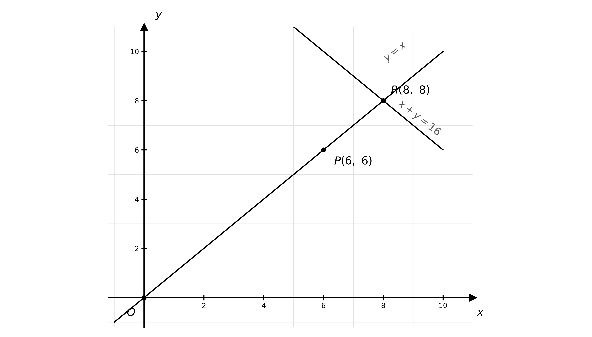

`P = \left( \dfrac{3}{4} \times 8,\ \dfrac{3}{4} \times 8 \right)`

**[M1]**

$P ( 6 ,  6 )$

**[A1]**

> **[mark-scheme]**
> **M1**: Correct method for a point dividing $O R$ in the ratio $3 : 1$, scaling the coordinate changes from $O$ to $R$ by $\frac{3}{4}$ (or an equivalent step method).
> 
> **A1**: Correct coordinates $P ( 6 ,  6 )$.

### Q39
Use $m = \frac{y_{2}-y_{1}}{x_{2}-x_{1}}$ with $A ( - 5 ,  - 11 )$ and $B ( 1 ,  1 )$

$m_{AB} = \frac{1-(-11)}{1-(-5)} = \frac{12}{6}$

**[M1]**

$m_{AB} = 2$

**[A1]**

> **[mark-scheme]**
> **M1**: Correct gradient method for $A B$, $\frac{y_{2}-y_{1}}{x_{2}-x_{1}}$.
> 
> **A1**: Correct gradient $m_{AB} = 2$.
Use the gradient formula with $B ( 1 ,  1 )$ and $C ( 4 ,  7 )$

$m_{BC} = \frac{7-1}{4-1} = \frac{6}{3}$

$m_{BC} = 2$

**[B1]**

> **[mark-scheme]**
> **B1**: Correct gradient $m_{BC} = 2$.
**Final answer:** $A B$** and **$B C$** have the same gradient, so they are parallel. As they also share the common point **$B$**, the three points must lie on the same straight line**

**[B1]**

> **[mark-scheme]**
> **B1**: Explains that equal gradients make $A B$ and $B C$ parallel, and that the shared point $B$ means $A$, $B$ and $C$ lie on one straight line (both ideas needed).

### Q40
The total cost is the fixed fee plus the hourly rate multiplied by the number of hours

$P = 20 h + 50$

**[B1]**

> **[mark-scheme]**
> **B1**: Fully correct equation $P = 20 h + 50$, including the fixed fee.
Set $P = 200$ and solve for $h$

$200 = 20 h + 50$

**[M1]**

$150 = 20 h$

$h = 7 . 5 \text{hours}$

**[A1]**

> **[mark-scheme]**
> **M1**: Correct setting of $P = 200$ and rearranging to solve for $h$.
> 
> **A1**: Correct time of $7 . 5$ hours.
Using the same variables, with the rival's fixed fee and hourly rate

$P = 24 h + 38$

**[B1]**

> **[mark-scheme]**
> **B1**: Fully correct equation $P = 24 h + 38$, including the fixed fee.
Substitute $h = 4$ into each equation

$P_{1} = 20 ( 4 ) + 50 = 130  P_{2} = 24 ( 4 ) + 38 = 134$

**[M1]**

**[A1]**

Compare the two totals

`\text{The first electrician is cheaper, by } £4`

**[A1]**

> **[mark-scheme]**
> **M1**: Substitutes $h = 4$ into both cost equations.
> 
> **A1**: Both costs correct, `£130` and `£134`.
> 
> **A1**: Correct conclusion that the first electrician (fixed fee £50) is cheaper, by £4.
