# Exam Questions — Further Integration
**Integration** · Cambridge (CIE) A-LEVEL maths (9709)
> Source: [https://www.savemyexams.com/a-level/maths/cie/20/pure-1/topic-questions/](https://www.savemyexams.com/a-level/maths/cie/20/pure-1/topic-questions/) · 28 questions across 1 sets

## Exam Questions (28 questions)

### Q1 — easy — 4 marks

**Q1** [4 marks]

The diagram below shows the graph of $y = x^{2} - 8 x + 12$.

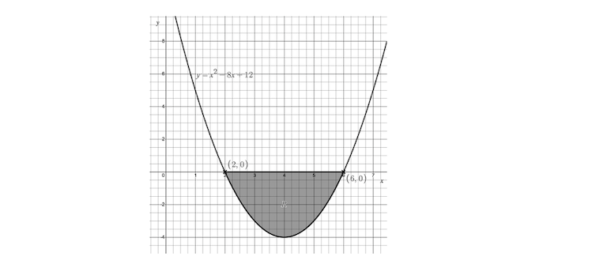

Find the shaded area marked $R$, giving your answer as a fraction in its simplest form.

### Q2 — easy — 5 marks

**Q2** [5 marks]

The diagram below shows the region $R$, bounded by the straight lines with equations $y = 2 x + 1$, $x = 2$, $x = 4$ and the $x$-axis.

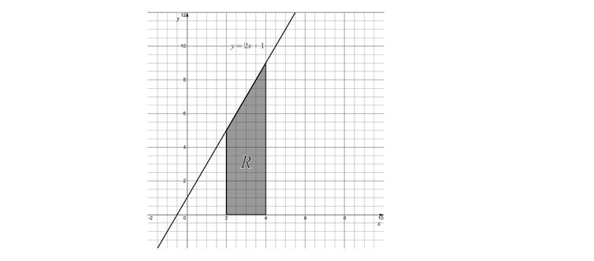

(i) For $y = 2 x + 1$, show that $y^{2} = 4 x^{2} + 4 x + 1$.

(ii) Find the volume of the solid formed when the region $R$ is rotated 360° around the $x$-axis.

### Q3 — easy — 3 marks

**Q3** [3 marks]

The diagram below shows the graph of $y = 7 x - x^{2} - 6$.

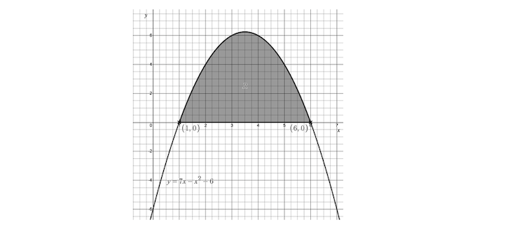

Find the shaded area, giving your answer as a fraction in its simplest terms.

### Q4 — easy — 5 marks

**Q4** [5 marks]

The diagram shows the curve with equation $y = x^{2} + 2$. The shaded region $R$ is bounded by the curve, the $y$-axis and the lines $y = 6$ and $y = 11$.

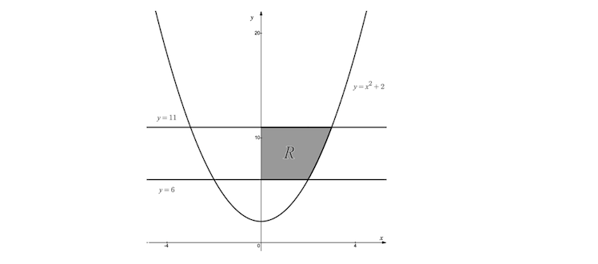

Find the volume of the solid formed when the shaded region $R$ is rotated through 360° about the $y$-axis.

### Q5 — easy — 5 marks

**Q5** [1 mark]

Simplify `x - \left(x^{2} - 8x + 18\right)`.

**Q5** [4 marks]

The diagram below shows the graphs of $y = x^{2} - 8 x + 18$ and $y = x$.

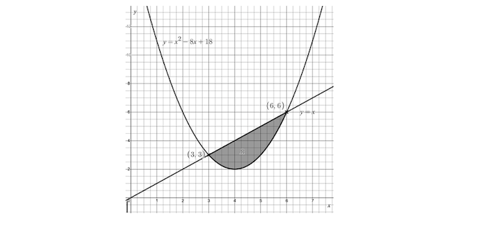

Find the shaded area marked $R$, giving your answer as a fraction in its simplest terms.

### Q6 — easy — 5 marks

**Q6** [2 marks]

The area bounded by the curve with equation $y = 9 - x^{2}$, the $x$-axis and the vertical lines with equations $x = 1$ and $x = 2$ is to be found.

Write down an integral that would find this area.

**Q6** [3 marks]

Evaluate your integral from part (a) and hence find the area described above.

### Q7 — very_hard — 11 marks

**Q7** [3 marks]

Sketch the region bounded by the lines

$x = 2$, $x = 6$, $2 y = x + 4$ and $y = p$, where $0 < p < 2$.

**Q7** [4 marks]

The region described in part (a) is rotated through 360° about the $x$-axis.

Find the volume of the solid formed, giving your answer in terms of $p$.

**Q7** [4 marks]

The solid formed in part (b) will have a 'hole' in its centre.

(i) Find the volume of this 'hole', giving your answer in terms of $p$.

(ii) Hence show that there are no values of $p$ in the given interval that make the volume of the solid equal to the volume of the 'hole'.

### Q8 — very_hard — 8 marks

**Q8** [6 marks]

The diagram below shows a sketch of the curves with equations $y = x^{2} + 5$ and $y = 23 - x^{2}$.

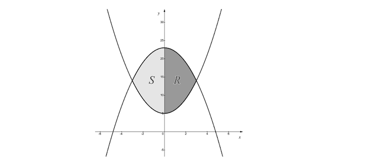

The region $R$ is bounded by the $y$-axis and the two curves. This region is rotated through 360° about the $y$-axis. Find the volume of the solid formed.

**Q8** [2 marks]

The regions marked $R$ and $S$ are now to be considered as a single region bounded by the two curves.

A student calculates the volume swept out when this combined region is rotated through a full 360° about the $y$-axis, without taking the symmetry of the two curves into account. Call this value $I$.

How does $I$ compare to the answer you found in part (a)?

Be sure to fully explain your answer.

### Q9 — very_hard — 11 marks

**Q9** [11 marks]

The diagram below shows the graphs of $4 y = 4 x + 17$ and $y = 3 x^{2} - 8 x - 16$.

Find the exact area of the shaded region.

### Q10 — hard — 5 marks

**Q10** [5 marks]

Starting with the equation of a semicircle of radius $r$, $y = \sqrt{r^{2}-x^{2}}$ (where $r > 0$), use calculus to show that the general formula for the volume $V$ of a sphere of radius $r$ is

$V = \frac{4}{3} π r^{3}$

### Q11 — hard — 8 marks

**Q11** [8 marks]

The diagram below shows part of the graph of $y = x^{3} - 2 x^{2} - x + 2$.

Find the total area of the two shaded regions.

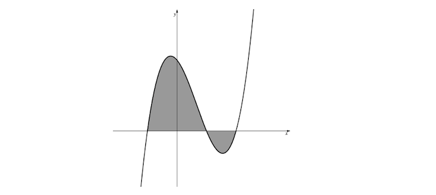

### Q12 — hard — 8 marks

**Q12** [8 marks]

The diagram below shows the graphs of $y = 12 x - x^{2} - 27$ and $y = x^{2} - 14 x + 45$.

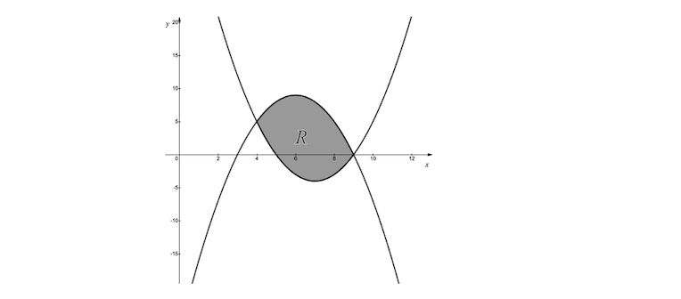

Find the area of the shaded region, $R$.

### Q13 — very_hard — 5 marks

**Q13** [4 marks]

The diagram below shows part of the graph of $y = 4 x - x^{3}$.

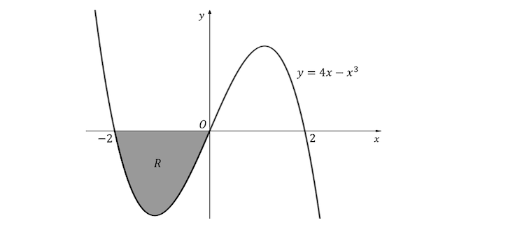

Find the area of the shaded region labelled $R$.

**Q13** [1 mark]

Without doing any additional calculation, explain why `\int_{-2}^{2} \left(4x - x^{3}\right) \,\text{d}x` must be equal to zero.

### Q14 — hard — 8 marks

**Q14** [4 marks]

A mathematical model for a bowl is obtained by rotating through 360° about the $y$-axis the part of the curve $y = \frac{1}{a} x^{2}$ which is between $y = 8$ and $y = 9$, and then adding a flat bottom. $a$ is a constant such that $a > 0$.

Find the capacity of the bowl in terms of $a$.

**Q14** [3 marks]

In the case where the boundaries $y = 3$ and $y = 6$ are used in place of $y = 8$ and $y = 9$, the capacity of the bowl is increased by $15 π$ cubic units.

Find the value of $a$.

**Q14** [1 mark]

What assumption has been made in finding the capacity of the bowl?

### Q15 — medium — 4 marks

**Q15** [4 marks]

The diagram below shows part of the graph of $y = 2 x + 3 x^{2} - 2 x^{3}$.

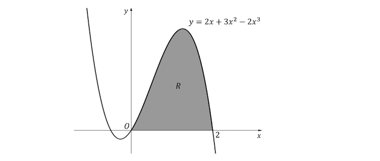

Find the area of the shaded region labelled $R$.

### Q16 — hard — 11 marks

**Q16** [5 marks]

The line with equation $5 y = 14 - 3 x$ cuts the curve with equation $5 y = 20 - 2 x - x^{2}$ at the points $P$ and $Q$, as shown.

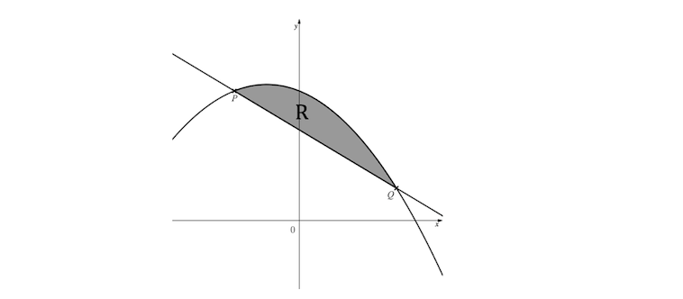

Find the $x$- and $y$-coordinates of the points $P$ and $Q$.

**Q16** [6 marks]

Find the exact area of the region labelled $R$, giving your answer in the form $\frac{a}{b}$, where $a$ and $b$ are integers to be found.

### Q17 — hard — 7 marks

**Q17** [2 marks]

The diagram below shows a sketch of the curves with equations

$y = x^{3} + 3$ and $y = - x^{3} + 2 x + 3$

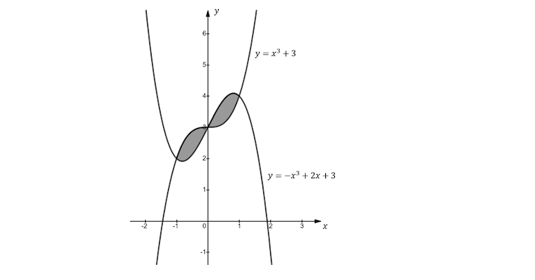

Find the $x$-coordinates of the points of intersection of the two graphs.

**Q17** [5 marks]

Use calculus to find the total shaded area enclosed by the two graphs.

### Q18 — hard — 8 marks

**Q18** [8 marks]

The diagram below shows part of the graph of `y = x\left(x - 1\right)\left(x + 2\right)`.

Find the total area of the two shaded regions.

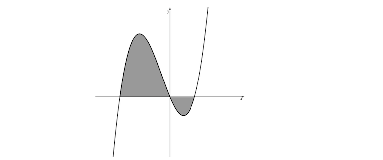

### Q19 — hard — 5 marks

**Q19** [2 marks]

The diagram below shows a right-angled triangle with vertices at the origin, the point `\left(h, 0\right)` and the point `\left(h, r\right)`, where $r > 0$ and $h > 0$.

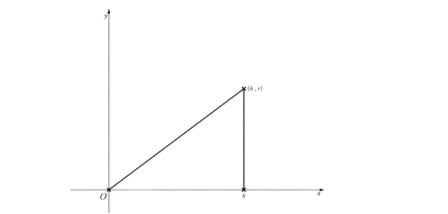

Find an equation of the line on which the hypotenuse of the right-angled triangle lies, giving your answer in the form $y = \text{f} ( x )$.

**Q19** [3 marks]

The triangle is rotated through 360° about the $x$-axis to form a cone.

Hence use calculus to show that the general formula for the volume $V$ of a cone is

$V = \frac{1}{3} π r^{2} h$

where $r$ is the base radius of the cone and $h$ is its perpendicular height.

### Q20 — hard — 4 marks

**Q20** [4 marks]

The diagram below shows part of the curve $C$ defined by the equation $y = \frac{1}{a} x^{2}$, where $a$ is a positive constant. The shaded region $R$ is bounded by the curve, the $x$-axis, and the lines $x = 1$ and $x = 6$.

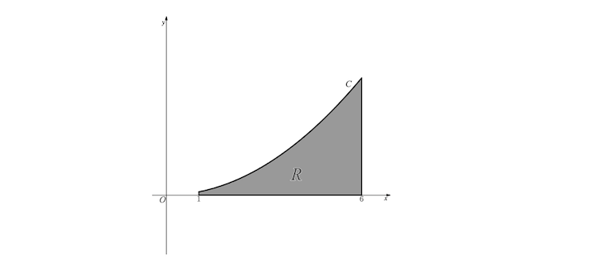

Given that the volume of the solid formed when the region $R$ is rotated through 360° about the $x$-axis is $\frac{311π}{20}$ cubic units, find the value of $a$.

### Q21 — hard — 11 marks

**Q21** [11 marks]

The diagram below shows the graphs of $y = x + 2$ and $y = 10 x - x^{2} - 16$.

Find the exact area of the shaded region.

### Q22 — medium — 7 marks

**Q22** [3 marks]

The diagram below shows the graphs of two horizontal lines and the function $y = \text{f} ( x )$.

$\text{f} ( x ) = a x^{2} + b$, where $a$ and $b$ are constants.

Point $P$ has coordinates `\left(1, 5\right)`.

Point $Q$ has coordinates `\left(2, 8\right)`.

(i) Find the values of $a$ and $b$.

(ii) Write down the equations of the two horizontal lines.

**Q22** [4 marks]

The shaded region $R$ is rotated through 360° about the $y$-axis. Find the volume of the solid formed.

### Q23 — medium — 5 marks

**Q23** [1 mark]

The diagram below shows part of the graph of `y = 4 - \left(x - 2\right)^{2}`.

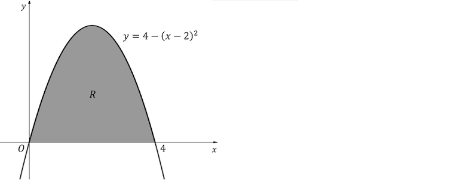

Write down the values of $x$ where $y = 0$.

**Q23** [1 mark]

Show that

`4 - \left(x - 2\right)^{2} = 4x - x^{2}`

**Q23** [2 marks]

Evaluate

`\int_{0}^{4} \left(4x - x^{2}\right) \,\text{d}x`

**Q23** [1 mark]

Write down the area of the region labelled $R$.

### Q24 — medium — 6 marks

**Q24** [2 marks]

The diagram below shows the graphs of the line $y = 6 - x$ and the curve $y = x^{2}$.

Find the $x$-coordinates of the points labelled $P$, $Q$ and $R$.

**Q24** [4 marks]

Find the area of the shaded region.

### Q25 — medium — 8 marks

**Q25** [2 marks]

The diagram below shows a sketch of the curves with equations

$y = x^{2} - 3 x + 4$ and $y = 4 - x^{2} + 2 x$

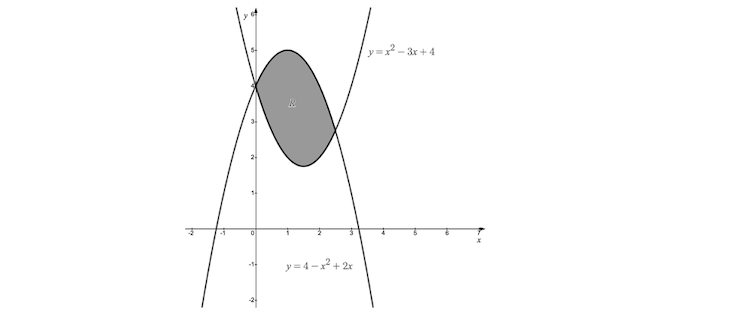

Find the $x$-coordinates of the points of intersection of the two graphs.

**Q25** [2 marks]

Show that the area of the shaded region labelled $R$ is given by

`\int_{0}^{\frac{5}{2}} \left(5x - 2x^{2}\right) \,\text{d}x`

**Q25** [4 marks]

Use calculus to find the area of the shaded region labelled $R$.

### Q26 — medium — 5 marks

**Q26** [5 marks]

The diagram below shows the graph of the curve with equation $y = 4 - x^{2}$.

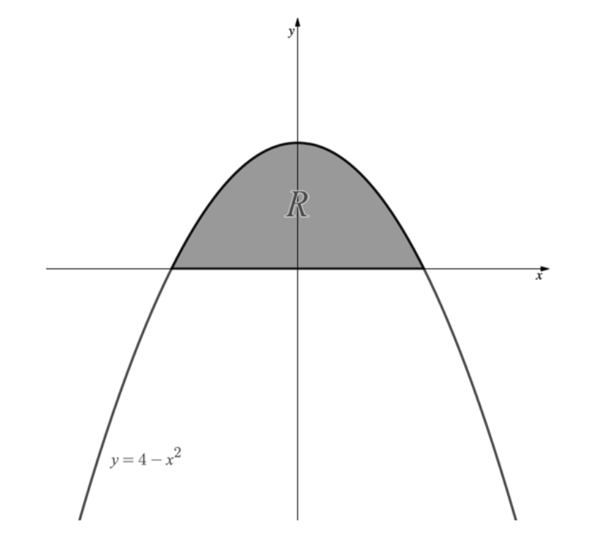

(i) Find the $x$-coordinates of the points where the graph of $y = 4 - x^{2}$ crosses the $x$-axis.

(ii) The shaded region $R$ is rotated through 360° about the $x$-axis. Find the volume of the solid formed.

### Q27 — easy — 3 marks

**Q27** [3 marks]

The diagram below shows part of the graph of $y = x^{2} - 4 x + 3$.

Find the area of the shaded region labelled $R$.

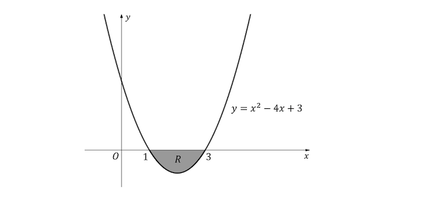

### Q28 — medium — 7 marks

**Q28** [2 marks]

Find the $x$-coordinates of the points of intersection of the line with equation $y = 2$ and the curve with equation $y = x^{2} - 4 x + 5$.

**Q28** [2 marks]

Evaluate

`\int_{1}^{3} \left(x^{2} - 4x + 5\right) \,\text{d}x`

**Q28** [3 marks]

The diagram below shows the graphs of $y = 2$ and $y = x^{2} - 4 x + 5$.

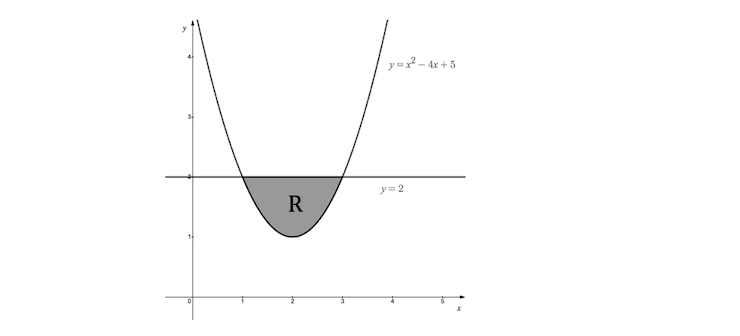

Find the exact area of the shaded region $R$.
