# Mark Schemes — Basic Trigonometry
**Trigonometry** · Cambridge (CIE) A-LEVEL maths (9709)

## Exam Questions (38 questions)

### Q1
The right angle is at $A$, so $B C$ is the hypotenuse. Relative to angle $A C B$, the side $A B$ is opposite, so use sine

$\text{sin}  ( A C B ) = \frac{7}{15}$

`ACB = \text{sin}^{-1} \left( \dfrac{7}{15} \right)`

**[M1]**

$A C B = 27 . 8 ^{\circ}$

**[A1]**

> **[mark-scheme]**
> **M1**: Correct use of trigonometry in the right-angled triangle, for example $\text{sin}  ( A C B ) = \frac{7}{15}$.
> 
> **A1**: Answers which round to $27 . 8 ^{\circ}$.

### Q2
Relative to the $42 ^{\circ}$ angle, $R Q$ is the opposite side and $P Q$ is the adjacent side, so use tangent

$\text{tan}  42 ^{\circ} = \frac{1.7}{PQ}$

$P Q = \frac{1.7}{\text{tan}42^{\circ}}$

**[M1]**

**Final answer:** $P Q = 1 . 9$** cm**

**[A1]**

> **[mark-scheme]**
> **M1**: Correct use of trigonometry in the right-angled triangle, for example $\text{tan}  42 ^{\circ} = \frac{1.7}{PQ}$ or $P Q = \frac{1.7}{\text{tan}42^{\circ}}$.
> 
> **A1**: Answers which round to $P Q = 1 . 9$ cm.

### Q3
The angle of $58 ^{\circ}$ is enclosed by the two known sides $A C$ and $B C$, so use the area formula

$\text{Area} = \frac{1}{2} ( A C ) ( B C )  \text{sin}  C$

$\text{Area} = \frac{1}{2} ( 18 . 4 ) ( 31 . 2 )  \text{sin}  58 ^{\circ}$

**[M1]**

$\text{Area} = 243 . 4 \dots \text{m}^{2}$

**[A1]**

$\text{Area} = 243 \text{m}^{2}$

**[A1]**

> **[mark-scheme]**
> **M1**: Correct substitution into the area formula, $\frac{1}{2} ( 18 . 4 ) ( 31 . 2 )  \text{sin}  58 ^{\circ}$.
> 
> **A1**: Correct unrounded area (answers which round to $243 . 4$).
> 
> **A1**: Area $= 243$ m², to the nearest square metre.

### Q4
(i)

Using the cosine rule, with $x ^{\circ}$ opposite the side of length $4$

$\text{cos}  x ^{\circ} = \frac{3^{2}+5^{2}-4^{2}}{2(3)(5)} = \frac{18}{30} = 0 . 6$

**[M1]**

$x = \text{cos}^{-1} ( 0 . 6 ) = 53 ^{\circ}$

**[A1]**

Since $3^{2} + 4^{2} = 5^{2}$, the triangle is right-angled (the right angle is between the sides of length $3$ and $4$). Relative to $x ^{\circ}$, the side $3$ is adjacent and the side $5$ is the hypotenuse

$\text{cos}  x ^{\circ} = \frac{3}{5} = 0 . 6$

**[M1]**

$x = \text{cos}^{-1} ( 0 . 6 ) = 53 ^{\circ}$

**[A1]**

Both methods give the same value

$x = 53 ^{\circ}$

(ii)

**Final answer:** **SOH CAH TOA is the more efficient method, because the triangle is right-angled so a single trigonometric ratio finds **$x ^{\circ}$** in one step**

**[B1]**

> **[mark-scheme]**
> **M1**: Correct substitution into the cosine rule, $\text{cos}  x ^{\circ} = \frac{3^{2}+5^{2}-4^{2}}{2(3)(5)}$.
> 
> **A1**: $x = 53 ^{\circ}$ obtained from the cosine rule.
> 
> **M1**: Recognising the triangle is right-angled and using a correct ratio, for example $\text{cos}  x ^{\circ} = \frac{3}{5}$ (accept $\text{sin}  x ^{\circ} = \frac{4}{5}$ or $\text{tan}  x ^{\circ} = \frac{4}{3}$).
> 
> **A1**: $x = 53 ^{\circ}$ obtained from SOH CAH TOA, confirming the two methods agree.
> 
> **B1**: States SOH CAH TOA is more efficient, with a valid reason (the triangle is right-angled, so only one ratio is needed rather than substituting three sides).

### Q5
$P R$ is the side opposite the known angle $Q$, so apply the cosine rule with these three values

$P R^{2} = P Q^{2} + Q R^{2} - 2 ( P Q ) ( Q R )  \text{cos}  Q$

$P R^{2} = 7 . 5^{2} + 9 . 2^{2} - 2 ( 7 . 5 ) ( 9 . 2 )  \text{cos}  84 ^{\circ}$

**[M1]**

$P R^{2} = 126 . 46 \dots$

**[A1]**

**Final answer:** $P R = 11 . 2$** cm**

**[A1]**

> **[mark-scheme]**
> **M1**: Correct substitution into the cosine rule, $P R^{2} = 7 . 5^{2} + 9 . 2^{2} - 2 ( 7 . 5 ) ( 9 . 2 )  \text{cos}  84 ^{\circ}$.
> 
> **A1**: Correct value of $P R^{2}$ (answers which round to $126$), or $P R = 11 . 2457 \dots$
> 
> **A1**: $P R = 11 . 2$ cm, correct to 3 significant figures.

### Q6
$A C$ is adjacent to the angle of $74 ^{\circ}$ and $A B$ is the hypotenuse, so use cosine

$\text{cos}  74 ^{\circ} = \frac{AC}{38}$

$A C = 38  \text{cos}  74 ^{\circ}$

**[M1]**

**Final answer:** $A C = 10 . 5$** m**

**[A1]**

> **[mark-scheme]**
> **M1**: Correct use of trigonometry in the right-angled triangle, for example $\text{cos}  74 ^{\circ} = \frac{AC}{38}$ or $A C = 38  \text{cos}  74 ^{\circ}$.
> 
> **A1**: Answers which round to $A C = 10 . 5$ m.

### Q7
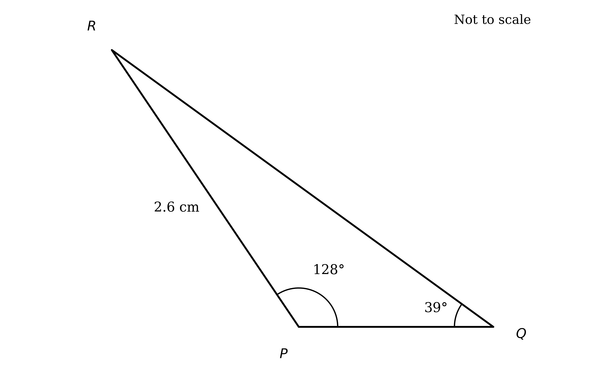

$Q R$ is opposite the angle $P = 128 ^{\circ}$, and the known side $P R = 2 . 6$ is opposite the angle $Q = 39 ^{\circ}$. To find a side, arrange the sine rule with the sides on top

$\frac{QR}{\text{sin}128^{\circ}} = \frac{2.6}{\text{sin}39^{\circ}}$

**[M1]**

$Q R = \frac{2.6\text{sin}128^{\circ}}{\text{sin}39^{\circ}} = 3 . 2556 \dots$

**[A1]**

**Final answer:** $Q R = 3 . 26$** cm**

**[A1]**

> **[mark-scheme]**
> **M1**: Correct use of the sine rule with the sides opposite the correct angles, for example $\frac{QR}{\text{sin}128^{\circ}} = \frac{2.6}{\text{sin}39^{\circ}}$.
> 
> **A1**: Correct unrounded length (answers which round to $3 . 2556$).
> 
> **A1**: $Q R = 3 . 26$ cm, correct to 3 significant figures.

### Q8
The angle the ladder makes with the ground has the wall height ($6$ m) opposite and the ground distance ($1 . 2$ m) adjacent, so use tangent

$\text{tan}  θ = \frac{6}{1.2} = 5$

**[M1]**

$θ = \text{tan}^{-1} ( 5 ) = 78 . 7 ^{\circ}$

**[A1]**

**Final answer:** **The angle **$78 . 7 ^{\circ}$** is greater than **$75 ^{\circ}$**, so it lies outside the safe range**

**Final answer:** **The ladder is not safe to climb**

**[A1]**

> **[mark-scheme]**
> **M1**: Correct use of trigonometry to set up the angle, for example $\text{tan}  θ = \frac{6}{1.2}$.
> 
> **A1**: Answers which round to $θ = 78 . 7 ^{\circ}$.
> 
> **A1**: Correct conclusion that the ladder is not safe, justified by comparing your angle with the range (it is greater than $75 ^{\circ}$).
The ladder is the hypotenuse of the right-angled triangle, so use Pythagoras' theorem

$L = \sqrt{1.2^{2}+6^{2}} = \sqrt{37.44}$

**[M1]**

$L = 6 . 1188 \dots$* m*

**[A1]**

Convert to centimetres and round to the nearest cm

**Final answer:** $L = 612$** cm**

**[A1]**

> **[mark-scheme]**
> **M1**: Correct method for the length of the ladder, for example $L = \sqrt{1.2^{2}+6^{2}}$ (or using $L = \frac{6}{\text{sin}78.7^{\circ}}$ with your angle from part (a)).
> 
> **A1**: Correct length, $L = 6 . 12$ m (answers which round to $611 . 9$ cm before final rounding).
> 
> **A1**: $L = 612$ cm, correct to the nearest cm. Allow 6.12 m.

### Q9
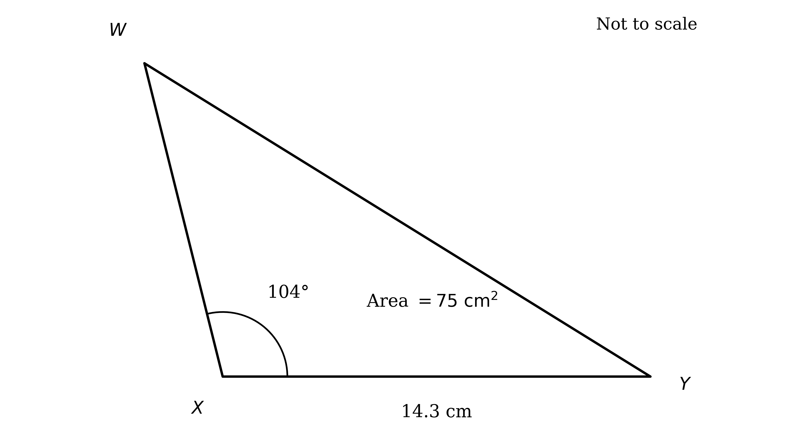

The angle $X = 104 ^{\circ}$ is enclosed by the sides $W X$ and $X Y$, so substitute into the area formula and solve for $W X$

$75 = \frac{1}{2} ( W X ) ( 14 . 3 )  \text{sin}  104 ^{\circ}$

**[M1]**

$W X = \frac{150}{14.3\text{sin}104^{\circ}} = 10 . 810 \dots$

**[A1]**

**Final answer:** $W X = 10 . 8$** cm**

**[A1]**

> **[mark-scheme]**
> **M1**: Correct substitution into the area formula and rearrangement for $W X$, for example $75 = \frac{1}{2} ( W X ) ( 14 . 3 )  \text{sin}  104 ^{\circ}$.
> 
> **A1**: Correct unrounded length (answers which round to $10 . 81$).
> 
> **A1**: $W X = 10 . 8$ cm, correct to 3 significant figures.

### Q10
To find an angle, arrange the sine rule with the sines on top. The side $B C = 18$ is opposite $x ^{\circ}$ and the side $A C = 26$ is opposite $54 ^{\circ}$

$\frac{\text{sin}x^{\circ}}{18} = \frac{\text{sin}54^{\circ}}{26}$

**[M1]**

$\text{sin}  x ^{\circ} = \frac{18\text{sin}54^{\circ}}{26} = 0 . 5601 \dots$

**[A1]**

Take the inverse sine

$x = \text{sin}^{-1} ( 0 . 5601 \dots ) = 34 . 06 \dots ^{\circ}$

$x = 34$

**[A1]**

> **[mark-scheme]**
> **M1**: Correct use of the sine rule with the sides opposite the correct angles, for example $\frac{\text{sin}x^{\circ}}{18} = \frac{\text{sin}54^{\circ}}{26}$.
> 
> **A1**: Correct value of $\text{sin}  x ^{\circ}$ (answers which round to $0 . 560$), or $x = 34 . 06 \dots$
> 
> **A1**: $x = 34$, to the nearest degree.

### Q11
Start from the cosine rule

$a^{2} = b^{2} + c^{2} - 2 b c  \text{cos}  A$

Add $2 b c  \text{cos}  A$ to both sides and subtract $a^{2}$ from both sides, to make the term in $\text{cos}  A$ the subject

$2 b c  \text{cos}  A = b^{2} + c^{2} - a^{2}$

**[M1 A1]**

Divide both sides by $2 b c$

**Final answer:** $\text{cos}  A = \frac{b^{2}+c^{2}-a^{2}}{2bc}$** as required**

**[A1]**

> **[mark-scheme]**
> **M1**: Correct rearrangement to make the term in $\text{cos}  A$ the subject (collecting $2 b c  \text{cos}  A$ on one side).
> 
> **A1**: Correct rearranged equation, $2 b c  \text{cos}  A = b^{2} + c^{2} - a^{2}$.
> 
> **A1**: Dividing by $2 b c$ to reach the printed result, $\text{cos}  A = \frac{b^{2}+c^{2}-a^{2}}{2bc}$.

### Q12
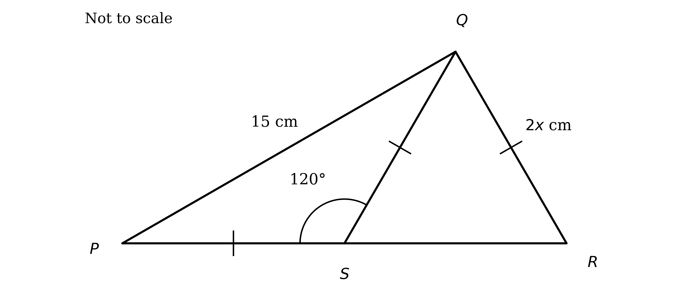

In triangle $P S Q$, $P S = S Q$, so it is isosceles with apex angle $P S Q = 120 ^{\circ}$. The base angles are equal

$\text{angle} S P Q = \text{angle} P Q S = \frac{180^{\circ}-120^{\circ}}{2} = 30 ^{\circ}$

Apply the sine rule, with $S Q = 2 x$ opposite the $30 ^{\circ}$ angle and $P Q = 15$ opposite the $120 ^{\circ}$ angle

$\frac{2x}{\text{sin}30^{\circ}} = \frac{15}{\text{sin}120^{\circ}}$

**[M1]**

$2 x = \frac{15\text{sin}30^{\circ}}{\text{sin}120^{\circ}} = 5 \sqrt{3}$

**[A1]**

$x = \frac{5\sqrt{3}}{2}$

**[A1]**

> **[mark-scheme]**
> **M1**: Finding the base angle $30 ^{\circ}$ and setting up the sine rule, $\frac{2x}{\text{sin}30^{\circ}} = \frac{15}{\text{sin}120^{\circ}}$.
> 
> **A1**: $2 x = 5 \sqrt{3}$ (exact).
> 
> **A1**: $x = \frac{5\sqrt{3}}{2}$.

Angle $Q S R = 180 ^{\circ} - 120 ^{\circ} = 60 ^{\circ}$. In triangle $S Q R$, $S Q = Q R$ with a base angle of $60 ^{\circ}$, so it is equilateral and angle $S Q R = 60 ^{\circ}$. Therefore

$\text{angle} P Q R = \text{angle} P Q S + \text{angle} S Q R = 30 ^{\circ} + 60 ^{\circ} = 90 ^{\circ}$

Triangle $P Q R$ is right-angled at $Q$, so its area is half the product of the two legs $P Q$ and $Q R = 2 x = 5 \sqrt{3}$

$\text{Area} = \frac{1}{2} ( 15 ) ( 5 \sqrt{3} )$

**[M1]**

$\text{Area} = \frac{75\sqrt{3}}{2} \text{cm}^{2}$

**[A1]**

> **[mark-scheme]**
> **M1**: Recognising angle $P Q R = 90 ^{\circ}$ (or using the area formula) with $P Q = 15$ and $Q R = 5 \sqrt{3}$.
> 
> **A1**: Area $= \frac{75\sqrt{3}}{2}$ cm² (accept $37 . 5 \sqrt{3}$ cm²).

### Q13
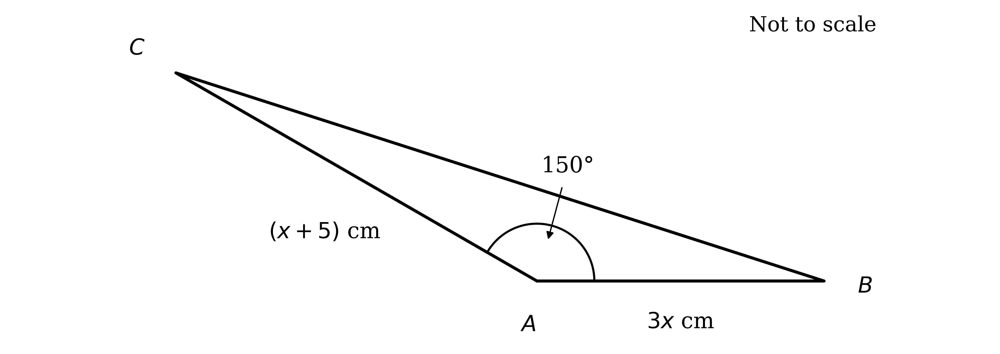

Use the area formula with $\text{sin}  150 ^{\circ} = \frac{1}{2}$ to form an equation in $x$

$\frac{1}{2} ( 3 x ) ( x + 5 )  \text{sin}  150 ^{\circ} = 7 \frac{1}{4} \Rightarrow \frac{3x^{2}+15x}{4} = \frac{29}{4}$

**[M1]**

$3 x^{2} + 15 x - 29 = 0$

**[A1]**

Solve with the quadratic formula, taking the positive root

$x = \frac{-15+\sqrt{573}}{6} = 1 . 489 \dots \Rightarrow A B = 4 . 468 ,  A C = 6 . 489$

**[M1]**

Find the third side $B C$ with the cosine rule

$B C^{2} = 4 . 468^{2} + 6 . 489^{2} - 2 ( 4 . 468 ) ( 6 . 489 )  \text{cos}  150 ^{\circ} = 112 . 3 \dots \Rightarrow B C = 10 . 60 \dots$

**[M1]**

Find angle $C$ (opposite $A B$) with the sine rule; then $B = 180 ^{\circ} - 150 ^{\circ} - C$

$\text{sin}  C = \frac{4.468\text{sin}150^{\circ}}{10.60} = 0 . 2108$

Take the inverse sine

$C = \text{sin}^{-1} ( 0 . 2108 ) = 12 . 171 \dots ^{\circ} \approx 12 ^{\circ}$

$B = 180 ^{\circ} - 150 ^{\circ} - 12 . 171 \dots ^{\circ} = 17 . 829 \dots ^{\circ} \approx 18 ^{\circ}$

**[A1]**

The angles are $150 ^{\circ}$, $18 ^{\circ}$ and $12 ^{\circ}$; divide the ratio by $6$

$A : B : C = 25 : 3 : 2$

**[A1]**

> **[mark-scheme]**
> **M1**: Correct use of the area formula with $\text{sin}  150 ^{\circ} = \frac{1}{2}$, equated to $7 \frac{1}{4}$.
> 
> **A1**: Correct quadratic $3 x^{2} + 15 x - 29 = 0$.
> 
> **M1**: Solving the quadratic for the positive value of $x$.
> 
> **M1**: Correct use of the cosine rule for $B C$.
> 
> **A1**: All three angles correct to the nearest degree, $150 ^{\circ}$, $18 ^{\circ}$ and $12 ^{\circ}$.
> 
> **A1**: Ratio $25 : 3 : 2$ in its simplest form.

### Q14
Because the triangle is isosceles, either the $7 . 3$ cm or the $9 . 8$ cm side is repeated, giving two possible triangles. In each, the smallest angle is opposite the shortest side.

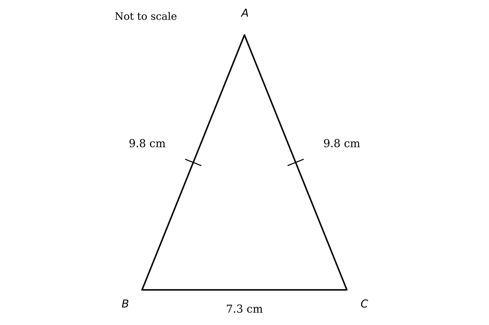

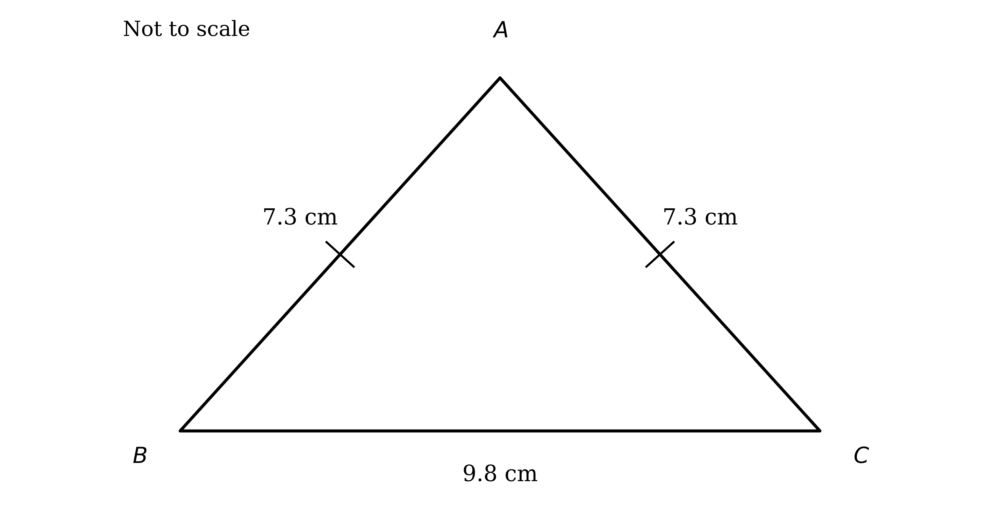

For the triangle with sides $7 . 3$, $7 . 3$, $9 . 8$, the smallest angle is a base angle. Find the apex (opposite $9 . 8$) first

$\text{cos} θ = \frac{7.3^{2}+7.3^{2}-9.8^{2}}{2(7.3)(7.3)} = 0 . 0989 \dots$

Take the inverse cosine

$θ=\text{cos}^{-1}(0.0989\dots)=84.325\dots$

$\text{smallest angle}=\frac{180\circ-84.325\dots\circ}{2}=47.838\dots$

**[M1 A1]**

For the triangle with sides $9 . 8$, $9 . 8$, $7 . 3$, the smallest angle is opposite the $7 . 3$ side

$\text{cos} θ = \frac{9.8^{2}+9.8^{2}-7.3^{2}}{2(9.8)(9.8)} = 0 . 7225 \dots$

Take the inverse cosine

$θ=\text{cos}^{-1}(0.7225\dots)=43.733\dots$

**[A1]**

Subtract the two smallest angles to find the difference

$\text{Difference}=47.838\dots-43.733\dots=4.10^{\circ}$

**[A1]**

> **[mark-scheme]**
> **M1**: Recognising the two possible isosceles triangles and using the cosine rule to find a smallest angle in one of them.
> 
> **A1**: Smallest angle of the $7 . 3 , 7 . 3 , 9 . 8$ triangle $=47.8^{\circ}$.
> 
> **A1**: Smallest angle of the $9 . 8 , 9 . 8 , 7 . 3$ triangle $=43.7^{\circ}$.
> 
> **A1**: Difference $=4.10^{\circ}$ (answers which round to $4.1^{\circ}$).

### Q15
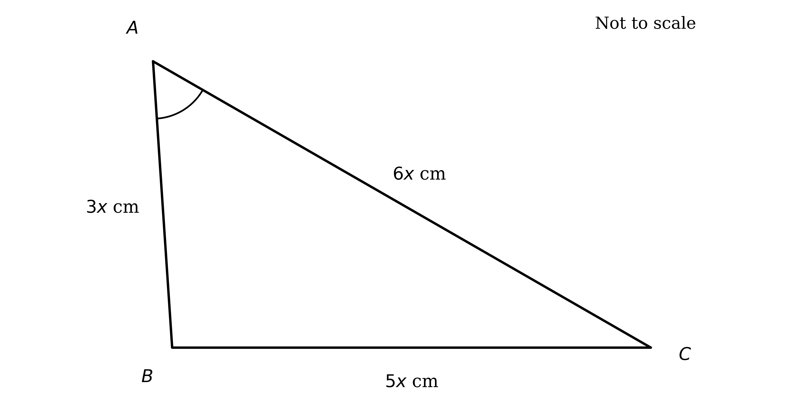

$B A C$ is opposite $B C = 5 x$. Rearranging the cosine rule, the $x^{2}$ terms cancel

$\text{cos}  B A C = \frac{(3x)^{2}+(6x)^{2}-(5x)^{2}}{2(3x)(6x)} = \frac{20x^{2}}{36x^{2}} = \frac{5}{9}$

**[M1]**

Take the inverse cosine

`BAC = \text{cos}^{-1}\left(\dfrac{5}{9}\right) = 56.251 \ldots°`

$B A C = 56 . 25 ^{\circ}$

**[A1]**

> **[mark-scheme]**
> **M1**: Correct rearrangement of the cosine rule with the $x$ terms cancelling, $\text{cos}  B A C = \frac{(3x)^{2}+(6x)^{2}-(5x)^{2}}{2(3x)(6x)}$.
> 
> **A1**: $B A C = 56 . 25 ^{\circ}$, to 2 decimal places.
The perimeter is $3 x + 5 x + 6 x = 14 x$

$14 x = 37 . 8 \Rightarrow x = 2 . 7$

**[M1]**

So $A B = 8 . 1$, $B C = 13 . 5$ and $A C = 16 . 2$ cm

**[A1]**

Use the area formula with the two sides enclosing angle $B A C$

$\text{Area} = \frac{1}{2} ( 8 . 1 ) ( 16 . 2 )  \text{sin}  56 . 25 ^{\circ}$

**[M1]**

$\text{Area} = 54 . 6 \text{cm}^{2}$

**[A1]**

> **[mark-scheme]**
> **M1**: Using $14 x = 37 . 8$ to find $x = 2 . 7$.
> 
> **A1**: Correct side lengths, $8 . 1$, $13 . 5$ and $16 . 2$ cm.
> 
> **M1**: Correct use of the area formula (or Heron's formula) with the side lengths.
> 
> **A1**: Area $= 54 . 6$ cm², correct to 3 significant figures.

### Q16
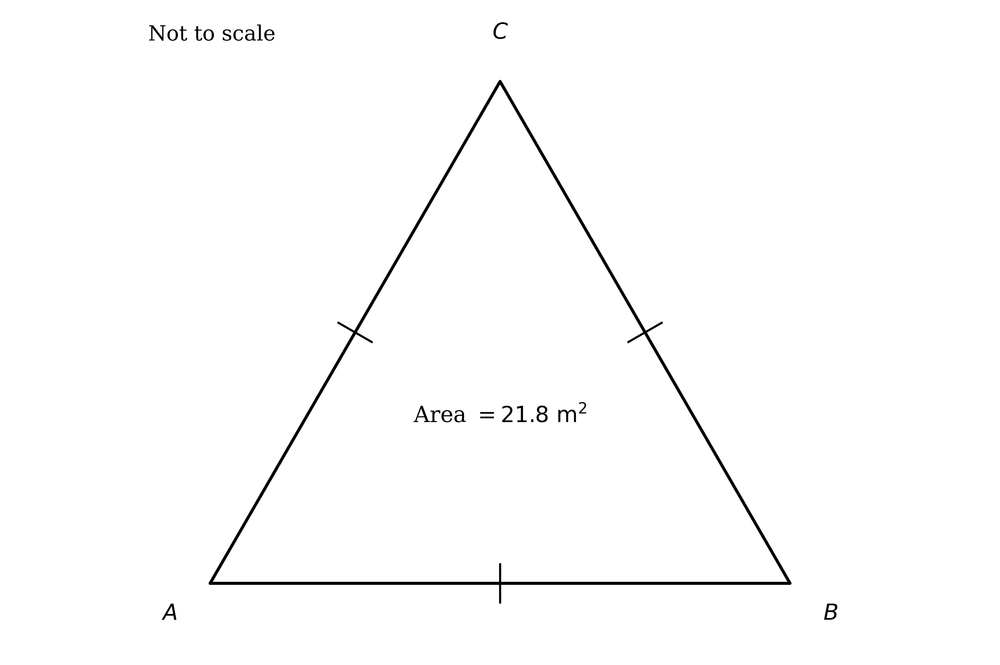

Three equal lengths make an equilateral triangle of side $s$, with a $60 ^{\circ}$ angle between each pair of sides. Use the area formula

$\frac{1}{2} s^{2}  \text{sin}  60 ^{\circ} = 21 . 8$

**[M1]**

$s^{2} = \frac{21.8}{\frac{1}{2}\text{sin}60^{\circ}} = 50 . 34 \dots$

**[A1]**

$s = 7 . 095 \dots$* m*

**[A1]**

The total piping is the perimeter, $3 s$; convert metres to centimetres

$3 s = 21 . 286 \dots \text{m} = 2128 . 6 \dots \text{cm}$

**[M1]**

**Final answer:** $2129$** cm**

**[A1]**

> **[mark-scheme]**
> **M1**: Correct use of the area formula for an equilateral triangle equated to $21 . 8$, for example $\frac{1}{2} s^{2}  \text{sin}  60 ^{\circ} = 21 . 8$.
> 
> **A1**: Correct value of $s^{2}$ (answers which round to $50 . 3$).
> 
> **A1**: Side length $s = 7 . 10$ m (answers which round to $7 . 095$).
> 
> **M1**: Finding the perimeter $3 s$ and converting to centimetres.
> 
> **A1**: $2129$ cm, to the nearest cm. Allow 21.29 m.

### Q17
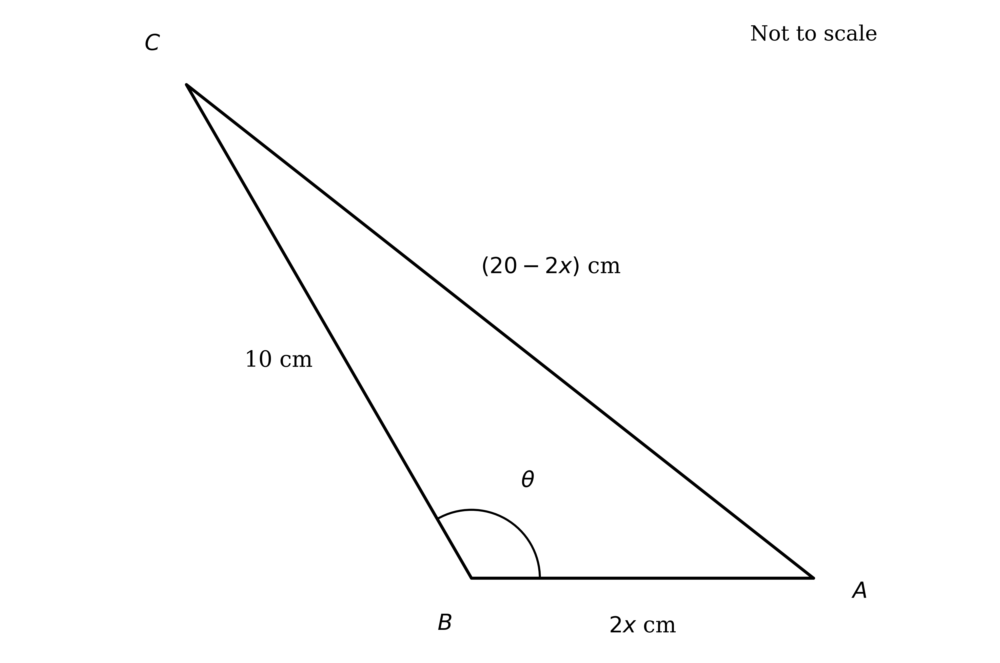

$A C$ is opposite the angle $B = θ$, so apply the cosine rule

$( 20 - 2 x )^{2} = ( 2 x )^{2} + 10^{2} - 2 ( 2 x ) ( 10 )  \text{cos}  θ$

**[M1]**

Expand: $400 - 80 x + 4 x^{2} = 4 x^{2} + 100 - 40 x  \text{cos}  θ$. The $4 x^{2}$ cancels, so $40 x  \text{cos}  θ = 80 x - 300$

**Final answer:** $\text{cos}  θ = \frac{80x-300}{40x} = \frac{4x-15}{2x}$** as required**

**[A1]**

> **[mark-scheme]**
> **M1**: Correct cosine rule with the given expressions substituted, $( 20 - 2 x )^{2} = ( 2 x )^{2} + 10^{2} - 2 ( 2 x ) ( 10 )  \text{cos}  θ$.
> 
> **A1**: Correct expansion and rearrangement to the printed result $\text{cos}  θ = \frac{4x-15}{2x}$.
Set the expression from part (a) equal to $- \frac{1}{2}$ and solve for $x$

$\frac{4x-15}{2x} = - \frac{1}{2} \Rightarrow 8 x - 30 = - 2 x \Rightarrow 10 x = 30$

**[M1]**

$x = 3 \Rightarrow A B = 6 ,  B C = 10$

**[A1]**

Since $\text{cos}  θ = - \frac{1}{2}$, take the inverse cosine

`\theta = \text{cos}^{-1}\left(-\dfrac{1}{2}\right) = 120°`

Use the area formula with the two sides enclosing $θ$

$\text{Area} = \frac{1}{2} ( 6 ) ( 10 )  \text{sin}  120 ^{\circ} = 30 \times \frac{\sqrt{3}}{2}$

**[M1]**

$\text{Area} = 15 \sqrt{3} \text{cm}^{2}$

**[A1]**

> **[mark-scheme]**
> **M1**: Setting $\frac{4x-15}{2x} = - \frac{1}{2}$ and solving for $x$.
> 
> **A1**: $x = 3$, giving $A B = 6$ and $B C = 10$.
> 
> **M1**: Correct use of the area formula with $\text{sin}  120 ^{\circ} = \frac{\sqrt{3}}{2}$.
> 
> **A1**: Area $= 15 \sqrt{3}$ cm² (accept $26 . 0$ cm² to 3 significant figures).

### Q18
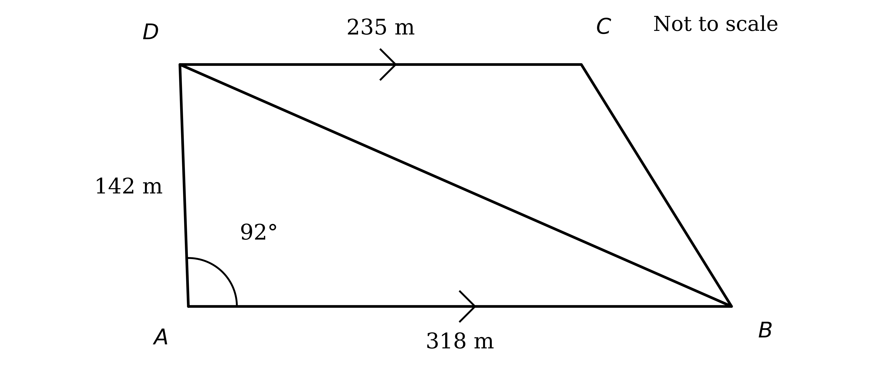

Draw the diagonal $B D$. In triangle $A B D$ the angle $D A B = 92 ^{\circ}$ is known, so find $B D$ with the cosine rule

$B D^{2} = 142^{2} + 318^{2} - 2 ( 142 ) ( 318 )  \text{cos}  92 ^{\circ}$

**[M1]**

$B D = 352 . 76 \dots$* m*

**[A1]**

Find angle $A B D$ with the sine rule (needed for the second triangle)

$\text{sin}  A B D = \frac{142\text{sin}92^{\circ}}{352.76\dots} = 0 . 4022 \dots$

**[M1]**

Take the inverse sine

$A B D = \text{sin}^{-1} ( 0 . 4022 \dots ) = 23 . 722 \dots ^{\circ}$

**[A1]**

Since $A B$ is parallel to $C D$, angle $B D C =$ angle $A B D = 23 . 72 ^{\circ}$ (alternate angles), so the area of the field is the sum of the two triangles

$\text{Area} = \frac{1}{2} ( 142 ) ( 318 )  \text{sin}  92 ^{\circ}$

**[M1]**

$+  \frac{1}{2} ( 235 ) ( 352 . 76 )  \text{sin}  23 . 72 ^{\circ}$

**[M1]**

$\text{Area} = 22564 + 16674 = 39238 \dots \text{m}^{2}$

**[A1]**

Divide by the area each unicorn needs, then round down

$\frac{39238\dots}{2222} = 17 . 6 \dots$

**[M1]**

**Final answer:** $17$** unicorns**

**[A1]**

> **[mark-scheme]**
> **M1**: Correct use of the cosine rule in triangle $A B D$ for the diagonal $B D$.
> 
> **A1**: Correct diagonal (answers which round to $353$ m).
> 
> **M1**: Correct use of the sine rule to find angle $A B D$.
> 
> **A1**: Angle $A B D = 23 . 7 ^{\circ}$ (answers which round to $23 . 7 ^{\circ}$).
> 
> **M1**: Correct area of triangle $A B D$, $\frac{1}{2} ( 142 ) ( 318 )  \text{sin}  92 ^{\circ}$.
> 
> **M1**: Correct area of triangle $B D C$, using angle $B D C = 23 . 72 ^{\circ}$ from alternate angles.
> 
> **A1**: Correct total area (answers which round to $39200$ m²).
> 
> **M1**: Dividing the total area by $2222$.
> 
> **A1**: $17$ unicorns, having rounded down to a whole number.

### Q19
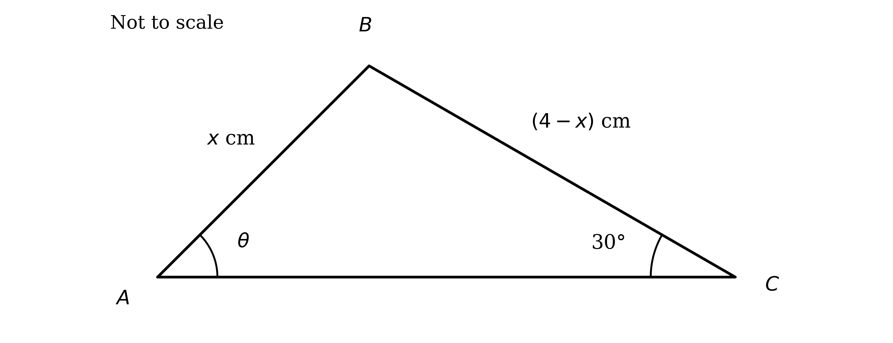

$B C$ is opposite $θ$ and $A B$ is opposite the $30 ^{\circ}$ angle, so use the sine rule

$\frac{4-x}{\text{sin}θ} = \frac{x}{\text{sin}30^{\circ}}$

**[M1]**

Substitute $\text{sin}  θ = \frac{1}{\sqrt{2}}$ and $\text{sin}  30 ^{\circ} = \frac{1}{2}$

$( 4 - x ) \sqrt{2} = 2 x$

**[A1]**

Collect the terms in $x$

$4 \sqrt{2} = 2 x + x \sqrt{2} = x ( 2 + \sqrt{2} )$

**[M1]**

$x = \frac{4\sqrt{2}}{2+\sqrt{2}}$

**[A1]**

Rationalise by multiplying by $\frac{2-\sqrt{2}}{2-\sqrt{2}}$

$x = \frac{4\sqrt{2}(2-\sqrt{2})}{4-2} = 2 \sqrt{2}  ( 2 - \sqrt{2} ) = 4 \sqrt{2} - 4$

**Final answer:** $x = 4 ( \sqrt{2} - 1 )$** as required**

**[A1]**

> **[mark-scheme]**
> **M1**: Correct use of the sine rule, $\frac{4-x}{\text{sin}θ} = \frac{x}{\text{sin}30^{\circ}}$.
> 
> **A1**: Correct equation after substituting the exact sines, $( 4 - x ) \sqrt{2} = 2 x$.
> 
> **M1**: Collecting the $x$ terms, $x ( 2 + \sqrt{2} ) = 4 \sqrt{2}$.
> 
> **A1**: $x = \frac{4\sqrt{2}}{2+\sqrt{2}}$.
> 
> **A1**: Rationalising to reach the printed result $x = 4 ( \sqrt{2} - 1 )$.

### Q20
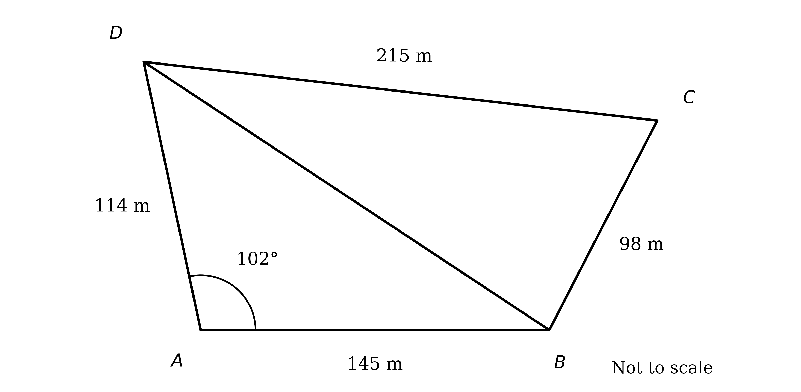

The angle between $B C$ and $C D$ is angle $B C D$. First find the diagonal $B D$, using triangle $A B D$ where the angle $D A B = 102 ^{\circ}$ is known

$B D^{2} = 145^{2} + 114^{2} - 2 ( 145 ) ( 114 )  \text{cos}  102 ^{\circ}$

**[M1]**

$B D = 202 . 2 \dots$* m*

**[A1]**

Now use triangle $B C D$, where $B D$ is opposite angle $B C D$, and rearrange the cosine rule

$\text{cos}  B C D = \frac{98^{2}+215^{2}-202.2\dots^{2}}{2(98)(215)} = 0 . 3544 \dots$

**[M1 A1]**

Take the inverse cosine

$B C D = \text{cos}^{-1} ( 0 . 3544 \dots ) = 69 . 243 \dots ^{\circ}$

$B C D = 69 . 2 ^{\circ}$

**[A1]**

> **[mark-scheme]**
> **M1**: Correct use of the cosine rule in triangle $A B D$ for the diagonal $B D$.
> 
> **A1**: Correct diagonal (answers which round to $202$ m).
> 
> **M1**: Correct rearrangement of the cosine rule in triangle $B C D$ for angle $B C D$, using your $B D$.
> 
> **A1**: Correct unrounded value of $\text{cos}  B C D$ (answers which round to $0 . 354$).
> 
> **A1**: $B C D = 69 . 2 ^{\circ}$ (answers which round to $69 . 2 ^{\circ}$).

The diagonal $B D$ splits the field into triangles $A B D$ and $B C D$; add their areas

$\text{Area} = \frac{1}{2} ( 145 ) ( 114 )  \text{sin}  102 ^{\circ} + \frac{1}{2} ( 98 ) ( 215 )  \text{sin}  69 . 25 ^{\circ}$

**[M1]**

$\text{Area} = 8084 + 9851 = 17935 \dots \text{m}^{2}$

**[A1]**

Divide by the area each unicorn needs, then round down (a whole number of unicorns)

$\frac{17935\dots}{1234} = 14 . 5 \dots$

**[M1]**

**Final answer:** $14$** unicorns**

**[A1]**

> **[mark-scheme]**
> **M1**: Correct method for the total area — adding the areas of triangles $A B D$ and $B C D$.
> 
> **A1**: Correct total area (answers which round to $17900$ m²).
> 
> **M1**: Dividing the total area by $1234$.
> 
> **A1**: $14$ unicorns, having rounded down to a whole number.

### Q21
Since $P S R$ is a straight line, angle $Q S R = 180 ^{\circ} - 102 ^{\circ} = 78 ^{\circ}$. Work in triangle $Q S R$, where $y = Q S$ is opposite the $37 ^{\circ}$ angle

$\frac{y}{\text{sin}37^{\circ}} = \frac{5.8}{\text{sin}78^{\circ}}$

**[M1]**

**Final answer:** $y = 3 . 57$** cm**

**[A1]**

Now work in triangle $P Q S$, where $P Q = 13$ is opposite the $102 ^{\circ}$ angle and $Q S$ is opposite $x ^{\circ}$

$\frac{\text{sin}x^{\circ}}{3.5686\dots} = \frac{\text{sin}102^{\circ}}{13}$

$\text{sin}  x ^{\circ} = 0 . 2685 \dots$

**[M1]**

Take the inverse sine

$x = \text{sin}^{-1} ( 0 . 2685 \dots ) = 15 . 575 \dots ^{\circ}$

$x = 15 . 6$

**[A1]**

> **[mark-scheme]**
> **M1**: Correct method for $y$ — using angle $Q S R = 78 ^{\circ}$ and the sine rule in triangle $Q S R$.
> 
> **A1**: Answers which round to $y = 3 . 57$ cm.
> 
> **M1**: Correct use of the sine rule in triangle $P Q S$ to find $x$ (using your $Q S$).
> 
> **A1**: Answers which round to $x = 15 . 6$.

### Q22
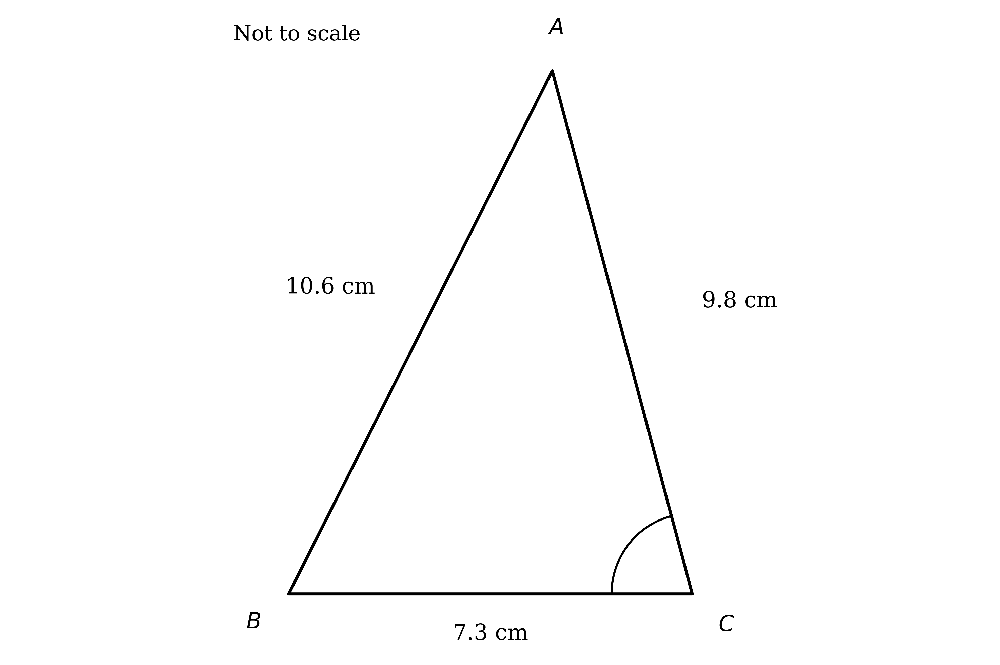

The largest angle is opposite the longest side ($10 . 6$ cm), so rearrange the cosine rule for that angle

$\text{cos}  θ = \frac{7.3^{2}+9.8^{2}-10.6^{2}}{2(7.3)(9.8)} = 0 . 2583 \dots$

**[M1]**

Take the inverse cosine

$θ = \text{cos}^{-1} ( 0 . 2583 \dots ) = 75 . 026 \dots ^{\circ}$

$θ = 75 . 0 ^{\circ}$

**[A1]**

> **[mark-scheme]**
> **M1**: Correct rearrangement of the cosine rule for the angle opposite the longest side, $\text{cos}  θ = \frac{7.3^{2}+9.8^{2}-10.6^{2}}{2(7.3)(9.8)}$.
> 
> **A1**: Largest angle $= 75 . 0 ^{\circ}$ (answers which round to $75 . 0 ^{\circ}$).
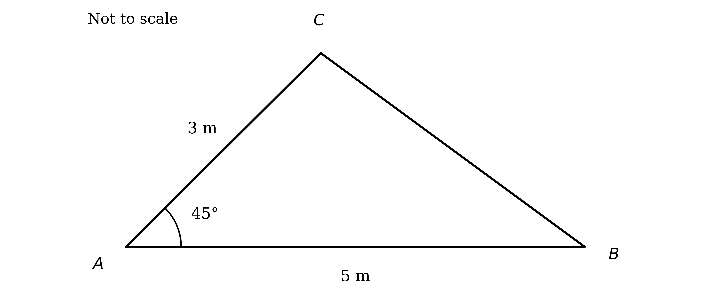

The third side is opposite the $45^{\circ}$ angle, so apply the cosine rule

$c^{2} = 3^{2} + 5^{2} - 2 ( 3 ) ( 5 )  \text{cos}  45 ^{\circ} = 12 . 78 \dots$

**[M1]**

**Final answer:** $c = 3 . 58$** m**

**[A1]**

> **[mark-scheme]**
> **M1**: Correct substitution into the cosine rule, $c^{2} = 3^{2} + 5^{2} - 2 ( 3 ) ( 5 )  \text{cos}  45 ^{\circ}$.
> 
> **A1**: Third side $= 3 . 58$ m, correct to 3 significant figures (answers which round to $3 . 576$).

### Q23
The information (two sides and a non-included angle) gives two possible triangles, shown together in the diagram below

Angle $B A C$ is opposite $B C = 3 . 5$ and the $43 ^{\circ}$ angle is opposite $A B = 2 . 8$. Use the sine rule

$\frac{\text{sin}BAC}{3.5} = \frac{\text{sin}43^{\circ}}{2.8} \Rightarrow \text{sin}  B A C = 0 . 8525 \dots$

**[M1]**

Take the inverse sine to obtain the acute value

$B A C = \text{sin}^{-1} ( 0 . 8525 \dots ) = 58 . 484 \dots ^{\circ}$

The acute solution is $B A C = 58 . 5 ^{\circ}$, and by the symmetry of the sine graph the obtuse solution is

* *$180 ^{\circ} - 58 . 5 ^{\circ} = 121 . 5 ^{\circ}$

**[A1]**

In the triangle with the obtuse angle, $B A C = 121 . 5 ^{\circ}$ is already the largest angle

$\text{Largest angle} = 121 . 5 ^{\circ}$

**[A1]**

In the triangle with $B A C = 58 . 5 ^{\circ}$, the largest angle is $A B C = 180 ^{\circ} - 43 ^{\circ} - 58 . 5 ^{\circ}$

$\text{Largest angle} = 78 . 5 ^{\circ}$

**[A1]**

> **[mark-scheme]**
> **M1**: Correct use of the sine rule to find $\text{sin}  B A C$, for example $\frac{\text{sin}BAC}{3.5} = \frac{\text{sin}43^{\circ}}{2.8}$.
> 
> **A1**: Correct acute value $58 . 5 ^{\circ}$ (answers which round to $58 . 5 ^{\circ}$).
> 
> **A1**: Largest angle of the second triangle $= 121 . 5 ^{\circ}$, found from $180 ^{\circ} - 58 . 5 ^{\circ}$.
> 
> **A1**: Largest angle of the first triangle $= 78 . 5 ^{\circ}$ (angle $A B C$).

### Q24
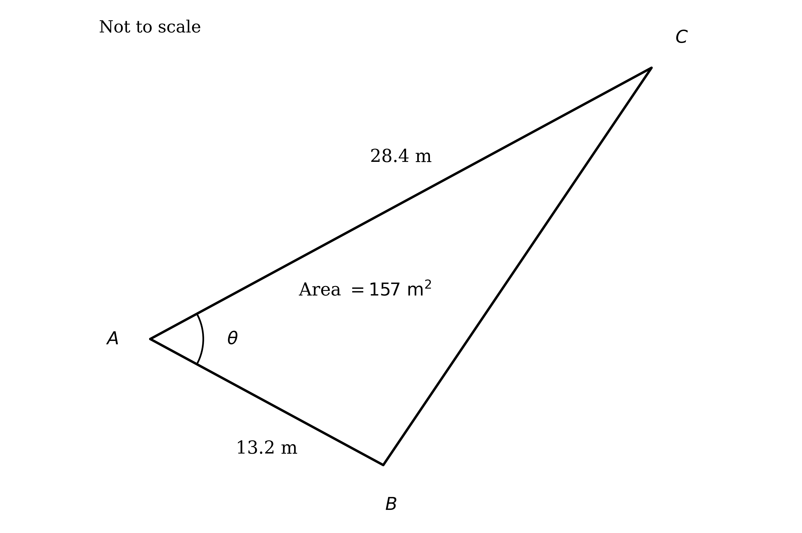

The angle $θ$ is between the two known sides, so use the area formula

$\frac{1}{2} ( 13 . 2 ) ( 28 . 4 )  \text{sin}  θ = 157$

**[M1]**

$\text{sin}  θ = \frac{157}{187.44} = 0 . 8376 \dots$

**[A1]**

Take the inverse sine to obtain the acute value

$θ = \text{sin}^{-1} ( 0 . 8376 \dots ) = 56 . 888 \dots ^{\circ}$

By the symmetry of the sine graph, $\text{sin}  θ = \text{sin}  ( 180 ^{\circ} - θ )$ also gives an obtuse solution

**Final answer:** $θ = 56 . 9 ^{\circ}$** or **$θ = 123 . 1 ^{\circ}$

**[A1 A1]**

> **[mark-scheme]**
> **M1**: Correct use of the area formula equated to $157$, $\frac{1}{2} ( 13 . 2 ) ( 28 . 4 )  \text{sin}  θ = 157$.
> 
> **A1**: Correct value $\text{sin}  θ = 0 . 838$ (answers which round to $0 . 838$).
> 
> **A1**: Acute value $θ = 56 . 9 ^{\circ}$.
> 
> **A1**: Obtuse value $θ = 123 . 1 ^{\circ}$, from $180 ^{\circ} - 56 . 9 ^{\circ}$.
Use $θ = 56 . 9 ^{\circ}$. The third side is opposite $θ$, so apply the cosine rule

$c^{2} = 13 . 2^{2} + 28 . 4^{2} - 2 ( 13 . 2 ) ( 28 . 4 )  \text{cos}  56 . 9 ^{\circ}$

$c^{2} = 571 . 4 \dots \Rightarrow c = 23 . 9 \dots$

**[M1 A1]**

Add the three sides

$P = 13 . 2 + 28 . 4 + 23 . 9 \dots = 65 . 5 \dots$

**Final answer:** $P = 66$** m**

**[A1]**

> **[mark-scheme]**
> **M1**: Correct use of the cosine rule for the third side, $c^{2} = 13 . 2^{2} + 28 . 4^{2} - 2 ( 13 . 2 ) ( 28 . 4 )  \text{cos}  56 . 9 ^{\circ}$.
> 
> **A1**: Correct third side (answers which round to $23 . 9$ m).
> 
> **A1**: Perimeter $= 66$ m, to the nearest metre.

### Q25
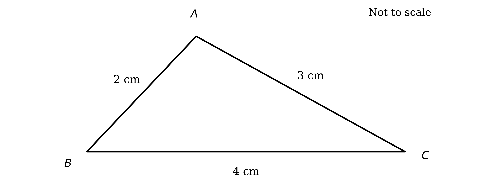

(i)

For the angle opposite the side of length $4$

$\text{cos}  θ = \frac{3^{2}+2^{2}-4^{2}}{2(3)(2)} = - \frac{1}{4}$

**[M1]**

For the angle opposite the side of length $3$

$\text{cos}  θ = \frac{4^{2}+2^{2}-3^{2}}{2(4)(2)} = \frac{11}{16}$

**[A1]**

For the angle opposite the side of length $2$

$\text{cos}  θ = - \frac{1}{4} ,   \frac{11}{16} ,   \frac{7}{8}$

**[A1]**

(ii)

The largest angle has the smallest (most negative) cosine, $- \frac{1}{4}$, which is opposite the longest side

**Final answer:** **The largest angle lies between the sides of length **$3$** cm and **$2$** cm**

**[B1]**

> **[mark-scheme]**
> **M1**: Correct rearrangement of the cosine rule for at least one angle, for example $\text{cos}  θ = \frac{3^{2}+2^{2}-4^{2}}{2(3)(2)}$.
> 
> **A1**: Any two of the correct values $- \frac{1}{4}$, $\frac{11}{16}$, $\frac{7}{8}$.
> 
> **A1**: All three values correct.
> 
> **B1**: States the largest angle lies between the sides of length $3$ cm and $2$ cm (opposite the longest side).

### Q26
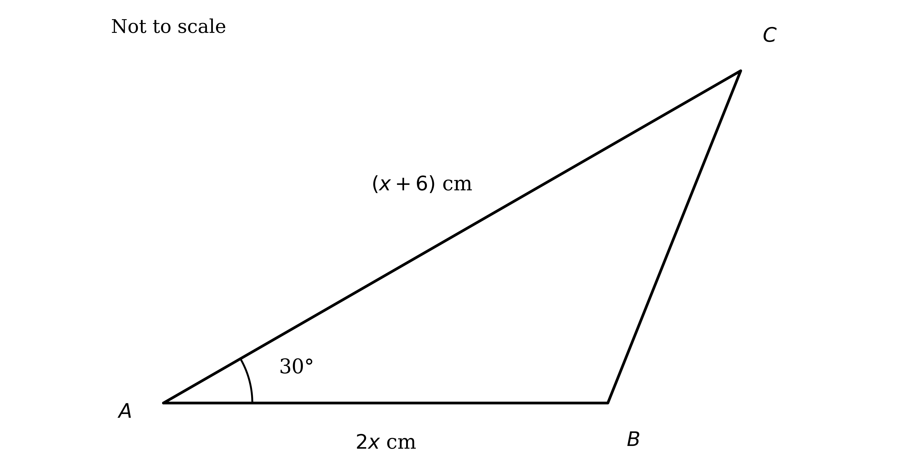

The angle $30 ^{\circ}$ is enclosed by the sides $A B$ and $A C$, so use the area formula with $\text{sin}  30 ^{\circ} = \frac{1}{2}$

$\frac{1}{2} ( 2 x ) ( x + 6 )  \text{sin}  30 ^{\circ} = 5 \frac{3}{4}$

**[M1]**

$\frac{2x^{2}+12x}{4} = \frac{23}{4}$

**[A1]**

Multiply both sides by $4$ and collect terms

**Final answer:** $2 x^{2} + 12 x - 23 = 0$** as required**

**[A1]**

> **[mark-scheme]**
> **M1**: Correct use of the area formula with $\text{sin}  30 ^{\circ} = \frac{1}{2}$, equated to $5 \frac{3}{4}$.
> 
> **A1**: Correct simplified equation, for example $\frac{2x^{2}+12x}{4} = \frac{23}{4}$.
> 
> **A1**: Reaching the printed result $2 x^{2} + 12 x - 23 = 0$ with correct working.
Solve the quadratic (the quadratic formula is needed here), taking the positive root

$x = \frac{-12+\sqrt{12^{2}+4(2)(23)}}{2(2)} = 1 . 527 \dots$

**[M1]**

Therefore $A B = 3 . 055 \dots$ and $A C = 7 . 527 \dots$

Find the third side $B C$ with the cosine rule

$B C^{2} = A B^{2} + A C^{2} - 2 ( A B ) ( A C )  \text{cos}  30 ^{\circ} = 26 . 16 \dots \Rightarrow B C = 5 . 11 \dots$

**[M1]**

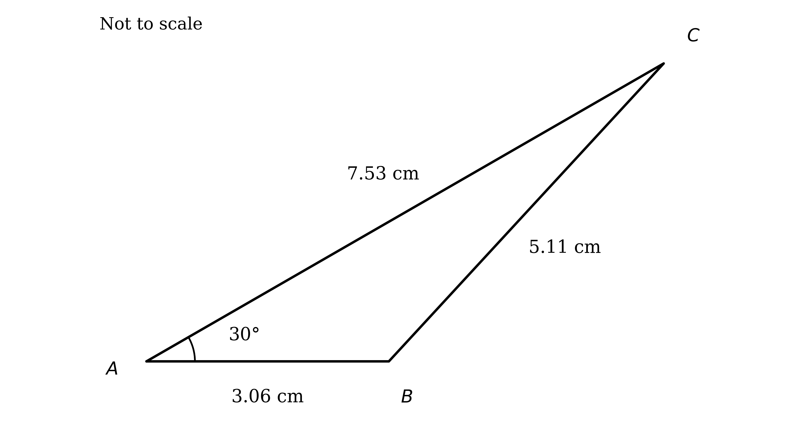

Add the three sides

**Final answer:** $\text{Perimeter} = 15 . 7$** cm**

**[A1]**

> **[mark-scheme]**
> **M1**: Correct method to solve the quadratic, giving $x = 1 . 53$ (rejecting the negative root).
> 
> **M1**: Correct use of the cosine rule for $B C$ with your side lengths.
> 
> **A1**: Perimeter $= 15 . 7$ cm, correct to 3 significant figures.

One angle is $A = 30 ^{\circ}$. Find angle $C$ (opposite the shorter side $A B$) with the sine rule

$\text{sin}  C = \frac{AB\text{sin}30^{\circ}}{BC} = 0 . 2986 \dots$

Take the inverse sine

$C = \text{sin}^{-1} ( 0 . 2986 \dots ) = 17 . 377 \dots ^{\circ} \approx 17 ^{\circ}$

**[M1]**

The angles sum to $180 ^{\circ}$, so find the obtuse angle $B$

$B = 180 ^{\circ} - 30 ^{\circ} - 17 . 4 ^{\circ} = 132 . 6 ^{\circ} \approx 133 ^{\circ}$

**[M1]**

Write the three angles as a ratio (there is no common factor, so it is already in simplest form)

$A : B : C = 30 : 133 : 17$

**[A1]**

> **[mark-scheme]**
> **M1**: Correct method to find a second angle (sine or cosine rule), for example $\text{sin}  C = \frac{AB\text{sin}30^{\circ}}{BC}$.
> 
> **M1**: Using the angle sum to find the obtuse angle, $B = 180 ^{\circ} - 30 ^{\circ} - 17 . 4 ^{\circ} \approx 133 ^{\circ}$.
> 
> **A1**: The three angles $30 ^{\circ}$, $133 ^{\circ}$ and $17 ^{\circ}$ expressed as the ratio $30 : 133 : 17$.

### Q27
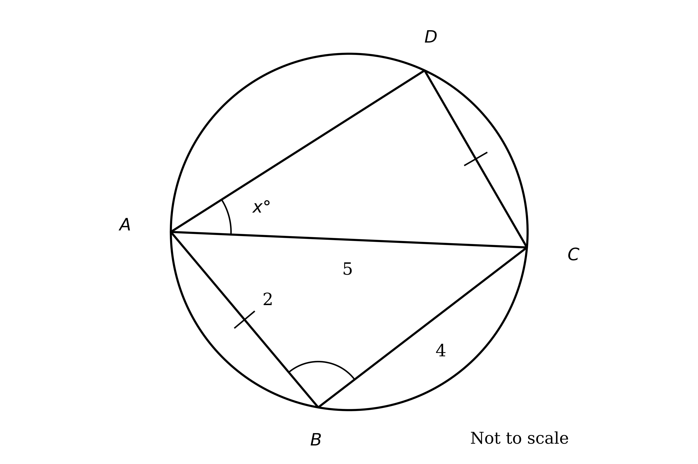

Use the ratio values as side lengths in triangle $A B C$: $A B = 2$, $B C = 4$, $A C = 5$. Angle $A B C$ is opposite $A C$, so rearrange the cosine rule

$\text{cos}  A B C = \frac{2^{2}+4^{2}-5^{2}}{2(2)(4)} = - \frac{5}{16}$

**[M1]**

Take the inverse cosine

`ABC = \text{cos}^{-1}\left(-\dfrac{5}{16}\right) = 108.21 \ldots°`

$A B C = 108 . 2 ^{\circ}$

**[A1]**

> **[mark-scheme]**
> **M1**: Correct rearrangement of the cosine rule using the ratio as side lengths, $\text{cos}  A B C = \frac{2^{2}+4^{2}-5^{2}}{2(2)(4)}$.
> 
> **A1**: $A B C = 108 . 2 ^{\circ}$, to 1 decimal place (answers which round to $108 . 2 ^{\circ}$).

$A B C D$ is a cyclic quadrilateral, so opposite angles sum to $180 ^{\circ}$

$A D C = 180 ^{\circ} - 108 . 21 \dots ^{\circ} = 71 . 79 \dots ^{\circ}$

**[M1]**

In triangle $A C D$, the side $C D = A B = 2$ is opposite $x ^{\circ}$ and $A C = 5$ is opposite $A D C$. Use the sine rule

$\text{sin}  x ^{\circ} = \frac{2\text{sin}71.79\dots^{\circ}}{5} = 0 . 3799 \dots$

Take the inverse sine

$x = \text{sin}^{-1} ( 0 . 3799 \dots ) = 22 . 332 \dots ^{\circ}$

**[M1]**

$x = 22 . 3 ^{\circ}$

**[A1]**

An error of $1$ degree means $x$ may vary by $\pm 0 . 5 ^{\circ}$ about this value

$21 . 8 ^{\circ} \leq x \leq 22 . 8 ^{\circ}$

**[A1]**

> **[mark-scheme]**
> **M1**: Using the cyclic-quadrilateral property (opposite angles sum to $180 ^{\circ}$) to find $A D C = 180 ^{\circ} - 108 . 2 ^{\circ} = 71 . 8 ^{\circ}$.
> 
> **M1**: Correct use of the sine rule in triangle $A C D$ to find $x$, using $C D = 2$ and $A C = 5$.
> 
> **A1**: $x = 22 . 3 ^{\circ}$ (answers which round to $22 . 3 ^{\circ}$).
> 
> **A1**: Acceptable range $21 . 8 ^{\circ} \leq x \leq 22 . 8 ^{\circ}$ (the value $\pm 0 . 5 ^{\circ}$).
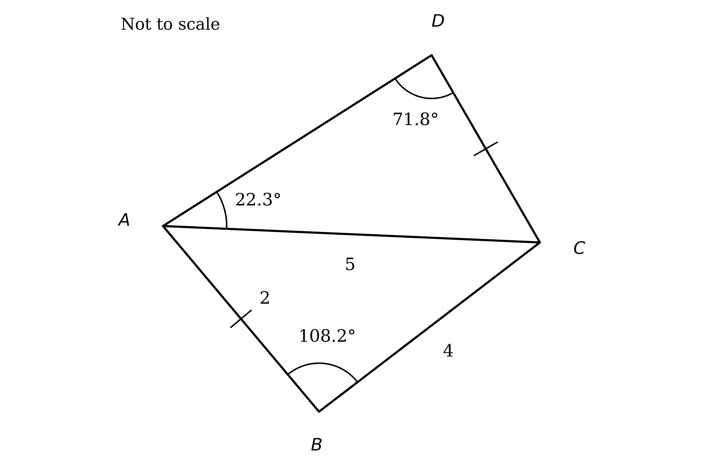

The ratio value of $B C$ is $4$, so with $B C = 1$ inch, divide every length by $4$

$A B = C D = 0 . 5 ,  A C = 1 . 25  ( \text{inches} )$

**[M1]**

The diagonal $A C$ splits $A B C D$ into triangles $A B C$ and $A C D$. In triangle $A C D$, the angles $A D C = 71 . 8 ^{\circ}$ and $C A D = 22 . 3 ^{\circ}$ were found in part (b), so the third angle is

$A C D = 180 ^{\circ} - 71 . 8 ^{\circ} - 22 . 3 ^{\circ} = 85 . 9 ^{\circ}$

Add the areas of the two triangles, each using $\frac{1}{2} a b  \text{sin}  C$

$\text{Area} = \frac{1}{2} ( 0 . 5 ) ( 1 )  \text{sin}  108 . 2 ^{\circ} + \frac{1}{2} ( 1 . 25 ) ( 0 . 5 )  \text{sin}  85 . 9 ^{\circ}$

**[M1]**

$\text{Area} = 0 . 549 \text{inches}^{2}$

**[A1]**

> **[mark-scheme]**
> **M1**: Correct side lengths from $B C = 1$ inch (dividing the ratio values by $4$).
> 
> **M1**: Correct method — area of triangle $A B C$ plus area of triangle $A C D$, each using $\frac{1}{2} a b  \text{sin}  C$, with $A C D = 85 . 9 ^{\circ}$ found from the part (b) angles ($71 . 8 ^{\circ}$ and $22 . 3 ^{\circ}$).
> 
> **A1**: Area $= 0 . 549$ inches², correct to 3 significant figures.

### Q28
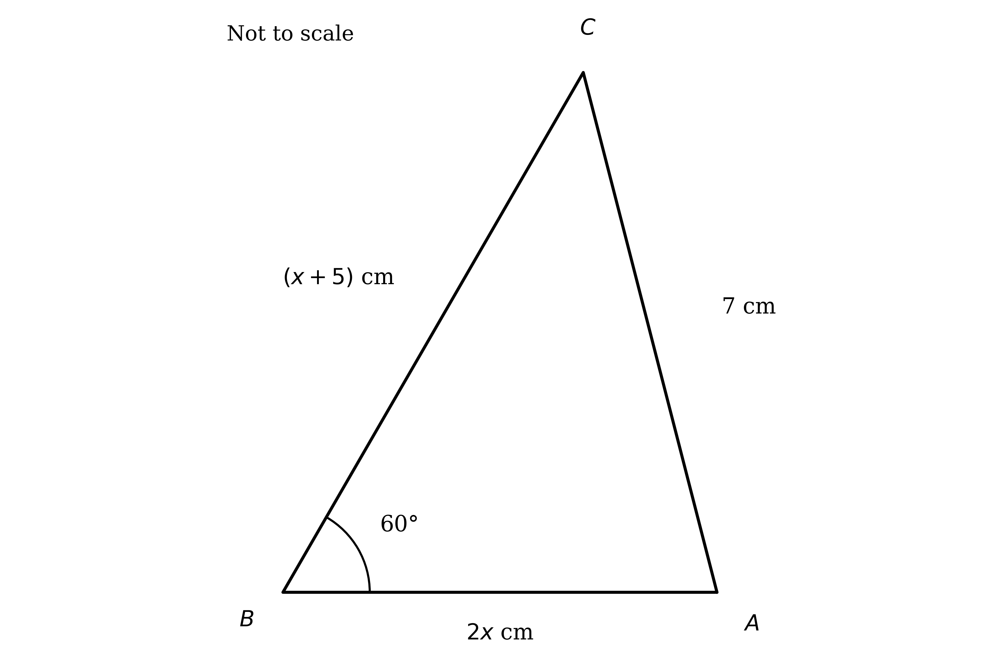

$A C$ is opposite the angle $B = 60 ^{\circ}$, so apply the cosine rule (with $\text{cos}  60 ^{\circ} = \frac{1}{2}$)

$7^{2} = ( 2 x )^{2} + ( x + 5 )^{2} - 2 ( 2 x ) ( x + 5 )  \text{cos}  60 ^{\circ}$

**[M1]**

Expand and simplify — the term $2 ( 2 x ) ( x + 5 ) \times \frac{1}{2} = 2 x^{2} + 10 x$ cancels the linear terms

$49 = 5 x^{2} + 10 x + 25 - ( 2 x^{2} + 10 x ) = 3 x^{2} + 25$

**[A1]**

$3 x^{2} = 24 \Rightarrow x^{2} = 8$

$x = 2 \sqrt{2}$

**[A1]**

> **[mark-scheme]**
> **M1**: Correct cosine rule with the given expressions substituted and $\text{cos}  60 ^{\circ} = \frac{1}{2}$.
> 
> **A1**: Correct simplification to $3 x^{2} + 25 = 49$ (or $3 x^{2} = 24$).
> 
> **A1**: $x = 2 \sqrt{2}$ (a positive length; $\sqrt{8}$ simplified).
Use the area formula with the sides enclosing the $60 ^{\circ}$ angle and $x = 2 \sqrt{2}$

$\text{Area} = \frac{1}{2} ( 2 x ) ( x + 5 )  \text{sin}  60 ^{\circ} = \frac{\sqrt{3}}{4} ( 2 x ) ( x + 5 )$

**[M1]**

Expand the surd product with $x = 2 \sqrt{2}$

$( 2 x ) ( x + 5 ) = 4 \sqrt{2}  ( 2 \sqrt{2} + 5 ) = 16 + 20 \sqrt{2}$

**[M1]**

Multiply by $\frac{\sqrt{3}}{4}$ and compare with the form $a \sqrt{6} + b \sqrt{3}$

$\text{Area} = \frac{\sqrt{3}}{4} ( 16 + 20 \sqrt{2} ) = 4 \sqrt{3} + 5 \sqrt{6}$

$a = 5 ,  b = 4$

**[A1]**

> **[mark-scheme]**
> **M1**: Correct use of the area formula $\frac{1}{2} ( 2 x ) ( x + 5 )  \text{sin}  60 ^{\circ}$ with $x = 2 \sqrt{2}$.
> 
> **M1**: Substituting $x = 2 \sqrt{2}$ and expanding the surd product to $16 + 20 \sqrt{2}$.
> 
> **A1**: Area $= 4 \sqrt{3} + 5 \sqrt{6}$, giving $a = 5$ and $b = 4$.

### Q29
$α ^{\circ}$ is angle $A B C$, opposite the side $A C = 7$, so rearrange the cosine rule for the angle

$\text{cos}  α ^{\circ} = \frac{12^{2}+15^{2}-7^{2}}{2(12)(15)} = \frac{320}{360}$

**[M1]**

Take the inverse cosine

`\alpha = \text{cos}^{-1}\left(\dfrac{320}{360}\right) = 27.266 \ldots°`

$α = 27 . 3 ^{\circ}$

**[A1]**

> **[mark-scheme]**
> **M1**: Correct rearrangement of the cosine rule for the angle, $\text{cos}  α ^{\circ} = \frac{12^{2}+15^{2}-7^{2}}{2(12)(15)}$.
> 
> **A1**: $α = 27 . 3 ^{\circ}$, to 1 decimal place (answers which round to $27 . 3 ^{\circ}$).
The bolt is two congruent triangles, so find the area of one and double it

$\text{Area of bolt} = 2 \times \frac{1}{2} ( 12 ) ( 15 )  \text{sin}  27 . 3 ^{\circ} = 82 . 46 \dots \text{cm}^{2}$

**[M1]**

Enlarging lengths by scale factor $10$ multiplies areas by $10^{2} = 100$; then convert cm² to m² by dividing by $10  000$

$82 . 46 \dots \times 100 = 8246 \dots \text{cm}^{2}$

**[M1]**

$\text{Area} = 0 . 825 \text{m}^{2}$

**[A1]**

> **[mark-scheme]**
> **M1**: Correct area of the lightning bolt as two triangles, $2 \times \frac{1}{2} ( 12 ) ( 15 )  \text{sin}  α ^{\circ}$ (answers which round to $82 . 5$ cm²).
> 
> **M1**: Applying the area scale factor $10^{2} = 100$ and converting to m² (dividing by $10  000$).
> 
> **A1**: Area $= 0 . 825$ m², correct to 3 significant figures.

### Q30
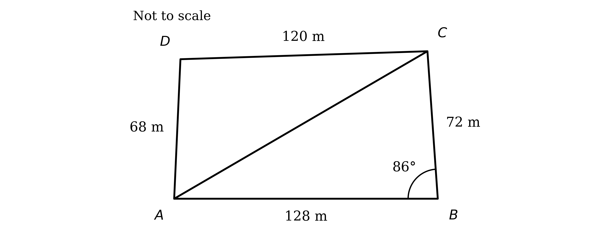

Work in triangle $A B C$, where $A C$ is opposite the known angle $B = 86 ^{\circ}$, and apply the cosine rule

$A C^{2} = 128^{2} + 72^{2} - 2 ( 128 ) ( 72 )  \text{cos}  86 ^{\circ}$

**[M1]**

$A C^{2} = 20282 \dots \Rightarrow A C = 142 . 4 \dots$

**[A1]**

**Final answer:** $A C = 142$** m**

**[A1]**

> **[mark-scheme]**
> **M1**: Correct use of the cosine rule in triangle $A B C$, $A C^{2} = 128^{2} + 72^{2} - 2 ( 128 ) ( 72 )  \text{cos}  86 ^{\circ}$.
> 
> **A1**: Correct unrounded length (answers which round to $142 . 4$).
> 
> **A1**: $A C = 142$ m, to the nearest metre.

The angle between $A D$ and $C D$ is angle $A D C$, in triangle $A C D$. It is opposite $A C$, so rearrange the cosine rule for the angle (using the unrounded $A C$)

$\text{cos}  A D C = \frac{AD^{2}+CD^{2}-AC^{2}}{2(AD)(CD)} = \frac{68^{2}+120^{2}-142.4^{2}}{2(68)(120)}$

**[M1]**

$\text{cos}  A D C = - 0 . 0771 \dots$

**[A1]**

Take the inverse cosine

$A D C = \text{cos}^{-1} ( - 0 . 0771 \dots ) = 94 . 421 \dots ^{\circ}$

$A D C = 94 . 4 ^{\circ}$

**[A1]**

> **[mark-scheme]**
> **M1**: Correct rearrangement of the cosine rule in triangle $A C D$ for angle $A D C$, using your $A C$ from part (a).
> 
> **A1**: Correct unrounded value of $\text{cos}  A D C$ (a small negative value, answers which round to $- 0 . 0771$).
> 
> **A1**: $A D C = 94 . 4 ^{\circ}$ (answers which round to $94 . 4 ^{\circ}$).
The diagonal $A C$ splits the field into triangles $A B C$ and $A C D$; add their areas

$\text{Area} = \frac{1}{2} ( 128 ) ( 72 )  \text{sin}  86 ^{\circ} + \frac{1}{2} ( 68 ) ( 120 )  \text{sin}  94 . 4 ^{\circ}$

**[M1]**

$\text{Area} = 4596 . 8 \dots + 4067 . 7 \dots$

**[A1]**

$\text{Area} = 8660 \text{m}^{2}$

**[A1]**

> **[mark-scheme]**
> **M1**: Correct method — adding the areas of triangles $A B C$ and $A C D$, each using $\frac{1}{2} a b  \text{sin}  C$.
> 
> **A1**: Both triangle areas correct (answers which round to $4600$ m² and $4070$ m²).
> 
> **A1**: Total area $= 8660$ m², correct to 3 significant figures.

### Q31
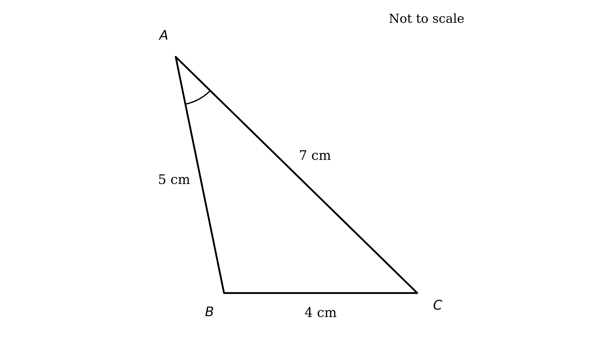

Angle $B A C$ is opposite the side $B C = 4$, so rearrange the cosine rule for the angle

$\text{cos}  B A C = \frac{AB^{2}+AC^{2}-BC^{2}}{2(AB)(AC)} = \frac{5^{2}+7^{2}-4^{2}}{2(5)(7)}$

$\text{cos}  B A C = \frac{58}{70} = 0 . 8285 \dots$

**[M1]**

Take the inverse cosine

$B A C = \text{cos}^{-1} ( 0 . 8285 \dots ) = 34 . 047 \dots ^{\circ}$

$B A C = 34 ^{\circ}$

**[A1]**

> **[mark-scheme]**
> **M1**: Correct rearrangement of the cosine rule to find the angle, $\text{cos}  B A C = \frac{5^{2}+7^{2}-4^{2}}{2(5)(7)}$.
> 
> **A1**: $B A C = 34 ^{\circ}$, to the nearest degree (answers which round to $34 . 0 ^{\circ}$).
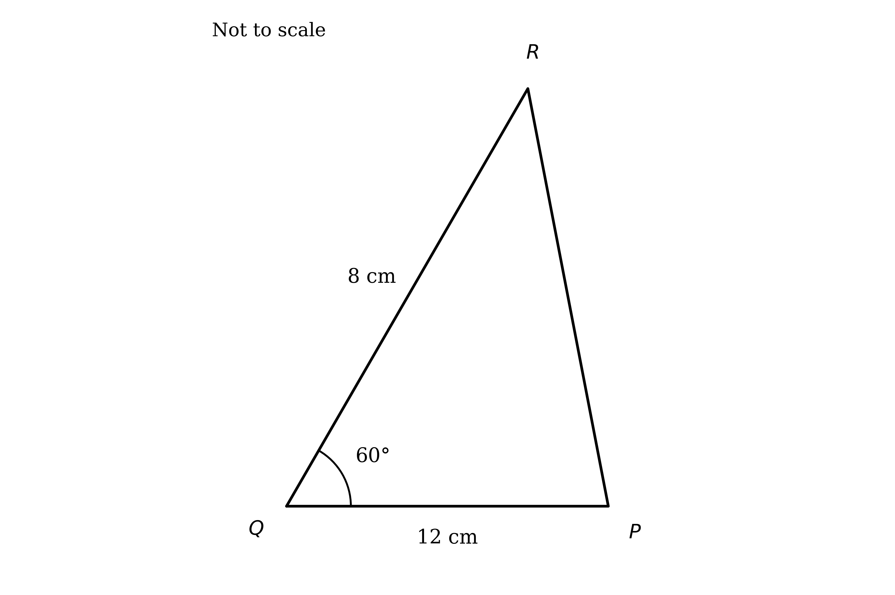

$R P$ is opposite the known angle $Q = 60 ^{\circ}$, so apply the cosine rule

$R P^{2} = P Q^{2} + Q R^{2} - 2 ( P Q ) ( Q R )  \text{cos}  Q$

$R P^{2} = 12^{2} + 8^{2} - 2 ( 12 ) ( 8 )  \text{cos}  60 ^{\circ} = 112$

**[M1]**

**Final answer:** $R P = 10 . 6$** cm**

**[A1]**

> **[mark-scheme]**
> **M1**: Correct substitution into the cosine rule, $R P^{2} = 12^{2} + 8^{2} - 2 ( 12 ) ( 8 )  \text{cos}  60 ^{\circ}$.
> 
> **A1**: $R P = 10 . 6$ cm, correct to 3 significant figures (answers which round to $10 . 583$).

### Q32
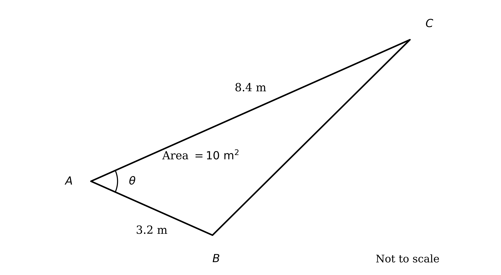

The angle $θ$ is between the two known sides, so substitute into the area formula and equate to $10$

$\frac{1}{2} ( 3 . 2 ) ( 8 . 4 )  \text{sin}  θ = 10$

**[M1]**

$\text{sin}  θ = \frac{10}{13.44} = 0 . 7440 \dots$

**[A1]**

Take the inverse sine

$θ = \text{sin}^{-1} ( 0 . 7440 \dots ) = 48 . 070 \dots ^{\circ}$

$θ = 48 . 1 ^{\circ}$

**[A1]**

> **[mark-scheme]**
> **M1**: Correct use of the area formula equated to $10$, $\frac{1}{2} ( 3 . 2 ) ( 8 . 4 )  \text{sin}  θ = 10$.
> 
> **A1**: Correct value $\text{sin}  θ = 0 . 744$ (answers which round to $0 . 744$).
> 
> **A1**: $θ = 48 . 1 ^{\circ}$ reached from an unrounded value (for example $48 . 07 ^{\circ}$), as required.
The area only fixes $\text{sin}  θ$, and by the symmetry of the sine graph $\text{sin}  θ = \text{sin}  ( 180 ^{\circ} - θ )$, so an obtuse angle gives the same area

$θ = 180 ^{\circ} - 48 . 07 \dots ^{\circ}$

**[M1]**

$θ = 131 . 9 ^{\circ}$

**[A1]**

> **[mark-scheme]**
> **M1**: Recognising a second solution from the symmetry of the sine graph, $\text{sin}  θ = \text{sin}  ( 180 ^{\circ} - θ )$, so $θ = 180 ^{\circ} - 48 . 07 ^{\circ}$.
> 
> **A1**: $θ = 131 . 9 ^{\circ}$ (answers which round to $131 . 9 ^{\circ}$).
Find the third side, which is opposite $θ$, using the cosine rule

$c^{2} = 3 . 2^{2} + 8 . 4^{2} - 2 ( 3 . 2 ) ( 8 . 4 )  \text{cos}  48 . 1 ^{\circ}$

$c^{2} = 44 . 90 \dots \Rightarrow c = 6 . 701 \dots$

**[M1 A1]**

Add the three sides for the perimeter

$P = 3 . 2 + 8 . 4 + 6 . 701 \dots$

**Final answer:** $P = 18 . 3$** m**

**[A1]**

> **[mark-scheme]**
> **M1**: Correct use of the cosine rule for the third side, $c^{2} = 3 . 2^{2} + 8 . 4^{2} - 2 ( 3 . 2 ) ( 8 . 4 )  \text{cos}  48 . 1 ^{\circ}$.
> 
> **A1**: Correct third side (answers which round to $6 . 70$ m).
> 
> **A1**: Perimeter $= 18 . 3$ m, correct to 3 significant figures.

### Q33
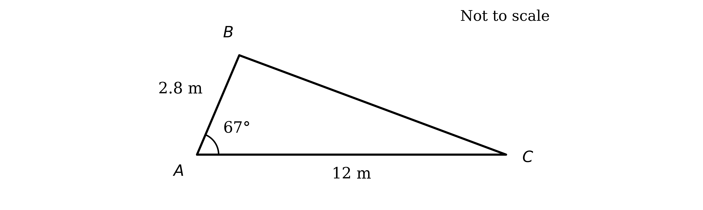

The $67 ^{\circ}$ angle is enclosed by the two known sides, so use the area formula

$\text{Area} = \frac{1}{2} ( 2 . 8 ) ( 12 )  \text{sin}  67 ^{\circ}$

**[M1]**

$\text{Area} = 15 . 5 \text{m}^{2}$

**[A1]**

> **[mark-scheme]**
> **M1**: Correct substitution into the area formula, $\frac{1}{2} ( 2 . 8 ) ( 12 )  \text{sin}  67 ^{\circ}$.
> 
> **A1**: Area $= 15 . 5$ m², correct to 3 significant figures (answers which round to $15 . 464$).

The third side is opposite the $67 ^{\circ}$ angle, so apply the cosine rule

$c^{2} = 2 . 8^{2} + 12^{2} - 2 ( 2 . 8 ) ( 12 )  \text{cos}  67 ^{\circ}$

$c^{2} = 125 . 58 \dots$

**[M1]**

**Final answer:** $c = 11 . 2$** m**

**[A1]**

> **[mark-scheme]**
> **M1**: Correct substitution into the cosine rule with the third side opposite the $67 ^{\circ}$ angle, $c^{2} = 2 . 8^{2} + 12^{2} - 2 ( 2 . 8 ) ( 12 )  \text{cos}  67 ^{\circ}$.
> 
> **A1**: Third side $= 11 . 2$ m, correct to 3 significant figures (answers which round to $11 . 207$).

### Q34
The information (two sides and a non-included angle) gives two possible triangles — the acute case and the obtuse case

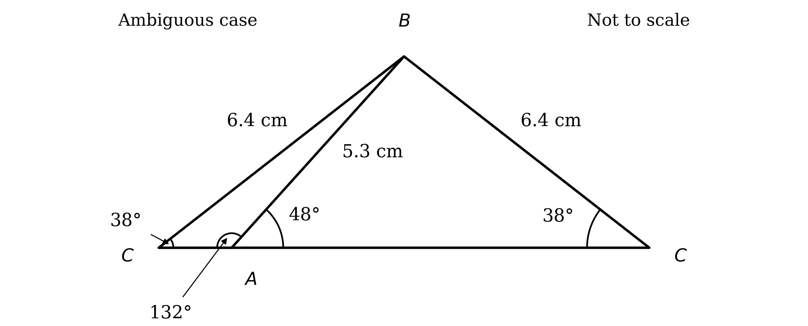

(i)

$B A C$ is opposite $B C = 6 . 4$ and the $38 ^{\circ}$ angle is opposite $A B = 5 . 3$. Arrange the sine rule with the sines on top

$\frac{\text{sin}BAC}{6.4} = \frac{\text{sin}38^{\circ}}{5.3}$

$\text{sin}  B A C = \frac{6.4\text{sin}38^{\circ}}{5.3} = 0 . 7434 \dots$

**[M1]**

The acute solution is

$\text{sin}^{-1}(0.7434\dots)=48.0^{\circ}$

**[A1]**

By the symmetry of the sine graph, $\text{sin}  B A C = \text{sin}  ( 180 ^{\circ} - B A C )$, so the obtuse angle is also possible

$B A C = 180 ^{\circ} - 48 . 0 ^{\circ} = 131 . 98 \dots ^{\circ}$

$B A C = 132 ^{\circ}$

**[A1]**

(ii)

The other triangle uses the acute value $B A C = 48 . 0 ^{\circ}$. The angles sum to $180 ^{\circ}$

$A B C = 180 ^{\circ} - 38 ^{\circ} - 48 . 0 ^{\circ}$

$A B C = 94 . 0 ^{\circ}$

**[B1]**

> **[mark-scheme]**
> **M1**: Correct use of the sine rule to find $\text{sin}  B A C$, for example $\frac{\text{sin}BAC}{6.4} = \frac{\text{sin}38^{\circ}}{5.3}$.
> 
> **A1**: Correct acute angle, answers which round to $48 . 0 ^{\circ}$.
> 
> **A1**: Obtaining $B A C = 132 ^{\circ}$ from $180 ^{\circ} - 48 . 0 ^{\circ}$ (using $\text{sin}  B A C = \text{sin}  ( 180 ^{\circ} - B A C )$).
> 
> **B1**: $A B C = 94 . 0 ^{\circ}$ for the other triangle (answers which round to $94 . 0 ^{\circ}$).

### Q35
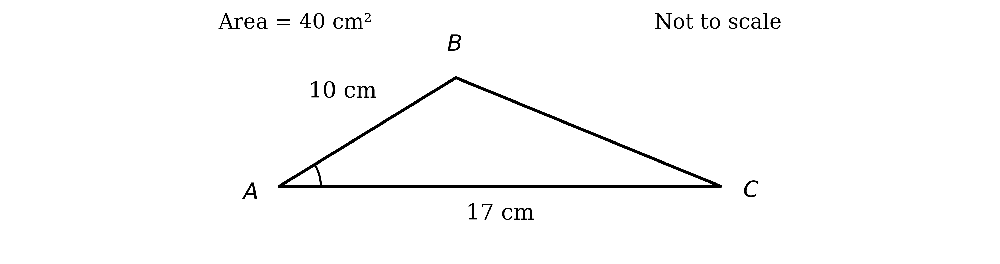

The angle $B A C$ is enclosed by the sides $A B$ and $A C$, so use the area formula and solve for the angle

$\frac{1}{2} ( 10 ) ( 17 )  \text{sin}  B A C = 40 \Rightarrow \text{sin}  B A C = \frac{8}{17}$

**[M1]**

Take the inverse sine, choosing the acute value

`BAC = \text{sin}^{-1}\left(\dfrac{8}{17}\right) = 28.072 \ldots°`

$B A C = 28 ^{\circ}$

**[A1]**

> **[mark-scheme]**
> **M1**: Correct use of the area formula to reach $\text{sin}  B A C$, for example $\frac{1}{2} ( 10 ) ( 17 )  \text{sin}  B A C = 40$.
> 
> **A1**: $B A C = 28 ^{\circ}$, to the nearest degree (the acute value, answers which round to $28 . 1 ^{\circ}$).

$B C$ is opposite the angle $B A C$, so use the cosine rule with the unrounded angle $B A C = 28 . 072 \dots ^{\circ}$ from part (a)

$B C^{2} = 10^{2} + 17^{2} - 2 ( 10 ) ( 17 )  \text{cos}  28 . 072 \dots ^{\circ} = 389 - 300 = 89$

**[M1]**

**Final answer:** $B C = \sqrt{89} = 9 . 43$** cm**

**[A1]**

> **[mark-scheme]**
> **M1**: Correct use of the cosine rule for $B C$, using your unrounded angle $B A C$ from part (a).
> 
> **A1**: $B C = \sqrt{89} = 9 . 43$ cm, reached from an unrounded angle, as required.

Angle $B C A$ is opposite $A B = 10$. Rearrange the cosine rule for the angle (using the unrounded $B C = \sqrt{89}$)

$\text{cos}  B C A = \frac{BC^{2}+AC^{2}-AB^{2}}{2(BC)(AC)} = \frac{89+289-100}{2\sqrt{89}(17)} = 0 . 8667 \dots$

**[M1]**

Take the inverse cosine

$B C A = \text{cos}^{-1} ( 0 . 8667 \dots ) = 29 . 924 \dots ^{\circ}$

$B C A = 29 . 9 ^{\circ}$

**[A1]**

> **[mark-scheme]**
> **M1**: Correct use of the sine or cosine rule to find angle $B C A$.
> 
> **A1**: $B C A = 29 . 9 ^{\circ}$, correct to 3 significant figures (answers which round to $29 . 9 ^{\circ}$).
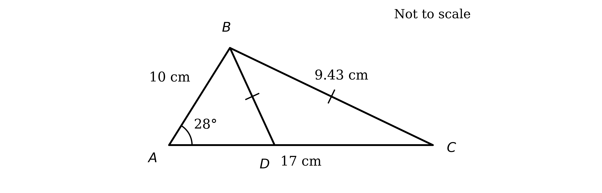

Since $B D = B C$, triangle $B C D$ is isosceles, so the base angles are equal: $B D C = B C D = 29 . 9 ^{\circ}$ (the angle $B C A$ from part (c)). The apex angle is

$D B C = 180 ^{\circ} - 2 ( 29 . 9 ^{\circ} ) = 120 . 2 ^{\circ}$

**[M1]**

Use the area formula with the two equal sides $B C = B D = \sqrt{89}$

$\text{Area} = \frac{1}{2} ( \sqrt{89} ) ( \sqrt{89} )  \text{sin}  120 . 2 ^{\circ}$

$\text{Area} = 38 . 5 \text{cm}^{2}$

**[A1]**

> **[mark-scheme]**
> **M1**: Correct method — recognising triangle $B C D$ is isosceles ($B D = B C$), so the apex angle $D B C = 180 ^{\circ} - 2 \times B C A$, then applying the area formula.
> 
> **A1**: Area $= 38 . 5$ cm², correct to 3 significant figures.

### Q36

The angle $150 ^{\circ}$ is enclosed by the sides $A B$ and $A C$, so use the area formula with $\text{sin}  150 ^{\circ} = \frac{1}{2}$

$\frac{1}{2}  x ( x + 8 )  \text{sin}  150 ^{\circ} = 2 \frac{1}{4}$

**[M1]**

$\frac{1}{4}  x ( x + 8 ) = \frac{9}{4}$

**[A1]**

Multiply both sides by $4$ and expand

$x^{2} + 8 x = 9$

**[A1]**

> **[mark-scheme]**
> **M1**: Correct use of the area formula with $\text{sin}  150 ^{\circ} = \frac{1}{2}$, equated to $2 \frac{1}{4}$.
> 
> **A1**: Correct simplified equation, for example $\frac{1}{4} x ( x + 8 ) = \frac{9}{4}$.
> 
> **A1**: Reaching the printed result $x^{2} + 8 x = 9$ with correct working.
Rearrange and factorise

$x^{2} + 8 x - 9 = 0 \Rightarrow ( x + 9 ) ( x - 1 ) = 0$

**[M1]**

A length must be positive, so reject $x = - 9$

$x = 1$

**[A1]**

> **[mark-scheme]**
> **M1**: Correct method to solve the quadratic, for example factorising to $( x + 9 ) ( x - 1 ) = 0$.
> 
> **A1**: $x = 1$, with $x = - 9$ rejected because a length must be positive.

With $x = 1$, the sides enclosing the $150 ^{\circ}$ angle are $A B = 1$ and $A C = 9$. Find the third side $B C$ with the cosine rule

$B C^{2} = 1^{2} + 9^{2} - 2 ( 1 ) ( 9 )  \text{cos}  150 ^{\circ} = 97 . 58 \dots$

**[M1]**

$B C = 9 . 879 \dots$

**[A1]**

Add the three sides

**Final answer:** $\text{Perimeter} = 1 + 9 + 9 . 879 \dots = 19 . 9$** cm**

**[A1]**

> **[mark-scheme]**
> **M1**: Correct use of the cosine rule for $B C$, $B C^{2} = 1^{2} + 9^{2} - 2 ( 1 ) ( 9 )  \text{cos}  150 ^{\circ}$.
> 
> **A1**: Correct third side (answers which round to $9 . 88$ cm).
> 
> **A1**: Perimeter $= 19 . 9$ cm, correct to 3 significant figures.

One angle is $150 ^{\circ}$. Find a second angle with the sine rule — angle $C$ is opposite $A B = 1$

$\text{sin}  C = \frac{1\times\text{sin}150^{\circ}}{9.879\dots} = 0 . 0506 \dots$

$C = \text{sin}^{-1} ( 0 . 0506 \dots ) = 2 . 900 \dots ^{\circ} \approx 3 ^{\circ}$

**[M1]**

The third angle is $B = 180 ^{\circ} - 150 ^{\circ} - 2 . 90 ^{\circ} = 27 . 1 ^{\circ} \approx 27 ^{\circ}$

$A : B : C = 150 : 27 : 3$

**[A1]**

Divide each part by $3$

$A : B : C = 50 : 9 : 1$

**[A1]**

> **[mark-scheme]**
> **M1**: Correct method to find a second angle (sine or cosine rule), for example $\text{sin}  C = \frac{1\times\text{sin}150^{\circ}}{BC}$.
> 
> **A1**: All three angles correct to the nearest degree, $150 ^{\circ}$, $27 ^{\circ}$ and $3 ^{\circ}$.
> 
> **A1**: Ratio $50 : 9 : 1$ in its simplest form.

### Q37
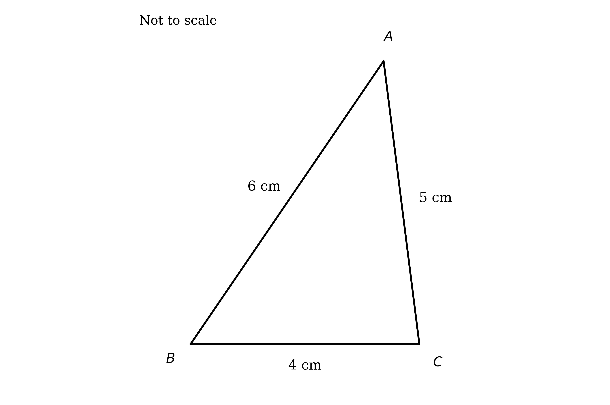

(i)

The angle between the sides of length $4$ and $5$ is opposite the side of length $6$, so rearrange the cosine rule for that angle

$\text{cos}  θ = \frac{4^{2}+5^{2}-6^{2}}{2(4)(5)} = \frac{5}{40}$

**[M1]**

$\text{cos}  θ = \frac{1}{8}$

**[A1]**

(ii)

For the angle opposite the side of length $4$ (between the sides $5$ and $6$)

$\text{cos}  θ = \frac{5^{2}+6^{2}-4^{2}}{2(5)(6)} = \frac{45}{60} = \frac{3}{4}$

For the angle opposite the side of length $5$ (between the sides $4$ and $6$)

$\text{cos}  θ = \frac{4^{2}+6^{2}-5^{2}}{2(4)(6)} = \frac{27}{48} = \frac{9}{16}$

**[B1]**

> **[mark-scheme]**
> **M1**: Correct rearrangement of the cosine rule for the angle opposite the side of length $6$, $\text{cos}  θ = \frac{4^{2}+5^{2}-6^{2}}{2(4)(5)}$.
> 
> **A1**: $\text{cos}  θ = \frac{1}{8}$, as required (accept $\frac{5}{40}$ simplified).
> 
> **B1**: Both other values correct, $\text{cos}  θ = \frac{3}{4}$ and $\text{cos}  θ = \frac{9}{16}$.

### Q38
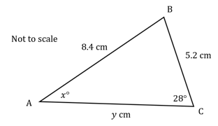

$x ^{\circ}$ is opposite $B C = 5 . 2$ and the $28 ^{\circ}$ angle is opposite $A B = 8 . 4$. To find the angle, arrange the sine rule with the sines on top

$\frac{\text{sin}x^{\circ}}{5.2} = \frac{\text{sin}28^{\circ}}{8.4}$

$\text{sin}  x ^{\circ} = \frac{5.2\text{sin}28^{\circ}}{8.4} = 0 . 2906 \dots$

**[M1]**

Take the inverse sine

$x = \text{sin}^{-1} ( 0 . 2906 \dots ) = 16 . 899 \dots ^{\circ}$

$x = 16 . 9$

**[A1]**

The angles sum to $180 ^{\circ}$, so angle $B = 180 ^{\circ} - 28 ^{\circ} - 16 . 90 ^{\circ} = 135 . 10 ^{\circ}$. Now find $y = A C$, which is opposite $B$

$\frac{y}{\text{sin}135.10^{\circ}} = \frac{8.4}{\text{sin}28^{\circ}}$

**[M1]**

**Final answer:** $y = 12 . 6$** cm**

**[A1]**

> **[mark-scheme]**
> **M1**: Correct use of the sine rule to find $x$, for example $\frac{\text{sin}x^{\circ}}{5.2} = \frac{\text{sin}28^{\circ}}{8.4}$.
> 
> **A1**: Answers which round to $x = 16 . 9$.
> 
> **M1**: Correct method for $y$ — finding the third angle ($135 . 1 ^{\circ}$) and using the sine rule (or the cosine rule with your $x$).
> 
> **A1**: Answers which round to $y = 12 . 6$ cm.
