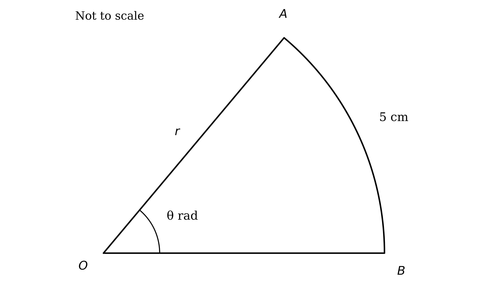
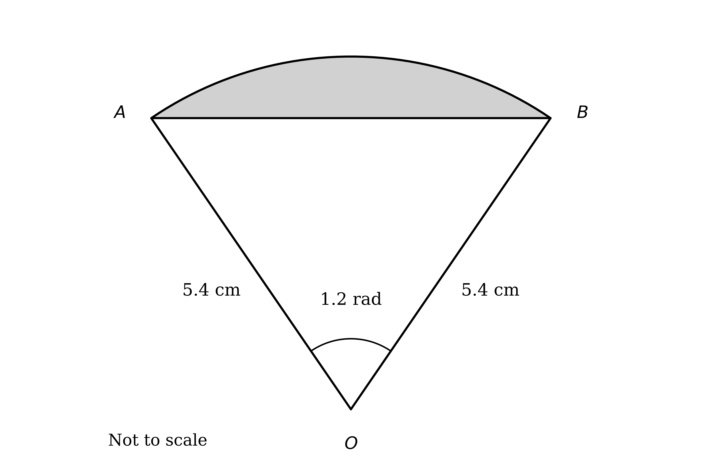

# Mark Schemes — Circular Measure (Radians)
**Trigonometry** · Cambridge (CIE) A-LEVEL maths (9709)

## Exam Questions (25 questions)

### Q1
(i)

The arc length uses $s = r θ$, with the angle $θ$ in radians

$s = r θ = 4 \times \frac{π}{4}$

**[M1]**

$s = π \text{cm}$

**[A1]**

(ii)

The sector area uses $A = \frac{1}{2} r^{2} θ$, again with $θ$ in radians

$A = \frac{1}{2} r^{2} θ = \frac{1}{2} \times 4^{2} \times \frac{π}{4}$

**[M1]**

$A = 2 π \text{cm}^{2}$

**[A1]**

> **[mark-scheme]**
> **M1**: Use of the arc-length formula $s = r θ$ with $r = 4$ and $θ = \frac{π}{4}$ (the angle in radians).
> 
> **A1**: Arc length $s = π$ cm. The exact value $π$ is required; answers which round to 3.14 cm are also accepted.
> 
> **M1**: Use of the sector-area formula $A = \frac{1}{2} r^{2} θ$ with $r = 4$ and $θ = \frac{π}{4}$.
> 
> **A1**: Area $= 2 π$ cm². The exact value $2 π$ is required; answers which round to 6.28 cm² are also accepted.

### Q2
A quarter circle is a sector with a right angle at the centre, so its area is a quarter of the whole circle

$\frac{1}{4} π r^{2} = 18 π$

**[M1]**

Divide both sides by $π$ and multiply by 4

$r^{2} = 72$

**[A1]**

Take the positive square root, since a radius must be positive

$r = 6 \sqrt{2} \text{cm}$

**[A1]**

> **[mark-scheme]**
> **M1**: The quarter-circle area equated to $18 π$, that is $\frac{1}{4} π r^{2} = 18 π$ (or $\frac{1}{2} r^{2} θ = 18 π$ with $θ = \frac{π}{2}$).
> 
> **A1**: $r^{2} = 72$.
> 
> **A1**: $r = 6 \sqrt{2}$ cm. The exact form is preferred; answers which round to 8.49 cm are also accepted.

### Q3
The triangle $O P Q$ has two sides of 6 cm enclosing the centre angle, so use $\frac{1}{2} a b  \text{sin}  C$ with $a = b = 6$ and $C = \frac{π}{12}$

`\text{Area} = \dfrac{1}{2}(6)(6)\,\text{sin}\left(\dfrac{\pi}{12}\right)`

**[M1]**

`\text{Area} = 18\,\text{sin}\left(\dfrac{\pi}{12}\right) = 4.66 \text{ cm}^2`

**[A1]**

> **[mark-scheme]**
> **M1**: Use of $\frac{1}{2} a b  \text{sin}  C$ with $a = b = 6$ and $C = \frac{π}{12}$.
> 
> **A1**: Area `= 18\,\text{sin}\left(\dfrac{\pi}{12}\right)`, which rounds to 4.66 cm².

The sector area uses $A = \frac{1}{2} r^{2} θ$, with $θ$ in radians

`A = \dfrac{1}{2}(6)^2\left(\dfrac{\pi}{12}\right)`

**[M1]**

$A = \frac{3π}{2} = 4 . 71 \text{cm}^{2}$

**[A1]**

> **[mark-scheme]**
> **M1**: Use of $A = \frac{1}{2} r^{2} θ$ with $r = 6$ and $θ = \frac{π}{12}$.
> 
> **A1**: Sector area $= \frac{3π}{2}$, which rounds to 4.71 cm².

The shaded segment is the sector with the triangle removed. Subtract the exact values from the previous parts, since the two areas are close and rounding first would lose accuracy

`\text{Segment} = \dfrac{3\pi}{2} - 18\,\text{sin}\left(\dfrac{\pi}{12}\right)`

**[M1]**

$\text{Segment} = 0 . 0536 \text{cm}^{2}$

**[A1]**

> **[mark-scheme]**
> **M1**: Shaded segment formed as the sector area minus the triangle area, using the unrounded values.
> 
> **A1**: Segment `= \dfrac{3\pi}{2} - 18\,\text{sin}\left(\dfrac{\pi}{12}\right)`, giving answers which round to 0.0536 cm². Keep full accuracy before subtracting.

### Q4
Set up an equation for the area and an equation for the arc length, using $A = \frac{1}{2} r^{2} θ$ and $s = r θ$

$\frac{1}{2} r^{2} θ = 8 π$

$r θ = 4 π$

**[M1]**

Make $θ$ the subject of the arc-length equation, then substitute it into the area equation to eliminate $θ$

$θ = \frac{4π}{r}$

`\dfrac{1}{2}r^2\left(\dfrac{4\pi}{r}\right) = 8\pi`

$2 π r = 8 π$

$r = 4 \text{cm}$

**[A1]**

Substitute $r = 4$ back into the arc-length equation to find the angle

$4 θ = 4 π$

**[M1]**

$θ = π \text{radians}$

**[A1]**

> **[mark-scheme]**
> **M1**: Two correct equations set up — area $\frac{1}{2} r^{2} θ = 8 π$ and arc $r θ = 4 π$.
> 
> **A1**: $r = 4$ cm, found by eliminating $θ$ (for example substituting $θ = \frac{4π}{r}$, or dividing the two equations).
> 
> **M1**: Substitute your radius back into $r θ = 4 π$ (or $\frac{1}{2} r^{2} θ = 8 π$) to find the angle.
> 
> **A1**: $θ = π$ radians.

### Q5
The perimeter of a sector is the arc length plus the two bounding radii. First find the arc length using $s = r θ$, with $θ$ in radians

$s = r θ = 8 \times \frac{π}{3} = \frac{8π}{3}$

**[M1]**

Add the two radii to the arc to form the perimeter

$\text{Perimeter} = 2 r + s = 8 + 8 + \frac{8π}{3}$

**[M1]**

$\text{Perimeter} = 16 + \frac{8π}{3} \text{cm}$

**[A1]**

> **[mark-scheme]**
> **M1**: Use of $s = r θ$ to find the arc length, with $r = 8$ and $θ = \frac{π}{3}$ (the angle in radians).
> 
> **M1**: Perimeter formed as the arc length plus the two radii, $2 r + s$.
> 
> **A1**: $\text{Perimeter} = 16 + \frac{8π}{3}$ cm. The exact form is preferred; answers which round to 24.4 cm are also accepted.

### Q6

The radius is twice the arc, so $r = 2 \times 5 = 10$ cm. Rearrange $s = r θ$ to make the angle the subject

$θ = \frac{s}{r} = \frac{5}{10}$

**[M1]**

$θ = 0 . 5 \text{radians}$

**[A1]**

> **[mark-scheme]**
> **M1**: Use of $s = r θ$ with $s = 5$ and $r = 10$ (the radius being twice the arc), giving $θ = \frac{5}{10}$.
> 
> **A1**: $θ = 0 . 5$ radians.

### Q7
(i)

Convert using $180 ^{\circ} = π$ radians, so multiply the degrees by $\frac{π}{180}$

$60 ^{\circ} = 60 \times \frac{π}{180}$

$\frac{π}{3}$

**[B1]**

(ii)

$\text{sin}  45 ^{\circ} = \frac{1}{\sqrt{2}}$

**[B1]**

(iii)

$\text{tan}  π = 0$

**[B1]**

(iv)

Convert using $π \text{radians} = 180 ^{\circ}$, so multiply by $\frac{180^{\circ}}{π}$

$\frac{5π}{6} = \frac{5π}{6} \times \frac{180^{\circ}}{π}$

$150 ^{\circ}$

**[B1]**

(v)

$\text{cos}  0 = 1$

**[B1]**

> **[mark-scheme]**
> **B1**: $60 ^{\circ} = \frac{π}{3}$ radians.
> 
> **B1**: $\text{sin}  45 ^{\circ} = \frac{1}{\sqrt{2}}$. The equivalent exact form $\frac{\sqrt{2}}{2}$ is accepted.
> 
> **B1**: $\text{tan}  π = 0$.
> 
> **B1**: $\frac{5π}{6}$ radians $= 150 ^{\circ}$.
> 
> **B1**: $\text{cos}  0 = 1$.

### Q8
A semicircle is a sector with angle $π$, so its area is $\frac{1}{2} π r^{2}$. The four radii are $R$, $R + k$, $R + 2 k$ and $R + 3 k$. The whole rainbow is the outer semicircle with the innermost part removed

$\text{Total area} = \frac{1}{2} π ( R + 3 k )^{2} - \frac{1}{2} π R^{2}$

**[M1]**

The inner region $A$ is the band between the two innermost semicircles

$A = \frac{1}{2} π ( R + k )^{2} - \frac{1}{2} π R^{2}$

**[M1]**

Set $A$ equal to one quarter of the total area

$\frac{\frac{1}{2}π(R+k)^{2}-\frac{1}{2}πR^{2}}{\frac{1}{2}π(R+3k)^{2}-\frac{1}{2}πR^{2}} = \frac{1}{4}$

**[M1]**

Cancel $\frac{1}{2} π$ and expand; the $R^{2}$ terms cancel, leaving $\frac{2R+k}{6R+9k} = \frac{1}{4}$. Cross-multiplying

$4 ( 2 R + k ) = 6 R + 9 k$

$2 R = 5 k$

**[A1]**

The mosaic is 22 m across, which is the diameter of the outer semicircle

$2 ( R + 3 k ) = 22$

$R + 3 k = 11$

**[M1]**

Substitute $R = \frac{5k}{2}$ into this equation

$\frac{5k}{2} + 3 k = 11$

**[M1]**

**Final answer:** $R = 5 \text{m}$** and **$k = 2 \text{m}$

**[A1]**

> **[mark-scheme]**
> **M1**: Total rainbow area as $\frac{1}{2} π ( R + 3 k )^{2} - \frac{1}{2} π R^{2}$.
> 
> **M1**: Inner region $A = \frac{1}{2} π ( R + k )^{2} - \frac{1}{2} π R^{2}$.
> 
> **M1**: Setting $A = \frac{1}{4} \times$ total area.
> 
> **A1**: Simplified to $2 R = 5 k$.
> 
> **M1**: The "22 m across" equation, $2 ( R + 3 k ) = 22$.
> 
> **M1**: Solving the two equations simultaneously.
> 
> **A1**: $R = 5$ m and $k = 2$ m.

### Q9
Each suspension line is a radius $r$, and the angle $A O B$ is $θ$. Write the arc length and the area in terms of $r$ and $θ$

$r θ = \frac{25π}{36}$

$\frac{1}{2} r^{2} θ = \frac{125π}{144}$

**[M1]**

Double the area equation to give $r^{2} θ = \frac{125π}{72}$, then divide it by the arc equation; the $θ$ cancels, leaving $r$

$r = \frac{r^{2}θ}{rθ} = \frac{125π/72}{25π/36}$

**[M1]**

$r = \frac{5}{2} \text{m}$

**[A1]**

Substitute back into the arc equation to find the angle

$θ = \frac{25π/36}{r} = \frac{25π/36}{5/2}$

**[M1]**

$θ = \frac{5π}{18} \text{radians}$

**[A1]**

> **[mark-scheme]**
> **M1**: Both relationships set up — arc $r θ = \frac{25π}{36}$ and area $\frac{1}{2} r^{2} θ = \frac{125π}{144}$.
> 
> **M1**: Dividing the (doubled) area equation by the arc equation to eliminate $θ$ and find $r$.
> 
> **A1**: $r = \frac{5}{2}$ m (that is 2.5 m).
> 
> **M1**: Substituting your $r$ into $r θ = \frac{25π}{36}$ to find $θ$.
> 
> **A1**: $θ = \frac{5π}{18}$ radians.

### Q10
Since $B C : C O = 2 : 3$ and $B C + C O = O B = r$, the point $C$ divides $O B$ so that $O C$ is $\frac{3}{5}$ of the radius

$O C = \frac{3}{5} r$

**[B1]**

$D C$ is perpendicular to $O B$, so triangle $O C D$ is right-angled at $C$ with the angle $θ$ at $O$. Hence $D C = O C  \text{tan}  θ$

$D C = \frac{3}{5} r  \text{tan}  θ$

**[M1]**

The area of the right-angled triangle $O C D$ is $\frac{1}{2} \times O C \times D C$

`\text{Area }OCD = \dfrac{1}{2}\left(\dfrac{3}{5}r\right)\left(\dfrac{3}{5}r\,\text{tan}\,\theta\right)`

**[M1]**

$= \frac{9}{50} r^{2}  \text{tan}  θ$

**[A1]**

The shaded shape $A B C D$ is the sector $O A B$ with the triangle $O C D$ removed

$A B C D = \frac{1}{2} r^{2} θ - \frac{9}{50} r^{2}  \text{tan}  θ$

**[M1]**

Factor out $\frac{1}{50} r^{2}$ (noting $\frac{1}{2} = \frac{25}{50}$)

**Final answer:** $= \frac{1}{50} r^{2} ( 25 θ - 9  \text{tan}  θ ) \text{cm}^{2}$** as required**

**[A1]**

> **[mark-scheme]**
> **B1**: $O C = \frac{3}{5} r$ (from $B C : C O = 2 : 3$ with $O B = r$).
> 
> **M1**: Using the right angle at $C$ to write $D C = O C  \text{tan}  θ$.
> 
> **M1**: Triangle $O C D$ area as $\frac{1}{2} \times O C \times D C$.
> 
> **A1**: Triangle $O C D = \frac{9}{50} r^{2}  \text{tan}  θ$.
> 
> **M1**: Shaded $A B C D$ formed as sector $O A B -$ triangle $O C D$.
> 
> **A1**: Factorised to the printed $\frac{1}{50} r^{2} ( 25 θ - 9  \text{tan}  θ )$.

### Q11
Apply the cosine rule to triangle $O S T$, which has two sides of length $r$ enclosing the angle $θ$

$a^{2} = r^{2} + r^{2} - 2 ( r ) ( r )  \text{cos}  θ$

**[M1]**

Collect the $r^{2}$ terms and factor

**Final answer:** $a^{2} = 2 r^{2} ( 1 - \text{cos}  θ )$** as required**

**[A1]**

> **[mark-scheme]**
> **M1**: Cosine rule on triangle $O S T$: $a^{2} = r^{2} + r^{2} - 2 r^{2}  \text{cos}  θ$.
> 
> **A1**: Simplified to the printed $a^{2} = 2 r^{2} ( 1 - \text{cos}  θ )$.

First find $θ$ from the sector area, using $A = \frac{1}{2} r^{2} θ$ with $r = 4 θ$

$\frac{1}{2} ( 4 θ )^{2} θ = \frac{8π^{3}}{27}$

$8 θ^{3} = \frac{8π^{3}}{27}$

**[M1]**

$θ^{3} = \frac{π^{3}}{27}$

$θ = \frac{π}{3}$

**[A1]**

Now use part (a) with $r = 4 θ$, so that $r^{2} = 16 θ^{2}$

$a^{2} = 2 ( 4 θ )^{2} ( 1 - \text{cos}  θ ) = 32 θ^{2} ( 1 - \text{cos}  θ )$

**[M1]**

Substitute $θ = \frac{π}{3}$, with $\text{cos} \frac{π}{3} = \frac{1}{2}$

`a^2 = 32\left(\dfrac{\pi}{3}\right)^2\left(1 - \dfrac{1}{2}\right) = \dfrac{16\pi^2}{9}`

**[A1]**

Take the positive root, since $a$ is a chord length

$a = \frac{4π}{3} \text{cm}$

**[A1]**

> **[mark-scheme]**
> **M1**: Sector area $\frac{1}{2} ( 4 θ )^{2} θ = \frac{8π^{3}}{27}$, simplified to $8 θ^{3} = \frac{8π^{3}}{27}$.
> 
> **A1**: $θ = \frac{π}{3}$.
> 
> **M1**: Substituting $r = 4 θ$ into part (a): $a^{2} = 32 θ^{2} ( 1 - \text{cos}  θ )$.
> 
> **A1**: $a^{2} = \frac{16π^{2}}{9}$.
> 
> **A1**: $a = \frac{4π}{3}$ cm, rejecting the negative root since $a$ is a length.

### Q12
The shaded segment is the sector $O A B$ with the triangle $O A B$ removed

$\text{Segment} = \text{sector} - \text{triangle}$

**[M1]**

The sector has area $\frac{1}{2} r^{2} θ$, and the triangle has two sides $r$ enclosing $θ$, so its area is $\frac{1}{2} r^{2}  \text{sin}  θ$

$= \frac{1}{2} r^{2} θ - \frac{1}{2} r^{2}  \text{sin}  θ$

**[M1]**

Factor out $\frac{1}{2} r^{2}$

**Final answer:** $= \frac{1}{2} r^{2} ( θ - \text{sin}  θ ) \text{cm}^{2}$** as required**

**[A1]**

> **[mark-scheme]**
> **M1**: Shaded segment formed as sector $-$ triangle.
> 
> **M1**: Sector area $\frac{1}{2} r^{2} θ$ and triangle area $\frac{1}{2} r^{2}  \text{sin}  θ$ both substituted.
> 
> **A1**: Factorised to the printed $\frac{1}{2} r^{2} ( θ - \text{sin}  θ )$.
The percentage is the segment as a fraction of the sector, multiplied by 100

$\frac{\text{segment}}{\text{sector}} \times 100 = \frac{\frac{1}{2}r^{2}(θ-\text{sin}θ)}{\frac{1}{2}r^{2}θ} \times 100$

**[M1]**

The factor $\frac{1}{2} r^{2}$ cancels, leaving

`\dfrac{100(\theta - \text{sin}\,\theta)}{\theta}\%`

**[A1]**

> **[mark-scheme]**
> **M1**: Percentage formed as $\frac{\text{segment}}{\text{sector}} \times 100$.
> 
> **A1**: `\dfrac{100(\theta - \text{sin}\,\theta)}{\theta}\%`, or equivalent such as `100\left(1 - \dfrac{\text{sin}\,\theta}{\theta}\right)\%`.

### Q13
Each suspension line is a radius $r$ of the sector. Use $A = \frac{1}{2} r^{2} θ$ with $θ = \frac{π}{3}$ and the given area to find $r$

`\dfrac{1}{2}r^2\left(\dfrac{\pi}{3}\right) = \dfrac{49\pi}{150}`

**[M1]**

Divide by $π$ and rearrange, then take the positive root

$r^{2} = \frac{49}{25}$

$r = \frac{7}{5} \text{m}$

**[A1]**

There are 40 equal lines, each of length $r$, so the total length is

$40 \times \frac{7}{5}$

**[M1]**

$= 56 \text{m}$

**[A1]**

> **[mark-scheme]**
> **M1**: Use of $A = \frac{1}{2} r^{2} θ$ with $θ = \frac{π}{3}$ and area $\frac{49π}{150}$, giving `\dfrac{1}{2}r^2\left(\dfrac{\pi}{3}\right) = \dfrac{49\pi}{150}`.
> 
> **A1**: $r = \frac{7}{5}$ m (that is 1.4 m).
> 
> **M1**: Total length formed as 40 × your radius.
> 
> **A1**: Total length $= 56$ m.

### Q14
The volume of a prism is the cross-section area times the thickness. The cross-section is a sector of area $\frac{1}{2} r^{2} θ$ with $r = 2 a - 3$ and $θ = 1 . 7$

$V = \frac{1}{2} ( 2 a - 3 )^{2} ( 1 . 7 ) ( 4 ) = 7 . 65$

**[M1]**

Simplify the constant factor and divide

$3 . 4 ( 2 a - 3 )^{2} = 7 . 65$

$( 2 a - 3 )^{2} = 2 . 25$

**[A1]**

Take the square root of both sides

$2 a - 3 = \pm 1 . 5$

**[M1]**

$a = 2 . 25$* or *$a = 0 . 75$

**[A1]**

The radius $( 2 a - 3 )$ must be positive, so reject $a = 0 . 75$ (which gives $2 a - 3 = - 1 . 5$)

$a = 2 . 25$

**[A1]**

> **[mark-scheme]**
> **M1**: Volume formed as $\frac{1}{2} ( 2 a - 3 )^{2} ( 1 . 7 ) ( 4 ) = 7 . 65$.
> 
> **A1**: $( 2 a - 3 )^{2} = 2 . 25$.
> 
> **M1**: Square-rooting to $2 a - 3 = \pm 1 . 5$.
> 
> **A1**: Both values $a = 2 . 25$ and $a = 0 . 75$.
> 
> **A1**: $a = 2 . 25$, rejecting $a = 0 . 75$ because it gives a negative radius.

### Q15
The triangle $O A B$ has two sides of length $r$ enclosing the 0.8 rad angle, so its area is $\frac{1}{2} r^{2}  \text{sin} ( 0 . 8 )$. Set this equal to the given area to find $r^{2}$

$\frac{1}{2} r^{2}  \text{sin} ( 0 . 8 ) = 5 . 64$

**[M1]**

$r^{2} = \frac{2\times5.64}{\text{sin}(0.8)} = 15 . 7244 \dots$

**[A1]**

The shaded segment is the sector with the triangle removed. Find the sector area using $A = \frac{1}{2} r^{2} θ$

$\text{Sector} = \frac{1}{2} ( 15 . 7244 \dots ) ( 0 . 8 ) = 6 . 2898 \dots$

**[M1]**

Subtract the triangle, keeping the unrounded values

$\text{Segment} = 6 . 2898 \dots - 5 . 64$

**[M1]**

$\text{Segment} = 0 . 650 \text{cm}^{2}$

**[A1]**

> **[mark-scheme]**
> **M1**: Triangle area formed as $\frac{1}{2} r^{2}  \text{sin} ( 0 . 8 ) = 5 . 64$ to find $r^{2}$.
> 
> **A1**: $r^{2} = 15 . 7$ (answers which round to 15.7).
> 
> **M1**: Sector area using $\frac{1}{2} r^{2} θ$ with $θ = 0 . 8$.
> 
> **M1**: Shaded segment formed as sector area $-$ triangle area.
> 
> **A1**: Segment which rounds to 0.650 cm². Use the unrounded $r^{2}$ throughout.
The perimeter of the sector is the two radii plus the arc. Take $r = \sqrt{15.7244\dots} = 3 . 9654 \dots$ and find the arc with $s = r θ$

$s = r θ = 3 . 9654 \dots \times 0 . 8 = 3 . 1723 \dots$

**[M1]**

Add the two radii to the arc

$\text{Perimeter} = 2 r + s = 2 ( 3 . 9654 \dots ) + 3 . 1723 \dots$

**[M1]**

$\text{Perimeter} = 11 . 1 \text{cm}$

**[A1]**

> **[mark-scheme]**
> **M1**: $r = \sqrt{\text{your}r^{2}} \approx 3 . 97$ and arc $= r θ$ with $θ = 0 . 8$.
> 
> **M1**: Perimeter formed as $2 r +$ arc.
> 
> **A1**: Perimeter which rounds to 11.1 cm.

### Q16
A semicircle is a sector with angle $π$, so its area is $\frac{1}{2} π r^{2}$. The 8 cm base is the diameter of the outer semicircle, so the radii are 4 cm, 3 cm and 2 cm (each 1 cm less than the one outside it)

$\text{radii} = 4 ,  3 ,  2$

**[B1]**

Area $A$ is the band between the outer two semicircles

$A = \frac{1}{2} π ( 4 )^{2} - \frac{1}{2} π ( 3 )^{2}$

**[M1]**

Area $B$ is the band between the inner two semicircles

$B = \frac{1}{2} π ( 3 )^{2} - \frac{1}{2} π ( 2 )^{2}$

**[M1]**

$A = \frac{7π}{2} ,  B = \frac{5π}{2}$

**[A1]**

Write the ratio and cancel the common factor $\frac{π}{2}$

$A : B = 7 : 5$

**[A1]**

> **[mark-scheme]**
> **B1**: Correct radii 4, 3 and 2 cm (outer = half the 8 cm base, each inner 1 cm less).
> 
> **M1**: Area $A$ as the difference of the outer two semicircles, $\frac{1}{2} π ( 4 )^{2} - \frac{1}{2} π ( 3 )^{2}$.
> 
> **M1**: Area $B$ as the difference of the inner two semicircles, $\frac{1}{2} π ( 3 )^{2} - \frac{1}{2} π ( 2 )^{2}$.
> 
> **A1**: $A = \frac{7π}{2}$ and $B = \frac{5π}{2}$.
> 
> **A1**: $A : B = 7 : 5$ in simplest form.

### Q17
Write the area and the arc in terms of $a$, using $A = \frac{1}{2} r^{2} θ$ and $s = r θ$ with $r = a$ and $θ = \frac{a}{3}$. The condition "area is three times the arc" gives

`\frac{1}{2} a^{2} \left(\frac{a}{3}\right) = 3 \times a \left(\frac{a}{3}\right)`

**[M1]**

Simplify each side

$\frac{a^{3}}{6} = a^{2}$

$a^{3} = 6 a^{2}$

**[A1]**

Bring everything to one side and factor out $a^{2}$

$a^{3} - 6 a^{2} = 0$

`a^{2} \left(a - 6\right) = 0`

**[M1]**

Since $a$ is a radius it must be positive, so reject $a = 0$

$a = 6$

**[A1]**

> **[mark-scheme]**
> **M1**: Area and arc written in terms of $a$ with the condition area = 3 × arc, giving `\frac{1}{2} a^{2} \left(\frac{a}{3}\right) = 3 a \left(\frac{a}{3}\right)`.
> 
> **A1**: Simplified to $a^{3} = 6 a^{2}$ (or $\frac{a^{3}}{6} = a^{2}$).
> 
> **M1**: Factorised to `a^{2} \left(a - 6\right) = 0`.
> 
> **A1**: $a = 6$, rejecting $a = 0$ since $a$ is a radius.

### Q18
The sector area uses $A = \frac{1}{2} r^{2} θ$, with $θ$ in radians

`A = \dfrac{1}{2}(9)^2\left(\dfrac{\pi}{5}\right)`

**[M1]**

$A = \frac{81π}{10} \text{cm}^{2}$

**[A1]**

For the perimeter, first find the arc length using $s = r θ$

$s = r θ = 9 \times \frac{π}{5} = \frac{9π}{5}$

**[M1]**

Add the two radii to the arc

$\text{Perimeter} = 2 r + s = 9 + 9 + \frac{9π}{5}$

**[M1]**

$\text{Perimeter} = 18 + \frac{9π}{5} \text{cm}$

**[A1]**

> **[mark-scheme]**
> **M1**: Use of $A = \frac{1}{2} r^{2} θ$ with $r = 9$ and $θ = \frac{π}{5}$.
> 
> **A1**: Area $= \frac{81π}{10}$ cm² (answers which round to 25.4 cm²).
> 
> **M1**: Use of $s = r θ$ to find the arc length, $\frac{9π}{5}$.
> 
> **M1**: Perimeter formed as the arc length plus the two radii, $2 r + s$.
> 
> **A1**: Perimeter $= 18 + \frac{9π}{5}$ cm (answers which round to 23.7 cm).

### Q19
The radius $O B = O C + C B = 8 + p$, and $O A = O B$ because both are radii, so the sector radius is $p + 8$

$O A = O B = p + 8$

**[M1]**

Use the sector-area formula $A = \frac{1}{2} r^{2} θ$ with $θ = \frac{π}{3}$

`\text{Area} = \dfrac{1}{2}(p+8)^2\left(\dfrac{\pi}{3}\right)`

**Final answer:** $\text{Area} = \frac{π}{6} ( p + 8 )^{2} \text{cm}^{2}$** as required**

**[A1]**

> **[mark-scheme]**
> **M1**: Radius $O A = O B = p + 8$ (from $O C = 8$ and $C B = p$), used in $A = \frac{1}{2} r^{2} θ$ with $θ = \frac{π}{3}$.
> 
> **A1**: Correctly simplified to the printed $\frac{π}{6} ( p + 8 )^{2}$ cm².

The triangle $O C D$ has $O C = O D = 8$ enclosing the angle $\frac{π}{3}$, so use $\frac{1}{2} a b  \text{sin}  C$ with the exact value $\text{sin} \frac{π}{3} = \frac{\sqrt{3}}{2}$

`\text{Area} = \dfrac{1}{2}(8)(8)\,\text{sin}\left(\dfrac{\pi}{3}\right) = 32 \times \dfrac{\sqrt{3}}{2}`

**[M1]**

**Final answer:** $\text{Area} = 16 \sqrt{3} \text{cm}^{2}$** as required**

**[A1]**

> **[mark-scheme]**
> **M1**: Use of $\frac{1}{2} a b  \text{sin}  C$ with $a = b = 8$ and $C = \frac{π}{3}$, using the exact value $\text{sin} \frac{π}{3} = \frac{\sqrt{3}}{2}$.
> 
> **A1**: Correctly reaches the printed $16 \sqrt{3}$ cm².

The shaded shape $A B C D$ is the sector $O A B$ with the triangle $O C D$ removed. Set this equal to the given area

$\frac{π}{6} ( p + 8 )^{2} - 16 \sqrt{3} = \frac{50π}{3} - 16 \sqrt{3}$

**[M1]**

The $16 \sqrt{3}$ terms cancel, leaving

$\frac{π}{6} ( p + 8 )^{2} = \frac{50π}{3}$

Multiply both sides by $\frac{6}{π}$ to solve for $( p + 8 )^{2}$

$( p + 8 )^{2} = 100$

**[A1]**

Take the square root of both sides

$p + 8 = \pm 10$

**[M1]**

Since $p$ is a length it must be positive, so reject the negative root

$p = 2 \text{cm}$

**[A1]**

> **[mark-scheme]**
> **M1**: Shaded $A B C D =$ sector $O A B -$ triangle $O C D$, equated to the given area $\frac{50π}{3} - 16 \sqrt{3}$.
> 
> **A1**: $( p + 8 )^{2} = 100$ (after the $16 \sqrt{3}$ terms cancel).
> 
> **M1**: Square-rooting to $p + 8 = \pm 10$.
> 
> **A1**: $p = 2$ cm, rejecting $p = - 18$ because $p$ is a length.

### Q20
Each connecting cord is a radius $r$ of the sector. Use the sector-area formula $A = \frac{1}{2} r^{2} θ$ with $θ = \frac{π}{4}$ and the given area

`\dfrac{1}{2}r^2\left(\dfrac{\pi}{4}\right) = \dfrac{81\pi}{200}`

**[M1]**

Divide both sides by $π$ and rearrange

$r^{2} = \frac{81}{25}$

**[A1]**

Take the positive square root, since a length is positive

$r = \frac{9}{5} = 1 . 8 \text{m}$

**[A1]**

> **[mark-scheme]**
> **M1**: Use of $A = \frac{1}{2} r^{2} θ$ with $θ = \frac{π}{4}$ and area $\frac{81π}{200}$, giving `\dfrac{1}{2}r^2\left(\dfrac{\pi}{4}\right) = \dfrac{81\pi}{200}`.
> 
> **A1**: $r^{2} = \frac{81}{25}$.
> 
> **A1**: $r = \frac{9}{5} = 1 . 8$ m.

### Q21
Convert between degrees and radians, recalling that $π$ radians is 180°, and use the exact trig values together with $\text{tan}  θ = \frac{\text{sin}θ}{\text{cos}θ}$. The completed table is shown below, with the values you needed to fill in shown in green

| **Degrees** | **Radians** | **sin** | **cos** | **tan** |
|---|---|---|---|---|
| **Final answer:** **30°** | $\frac{π}{6}$ | $\frac{1}{2}$ | $\frac{\sqrt{3}}{2}$ | $\frac{1}{\sqrt{3}}$ |
| 45° | $\frac{π}{4}$ | $\frac{1}{\sqrt{2}}$ | $\frac{1}{\sqrt{2}}$ | **Final answer:** **1** |
| 60° | $\frac{π}{3}$ | $\frac{\sqrt{3}}{2}$ | $\frac{1}{2}$ | $\sqrt{3}$ |
| **Final answer:** **120°** | $\frac{2π}{3}$ | $\frac{\sqrt{3}}{2}$ | $- \frac{1}{2}$ | $- \sqrt{3}$ |
| 270° | $\frac{3π}{2}$ | $- 1$ | **Final answer:** **0** | n/a |

**[B1 B1 B1 B1 B1]**

> **[mark-scheme]**
> **B1**: Row 30° / $\frac{π}{6}$ correct — 30°, $\text{sin} = \frac{1}{2}$, $\text{tan} = \frac{1}{\sqrt{3}}$.
> 
> **B1**: Row 45° / $\frac{π}{4}$ correct — $\frac{π}{4}$, $\text{sin} = \frac{1}{\sqrt{2}}$, $\text{tan} = 1$.
> 
> **B1**: Row 60° / $\frac{π}{3}$ correct — $\text{sin} = \frac{\sqrt{3}}{2}$, $\text{cos} = \frac{1}{2}$, $\text{tan} = \sqrt{3}$.
> 
> **B1**: Row 120° / $\frac{2π}{3}$ correct — 120°, $\text{cos} = - \frac{1}{2}$, $\text{tan} = - \sqrt{3}$.
> 
> **B1**: Row 270° / $\frac{3π}{2}$ correct — $\frac{3π}{2}$, $\text{sin} = - 1$, $\text{cos} = 0$.
> 
> Equivalent exact forms are accepted ($\frac{1}{\sqrt{3}} = \frac{\sqrt{3}}{3}$, $\frac{1}{\sqrt{2}} = \frac{\sqrt{2}}{2}$).

### Q22
(i)

The sector area uses $A = \frac{1}{2} r^{2} θ$, with $θ$ in radians

$A = \frac{1}{2} ( 5 . 4 )^{2} ( 1 . 2 ) = 17 . 496$

**[M1]**

$A = 17 . 5 \text{cm}^{2}$

**[A1]**

(ii)

The triangle $O A B$ has two sides of 5.4 cm enclosing the angle, so use $\frac{1}{2} a b  \text{sin}  C$

$\text{Area} = \frac{1}{2} ( 5 . 4 ) ( 5 . 4 )  \text{sin} ( 1 . 2 ) = 13 . 589 \dots$

**[M1]**

$\text{Area} = 13 . 6 \text{cm}^{2}$

**[A1]**

(iii)

The shaded segment is the sector with the triangle removed; subtract the unrounded values to avoid rounding error

$\text{Segment} = 17 . 496 - 13 . 589 \dots$

$\text{Segment} = 3 . 91 \text{cm}^{2}$

**[A1]**

> **[mark-scheme]**
> **M1**: Use of $A = \frac{1}{2} r^{2} θ$ with $r = 5 . 4$ and $θ = 1 . 2$.
> 
> **A1**: Sector area which rounds to 17.5 cm².
> 
> **M1**: Use of $\frac{1}{2} a b  \text{sin}  C$ with $a = b = 5 . 4$ and $C = 1 . 2$.
> 
> **A1**: Triangle area which rounds to 13.6 cm².
> 
> **A1**: Shaded segment $=$ sector $-$ triangle, which rounds to 3.91 cm². Use the unrounded areas before subtracting.

(i)

The arc length uses $s = r θ$

$s = r θ = 5 . 4 \times 1 . 2$

**[M1]**

$s = 6 . 48 \text{cm}$

**[A1]**

(ii)

Add the two radii to the arc for the perimeter

$\text{Perimeter} = 5 . 4 + 5 . 4 + 6 . 48$

$\text{Perimeter} = 17 . 28 \text{cm}$

**[A1]**

> **[mark-scheme]**
> **M1**: Use of $s = r θ$ with $r = 5 . 4$ and $θ = 1 . 2$.
> 
> **A1**: Arc $A B = 6 . 48$ cm.
> 
> **A1**: Perimeter $= 2 r + \text{arc} = 5 . 4 + 5 . 4 + 6 . 48 = 17 . 28$ cm (follow through your arc length).

### Q23
A semicircle is a sector with angle $π$, so its area is $\frac{1}{2} π r^{2}$. The 10 cm base is the diameter of the larger semicircle, so its radius is $\frac{10}{2} = 5$ cm, and the smaller radius is $5 - 1 = 4$ cm

$R = 5 ,  r = 4$

**[B1]**

The logo is the larger semicircle with the smaller semicircle removed

$\text{Area} = \frac{1}{2} π ( 5 )^{2} - \frac{1}{2} π ( 4 )^{2}$

**[M1]**

$= \frac{25π}{2} - \frac{16π}{2}$

**[A1]**

$\text{Area} = \frac{9π}{2} \text{cm}^{2}$

**[A1]**

> **[mark-scheme]**
> **B1**: Correct radii — larger $R = 5$ cm (half the 10 cm base) and smaller $r = 4$ cm (1 cm less).
> 
> **M1**: Area of the logo formed as the larger semicircle minus the smaller semicircle, $\frac{1}{2} π ( 5 )^{2} - \frac{1}{2} π ( 4 )^{2}$.
> 
> **A1**: $\frac{25π}{2} - \frac{16π}{2}$, or equivalent unsimplified.
> 
> **A1**: Area $= \frac{9π}{2}$ cm² (answers which round to 14.1 cm²).

### Q24
(i)

The arc length uses $s = r θ$, with the angle $θ$ in radians

$s = r θ = 3 . 4 \times \frac{3π}{4}$

**[M1]**

$s = \frac{51π}{20} \text{cm}$

**[A1]**

(ii)

The sector area uses $A = \frac{1}{2} r^{2} θ$, again with $θ$ in radians

`A = \dfrac{1}{2}(3.4)^2\left(\dfrac{3\pi}{4}\right)`

**[M1]**

$A = \frac{867π}{200} \text{cm}^{2}$

**[A1]**

> **[mark-scheme]**
> **M1**: Use of $s = r θ$ with $r = 3 . 4$ and $θ = \frac{3π}{4}$ (the angle in radians).
> 
> **A1**: $s = \frac{51π}{20}$ cm. The exact form is preferred; answers which round to 8.01 cm are also accepted.
> 
> **M1**: Use of $A = \frac{1}{2} r^{2} θ$ with $r = 3 . 4$ and $θ = \frac{3π}{4}$.
> 
> **A1**: $A = \frac{867π}{200}$ cm² (the exact form is preferred; answers which round to 13.6 cm² are also accepted).

### Q25
(i)

The cross-section is a sector, so its area uses $A = \frac{1}{2} r^{2} θ$ with $θ$ in radians

$A = \frac{1}{2} ( 8 )^{2} ( 1 . 2 )$

**[M1]**

$A = 38 . 4 \text{cm}^{2}$

**[A1]**

(ii)

The volume of a prism is the cross-section area multiplied by the thickness

$V = 38 . 4 \times 2$

$V = 76 . 8 \text{cm}^{3}$

**[B1]**

> **[mark-scheme]**
> **M1**: Use of $A = \frac{1}{2} r^{2} θ$ with $r = 8$ and $θ = 1 . 2$ for the cross-section.
> 
> **A1**: Cross-section area $= 38 . 4$ cm².
> 
> **B1**: Volume $=$ cross-section area $\times$ thickness $= 38 . 4 \times 2 = 76 . 8$ cm³ (follow through your cross-section area).
