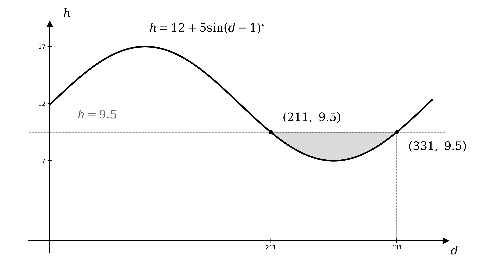

# Mark Schemes — Modelling with Trigonometric Functions
**Trigonometry** · Cambridge (CIE) A-LEVEL maths (9709)

## Exam Questions (19 questions)

### Q1
(i)

To find the height, substitute the horizontal displacement $x = 6$ into the model

$y = 12 - \sqrt{100-6^{2}} = 12 - \sqrt{64}$

$y = 4 \text{m}$

**[B1]**

(ii)

To find the horizontal distance, set the height $y = 5$ and solve for $x$

$5 = 12 - \sqrt{100-x^{2}}$

$\sqrt{100-x^{2}} = 7$

$100 - x^{2} = 49 \Rightarrow x^{2} = 51$

**[M1]**

A distance is required, so take the positive root

**Final answer:** $x = \sqrt{51} = 7 . 14 \text{m}$** (3 s.f.)**

**[A1]**

(iii)

The height is greatest when $\sqrt{100-x^{2}}$ is smallest, which is at the ends of the swing, where $x = \pm 8$

$y = 12 - \sqrt{100-8^{2}} = 12 - \sqrt{36}$

$y = 6 \text{m}$

**[B1]**

(iv)

At its maximum height the boat is at the point $( 8 , 6 )$, so the angle of elevation $θ$ from the origin satisfies

$\text{tan}  θ = \frac{6}{8}$

**[M1]**

**Final answer:** $θ = 36 . 9 ^{\circ}$** (1 d.p.)**

**[A1]**

> **[mark-scheme]**
> **B1**: Correct height of 4 m, from substituting $x = 6$ into the model.
> 
> **M1**: You set $y = 5$, isolate the square root and square both sides, reaching $x^{2} = 51$ (or $x = \pm \sqrt{51}$).
> 
> **A1**: Correct horizontal distance, giving answers which round to 7.14 m. As a distance is asked for, the positive root is taken.
> 
> **B1**: Correct maximum height of 6 m, recognising it occurs at the ends of the swing where $x = \pm 8$.
> 
> **M1**: You use the maximum-height point $( 8 , 6 )$ to form the correct trigonometric ratio, $\text{tan}  θ = \frac{6}{8}$.
> 
> **A1**: Correct angle of elevation, giving answers which round to $36 . 9 ^{\circ}$ (accept $0 . 643$ radians).

### Q2
At midday $t = 0$, and since $\text{sin}  0 = 0$ the sine term vanishes

$h = 6 + A \text{sin}  0 = 6$

$h = 6 \text{m}$

**[B1]**

> **[mark-scheme]**
> **B1**: You state the midday height as 6 m, since $\text{sin}  0 = 0$.
(i)

The minimum height occurs when $\text{sin}  t = - 1$, its least value, so the model gives $6 - A$

$6 - A = 3$

$A = 3$

**[B1]**

(ii)

The maximum height occurs when $\text{sin}  t = 1$, its greatest value

$h = 6 + 3$

$h = 9 \text{m}$

**[B1]**

> **[mark-scheme]**
> **B1**: You find $A = 3$, from the minimum height $6 - A = 3$.
> 
> **B1**: You find the maximum height of 9 m, from $6 + A$ when $\text{sin}  t = 1$.
(i)

2 p.m. is 2 hours after midday, so substitute $t = 2$, working in radians

$h = 6 + 3 \text{sin}  2 = 8 . 72789 \dots$

**[M1]**

**Final answer:** $h = 8 . 73 \text{m}$** (3 s.f.)**

**[A1]**

(ii)

Midnight is 12 hours after midday, so substitute $t = 12$

$h = 6 + 3 \text{sin}  12 = 4 . 39028 \dots$

**Final answer:** $h = 4 . 39 \text{m}$** (3 s.f.)**

**[B1]**

> **[mark-scheme]**
> **M1**: You substitute $t = 2$ (2 hours after midday) into the model, working in radians. Working in degrees does not earn this mark.
> 
> **A1**: Correct height at 2 p.m., giving answers which round to 8.73 m.
> 
> **B1**: Correct height at midnight, giving answers which round to 4.39 m, from substituting $t = 12$.

### Q3
Since $\text{sin} ( B t )$ only ranges between $- 1$ and $1$, the constant $A$ is the amplitude — the greatest height (and depth) the model reaches

$A = 70$

**[B1]**

> **[mark-scheme]**
> **B1**: You state $A = 70$, recognising it as the amplitude — the maximum height of 70 cm above (and depth below) sea level. No working is needed for this "state" mark.
One complete cycle of the motion is one full period of the sine model, so set the period equal to $π$

$\frac{2π}{B} = π$

**[M1]**

Rearrange to find $B$

$B = \frac{2π}{π}$

$B = 2$

**[A1]**

> **[mark-scheme]**
> **M1**: You relate the period of the model to $B$, setting $\frac{2π}{B}$ equal to the cycle time of $π$ seconds.
> 
> **A1**: Correct value $B = 2$.

### Q4
(i)

The 32 pods are evenly spaced around a full turn of $2 π$ radians, so divide the full turn by the number of pods

$\frac{2π}{32} = \frac{π}{16} \text{radians}$

**[B1]**

(ii)

The next pod anticlockwise is at $θ = \frac{π}{16}$, so substitute this into the coordinate model

`(x, y) = \left(100\text{cos} \; \dfrac{\pi}{16}, \; 100\text{sin} \; \dfrac{\pi}{16}\right)`

**[M1]**

**Final answer:** $( 98 . 1 ,  19 . 5 )$** (1 d.p.)**

**[A1]**

> **[mark-scheme]**
> **B1**: Correct angle of $\frac{π}{16}$ radians between adjacent pods, from $\frac{2π}{32}$.
> 
> **M1**: You substitute $θ = \frac{π}{16}$ into $( 100 \text{cos}  θ ,  100 \text{sin}  θ )$, working in radians.
> 
> **A1**: Correct coordinates, giving answers which round to $( 98 . 1 ,  19 . 5 )$.
(i)

The point $( - 100 , 0 )$ lies on the negative $x$-axis, half a turn anticlockwise from the positive $x$-axis

$θ = π$

**[B1]**

(ii)

Equate the $x$-coordinate to the model and solve for $\text{cos}  θ$

$100 \text{cos}  θ = 50 \Rightarrow \text{cos}  θ = \frac{1}{2}$

**[M1]**

Both coordinates are positive, so the point is in the first quadrant, giving the exact value

$θ = \frac{π}{3}$

**[A1]**

> **[mark-scheme]**
> **B1**: Correct angle $θ = π$ for the point $( - 100 , 0 )$.
> 
> **M1**: You equate a coordinate to the model (for example $100 \text{cos}  θ = 50$) and solve for $\text{cos}  θ$ or $\text{sin}  θ$.
> 
> **A1**: Correct exact angle $θ = \frac{π}{3}$, identified as the first-quadrant solution since both coordinates are positive.

### Q5
(i)

On day 1, $d = 1$, so the argument is $( 1 - 1 ) ^{\circ} = 0 ^{\circ}$ and $\text{sin}  0 ^{\circ} = 0$

$h = 12 + 5 \text{sin}  0 ^{\circ} = 12$

$12 \text{hours}$

**[B1]**

(ii)

On day 136, substitute $d = 136$, working in degrees

$h = 12 + 5 \text{sin} ( 136 - 1 ) ^{\circ} = 12 + 5 \text{sin}  135 ^{\circ}$

**[M1]**

$h = 15 . 5355 \dots$

**Final answer:** $15 . 5 \text{hours}$** (3 s.f.)**

**[A1]**

> **[mark-scheme]**
> **B1**: You state 12 hours on day 1, since $\text{sin}  0 ^{\circ} = 0$.
> 
> **M1**: You substitute $d = 136$ into the model, working in degrees.
> 
> **A1**: Correct value, giving answers which round to 15.5 hours.
(i)

To find these days, set $h = 9 . 5$ and rearrange to isolate the sine term

$12 + 5 \text{sin} ( d - 1 ) ^{\circ} = 9 . 5$

$\text{sin} ( d - 1 ) ^{\circ} = - 0 . 5$

**[M1]**

Let $φ = ( d - 1 ) ^{\circ}$ and substitute the endpoints of $1 \leq d \leq 365$ to find the interval for $φ$

$d = 1 \Rightarrow φ = 0 ^{\circ} ,  d = 365 \Rightarrow φ = 364 ^{\circ}$

so $0 ^{\circ} \leq φ \leq 364 ^{\circ}$; find the principal value

$φ = \text{sin}^{-1} ( - 0 . 5 ) = - 30 ^{\circ}$

Use the symmetry of the sine graph ($\text{sin}  φ = \text{sin} ( 180 ^{\circ} - φ )$) and its period $360 ^{\circ}$ to find every value of $φ$ in the interval

$φ = 180 ^{\circ} - ( - 30 ^{\circ} ) = 210 ^{\circ}$

$φ = - 30 ^{\circ} + 360 ^{\circ} = 330 ^{\circ}$

**[M1]**

Add 1 to each value of $φ$ to return to $d$

**Final answer:** $d = 211$** or **$d = 331$

**[A1]**

(ii)

The model predicts fewer than 9.5 hours where $\text{sin} ( d - 1 ) ^{\circ} < - 0 . 5$ — the trough of the sine curve below $- 0 . 5$, strictly between the two solutions found in (i), so for $211 < d < 331$

$d = 212 ,  213 ,  \dots ,  330$

**[M1]**

Count the integer days in this range; the endpoints $d = 211$ and $d = 331$ give exactly 9.5 hours, so they are excluded

$330 - 212 + 1 = 119 \text{days}$

**[A1]**

> **[mark-scheme]**
> **M1**: You set $h = 9 . 5$ and rearrange to $\text{sin} ( d - 1 ) ^{\circ} = - 0 . 5$.
> 
> **M1**: You use the symmetry of the sine graph (and its period) to find both values of $d - 1$ in the interval, namely $210$ and $330$.
> 
> **A1**: Both correct values, $d = 211$ and $d = 331$, and no others in the interval.
> 
> **M1**: You identify that fewer than 9.5 hours corresponds to $211 < d < 331$ and attempt to count the integer days strictly between the two solutions.
> 
> **A1**: Correct count of 119 days. The boundary days 211 and 331 give exactly 9.5 hours, so they are not included.
The sine function has period $360 ^{\circ}$, and the argument increases by $1 ^{\circ}$ for each day, so the model repeats every 360 days

**Final answer:** **The model has a period of 360 days, which is 5 days short of a 365-day calendar year, so it repeats before a full year has passed**

**[B1]**

> **[mark-scheme]**
> **B1**: You state that the model's period is 360 days — since the sine function has period $360 ^{\circ}$ and the argument increases by $1 ^{\circ}$ per day — and compare this with the 365-day year. Accept any equivalent comparison of the 360-day period with the 365-day (or 366-day leap) year.

### Q6
(i)

The natural (unstretched) length is the value about which the spring oscillates — the constant term, since $2 \text{sin}  t$ swings symmetrically between $- 2$ and $2$

$8 \text{cm}$

**[B1]**

(ii)

The maximum length occurs when $\text{sin}  t$ takes its greatest value, $1$, giving $8 + 2$

$10 \text{cm}$

**[B1]**

(iii)

The minimum length occurs when $\text{sin}  t$ takes its least value, $- 1$, giving $8 - 2$

$6 \text{cm}$

**[B1]**

> **[mark-scheme]**
> **B1**: You state the natural length as 8 cm — the constant term, about which the spring oscillates.
> 
> **B1**: You state the maximum length as 10 cm.
> 
> **B1**: You state the minimum length as 6 cm.
(i)

To find the length at this time, substitute $t = 5$ into the model, working in radians

$l = 8 + 2 \text{sin}  5$

**[M1]**

$l = 8 + 2 \times ( - 0 . 95892 \dots ) = 6 . 08215 \dots$

**Final answer:** $l = 6 . 08 \text{cm}$** (3 s.f.)**

**[A1]**

(ii)

To find when the spring reaches 9.5 cm, set the model equal to 9.5 and solve for $t$

$8 + 2 \text{sin}  t = 9 . 5$

**[M1]**

$\text{sin}  t = 0 . 75$

**[A1]**

The inverse sine returns the principal value, which is the first (smallest) positive solution here

$t = \text{sin}^{-1} ( 0 . 75 ) = 0 . 84806 \dots$

**Final answer:** $t = 0 . 848 \text{s}$** (3 s.f.)**

**[A1]**

> **[mark-scheme]**
> **M1**: You substitute $t = 5$ into the model, working in radians. Working in degrees (which gives $l = 8 . 17$) does not earn this mark.
> 
> **A1**: Correct length, giving answers which round to 6.08 cm.
> 
> **M1**: You set the model equal to 9.5 and rearrange toward $\text{sin}  t$.
> 
> **A1**: Correct value $\text{sin}  t = 0 . 75$.
> 
> **A1**: Correct smallest positive solution, giving answers which round to $t = 0 . 848$ s.
The spring is at rest only if its length stops changing, so consider whether $l$ can ever settle to a constant value

**Final answer:** **Since the sine term is periodic and never decays, the length keeps oscillating between 6 cm and 10 cm and never settles to a single value**

**[B1]**

> **[mark-scheme]**
> **B1**: You explain that $\text{sin}  t$ keeps oscillating between $- 1$ and $1$ for all $t$ (it is periodic and does not decay), so the length never settles to a constant value and the spring keeps moving. Accept any equivalent explanation that the constant amplitude means the motion never dies away.

### Q7
(i)

The centre $( 0 , a )$ lies on the support line, so substitute $x = 0$ into $4 x - 3 y + 240 = 0$ to find $a$

$- 3 a + 240 = 0 \Rightarrow a = 80$

The pod $( 42 , 136 )$ lies on the circle, so its distance from the centre $( 0 , 80 )$ is the radius

$r^{2} = 42^{2} + ( 136 - 80 )^{2} = 1764 + 3136 = 4900$

$x^{2} + ( y - 80 )^{2} = 4900$

**[B1]**

(ii)

The lowest point of the circle is directly below the centre, at $y = a - r = 80 - 70$

$10 \text{m}$

**[B1]**

> **[mark-scheme]**
> **B1**: Correct equation $x^{2} + ( y - 80 )^{2} = 4900$ (allow $70^{2}$ for 4900), from the centre $a = 80$ (which lies on the support line) and the radius $r = 70$ (the distance to the pod).
> 
> **B1**: Lowest point 10 m above the ground, from $y = a - r = 80 - 70$.
The left support meets the ground where $y = 0$, giving $4 x + 240 = 0$, so $x = - 60$. The support runs from the centre $( 0 , 80 )$ to $( - 60 , 0 )$, so the angle $θ$ it makes with the downward vertical satisfies $\text{tan}  θ = \frac{60}{80}$

`\theta = \text{tan}^{-1}\left(\dfrac{60}{80}\right) = 0.6435\ldots`

By symmetry the angle of the wedge between the two supports is $2 θ$

$2 θ = 1 . 287 \dots \text{rad}$

**[M1]**

For at most three pods to lie in this wedge, the angle between adjacent pods must be at least one third of the wedge, so the number of pods is at most

$p = \frac{2π}{1.287\div3} = \frac{2π}{0.429} = 14 . 6 \dots$

**[M1]**

$p = 14$

**[A1]**

> **[mark-scheme]**
> **M1**: You find the angle of the wedge between the two supports, `2\text{tan}^{-1}\left(\dfrac{60}{80}\right) \approx 1.287` radians.
> 
> **M1**: You use the "at most three pods" condition — the pod spacing must be at least one third of the wedge — to form $p = \frac{2π}{\text{wedge}\div3} \approx 14 . 6$.
> 
> **A1**: Correct maximum $p = 14$ (round down, since $p$ must be a whole number).
Each support runs from the centre $( 0 , 80 )$ to the ground at $( - 60 , 0 )$, a length of

$\sqrt{60^{2}+80^{2}} = 100 \text{m}$

**[B1]**

The section within the wheel is the radius, 70 m, so the thicker base outside the wheel is $100 - 70 = 30$ m of the 100 m support

`\dfrac{30}{100} \times 100\% = 30\%`

**[B1]**

> **[mark-scheme]**
> **B1**: Correct support length 100 m, from the centre $( 0 , 80 )$ to the ground at $( - 60 , 0 )$.
> 
> **B1**: Correct percentage, 30% (the outside section $100 - 70 = 30$ m as a percentage of the 100 m support).

### Q8

The helicopter leaves the ground when $h = 0$, so set the model to zero and solve for $t$

`12 + 2\text{tan}\left(\dfrac{1}{2}t - \dfrac{\pi}{2}\right) = 0 \implies \text{tan}\left(\dfrac{1}{2}t - \dfrac{\pi}{2}\right) = -6`

**[M1]**

$\frac{1}{2} t - \frac{π}{2} = \text{tan}^{-1} ( - 6 ) = - 1 . 4056 \dots \Rightarrow t = 0 . 3303 \dots$

**Final answer:** $α = 0 . 33$** (2 s.f.)**

**[A1]**

> **[mark-scheme]**
> **M1**: You set $h = 0$ and rearrange to `\text{tan}\left(\dfrac{1}{2}t - \dfrac{\pi}{2}\right) = -6`, then take the inverse tangent and solve for $t$.
> 
> **A1**: Correct value, giving answers which round to $α = 0 . 33$ (2 s.f.).
Evaluate the height at each time, using the exact values of the tangent

`h\left(\dfrac{\pi}{2}\right) = 12 + 2\text{tan}\left(-\dfrac{\pi}{4}\right) = 12 - 2 = 10`

`h\left(\dfrac{3\pi}{2}\right) = 12 + 2\text{tan}\left(\dfrac{\pi}{4}\right) = 12 + 2 = 14`

**[M1]**

The rise is the difference between the two heights

**Final answer:** $14 - 10 = 4 \text{m}$**, as required**

**[A1]**

> **[mark-scheme]**
> **M1**: You evaluate the height at both times, obtaining `h\left(\dfrac{\pi}{2}\right) = 10` and `h\left(\dfrac{3\pi}{2}\right) = 14`, using the exact tangent values.
> 
> **A1**: You show the rise is $14 - 10 = 4$ m.
The model is valid for $0 < t \leq 6$, so it ceases to be valid at $t = 6$; evaluate the height there

`h(6) = 12 + 2\text{tan}\left(3 - \dfrac{\pi}{2}\right) = 26.030\ldots`

**[M1]**

**Final answer:** $h = 26 . 0 \text{m}$** (3 s.f.)**

**[A1]**

> **[mark-scheme]**
> **M1**: You recognise the model ceases to be valid at $t = 6$ and substitute to find $h ( 6 )$.
> 
> **A1**: Correct height, giving answers which round to 26.0 m.

### Q9
The maximum height is $A + B$ and the minimum height is $A - B$, so form two equations

$A + B = 26 ,  A - B = 14$

**[M1]**

$A = 20 ,   B = 6$

**[A1]**

At launch $t = 0$ the height is 23, so substitute to find $D$; and the maximum at $t = \frac{π}{6}$ makes the sine term equal 1, which gives $C$

$23 = 20 + 6 \text{sin}  D \Rightarrow \text{sin}  D = \frac{1}{2} \Rightarrow D = \frac{π}{6}$

`C \cdot \dfrac{\pi}{6} + \dfrac{\pi}{6} = \dfrac{\pi}{2} \implies C \cdot \dfrac{\pi}{6} = \dfrac{\pi}{3}`

**[M1]**

$C = 2 ,   D = \frac{π}{6}$

**[A1]**

> **[mark-scheme]**
> **M1**: You use the maximum $A + B = 26$ and minimum $A - B = 14$ to form two equations.
> 
> **A1**: Correct values $A = 20$ and $B = 6$.
> 
> **M1**: You use the launch height $h ( 0 ) = 23$ to find $D$ (from $\text{sin}  D = \frac{1}{2}$), and the maximum at $t = \frac{π}{6}$ to form an equation for $C$.
> 
> **A1**: Correct values $C = 2$ and $D = \frac{π}{6}$ (with $D$ acute), giving `h = 20 + 6\text{sin}\left(2t + \dfrac{\pi}{6}\right)`.
The flight is one complete period of the model, $\frac{2π}{2} = π$ seconds. The lights are off when $h < 17$, so first find when $h = 17$

`20 + 6\text{sin}\left(2t + \dfrac{\pi}{6}\right) = 17 \implies \text{sin}\left(2t + \dfrac{\pi}{6}\right) = -\dfrac{1}{2}`

**[M1]**

Let $φ = 2 t + \frac{π}{6}$ and substitute the endpoints of $0 \leq t \leq π$ to find the interval for $φ$

$t = 0 \Rightarrow φ = \frac{π}{6} ,  t = π \Rightarrow φ = 2 π + \frac{π}{6} = \frac{13π}{6}$

so $\frac{π}{6} \leq φ \leq \frac{13π}{6}$; find the principal value

`\varphi = \text{sin}^{-1}\left(-\dfrac{1}{2}\right) = -\dfrac{\pi}{6}`

Use the symmetry of the sine graph ($\text{sin}  φ = \text{sin} ( π - φ )$) and its period $2 π$ to find every value of $φ$ in the interval

`\varphi = \pi - \left(-\dfrac{\pi}{6}\right) = \dfrac{7\pi}{6}`

$φ = - \frac{π}{6} + 2 π = \frac{11π}{6}$

Return to $t$ using $2 t + \frac{π}{6} = φ$

$2 t + \frac{π}{6} = \frac{7π}{6} \Rightarrow t = \frac{π}{2}$

$2 t + \frac{π}{6} = \frac{11π}{6} \Rightarrow t = \frac{5π}{6}$

**[M1]**

The lights are off where `\text{sin}\left(2t + \dfrac{\pi}{6}\right) < -\dfrac{1}{2}` — the trough of the curve below $- \frac{1}{2}$, between these two times — a duration of $\frac{5π}{6} - \frac{π}{2} = \frac{π}{3}$ seconds, which is one third of the $π$-second period

**Final answer:** **The lights are off for one third of the flight, so they are on for two-thirds of the flight, as required**

**[A1]**

> **[mark-scheme]**
> **M1**: You set $h = 17$ and rearrange to `\text{sin}\left(2t + \dfrac{\pi}{6}\right) = -\dfrac{1}{2}`.
> 
> **M1**: You solve over the flight to find the lights-off and lights-on times, $t = \frac{π}{2}$ and $t = \frac{5π}{6}$.
> 
> **A1**: You show the off-duration $\frac{π}{3}$ is one third of the $π$-second period, so the lights are on for two-thirds of the flight.

### Q10
(i)

At the equinox $d = 0$, so $\text{sin}  0 = 0$ and $h = A$; the daylight hours there are 12

$A = 12$

**[B1]**

(ii)

The maximum is $A + B$, reached when the sine term equals 1

$12 + B = 16 . 5$

$B = 4 . 5$

**[B1]**

> **[mark-scheme]**
> **B1**: You state $A = 12$ (the value at the equinox, where $d = 0$).
> 
> **B1**: You state $B = 4 . 5$, from the maximum $A + B = 16 . 5$.
First find the boundary by setting $h = 10$

`12 + 4.5\text{sin}\left(\dfrac{2\pi}{365}d\right) = 10 \implies \text{sin}\left(\dfrac{2\pi}{365}d\right) = -\dfrac{4}{9}`

**[M1]**

Let $φ = \frac{2π}{365} d$ and substitute the endpoints of $0 \leq d \leq 365$ to find the interval for $φ$

$d = 0 \Rightarrow φ = 0 ,  d = 365 \Rightarrow φ = \frac{2π}{365} ( 365 ) = 2 π$

so $0 \leq φ \leq 2 π$; find the principal value

`\varphi = \text{sin}^{-1}\left(-\dfrac{4}{9}\right) = -0.4606\ldots`

Use the symmetry of the sine graph ($\text{sin}  φ = \text{sin} ( π - φ )$) and its period $2 π$ to find the boundary values of $φ$

$φ = π - ( - 0 . 4606 ) = 3 . 602 \dots$

$φ = - 0 . 4606 + 2 π = 5 . 823 \dots$

**[M1]**

Multiply each value by $\frac{365}{2π}$ to return to $d$

$d = 209 . 2 \dots ,  338 . 2 \dots$

**[A1]**

The daylight is below 10 hours where `\text{sin}\left(\dfrac{2\pi}{365}d\right) < -\dfrac{4}{9}` — the trough of the sine curve below $- \frac{4}{9}$, between the two boundary values, so for $209 . 2 < d < 338 . 2$

Only whole-number days count, so test the integer day on each side of the boundaries against $h = 10$ rather than rounding

$h ( 209 ) > 10 ,   h ( 210 ) < 10$

$h ( 338 ) < 10 ,   h ( 339 ) > 10$

So the daylight is below 10 hours from $d = 210$ to $d = 338$ inclusive

$338 - 210 + 1 = 129 \text{days}$

**[A1]**

> **[mark-scheme]**
> **M1**: You set $h = 10$ and rearrange to `\text{sin}\left(\dfrac{2\pi}{365}d\right) = -\dfrac{4}{9}`.
> 
> **M1**: You use the symmetry of the sine graph and its period $2 π$ to find both boundary values of $φ$ in the interval, hence both boundary days.
> 
> **A1**: Correct boundary days, approximately $d = 209 . 2$ and $d = 338 . 2$.
> 
> **A1**: Correct count of 129 days. The daylight is below 10 hours between the boundaries; testing the integer days shows it holds from $d = 210$ to $d = 338$ inclusive, so $338 - 210 + 1 = 129$ (not $338 - 210 = 128$, which omits an endpoint).
Set $h = 16$ and rearrange

`12 + 4.5\text{sin}\left(\dfrac{2\pi}{365}d\right) = 16 \implies \text{sin}\left(\dfrac{2\pi}{365}d\right) = \dfrac{8}{9}`

**[M1]**

Let $φ = \frac{2π}{365} d$ and substitute the endpoints of $0 \leq d \leq 365$ to find the interval for $φ$

$d = 0 \Rightarrow φ = 0 ,  d = 365 \Rightarrow φ = \frac{2π}{365} ( 365 ) = 2 π$

so $0 \leq φ \leq 2 π$; find the principal value

`\varphi = \text{sin}^{-1}\left(\dfrac{8}{9}\right) = 1.0949\ldots`

Use the symmetry of the sine graph ($\text{sin}  φ = \text{sin} ( π - φ )$) to find the other value in the interval

$φ = π - 1 . 0949 = 2 . 0466 \dots$

Multiply each value by $\frac{365}{2π}$ to return to $d$

$d = 63 . 6 \dots ,  118 . 9 \dots$

**[A1]**

These fall on the 64th and 119th days after 21 March

**Final answer:** **24 May and 18 July**

**[A1]**

> **[mark-scheme]**
> **M1**: You set $h = 16$ and rearrange to `\text{sin}\left(\dfrac{2\pi}{365}d\right) = \dfrac{8}{9}`.
> 
> **A1**: Both correct day-numbers, $d = 64$ and $d = 119$ (from 63.6 and 118.9).
> 
> **A1**: Correct dates, 24 May and 18 July.
Consider the number of days the model assumes in a year

**Final answer:** **The model uses 365 days per year, but every four years a leap year has 366 days, so the model drifts and must be adjusted**

**[B1]**

> **[mark-scheme]**
> **B1**: You explain that the model assumes 365 days, whereas a leap year (every four years) has 366 days, so the model gradually drifts out of step. Accept any equivalent reference to leap years / the extra day every four years.

### Q11
The helicopter oscillates between 200 m and 220 m, so the midline is the average of the two heights

$A = \frac{200+220}{2} = 210$

**[B1]**

The amplitude is half the difference between the heights, and moving between the two heights takes half a period, so the period is $\frac{2π}{5}$

$B = \frac{220-200}{2} = 10 ,  \frac{2π}{C} = \frac{2π}{5} \Rightarrow C = 5$

**[B1]**

Taking the helicopter to start at its maximum height gives the model, and the initial height is its value at $t = 0$

$h = 210 + 10 \text{cos}  5 t$

$h ( 0 ) = 210 + 10 = 220 \text{m}$

**[B1]**

> **[mark-scheme]**
> **B1**: You find $A = 210$, the midline (the average of 200 and 220).
> 
> **B1**: You find $C = 5$, recognising that moving between the two heights is a half-period of $\frac{π}{5}$ (so the period is $\frac{2π}{5}$).
> 
> **B1**: Correct model $h = 210 + 10 \text{cos}  5 t$ with initial height 220 m. Accept the alternative $h = 210 - 10 \text{cos}  5 t$ with initial height 200 m.

### Q12
Since $\text{cos}  4 t$ ranges between $- 1$ and $1$, the length oscillates about the constant term $a$, between $a - b$ and $a + b$

**Final answer:** $a$** is the natural (resting) length of the spring — the value about which the length oscillates**

**[B1]**

**Final answer:** $b$** is the amplitude — the maximum extension of the spring beyond its natural length**

**[B1]**

> **[mark-scheme]**
> **B1**: You state that $a$ is the natural (resting) length of the spring, the value about which the length oscillates.
> 
> **B1**: You state that $b$ is the amplitude — the maximum extension of the spring beyond its natural length (equivalently, the maximum compression below it).
The maximum length is $a + b$ and the minimum length is $a - b$, so form two equations

$a + b = 30$

$a - b = 12$

**[M1]**

Add the equations to find $a$, then substitute back for $b$

$2 a = 42 \Rightarrow a = 21$

$a = 21 ,   b = 9$

**[A1]**

> **[mark-scheme]**
> **M1**: You use maximum $= a + b = 30$ and minimum $= a - b = 12$ to form two equations and attempt to solve.
> 
> **A1**: Correct values, $a = 21$ and $b = 9$.
(i)

Both springs share the same values of $a$ and $b$, so they have the same natural length and amplitude

**Final answer:** **Both springs oscillate between the same maximum length of 30 cm and minimum length of 12 cm**

**[B1]**

The periods differ: $\text{cos}  4 t$ has period $\frac{2π}{4} = \frac{π}{2}$, whereas $\text{cos}  2 t$ has period $\frac{2π}{2} = π$

**Final answer:** **The first spring oscillates twice as fast as the second, since its period is half as long**

**[B1]**

(ii)

Consider what happens to a real spring as time passes

**Final answer:** **The model could be improved by including damping, so that the amplitude decreases over time and the spring eventually comes to rest instead of oscillating forever**

**[B1]**

> **[mark-scheme]**
> **B1**: You state that the two springs have the same natural length and amplitude — the same maximum (30 cm) and minimum (12 cm) lengths.
> 
> **B1**: You state that the first spring oscillates twice as fast (its period $\frac{π}{2}$ is half the second spring's period $π$).
> 
> **B1**: You suggest a valid improvement — for example, including damping so the oscillations decay and the spring comes to rest. Accept any equivalent comment on energy loss / a finite domain for $t$.

### Q13
(i)

The coordinates $( A \text{cos}  θ ,  B \text{sin}  θ )$ describe a circle of radius 60, so both constants equal the radius

$A = 60 ,   B = 60$

**[B1]**

(ii)

The 30 pods are evenly spaced around a full turn of $2 π$

$\frac{2π}{30}$

**[M1]**

$\frac{π}{15} \text{radians}$

**[A1]**

> **[mark-scheme]**
> **B1**: You state $A = 60$ and $B = 60$ (both equal to the radius).
> 
> **M1**: You use $\frac{2π}{30}$ for the even spacing of the 30 pods.
> 
> **A1**: Correct angle $\frac{π}{15}$ radians.
The pod's height on the axes is its $y$-coordinate, $60 \text{sin}  θ$, so substitute $θ = \frac{7π}{6}$

$y = 60 \text{sin}  \frac{7π}{6}$

**[M1]**

`y = 60 \times \left(-\dfrac{1}{2}\right) = -30`

**[A1]**

The ground is at $y = - 62$, so the height above the ground is the difference

$- 30 - ( - 62 ) = 32 \text{m}$

**[A1]**

> **[mark-scheme]**
> **M1**: You substitute $θ = \frac{7π}{6}$ into $y = 60 \text{sin}  θ$.
> 
> **A1**: Correct $y$-coordinate, $y = - 30$.
> 
> **A1**: Correct height above the ground, 32 m, from $- 30 - ( - 62 )$.
The pod is at $( 48 , - 36 )$: the $x$-coordinate is positive and the $y$-coordinate is negative, so $θ$ lies in the fourth quadrant

$60 \text{cos}  θ = 48 > 0 ,   60 \text{sin}  θ = - 36 < 0$

**[M1]**

Dropping a perpendicular to the $x$-axis gives a right triangle with legs 48 and 36, so the acute angle $α$ the radius makes with the axis has $\text{tan}  α = \frac{36}{48}$

`\alpha = \text{tan}^{-1}\left(\dfrac{36}{48}\right) = 0.6435\ldots`

Measuring $θ$ anticlockwise from the positive $x$-axis, it is a full turn less this acute angle

$θ = 2 π - 0 . 6435 \dots = 5 . 639 \dots$

**Final answer:** $θ = 5 . 64$** radians (3 s.f.)**

**[A1]**

> **[mark-scheme]**
> **M1**: You use the point $( 48 , - 36 )$ — positive $x$, negative $y$ — to place $θ$ in the fourth quadrant.
> 
> **A1**: Correct angle, giving answers which round to $θ = 5 . 64$ radians, from the acute angle `\text{tan}^{-1}\left(\dfrac{36}{48}\right)` and `\theta = 2\pi - \text{tan}^{-1}\left(\dfrac{36}{48}\right)`. Accept an equivalent method via $\text{cos}  θ = 0 . 8$ (so $θ = 2 π - \text{cos}^{-1} 0 . 8$).
Consider the shape traced by $( A \text{cos}  θ ,  B \text{sin}  θ )$ when the horizontal and vertical scale factors differ

**Final answer:** **The wheel would no longer be a circle — it would be an ellipse (an oval)**

**[B1]**

> **[mark-scheme]**
> **B1**: You state that the wheel would no longer be a circle — it would be an ellipse (an oval). Accept "not circular" / "oval-shaped".

### Q14
(i)

One and a half cycles in 24 hours means the period is $\frac{24}{1.5} = 16$ hours, so use the period to find $C$

$\frac{2π}{C} = 16$

**[M1]**

$C = \frac{π}{8}$

**[A1]**

(ii)

The height is least when the sine term takes its smallest value, $- 1$; this locates the time without needing $A$ or $B$ (found in part (iii))

`\text{sin}\left(\dfrac{\pi}{8}t\right) = -1`

Over one day $0 \leq t \leq 24$ the argument $\frac{π}{8} t$ runs from $0$ to $3 π$, and the sine reaches $- 1$ just once in this range (the minimum occurs once per day)

$\frac{π}{8} t = \frac{3π}{2}$

Multiply both sides by $\frac{8}{π}$ to find $t$

$t = \frac{3π}{2} \times \frac{8}{π} = 12$

As $t$ is the number of hours after midnight, this is midday

**Final answer:** **12:00 (midday)**

**[B1]**

(iii)

The maximum height is $A + B$ and the minimum height is $A - B$, so form two equations

$A + B = 11 ,  A - B = 1$

**[M1]**

$A = 6 ,   B = 5$

**[A1]**

> **[mark-scheme]**
> **M1**: You use the period of 16 hours (one and a half cycles in 24) to form an equation for $C$.
> 
> **A1**: Correct value $C = \frac{π}{8}$.
> 
> **B1**: Correct time of 12:00 (midday), from $\text{sin} ( C t ) = - 1$ giving $t = 12$.
> 
> **M1**: You form $A + B = 11$ and $A - B = 1$ and attempt to solve.
> 
> **A1**: Correct values $A = 6$ and $B = 5$.
With $A = 6$ and $B = 5$, the overflow is in use when $h > 10$, so first find the boundary times by setting $h = 10$

`6 + 5\text{sin}\left(\dfrac{\pi}{8}t\right) = 10 \implies \text{sin}\left(\dfrac{\pi}{8}t\right) = 0.8`

**[M1]**

Let $φ = \frac{π}{8} t$ and substitute the endpoints of $0 \leq t \leq 24$ to find the interval for $φ$

$t = 0 \Rightarrow φ = 0 ,  t = 24 \Rightarrow φ = \frac{π}{8} ( 24 ) = 3 π$

so $0 \leq φ \leq 3 π$; find the principal value

$φ = \text{sin}^{-1} ( 0 . 8 ) = 0 . 9273 \dots$

Use the symmetry of the sine graph ($\text{sin}  φ = \text{sin} ( π - φ )$) and its period $2 π$ to find the other values of $φ$ in the interval

$φ = π - 0 . 9273 = 2 . 2143$

$φ = 0 . 9273 + 2 π = 7 . 2105$

$φ = 2 . 2143 + 2 π = 8 . 4975$

**[M1]**

Multiply each value by $\frac{8}{π}$ to return to $t$

$t = 2 . 361 ,  5 . 639 ,  18 . 361 ,  21 . 639$

**[A1]**

The overflow is in use where `\text{sin}\left(\dfrac{\pi}{8}t\right) > 0.8`, the two arcs of the curve above $0 . 8$ — between the first and second of these times, and between the third and fourth; converting to the nearest minute (without rounding these times prematurely)

**Final answer:** **from 02:22 to 05:38 and from 18:22 to 21:38**

**[A1]**

> **[mark-scheme]**
> **M1**: You set $h = 10$ and rearrange to `\text{sin}\left(\dfrac{\pi}{8}t\right) = 0.8`.
> 
> **M1**: You use the symmetry and period of the sine graph to find all four boundary values in the interval $0 \leq φ \leq 3 π$.
> 
> **A1**: Correct four boundary times, approximately $t = 2 . 36$, $5 . 64$, $18 . 36$ and $21 . 64$ hours.
> 
> **A1**: Correct intervals to the nearest minute — 02:22 to 05:38 and 18:22 to 21:38. Carry full precision before converting: rounding the hours to 3 significant figures first gives the wrong minutes for the afternoon interval.

### Q15
(i)

The natural length is the value about which the spring oscillates — the constant term

$5 \text{cm}$

**[B1]**

(ii)

The maximum extension is the amplitude — the greatest distance from the natural length, reached when $\text{cos}  2 t = 1$ (giving the maximum length $8$ cm)

$3 \text{cm}$

**[B1]**

> **[mark-scheme]**
> **B1**: You state the natural length as 5 cm (the constant term).
> 
> **B1**: You state the maximum extension as 3 cm (the amplitude, i.e. maximum length 8 cm minus natural length 5 cm).
(i)

To find the length after 6 seconds, substitute $t = 6$, working in radians

$l = 5 + 3 \text{cos}  12 = 7 . 5315 \dots$

**Final answer:** $l = 7 . 53 \text{cm}$** (3 s.f.)**

**[B1]**

(ii)

To find when the spring first reaches 4 cm, set $l = 4$ and solve for $t$

$5 + 3 \text{cos}  2 t = 4$

$\text{cos}  2 t = - \frac{1}{3}$

**[M1]**

Take the inverse cosine for the first positive solution, then halve

`2t = \text{cos}^{-1}\left(-\dfrac{1}{3}\right) = 1.9106\ldots`

**Final answer:** $t = 0 . 955 \text{s}$** (3 s.f.)**

**[A1]**

> **[mark-scheme]**
> **B1**: Correct length, giving answers which round to 7.53 cm, evaluated in radians. Working in degrees does not earn this mark.
> 
> **M1**: You set $l = 4$ and rearrange to $\text{cos}  2 t = - \frac{1}{3}$.
> 
> **A1**: Correct first positive solution, giving answers which round to $t = 0 . 955$ s.
Consider the behaviour of the model as $t$ grows large

**Final answer:** **The oscillations keep a constant amplitude of 3 cm and never decay, so the model unrealistically predicts the spring keeps extending and shrinking forever without coming to rest**

**[B1]**

> **[mark-scheme]**
> **B1**: You identify that the oscillations have constant amplitude and never die away, so the model unrealistically predicts the spring never comes to rest. Accept any equivalent comment that real resistive forces (damping) would make the oscillations decay over time.

### Q16
The natural height is the value about which the water oscillates — the constant term

$A \text{m}$

**[B1]**

The maximum height occurs when `\text{sin}\left(\dfrac{\pi}{6}t\right) = 1`

$( A + B ) \text{m}$

**[B1]**

The minimum height occurs when `\text{sin}\left(\dfrac{\pi}{6}t\right) = -1`

$( A - B ) \text{m}$

**[B1]**

> **[mark-scheme]**
> **B1**: Natural height $A$ m (the constant term).
> 
> **B1**: Maximum height $( A + B )$ m.
> 
> **B1**: Minimum height $( A - B )$ m.
The maximum is 3 m above the natural level $A$, and this difference is $B$

$B = 3$

**[B1]**

The maximum is three times the minimum, so use $\text{max} = A + B$ and $\text{min} = A - B$

$A + B = 3 ( A - B )$

$A + 3 = 3 ( A - 3 ) \Rightarrow A + 3 = 3 A - 9$

**[M1]**

Solve for $A$

$2 A = 12 \Rightarrow A = 6$

$\text{natural} = 6 \text{m}$

$\text{max} = 9 \text{m}$

$\text{min} = 3 \text{m}$

**[A1]**

> **[mark-scheme]**
> **B1**: You find $B = 3$, from the maximum being 3 m above the natural level.
> 
> **M1**: You form the equation $A + B = 3 ( A - B )$ using the maximum and minimum, and substitute $B = 3$.
> 
> **A1**: Correct levels — natural 6 m, maximum 9 m, minimum 3 m.
(i)

The period of the model is $2 π \div \frac{π}{6} = 12$ hours, so in a 24-hour day the water completes two full cycles and reaches its maximum once per cycle

**Final answer:** **2 times per day**

**[B1]**

(ii)

The minimum occurs when the sine term equals $- 1$; over one day $0 \leq t \leq 24$, so the argument $\frac{π}{6} t$ runs over $0 \leq \frac{π}{6} t \leq 4 π$

`6 + 3\text{sin}\left(\dfrac{\pi}{6}t\right) = 3 \implies \text{sin}\left(\dfrac{\pi}{6}t\right) = -1`

**[M1]**

The sine equals $- 1$ once per period, at $\frac{π}{6} t = \frac{3π}{2}$

$\frac{π}{6} t = \frac{3π}{2} \Rightarrow t = 9$

Add the period $2 π$ for the next value in the interval

$\frac{π}{6} t = \frac{3π}{2} + 2 π = \frac{7π}{2} \Rightarrow t = 21$

Write as times

**Final answer:** **9 a.m. and 9 p.m.**

**[A1]**

> **[mark-scheme]**
> **B1**: The water reaches its maximum 2 times per day, from the 12-hour period.
> 
> **M1**: You set the level to its minimum, giving `\text{sin}\left(\dfrac{\pi}{6}t\right) = -1`, and solve over $0 \leq t \leq 24$.
> 
> **A1**: Both correct times, 9 a.m. and 9 p.m. (that is, $t = 9$ and $t = 21$).

### Q17
(i)

Two metres horizontally from the initial position $( 0 , 2 )$ means $x = 2$, so substitute into the path equation

$y = 10 - \sqrt{64-2^{2}} = 10 - \sqrt{60} = 2 . 25403 \dots$

**[M1]**

**Final answer:** $y = 2 . 25 \text{m}$** (3 s.f.)**

**[A1]**

(ii)

To find the horizontal distance at this height, set $y = 6$ and solve for $x$, leaving the answer exact

$6 = 10 - \sqrt{64-x^{2}} \Rightarrow \sqrt{64-x^{2}} = 4$

$64 - x^{2} = 16 \Rightarrow x^{2} = 48$

**[M1]**

$x = 4 \sqrt{3} \text{m}$

**[A1]**

> **[mark-scheme]**
> **M1**: You substitute $x = 2$ (2 m horizontally from the initial position) into the path equation.
> 
> **A1**: Correct height, giving answers which round to 2.25 m.
> 
> **M1**: You set $y = 6$, isolate the square root and square both sides to reach $x^{2} = 48$.
> 
> **A1**: Correct exact distance, $x = 4 \sqrt{3}$ m (accept $\sqrt{48}$ simplified).
The two ends of the ride are at $x = \pm 8$, so set the model equal to $\pm 8$

`8\text{sin}\left(\dfrac{\pi}{6}t\right) = \pm 8 \implies \text{sin}\left(\dfrac{\pi}{6}t\right) = \pm 1`

**[M1]**

The boat reaches $x = 8$ when the argument is $\frac{π}{2}$, and $x = - 8$ when the argument is $\frac{3π}{2}$

$\frac{π}{6} t = \frac{π}{2} \Rightarrow t = 3$

$\frac{π}{6} t = \frac{3π}{2} \Rightarrow t = 9$

**[A1]**

The time to swing from one end to the other is the difference between these times

$9 - 3 = 6 \text{seconds}$

**[A1]**

> **[mark-scheme]**
> **M1**: You recognise the ends of the ride are at $x = \pm 8$ and reduce the equation to `\text{sin}\left(\dfrac{\pi}{6}t\right) = \pm 1` (or find the period of the motion).
> 
> **A1**: Correct times at the two ends, $t = 3$ and $t = 9$ (or the period of 12 s).
> 
> **A1**: Correct time of 6 seconds to swing from one end to the other — equivalently, half of the 12-second period.

### Q18
(i)

The coordinates $( A \text{cos}  θ ,  A \text{sin}  θ )$ trace a circle of radius $A$, and the wheel's radius is 50 m

$A = 50$

**[B1]**

(ii)

The $p$ pods are evenly spaced around a full turn of $2 π$, with $\frac{π}{12}$ between adjacent pods

$p = 2 π \div \frac{π}{12} = 2 π \times \frac{12}{π}$

**[M1]**

$p = 24$

**[A1]**

(iii)

The highest point of the wheel is the top of the circle, at $( 0 , 50 )$; the ground is at $y = - 60$, so the maximum height above the ground is the difference

$50 - ( - 60 )$

$110 \text{m}$

**[B1]**

> **[mark-scheme]**
> **B1**: You state $A = 50$, the radius of the wheel.
> 
> **M1**: You use the even spacing, forming $p \times \frac{π}{12} = 2 π$ (or $p = 2 π \div \frac{π}{12}$).
> 
> **A1**: Correct number of pods, $p = 24$.
> 
> **B1**: Correct maximum height of 110 m, from the top of the wheel at $y = 50$ and the ground at $y = - 60$.
The point $( 30 , 40 )$ is in the first quadrant, so form the tangent ratio and take the inverse

`\text{tan} \; \theta = \dfrac{40}{30} \implies \theta = \text{tan}^{-1}\left(\dfrac{4}{3}\right) = 0.92729\ldots`

**[M1]**

**Final answer:** $θ = 0 . 927$** radians (3 s.f.)**

**[A1]**

> **[mark-scheme]**
> **M1**: You use the point $( 30 , 40 )$ to form a correct trigonometric ratio — for example $\text{tan}  θ = \frac{40}{30}$ (or $\text{cos}  θ = \frac{30}{50}$) — and take the inverse.
> 
> **A1**: Correct angle, giving answers which round to $θ = 0 . 927$ radians.

### Q19
The amplitude is the greatest height the dolphin reaches above (and below) sea level

$A = 2$

**[B1]**

One complete cycle — out of the water, under the water, and back to sea level — is one full period of the sine model, so set the period equal to $\frac{2π}{3}$

$\frac{2π}{B} = \frac{2π}{3}$

**[M1]**

Solve for $B$ and state the model

$h = 2 \text{sin} ( 3 t )$

**[A1]**

> **[mark-scheme]**
> **B1**: You identify the amplitude, giving $A = 2$.
> 
> **M1**: You set the period $\frac{2π}{B}$ equal to the cycle time $\frac{2π}{3}$ (or use a key point on the curve to form an equation in $B$).
> 
> **A1**: Correct model $h = 2 \text{sin} ( 3 t )$ (equivalently $B = 3$).
