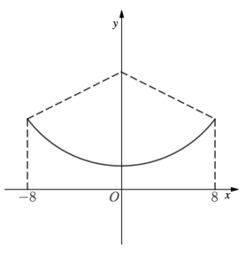
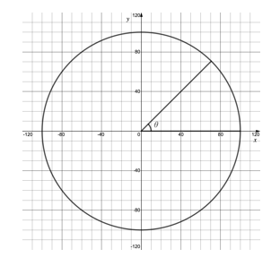
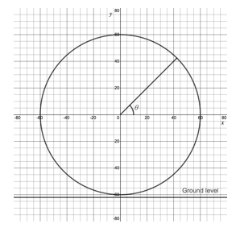
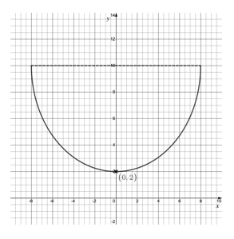
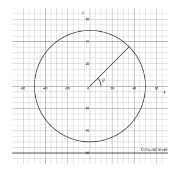

# Exam Questions — Modelling with Trigonometric Functions
**Trigonometry** · Cambridge (CIE) A-LEVEL maths (9709)
> Source: [https://www.savemyexams.com/a-level/maths/cie/20/pure-1/topic-questions/](https://www.savemyexams.com/a-level/maths/cie/20/pure-1/topic-questions/) · 19 questions across 1 sets

## Exam Questions (19 questions)

### Q1 — easy — 6 marks

**Q1** [6 marks]

The path of a swing boat fairground ride, which swings forwards and backwards, is modelled as the arc of a circle of radius 10 m with centre $( 0 , 12 )$, as shown in the diagram.

Ground level is represented by the $x$-axis. The horizontal displacement of the swing boat from the origin $O$ is $x$ metres, and its height above ground level is $y$ metres. The height of the boat is modelled by

$y = 12 - \sqrt{100-x^{2}} ,  - 8 \leq x \leq 8 .$

(i) Find the height of the boat when its horizontal displacement from the origin is 6 m.

(ii) Find the horizontal distance of the boat from the origin when it is 5 m above the ground, giving your answer correct to 3 significant figures.

(iii) Find the maximum height above the ground reached by the swing boat.

(iv) When the swing boat is at its maximum height with a positive horizontal displacement, find the angle of elevation of the boat from the origin. Give your answer correct to 1 decimal place.

### Q2 — easy — 6 marks

**Q2** [1 mark]

The height, $h$ m, of water in a reservoir is modelled by

$h = 6 + A \text{sin}  t ,  t \geq 0 ,$

where $t$ is the time in hours after midday, $A$ is a positive constant, and $t$ is in radians.

State the height of the water in the reservoir at midday.

**Q2** [2 marks]

The minimum height of the water is 3 m.

(i) State the value of $A$.

(ii) Find the maximum height of the water.

**Q2** [3 marks]

Find the height of the water at

(i) 2 p.m.,

(ii) midnight (12 hours after midday),

giving your answers correct to 3 significant figures.

### Q3 — easy — 3 marks

**Q3** [1 mark]

A dolphin dives in and out of the sea. Its height, $h$ cm, relative to sea level $( h = 0 )$, at time $t$ seconds, is modelled by

$h = A \text{sin} ( B t ) ,  t \geq 0 ,$

where $A$ and $B$ are positive constants and $t$ is in radians.

On each jump and dive, the dolphin reaches a maximum height of 70 cm above sea level and a maximum depth of 70 cm below sea level.

State the value of $A$.

**Q3** [2 marks]

Starting at sea level, the dolphin jumps out of the water, dives back under, and returns to sea level. This complete cycle takes $π$ seconds.

Find the value of $B$.

### Q4 — easy — 6 marks

**Q4** [3 marks]

A Ferris wheel is modelled as a circle with centre $O ( 0 , 0 )$ and radius 100 m. There are 32 passenger pods evenly spaced around the wheel.

A pod's position is determined by the angle $θ$ radians, measured anticlockwise from the positive $x$-direction, as shown in the diagram. The coordinates $( x , y )$ of a pod are given by

$( x , y ) = ( 100 \text{cos}  θ ,  100 \text{sin}  θ ) .$

One pod is located at the point $( 100 , 0 )$, where $θ = 0$.

(i) Find the angle, in radians, between adjacent pods.

(ii) Find the coordinates, correct to 1 decimal place, of the next pod anticlockwise from $( 100 , 0 )$.

**Q4** [3 marks]

Using the coordinate model, find the value of $θ$, where $0 \leq θ < 2 π$, for the point on the wheel with coordinates

(i) $( - 100 , 0 )$,

(ii) $( 50 ,  50 \sqrt{3} )$.

### Q5 — medium — 9 marks

**Q5** [3 marks]

The number of daylight hours, $h$, on day $d$ of a year is modelled by

$h = 12 + 5 \text{sin} ( d - 1 ) ^{\circ} ,  d \geq 1 ,$

where the argument of the sine function is in degrees.

(i) State the number of daylight hours predicted by the model on day 1.

(ii) Find the number of daylight hours predicted by the model on day 136, giving your answer correct to 3 significant figures.

**Q5** [5 marks]

(i) Find the two values of $d$ in the interval $1 \leq d \leq 365$ for which the model predicts exactly 9.5 daylight hours.

(ii) Hence find the number of days in the year for which the model predicts fewer than 9.5 daylight hours.

**Q5** [1 mark]

Explain why the model does not cover a full calendar year of 365 days before repeating its cycle.

### Q6 — easy — 9 marks

**Q6** [3 marks]

The length, $l$ cm, of a spring at time $t$ seconds is modelled by

$l = 8 + 2 \text{sin}  t ,  t \geq 0 ,$

where $t$ is in radians.

State

(i) the natural length of the spring,

(ii) the maximum length of the spring,

(iii) the minimum length of the spring.

**Q6** [5 marks]

(i) Find the length of the spring when $t = 5$.

(ii) Find the smallest value of $t$ for which the length of the spring is 9.5 cm.

Give your answers correct to 3 significant figures.

**Q6** [1 mark]

Explain why, according to this model, the spring never comes to rest.

### Q7 — very_hard — 7 marks

**Q7** [2 marks]

Engineers are designing a Ferris wheel with $p$ passenger pods. The wheel is modelled as a circle with centre $( 0 , a )$ and radius $r$ metres. One pod is located at the point $( 42 , 136 )$, as shown in the diagram.

The two thick lines represent two symmetrical ground supports, each running from the centre of the wheel to ground level. The left-hand support lies on the line $4 x - 3 y + 240 = 0$, and the $x$-axis represents ground level.

(i) Find the equation of the circle.

(ii) How far above the ground is the lowest point of the Ferris wheel?

**Q7** [3 marks]

The $p$ pods are evenly distributed around the wheel. The engineers require that no more than three pods are within the intersection of the two supports (the region below the centre bounded by the supports) at any one time.

Find the maximum value of $p$ this design allows.

**Q7** [2 marks]

Each support is made in two sections: a thinner section within the wheel, and a thicker base section outside the wheel. Find the percentage of each support that is made from the thicker material.

### Q8 — very_hard — 6 marks

**Q8** [2 marks]

The height, $h$ m, of a helicopter, $t$ seconds after take-off, is modelled by

`h = 12 + 2\text{tan}\left(\dfrac{1}{2}t - \dfrac{\pi}{2}\right), \quad 0 < t \leq 6,`

where the argument of the tangent function is in radians.

The time lag between the pilot firing up the helicopter and it leaving the ground is accounted for in the model by negative values of $h$ for the period $0 < t < α$.

Find the value of $α$, correct to 2 significant figures.

**Q8** [2 marks]

Show that the helicopter rises just 4 m between the times of $\frac{π}{2}$ seconds and $\frac{3π}{2}$ seconds.

**Q8** [2 marks]

Find the height of the helicopter at the point at which the model ceases to be valid.

### Q9 — very_hard — 7 marks

**Q9** [4 marks]

The height above ground, $h$ m, of a drone used in an air display is modelled by

$h = A + B \text{sin} ( C t + D ) ,$

where $t$ is the time in seconds after launch, $A$, $B$, $C$ and $D$ are constants, and the argument of the sine function is in radians.

The drone is launched upwards from a height of 23 m, and $\frac{π}{6}$ seconds later it reaches its maximum height of 26 m. The minimum height the drone reaches is 14 m.

Find the values of the constants $A$, $B$, $C$ and $D$, given that $D$ is acute.

**Q9** [3 marks]

The drone's lights switch off when its height drops below 17 m. Show that the drone's lights are on for two-thirds of its flight.

### Q10 — hard — 10 marks

**Q10** [2 marks]

The number of daylight hours, $h$, in the UK, $d$ days after the spring equinox (the day in spring when the number of daylight hours is 12) is modelled by

`h = A + B\text{sin}\left(\dfrac{2\pi}{365}d\right),`

where $A$ and $B$ are constants and the argument of the sine function is in radians.

(i) Write down the value of $A$.

(ii) Given that the maximum number of daylight hours is 16.5, write down the value of $B$.

**Q10** [4 marks]

For how many days of the year does the number of daylight hours remain below 10? Give your answer as a whole number of days.

**Q10** [3 marks]

If the spring equinox falls on 21 March, find the dates in the year on which there are 16 hours of daylight.

**Q10** [1 mark]

The model needs to be adjusted every four years. Suggest a reason why.

### Q11 — medium — 3 marks

**Q11** [3 marks]

A hovering helicopter moves up and down at a constant rate between the heights of 200 m and 220 m. It takes the helicopter $\frac{π}{5}$ seconds to move between these two heights.

Write down a model in the form $h = A + B \text{cos} ( C t )$ for the height, $h$ m, of the helicopter at time $t$ seconds, where $A$, $B$ and $C$ are constants to be found and the argument of the cosine function is in radians. State the initial height of the helicopter suggested by your model.

### Q12 — hard — 7 marks

**Q12** [2 marks]

The length of a spring, $l$ cm, at time $t$ seconds, after being released from rest, is modelled by

$l = a + b \text{cos}  4 t ,  t \geq 0 ,$

where the argument of the cosine function is in radians.

Describe what the constants $a$ and $b$ represent in terms of the length of the spring.

**Q12** [2 marks]

Given that the minimum length the spring can attain is 12 cm and its maximum length is 30 cm, find the values of $a$ and $b$.

**Q12** [3 marks]

(i) A similar spring, with the same values of $a$ and $b$, has length modelled by

$l = a + b \text{cos}  2 t ,  t \geq 0 .$

Compare the motion of the two springs.

(ii) Suggest one way in which the model (for both springs) could be improved.

### Q13 — hard — 9 marks

**Q13** [3 marks]

A Ferris wheel with 30 passenger pods is modelled as a circle with centre $( 0 , 0 )$ and radius 60 m. A pod's position is determined by the angle $θ$ radians, measured anticlockwise from the positive $x$-direction, as shown in the diagram.

The coordinates $( x , y )$ of a pod are given by $( A \text{cos}  θ ,  B \text{sin}  θ )$, where $A$ and $B$ are positive constants. Ground level is represented by the line $y = - 62$.

(i) Write down the values of $A$ and $B$.

(ii) The pods are evenly distributed around the wheel. Find the angle between adjacent pods.

**Q13** [3 marks]

Find the height above the ground of a passenger pod when $θ = \frac{7π}{6}$ radians.

**Q13** [2 marks]

Find the angle $θ$, correct to 3 significant figures, for a passenger pod located at the point $( 48 , - 36 )$.

**Q13** [1 mark]

What would you be able to say about the Ferris wheel in the case where $A \neq B$?

### Q14 — hard — 9 marks

**Q14** [5 marks]

The height, $h$ m, of water in a reservoir is modelled by

$h ( t ) = A + B \text{sin} ( C t ) ,  t \geq 0 ,$

where $t$ is the time in hours after midnight, $A$, $B$ and $C$ are positive constants, and the argument of the sine function is in radians.

(i) Given that the water level rises and falls through one and a half cycles in a 24-hour period, find the value of $C$.

(ii) The height of water reaches its minimum of 1 m just once per day. Find the time of day when this occurs.

(iii) The maximum height of water is 11 m. Find the values of $A$ and $B$.

**Q14** [4 marks]

The reservoir is only capable of holding water to a maximum height of 10 m. Should the water level exceed this, an overflow reservoir is available.

During which times of day will the overflow reservoir be in use? Give your answers to the nearest minute.

### Q15 — medium — 6 marks

**Q15** [2 marks]

A small spring is extended to its maximum length and released from rest. The length of the spring, $l$ cm, at time $t$ seconds, is modelled by

$l = 5 + 3 \text{cos}  2 t ,  t \geq 0 ,$

where the argument of the cosine function is in radians.

State

(i) the natural length of the spring,

(ii) the maximum extension of the spring.

**Q15** [3 marks]

(i) Find the length of the spring when $t = 6$.

(ii) Find the value of $t$ at which the length of the spring first reaches 4 cm.

Give your answers correct to 3 significant figures.

**Q15** [1 mark]

State one criticism of this model as time passes.

### Q16 — medium — 9 marks

**Q16** [3 marks]

The height, $h$ m, of water in a reservoir is modelled by

`h(t) = A + B\text{sin}\left(\dfrac{\pi}{6}t\right), \quad t \geq 0,`

where $t$ is the time in hours after midnight, $A$ and $B$ are positive constants, and $t$ is in radians.

In terms of $A$ and $B$, write down the natural height of the water, and its maximum and minimum heights.

**Q16** [3 marks]

The maximum level of the water is 3 m higher than its natural level, and the level of the water is three times higher at its maximum than at its minimum.

Find the maximum, minimum and natural water levels.

**Q16** [3 marks]

(i) How many times per day does the water reach its maximum level?

(ii) Find the times of day when the water level is at its minimum.

### Q17 — medium — 7 marks

**Q17** [4 marks]

The path of a swing boat fairground ride, which swings forwards and backwards, is modelled as a semicircle of radius 8 m, as shown in the diagram.

Ground level is represented by the $x$-axis, and $y$ represents the height, in metres, of the boat above ground level. The path of the boat is given by

$y = 10 - \sqrt{64-x^{2}} ,  - 8 \leq x \leq 8 .$

The boat's initial position is the point $( 0 , 2 )$.

(i) Find the height of the boat when it is 2 m horizontally from its initial position.

(ii) When the boat is at a height of 6 m, find its exact horizontal distance from the origin.

**Q17** [3 marks]

The $x$-coordinate of the boat is also given by

`x = 8\text{sin}\left(\dfrac{\pi}{6} t\right),`

where $t$ seconds is the time since the boat was released from its initial position.

Find the time it takes the boat to swing from one end of the ride to the other.

### Q18 — medium — 6 marks

**Q18** [4 marks]

A Ferris wheel with $p$ passenger pods is modelled as a circle with centre $( 0 , 0 )$ and radius 50 m. A pod's position is determined by the angle $θ$ radians, measured anticlockwise from the positive $x$-direction, as shown in the diagram.

The coordinates $( x , y )$ of a pod are given by $( A \text{cos}  θ ,  A \text{sin}  θ )$, where $A$ is a positive constant. Ground level is represented by the line $y = - 60$.

(i) Write down the value of the constant $A$.

(ii) The angle between adjacent pods is $\frac{π}{12}$ radians. Find the value of $p$.

(iii) Find the maximum height above the ground of a passenger pod during one complete rotation of the Ferris wheel.

**Q18** [2 marks]

Find, correct to 3 significant figures, the value of $θ$ for a passenger pod located at the point $( 30 , 40 )$.

### Q19 — medium — 3 marks

**Q19** [3 marks]

A dolphin dives in and out of the water. On each jump and dive, it reaches a maximum height of 2 m above sea level and a maximum depth of 2 m below sea level.

Starting at sea level, the dolphin takes $\frac{2π}{3}$ seconds to jump out of the water, dive back under the water, and return to sea level.

Express the height, $h$ m, of the dolphin relative to sea level at time $t$ seconds as a model in the form

$h = A \text{sin} ( B t ) ,$

where $A$ and $B$ are positive constants to be found.
