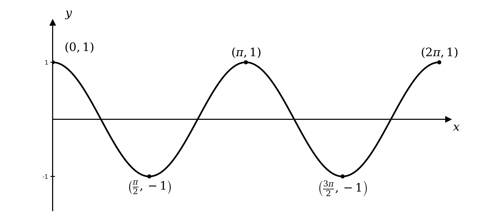
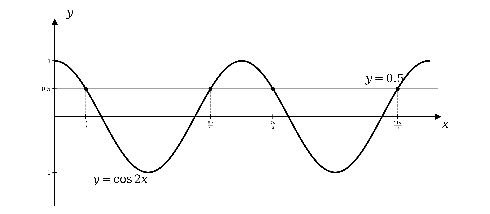
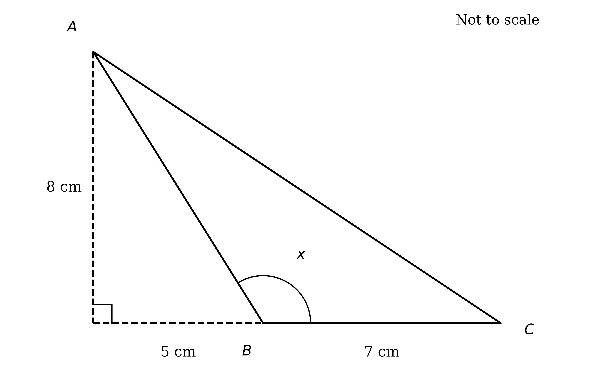
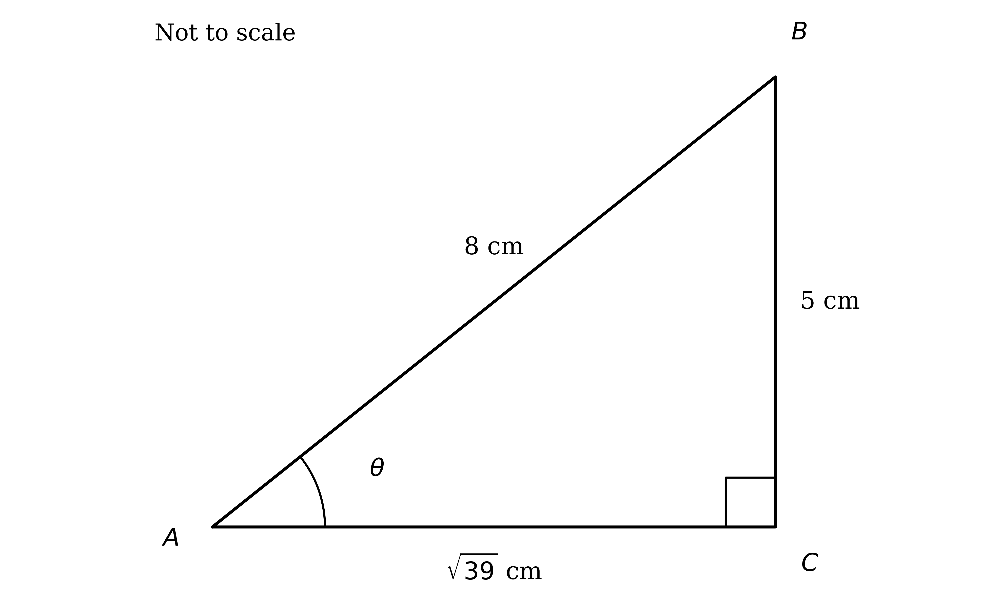
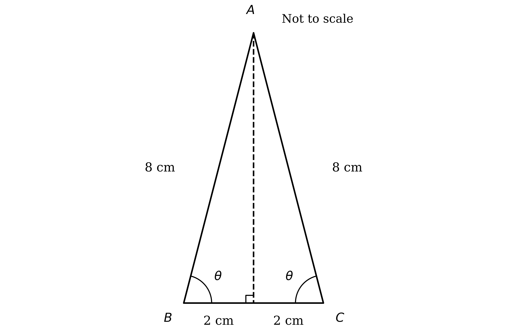

# Mark Schemes — Trigonometric Equations
**Trigonometry** · Cambridge (CIE) A-LEVEL maths (9709)

## Exam Questions (34 questions)

### Q1
Let $φ = 2 θ$; as $- 180 ^{\circ} \leq θ \leq 180 ^{\circ}$, the interval for $φ$ is $- 360 ^{\circ} \leq φ \leq 360 ^{\circ}$

$φ = \text{tan}^{-1} ( 0 . 3 ) = 16 . 699 . . . ^{\circ}$

**[M1]**

Add and subtract the period of tan ($180 ^{\circ}$) to find every value of $φ$ in the interval

$φ = 16 . 699 ^{\circ} + 180 ^{\circ} = 196 . 699 ^{\circ}$

$φ = 16 . 699 ^{\circ} - 180 ^{\circ} = - 163 . 301 ^{\circ}$

$φ = - 163 . 301 ^{\circ} - 180 ^{\circ} = - 343 . 301 ^{\circ}$

**[A1]**

Divide each value by 2 to find $θ$, then round to 1 decimal place

$θ = 8 . 3 ^{\circ} ,  98 . 3 ^{\circ} ,  - 81 . 7 ^{\circ} ,  - 171 . 7 ^{\circ}$

**[A1]**

> **[mark-scheme]**
> **M1**: Finds the principal value $\text{tan}^{-1} ( 0 . 3 ) = 16 . 7 ^{\circ}$ and works with $φ = 2 θ$ over $- 360 ^{\circ} \leq φ \leq 360 ^{\circ}$.
> 
> **A1**: All four values of $2 θ$ correct (adding/subtracting the period $180 ^{\circ}$).
> 
> **A1**: All four solutions, answers which round to $θ = - 171 . 7 ^{\circ} , - 81 . 7 ^{\circ} , 8 . 3 ^{\circ} , 98 . 3 ^{\circ}$ (1 decimal place), and no others in the interval.
> 
> Guidance: keep the unrounded value through the working — rounding $2 θ$ to $16 . 7 ^{\circ}$ before halving loses accuracy. Answers given in radians are treated as a misread.

### Q2
The triangle is right-angled, so apply Pythagoras' theorem with the 13 cm side as the hypotenuse

$13^{2} = 12^{2} + ℓ^{2}$

**[M1]**

Rearrange to make the unknown side the subject

$ℓ^{2} = 169 - 144 = 25$

Take the positive square root, since a length cannot be negative

$ℓ = 5 \text{cm}$

**[A1]**

> **[mark-scheme]**
> **M1**: Correct use of Pythagoras' theorem with 13 cm as the hypotenuse, for example $13^{2} = 12^{2} + ℓ^{2}$ or $ℓ^{2} = 13^{2} - 12^{2}$.
> 
> **A1**: Correct missing length, $ℓ = 5 \text{cm}$ (positive value only).
Using the sides relative to $θ$ — opposite $= 5$, adjacent $= 12$, hypotenuse $= 13$ — apply SOH-CAH-TOA

(i)

Sine is the opposite side over the hypotenuse

$\text{sin}  θ = \frac{5}{13}$

**[B1]**

(ii)

Cosine is the adjacent side over the hypotenuse

$\text{cos}  θ = \frac{12}{13}$

**[B1]**

(iii)

Tangent is the opposite side over the adjacent side

$\text{tan}  θ = \frac{5}{12}$

**[B1]**

> **[mark-scheme]**
> **B1**: Correct value of $\text{sin}  θ = \frac{5}{13}$.
> 
> **B1**: Correct value of $\text{cos}  θ = \frac{12}{13}$.
> 
> **B1**: Correct value of $\text{tan}  θ = \frac{5}{12}$.
> 
> Guidance: accept equivalent simplified fractions, or the decimals which round to $\text{sin}  θ = 0 . 385$, $\text{cos}  θ = 0 . 923$ and $\text{tan}  θ = 0 . 417$ (3 significant figures). The value of $θ$ itself is not required.

### Q3
Take the inverse sine to find the principal value

`x = \text{sin}^{-1}\left(\dfrac{1}{2}\right) = 30^{\circ}`

**[M1 A1]**

Find the second solution using the symmetry of the sine graph, $\text{sin}  x = \text{sin} ( 180 ^{\circ} - x )$

$x = 180 ^{\circ} - 30 ^{\circ} = 150 ^{\circ}$

$x = 30 ^{\circ} ,  150 ^{\circ}$

**[A1]**

> **[mark-scheme]**
> **M1**: Uses inverse sine to obtain a principal value, `x = \text{sin}^{-1}\left(\dfrac{1}{2}\right)`.
> 
> **A1**: Correct principal value $x = 30 ^{\circ}$.
> 
> **A1**: Correct second solution $x = 150 ^{\circ}$, with no extra solutions inside the interval. (Extra incorrect solutions in $0 ^{\circ} \leq x \leq 360 ^{\circ}$ lose this mark; ignore any outside it.)

### Q4
Use $\text{sin}^{2} θ + \text{cos}^{2} θ \equiv 1$ to replace $1 - \text{cos}^{2} θ$ with $\text{sin}^{2} θ$

$2 \text{sin}^{2} θ = 1$

**[M1]**

Rearrange and take the square root, keeping both signs

$\text{sin}  θ = \pm \frac{1}{\sqrt{2}}$

**[A1]**

Solve $\text{sin}  θ = \frac{1}{\sqrt{2}}$ using the principal value $\frac{π}{4}$ and the symmetry $\text{sin}  θ = \text{sin} ( π - θ )$

$θ = \frac{π}{4}$

$θ = π - \frac{π}{4} = \frac{3π}{4}$

**[A1]**

Solve $\text{sin}  θ = - \frac{1}{\sqrt{2}}$ in the same way across the interval

$θ = - \frac{π}{4} ,  - \frac{3π}{4}$

$θ = - \frac{3π}{4} ,  - \frac{π}{4} ,  \frac{π}{4} ,  \frac{3π}{4}$

**[A1]**

> **[mark-scheme]**
> **M1**: Uses $\text{sin}^{2} θ + \text{cos}^{2} θ \equiv 1$ to reach $2 \text{sin}^{2} θ = 1$ (an equation in one ratio).
> 
> **A1**: Correct $\text{sin}  θ = \pm \frac{1}{\sqrt{2}}$ (accept $\pm \frac{\sqrt{2}}{2}$).
> 
> **A1**: Both solutions from the positive root, $θ = \frac{π}{4} , \frac{3π}{4}$.
> 
> **A1**: Both solutions from the negative root, $θ = - \frac{π}{4} , - \frac{3π}{4}$, giving all four and no others in the interval.

### Q5
Work from the left-hand side; replace the numerator using $\text{sin}^{2} x + \text{cos}^{2} x \equiv 1$, and write $\text{tan}^{2} x$ as $\frac{\text{sin}^{2}x}{\text{cos}^{2}x}$

$\frac{1-\text{cos}^{2}x}{\text{tan}^{2}x} = \frac{\text{sin}^{2}x}{\frac{\text{sin}^{2}x}{\text{cos}^{2}x}}$

**[M1]**

Divide by the fraction and cancel $\text{sin}^{2} x$

**Final answer:** $= \text{sin}^{2} x \times \frac{\text{cos}^{2}x}{\text{sin}^{2}x} = \text{cos}^{2} x$** as required**

**[A1]**

> **[mark-scheme]**
> **M1**: Correct use of $\text{sin}^{2} x + \text{cos}^{2} x \equiv 1$ (so $1 - \text{cos}^{2} x = \text{sin}^{2} x$) together with $\text{tan}  x \equiv \frac{\text{sin}x}{\text{cos}x}$ to rewrite the left-hand side in terms of $\text{sin}  x$ and $\text{cos}  x$.
> 
> **A1**: Correct simplification to $\text{cos}^{2} x$, reaching the printed result with no errors seen. Undefined shorthand for the trig ratios is not accepted.

### Q6
$y = \text{cos}  2 x$ is $y = \text{cos}  x$ with a horizontal stretch of scale factor $\frac{1}{2}$, so it completes two full cycles on $0 \leq x \leq 2 π$, with maxima of $1$ at $x = 0 , π , 2 π$ and minima of $- 1$ at $x = \frac{π}{2} , \frac{3π}{2}$

**[B1 B1]**

> **[mark-scheme]**
> **B1**: Correct shape — a cosine curve completing two full cycles over $0 \leq x \leq 2 π$ (amplitude 1), starting at a maximum.
> 
> **B1**: Key features correct — starts at $( 0 , 1 )$, minima of $- 1$ at $x = \frac{π}{2}$ and $\frac{3π}{2}$, and returns to $1$ at $x = 2 π$ (x-intercepts at $\frac{π}{4} , \frac{3π}{4} , \frac{5π}{4} , \frac{7π}{4}$).
Let $φ = 2 x$; as $0 \leq x \leq 2 π$, the interval for $φ$ is $0 \leq φ \leq 4 π$. Find the principal value

$φ = \text{cos}^{-1} ( 0 . 5 ) = \frac{π}{3}$

**[M1]**

Using the symmetry of the cosine graph ($\text{cos}  φ = \text{cos} ( - φ )$) and its period $2 π$, find every $φ$ in the interval

$φ = 2 π - \frac{π}{3} = \frac{5π}{3}$

$φ = \frac{π}{3} + 2 π = \frac{7π}{3}$

$φ = \frac{5π}{3} + 2 π = \frac{11π}{3}$

Divide each by 2

$x = \frac{π}{6} ,  \frac{5π}{6} ,  \frac{7π}{6} ,  \frac{11π}{6}$

**[A1]**

> **[mark-scheme]**
> **M1**: Correct method — inverse cosine for the principal value and use of symmetry/period (or the graph) to find further solutions, working with $2 x$ over $0 \leq 2 x \leq 4 π$.
> 
> **A1**: All four exact solutions $x = \frac{π}{6} , \frac{5π}{6} , \frac{7π}{6} , \frac{11π}{6}$, and no others in the interval. Exact multiples of $π$ are required; decimal answers are not accepted.

### Q7
Factorise: find two numbers multiplying to $- 2$ and adding to $1$ (these are $+ 2$ and $- 1$)

$( x - 1 ) ( x + 2 ) = 0$

**[M1]**

Set each factor to zero

**Final answer:** $x = 1$** or **$x = - 2$

**[A1]**

> **[mark-scheme]**
> **M1**: Valid attempt to factorise (or correct use of the quadratic formula), for example $( x - 1 ) ( x + 2 ) = 0$.
> 
> **A1**: Both correct values, $x = 1$ and $x = - 2$.
The equation has the same form as part (a) with $\text{cos}  x$ in place of $x$, so use the same factors

$( \text{cos}  x - 1 ) ( \text{cos}  x + 2 ) = 0$

**[M1]**

Since $\text{cos}  x$ cannot be less than $- 1$, reject $\text{cos}  x = - 2$; solve $\text{cos}  x = 1$ across the interval

$x = 0 ^{\circ} ,  360 ^{\circ} ,  720 ^{\circ}$

**[A1]**

> **[mark-scheme]**
> **M1**: Uses the factors (or method) from part (a) to obtain $\text{cos}  x = 1$ or $\text{cos}  x = - 2$, and rejects $\text{cos}  x = - 2$.
> 
> **A1**: All three correct solutions $x = 0 ^{\circ} , 360 ^{\circ} , 720 ^{\circ}$, and no others in the interval.

### Q8
Rearrange to $\text{sin}  θ = \frac{\sqrt{3}}{2}$ and find the principal value

$\text{sin}  θ = \frac{\sqrt{3}}{2}  \Rightarrow  θ = \frac{π}{3}$

**[M1 A1]**

Use the symmetry of the sine graph, $\text{sin}  θ = \text{sin} ( π - θ )$, for the second solution in $0 \leq θ \leq 2 π$

$θ = π - \frac{π}{3} = \frac{2π}{3}$

**[A1]**

Subtract the period $2 π$ from each to reach the negative part of the interval

$\frac{π}{3} - 2 π = - \frac{5π}{3} ,  \frac{2π}{3} - 2 π = - \frac{4π}{3}$

$θ = - \frac{5π}{3} ,  - \frac{4π}{3} ,  \frac{π}{3} ,  \frac{2π}{3}$

**[A1]**

> **[mark-scheme]**
> **M1**: Rearranges to $\text{sin}  θ = \frac{\sqrt{3}}{2}$ and finds a principal value using inverse sine.
> 
> **A1**: Correct principal value $θ = \frac{π}{3}$.
> 
> **A1**: Second solution in $0 \leq θ \leq 2 π$, $θ = \frac{2π}{3}$, by symmetry.
> 
> **A1**: Both remaining solutions $θ = - \frac{5π}{3} , - \frac{4π}{3}$ (subtracting the period), giving all four and no others in the interval.

### Q9
Rearrange to make $\text{sin}^{2} θ$ the subject

$4 \text{sin}^{2} θ = 1  \Rightarrow  \text{sin}^{2} θ = \frac{1}{4}$

**[M1]**

Take the square root, keeping both signs

$\text{sin}  θ = \pm \frac{1}{2}$

**[A1]**

On $0 ^{\circ} \leq θ \leq 180 ^{\circ}$ the sine is never negative, so reject $\text{sin}  θ = - \frac{1}{2}$; the principal value of $\text{sin}  θ = \frac{1}{2}$ is $30 ^{\circ}$

$θ = 30 ^{\circ}$

**[A1]**

Find the second solution using the symmetry $\text{sin}  θ = \text{sin} ( 180 ^{\circ} - θ )$

$θ = 180 ^{\circ} - 30 ^{\circ} = 150 ^{\circ}$

$θ = 30 ^{\circ} ,  150 ^{\circ}$

**[A1]**

> **[mark-scheme]**
> **M1**: Rearranges to $\text{sin}^{2} θ = \frac{1}{4}$ (or $\text{cos}^{2} θ = \frac{3}{4}$ by the equivalent route).
> 
> **A1**: Correct $\text{sin}  θ = \pm \frac{1}{2}$ (or $\text{cos}  θ = \pm \frac{\sqrt{3}}{2}$).
> 
> **A1**: First solution $θ = 30 ^{\circ}$.
> 
> **A1**: Second solution $θ = 150 ^{\circ}$, and no others in the interval.

### Q10
Let $φ = 2 x + 30 ^{\circ}$. Find the interval for $φ$ by substituting the two endpoints of $- 180 ^{\circ} \leq x \leq 180 ^{\circ}$ into this expression

At $x = - 180 ^{\circ}$

$φ = 2 ( - 180 ^{\circ} ) + 30 ^{\circ} = - 330 ^{\circ}$

At $x = 180 ^{\circ}$

$φ = 2 ( 180 ^{\circ} ) + 30 ^{\circ} = 390 ^{\circ}$

So $φ$ ranges over $- 330 ^{\circ} \leq φ \leq 390 ^{\circ}$

Now write $\text{tan}  φ = \frac{\text{sin}φ}{\text{cos}φ}$ and collect terms on one side

$3 \text{sin}  φ - \frac{\text{sin}φ}{\text{cos}φ} = 0$

Factorise out $\text{sin}  φ$ — do not divide by it

`\text{sin} \; \varphi \left(3 - \dfrac{1}{\text{cos} \; \varphi}\right) = 0`

**[M1]**

Set each factor to zero

$\text{sin}  φ = 0$* or *$\text{cos}  φ = \frac{1}{3}$

**[A1]**

Solve $\text{sin}  φ = 0$ in $- 330 ^{\circ} \leq φ \leq 390 ^{\circ}$ (the sine is zero at multiples of $180 ^{\circ}$)

$φ = 0 ^{\circ} ,  180 ^{\circ} ,  360 ^{\circ} ,  - 180 ^{\circ}$

**[A1]**

Solve $\text{cos}  φ = \frac{1}{3}$ (principal $70 . 5288 ^{\circ}$), using cosine symmetry ($\text{cos}  φ = \text{cos} ( - φ )$) and the period $360 ^{\circ}$

$φ = 70 . 5288 ^{\circ} ,  - 70 . 5288 ^{\circ}$

$φ = 360 ^{\circ} - 70 . 5288 ^{\circ} = 289 . 4712 ^{\circ} ,  - 289 . 4712 ^{\circ}$

**[M1]**

Convert back with $x = \frac{φ-30}{2}$ and round to 1 decimal place where appropriate

$x = - 159 . 7 ^{\circ} ,  - 105 ^{\circ} ,  - 50 . 3 ^{\circ} ,  - 15 ^{\circ} ,  20 . 3 ^{\circ} ,  75 ^{\circ} ,  129 . 7 ^{\circ} ,  165 ^{\circ}$

**[A1]**

> **[mark-scheme]**
> **M1**: Writes $\text{tan}  φ = \frac{\text{sin}φ}{\text{cos}φ}$ and factorises out $\text{sin}  φ$ (not dividing by it).
> 
> **A1**: $\text{sin}  φ = 0$ or $\text{cos}  φ = \frac{1}{3}$.
> 
> **A1**: All four values of $φ$ from $\text{sin}  φ = 0$.
> 
> **M1**: Finds all values of $φ$ from $\text{cos}  φ = \frac{1}{3}$ in the interval.
> 
> **A1**: All eight solutions, answers which round to $x = - 159 . 7 ^{\circ} , - 105 ^{\circ} , - 50 . 3 ^{\circ} , - 15 ^{\circ} , 20 . 3 ^{\circ} , 75 ^{\circ} , 129 . 7 ^{\circ} , 165 ^{\circ}$, and no others.

### Q11
Replace $\text{cos}^{2} 2 θ$ with $1 - \text{sin}^{2} 2 θ$ and rearrange into a quadratic in $\text{sin}  2 θ$

$6 ( 1 - \text{sin}^{2} 2 θ ) = \text{sin}  2 θ + 5$

**[M1]**

$6 \text{sin}^{2} 2 θ + \text{sin}  2 θ - 1 = 0$

**[A1]**

Factorise and solve for $\text{sin}  2 θ$

$( 3 \text{sin}  2 θ - 1 ) ( 2 \text{sin}  2 θ + 1 ) = 0  \Rightarrow  \text{sin}  2 θ = \frac{1}{3}  \text{or}  - \frac{1}{2}$

**[M1]**

Working in $- 360 ^{\circ} \leq 2 θ \leq 360 ^{\circ}$, use sine symmetry ($\text{sin}  2 θ = \text{sin} ( 180 ^{\circ} - 2 θ )$) and the period $360 ^{\circ}$

For $\text{sin}  2 θ = \frac{1}{3}$ (principal $19 . 4712 ^{\circ}$)

$2 θ = 19 . 4712 ^{\circ} ,  180 ^{\circ} - 19 . 4712 ^{\circ} = 160 . 5288 ^{\circ}$

$2 θ = 19 . 4712 ^{\circ} - 360 ^{\circ} = - 340 . 5288 ^{\circ} ,  160 . 5288 ^{\circ} - 360 ^{\circ} = - 199 . 4712 ^{\circ}$

For $\text{sin}  2 θ = - \frac{1}{2}$ (principal $- 30 ^{\circ}$)

$2 θ = - 30 ^{\circ} ,  180 ^{\circ} + 30 ^{\circ} = 210 ^{\circ}$

$2 θ = - 30 ^{\circ} + 360 ^{\circ} = 330 ^{\circ} ,  210 ^{\circ} - 360 ^{\circ} = - 150 ^{\circ}$

**[A1]**

Divide each value by 2 and round to 1 decimal place where appropriate

$θ = - 170 . 3 ^{\circ} ,  - 99 . 7 ^{\circ} ,  - 75 ^{\circ} ,  - 15 ^{\circ} ,  9 . 7 ^{\circ} ,  80 . 3 ^{\circ} ,  105 ^{\circ} ,  165 ^{\circ}$

**[A1]**

> **[mark-scheme]**
> **M1**: Uses $\text{cos}^{2} 2 θ \equiv 1 - \text{sin}^{2} 2 θ$ to form an equation in $\text{sin}  2 θ$.
> 
> **A1**: Correct quadratic $6 \text{sin}^{2} 2 θ + \text{sin}  2 θ - 1 = 0$.
> 
> **M1**: Factorises (or solves) to $\text{sin}  2 θ = \frac{1}{3}$ or $- \frac{1}{2}$.
> 
> **A1**: All eight values of $2 θ$ in the interval (sine symmetry and period).
> 
> **A1**: All eight solutions, answers which round to $θ = - 170 . 3 ^{\circ} , - 99 . 7 ^{\circ} , - 75 ^{\circ} , - 15 ^{\circ} , 9 . 7 ^{\circ} , 80 . 3 ^{\circ} , 105 ^{\circ} , 165 ^{\circ}$, and no others. Keep full precision before halving.

### Q12
Let $φ = 2 θ$; as $0 \leq θ \leq 2 π$, the interval is $0 \leq 2 θ \leq 4 π$. Collect terms and factorise — do not divide by $\text{cos}  2 θ$

$4 \text{sin}  2 θ  \text{cos}  2 θ - 2 \text{cos}  2 θ = 0$

$2 \text{cos}  2 θ ( 2 \text{sin}  2 θ - 1 ) = 0$

**[M1]**

Set each factor to zero

$\text{cos}  2 θ = 0$* or *$\text{sin}  2 θ = \frac{1}{2}$

**[A1]**

From $\text{cos}  2 θ = 0$ (the cosine is zero at $\frac{π}{2}$, then every $π$) in $0 \leq 2 θ \leq 4 π$

$2 θ = \frac{π}{2} ,  \frac{π}{2} + π = \frac{3π}{2}$

$2θ=\frac{3π}{2}+π=\frac{5π}{2}\,\frac{5π}{2}+π=\frac{7π}{2}$

**[A1]**

From $\text{sin}  2 θ = \frac{1}{2}$ (principal $\frac{π}{6}$)

$2 θ = \frac{π}{6} ,  π - \frac{π}{6} = \frac{5π}{6}$

$2θ=\frac{π}{6}+2π=\frac{13π}{6}\,\frac{5π}{6}+2π=\frac{17π}{6}$

**[A1]**

Divide the cosine-branch values by 2

$θ = \frac{π}{4} ,  \frac{3π}{4} ,  \frac{5π}{4} ,  \frac{7π}{4}$

**[A1]**

Divide the sine-branch values by 2 and collect all eight solutions

$θ = \frac{π}{12} ,  \frac{π}{4} ,  \frac{5π}{12} ,  \frac{3π}{4} ,  \frac{13π}{12} ,  \frac{5π}{4} ,  \frac{17π}{12} ,  \frac{7π}{4}$

**[A1]**

> **[mark-scheme]**
> **M1**: Collects terms and factorises to $2 \text{cos}  2 θ ( 2 \text{sin}  2 θ - 1 ) = 0$ (factorising, not dividing by $\text{cos}  2 θ$).
> 
> **A1**: $\text{cos}  2 θ = 0$ or $\text{sin}  2 θ = \frac{1}{2}$.
> 
> **A1**: All four values of $2 θ$ from $\text{cos}  2 θ = 0$.
> 
> **A1**: All four values of $2 θ$ from $\text{sin}  2 θ = \frac{1}{2}$.
> 
> **A1**: The four solutions from the cosine branch, $θ = \frac{π}{4} , \frac{3π}{4} , \frac{5π}{4} , \frac{7π}{4}$.
> 
> **A1**: The four solutions from the sine branch, giving all eight exact solutions and no others.
Let $φ = 4 x$; as $0 \leq x \leq π$, the interval is $0 \leq 4 x \leq 4 π$. Factorise the quadratic in $\text{cos}  4 x$

$( 3 \text{cos}  4 x - 2 ) ( \text{cos}  4 x + 5 ) = 0$

**[M1]**

Since $\text{cos}  4 x$ cannot be less than $- 1$, reject $\text{cos}  4 x = - 5$

$\text{cos}  4 x = \frac{2}{3}$

**[A1]**

Find the principal value

`4x = \text{cos}^{-1}\left(\dfrac{2}{3}\right) = 0.84106...`

**[A1]**

Use cosine symmetry and the period $2 π$ to find every value of $4 x$ in the interval

$4 x = 2 π - 0 . 84106 = 5 . 44211$

$4 x = 2 π + 0 . 84106 = 7 . 12425$

$4 x = 4 π - 0 . 84106 = 11 . 72530$

**[M1 A1]**

Divide each value by 4 and round to 3 significant figures

$x = 0 . 210 ,  1 . 36 ,  1 . 78 ,  2 . 93$

**[A1]**

> **[mark-scheme]**
> **M1**: Factorises (or solves) the quadratic in $\text{cos}  4 x$.
> 
> **A1**: $\text{cos}  4 x = \frac{2}{3}$, with $\text{cos}  4 x = - 5$ rejected.
> 
> **A1**: Principal value $4 x = 0 . 841$.
> 
> **M1**: Uses cosine symmetry and the period to find further values of $4 x$ over $0 \leq 4 x \leq 4 π$.
> 
> **A1**: All four values of $4 x$ correct.
> 
> **A1**: All four solutions, answers which round to $x = 0 . 210 , 1 . 36 , 1 . 78 , 2 . 93$ (3 significant figures), and no others.

### Q13
Drop a perpendicular of height 8 cm from the top vertex. The 12 cm span is 5 cm wider than the 7 cm base, so the foot lands 5 cm beyond the base vertex — which makes $x$ obtuse

Find the two sloping sides by Pythagoras

$\sqrt{8^{2}+5^{2}} = \sqrt{89} ,  \sqrt{8^{2}+12^{2}} = \sqrt{208}$

**[M1 A1]**

Apply the cosine rule, with $x$ between the sides 7 and $\sqrt{89}$ and opposite $\sqrt{208}$

$208 = 49 + 89 - 2 ( 7 ) ( \sqrt{89} )  \text{cos}  x$

**[M1]**

Rearrange for $\text{cos}  x$

$\text{cos}  x = - \frac{70}{14\sqrt{89}} = - \frac{5}{\sqrt{89}}$

**[A1]**

Use $\text{sin}^{2} x + \text{cos}^{2} x \equiv 1$, since $x$ is obtuse, sine is positive

$\text{sin}^{2} x = 1 - \frac{25}{89} = \frac{64}{89}  \Rightarrow  \text{sin}  x = \frac{8}{\sqrt{89}}$

**[A1]**

Finally use $\text{tan}  x = \frac{\text{sin}x}{\text{cos}x}$

$\text{tan}  x = \frac{8/\sqrt{89}}{-5/\sqrt{89}} = - \frac{8}{5}$

**[A1]**

> **[mark-scheme]**
> **M1**: Uses Pythagoras (with the 5 cm offset) to find a sloping side.
> 
> **A1**: $\sqrt{89}$ and $\sqrt{208}$ correct.
> 
> **M1**: Correct cosine-rule statement for the angle $x$.
> 
> **A1**: $\text{cos}  x = - \frac{5}{\sqrt{89}}$.
> 
> **A1**: $\text{sin}  x = \frac{8}{\sqrt{89}}$ (positive, justified by $x$ obtuse).
> 
> **A1**: $\text{tan}  x = - \frac{8}{5}$. Accept rationalised forms such as $\text{cos}  x = - \frac{5\sqrt{89}}{89}$.

### Q14
Find the period of the model to see how the motion repeats

$\text{period} = \frac{360^{\circ}}{90} = 4 \text{seconds}$

**[B1]**

Over one 4-second cycle the height rises above $0 . 5$ m between two times, $t_{1}$ and $t_{2}$

Set the model equal to $0 . 5$ and reduce to a single sine

$\frac{3}{5} \text{sin} ( 90 t ) ^{\circ} = 0 . 5  \Rightarrow  \text{sin} ( 90 t ) ^{\circ} = \frac{5}{6}$

**[M1]**

Take the inverse sine for the principal value (working in degrees)

`90t = \text{sin}^{-1}\left(\dfrac{5}{6}\right) = 56.4427...^{\circ}`

**[A1]**

Use the symmetry of the sine graph, $\text{sin}  θ = \text{sin} ( 180 ^{\circ} - θ )$, for the second time in the cycle

$90 t = 180 ^{\circ} - 56 . 4427 ^{\circ} = 123 . 5573 . . . ^{\circ}$

**[M1]**

Divide each value by 90 to find the two times

$t_{1} = \frac{56.4427}{90} = 0 . 62714 . . . ,  t_{2} = \frac{123.5573}{90} = 1 . 37286 . . .$

**[A1]**

The height is above $0 . 5$ m for $t_{2} - t_{1}$ in each cycle, and there are $5$ cycles in the first $20$ seconds, so multiply by 5

$5 ( t_{2} - t_{1} ) = 5 ( 1 . 37286 - 0 . 62714 ) = 5 \times 0 . 74572 . . .$

**[M1]**

$3 . 73 \text{seconds}$

**[A1]**

> **[mark-scheme]**
> **B1**: States the period is $\frac{360^{\circ}}{90} = 4$ seconds (or that there are $5$ complete cycles in the first $20$ seconds).
> 
> **M1**: Sets $\frac{3}{5} \text{sin} ( 90 t ) ^{\circ} = 0 . 5$ and reduces to $\text{sin} ( 90 t ) ^{\circ} = \frac{5}{6}$.
> 
> **A1**: Principal value, answers which round to $90 t = 56 . 4 ^{\circ}$.
> 
> **M1**: Uses sine symmetry ($180 ^{\circ}$ minus the principal value) for the second angle in the cycle, $90 t = 123 . 6 ^{\circ}$.
> 
> **A1**: Both times in one cycle, answers which round to $t_{1} = 0 . 627$ and $t_{2} = 1 . 37$.
> 
> **M1**: Finds the interval width $t_{2} - t_{1}$ and multiplies by $5$ (five cycles in $20$ seconds).
> 
> **A1**: $3 . 73$ seconds (answers which round to this, 3 significant figures). Keep at least 4 significant figures in the intermediate values, and work in degrees.

### Q15
Let $φ = 3 θ$; as $0 \leq θ \leq π$, the interval is $0 \leq 3 θ \leq 3 π$. Divide by $\text{cos}  3 θ$ and find the principal value

`\text{tan} \; 3\theta = \dfrac{4}{3} \quad \Rightarrow \quad 3\theta = \text{tan}^{-1}\left(\dfrac{4}{3}\right) = 0.92730...`

**[M1]**

Tangent has period $π$, so add $π$ repeatedly to find every value of $3 θ$ in the interval

$3 θ = 0 . 92730 + π = 4 . 06889$

$3 θ = 4 . 06889 + π = 7 . 21048$

**[A1]**

Divide each value by 3 and round to 3 significant figures

$θ = 0 . 309 ,  1 . 36 ,  2 . 40$

**[A1]**

> **[mark-scheme]**
> **M1**: Divides by $\text{cos}  3 θ$ to obtain $\text{tan}  3 θ = \frac{4}{3}$, and finds the principal value over $0 \leq 3 θ \leq 3 π$.
> 
> **A1**: All three values of $3 θ$ (using the period $π$).
> 
> **A1**: All three solutions, answers which round to $θ = 0 . 309 , 1 . 36 , 2 . 40$ (3 significant figures), and no others.

### Q16
Use $\text{sin}^{2} θ + \text{cos}^{2} θ \equiv 1$ to find $\text{sin}  θ$

`\text{sin}^2 \theta = 1 - \left(\dfrac{1}{3}\right)^2 = \dfrac{8}{9} \quad \Rightarrow \quad \text{sin} \; \theta = \pm\dfrac{2\sqrt{2}}{3}`

**[M1]**

The angle is reflex with a positive cosine, so it lies between $270 ^{\circ}$ and $360 ^{\circ}$, where sine is negative (consider the graph of sine)

$\text{sin}  θ = - \frac{2\sqrt{2}}{3}$

**[A1]**

Use $\text{tan}  θ = \frac{\text{sin}θ}{\text{cos}θ}$

$\text{tan}  θ = \frac{-\frac{2\sqrt{2}}{3}}{\frac{1}{3}} = - 2 \sqrt{2}$

**[A1]**

> **[mark-scheme]**
> **M1**: Uses $\text{sin}^{2} θ + \text{cos}^{2} θ \equiv 1$ to reach $\text{sin}  θ = \pm \frac{2\sqrt{2}}{3}$.
> 
> **A1**: Selects $\text{sin}  θ = - \frac{2\sqrt{2}}{3}$, justified by $θ$ being reflex with positive cosine.
> 
> **A1**: $\text{tan}  θ = - 2 \sqrt{2}$ (exact).

### Q17
Let $φ = 3 x$; as $- \frac{π}{2} \leq x \leq \frac{π}{2}$, the interval is $- \frac{3π}{2} \leq 3 x \leq \frac{3π}{2}$

Rearrange to make $\text{sin}^{2} 3 x$ the subject

$\text{sin}^{2} 3 x = \frac{1}{2}$

**[M1]**

Take the square root, keeping both signs

$\text{sin}  3 x = \pm \frac{1}{\sqrt{2}}$

**[A1]**

Solve $\text{sin}  3 x = \frac{1}{\sqrt{2}}$: principal value $\frac{π}{4}$, and sine symmetry $\text{sin}  3 x = \text{sin} ( π - 3 x )$

$3 x = \frac{π}{4} ,  π - \frac{π}{4} = \frac{3π}{4}$

$3 x = \frac{3π}{4} - 2 π = - \frac{5π}{4}$

**[A1]**

Solve $\text{sin}  3 x = - \frac{1}{\sqrt{2}}$ in the same way

$3 x = - \frac{π}{4} ,  - \frac{3π}{4}$

$3 x = - \frac{3π}{4} + 2 π = \frac{5π}{4}$

**[A1]**

Divide each of the six values by 3

$x = - \frac{5π}{12} ,  - \frac{π}{4} ,  - \frac{π}{12} ,  \frac{π}{12} ,  \frac{π}{4} ,  \frac{5π}{12}$

**[A1]**

> **[mark-scheme]**
> **M1**: Reduces to $\text{sin}^{2} 3 x = \frac{1}{2}$ and transforms the interval to $- \frac{3π}{2} \leq 3 x \leq \frac{3π}{2}$.
> 
> **A1**: $\text{sin}  3 x = \pm \frac{1}{\sqrt{2}}$.
> 
> **A1**: All three values of $3 x$ from the positive root.
> 
> **A1**: All three values of $3 x$ from the negative root.
> 
> **A1**: All six exact solutions for $x$ (dividing by 3) and no others in the interval.

### Q18
Find the third side using Pythagoras, leaving it in surd form since exact values are required

$\sqrt{8^{2}-5^{2}} = \sqrt{64-25} = \sqrt{39}$

**[M1 A1]**

The smallest angle is opposite the shortest side, so relative to $θ$ the opposite is $5$, the adjacent is $\sqrt{39}$ and the hypotenuse is $8$

**[B1]**

Apply SOH-CAH-TOA

$\text{sin}  θ = \frac{5}{8}$

**[B1]**

$\text{cos}  θ = \frac{\sqrt{39}}{8}$

**[B1]**

$\text{tan}  θ = \frac{5}{\sqrt{39}}$

**[B1]**

> **[mark-scheme]**
> **M1**: Uses Pythagoras to find the third side, $\sqrt{8^{2}-5^{2}}$.
> 
> **A1**: Third side $= \sqrt{39}$ (exact/surd form).
> 
> **B1**: Identifies that $θ$, the smallest angle, is opposite the shortest side (5), fixing opposite $= 5$, adjacent $= \sqrt{39}$, hypotenuse $= 8$.
> 
> **B1**: $\text{sin}  θ = \frac{5}{8}$.
> 
> **B1**: $\text{cos}  θ = \frac{\sqrt{39}}{8}$.
> 
> **B1**: $\text{tan}  θ = \frac{5}{\sqrt{39}}$ (accept the rationalised form $\frac{5\sqrt{39}}{39}$).

### Q19
Collect all terms on one side and factorise — do not divide by $\text{cos}  x$, which would discard solutions

$2 \text{sin}  x  \text{cos}  x - \text{cos}  x = 0$

$\text{cos}  x ( 2 \text{sin}  x - 1 ) = 0$

**[M1]**

Set each factor to zero

$\text{cos}  x = 0$* or *$\text{sin}  x = \frac{1}{2}$

**[A1]**

From $\text{cos}  x = 0$, the cosine is zero at $\pm \frac{π}{2}$

$x = - \frac{π}{2} ,  \frac{π}{2}$

**[A1]**

From $\text{sin}  x = \frac{1}{2}$, the principal value is $\frac{π}{6}$ and the symmetry $\text{sin}  x = \text{sin} ( π - x )$ gives the other

$x = \frac{π}{6}$

$x = π - \frac{π}{6} = \frac{5π}{6}$

**[A1]**

$x = - \frac{π}{2} ,  \frac{π}{6} ,  \frac{π}{2} ,  \frac{5π}{6}$

**[A1]**

> **[mark-scheme]**
> **M1**: Collects terms and factorises to $\text{cos}  x ( 2 \text{sin}  x - 1 ) = 0$ (factorising, not dividing by $\text{cos}  x$).
> 
> **A1**: Both factors set to zero, $\text{cos}  x = 0$ or $\text{sin}  x = \frac{1}{2}$.
> 
> **A1**: From $\text{cos}  x = 0$, $x = - \frac{π}{2} , \frac{π}{2}$.
> 
> **A1**: From $\text{sin}  x = \frac{1}{2}$, $x = \frac{π}{6} , \frac{5π}{6}$.
> 
> **A1**: All four exact solutions and no others in the interval. Dividing by $\text{cos}  x$ (losing $\pm \frac{π}{2}$) scores a maximum of the first method mark.

### Q20
Expand two of the brackets first

$( x - 2 ) ( x - 3 ) = x^{2} - 5 x + 6$

**[M1]**

Multiply by the remaining bracket and collect like terms

$( x + 1 ) ( x^{2} - 5 x + 6 ) = x^{3} - 5 x^{2} + 6 x + x^{2} - 5 x + 6$

**Final answer:** $= x^{3} - 4 x^{2} + x + 6$** as required**

**[A1]**

> **[mark-scheme]**
> **M1**: Expands a correct pair of brackets, for example $( x - 2 ) ( x - 3 ) = x^{2} - 5 x + 6$.
> 
> **A1**: Completes the expansion to the printed cubic $x^{3} - 4 x^{2} + x + 6$ with no errors seen.
Let $y = \text{tan}  x$; the equation is part (a) with $y$ in place of $x$, so it factorises the same way

$( \text{tan}  x + 1 ) ( \text{tan}  x - 2 ) ( \text{tan}  x - 3 ) = 0$

**[M1]**

So $\text{tan}  x = - 1$, $2$ or $3$; solve each over $0 ^{\circ} \leq x \leq 360 ^{\circ}$ (tan has period $180 ^{\circ}$)

$\text{tan}  x = - 1 ,  2 ,  3$

**[A1]**

From $\text{tan}  x = - 1$ (the principal value $- 45 ^{\circ}$ is out of range, so add $180 ^{\circ}$)

$x = - 45 ^{\circ} + 180 ^{\circ} = 135 ^{\circ}$

$x = 135 ^{\circ} + 180 ^{\circ} = 315 ^{\circ}$

**[A1]**

From $\text{tan}  x = 2$

$x = 63 . 4 ^{\circ}$

$x = 63 . 4 ^{\circ} + 180 ^{\circ} = 243 . 4 ^{\circ}$

**[A1]**

From $\text{tan}  x = 3$

$x = 71 . 6 ^{\circ}$

$x = 71 . 6 ^{\circ} + 180 ^{\circ} = 251 . 6 ^{\circ}$

$x = 63 . 4 ^{\circ} ,  71 . 6 ^{\circ} ,  135 ^{\circ} ,  243 . 4 ^{\circ} ,  251 . 6 ^{\circ} ,  315 ^{\circ}$

**[A1]**

> **[mark-scheme]**
> **M1**: Uses the factorisation from part (a) with $\text{tan}  x$ in place of $x$.
> 
> **A1**: $\text{tan}  x = - 1 , 2 , 3$.
> 
> **A1**: From $\text{tan}  x = - 1$, $x = 135 ^{\circ} , 315 ^{\circ}$.
> 
> **A1**: From $\text{tan}  x = 2$, answers which round to $x = 63 . 4 ^{\circ} , 243 . 4 ^{\circ}$.
> 
> **A1**: From $\text{tan}  x = 3$, answers which round to $x = 71 . 6 ^{\circ} , 251 . 6 ^{\circ}$; all six correct and no others.

### Q21
Let $φ = 2 θ$; as $0 \leq θ \leq 2 π$, the interval for $φ$ is $0 \leq 2 θ \leq 4 π$. Rearrange and find the principal value

`\text{sin} \; 2\theta = \dfrac{1}{2} \quad \Rightarrow \quad 2\theta = \text{sin}^{-1}\left(\dfrac{1}{2}\right) = \dfrac{\pi}{6}`

**[M1]**

Use the symmetry of the sine graph ($\text{sin}  2 θ = \text{sin} ( π - 2 θ )$) and its period $2 π$ to find every value of $2 θ$ in the interval

$2 θ = π - \frac{π}{6} = \frac{5π}{6}$

$2 θ = \frac{π}{6} + 2 π = \frac{13π}{6}$

$2 θ = \frac{5π}{6} + 2 π = \frac{17π}{6}$

**[A1]**

Divide each value by 2

$θ = \frac{π}{12} ,  \frac{5π}{12} ,  \frac{13π}{12} ,  \frac{17π}{12}$

**[A1]**

> **[mark-scheme]**
> **M1**: Rearranges to $\text{sin}  2 θ = \frac{1}{2}$, transforms the interval to $0 \leq 2 θ \leq 4 π$, and finds the principal value $\frac{π}{6}$.
> 
> **A1**: All four values of $2 θ$ (using sine symmetry and the period $2 π$).
> 
> **A1**: All four exact solutions $θ = \frac{π}{12} , \frac{5π}{12} , \frac{13π}{12} , \frac{17π}{12}$ and no others in the interval.

### Q22
The interval $0 \leq t \leq 10$ gives $0 \leq 180 t \leq 1800$; since $1800 \div 360 = 5$, the graph completes 5 full sine cycles, with amplitude $\frac{1}{2}$ and zeros wherever $180 t$ is a multiple of $180 ^{\circ}$

**[B1 B1]**

> **[mark-scheme]**
> **B1**: Correct shape — a sine curve of amplitude $\frac{1}{2}$ completing five full cycles over $0 \leq t \leq 10$.
> 
> **B1**: Correct intersections with the $t$-axis, at $t = 0 , 1 , 2 , \dots , 10$ (every integer value).

The height reaches $0 . 25$ m twice in each 2-second cycle, so $10$ times in the first $10$ seconds; one minute is $60 = 6 \times 10$ seconds

$6 \times 10 = 60$

$60 \text{times}$

**[B1]**

> **[mark-scheme]**
> **B1**: $60$ times.

Set the model equal to $0 . 25$ and simplify

$\frac{1}{2} \text{sin} ( 180 t ) ^{\circ} = 0 . 25  \Rightarrow  \text{sin} ( 180 t ) ^{\circ} = 0 . 5$

**[M1]**

Moving downwards means the decreasing part of the curve, so take the second solution $180 - 30 = 150$ (not the ascending crossing at $30$)

$180 t = 150  \Rightarrow  t = \frac{150}{180}$

**[M1]**

Evaluate to 3 significant figures

$t = 0 . 833 \text{seconds}$

**[A1]**

> **[mark-scheme]**
> **M1**: Sets $\frac{1}{2} \text{sin} ( 180 t ) ^{\circ} = 0 . 25$ and reduces to $\text{sin} ( 180 t ) ^{\circ} = 0 . 5$, finding $180 t = 30$ or $150$.
> 
> **M1**: Selects the descending solution $180 t = 150$ (moving downwards) and solves for $t$.
> 
> **A1**: $t = 0 . 833$ seconds (answers which round to this, 3 significant figures). Accept the exact $\frac{5}{6}$.

### Q23
Replace $\text{sin}^{2} x$ using the identity $\text{sin}^{2} x \equiv 1 - \text{cos}^{2} x$

$2 ( 1 - \text{cos}^{2} x ) + 3 \text{cos}  x = 0$

**[M1]**

Expand and rearrange so the $\text{cos}^{2} x$ term is positive, giving integers $a = 2$, $b = - 3$, $c = - 2$

$2 \text{cos}^{2} x - 3 \text{cos}  x - 2 = 0$

**[A1]**

> **[mark-scheme]**
> **M1**: Correct use of $\text{sin}^{2} x \equiv 1 - \text{cos}^{2} x$ to obtain an equation in $\text{cos}  x$ only.
> 
> **A1**: Correct three-term quadratic $2 \text{cos}^{2} x - 3 \text{cos}  x - 2 = 0$, with $a = 2$, $b = - 3$, $c = - 2$ identified. (Accept the equivalent $- 2 \text{cos}^{2} x + 3 \text{cos}  x + 2 = 0$.)
Using the equation from part (a), factorise the quadratic in $\text{cos}  x$

$( 2 \text{cos}  x + 1 ) ( \text{cos}  x - 2 ) = 0$

**[M1]**

Since $\text{cos}  x$ cannot exceed 1, reject $\text{cos}  x = 2$; solve $\text{cos}  x = - \frac{1}{2}$, whose principal value is $120 ^{\circ}$

$\text{cos}  x = - \frac{1}{2}  \Rightarrow  x = 120 ^{\circ}$

**[A1]**

Use cosine symmetry $\text{cos}  x = \text{cos} ( - x )$ for the other solution in the interval

$x = - 120 ^{\circ} ,  120 ^{\circ}$

**[A1]**

> **[mark-scheme]**
> **M1**: Solves the three-term quadratic from part (a) by a visible method (factorising, formula or completing the square).
> 
> **A1**: Correct $\text{cos}  x = - \frac{1}{2}$ with $\text{cos}  x = 2$ rejected; principal value $x = 120 ^{\circ}$.
> 
> **A1**: Both solutions $x = - 120 ^{\circ} , 120 ^{\circ}$ and no others in the interval.

### Q24
Use $\text{sin}^{2} θ + \text{cos}^{2} θ \equiv 1$ and substitute the known value of $\text{sin}  θ$

`\left(\dfrac{3}{5}\right)^2 + \text{cos}^2 \theta = 1 \quad \Rightarrow \quad \text{cos}^2 \theta = \dfrac{16}{25}`

**[M1]**

Take the square root, keeping both signs since the quadrant is not fixed

**Final answer:** $\text{cos}  θ = \frac{4}{5}$** or **$\text{cos}  θ = - \frac{4}{5}$

**[A1]**

Each value of $\text{cos}  θ$ gives a value of $\text{tan}  θ = \frac{\text{sin}θ}{\text{cos}θ}$

**Final answer:** $\text{tan}  θ = \frac{3}{4}$** or **$\text{tan}  θ = - \frac{3}{4}$

**[A1]**

> **[mark-scheme]**
> **M1**: Uses $\text{sin}^{2} θ + \text{cos}^{2} θ \equiv 1$ to reach $\text{cos}^{2} θ = \frac{16}{25}$.
> 
> **A1**: Both values $\text{cos}  θ = \pm \frac{4}{5}$.
> 
> **A1**: Both values $\text{tan}  θ = \pm \frac{3}{4}$ (the signs paired with the corresponding $\text{cos}  θ$).

### Q25
Take the inverse cosine for the principal value

`\theta = \text{cos}^{-1}\left(\dfrac{1}{2}\right) = \dfrac{\pi}{3}`

**[M1 A1]**

Use the symmetry of the cosine graph ($\text{cos}  θ = \text{cos} ( - θ )$) and its period $2 π$ to find the other solutions in the interval

$θ = 2 π - \frac{π}{3} = \frac{5π}{3}$

$θ = - \frac{π}{3} ,  - \frac{5π}{3}$

**[A1]**

$θ = - \frac{5π}{3} ,  - \frac{π}{3} ,  \frac{π}{3} ,  \frac{5π}{3}$

**[A1]**

> **[mark-scheme]**
> **M1**: Uses inverse cosine to find a principal value, `\text{cos}^{-1}\left(\dfrac{1}{2}\right)`.
> 
> **A1**: Correct principal value $θ = \frac{π}{3}$.
> 
> **A1**: A correct method (cosine symmetry and period $2 π$) producing further solutions in the interval.
> 
> **A1**: All four exact solutions $θ = - \frac{5π}{3} , - \frac{π}{3} , \frac{π}{3} , \frac{5π}{3}$ and no others. Exact multiples of $π$ required.
Rearrange, and transform the interval by letting $φ = 3 x$ so that $0 \leq 3 x \leq 3 π$; find the principal value

`\text{sin} \; 3x = \dfrac{1}{5} \quad \Rightarrow \quad 3x = \text{sin}^{-1}\left(\dfrac{1}{5}\right) = 0.20135...`

**[M1 A1]**

Use the symmetry of the sine graph ($\text{sin}  φ = \text{sin} ( π - φ )$) and its period $2 π$ to find every value of $3 x$ in $0 \leq 3 x \leq 3 π$

$3 x = π - 0 . 20135 = 2 . 94023$

$3 x = 0 . 20135 + 2 π = 6 . 48454$

$3 x = 2 . 94023 + 2 π = 9 . 22342$

**[M1 A1]**

Divide each value by 3 and round to 3 significant figures

$x = 0 . 0671 ,  0 . 980 ,  2 . 16 ,  3 . 07$

**[M1 A1]**

> **[mark-scheme]**
> **M1**: Rearranges to $\text{sin}  3 x = \frac{1}{5}$ and finds the principal value of $3 x$, working over $0 \leq 3 x \leq 3 π$.
> 
> **A1**: Correct principal value $3 x = 0 . 201$ (answers which round to this).
> 
> **M1**: Uses sine symmetry and the period $2 π$ to find the further values of $3 x$ in the interval.
> 
> **A1**: All four correct values of $3 x$.
> 
> **M1**: Divides each value of $3 x$ by 3.
> 
> **A1**: All four solutions, answers which round to $x = 0 . 0671 , 0 . 980 , 2 . 16 , 3 . 07$ (3 significant figures), and no others. Keep the unrounded value through the working.

### Q26
Multiply both sides by $\text{sin}  x$ to clear the fraction

$2 \text{sin}^{2} x = 1$

**[M1]**

Rearrange to make $\text{sin}^{2} x$ the subject

$\text{sin}^{2} x = \frac{1}{2}$

**[A1]**

Take the square root, keeping both signs

$\text{sin}  x = \pm \frac{1}{\sqrt{2}}$

**[A1]**

Solve $\text{sin}  x = \frac{1}{\sqrt{2}}$: the principal value is $45 ^{\circ}$, and the symmetry $\text{sin}  x = \text{sin} ( 180 ^{\circ} - x )$ gives the second

$x = 45 ^{\circ}$

$x = 180 ^{\circ} - 45 ^{\circ} = 135 ^{\circ}$

**[A1]**

Solve $\text{sin}  x = - \frac{1}{\sqrt{2}}$ across the interval

$x = 180 ^{\circ} + 45 ^{\circ} = 225 ^{\circ}$

$x = 360 ^{\circ} - 45 ^{\circ} = 315 ^{\circ}$

$x = 45 ^{\circ} ,  135 ^{\circ} ,  225 ^{\circ} ,  315 ^{\circ}$

**[A1]**

> **[mark-scheme]**
> **M1**: Multiplies through by $\text{sin}  x$ to obtain $2 \text{sin}^{2} x = 1$ (do not divide, which would lose solutions).
> 
> **A1**: Rearranges to $\text{sin}^{2} x = \frac{1}{2}$.
> 
> **A1**: $\text{sin}  x = \pm \frac{1}{\sqrt{2}}$ (accept $\pm \frac{\sqrt{2}}{2}$).
> 
> **A1**: Both solutions from the positive root, $x = 45 ^{\circ} , 135 ^{\circ}$.
> 
> **A1**: Both solutions from the negative root, $x = 225 ^{\circ} , 315 ^{\circ}$; all four correct and no others in the interval.

### Q27
Let $φ = 2 θ$; as $- π \leq θ \leq π$, the interval is $- 2 π \leq 2 θ \leq 2 π$. Rearrange and find the principal value

`\text{tan} \; 2\theta = -\dfrac{1}{\sqrt{3}} \quad \Rightarrow \quad 2\theta = \text{tan}^{-1}\left(-\dfrac{1}{\sqrt{3}}\right) = -\dfrac{\pi}{6}`

**[M1 A1]**

Tangent has period $π$, so add and subtract $π$ to find every value of $2 θ$ in the interval

$2 θ = - \frac{π}{6} + π = \frac{5π}{6}$

$2 θ = \frac{5π}{6} + π = \frac{11π}{6}$

$2 θ = - \frac{π}{6} - π = - \frac{7π}{6}$

**[A1]**

Divide each value by 2

$θ = - \frac{7π}{12} ,  - \frac{π}{12} ,  \frac{5π}{12} ,  \frac{11π}{12}$

**[A1]**

> **[mark-scheme]**
> **M1**: Transforms the interval to $- 2 π \leq 2 θ \leq 2 π$ and finds the principal value of $2 θ$.
> 
> **A1**: Principal value $2 θ = - \frac{π}{6}$.
> 
> **A1**: All four values of $2 θ$ (using the period $π$).
> 
> **A1**: All four exact solutions $θ = - \frac{7π}{12} , - \frac{π}{12} , \frac{5π}{12} , \frac{11π}{12}$ and no others.
Factorise the three-term quadratic in $\text{sin}  x$

$( 2 \text{sin}  x + 3 ) ( 3 \text{sin}  x - 1 ) = 0$

**[M1]**

So $\text{sin}  x = - \frac{3}{2}$ or $\text{sin}  x = \frac{1}{3}$; since $- 1 \leq \text{sin}  x \leq 1$, reject $\text{sin}  x = - \frac{3}{2}$

$\text{sin}  x = \frac{1}{3}$

**[A1]**

Find the principal value

`x = \text{sin}^{-1}\left(\dfrac{1}{3}\right) = 0.33984...`

**[A1]**

Use the symmetry of the sine graph, $\text{sin}  x = \text{sin} ( π - x )$, for the second solution

$x = π - 0 . 33984 = 2 . 80175 . . .$

**[M1]**

$x = 0 . 340 ,  2 . 80$

**[A1]**

> **[mark-scheme]**
> **M1**: Factorises (or solves) the three-term quadratic in $\text{sin}  x$.
> 
> **A1**: $\text{sin}  x = \frac{1}{3}$, with $\text{sin}  x = - \frac{3}{2}$ rejected.
> 
> **A1**: Principal value, answers which round to $x = 0 . 340$.
> 
> **M1**: Uses sine symmetry to obtain the second solution.
> 
> **A1**: Both solutions, answers which round to $x = 0 . 340 , 2 . 80$ (3 significant figures), and no others.

### Q28
Set the model equal to $0 . 3$ and simplify

$\frac{2}{5} \text{sin} ( 180 t ) ^{\circ} = 0 . 3  \Rightarrow  \text{sin} ( 180 t ) ^{\circ} = 0 . 75$

**[M1]**

The first time corresponds to the principal value

$180 t = \text{sin}^{-1} ( 0 . 75 ) = 48 . 590 . . . ^{\circ}$

**[A1]**

Divide by 180 to find $t$

$t = \frac{48.590}{180}$

**[M1]**

Evaluate to 2 decimal places

$t = 0 . 27 \text{seconds}$

**[A1]**

> **[mark-scheme]**
> **M1**: Sets $\frac{2}{5} \text{sin} ( 180 t ) ^{\circ} = 0 . 3$ and reduces to $\text{sin} ( 180 t ) ^{\circ} = 0 . 75$.
> 
> **A1**: $180 t = 48 . 6 ^{\circ}$ (principal value).
> 
> **M1**: Divides by 180 to find $t$.
> 
> **A1**: $t = 0 . 27$ seconds (answers which round to this, 2 decimal places). Keep the unrounded value before dividing.
The period is $\frac{360}{180} = 2$ seconds; the height reaches $0 . 3$ m twice in each cycle, and the first minute contains $30$ cycles

$2 \times 30 = 60$

$60 \text{times}$

**[M1 A1]**

> **[mark-scheme]**
> **M1**: Recognises the height is reached twice per 2-second cycle, with $30$ cycles in $60$ seconds.
> 
> **A1**: $60$ times.

### Q29
Multiply both sides by $\text{tan}  2 x$ to clear the fraction

$\text{tan}^{2} 2 x = 3  \Rightarrow  \text{tan}  2 x = \pm \sqrt{3}$

**[M1 A1]**

Let $φ = 2 x$; as $- 180 ^{\circ} \leq x \leq 180 ^{\circ}$, the interval is $- 360 ^{\circ} \leq 2 x \leq 360 ^{\circ}$. Tangent has period $180 ^{\circ}$, so add or subtract $180 ^{\circ}$ from each principal value

For $\text{tan}  2 x = \sqrt{3}$ the principal value is $60 ^{\circ}$

$2 x = 60 ^{\circ} ,  60 ^{\circ} + 180 ^{\circ} = 240 ^{\circ}$

$2x=60^{\circ}-180^{\circ}=-120^{\circ}\,\,-120^{\circ}-180^{\circ}=-300^{\circ}$

For $\text{tan}  2 x = - \sqrt{3}$ the principal value is $- 60 ^{\circ}$

$2 x = - 60 ^{\circ} ,  - 60 ^{\circ} + 180 ^{\circ} = 120 ^{\circ}$

$2x=120^{\circ}+180^{\circ}=300^{\circ}\,\,-60^{\circ}-180^{\circ}=-240^{\circ}$

**[M1 A1]**

Divide each value by 2

$x = - 150 ^{\circ} ,  - 120 ^{\circ} ,  - 60 ^{\circ} ,  - 30 ^{\circ} ,  30 ^{\circ} ,  60 ^{\circ} ,  120 ^{\circ} ,  150 ^{\circ}$

**[A1]**

> **[mark-scheme]**
> **M1**: Multiplies by $\text{tan}  2 x$ to obtain $\text{tan}^{2} 2 x = 3$.
> 
> **A1**: $\text{tan}  2 x = \pm \sqrt{3}$.
> 
> **M1**: Transforms the interval to $- 360 ^{\circ} \leq 2 x \leq 360 ^{\circ}$ and uses the period $180 ^{\circ}$ to find values of $2 x$.
> 
> **A1**: All eight values of $2 x$ correct.
> 
> **A1**: All eight solutions for $x$ and no others in the interval. Convert to $x$ only at the final step.

### Q30
Draw a perpendicular from the apex to the base; it bisects the 4 cm base into two 2 cm halves, forming a right-angled triangle with hypotenuse 8 cm

Find the height by Pythagoras, in surd form

$h = \sqrt{8^{2}-2^{2}} = \sqrt{60} = 2 \sqrt{15}$

**[M1 A1]**

Relative to the base angle $θ$: opposite $= 2 \sqrt{15}$, adjacent $= 2$, hypotenuse $= 8$

**[B1]**

Apply SOH-CAH-TOA and simplify

$\text{sin}  θ = \frac{2\sqrt{15}}{8} = \frac{\sqrt{15}}{4}$

**[B1]**

$\text{cos}  θ = \frac{2}{8} = \frac{1}{4}$

**[B1]**

$\text{tan}  θ = \frac{2\sqrt{15}}{2} = \sqrt{15}$

**[B1]**

> **[mark-scheme]**
> **M1**: Splits the isosceles triangle and uses Pythagoras for the height, $\sqrt{8^{2}-2^{2}}$.
> 
> **A1**: Height $= 2 \sqrt{15}$ (exact/surd form).
> 
> **B1**: Correctly assigns opposite $= 2 \sqrt{15}$, adjacent $= 2$, hypotenuse $= 8$ for the base angle $θ$.
> 
> **B1**: $\text{sin}  θ = \frac{\sqrt{15}}{4}$.
> 
> **B1**: $\text{cos}  θ = \frac{1}{4}$.
> 
> **B1**: $\text{tan}  θ = \sqrt{15}$.

### Q31
Replace $\text{sin}^{2} θ$ with $1 - \text{cos}^{2} θ$ using the identity

$2 ( 1 - \text{cos}^{2} θ ) = \text{cos}  θ + 1$

**[M1]**

Expand and rearrange into a three-term quadratic in $\text{cos}  θ$

$2 \text{cos}^{2} θ + \text{cos}  θ - 1 = 0$

**[A1]**

Factorise

$( 2 \text{cos}  θ - 1 ) ( \text{cos}  θ + 1 ) = 0$

**[M1]**

From $\text{cos}  θ = \frac{1}{2}$ (principal $60 ^{\circ}$, and $- 60 ^{\circ}$ by cosine symmetry)

$θ = - 60 ^{\circ} ,  60 ^{\circ}$

**[A1]**

From $\text{cos}  θ = - 1$, which occurs at the ends of the interval

$θ = - 180 ^{\circ} ,  180 ^{\circ}$

$θ = - 180 ^{\circ} ,  - 60 ^{\circ} ,  60 ^{\circ} ,  180 ^{\circ}$

**[A1]**

> **[mark-scheme]**
> **M1**: Uses $\text{sin}^{2} θ \equiv 1 - \text{cos}^{2} θ$ to form an equation in $\text{cos}  θ$.
> 
> **A1**: Correct three-term quadratic $2 \text{cos}^{2} θ + \text{cos}  θ - 1 = 0$.
> 
> **M1**: Solves the quadratic by a visible method (factorising, formula or completing the square).
> 
> **A1**: From $\text{cos}  θ = \frac{1}{2}$, $θ = \pm 60 ^{\circ}$.
> 
> **A1**: From $\text{cos}  θ = - 1$, $θ = \pm 180 ^{\circ}$; all four correct and no others in the interval.

### Q32
Write $\text{tan}  x$ as $\frac{\text{sin}x}{\text{cos}x}$

$\frac{2\text{sin}x}{\text{cos}x} - \text{sin}  x = 0$

**[M1]**

Factorise out $\text{sin}  x$ — do not divide by $\text{sin}  x$, which would lose solutions

`\text{sin} \; x \left(\dfrac{2}{\text{cos} \; x} - 1\right) = 0`

**[M1]**

Set each factor to zero; $\text{cos}  x$ cannot exceed 1, so reject $\text{cos}  x = 2$

$\text{sin}  x = 0$

**[A1]**

Solve $\text{sin}  x = 0$ in the interval (principal value $0$)

$x = 0$

**[A1]**

Include the other points where the sine is zero in $- π \leq x \leq π$

$x = - π ,  0 ,  π$

**[A1]**

> **[mark-scheme]**
> **M1**: Replaces $\text{tan}  x$ with $\frac{\text{sin}x}{\text{cos}x}$.
> 
> **M1**: Factorises out $\text{sin}  x$ (not dividing by it).
> 
> **A1**: $\text{sin}  x = 0$, with $\text{cos}  x = 2$ rejected.
> 
> **A1**: One correct solution, $x = 0$.
> 
> **A1**: All three solutions $x = - π , 0 , π$ and no others. Dividing by $\text{sin}  x$ (losing all three) scores a maximum of the first method mark.

### Q33
Use $\text{sin}^{2} θ + \text{cos}^{2} θ \equiv 1$ to find $\text{cos}^{2} θ$

`\left(\dfrac{3}{4}\right)^2 + \text{cos}^2 \theta = 1 \quad \Rightarrow \quad \text{cos}^2 \theta = \dfrac{7}{16}`

**[M1]**

Take the square root, keeping both signs for now

$\text{cos}  θ = \pm \frac{\sqrt{7}}{4}$

**[A1]**

Since $θ$ is obtuse (between $90 ^{\circ}$ and $180 ^{\circ}$), the cosine is negative (consider the graph), so take the negative root

$\text{cos}  θ = - \frac{\sqrt{7}}{4}$

**[A1]**

> **[mark-scheme]**
> **M1**: Uses $\text{sin}^{2} θ + \text{cos}^{2} θ \equiv 1$ to reach $\text{cos}^{2} θ = \frac{7}{16}$.
> 
> **A1**: $\text{cos}  θ = \pm \frac{\sqrt{7}}{4}$.
> 
> **A1**: Selects $\text{cos}  θ = - \frac{\sqrt{7}}{4}$, justified by $θ$ being obtuse. Exact surd form required.

### Q34
Divide both sides by $\text{cos}  θ$ to form a single tangent

$\frac{\text{sin}θ}{\text{cos}θ} = \frac{3}{2}  \Rightarrow  \text{tan}  θ = \frac{3}{2}$

**[M1]**

Take the inverse tangent for the principal value

`\theta = \text{tan}^{-1}\left(\dfrac{3}{2}\right) = 0.98279...`

**[A1]**

Tangent has period $π$, so add $π$ for the other solution in the interval

$θ = 0 . 98279 + π = 4 . 12439 . . .$

$θ = 0 . 983 ,  4 . 12$

**[A1]**

> **[mark-scheme]**
> **M1**: Divides by $\text{cos}  θ$ (or equivalent) to obtain $\text{tan}  θ = \frac{3}{2}$.
> 
> **A1**: Correct principal value, answers which round to $θ = 0 . 983$.
> 
> **A1**: Second solution, answers which round to $θ = 4 . 12$ (using the period $π$), and no others in the interval. Keep full precision before adding $π$.
