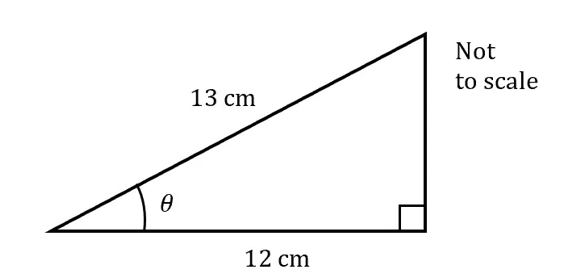
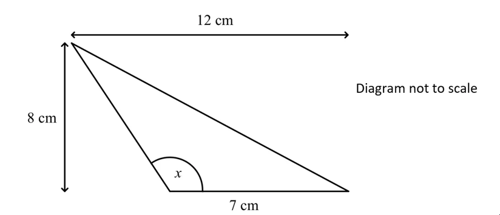

# Exam Questions — Trigonometric Equations
**Trigonometry** · Cambridge (CIE) A-LEVEL maths (9709)
> Source: [https://www.savemyexams.com/a-level/maths/cie/20/pure-1/topic-questions/](https://www.savemyexams.com/a-level/maths/cie/20/pure-1/topic-questions/) · 34 questions across 1 sets

## Exam Questions (34 questions)

### Q1 — easy — 3 marks

**Q1** [3 marks]

Solve the equation

$\text{tan}  2 θ = 0 . 3$

for $- 180 ^{\circ} \leq θ \leq 180 ^{\circ}$, giving your answers correct to 1 decimal place.

### Q2 — easy — 5 marks

**Q2** [2 marks]

Work out the length of the missing side in the following right-angled triangle.

**Q2** [3 marks]

Using your answer from part (a) to help, write down the values of the following:

(i) $\text{sin}  θ$

(ii) $\text{cos}  θ$

(iii) $\text{tan}  θ$

### Q3 — easy — 3 marks

**Q3** [3 marks]

Solve the equation

$\text{sin}  x = \frac{1}{2}$

for $0 ^{\circ} \leq x \leq 360 ^{\circ}$.

### Q4 — easy — 4 marks

**Q4** [4 marks]

Solve the equation

`2\left(1 - \text{cos}^2 \theta\right) = 1`

for $- π \leq θ \leq π$.

### Q5 — easy — 2 marks

**Q5** [2 marks]

Show that

$\frac{1-\text{cos}^{2}x}{\text{tan}^{2}x} \equiv \text{cos}^{2} x$

### Q6 — easy — 4 marks

**Q6** [2 marks]

Sketch the graph of $y = \text{cos}  2 x$ for $0 \leq x \leq 2 π$.

**Q6** [2 marks]

Solve the equation $\text{cos}  2 x = 0 . 5$ for $0 \leq x \leq 2 π$.

### Q7 — easy — 4 marks

**Q7** [2 marks]

Solve the equation  $x^{2}+x-2=0$

**Q7** [2 marks]

Hence, or otherwise, solve the equation $\text{cos}^{2} x + \text{cos}  x - 2 = 0$ for $0 ^{\circ} \leq x \leq 720 ^{\circ}$.

### Q8 — easy — 4 marks

**Q8** [4 marks]

Find all the solutions of the equation

$2  \text{sin}  θ = \sqrt{3}$

for $- 2 π \leq θ \leq 2 π$, giving your answers in terms of $π$.

### Q9 — easy — 4 marks

**Q9** [4 marks]

Solve the equation

$4 - 4 \text{sin}^{2} θ = 3$

for $0 ^{\circ} \leq θ \leq 180 ^{\circ}$.

### Q10 — very_hard — 5 marks

**Q10** [5 marks]

Solve the equation $3 \text{sin} ( 2 x + 30 ^{\circ} ) = \text{tan} ( 2 x + 30 ^{\circ} )$ for $- 180 ^{\circ} \leq x \leq 180 ^{\circ}$, giving your answers to 1 decimal place where appropriate.

### Q11 — very_hard — 5 marks

**Q11** [5 marks]

Solve the equation $6 \text{cos}^{2} 2 θ = \text{sin}  2 θ + 5$ for $- 180 ^{\circ} \leq θ \leq 180 ^{\circ}$, giving your answers to 1 decimal place where appropriate.

### Q12 — very_hard — 12 marks

**Q12** [6 marks]

Find all the solutions of the equation $2 \text{cos}  2 θ = 4 \text{sin}  2 θ  \text{cos}  2 θ$ in the interval $0 \leq θ \leq 2 π$, giving your answers in radians as multiples of $π$.

**Q12** [6 marks]

Find all the solutions of the equation $3 \text{cos}^{2} 4 x + 13 \text{cos}  4 x - 10 = 0$ in the interval $0 \leq x \leq π$, giving your answers in radians to 3 significant figures.

### Q13 — very_hard — 6 marks

**Q13** [6 marks]

For the triangle in the diagram, find exact values for $\text{sin}  x$, $\text{cos}  x$ and $\text{tan}  x$.

### Q14 — very_hard — 7 marks

**Q14** [7 marks]

A seagull sits on the surface of the sea and moves up and down as waves pass.

Its height, $h$ metres, above its position in calm water is modelled by the function $h = \frac{3}{5} \text{sin} ( 90 t ) ^{\circ}$ where $t$ is the time in seconds after timing commences.

Find the amount of time the seagull is more than 0.5 metres above its calm water position in the first 20 seconds after timing commences. Give your answer correct to 3 significant figures.

### Q15 — hard — 3 marks

**Q15** [3 marks]

Solve the equation $3 \text{sin}  3 θ = 4 \text{cos}  3 θ$ in the interval $0 \leq θ \leq π$, giving your answers to 3 significant figures.

### Q16 — hard — 3 marks

**Q16** [3 marks]

Given that the angle $θ$ is reflex and that $\text{cos}  θ = \frac{1}{3}$, find the exact value of $\text{tan}  θ$.

### Q17 — very_hard — 5 marks

**Q17** [5 marks]

Solve the equation $2 \text{sin}^{2} 3 x = 1$ for $- \frac{π}{2} \leq x \leq \frac{π}{2}$.

### Q18 — medium — 6 marks

**Q18** [6 marks]

A right-angled triangle has hypotenuse 8 cm. One of its other sides is 5 cm.

Find exact values for $\text{sin}  θ$, $\text{cos}  θ$ and $\text{tan}  θ$, where $θ$ is the smallest angle in the triangle.

### Q19 — medium — 5 marks

**Q19** [5 marks]

Solve the equation $2 \text{sin}  x  \text{cos}  x = \text{cos}  x$ for $- π \leq x \leq π$.

### Q20 — medium — 7 marks

**Q20** [2 marks]

Show that $( x + 1 ) ( x - 2 ) ( x - 3 ) \equiv x^{3} - 4 x^{2} + x + 6$.

**Q20** [5 marks]

Hence, or otherwise, solve the equation $\text{tan}^{3} x - 4 \text{tan}^{2} x + \text{tan}  x + 6 = 0$ for $0 ^{\circ} \leq x \leq 360 ^{\circ}$, giving your answers to 1 decimal place where appropriate.

### Q21 — medium — 3 marks

**Q21** [3 marks]

Solve the equation $2 \text{sin}  2 θ = 1$ for $0 \leq θ \leq 2 π$.

### Q22 — medium — 6 marks

**Q22** [2 marks]

A seagull sits on the surface of the sea and moves up and down as waves pass.

Its height, $h$ metres, above its position in calm water is modelled by the function $h = \frac{1}{2} \text{sin} ( 180 t ) ^{\circ}$ where $t$ is the time in seconds after timing commences.

Sketch a graph of $h$ against $t$ for $0 \leq t \leq 10$, showing the coordinates of the points of intersection with the $t$ axis.

**Q22** [1 mark]

How many times in the first minute after timing commences is the seagull 0.25 metres above its calm water position?

**Q22** [3 marks]

Find the time at which the seagull is first 0.25 m above its calm water position **and moving downwards**. Give your answer to 3 significant figures.

### Q23 — medium — 5 marks

**Q23** [2 marks]

Show that the equation $2 \text{sin}^{2} x + 3 \text{cos}  x = 0$ can be written in the form $a \text{cos}^{2} x + b \text{cos}  x + c = 0$, where $a$, $b$ and $c$ are integers to be found.

**Q23** [3 marks]

Hence, or otherwise, solve the equation $2 \text{sin}^{2} x + 3 \text{cos}  x = 0$ for $- 180 ^{\circ} \leq x \leq 180 ^{\circ}$.

### Q24 — medium — 3 marks

**Q24** [3 marks]

Given that $\text{sin}  θ = \frac{3}{5}$, find the possible values of $\text{cos}  θ$ and $\text{tan}  θ$.

### Q25 — medium — 10 marks

**Q25** [4 marks]

Find all solutions of the equation $\text{cos}  θ = \frac{1}{2}$ in the interval $- 2 π \leq θ \leq 2 π$, giving your answers in radians as multiples of $π$.

**Q25** [6 marks]

Find all solutions of the equation $5  \text{sin}  3 x = 1$ in the interval $0 \leq x \leq π$, giving your answers in radians correct to 3 significant figures.

### Q26 — medium — 5 marks

**Q26** [5 marks]

Solve the equation $2 \text{sin}  x = \frac{1}{\text{sin}x}$ for $0 ^{\circ} \leq x \leq 360 ^{\circ}$.

### Q27 — hard — 9 marks

**Q27** [4 marks]

Find all the solutions of the equation $\sqrt{3}  \text{tan}  2 θ = - 1$ in the interval $- π \leq θ \leq π$, giving your answers in radians as multiples of $π$.

**Q27** [5 marks]

Find all the solutions of the equation $6 \text{sin}^{2} x + 7 \text{sin}  x - 3 = 0$ in the interval $0 \leq x \leq 2 π$, giving your answers in radians to 3 significant figures.

### Q28 — hard — 6 marks

**Q28** [4 marks]

A seagull sits on the surface of the sea and moves up and down as waves pass.

Its height, $h$ metres, above its position in calm water is modelled by the function $h = \frac{2}{5} \text{sin} ( 180 t ) ^{\circ}$ where $t$ is the time in seconds after timing commenced.

Find the first time the seagull is 0.3 metres above its calm water position. Give your answer to 2 decimal places.

**Q28** [2 marks]

How many times in the first minute after timing commences is the seagull 0.3 metres above its calm water position?

### Q29 — hard — 5 marks

**Q29** [5 marks]

Solve the equation $\text{tan}  2 x = \frac{3}{\text{tan}2x}$ for $- 180 ^{\circ} \leq x \leq 180 ^{\circ}$.

### Q30 — medium — 6 marks

**Q30** [6 marks]

An isosceles triangle has sides 8 cm, 8 cm and 4 cm and equal base angles $θ$.

Find exact values for $\text{sin}  θ$, $\text{cos}  θ$ and $\text{tan}  θ$.

### Q31 — hard — 5 marks

**Q31** [5 marks]

Solve the equation $2 \text{sin}^{2} θ = \text{cos}  θ + 1$ for $- 180 ^{\circ} \leq θ \leq 180 ^{\circ}$.

### Q32 — hard — 5 marks

**Q32** [5 marks]

Solve the equation $2 \text{tan}  x - \text{sin}  x = 0$ for $- π \leq x \leq π$.

### Q33 — medium — 3 marks

**Q33** [3 marks]

Given that the angle $θ$ is obtuse and that $\text{sin}  θ = \frac{3}{4}$, find the exact value of $\text{cos}  θ$.

### Q34 — hard — 3 marks

**Q34** [3 marks]

Solve the equation $2 \text{sin}  θ = 3 \text{cos}  θ$ for $0 \leq θ \leq 2 π$, giving your answers to 3 significant figures.
