# Mark Schemes — Trigonometric Functions
**Trigonometry** · Cambridge (CIE) A-LEVEL maths (9709)

## Exam Questions (42 questions)

### Q1
(i)

$y = \text{f} ( x ) + 2$ is a translation of $2$ units in the positive $y$-direction, so only the $y$-coordinate changes: $1 + 2 = 3$

`\left(90^{\circ},\ 3\right)`

**[B1]**

(ii)

$y = \text{f} ( 3 x )$ is a horizontal stretch of scale factor $\frac{1}{3}$, so the $x$-coordinate is divided by $3$: $90 ^{\circ} \div 3 = 30 ^{\circ}$

`\left(30^{\circ},\ 1\right)`

**[B1]**

(iii)

$y = \text{f} ( x + 30 ^{\circ} )$ is a translation of $30 ^{\circ}$ in the negative $x$-direction, so the $x$-coordinate decreases by $30 ^{\circ}$: $90 ^{\circ} - 30 ^{\circ} = 60 ^{\circ}$

`\left(60^{\circ},\ 1\right)`

**[B1]**

> **[mark-scheme]**
> **B1**: `\left(90^{\circ},\ 3\right)`. Adding $2$ raises every point by $2$, so the $x$-coordinate is unchanged and the $y$-coordinate becomes $3$.
> 
> **B1**: `\left(30^{\circ},\ 1\right)`. Replacing $x$ by $3 x$ compresses the graph horizontally towards the $y$-axis, dividing the $x$-coordinate by $3$; the $y$-coordinate is unchanged.
> 
> **B1**: `\left(60^{\circ},\ 1\right)`. Replacing $x$ by $x + 30 ^{\circ}$ shifts the graph $30 ^{\circ}$ to the left, decreasing the $x$-coordinate by $30 ^{\circ}$; the $y$-coordinate is unchanged.

### Q2
Let $u = 3 x$, so the interval becomes $0 ^{\circ} \leq u \leq 1080 ^{\circ}$

$\text{sin}  u = 0$ at every multiple of $180 ^{\circ}$:

$u = 0 ^{\circ} ,  180 ^{\circ} ,  360 ^{\circ} ,  540 ^{\circ} ,  720 ^{\circ} ,  900 ^{\circ} ,  1080 ^{\circ}$

**[M1]**

Dividing each value by $3$ (since $x = \frac{u}{3}$):

$x = 0 ^{\circ} ,  60 ^{\circ} ,  120 ^{\circ} ,  180 ^{\circ} ,  240 ^{\circ} ,  300 ^{\circ} ,  360 ^{\circ}$

**[A1]**

> **[mark-scheme]**
> **M1**: A correct method for the multiple angle — setting $3 x$ equal to the values where sine is zero (multiples of $180 ^{\circ}$), or equivalent, over the widened interval $0 ^{\circ} \leq 3 x \leq 1080 ^{\circ}$.
> 
> **A1**: All seven values $x = 0 ^{\circ} ,  60 ^{\circ} ,  120 ^{\circ} ,  180 ^{\circ} ,  240 ^{\circ} ,  300 ^{\circ} ,  360 ^{\circ}$, with no values omitted and none extra. Both endpoints are included.

### Q3
(i)

Since $\text{cos}  x$ has a maximum value of $1$, the maximum value of $3  \text{cos}  x$ is $3 \times 1$

$y_{\text{max}} = 3$

**[B1]**

(ii)

Since $\text{sin}  x$ has a minimum value of $- 1$, the minimum value of $9  \text{sin}  x$ is $9 \times ( - 1 )$

$y_{\text{min}} = - 9$

**[B1]**

> **[mark-scheme]**
> **B1**: The maximum value $3$ is stated. Multiplying $\text{cos}  x$ by $3$ stretches the graph vertically, so the greatest value rises from $1$ to $3$.
> 
> **B1**: The minimum value $- 9$ is stated. Multiplying $\text{sin}  x$ by $9$ stretches the graph vertically, so the least value falls from $- 1$ to $- 9$.

### Q4
The principal value is

`x = \text{cos}^{-1}\left(\tfrac{1}{2}\right) = 60^{\circ}`

**[B1]**

The cosine graph is symmetric about $x = 180 ^{\circ}$, so the other solution in the interval is $360 ^{\circ} - 60 ^{\circ}$

$x = 60 ^{\circ}   \text{or}   x = 300 ^{\circ}$

**[B1]**

> **[mark-scheme]**
> **B1**: The value $x = 60 ^{\circ}$ is found.
> 
> **B1**: The value $x = 300 ^{\circ}$ is found, using the symmetry of the cosine graph ($360 ^{\circ} - 60 ^{\circ}$), with no extra values inside $0 ^{\circ} \leq x \leq 360 ^{\circ}$. Answers given in radians are not accepted for this degree interval.

### Q5
(i)

The graph of $y = \text{sin}  x$ is a wave that passes through the origin, crossing the $x$-axis at $- 180 ^{\circ}$, $0 ^{\circ}$ and $180 ^{\circ}$, with a maximum of $1$ at $x = 90 ^{\circ}$ and a minimum of $- 1$ at $x = - 90 ^{\circ}$

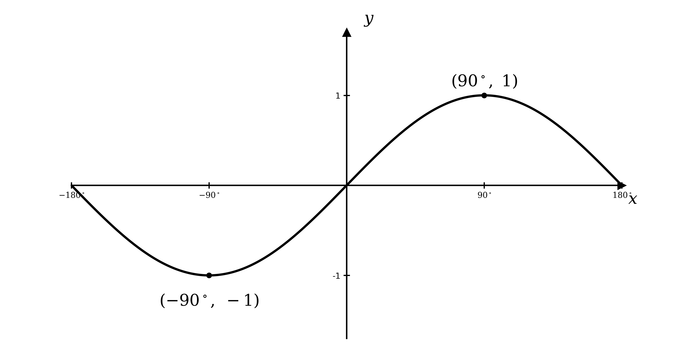

**[B1 B1]**

(ii)

The graph of $y = \text{cos}  x$ starts at its maximum $( 0 ^{\circ} ,  1 )$, crosses the $x$-axis at $90 ^{\circ}$ and $270 ^{\circ}$, reaches a minimum of $- 1$ at $x = 180 ^{\circ}$ and returns to $1$ at $x = 360 ^{\circ}$

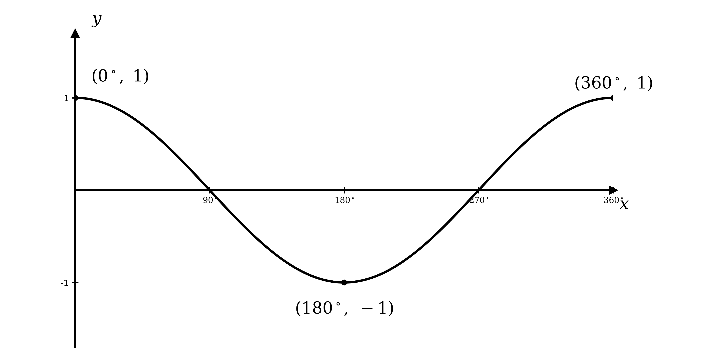

**[B1 B1]**

(iii)

The graph of $y = \text{tan}  x$ passes through the origin and crosses the $x$-axis at $- 180 ^{\circ}$, $0 ^{\circ}$ and $180 ^{\circ}$, with vertical asymptotes at $x = - 90 ^{\circ}$ and $x = 90 ^{\circ}$

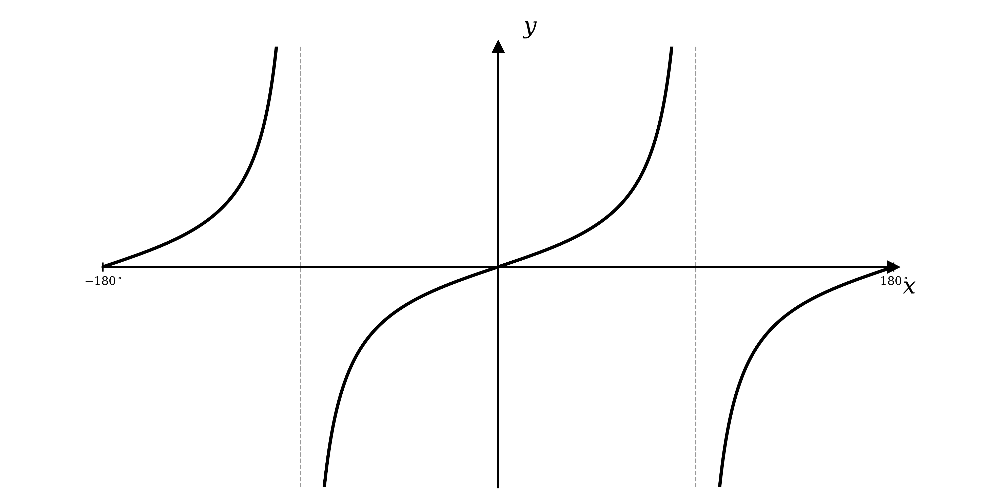

**[B1 B1]**

> **[mark-scheme]**
> **B1**: Correct shape for $y = \text{sin}  x$ — a smooth wave through the origin over the whole interval (not straight line segments), with the correct number of turning points.
> 
> **B1**: Your sine graph is labelled with the $x$-axis crossings at $- 180 ^{\circ}$, $0 ^{\circ}$, $180 ^{\circ}$ and the maximum $( 90 ^{\circ} ,  1 )$ and minimum $( - 90 ^{\circ} ,  - 1 )$.
> 
> **B1**: Correct shape for $y = \text{cos}  x$ — a smooth wave starting and ending at a maximum.
> 
> **B1**: Your cosine graph is labelled with the maximum points $( 0 ^{\circ} ,  1 )$ and $( 360 ^{\circ} ,  1 )$, the minimum $( 180 ^{\circ} ,  - 1 )$ and the $x$-axis crossings at $90 ^{\circ}$ and $270 ^{\circ}$.
> 
> **B1**: Correct shape for $y = \text{tan}  x$ — the curve rises from bottom-left to top-right within each section and never reaches the asymptotes at $x = \pm 90 ^{\circ}$.
> 
> **B1**: Your tangent graph is labelled with the $x$-axis crossings at $- 180 ^{\circ}$, $0 ^{\circ}$, $180 ^{\circ}$; the vertical asymptotes at $x = \pm 90 ^{\circ}$ may be shown as dashed lines but are not required for the mark.

### Q6
The graph of $y = - \text{sin}  θ$ is the graph of $y = \text{sin}  θ$ reflected in the $θ$-axis

It crosses the $θ$-axis at $0 ^{\circ}$, $180 ^{\circ}$ and $360 ^{\circ}$, with a minimum at $( 90 ^{\circ} ,  - 1 )$ and a maximum at $( 270 ^{\circ} ,  1 )$

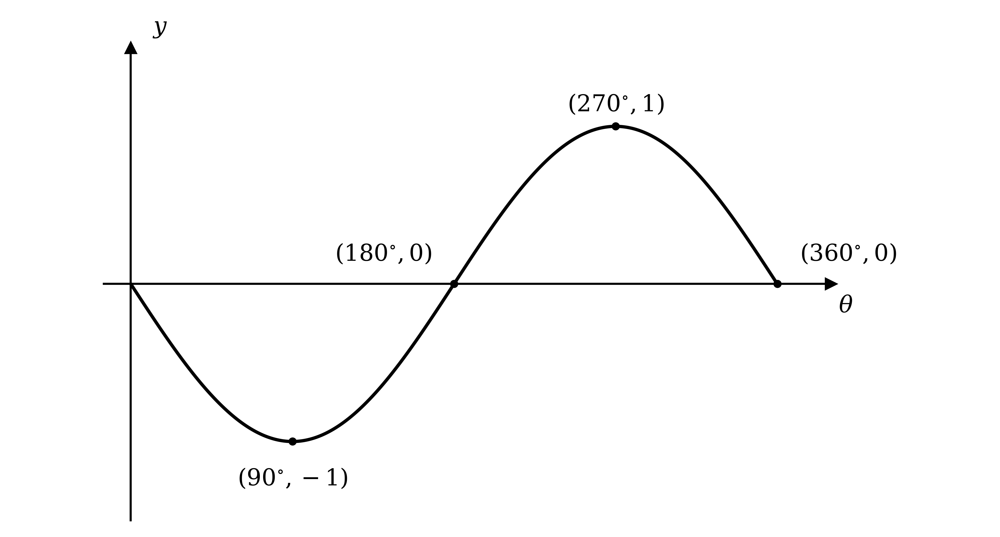

**[B1 B1]**

> **[mark-scheme]**
> **B1**: Correct shape — a smooth wave that is the reflection of $y = \text{sin}  θ$ in the horizontal axis (falling to a minimum first, then rising to a maximum).
> 
> **B1**: The curve is labelled with the crossings at $0 ^{\circ}$, $180 ^{\circ}$, $360 ^{\circ}$, the minimum $( 90 ^{\circ} ,  - 1 )$ and the maximum $( 270 ^{\circ} ,  1 )$.

### Q7
The solutions of $\text{tan}  x = 2$ are the values of $x$ where the curve $y = \text{tan}  x$ meets the horizontal line $y = 2$

Adding the line $y = 2$ to the graph:

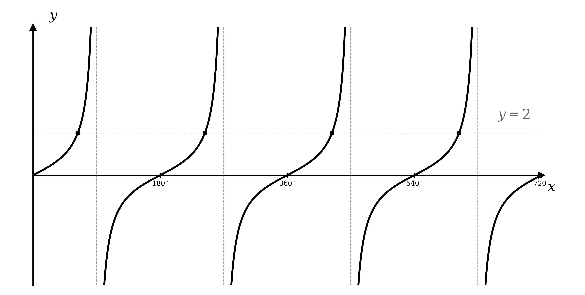

**[B1]**

The tangent graph has four separate branches in $0 ^{\circ} \leq x \leq 720 ^{\circ}$ (its period is $180 ^{\circ}$), and the line $y = 2$ crosses each branch exactly once — so there are four solutions

**[B1]**

> **[mark-scheme]**
> **B1**: The straight line $y = 2$ (horizontal) is drawn on the graph.
> 
> **B1**: The four points of intersection are indicated, with a statement that the line meets the curve once in each of the four branches of $y = \text{tan}  x$, giving four solutions. You are not required to calculate the values of $x$.

### Q8
(i)

Replace $\text{f} ( θ )$ with $\text{cos}  θ$:

$2  \text{cos}  θ + 3$

**[B1]**

(ii)

First $\text{f} ( 2 θ ) = \text{cos}  2 θ$, then multiply by $3$:

$\text{f} ( 2 θ ) = \text{cos}  2 θ$

**[B1]**

$3  \text{cos}  2 θ$

**[B1]**

> **[mark-scheme]**
> **B1**: $2  \text{cos}  θ + 3$, obtained by replacing $\text{f} ( θ )$ with $\text{cos}  θ$.
> 
> **B1**: $\text{f} ( 2 θ ) = \text{cos}  2 θ$ — the input is doubled, so the angle inside the cosine is doubled (it is not $2  \text{cos}  θ$).
> 
> **B1**: The full expression $3  \text{cos}  2 θ$ is stated.

### Q9
The graph of $y = \text{sin}  2 x$ is the graph of $y = \text{sin}  x$ stretched horizontally by scale factor $\frac{1}{2}$, so its period is $\frac{360^{\circ}}{2} = 180 ^{\circ}$ and one complete wave fits into the interval

The curve passes through $( 0 ^{\circ} ,  0 )$, $( 90 ^{\circ} ,  0 )$ and $( 180 ^{\circ} ,  0 )$, with a maximum at $( 45 ^{\circ} ,  1 )$ and a minimum at $( 135 ^{\circ} ,  - 1 )$

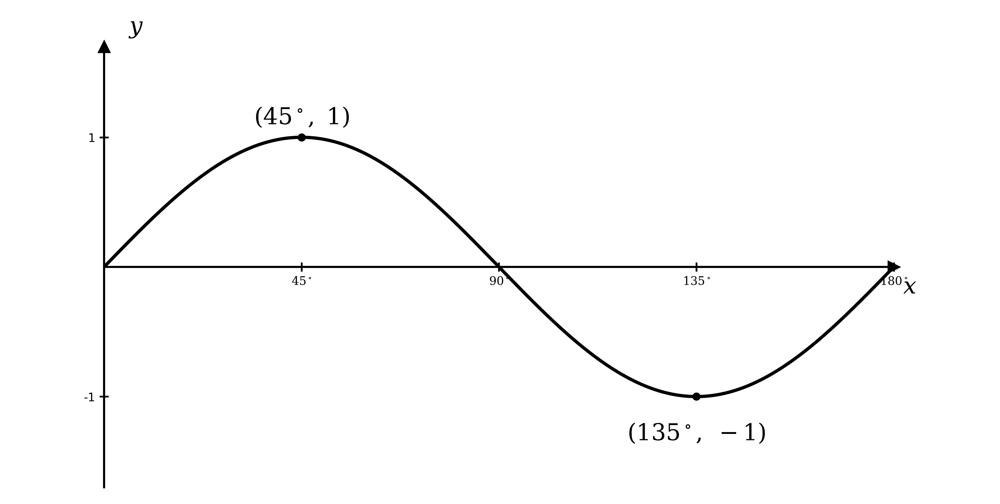

**[B1 B1 B1]**

> **[mark-scheme]**
> **B1**: Correct shape — one complete, smooth sine wave over the interval (not straight line segments), starting and finishing on the $x$-axis.
> 
> **B1**: The $x$-axis crossings are shown at $0 ^{\circ}$, $90 ^{\circ}$ and $180 ^{\circ}$.
> 
> **B1**: The maximum $( 45 ^{\circ} ,  1 )$ and the minimum $( 135 ^{\circ} ,  - 1 )$ are labelled. Follow-through applies if your shape is a correct sine wave but positioned differently, provided the turning points match your curve.

### Q10
(i)

The cosine graph first crosses the $x$-axis when its angle is $90 ^{\circ}$, so $p \times 18 ^{\circ} = 90 ^{\circ}$

$18 p = 90 \Rightarrow p = 5$

**[M1]**

$p = 5$

**[A1]**

So $\text{f} ( x ) = \text{cos}  5 x$: five complete cosine cycles over $0 ^{\circ} \leq x \leq 360 ^{\circ}$, with maxima at $0 ^{\circ}$, $72 ^{\circ}$, $144 ^{\circ}$, $216 ^{\circ}$, $288 ^{\circ}$, $360 ^{\circ}$, minima at $36 ^{\circ}$, $108 ^{\circ}$, $180 ^{\circ}$, $252 ^{\circ}$, $324 ^{\circ}$, and crossing the axis at $18 ^{\circ}$, $54 ^{\circ}$, $90 ^{\circ}$, ... (every $36 ^{\circ}$)

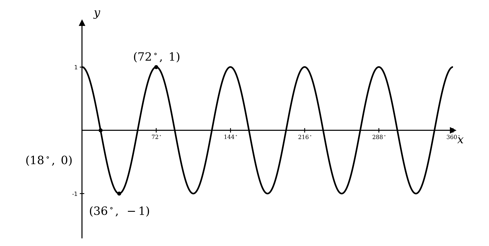

**[B1 B1 B1]**

(ii)

The period is $\frac{360^{\circ}}{5}$:

$\text{Period} = 72 ^{\circ}$

**[B1]**

> **[mark-scheme]**
> **M1**: Setting the first crossing to $p \times 18 ^{\circ} = 90 ^{\circ}$ (or equivalent use of the period).
> 
> **A1**: $p = 5$.
> 
> **B1**: Correct shape — five complete cosine cycles over the interval, starting at a maximum.
> 
> **B1**: Maxima and minima labelled (e.g. maxima at $0 ^{\circ}$, $72 ^{\circ}$, ...; minima at $36 ^{\circ}$, $108 ^{\circ}$, ...).
> 
> **B1**: The $x$-axis crossings at $18 ^{\circ}$, $54 ^{\circ}$, $90 ^{\circ}$, ... (every $36 ^{\circ}$) shown.
> 
> **B1**: The period stated as $72 ^{\circ}$ (simplified from $\frac{360}{5}$).

### Q11
Since $\text{cos}  θ = \text{sin} ( θ + 90 ^{\circ} )$, writing $θ = x + 20 ^{\circ}$ gives `\text{cos}(x + 20^{\circ}) = \text{sin}\left((x + 20^{\circ}) + 90^{\circ}\right)`, so the graph moves $90 ^{\circ}$ to the left

$\text{Translation}$

**[B1]**

`\begin{pmatrix} -90^{\circ} \\ 0 \end{pmatrix}`

**[B1]**

> **[mark-scheme]**
> **B1**: "Translation" (or "shift") identified.
> 
> **B1**: The correct vector `\begin{pmatrix} -90^{\circ} \\ 0 \end{pmatrix}` (accept "$90 ^{\circ}$ in the negative $x$-direction" / "$90 ^{\circ}$ to the left, parallel to the $x$-axis"). "Left" on its own is not accepted.
Both curves have amplitude $1$; $y = \text{cos} ( x + 20 ^{\circ} )$ is $y = \text{sin} ( x + 20 ^{\circ} )$ shifted $90 ^{\circ}$ to the left

They meet where $\text{sin} ( x + 20 ^{\circ} ) = \text{cos} ( x + 20 ^{\circ} )$, i.e. $\text{tan} ( x + 20 ^{\circ} ) = 1$:

$x + 20 ^{\circ} = 45 ^{\circ} \Rightarrow x = 25 ^{\circ} ;  x = - 155 ^{\circ}$

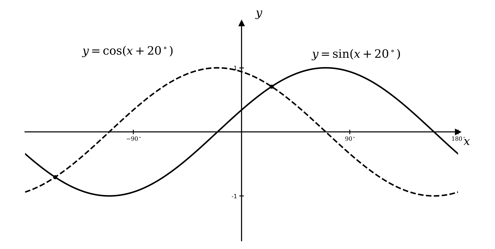

**[B1]**

`\left(25^{\circ},\ \dfrac{\sqrt{2}}{2}\right) \;\;\text{and}\;\; \left(-155^{\circ},\ -\dfrac{\sqrt{2}}{2}\right)`

**[B1]**

> **[mark-scheme]**
> **B1**: Both curves drawn correctly on the same axes over the interval, with $y = \text{cos} ( x + 20 ^{\circ} )$ being $y = \text{sin} ( x + 20 ^{\circ} )$ shifted $90 ^{\circ}$ left.
> 
> **B1**: Both intersection points `\left(25^{\circ},\ \tfrac{\sqrt{2}}{2}\right)` and `\left(-155^{\circ},\ -\tfrac{\sqrt{2}}{2}\right)` labelled (accept $\frac{1}{\sqrt{2}}$ for $\frac{\sqrt{2}}{2}$).

### Q12
Sketch $y = \text{tan}  θ$ and the line $y = - \frac{1}{\sqrt{3}}$; the solutions are where they meet

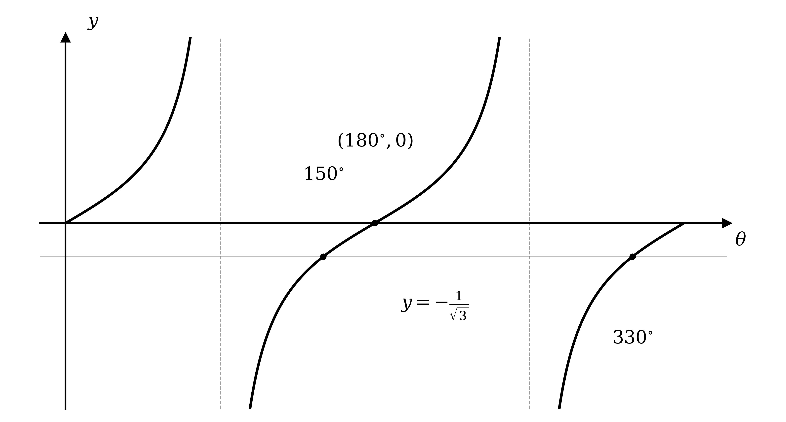

**[B1]**

The principal value is `\text{tan}^{-1}\left(-\dfrac{1}{\sqrt{3}}\right) = -30^{\circ}`, which is outside the interval; adding the period $180 ^{\circ}$ brings it into range

$θ = - 30 ^{\circ} + 180 ^{\circ} = 150 ^{\circ}$

**[M1]**

$θ = 150 ^{\circ}   \text{and}   θ = 330 ^{\circ}$

**[A1 A1]**

> **[mark-scheme]**
> **B1**: A sketch of $y = \text{tan}  θ$ over the interval with the line $y = - \frac{1}{\sqrt{3}}$ (or equivalent working from `\text{tan}^{-1}\left(-\tfrac{1}{\sqrt{3}}\right) = -30^{\circ}`).
> 
> **M1**: A correct method for a solution in range — adding $180 ^{\circ}$ to the principal value $- 30 ^{\circ}$.
> 
> **A1**: $θ = 150 ^{\circ}$.
> 
> **A1**: $θ = 330 ^{\circ}$, with no extra values in the interval. Answers in radians are not accepted for this degree interval.

### Q13
(i)

Because cosine is an even function, $\text{cos} ( - 2 θ ) = \text{cos}  2 θ$, so this is $y = \text{cos}  θ$ squashed horizontally by factor $\frac{1}{2}$: maxima at $0 ^{\circ}$, $\pm 180 ^{\circ}$, $\pm 360 ^{\circ}$, minima at $\pm 90 ^{\circ}$, $\pm 270 ^{\circ}$, crossing the axis at $\pm 45 ^{\circ}$, $\pm 135 ^{\circ}$, $\pm 225 ^{\circ}$, $\pm 315 ^{\circ}$

$y = \text{cos}  \frac{1}{2} θ$ is $y = \text{cos}  θ$ stretched horizontally by factor $2$: a maximum at $( 0 ^{\circ} ,  1 )$, minima at $( \pm 360 ^{\circ} ,  - 1 )$, crossing the axis at $\pm 180 ^{\circ}$

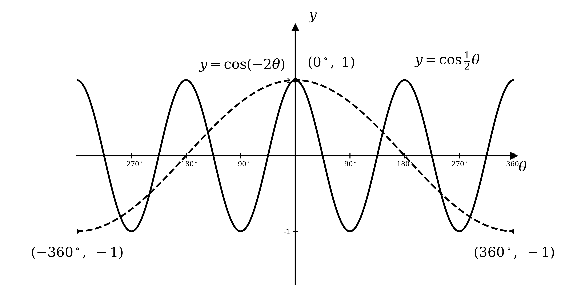

**[B1 B1 B1 B1]**

(ii)

The periods are:

$y = \text{cos} ( - 2 θ ) : \text{period} 180 ^{\circ}$

**[B1]**

$y = \text{cos}  \frac{1}{2} θ : \text{period} 720 ^{\circ}$

**[B1]**

> **[mark-scheme]**
> **B1**: Correct shape for $y = \text{cos} ( - 2 θ )$ — equivalent to $\text{cos}  2 θ$, four complete cycles over the interval.
> 
> **B1**: $y = \text{cos} ( - 2 θ )$ labelled with its axis crossings at $\pm 45 ^{\circ}$, $\pm 135 ^{\circ}$, $\pm 225 ^{\circ}$, $\pm 315 ^{\circ}$.
> 
> **B1**: Correct shape for $y = \text{cos}  \frac{1}{2} θ$ — a single wide cosine cycle over the interval.
> 
> **B1**: $y = \text{cos}  \frac{1}{2} θ$ labelled with maximum $( 0 ^{\circ} , 1 )$, minima $( \pm 360 ^{\circ} , - 1 )$ and crossings $\pm 180 ^{\circ}$.
> 
> **B1**: The period of $y = \text{cos} ( - 2 θ )$ is $180 ^{\circ}$.
> 
> **B1**: The period of $y = \text{cos}  \frac{1}{2} θ$ is $720 ^{\circ}$.

### Q14
$y = p  \text{sin}  x$ has amplitude $2$, so $p = 2$; the cosine curve is translated $60 ^{\circ}$ to the left (its $y$-intercept is $\text{cos}  60 ^{\circ} = 0 . 5$), so $q = 60$

$p = 2 ,  q = 60$

**[B1 B1]**

**Final answer:** $y = 2  \text{sin}  x$** meets the axes at **$( - 180 ^{\circ} ,  0 )$**, **$( 0 ^{\circ} ,  0 )$**, **$( 180 ^{\circ} ,  0 )$

**[B1]**

**Final answer:** $y = \text{cos} ( x + 60 ^{\circ} )$** meets the axes at **$( - 150 ^{\circ} ,  0 )$**, **$( 30 ^{\circ} ,  0 )$** and **$( 0 ^{\circ} ,  0 . 5 )$

**[B1]**

> **[mark-scheme]**
> **B1**: $p = 2$ (the amplitude of the sine curve).
> 
> **B1**: $q = 60$ (the cosine curve translated $60 ^{\circ}$ left, or $y$-intercept $0 . 5 = \text{cos}  60 ^{\circ}$).
> 
> **B1**: The axis crossings of $y = 2  \text{sin}  x$: $( - 180 ^{\circ} , 0 )$, $( 0 ^{\circ} , 0 )$, $( 180 ^{\circ} , 0 )$.
> 
> **B1**: The axis crossings of $y = \text{cos} ( x + 60 ^{\circ} )$: $( - 150 ^{\circ} , 0 )$, $( 30 ^{\circ} , 0 )$ and the $y$-intercept $( 0 ^{\circ} , 0 . 5 )$.
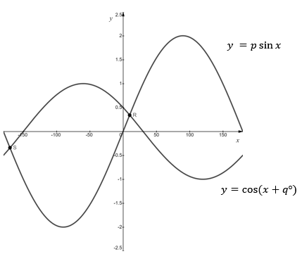

Shifting $x$ by $180 ^{\circ}$ changes the sign of both $\text{sin}  x$ and $\text{cos} ( x + 60 ^{\circ} )$, since $\text{sin} ( x - 180 ^{\circ} ) = - \text{sin}  x$ and $\text{cos} ( x - 180 ^{\circ} ) = - \text{cos}  x$

So the intersection $180 ^{\circ}$ to the left of $R$ has the negated $y$-coordinate: $x = 9 . 90 ^{\circ} - 180 ^{\circ} = - 170 . 10 ^{\circ}$

**[M1]**

$S = ( - 170 . 10 ^{\circ} ,  - 0 . 34 )$

**[A1]**

> **[mark-scheme]**
> **M1**: Using the symmetry of both curves under a $180 ^{\circ}$ shift (both change sign), giving the $x$-coordinate $9 . 90 ^{\circ} - 180 ^{\circ} = - 170 . 10 ^{\circ}$.
> 
> **A1**: $S = ( - 170 . 10 ^{\circ} ,  - 0 . 34 )$.

### Q15
$y = \text{tan}  \frac{1}{2} θ$ is a horizontal stretch of $y = \text{tan}  θ$ (factor $2$): it crosses the axis at $- 360 ^{\circ}$, $0 ^{\circ}$, $360 ^{\circ}$, with asymptotes at $\pm 180 ^{\circ}$

$y = \text{tan} ( θ - 30 ^{\circ} )$ is $y = \text{tan}  θ$ translated $30 ^{\circ}$ to the right: it crosses the axis at $- 330 ^{\circ}$, $- 150 ^{\circ}$, $30 ^{\circ}$, $210 ^{\circ}$, with asymptotes at $- 240 ^{\circ}$, $- 60 ^{\circ}$, $120 ^{\circ}$, $300 ^{\circ}$

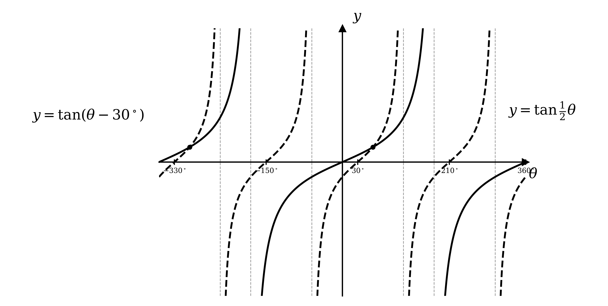

**[B1 B1 B1 B1]**

> **[mark-scheme]**
> **B1**: Correct shape for $y = \text{tan}  \frac{1}{2} θ$ over the interval (period $360 ^{\circ}$).
> 
> **B1**: $y = \text{tan}  \frac{1}{2} θ$ crossings at $- 360 ^{\circ}$, $0 ^{\circ}$, $360 ^{\circ}$ (and asymptotes at $\pm 180 ^{\circ}$) shown.
> 
> **B1**: Correct shape for $y = \text{tan} ( θ - 30 ^{\circ} )$ — the tangent graph translated $30 ^{\circ}$ right.
> 
> **B1**: $y = \text{tan} ( θ - 30 ^{\circ} )$ crossings at $- 330 ^{\circ}$, $- 150 ^{\circ}$, $30 ^{\circ}$, $210 ^{\circ}$ shown.
Setting the two angles equal: $\frac{1}{2} θ = θ - 30 ^{\circ}$

$- \frac{1}{2} θ = - 30 ^{\circ} \Rightarrow θ = 60 ^{\circ}$

**[M1]**

At $θ = 60 ^{\circ}$: $\text{tan}  30 ^{\circ} = \frac{\sqrt{3}}{3}$. Since $y = \text{tan}  \frac{1}{2} θ$ has period $360 ^{\circ}$, the value repeats at $θ = 60 ^{\circ} - 360 ^{\circ} = - 300 ^{\circ}$

`\left(60^{\circ},\ \dfrac{\sqrt{3}}{3}\right) \;\;\text{and}\;\; \left(-300^{\circ},\ \dfrac{\sqrt{3}}{3}\right)`

**[A1 A1]**

> **[mark-scheme]**
> **M1**: Equating the angles $\frac{1}{2} θ = θ - 30 ^{\circ}$ and solving to get $θ = 60 ^{\circ}$.
> 
> **A1**: `\left(60^{\circ},\ \dfrac{\sqrt{3}}{3}\right)` — accept $\frac{1}{\sqrt{3}}$ for the $y$-coordinate.
> 
> **A1**: `\left(-300^{\circ},\ \dfrac{\sqrt{3}}{3}\right)`, found using the period of $y = \text{tan}  \frac{1}{2} θ$.

### Q16
The sine function repeats every $360 ^{\circ}$, so adding a whole-number multiple of $360 ^{\circ}$ to $k$ (that is, $k + 360 n$ for any integer $n$) produces exactly the same curve

$\text{sin} ( x + k ^{\circ} ) = \text{sin} ( x + ( k + 360 n ) ^{\circ} )$

**[B1]**

$\text{The student is correct, so there are infinitely many values of} k$

**[B1]**

> **[mark-scheme]**
> **B1**: A statement that the sine graph repeats every $360 ^{\circ}$, so adding a multiple of $360 ^{\circ}$ to $k$ gives the same curve.
> 
> **B1**: The conclusion that the student is correct (infinitely many values), following from the periodicity.
The pictured curve is $y = \text{sin} ( x + 60 ^{\circ} )$. Since $\text{cos} ( θ - 90 ^{\circ} ) = \text{sin}  θ$, writing $θ = x + 60 ^{\circ}$ gives

`\text{sin}(x + 60^{\circ}) = \text{cos}\left((x + 60^{\circ}) - 90^{\circ}\right) = \text{cos}(x - 30^{\circ})`

**[M1]**

$k = - 30$

**[A1]**

> **[mark-scheme]**
> **M1**: Using the relationship between sine and cosine (a $90 ^{\circ}$ horizontal shift), e.g. $\text{sin} ( x + 60 ^{\circ} ) = \text{cos} ( x - 30 ^{\circ} )$.
> 
> **A1**: A correct value $k = - 30$ (accept any equivalent such as $k = 330$).

### Q17
$y = \text{sin} \frac{1}{2} θ$ is $y = \text{sin} θ$ stretched horizontally by factor $2$: it passes through $( 0 \circ , 0 )$, with a maximum $( 180 \circ , 1 )$ and a minimum $( - 180 \circ , - 1 )$

$y = \text{sin} ( θ + 30 \circ )$ is $y = \text{sin} θ$ translated $30 \circ$ to the left: crossings at $( - 210 \circ , 0 )$, $( - 30 \circ , 0 )$, $( 150 \circ , 0 )$, maximum $( 60 \circ , 1 )$, minima $( - 120 \circ , - 1 )$ and $( 240 \circ , - 1 )$

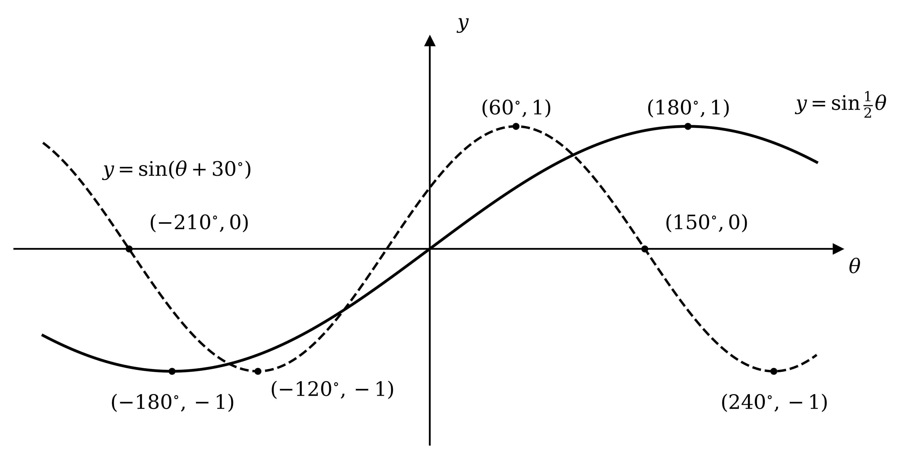

**[B1 B1 B1 B1]**

> **[mark-scheme]**
> **B1**: Correct shape for $y = \text{sin} \frac{1}{2} θ$ — a single wide sine wave over the interval.
> 
> **B1**: $y = \text{sin} \frac{1}{2} θ$ labelled with $( 0 \circ , 0 )$, maximum $( 180 \circ , 1 )$, minimum $( - 180 \circ , - 1 )$.
> 
> **B1**: Correct shape for $y = \text{sin} ( θ + 30 \circ )$ — the sine graph translated $30 \circ$ left.
> 
> **B1**: $y = \text{sin} ( θ + 30 \circ )$ labelled with crossings $( - 210 \circ , 0 )$, $( - 30 \circ , 0 )$, $( 150 \circ , 0 )$ and turning points $( 60 \circ , 1 )$, $( - 120 \circ , - 1 )$ and $( 240 \circ , - 1 )$.
As $\text{sin}  \frac{1}{2} θ = \text{sin} ( θ + 30 ^{\circ} )$, this means $\frac{1}{2} θ = θ + 30 ^{\circ}$

$\frac{1}{2} θ = θ + 30 ^{\circ}$

$- \frac{1}{2} θ = 30 ^{\circ} \Rightarrow θ = - 60 ^{\circ}$

**[M1]**

Substituting $θ = - 60 ^{\circ}$:

$\text{sin}  \frac{1}{2} ( - 60 ^{\circ} ) = \text{sin} ( - 30 ^{\circ} ) = - \frac{1}{2}$

`\left(-60^{\circ},\ -\dfrac{1}{2}\right)`

**[A1]**

> **[mark-scheme]**
> **M1**: Setting the two angles equal, $\frac{1}{2} θ = θ + 30 ^{\circ}$, and solving to get $θ = - 60 ^{\circ}$.
> 
> **A1**: The point of intersection `\left(-60^{\circ},\ -\dfrac{1}{2}\right)`, with the $y$-coordinate found by substitution.

### Q18
(i)

Going from $\frac{1}{3} \text{tan}  x$ to $3  \text{tan}  x$ multiplies the function by $9$:

$\text{Stretch, scale factor} 9$

**[B1]**

$\text{parallel to the} y \text{-axis}$

**[B1]**

(ii)

Onto $y = \frac{1}{3} \text{tan}  x$, the $y$-coordinate is multiplied by $\frac{1}{3}$: $\sqrt{3} \times \frac{1}{3} = \frac{\sqrt{3}}{3}$

`\left(60^{\circ},\ \dfrac{\sqrt{3}}{3}\right)`

**[B1 B1]**

Onto $y = 3  \text{tan}  x$, the $y$-coordinate is multiplied by $3$: $\sqrt{3} \times 3 = 3 \sqrt{3}$

`\left(60^{\circ},\ 3\sqrt{3}\right)`

**[B1 B1]**

> **[mark-scheme]**
> **B1**: "Stretch" with scale factor $9$ identified.
> 
> **B1**: The direction given as parallel to the $y$-axis (accept "$y$-direction", "vertically", "$x$-axis invariant").
> 
> **B1**: The scaling onto $y = \frac{1}{3} \text{tan}  x$ recognised as $\times \frac{1}{3}$.
> 
> **B1**: `\left(60^{\circ},\ \dfrac{\sqrt{3}}{3}\right)`.
> 
> **B1**: The scaling onto $y = 3 \text{tan}  x$ recognised as $\times 3$.
> 
> **B1**: `\left(60^{\circ},\ 3\sqrt{3}\right)`.

### Q19
$y = \text{sin}  3 x$ has a minimum where $3 x = - 90 ^{\circ}$ and a maximum where $3 x = 90 ^{\circ}$:

$A = ( - 30 ^{\circ} ,  - 1 )   \text{and}   B = ( 30 ^{\circ} ,  1 )$

**[B1]**

> **[mark-scheme]**
> **B1**: Both $A = ( - 30 ^{\circ} ,  - 1 )$ and $B = ( 30 ^{\circ} ,  1 )$ correct.
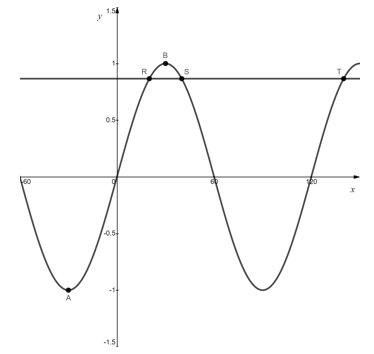

$\text{sin}  3 x = \frac{\sqrt{3}}{2}$ first at $3 x = 60 ^{\circ}$, i.e. $x = 20 ^{\circ}$, so `R = \left(20^{\circ},\ \tfrac{\sqrt{3}}{2}\right)`

$S$ is the mirror image of $R$ in the maximum $B ( 30 ^{\circ} )$: $30 ^{\circ} + ( 30 ^{\circ} - 20 ^{\circ} ) = 40 ^{\circ}$

$T$ is one period ($120 ^{\circ}$) on from $R$: $20 ^{\circ} + 120 ^{\circ} = 140 ^{\circ}$

`R = \left(20^{\circ},\ \tfrac{\sqrt{3}}{2}\right),\ S = \left(40^{\circ},\ \tfrac{\sqrt{3}}{2}\right),\ T = \left(140^{\circ},\ \tfrac{\sqrt{3}}{2}\right)`

**[B1 B1]**

> **[mark-scheme]**
> **B1**: `R = \left(20^{\circ},\ \tfrac{\sqrt{3}}{2}\right)`, from $3 x = 60 ^{\circ}$.
> 
> **B1**: `S = \left(40^{\circ},\ \tfrac{\sqrt{3}}{2}\right)` (symmetry about the maximum) and `T = \left(140^{\circ},\ \tfrac{\sqrt{3}}{2}\right)` (using the period $120 ^{\circ}$). All three $y$-coordinates are $\frac{\sqrt{3}}{2}$.

### Q20
**Final answer:** **The cosine function repeats every **$360 ^{\circ}$**, so adding any multiple of **$360 ^{\circ}$** to **$k$** gives exactly the same curve**

The graph crosses the axis going downwards at $x = 50 ^{\circ}$, which corresponds to $k = 40$; adding $360 ^{\circ}$ gives another value

$k = 40   \text{or}   k = 400$

**[B1 B1]**

> **[mark-scheme]**
> **B1**: A statement that the cosine graph repeats every $360 ^{\circ}$, so adding (or subtracting) a multiple of $360 ^{\circ}$ to $k$ produces the same curve.
> 
> **B1**: Two valid values of $k$ that differ by $360 ^{\circ}$ — for example $k = 40$ and $k = 400$ (accept $k = - 320$, etc.).
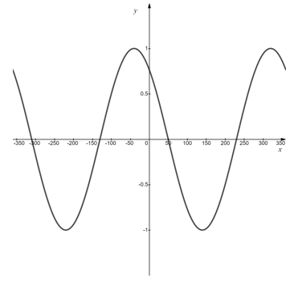

The curve meets the $x$-axis at the zeros of the cosine graph, which are $180 ^{\circ}$ apart. Taking $k = 40$, one crossing is at $x = 50 ^{\circ}$, and the others follow by adding or subtracting $180 ^{\circ}$:

$( - 310 ^{\circ} ,  0 ) ,  ( - 130 ^{\circ} ,  0 ) ,  ( 50 ^{\circ} ,  0 ) ,  ( 230 ^{\circ} ,  0 )$

**[B1 B1]**

> **[mark-scheme]**
> **B1**: At least two correct $x$-axis crossings from $( - 310 ^{\circ} , 0 )$, $( - 130 ^{\circ} , 0 )$, $( 50 ^{\circ} , 0 )$, $( 230 ^{\circ} , 0 )$.
> 
> **B1**: All four crossings correct, with none extra in the interval.

### Q21
(i)

The cosine graph over $- 90 ^{\circ} \leq θ \leq 360 ^{\circ}$ meets the axes at $( - 90 ^{\circ} ,  0 )$, $( 0 ^{\circ} ,  1 )$, $( 90 ^{\circ} ,  0 )$, $( 180 ^{\circ} ,  - 1 )$, $( 270 ^{\circ} ,  0 )$, $( 360 ^{\circ} ,  1 )$

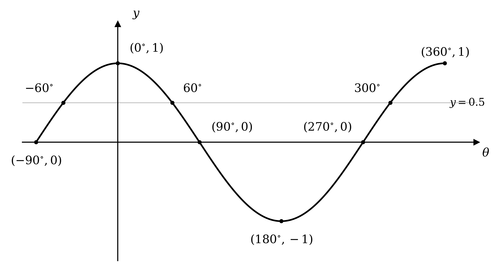

**[B1]**

(ii)

Drawing $y = 0 . 5$ across the graph, the cosine curve is symmetric about $θ = 0 ^{\circ}$ and $θ = 360 ^{\circ}$, giving the other solutions $- 60 ^{\circ}$ and $360 ^{\circ} - 60 ^{\circ}$

$θ = - 60 ^{\circ}   \text{and}   θ = 300 ^{\circ}$

**[B1]**

> **[mark-scheme]**
> **B1**: Correct cosine shape over the interval with the axis-meeting points labelled.
> 
> **B1**: Both other values $θ = - 60 ^{\circ}$ and $θ = 300 ^{\circ}$, using the symmetry of the graph, with no extra values in the interval. Answers in radians are not accepted for this degree interval.

### Q22
(i)

Over $0 \leq t \leq 8$, the angle $22 . 5 t$ runs from $0 ^{\circ}$ to $180 ^{\circ}$, so the graph is a single arch of the sine curve, with a maximum at $( 4 ,  1 )$ and passing through $( 0 ,  0 )$ and $( 8 ,  0 )$

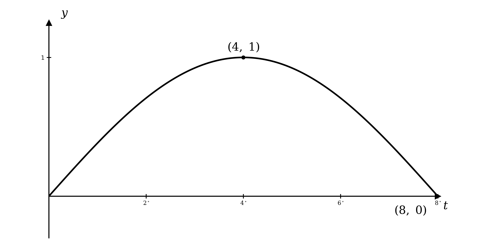

**[B1 B1]**

(ii)

The halfway point is $y = \frac{1}{2}$. Solving $\text{sin} ( 22 . 5 t ) ^{\circ} = \frac{1}{2}$ gives $22 . 5 t = 30 ^{\circ}$, and by symmetry $22 . 5 t = 150 ^{\circ}$:

$t = \frac{30}{22.5} = \frac{4}{3} \approx 1 . 5  \text{and}  t = \frac{150}{22.5} = \frac{20}{3} \approx 6 . 5$

**[M1 A1]**

Taking $t = 0$ as 2pm, these times are $1 . 5$ hours and $6 . 5$ hours after 2pm:

$\text{Between 3:30pm and 8:30pm}$

**[A1]**

> **[mark-scheme]**
> **B1**: Correct shape — a single sine arch over $0 \leq t \leq 8$ (half a period).
> 
> **B1**: The maximum $( 4 ,  1 )$ and the endpoints $( 0 ,  0 )$, $( 8 ,  0 )$ are labelled.
> 
> **M1**: Setting $\text{sin} ( 22 . 5 t ) ^{\circ} = \frac{1}{2}$ and solving for the first time, $22 . 5 t = 30 ^{\circ}$.
> 
> **A1**: Both times found, $t = \frac{4}{3}$ and $t = \frac{20}{3}$ (or $\approx 1 . 5$ and $\approx 6 . 5$ hours, to the nearest half hour).
> 
> **A1**: The interval stated as between 3:30pm and 8:30pm.

### Q23
(i)

Multiplying the whole function by $\frac{1}{5}$ compresses it towards the $x$-axis:

$\text{Stretch, scale factor} \frac{1}{5}$

**[B1]**

$\text{parallel to the} y \text{-axis}$

**[B1]**

(ii)

A vertical stretch of factor $\frac{1}{5}$ multiplies the $y$-coordinate by $\frac{1}{5}$: $\frac{\sqrt{3}}{3} \times \frac{1}{5} = \frac{\sqrt{3}}{15}$

`\left(30^{\circ},\ \dfrac{\sqrt{3}}{15}\right)`

**[B1]**

> **[mark-scheme]**
> **B1**: "Stretch" with scale factor $\frac{1}{5}$ identified (accept "SF $\frac{1}{5}$").
> 
> **B1**: The direction given as parallel to the $y$-axis (accept "in the $y$-direction", "vertically", or "$x$-axis invariant"). "Downwards" or "shrink" is not accepted.
> 
> **B1**: `\left(30^{\circ},\ \dfrac{\sqrt{3}}{15}\right)` — only the $y$-coordinate changes, becoming $\frac{\sqrt{3}}{3} \times \frac{1}{5} = \frac{\sqrt{3}}{15}$.

### Q24
$y = - 3  \text{cos}  θ$ is $y = \text{cos}  θ$ stretched vertically by factor $3$ and reflected in the $θ$-axis: minima at $( 0 ^{\circ} ,  - 3 )$ and $( 360 ^{\circ} ,  - 3 )$, a maximum at $( 180 ^{\circ} ,  3 )$, crossing at $90 ^{\circ}$ and $270 ^{\circ}$

$y = \text{cos}  3 θ$ is $y = \text{cos}  θ$ squashed horizontally by factor $\frac{1}{3}$: maxima at $0 ^{\circ}$, $120 ^{\circ}$, $240 ^{\circ}$, $360 ^{\circ}$, minima at $60 ^{\circ}$, $180 ^{\circ}$, $300 ^{\circ}$, crossing at $30 ^{\circ}$, $90 ^{\circ}$, $150 ^{\circ}$, $210 ^{\circ}$, $270 ^{\circ}$, $330 ^{\circ}$

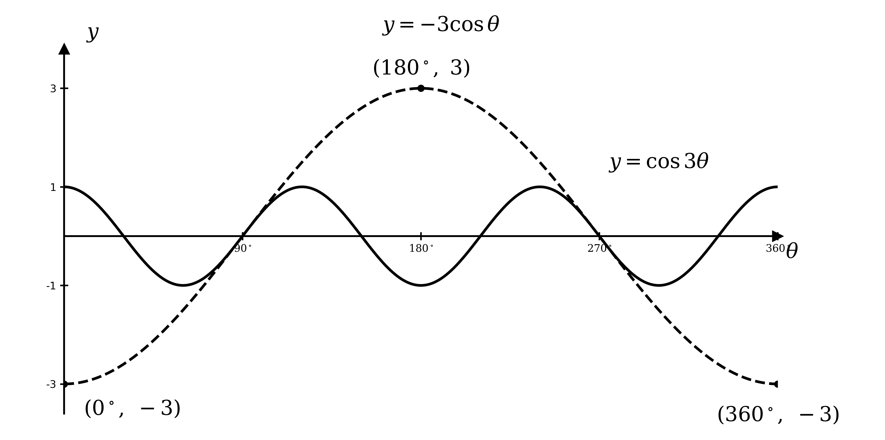

**[B1 B1 B1 B1]**

The period of each function is:

$y = - 3  \text{cos}  θ : \text{period} 360 ^{\circ}$

**[B1]**

$y = \text{cos}  3 θ : \text{period} 120 ^{\circ}$

**[B1]**

> **[mark-scheme]**
> **B1**: Correct shape for $y = - 3  \text{cos}  θ$ — amplitude $3$, starting at a minimum.
> 
> **B1**: $y = - 3  \text{cos}  θ$ labelled with minima $( 0 ^{\circ} ,  - 3 )$, $( 360 ^{\circ} ,  - 3 )$, maximum $( 180 ^{\circ} ,  3 )$ and crossings $90 ^{\circ}$, $270 ^{\circ}$.
> 
> **B1**: Correct shape for $y = \text{cos}  3 θ$ — three complete cosine cycles over the interval.
> 
> **B1**: $y = \text{cos}  3 θ$ labelled with its crossings at $30 ^{\circ}$, $90 ^{\circ}$, $150 ^{\circ}$, $210 ^{\circ}$, $270 ^{\circ}$, $330 ^{\circ}$.
> 
> **B1**: The period of $y = - 3  \text{cos}  θ$ is $360 ^{\circ}$ (the stretch and reflection do not change the period).
> 
> **B1**: The period of $y = \text{cos}  3 θ$ is $120 ^{\circ}$ (given as a simplified value, from $\frac{360^{\circ}}{3}$).

### Q25
$y = \text{tan} ( θ - 45 ^{\circ} )$ is the tangent graph translated $45 ^{\circ}$ to the right: it crosses the $θ$-axis at $- 315 ^{\circ}$, $- 135 ^{\circ}$, $45 ^{\circ}$, $225 ^{\circ}$, with asymptotes at $- 225 ^{\circ}$, $- 45 ^{\circ}$, $135 ^{\circ}$, $315 ^{\circ}$

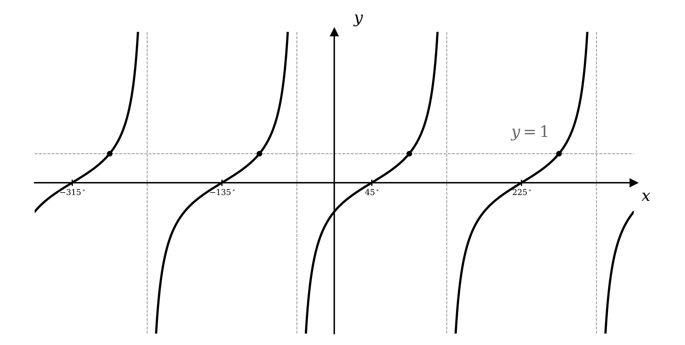

**[B1 B1]**

Solving $\text{tan} ( θ - 45 ^{\circ} ) = 1$: since $\text{tan}^{-1} ( 1 ) = 45 ^{\circ}$, $θ - 45 ^{\circ} = 45 ^{\circ}$ gives $θ = 90 ^{\circ}$; adding and subtracting the period $180 ^{\circ}$:

$θ = - 270 ^{\circ} ,  - 90 ^{\circ} ,  90 ^{\circ} ,  270 ^{\circ}$

**[B1 B1]**

> **[mark-scheme]**
> **B1**: Correct tangent shape, translated $45 ^{\circ}$ to the right over the interval.
> 
> **B1**: The $θ$-axis crossings ($- 315 ^{\circ}$, $- 135 ^{\circ}$, $45 ^{\circ}$, $225 ^{\circ}$) or asymptote positions are shown correctly.
> 
> **B1**: At least two correct values from $θ = - 270 ^{\circ} , - 90 ^{\circ} , 90 ^{\circ} , 270 ^{\circ}$.
> 
> **B1**: All four values correct, with no extra values in the interval.

### Q26
(i)

The amplitude is $4$ and the period is $\frac{360^{\circ}}{18} = 20$ metres, so two complete cosine cycles fit into $0 \leq x \leq 40$

Maxima at $( 0 ,  4 )$, $( 20 ,  4 )$, $( 40 ,  4 )$; minima at $( 10 ,  - 4 )$ and $( 30 ,  - 4 )$; crossing the axis at $x = 5 ,  15 ,  25 ,  35$

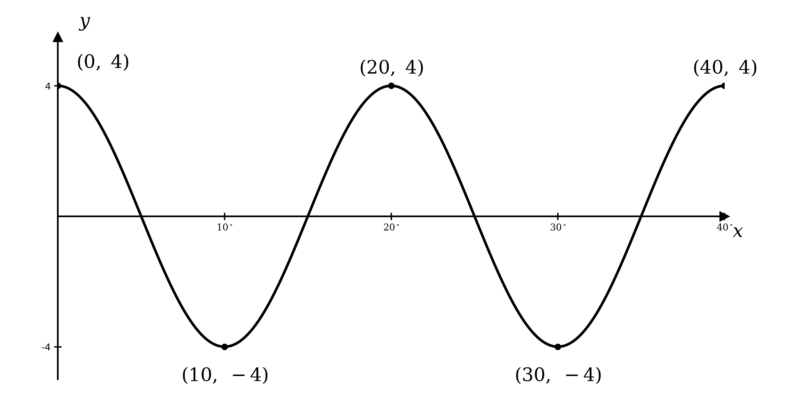

**[B1 B1 B1]**

$\text{Period} = 20 \text{metres}$

**[B1]**

(ii)

Each dip is a minimum, and there are two minima in the interval:

$\text{Two}$

**[B1]**

> **[mark-scheme]**
> **B1**: Correct cosine shape — two complete cycles over $0 \leq x \leq 40$, starting at a maximum.
> 
> **B1**: Maxima $( 0 , 4 )$, $( 20 , 4 )$, $( 40 , 4 )$ and minima $( 10 , - 4 )$, $( 30 , - 4 )$ labelled.
> 
> **B1**: The axis crossings at $x = 5 , 15 , 25 , 35$.
> 
> **B1**: The period stated as $20$ metres (simplified from $\frac{360}{18}$).
> 
> **B1**: "Two" dips.

### Q27
(i)

$y = \text{tan}  \frac{1}{4} θ$ is a horizontal stretch of $y = \text{tan}  θ$ (factor $4$): over $0 ^{\circ} \leq θ \leq 270 ^{\circ}$ the angle $\frac{1}{4} θ$ only reaches $67 . 5 ^{\circ}$, so the curve rises steadily from the origin $( 0 ^{\circ} ,  0 )$ with no asymptote

$y = \text{cos} ( θ + 120 ^{\circ} )$ is $y = \text{cos}  θ$ translated $120 ^{\circ}$ to the left: it starts at $( 0 ^{\circ} ,  - \frac{1}{2} )$, reaches a minimum $( 60 ^{\circ} ,  - 1 )$, crosses the axis at $( 150 ^{\circ} ,  0 )$ and rises to a maximum $( 240 ^{\circ} ,  1 )$

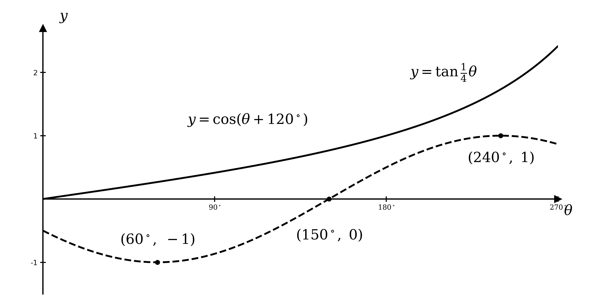

**[B1 B1 B1 B1 B1 B1]**

(ii)

The equation rearranges to $\text{cos} ( θ + 120 ^{\circ} ) = \text{tan}  \frac{1}{4} θ$, so its solutions are the intersection points of the two curves. From the sketch, $y = \text{tan}  \frac{1}{4} θ$ lies entirely above $y = \text{cos} ( θ + 120 ^{\circ} )$, so the curves never meet:

$\text{There are} 0 \text{solutions}$

**[M1 A1]**

> **[mark-scheme]**
> **B1**: Correct shape for $y = \text{tan}  \frac{1}{4} θ$ — increasing from the origin, no asymptote in the interval.
> 
> **B1**: $y = \text{tan}  \frac{1}{4} θ$ passing through $( 0 ^{\circ} ,  0 )$ (and staying positive).
> 
> **B1**: Correct shape for $y = \text{cos} ( θ + 120 ^{\circ} )$ — the cosine graph translated $120 ^{\circ}$ left.
> 
> **B1**: $y = \text{cos} ( θ + 120 ^{\circ} )$ labelled with $( 0 ^{\circ} ,  - \frac{1}{2} )$ and the axis crossing $( 150 ^{\circ} ,  0 )$.
> 
> **B1**: $y = \text{cos} ( θ + 120 ^{\circ} )$ minimum $( 60 ^{\circ} ,  - 1 )$ and maximum $( 240 ^{\circ} ,  1 )$ shown.
> 
> **B1**: The two curves drawn on the same axes with the tangent curve above the cosine curve throughout.
> 
> **M1**: Recognising that the number of solutions equals the number of intersection points of the two curves.
> 
> **A1**: Deduces there are $0$ solutions, as the curves do not intersect in the interval.

### Q28
The tangent graph over $- 270 ^{\circ} \leq θ \leq 270 ^{\circ}$ crosses the $θ$-axis at $- 180 ^{\circ}$, $0 ^{\circ}$ and $180 ^{\circ}$, with vertical asymptotes at $θ = \pm 90 ^{\circ}$ and $θ = \pm 270 ^{\circ}$

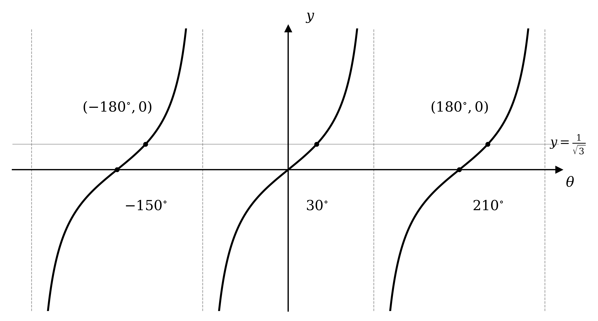

**[B1]**

The tangent graph repeats every $180 ^{\circ}$, so the other solutions are $30 ^{\circ} - 180 ^{\circ}$ and $30 ^{\circ} + 180 ^{\circ}$

$θ = - 150 ^{\circ}   \text{and}   θ = 210 ^{\circ}$

**[B1 B1]**

> **[mark-scheme]**
> **B1**: Correct tangent shape over the interval, crossing at $- 180 ^{\circ}$, $0 ^{\circ}$, $180 ^{\circ}$, with the curve respecting the asymptotes at $\pm 90 ^{\circ}$ and $\pm 270 ^{\circ}$.
> 
> **B1**: The value $θ = 210 ^{\circ}$ (from $30 ^{\circ} + 180 ^{\circ}$).
> 
> **B1**: The value $θ = - 150 ^{\circ}$ (from $30 ^{\circ} - 180 ^{\circ}$), with no extra values in the interval.

### Q29
(i)

$y = \frac{1}{2} \text{sin}  θ$ has amplitude $\frac{1}{2}$: crossings at $- 180 ^{\circ}$, $0 ^{\circ}$, $180 ^{\circ}$, maximum $( 90 ^{\circ} ,  \frac{1}{2} )$, minimum $( - 90 ^{\circ} ,  - \frac{1}{2} )$

$y = \text{sin} ( θ - 60 ^{\circ} )$ is $y = \text{sin}  θ$ translated $60 ^{\circ}$ to the right: crossings at $( - 120 ^{\circ} ,  0 )$, $( 60 ^{\circ} ,  0 )$, maximum $( 150 ^{\circ} ,  1 )$, minimum $( - 30 ^{\circ} ,  - 1 )$

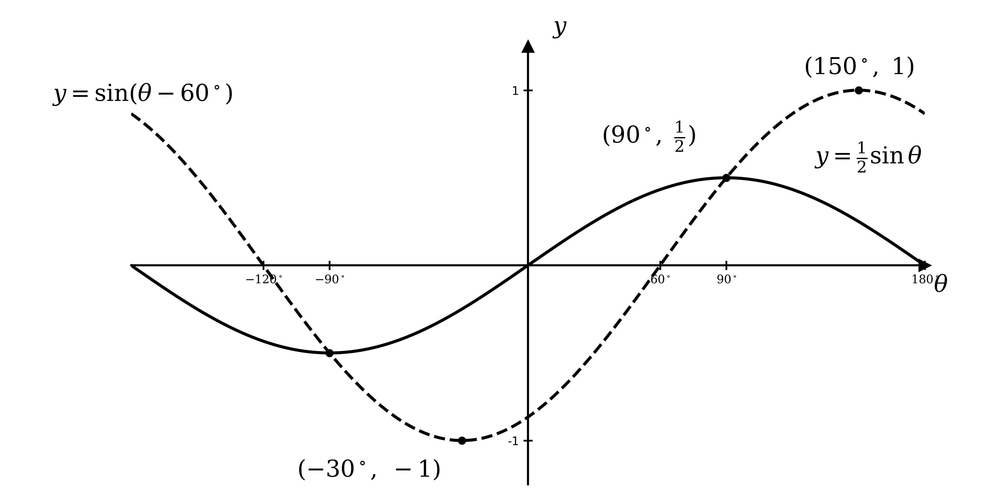

**[B1 B1 B1 B1 B1 B1]**

(ii)

Substituting $θ = 90 ^{\circ}$ into both sides:

$\frac{1}{2} \text{sin}  90 ^{\circ} = \frac{1}{2} ,  \text{sin} ( 90 ^{\circ} - 60 ^{\circ} ) = \text{sin}  30 ^{\circ} = \frac{1}{2}$

Both sides equal $\frac{1}{2}$, so $θ = 90 ^{\circ}$ is a solution

**[M1]**

From the sketch the curves meet at only one other point; substituting $θ = - 90 ^{\circ}$ gives $\frac{1}{2} \text{sin} ( - 90 ^{\circ} ) = - \frac{1}{2}$ and $\text{sin} ( - 150 ^{\circ} ) = - \frac{1}{2}$:

$θ = - 90 ^{\circ}$

**[A1]**

> **[mark-scheme]**
> **B1**: Correct shape for $y = \frac{1}{2} \text{sin}  θ$ — a sine wave of amplitude $\frac{1}{2}$.
> 
> **B1**: $y = \frac{1}{2} \text{sin}  θ$ labelled with crossings $- 180 ^{\circ}$, $0 ^{\circ}$, $180 ^{\circ}$ and turning points $( 90 ^{\circ} , \frac{1}{2} )$, $( - 90 ^{\circ} , - \frac{1}{2} )$.
> 
> **B1**: Correct shape for $y = \text{sin} ( θ - 60 ^{\circ} )$ — the sine graph translated $60 ^{\circ}$ right.
> 
> **B1**: $y = \text{sin} ( θ - 60 ^{\circ} )$ labelled with crossings $( - 120 ^{\circ} , 0 )$, $( 60 ^{\circ} , 0 )$.
> 
> **B1**: $y = \text{sin} ( θ - 60 ^{\circ} )$ turning points $( 150 ^{\circ} , 1 )$ and $( - 30 ^{\circ} , - 1 )$ shown.
> 
> **B1**: Both curves drawn on the same axes with the correct relative positions (crossing at $( 90 ^{\circ} , \frac{1}{2} )$ and $( - 90 ^{\circ} , - \frac{1}{2} )$).
> 
> **M1**: Verifying $θ = 90 ^{\circ}$ by substituting into both sides and showing each equals $\frac{1}{2}$ (a numerical check, not equating the expressions algebraically).
> 
> **A1**: The only other solution $θ = - 90 ^{\circ}$, with no extra values in the interval.

### Q30
(i)

The sine graph over $- 180 ^{\circ} \leq θ \leq 180 ^{\circ}$ crosses the axis at $- 180 ^{\circ}$, $0 ^{\circ}$ and $180 ^{\circ}$, with a maximum $( 90 ^{\circ} ,  1 )$ and a minimum $( - 90 ^{\circ} ,  - 1 )$

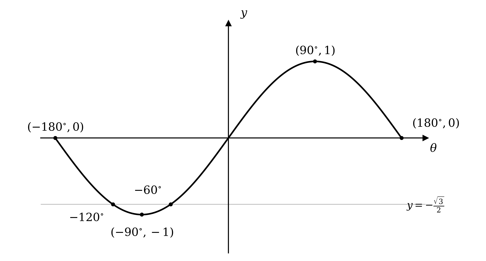

**[B1]**

(ii)

Drawing $y = - \frac{\sqrt{3}}{2}$, the negative solutions are the reflection of $60 ^{\circ}$ in the origin and its mirror image about $θ = - 90 ^{\circ}$

$θ = - 60 ^{\circ}   \text{and}   θ = - 120 ^{\circ}$

**[B1 B1]**

> **[mark-scheme]**
> **B1**: Correct sine shape over the interval, with crossings at $- 180 ^{\circ}$, $0 ^{\circ}$, $180 ^{\circ}$ and turning points $( 90 ^{\circ} ,  1 )$, $( - 90 ^{\circ} ,  - 1 )$.
> 
> **B1**: The value $θ = - 60 ^{\circ}$.
> 
> **B1**: The value $θ = - 120 ^{\circ}$, with no extra values in the interval (both solutions lie below the axis where $y = - \frac{\sqrt{3}}{2}$).

### Q31
(i)

Replacing $x$ by $3 x$ compresses the graph horizontally towards the $y$-axis:

$\text{Stretch} , \text{scale factor}  \frac{1}{3}$

**[B1]**

$\text{parallel to the}  x - \text{axis}$

**[B1]**

(ii)

A horizontal stretch of factor $\frac{1}{3}$ divides the $x$-coordinate by $3$, leaving the $y$-coordinate unchanged: $60 \circ \div 3 = 20 \circ$

`\left(20 \circ , \frac{\sqrt{3}}{2}\right)`

**[B1]**

> **[mark-scheme]**
> **B1**: "Stretch" with scale factor $\frac{1}{3}$ identified (accept "SF $\frac{1}{3}$", or "period divided by 3").
> 
> **B1**: The direction given as parallel to the $x$-axis (accept "in the $x$-direction", "horizontally", or "$y$-axis invariant"). "Sideways" or "inwards" is not accepted.
> 
> **B1**: `\left(20 \circ , \frac{\sqrt{3}}{2}\right)` — only the $x$-coordinate changes, becoming $60 \circ \div 3 = 20 \circ$.

### Q32
(i)

The graph of $y = \text{sin}  θ$ passes through the origin, rises to a maximum at $( 90 ^{\circ} ,  1 )$, crosses the $θ$-axis at $180 ^{\circ}$, falls to a minimum at $( 270 ^{\circ} ,  - 1 )$ and returns to the axis at $360 ^{\circ}$

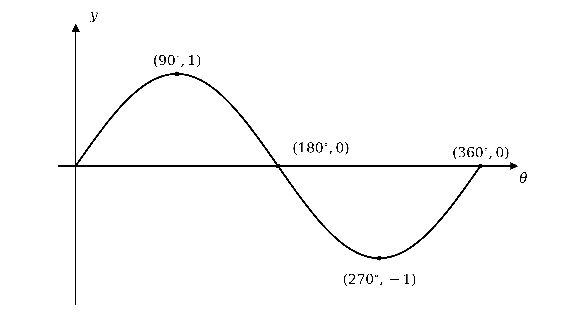

**[B1 B1]**

(ii)

The sine graph is symmetric about $θ = 90 ^{\circ}$, so the other value with the same height is $180 ^{\circ} - 30 ^{\circ}$

$θ = 150 ^{\circ}$

**[B1]**

> **[mark-scheme]**
> **B1**: Correct shape for $y = \text{sin}  θ$ — a smooth wave through the origin, up to a maximum then down to a minimum.
> 
> **B1**: The graph is labelled with the crossings $( 0 ^{\circ} ,  0 )$, $( 180 ^{\circ} ,  0 )$, $( 360 ^{\circ} ,  0 )$, the maximum $( 90 ^{\circ} ,  1 )$ and the minimum $( 270 ^{\circ} ,  - 1 )$.
> 
> **B1**: The value $θ = 150 ^{\circ}$, found from the symmetry of the graph ($180 ^{\circ} - 30 ^{\circ}$). An answer given in radians is not accepted for this degree interval.

### Q33
$y = 2  \text{sin}  θ$ is $y = \text{sin}  θ$ stretched vertically by factor $2$: it passes through $( 0 ^{\circ} ,  0 )$, $( 180 ^{\circ} ,  0 )$, $( 360 ^{\circ} ,  0 )$, with a maximum $( 90 ^{\circ} ,  2 )$ and a minimum $( 270 ^{\circ} ,  - 2 )$

$y = - 2  \text{sin}  θ$ is its reflection in the $θ$-axis: same crossings, with a minimum $( 90 ^{\circ} ,  - 2 )$ and a maximum $( 270 ^{\circ} ,  2 )$

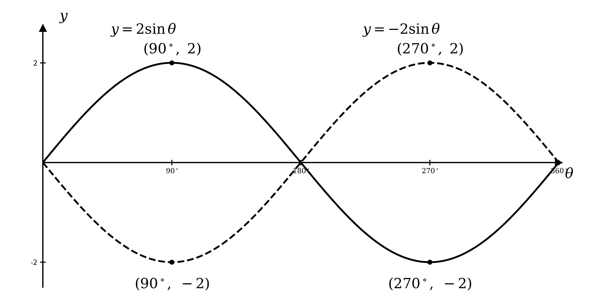

**[B1 B1 B1 B1]**

Neither the stretch nor the reflection changes how often the wave repeats:

$\text{Each function has a period of} 360 ^{\circ}$

**[B1]**

> **[mark-scheme]**
> **B1**: Correct shape for $y = 2  \text{sin}  θ$ — a sine wave with amplitude $2$.
> 
> **B1**: $y = 2  \text{sin}  θ$ labelled with crossings $( 0 ^{\circ} ,  0 )$, $( 180 ^{\circ} ,  0 )$, $( 360 ^{\circ} ,  0 )$, maximum $( 90 ^{\circ} ,  2 )$ and minimum $( 270 ^{\circ} ,  - 2 )$.
> 
> **B1**: Correct shape for $y = - 2  \text{sin}  θ$ — the reflection of the first curve in the $θ$-axis.
> 
> **B1**: $y = - 2  \text{sin}  θ$ labelled with minimum $( 90 ^{\circ} ,  - 2 )$ and maximum $( 270 ^{\circ} ,  2 )$.
> 
> **B1**: The period of each function is stated as $360 ^{\circ}$.

### Q34
(i)

The graph of $y = \text{cos}  θ$ starts at its maximum $( 0 ^{\circ} ,  1 )$, falls to cross the $θ$-axis at $90 ^{\circ}$, reaches a minimum at $( 180 ^{\circ} ,  - 1 )$, crosses again at $270 ^{\circ}$ and returns to $( 360 ^{\circ} ,  1 )$

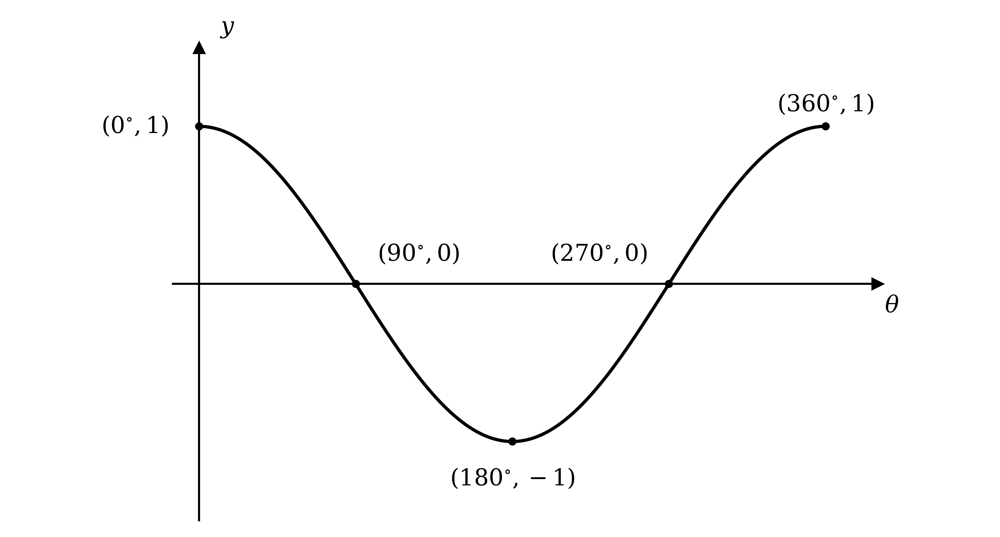

**[B1 B1]**

(ii)

The graph meets the $θ$-axis where $\text{cos}  θ = 0$:

$θ = 90 ^{\circ}   \text{and}   θ = 270 ^{\circ}$

**[B1]**

> **[mark-scheme]**
> **B1**: Correct shape for $y = \text{cos}  θ$ — a smooth wave starting and finishing at a maximum, with one minimum in between.
> 
> **B1**: The graph is labelled with the maximum points $( 0 ^{\circ} ,  1 )$ and $( 360 ^{\circ} ,  1 )$, the minimum $( 180 ^{\circ} ,  - 1 )$, and the axis crossings $( 90 ^{\circ} ,  0 )$ and $( 270 ^{\circ} ,  0 )$.
> 
> **B1**: Both values $θ = 90 ^{\circ}$ and $θ = 270 ^{\circ}$ are stated, with no extra values in the interval. These may simply be read from the $θ$-axis crossings of your sketch.

### Q35
The tangent function repeats every $180 ^{\circ}$, so subtracting $180 ^{\circ}$ from the angle gives the same curve

`\text{tan}\left((x + 50^{\circ}) - 180^{\circ}\right) = \text{tan}(x - 130^{\circ})`

**[B1]**

$\text{The student is correct}$

**[B1]**

> **[mark-scheme]**
> **B1**: A statement that the tangent graph has period $180 ^{\circ}$, shown by $\text{tan} ( x + 50 ^{\circ} - 180 ^{\circ} ) = \text{tan} ( x - 130 ^{\circ} )$.
> 
> **B1**: The conclusion that the student is correct, following from the period argument.
The curve meets the $x$-axis where $\text{tan} ( x + 50 ^{\circ} ) = 0$, i.e. $x + 50 ^{\circ} = 0 ^{\circ} ,  180 ^{\circ} ,  360 ^{\circ}$:

$x = - 50 ^{\circ} ,  130 ^{\circ} ,  310 ^{\circ}$

**[B1]**

It meets the $y$-axis where $x = 0$, giving $y = \text{tan}  50 ^{\circ} = 1 . 19$ (3 s.f.):

$( - 50 ^{\circ} ,  0 ) ,  ( 130 ^{\circ} ,  0 ) ,  ( 310 ^{\circ} ,  0 ) ,  ( 0 ^{\circ} ,  1 . 19 )$

**[B1]**

> **[mark-scheme]**
> **B1**: The three $x$-axis crossings $( - 50 ^{\circ} ,  0 )$, $( 130 ^{\circ} ,  0 )$, $( 310 ^{\circ} ,  0 )$.
> 
> **B1**: The $y$-axis crossing $( 0 ^{\circ} ,  1 . 19 )$ — accept answers which round to $1 . 19$ (from $\text{tan}  50 ^{\circ}$).
Adding another $180 ^{\circ}$ to the angle gives the same curve:

$y = \text{tan} ( x + 230 ^{\circ} )$

**[B1]**

> **[mark-scheme]**
> **B1**: Any equation of the form $y = \text{tan} ( x + 50 ^{\circ} + 180 ^{\circ} n )$ for a non-zero integer $n$ — for example $y = \text{tan} ( x + 230 ^{\circ} )$ or $y = \text{tan} ( x - 310 ^{\circ} )$.

### Q36
(i)

$y = \text{sin}  2 θ$ has period $180 ^{\circ}$ (two cycles): it crosses the axis at $- 180 ^{\circ}$, $- 90 ^{\circ}$, $0 ^{\circ}$, $90 ^{\circ}$, $180 ^{\circ}$, with maxima $( - 135 ^{\circ} ,  1 )$, $( 45 ^{\circ} ,  1 )$ and minima $( - 45 ^{\circ} ,  - 1 )$, $( 135 ^{\circ} ,  - 1 )$

$y = \text{cos} ( θ + 90 ^{\circ} )$ is $y = \text{cos}  θ$ translated $90 ^{\circ}$ to the left: it passes through $( 0 ^{\circ} ,  0 )$, crosses at $- 180 ^{\circ}$ and $180 ^{\circ}$, with a maximum $( - 90 ^{\circ} ,  1 )$ and a minimum $( 90 ^{\circ} ,  - 1 )$

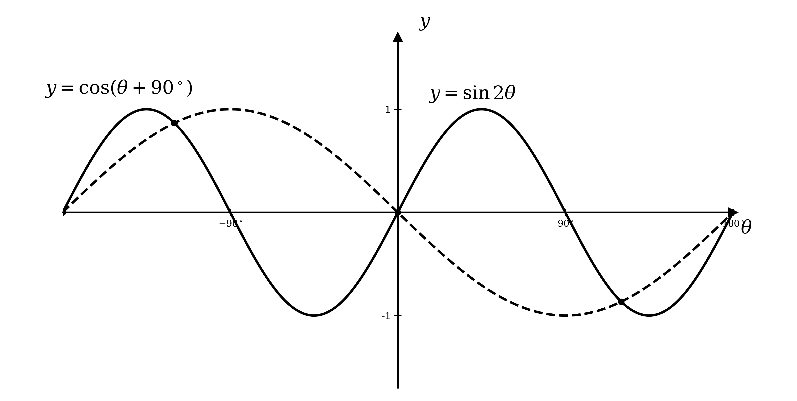

**[B1 B1 B1 B1 B1 B1]**

(ii)

The solutions of $\text{sin}  2 θ = \text{cos} ( θ + 90 ^{\circ} )$ are the points where the two curves meet. Counting the intersections on the sketch:

$\text{There are} 5 \text{solutions}$

**[M1 A1]**

> **[mark-scheme]**
> **B1**: Correct shape for $y = \text{sin}  2 θ$ — two full cycles over the interval.
> 
> **B1**: $y = \text{sin}  2 θ$ labelled with its axis crossings $- 180 ^{\circ} , - 90 ^{\circ} , 0 ^{\circ} , 90 ^{\circ} , 180 ^{\circ}$.
> 
> **B1**: $y = \text{sin}  2 θ$ maxima $( - 135 ^{\circ} , 1 )$, $( 45 ^{\circ} , 1 )$ and minima $( - 45 ^{\circ} , - 1 )$, $( 135 ^{\circ} , - 1 )$ shown.
> 
> **B1**: Correct shape for $y = \text{cos} ( θ + 90 ^{\circ} )$ — the cosine graph translated $90 ^{\circ}$ to the left.
> 
> **B1**: $y = \text{cos} ( θ + 90 ^{\circ} )$ labelled with crossings $( - 180 ^{\circ} , 0 )$, $( 0 ^{\circ} , 0 )$, $( 180 ^{\circ} , 0 )$.
> 
> **B1**: $y = \text{cos} ( θ + 90 ^{\circ} )$ maximum $( - 90 ^{\circ} , 1 )$ and minimum $( 90 ^{\circ} , - 1 )$ shown.
> 
> **M1**: Recognising that the number of solutions equals the number of intersection points of the two curves.
> 
> **A1**: Deduces there are $5$ solutions in the interval.

### Q37
Sketch $y = \text{tan}  θ$ and the horizontal line $y = - 1$; the solutions are where they meet

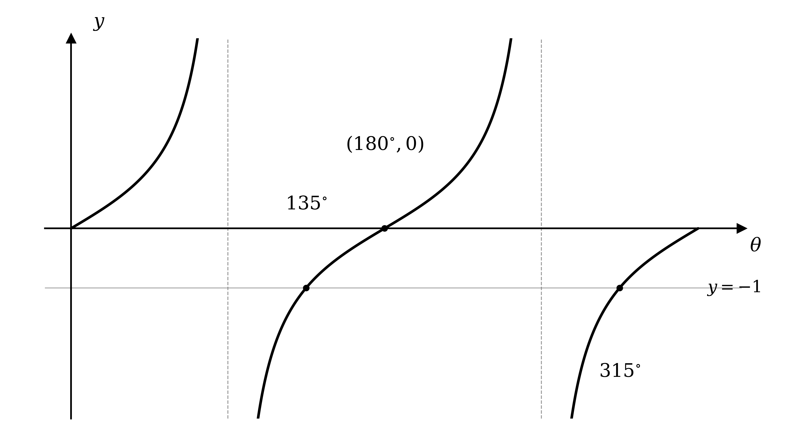

**[B1]**

The line meets the first branch at $θ = 135 ^{\circ}$ (since $\text{tan}^{-1} ( - 1 ) = - 45 ^{\circ}$, then $- 45 ^{\circ} + 180 ^{\circ}$)

$θ = 135 ^{\circ}$

**[B1]**

Adding the period $180 ^{\circ}$ again gives the second solution in range:

$θ = 135 ^{\circ}   \text{and}   θ = 315 ^{\circ}$

**[B1]**

> **[mark-scheme]**
> **B1**: A sketch of $y = \text{tan}  θ$ over the interval with the line $y = - 1$ added (or equivalent working from $\text{tan}^{-1} ( - 1 ) = - 45 ^{\circ}$).
> 
> **B1**: The first solution $θ = 135 ^{\circ}$.
> 
> **B1**: The second solution $θ = 315 ^{\circ}$ (using the tangent period, $135 ^{\circ} + 180 ^{\circ}$), with no extra values in the interval. Answers in radians are not accepted for this degree interval.

### Q38
(i)

Multiplying the whole function by $4$ stretches it away from the $x$-axis:

$\text{Stretch, scale factor} 4$

**[B1]**

$\text{parallel to the} y \text{-axis}$

**[B1]**

(ii)

A vertical stretch of factor $4$ multiplies the $y$-coordinate by $4$, leaving the $x$-coordinate unchanged: $4 \times 0 . 5 = 2$

`\left(60^{\circ},\ 2\right)`

**[B1]**

> **[mark-scheme]**
> **B1**: "Stretch" with scale factor $4$ identified (accept "SF 4", or "$y$-coordinates multiplied by 4", or "amplitude multiplied by 4").
> 
> **B1**: The direction given as parallel to the $y$-axis (accept "in the $y$-direction", "vertically", or "$x$-axis invariant"). A direction such as "upwards" is not accepted.
> 
> **B1**: `\left(60^{\circ},\ 2\right)` — only the $y$-coordinate changes, becoming $4 \times 0 . 5 = 2$.

### Q39
$y = \text{sin}  2 x$ reaches its maximum of $1$ when $2 x = 90 ^{\circ}$, i.e. $x = 45 ^{\circ}$

`B = \left(45^{\circ},\ 1\right)`

**[B1]**

> **[mark-scheme]**
> **B1**: `B = \left(45^{\circ},\ 1\right)`, the nearest maximum to the origin ($\text{sin}  2 x = 1$ when $2 x = 90 ^{\circ}$).
$Q$ is the mirror image of $P$ in the vertical line through the maximum $B ( 45 ^{\circ} ,  1 )$. The horizontal distance from $P$ to $B$ is $45 ^{\circ} - ( - 15 ^{\circ} ) = 60 ^{\circ}$, so $Q$ is $60 ^{\circ}$ beyond $B$:

$x_{Q} = 45 ^{\circ} + 60 ^{\circ} = 105 ^{\circ}$

`Q = \left(105^{\circ},\ -\dfrac{1}{2}\right)`

**[B1]**

$R$ is one full period ($180 ^{\circ}$) on from $P$:

$x_{R} = - 15 ^{\circ} + 180 ^{\circ} = 165 ^{\circ}$

`R = \left(165^{\circ},\ -\dfrac{1}{2}\right)`

**[B1]**

> **[mark-scheme]**
> **B1**: `Q = \left(105^{\circ},\ -\dfrac{1}{2}\right)`, using the symmetry of the curve about the maximum at $x = 45 ^{\circ}$.
> 
> **B1**: `R = \left(165^{\circ},\ -\dfrac{1}{2}\right)`, using the period $180 ^{\circ}$ of $y = \text{sin}  2 x$ ($- 15 ^{\circ} + 180 ^{\circ}$). Both $y$-coordinates must be $- \frac{1}{2}$.

### Q40
(i)

The amplitude is $30$ and the period is $\frac{360^{\circ}}{24} = 15$ seconds, so two complete cosine cycles fit into $0 \leq t \leq 30$

The carriage starts at the top $( 0 ,  30 )$, with further maxima at $( 15 ,  30 )$ and $( 30 ,  30 )$, minima at $( 7 . 5 ,  - 30 )$ and $( 22 . 5 ,  - 30 )$, crossing the reference height at $t = 3 . 75 ,  11 . 25 ,  18 . 75 ,  26 . 25$

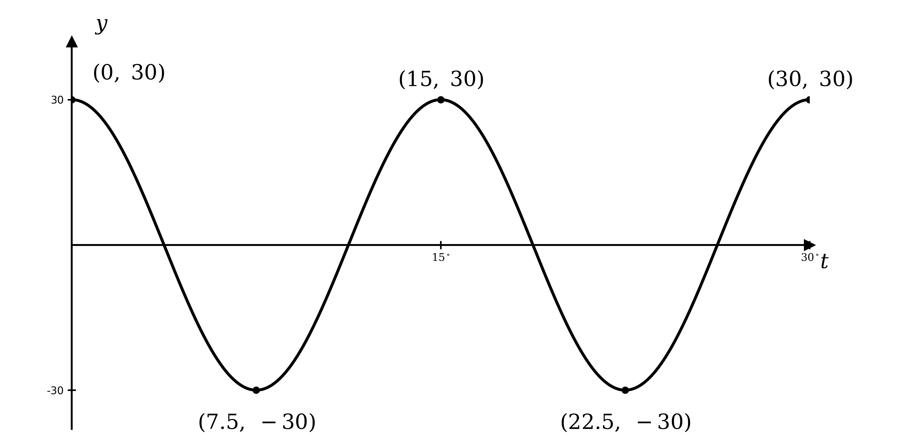

**[B1 B1 B1]**

(ii)

Each cycle contains one fall from a maximum to a minimum, and there are two cycles:

$\text{Twice}$

**[B1]**

(iii)

The bottom of the first fall is the first minimum, where $24 t = 180 ^{\circ}$:

$t = \frac{180}{24}$

**[M1]**

$t = 7 . 5 \text{seconds}$

**[A1]**

> **[mark-scheme]**
> **B1**: Correct cosine shape — two complete cycles over $0 \leq t \leq 30$, starting at a maximum.
> 
> **B1**: The maximum points $( 0 ,  30 )$, $( 15 ,  30 )$, $( 30 ,  30 )$ and minimum points $( 7 . 5 ,  - 30 )$, $( 22 . 5 ,  - 30 )$ are labelled.
> 
> **B1**: The graph crosses the $t$-axis at $t = 3 . 75$, $11 . 25$, $18 . 75$, $26 . 25$.
> 
> **B1**: "Twice" — one fall per cycle, over two cycles.
> 
> **M1**: Setting the first minimum, $24 t = 180 ^{\circ}$, to find its time.
> 
> **A1**: $t = 7 . 5$ seconds.

### Q41
(i)

$y = \text{cos}  θ$ has a maximum $( 0 ^{\circ} ,  1 )$, minima $( \pm 180 ^{\circ} ,  - 1 )$ and crosses the axis at $\pm 90 ^{\circ}$

$y = \text{cos}  3 θ$ is $y = \text{cos}  θ$ stretched horizontally by factor $\frac{1}{3}$ (period $120 ^{\circ}$): it crosses the axis at $\pm 30 ^{\circ}$, $\pm 90 ^{\circ}$, $\pm 150 ^{\circ}$, with maxima at $0 ^{\circ}$, $\pm 120 ^{\circ}$ and minima at $\pm 60 ^{\circ}$, $\pm 180 ^{\circ}$

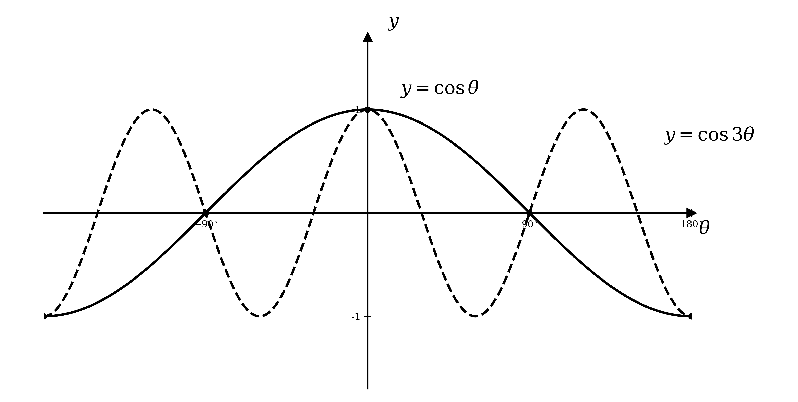

**[B1 B1 B1]**

(ii)

The curves cross where $\text{cos}  θ = \text{cos}  3 θ$:

$( - 180 ^{\circ} ,  - 1 ) ,  ( - 90 ^{\circ} ,  0 ) ,  ( 0 ^{\circ} ,  1 ) ,  ( 90 ^{\circ} ,  0 ) ,  ( 180 ^{\circ} ,  - 1 )$

**[B1 B1]**

> **[mark-scheme]**
> **B1**: Correct shape for $y = \text{cos}  θ$ over the interval, with its axis crossings at $\pm 90 ^{\circ}$ and maximum $( 0 ^{\circ} ,  1 )$.
> 
> **B1**: Correct shape for $y = \text{cos}  3 θ$ — three times as many oscillations (period $120 ^{\circ}$) — with its axis crossings at $\pm 30 ^{\circ}$, $\pm 90 ^{\circ}$, $\pm 150 ^{\circ}$.
> 
> **B1**: All points where each curve meets the coordinate axes are labelled.
> 
> **B1**: At least three of the five intersection points are correctly stated.
> 
> **B1**: All five intersection points $( - 180 ^{\circ} ,  - 1 )$, $( - 90 ^{\circ} ,  0 )$, $( 0 ^{\circ} ,  1 )$, $( 90 ^{\circ} ,  0 )$, $( 180 ^{\circ} ,  - 1 )$ are correct, with none extra.

### Q42
(i)

$y = \text{cos} ( θ + 30 ^{\circ} )$ is the graph of $y = \text{cos}  θ$ translated $30 ^{\circ}$ to the left

It has maximum points at $( - 30 ^{\circ} ,  1 )$ and $( 330 ^{\circ} ,  1 )$, a minimum at $( 150 ^{\circ} ,  - 1 )$, crosses the $θ$-axis at $- 120 ^{\circ}$, $60 ^{\circ}$ and $240 ^{\circ}$, and meets the $y$-axis at `\left(0^{\circ},\ \tfrac{\sqrt{3}}{2}\right)`

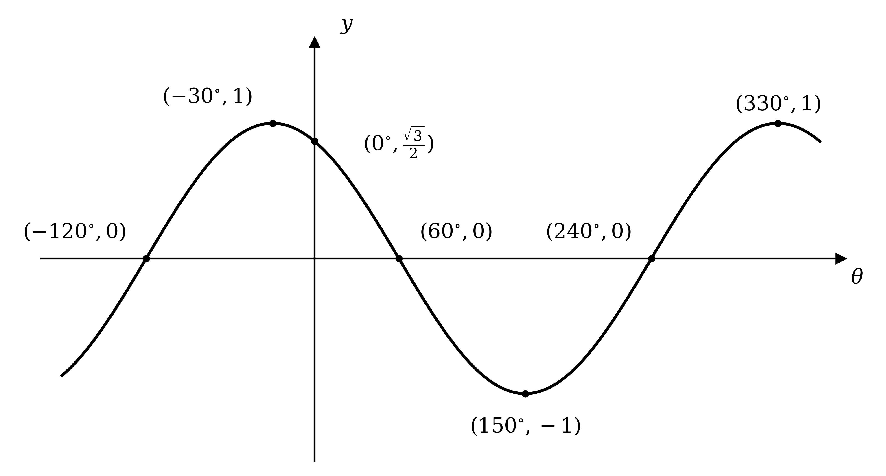

**[B1 B1 B1]**

(ii)

The graph meets the $θ$-axis where $\text{cos} ( θ + 30 ^{\circ} ) = 0$:

$θ = - 120 ^{\circ} ,  60 ^{\circ} ,  240 ^{\circ}$

**[B1]**

> **[mark-scheme]**
> **B1**: Correct shape — the cosine graph translated $30 ^{\circ}$ to the left, smooth over the whole interval.
> 
> **B1**: The maximum points $( - 30 ^{\circ} ,  1 )$ and $( 330 ^{\circ} ,  1 )$ and the minimum $( 150 ^{\circ} ,  - 1 )$ are labelled.
> 
> **B1**: The axis crossings are labelled — $θ$-axis at $- 120 ^{\circ}$, $60 ^{\circ}$, $240 ^{\circ}$ and the $y$-axis at `\left(0^{\circ},\ \tfrac{\sqrt{3}}{2}\right)` (accept $0 . 87$ to 2 significant figures).
> 
> **B1**: All three values $θ = - 120 ^{\circ} ,  60 ^{\circ} ,  240 ^{\circ}$ are stated, with no extra values in the interval.
