# Mark Schemes — Modulus Functions
**Algebra & Functions** · Cambridge (CIE) A-LEVEL maths (9709)

## Exam Questions (15 questions)

### Q1
Both sides are moduli, so square both sides, using `|X| > |Y| \iff X^2 > Y^2`

$( 2 x - a )^{2} > ( x + a )^{2}$

**[B1]**

Expand both sides

$4 x^{2} - 4 a x + a^{2} > x^{2} + 2 a x + a^{2}$

Collect all terms on one side, and note the $a^{2}$ terms cancel

$3 x^{2} - 6 a x > 0$

Factorise

$3 x ( x - 2 a ) > 0$

**[M1]**

**Final answer:** $x = 0$** and **$x = 2 a$

**[A1]**

Since $a > 0$, the critical values are in the order $0 < 2 a$, and the upward parabola $3 x ( x - 2 a )$ is positive outside its roots, shown shaded below

**Final answer:** $x < 0$** or **$x > 2 a$

**[A1]**

> **[mark-scheme]**
> **B1**: Squares both sides to form $( 2 x - a )^{2} > ( x + a )^{2}$.
> 
> **M1**: Expands, cancels the $a^{2}$ terms and factorises to $3 x ( x - 2 a ) > 0$ (or finds the critical values by the formula).
> 
> **A1**: Critical values $x = 0$ and $x = 2 a$.
> 
> **A1**: $x < 0$ or $x > 2 a$. The region must be outside the critical values, using $a > 0$ to order them.

### Q2
Sketch `y = |x - 4|` (a V with vertex $( 4 , 0 )$) and the line $y = 2 x - 5$

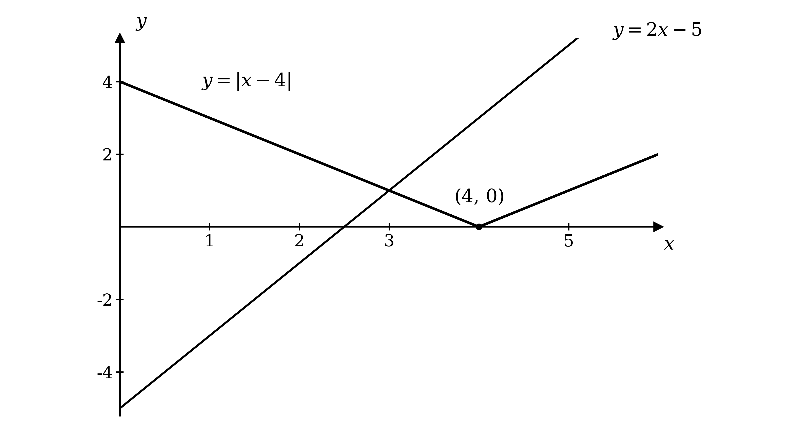

Each arm of the V gives a possible equation: the regular (right) arm $x - 4 = 2 x - 5$ and the reflected (left) arm $- ( x - 4 ) = 2 x - 5$

$x - 4 = 2 x - 5$

$- ( x - 4 ) = 2 x - 5$

**[M1]**

Solving these gives two candidate values

$x - 4 = 2 x - 5 \Rightarrow x = 1$

$4 - x = 2 x - 5 \Rightarrow 3 x = 9 \Rightarrow x = 3$

**[A1]**

The sketch shows the line crosses the V just once. To the right of the vertex the line $y = 2 x - 5$ (gradient $2$) is steeper than the arm $y = x - 4$ (gradient $1$) and already lies above it, so they cannot meet there; the candidate $x = 1$ is rejected

$x = 3$

**[A1]**

> **[mark-scheme]**
> **M1**: Both cases formed from the two arms, $x - 4 = 2 x - 5$ and $- ( x - 4 ) = 2 x - 5$.
> 
> **A1**: Both candidate values $x = 1$ and $x = 3$.
> 
> **A1**: Rejects $x = 1$ because the steeper line does not meet the right arm (equivalently, the line is negative there), giving $x = 3$.

### Q3
Both sides are moduli, so square both sides, using `|a| \leq |b| \iff a^2 \leq b^2`

$( 3 x + 2 )^{2} \leq ( x - 4 )^{2}$

**[B1]**

Expand and collect all terms on one side

$9 x^{2} + 12 x + 4 \leq x^{2} - 8 x + 16$

$8 x^{2} + 20 x - 12 \leq 0$

Divide by $4$ and factorise to find the critical values

$2 x^{2} + 5 x - 3 \leq 0$

$( 2 x - 1 ) ( x + 3 ) \leq 0$

**[M1]**

**Final answer:** $x = \frac{1}{2}$** and **$x = - 3$

**[A1]**

The graph of $y = 2 x^{2} + 5 x - 3$ is an upward parabola, so it is negative or zero between its roots, shown shaded below

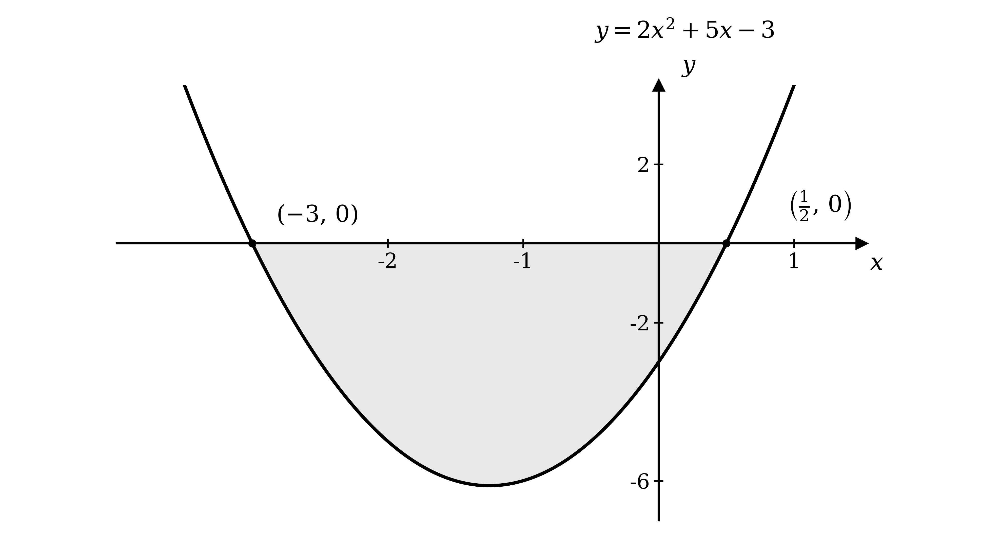

$- 3 \leq x \leq \frac{1}{2}$

**[A1]**

> **[exam-tip]**
> You could also solve this graphically: sketch `y = |3x + 2|` and `y = |x - 4|` on the same axes and find the crossings by matching arms.
> 
> Both reflected arms give $3 x + 2 = x - 4$, so $x = - 3$; the non-reflected arm of `y = |3x + 2|` against the reflected arm of `y = |x - 4|` gives $3 x + 2 = - ( x - 4 )$, so $x = \frac{1}{2}$.
> 
> The inequality `|3x + 2| \leq |x - 4|` then holds where the first graph lies on or below the second, which is between the crossings, giving $- 3 \leq x \leq \frac{1}{2}$.

> **[mark-scheme]**
> **B1**: Correct non-modular inequality $( 3 x + 2 )^{2} \leq ( x - 4 )^{2}$ from squaring both sides.
> 
> **M1**: Rearrangement to a three-term quadratic, factorised (or the formula used) to find the critical values.
> 
> **A1**: Critical values $x = - 3$ and $x = \frac{1}{2}$.
> 
> **A1**: $- 3 \leq x \leq \frac{1}{2}$. The inclusive inequalities are required, and the region must be between the critical values.

### Q4
Sketch `y = |2x - 3|` (a V with vertex `\left(\dfrac{3}{2}, 0\right)`) and `y = |x + 1|` (a V with vertex $( - 1 , 0 )$); the two graphs cross at two points

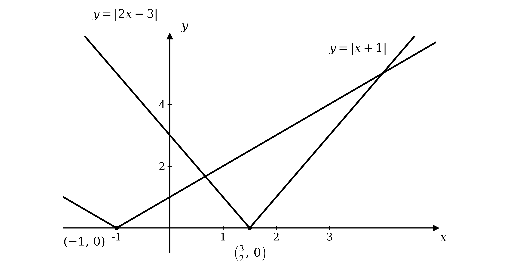

Read from the sketch which arm of each graph forms each crossing, then equate those arms

At the right-hand crossing both graphs are on their non-reflected arms, so the line $2 x - 3$ meets the line $x + 1$

$2 x - 3 = x + 1$

At the left-hand crossing the reflected part of `y = |2x - 3|` meets the non-reflected part of `y = |x + 1|`

$- ( 2 x - 3 ) = x + 1$

**[M1]**

Solve the right-hand crossing

$2 x - 3 = x + 1 \Rightarrow x = 4$

$x = 4$

**[A1]**

Solve the left-hand crossing

$- ( 2 x - 3 ) = x + 1 \Rightarrow 3 - 2 x = x + 1 \Rightarrow 3 x = 2$

$x = \frac{2}{3}$

**[A1]**

> **[mark-scheme]**
> **M1**: Reads the arms from the graph to form the two equations, $2 x - 3 = x + 1$ and $- ( 2 x - 3 ) = x + 1$ (equivalently $2 x - 3 = - ( x + 1 )$, or squares both sides to $( 2 x - 3 )^{2} = ( x + 1 )^{2}$).
> 
> **A1**: $x = 4$.
> 
> **A1**: $x = \frac{2}{3}$.

### Q5
(i)

Sketch `y = |x - 5|` by drawing the line $y = x - 5$ and reflecting the part below the $x$-axis back above it, giving a V-shape with vertex $( 5 , 0 )$ and $y$-intercept $( 0 , 5 )$

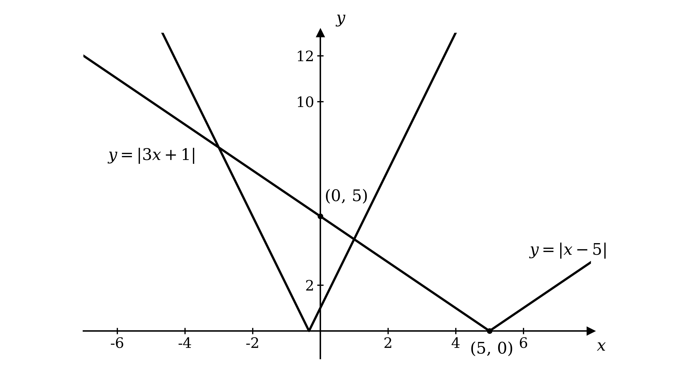

**[B1]**

The two graphs cross at two points; read from the sketch which arm of each graph forms each crossing, then equate those arms

At the left-hand crossing both graphs lie on their reflected arms, so the reflected part of `y = |3x + 1|` meets the reflected part of `y = |x - 5|`

$- ( 3 x + 1 ) = - ( x - 5 )$

At the right-hand crossing the non-reflected part of `y = |3x + 1|` meets the reflected part of `y = |x - 5|`

$3 x + 1 = - ( x - 5 )$

**[M1]**

Solve the left-hand crossing

$3 x + 1 = x - 5 \Rightarrow 2 x = - 6 \Rightarrow x = - 3$

Solve the right-hand crossing

$3 x + 1 = 5 - x \Rightarrow 4 x = 4 \Rightarrow x = 1$

**[A1]**

Substitute each $x$-value back into either graph to find its $y$-coordinate

`x = -3 \Rightarrow y = |3(-3) + 1| = 8`

`x = 1 \Rightarrow y = |3(1) + 1| = 4`

**Final answer:** $( - 3 , 8 )$** and **$( 1 , 4 )$

**[A1]**

(ii)

`|3x + 1| < |x - 5|` is satisfied where the graph of `y = |3x + 1|` lies below the graph of `y = |x - 5|`, which from the sketch is the region between the two points of intersection

$- 3 < x < 1$

**[M1 A1]**

> **[exam-tip]**
> If you prefer to work algebraically, squaring both sides of `|3x + 1| = |x - 5|` gives $( 3 x + 1 )^{2} = ( x - 5 )^{2}$, which rearranges to $x^{2} + 2 x - 3 = 0$ and factorises to $( x + 3 ) ( x - 1 ) = 0$. Once you have drawn the graph, though, reading straight off it which arm meets which is quicker and keeps the working tied to the picture.

> **[mark-scheme]**
> **B1**: Correct sketch of `y = |x - 5|` as a V-shape with vertex at $( 5 , 0 )$, drawn on the given axes.
> 
> **M1**: Reads the arms from the graph to form the two correct linear equations, $- ( 3 x + 1 ) = - ( x - 5 )$ and $3 x + 1 = - ( x - 5 )$ (or squares both sides to $( 3 x + 1 )^{2} = ( x - 5 )^{2}$).
> 
> **A1**: $x = - 3$ and $x = 1$.
> 
> **A1**: Both coordinate pairs $( - 3 , 8 )$ and $( 1 , 4 )$.
> 
> **M1**: Uses the graph to identify that the inequality holds between the two intersection points.
> 
> **A1**: $- 3 < x < 1$. The strict inequalities are required.

### Q6
$A$ is where the line meets the $y$-axis and $B$ is where it meets the $x$-axis

$x = 0 \Rightarrow y = 2 ( 0 ) - 3 = - 3$

$y = 0 \Rightarrow 2 x - 3 = 0 \Rightarrow x = \frac{3}{2}$

**Final answer:** $A = ( 0 , - 3 )$** and **`B = \left(\dfrac{3}{2}, 0\right)`

**[B1]**

> **[mark-scheme]**
> **B1**: Both coordinates correct, $A = ( 0 , - 3 )$ and `B = \left(\dfrac{3}{2}, 0\right)`.
(i)

The transformation from $\text{f} ( x )$ to `|\text{f}(x-1)|` is applied in two stages

First, $\text{f} ( x - 1 )$ translates the graph $1$ unit to the right

**[B1]**

Then the modulus reflects the part of the graph below the $x$-axis back above it, giving a V-shape with vertex at `\left(\dfrac{5}{2}, 0\right)`

**[B1]**

**[B1]**

(ii)

Apply the same two steps to each point: add $1$ to the $x$-coordinate, then make any negative $y$-coordinate positive

$A = ( 0 , - 3 )$ translates to $( 1 , - 3 )$, which the modulus reflects to

$A ' = ( 1 , 3 )$

**[B1]**

`B = \left(\dfrac{3}{2}, 0\right)` translates to `\left(\dfrac{5}{2}, 0\right)`, and the modulus leaves it unchanged

`B' = \left(\dfrac{5}{2}, 0\right)`

**[B1]**

> **[mark-scheme]**
> **B1**: Applies the translation $1$ unit to the right.
> 
> **B1**: Applies the modulus, reflecting the part below the $x$-axis above it.
> 
> **B1**: Fully correct sketch of `y = |\text{f}(x - 1)|`.
> 
> **B1**: $A ' = ( 1 , 3 )$.
> 
> **B1**: `B' = \left(\dfrac{5}{2}, 0\right)`.

### Q7
Sketch `y = |3x - 2|`, a V-shape with vertex `\left(\dfrac{2}{3}, 0\right)` and $y$-intercept $( 0 , 2 )$, together with the line $y = 7$, which meets the V once on each arm

On the right-hand arm the graph is the unreflected line $y = 3 x - 2$, so one solution is where this line equals $7$

$3 x - 2 = 7$

On the left-hand arm the graph is that line reflected in the $x$-axis, so the other solution is where the reflected line equals $7$

$- ( 3 x - 2 ) = 7$

**[M1]**

Solve the equation from the right-hand arm

$3 x = 9$

$x = 3$

**[A1]**

Solve the equation from the left-hand arm

$3 x - 2 = - 7 \Rightarrow 3 x = - 5$

$x = - \frac{5}{3}$

**[A1]**

> **[mark-scheme]**
> **M1**: The two cases identified from the graph: the unreflected line gives $3 x - 2 = 7$ and the reflected line gives $- ( 3 x - 2 ) = 7$.
> 
> **A1**: $x = 3$.
> 
> **A1**: $x = - \frac{5}{3}$. Accept answers which round to $- 1 . 67$ to 3 significant figures.

### Q8
Sketch `y = |6 - 2x|`, a V-shape with vertex $( 3 , 0 )$ and $y$-intercept $( 0 , 6 )$, together with the line $y = 4$; the line meets the V once on each arm

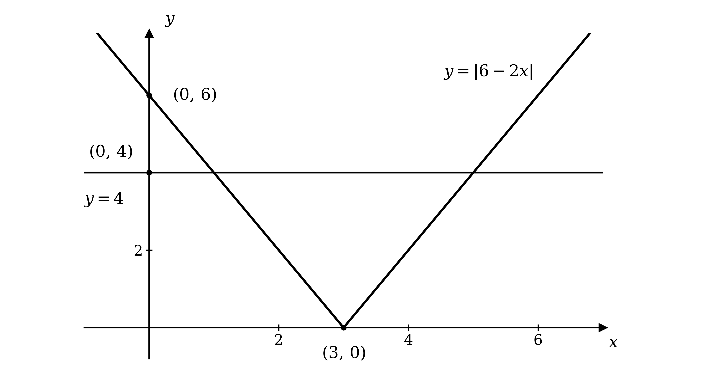

On the left-hand arm the graph is the regular line $6 - 2 x$, so one solution is where this equals $4$

$6 - 2 x = 4$

On the right-hand arm the graph is that line reflected in the $x$-axis, so the other solution is where the reflected line equals $4$

$- ( 6 - 2 x ) = 4$

**[M1]**

Solve the left-hand arm

$6 - 2 x = 4 \Rightarrow 2 x = 2$

$x = 1$

**[A1]**

Solve the right-hand arm

$- ( 6 - 2 x ) = 4 \Rightarrow 2 x - 6 = 4 \Rightarrow 2 x = 10$

$x = 5$

**[A1]**

> **[mark-scheme]**
> **M1**: Reads the two arms from the graph (or otherwise identifies the two cases), the regular line $6 - 2 x = 4$ and the reflected line $- ( 6 - 2 x ) = 4$.
> 
> **A1**: $x = 1$.
> 
> **A1**: $x = 5$.
Sketch $y = 6 - 2 x$, which crosses the axes at $( 0 , 6 )$ and $( 3 , 0 )$, then reflect the part below the $x$-axis back above it to give a V-shape with vertex $( 3 , 0 )$

**[B1]**

Label the intercepts of `y = |6 - 2x|` with the axes, $( 0 , 6 )$ and $( 3 , 0 )$

**[B1]**

Add the horizontal line $y = 4$, which crosses the $y$-axis at $( 0 , 4 )$

**[B1]**

The two graphs meet at the points found in part (a), namely $( 1 , 4 )$ and $( 5 , 4 )$

**[B1]**

> **[mark-scheme]**
> **B1**: Correct V-shape for `y = |6 - 2x|` with vertex at $( 3 , 0 )$.
> 
> **B1**: Axis intercepts of the modulus graph labelled, $( 0 , 6 )$ and $( 3 , 0 )$.
> 
> **B1**: Horizontal line $y = 4$ drawn, with its $y$-axis intercept $( 0 , 4 )$ labelled.
> 
> **B1**: Both intersection points labelled, $( 1 , 4 )$ and $( 5 , 4 )$.
The graph of `y = |6 - 2x|` has its lowest point at the vertex $( 3 , 0 )$, so its smallest value is $0$; compare the horizontal line $y = k$ with this

(i)

The line lies below the vertex and never meets the graph

$k < 0$

**[B1]**

(ii)

The line passes through the vertex, touching the graph once

$k = 0$

**[B1]**

(iii)

The line lies above the vertex and crosses each arm of the V

$k > 0$

**[B1]**

> **[mark-scheme]**
> **B1**: $k < 0$.
> 
> **B1**: $k = 0$.
> 
> **B1**: $k > 0$.

### Q9
(i)

Remove the modulus: an expression whose modulus is less than $9$ must lie between $- 9$ and $9$

$- 9 < 4 x + 3 < 9$

**[M1]**

Subtract $3$ from each part

$- 12 < 4 x < 6$

Divide each part by $4$

$- 3 < x < \frac{3}{2}$

**[A1]**

(ii)

First isolate the modulus by subtracting $5$ from both sides

`|2x| \geq 10`

An expression whose modulus is at least $10$ is itself either $\leq - 10$ or $\geq 10$, giving two inequalities

$2 x \leq - 10$* or *$2 x \geq 10$

**[M1]**

Divide each by $2$

**Final answer:** $x \leq - 5$** or **$x \geq 5$

**[A1]**

(iii)

Sketch `y = |x + 8|` (a V with vertex $( - 8 , 0 )$) and `y = |2x + 10|` (a V with vertex $( - 5 , 0 )$)

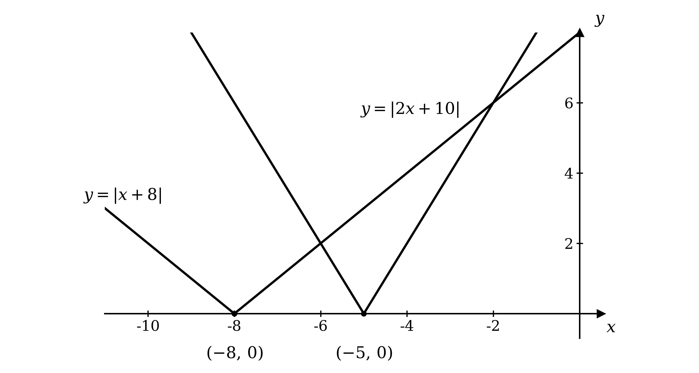

Read from the sketch which arm of each graph forms each crossing, then equate those arms

At the right-hand crossing both graphs are on their non-reflected arms, so the line $x + 8$ meets the line $2 x + 10$

$x + 8 = 2 x + 10$

At the left-hand crossing the non-reflected arm of `y = |x + 8|` meets the reflected arm of `y = |2x + 10|`

$x + 8 = - ( 2 x + 10 )$

**[M1]**

Solve the right-hand crossing

$x + 8 = 2 x + 10 \Rightarrow x = - 2$

Solve the left-hand crossing

$x + 8 = - 2 x - 10 \Rightarrow 3 x = - 18 \Rightarrow x = - 6$

**Final answer:** $x = - 6$** or **$x = - 2$

**[A1]**

> **[mark-scheme]**
> **M1**: For `|4x + 3| < 9`, correct removal of the modulus as the double inequality $- 9 < 4 x + 3 < 9$ (or as two separate inequalities).
> 
> **A1**: $- 3 < x < \frac{3}{2}$. The strict inequalities are required.
> 
> **M1**: For `|2x| + 5 \geq 15`, isolating the modulus to `|2x| \geq 10` and forming $2 x \leq - 10$ or $2 x \geq 10$.
> 
> **A1**: $x \leq - 5$ or $x \geq 5$.
> 
> **M1**: For `|x + 8| = |2x + 10|`, reading the arms from the sketch (or forming the two cases $x + 8 = 2 x + 10$ and $x + 8 = - ( 2 x + 10 )$, or squaring both sides).
> 
> **A1**: $x = - 6$ and $x = - 2$.

### Q10
$y = \sqrt{x}$ starts at the origin $( 0 , 0 )$ and increases, becoming less steep as $x$ grows

**[B1]**

`|\text{g}(x)| = |2x - 3|` is a V-shape; since $2 x - 3 = 0$ at $x = \frac{3}{2}$, its vertex is `\left(\tfrac32, 0\right)` and its $y$-intercept is $( 0 , 3 )$

**[B1]**

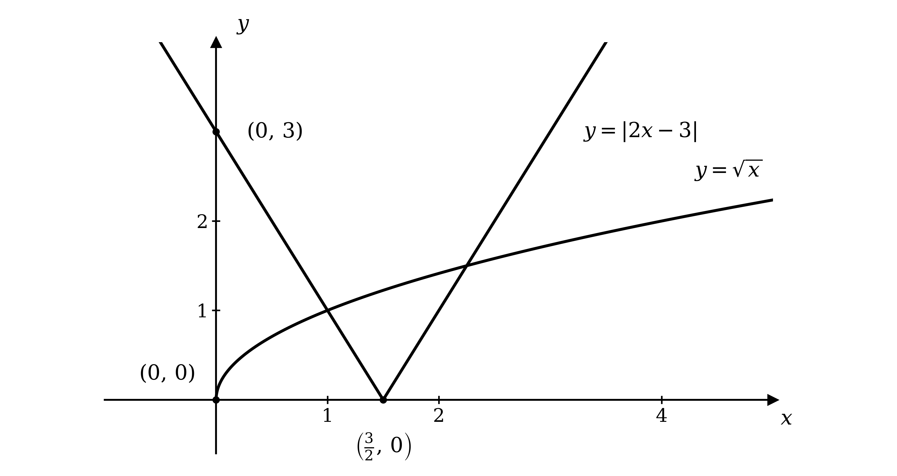

The graphs meet the axes at $( 0 , 0 )$, `\left(\tfrac32, 0\right)` and $( 0 , 3 )$

**[B1]**

> **[mark-scheme]**
> **B1**: Correct shape of $y = \sqrt{x}$ from the origin (increasing, concave down).
> 
> **B1**: Correct V-shape of `y = |2x - 3|` with vertex `\left(\tfrac32, 0\right)`.
> 
> **B1**: Axis intersection points labelled, $( 0 , 0 )$, `\left(\tfrac32, 0\right)` and $( 0 , 3 )$.

From the sketch in part (a), the two graphs cross at two points. Both sides are non-negative, so square both sides to remove the square root and the modulus together

$x = ( 2 x - 3 )^{2}$

**[M1]**

Expand and rearrange to a quadratic

$x = 4 x^{2} - 12 x + 9$

$4 x^{2} - 13 x + 9 = 0$

Factorise and solve

$( 4 x - 9 ) ( x - 1 ) = 0$

**[A1]**

**Final answer:** $x = \frac{9}{4}$** or **$x = 1$

**[A1]**

> **[mark-scheme]**
> **M1**: Squares both sides to form $x = ( 2 x - 3 )^{2}$.
> 
> **A1**: Correct three-term quadratic $4 x^{2} - 13 x + 9 = 0$.
> 
> **A1**: Both values $x = \frac{9}{4}$ and $x = 1$.

The equation $\text{f} ( x ) = \text{g} ( x )$ is $\sqrt{x} = 2 x - 3$; at $x = \frac{9}{4}$ both sides equal $\frac{3}{2}$, but at $x = 1$ the left side is $1$ while $2 ( 1 ) - 3 = - 1$, so $x = 1$ satisfies $\text{f} ( x ) = - \text{g} ( x )$ rather than $\text{f} ( x ) = \text{g} ( x )$

$x = 1$

**[B1]**

> **[mark-scheme]**
> **B1**: $x = 1$ (the solution arising from the negative case of the modulus).

### Q11
$\text{f}$ is a many-to-one function: as the graph shows, a horizontal line can cross the V-shape at two points, so two different values of $x$ give the same value of $\text{f} ( x )$

**Final answer:** **Only a one-to-one function has an inverse, so **$\text{f}^{-1}$** does not exist**

**[B1]**

> **[mark-scheme]**
> **B1**: States that $\text{f}$ is many-to-one (not one-to-one), so it has no inverse. Accept a clear statement that two $x$-values give the same output.
The graph turns at its vertex, where $3 x - 2 = 0$, that is $x = \frac{2}{3}$; restricting to one arm from the vertex makes $\text{f}$ one-to-one while keeping the full range $\text{f} ( x ) \geq 0$

$x \geq \frac{2}{3}$

**[B1]**

> **[mark-scheme]**
> **B1**: $x \geq \frac{2}{3}$. Accept $x \leq \frac{2}{3}$ (either arm gives the maximum range).
On the domain $x \geq \frac{2}{3}$, the expression $3 x - 2$ is not negative, so $\text{f} ( x ) = 3 x - 2$; set $y = 3 x - 2$ and make $x$ the subject

$y + 2 = 3 x$

$x = \frac{y+2}{3}$

**[M1]**

Replace $y$ with $x$ to write the inverse

$\text{f}^{-1} ( x ) = \frac{x+2}{3}$

**[A1]**

The domain of $\text{f}^{-1}$ is the range of $\text{f}$, and the range of $\text{f}^{-1}$ is the domain of $\text{f}$

$\text{domain:} x \geq 0$

$\text{range:} \text{f}^{-1} ( x ) \geq \frac{2}{3}$

**[A1]**

> **[mark-scheme]**
> **M1**: Uses $\text{f} ( x ) = 3 x - 2$ on the restricted domain and rearranges $y = 3 x - 2$ to make $x$ the subject.
> 
> **A1**: $\text{f}^{-1} ( x ) = \frac{x+2}{3}$ (or equivalent). For the $x \leq \frac{2}{3}$ branch, accept $\text{f}^{-1} ( x ) = \frac{2-x}{3}$.
> 
> **A1**: Domain $x \geq 0$ and range $\text{f}^{-1} ( x ) \geq \frac{2}{3}$ both correct (or $\leq \frac{2}{3}$ for the other branch).

### Q12
On $x \leq 0$ the expression $2 x$ is not positive, so `\text{p}(x) = |2x| = -2x`, a half-line from the origin rising to the upper left

**[B1]**

The graph of $y = \text{p}^{-1} ( x )$ is the reflection of $y = \text{p} ( x )$ in the line $y = x$

**[B1]**

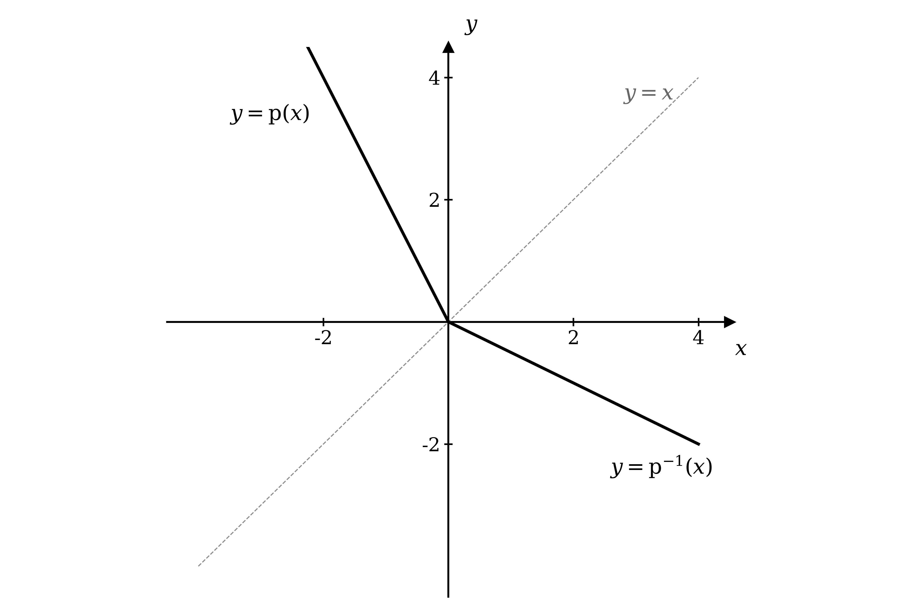

Both half-lines start at the origin, with $y = \text{p}^{-1} ( x )$ falling to the lower right

**[B1]**

> **[mark-scheme]**
> **B1**: Correct half-line for $y = \text{p} ( x )$, i.e. $y = - 2 x$ for $x \leq 0$.
> 
> **B1**: $y = \text{p}^{-1} ( x )$ shown as the reflection of $y = \text{p} ( x )$ in $y = x$.
> 
> **B1**: Fully correct sketch, both half-lines from the origin (line $y = x$ indicated).
Let `y = |2x|`; on the domain $x \leq 0$ this is $y = - 2 x$, so make $x$ the subject

$x = - \frac{y}{2}$

**[M1]**

Replace $y$ with $x$ to write the inverse

$\text{p}^{-1} ( x ) = - \frac{1}{2} x$

**[A1]**

The domain of $\text{p}^{-1}$ is the range of $\text{p}$

$\text{domain:} x \geq 0$

**[A1]**

> **[mark-scheme]**
> **M1**: Uses $\text{p} ( x ) = - 2 x$ on the restricted domain and rearranges to make $x$ the subject.
> 
> **A1**: $\text{p}^{-1} ( x ) = - \frac{1}{2} x$.
> 
> **A1**: Domain $x \geq 0$.
Work from the right-hand side, substituting $- \frac{1}{2} x$ into `\text{p}(t) = |2t|`

`-\dfrac{1}{2}\,\text{p}\left(-\dfrac{1}{2}x\right) = -\dfrac{1}{2}\left|2\left(-\dfrac{1}{2}x\right)\right|`

**[M1]**

Simplify inside the modulus

`= -\dfrac{1}{2}\,|-x|`

**[A1]**

The expression $\text{p}^{-1}$ has domain $x \geq 0$, so `|-x| = x`, which gives the result found in part (b)

`-\dfrac{1}{2}\,\text{p}\left(-\dfrac{1}{2}x\right) = -\dfrac{1}{2}x = \text{p}^{-1}(x)`

**[A1]**

> **[mark-scheme]**
> **M1**: Substitutes $- \frac{1}{2} x$ into $\text{p}$ to form `-\dfrac{1}{2}\left|2\left(-\dfrac{1}{2}x\right)\right|`.
> 
> **A1**: Simplifies to `-\dfrac{1}{2}|-x|`.
> 
> **A1**: Uses $x \geq 0$ to reach $- \frac{1}{2} x$ and concludes this equals $\text{p}^{-1} ( x )$.

### Q13
`|\text{f}(x)| = |3x - 1|` is a V-shape; since $3 x - 1 = 0$ at $x = \frac{1}{3}$, its vertex is `\left(\tfrac13, 0\right)` and its $y$-intercept is $( 0 , 1 )$

**[B1]**

`|\text{g}(x)| = |2x + 2|` is a V-shape; since $2 x + 2 = 0$ at $x = - 1$, its vertex is $( - 1 , 0 )$ and its $y$-intercept is $( 0 , 2 )$

**[B1]**

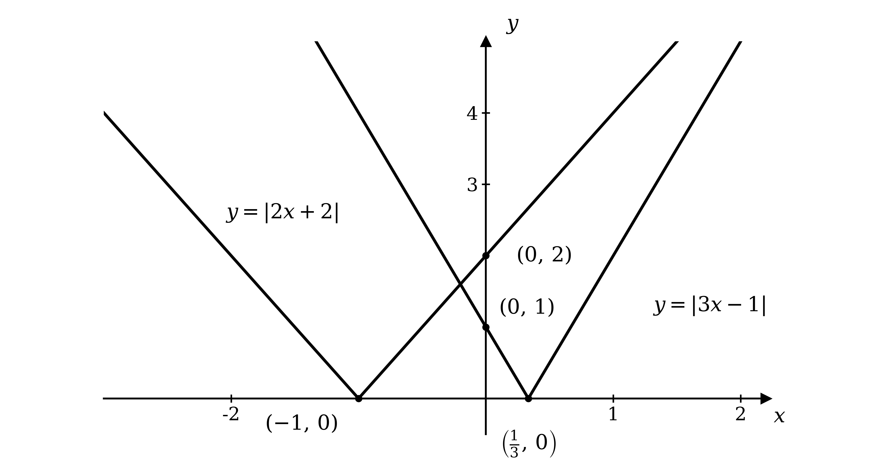

The graphs meet the axes at `\left(\tfrac13, 0\right)`, $( 0 , 1 )$, $( - 1 , 0 )$ and $( 0 , 2 )$

**[B1]**

> **[mark-scheme]**
> **B1**: Correct V-shape for `y = |3x - 1|` with vertex `\left(\tfrac13, 0\right)`.
> 
> **B1**: Correct V-shape for `y = |2x + 2|` with vertex $( - 1 , 0 )$.
> 
> **B1**: All four axis intersection points labelled, `\left(\tfrac13, 0\right)`, $( 0 , 1 )$, $( - 1 , 0 )$ and $( 0 , 2 )$.

The two graphs cross at two points; read from the sketch which arm of each graph forms each crossing, then equate those arms

At the right-hand crossing both graphs are on their non-reflected arms, so the line $3 x - 1$ meets the line $2 x + 2$

$3 x - 1 = 2 x + 2$

At the left-hand crossing the reflected part of `y = |3x - 1|` meets the non-reflected part of `y = |2x + 2|`

$- ( 3 x - 1 ) = 2 x + 2$

**[M1]**

Solve the right-hand crossing

$3 x - 1 = 2 x + 2 \Rightarrow x = 3$

$x = 3$

**[A1]**

Solve the left-hand crossing

$- ( 3 x - 1 ) = 2 x + 2 \Rightarrow 1 - 3 x = 2 x + 2 \Rightarrow 5 x = - 1$

$x = - \frac{1}{5}$

**[A1]**

> **[mark-scheme]**
> **M1**: Reads the arms from the graph to form the two equations, $3 x - 1 = 2 x + 2$ and $- ( 3 x - 1 ) = 2 x + 2$ (equivalently $3 x - 1 = - ( 2 x + 2 )$, or squares both sides to form $5 x^{2} - 14 x - 3 = 0$).
> 
> **A1**: $x = 3$.
> 
> **A1**: $x = - \frac{1}{5}$.

The right-hand crossing, where both graphs are on their non-reflected arms, is where $\text{f} ( x ) = \text{g} ( x )$ itself (the equation $3 x - 1 = 2 x + 2$), giving $x = 3$; the other crossing came from $\text{f} ( x ) = - \text{g} ( x )$

$x = 3$

**[B1]**

> **[mark-scheme]**
> **B1**: $x = 3$.

### Q14
Sketch `y = |4x + 2|`, a V-shape with vertex `\left(-\dfrac{1}{2}, 0\right)` and $y$-intercept $( 0 , 2 )$, together with the line $y = 5$, which meets the V once on each arm

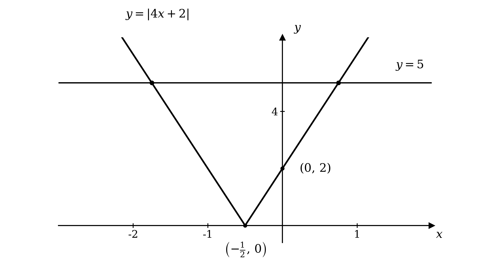

On the right-hand arm the graph is the unreflected line $y = 4 x + 2$, so one solution is where this line equals $5$

$4 x + 2 = 5$

On the left-hand arm the graph is that line reflected in the $x$-axis, so the other solution is where the reflected line equals $5$

$- ( 4 x + 2 ) = 5$

**[M1]**

Solve the equation from the right-hand arm

$4 x = 3$

$x = \frac{3}{4}$

**[A1]**

Solve the equation from the left-hand arm

$4 x + 2 = - 5 \Rightarrow 4 x = - 7$

$x = - \frac{7}{4}$

**[A1]**

> **[mark-scheme]**
> **M1**: The two cases identified from the graph: the unreflected line gives $4 x + 2 = 5$ and the reflected line gives $- ( 4 x + 2 ) = 5$.
> 
> **A1**: $x = \frac{3}{4}$. Accept $0 . 75$.
> 
> **A1**: $x = - \frac{7}{4}$. Accept $- 1 . 75$.

### Q15
$\text{f} ( x ) = ( x + 2 )^{2}$ is a parabola with a repeated root, touching the $x$-axis at $( - 2 , 0 )$ and crossing the $y$-axis at $( 0 , 4 )$

**[B1]**

`|\text{g}(x)| = |2x + 4|` is a V-shape; since $2 x + 4 = 0$ at $x = - 2$, its vertex is $( - 2 , 0 )$ and its $y$-intercept is $( 0 , 4 )$

**[B1]**

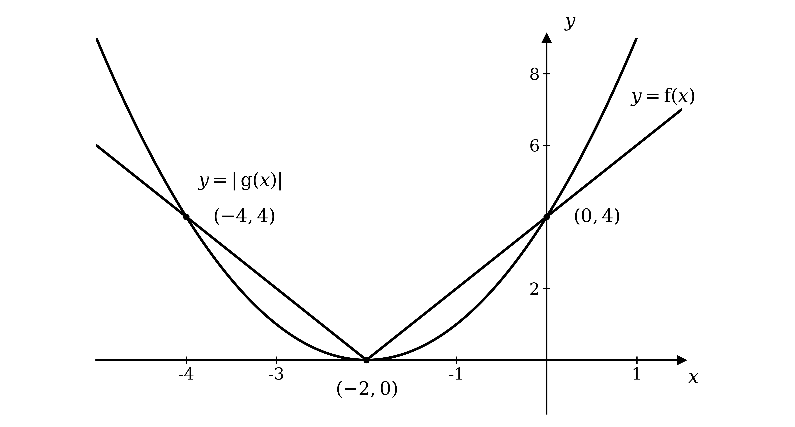

Both graphs meet the coordinate axes at $( - 2 , 0 )$ and $( 0 , 4 )$

**[B1]**

> **[mark-scheme]**
> **B1**: Correct parabola $y = ( x + 2 )^{2}$, touching the $x$-axis at $( - 2 , 0 )$.
> 
> **B1**: Correct V-shape `y = |2x + 4|` with vertex at $( - 2 , 0 )$.
> 
> **B1**: Axis intersection points labelled, $( - 2 , 0 )$ and $( 0 , 4 )$.
From part (a) both graphs pass through the shared axis points $( - 2 , 0 )$ and $( 0 , 4 )$, so two solutions are

$x = - 2$* and *$x = 0$

**[M1]**

Both graphs are symmetric about the vertical line $x = - 2$, so the solution $x = 0$ has a mirror image at $x = - 4$

$x = - 4 , - 2 , 0$

**[A1]**

> **[exam-tip]**
> You can also solve this purely algebraically, without the graph, by removing the modulus in two cases: for $2 x + 4 \geq 0$ you get $( x + 2 )^{2} = 2 x + 4$, and for $2 x + 4 < 0$ you get $( x + 2 )^{2} = - ( 2 x + 4 )$. Solving both and keeping only the roots that fit each case gives the same three answers, and confirms the third solution $x = - 4$.

> **[mark-scheme]**
> **M1**: Both intersections identified at the shared axis points $x = - 2$ and $x = 0$, or the two modulus cases set up algebraically.
> 
> **A1**: All three solutions $x = - 4$, $x = - 2$ and $x = 0$.
