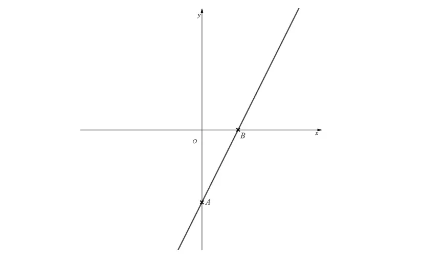

# Exam Questions — Modulus Functions
**Algebra & Functions** · Cambridge (CIE) A-LEVEL maths (9709)
> Source: [https://www.savemyexams.com/a-level/maths/cie/20/pure-3/topic-questions/](https://www.savemyexams.com/a-level/maths/cie/20/pure-3/topic-questions/) · 15 questions across 1 sets

## Exam Questions (15 questions)

### Q1 — hard — 4 marks

**Q1** [4 marks]

The constant $a$ is positive. Solve the inequality `|2x - a| > |x + a|`, giving your answer in terms of $a$.

### Q2 — medium — 3 marks

**Q2** [3 marks]

Solve the equation `|x - 4| = 2x - 5`.

### Q3 — medium — 4 marks

**Q3** [4 marks]

Solve the inequality `|3x + 2| \leq |x - 4|`.

### Q4 — medium — 3 marks

**Q4** [3 marks]

Solve the equation `|2x - 3| = |x + 1|`.

### Q5 — medium — 6 marks

**Q5** [6 marks]

The graph of $y = \text{f} ( x )$, where `\text{f}(x) = |3x + 1|`, is shown below.

(i) On the diagram above, sketch the graph of `y = |x - 5|` and state the coordinates of any points of intersection with $y = \text{f} ( x )$.

(ii) Hence, or otherwise, solve the inequality `|3x + 1| < |x - 5|`.

### Q6 — easy — 6 marks

**Q6** [1 mark]

The graph of $y = \text{f} ( x )$, where $\text{f} ( x ) = 2 x - 3$, is shown below.

Determine the coordinates of the points marked $A$ and $B$.

**Q6** [5 marks]

(i) On the diagram above, sketch the graph of `y = |\text{f}(x - 1)|`.

(ii) Determine the coordinates of the image of the points $A$ and $B$ under the transformation in part (i).

### Q7 — easy — 3 marks

**Q7** [3 marks]

Solve the equation `|3x - 2| = 7`.

### Q8 — easy — 10 marks

**Q8** [3 marks]

Solve the equation `|6 - 2x| = 4`.

**Q8** [4 marks]

On the same diagram, sketch the graphs of `y = |6 - 2x|` and $y = 4$. Label the coordinates of the points where the two graphs intersect each other and the coordinate axes.

**Q8** [3 marks]

Consider the graphs of `y = |6 - 2x|` and $y = k$, where $k$ is a constant. For which values of $k$ will the two graphs have

(i) no points of intersection,

(ii) one point of intersection,

(iii) two points of intersection?

### Q9 — easy — 6 marks

**Q9** [6 marks]

Solve the following.

(i) `|4x + 3| < 9`

(ii) `|2x| + 5 \geq 15`

(iii) `|x + 8| = |2x + 10|`

### Q10 — hard — 7 marks

**Q10** [3 marks]

The functions $\text{f}$ and $\text{g}$ are defined by $\text{f} ( x ) = \sqrt{x}$ for $x \geq 0$ and $\text{g} ( x ) = 2 x - 3$ for $x \in ℝ$.

On the same axes, sketch the graphs of $y = \text{f} ( x )$ and `y = |\text{g}(x)|`, labelling the points at which the graphs intersect the coordinate axes.

**Q10** [3 marks]

Solve the equation `\text{f}(x) = |\text{g}(x)|`.

**Q10** [1 mark]

Which of the solutions to `\text{f}(x) = |\text{g}(x)|` is **not** a solution to $\text{f} ( x ) = \text{g} ( x )$?

### Q11 — hard — 5 marks

**Q11** [1 mark]

The function $\text{f}$ is defined by `\text{f}: x \mapsto |3x - 2|` for $x \in ℝ$.

Explain why the inverse of $\text{f} ( x )$ does not exist.

**Q11** [1 mark]

Suggest an adaptation to the domain of $\text{f} ( x )$ so that its inverse exists, while also producing the maximum possible range for $\text{f} ( x )$.

**Q11** [3 marks]

Using your adaptation from part (b), find an expression for $\text{f}^{-1} ( x )$ and state its domain and range.

### Q12 — hard — 9 marks

**Q12** [3 marks]

The function $\text{p}$ is defined by `\text{p}(x) = |2x|` for $x \leq 0$.

On the same axes, sketch the graphs of $y = \text{p} ( x )$ and $y = \text{p}^{-1} ( x )$.

**Q12** [3 marks]

Find an expression for $\text{p}^{-1} ( x )$ and state its domain.

**Q12** [3 marks]

Show that `\text{p}^{-1}(x) = -\dfrac{1}{2}\,\text{p}\left(-\dfrac{1}{2}x\right)`.

### Q13 — hard — 7 marks

**Q13** [3 marks]

The functions $\text{f}$ and $\text{g}$ are defined for all real $x$ by $\text{f} ( x ) = 3 x - 1$ and $\text{g} ( x ) = 2 x + 2$.

On the same axes, sketch the graphs of `y = |\text{f}(x)|` and `y = |\text{g}(x)|`, labelling the points at which the graphs intersect the coordinate axes.

**Q13** [3 marks]

Solve the equation `|\text{f}(x)| = |\text{g}(x)|`.

**Q13** [1 mark]

Which of the solutions to `|\text{f}(x)| = |\text{g}(x)|` is also a solution to $\text{f} ( x ) = \text{g} ( x )$?

### Q14 — easy — 3 marks

**Q14** [3 marks]

Solve the equation `|4x + 2| = 5`.

### Q15 — medium — 5 marks

**Q15** [3 marks]

The functions $\text{f}$ and $\text{g}$ are defined for all real $x$ by $\text{f} ( x ) = ( x + 2 )^{2}$ and $\text{g} ( x ) = 2 x + 4$.

On the same axes, sketch the graphs of $y = \text{f} ( x )$ and `y = |\text{g}(x)|`, labelling the points at which the graphs intersect the coordinate axes.

**Q15** [2 marks]

Solve the equation `\text{f}(x) = |\text{g}(x)|`.
