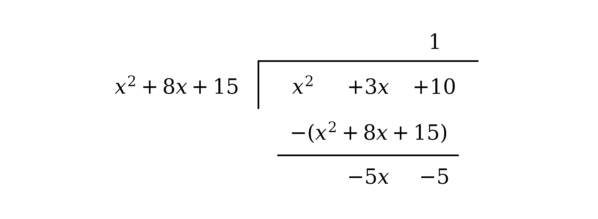
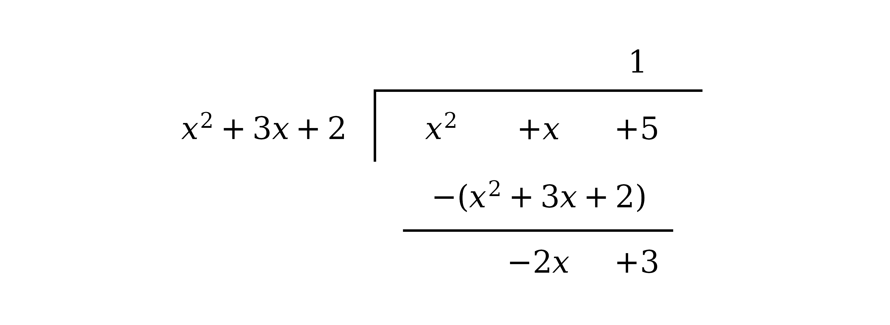
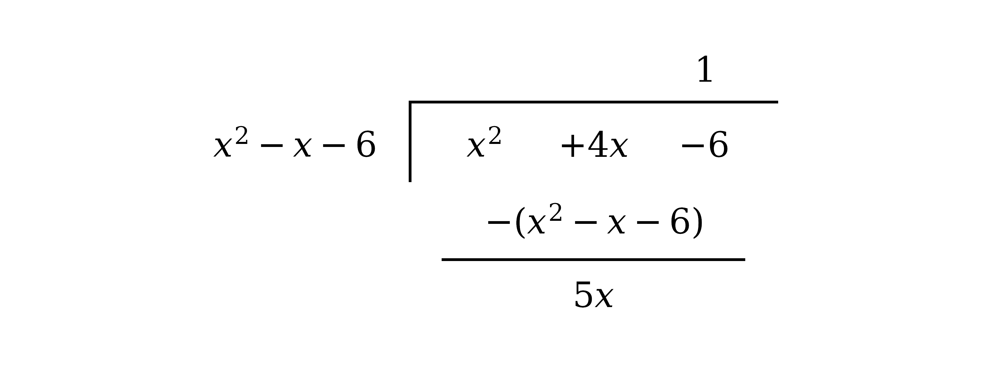
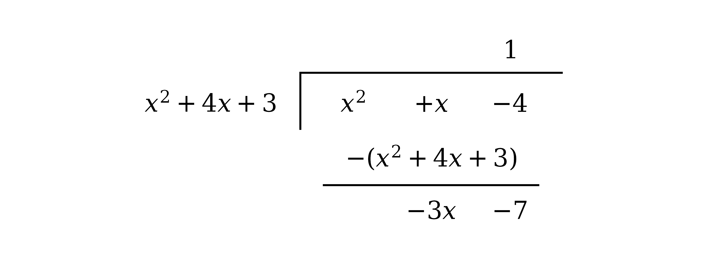

# Mark Schemes — Partial Fractions
**Algebra & Functions** · Cambridge (CIE) A-LEVEL maths (9709)

## Exam Questions (38 questions)

### Q1
The denominator must be factorised first, so test the factors of the constant term $15$ using the factor theorem

$( 1 )^{3} - 3 ( 1 )^{2} - 13 ( 1 ) + 15 = 1 - 3 - 13 + 15 = 0$

**[M1]**

Since this is zero, $( x - 1 )$ is a factor, so write the cubic as that factor multiplied by an unknown quadratic

$x^{3} - 3 x^{2} - 13 x + 15 = ( x - 1 ) ( x^{2} + b x + c )$

Compare the constant terms

$- c = 15 \Rightarrow c = - 15$

Compare the coefficients of $x^{2}$

$b - 1 = - 3 \Rightarrow b = - 2$

Substitute these values into the quadratic factor

$x^{3} - 3 x^{2} - 13 x + 15 = ( x - 1 ) ( x^{2} - 2 x - 15 )$

Factorise the quadratic to reach three distinct linear factors

$x^{3} - 3 x^{2} - 13 x + 15 = ( x - 1 ) ( x - 5 ) ( x + 3 )$

Each distinct linear factor contributes a constant numerator

$\frac{2x-5}{(x-1)(x-5)(x+3)} \equiv \frac{A}{x-1} + \frac{B}{x-5} + \frac{C}{x+3}$

**[B1]**

Multiply through by $( x - 1 ) ( x - 5 ) ( x + 3 )$ to clear the fractions

$2 x - 5 = A ( x - 5 ) ( x + 3 ) + B ( x - 1 ) ( x + 3 ) + C ( x - 1 ) ( x - 5 )$

**[M1]**

To find $A$, substitute $x = 1$, which makes the $B$ and $C$ terms vanish

$- 3 = - 16 A \Rightarrow A = \frac{3}{16}$

**[A1]**

To find $B$, substitute $x = 5$

$5 = 32 B \Rightarrow B = \frac{5}{32}$

**[A1]**

To find $C$, substitute $x = - 3$

$- 11 = 32 C \Rightarrow C = - \frac{11}{32}$

**[A1]**

Write the decomposition, folding each constant into the denominator

$\text{f} ( x ) = \frac{3}{16(x-1)} + \frac{5}{32(x-5)} - \frac{11}{32(x+3)}$

> **[mark-scheme]**
> **M1**: Using the factor theorem to find a root of the denominator, with the substitution visible. Any of the factors of $15$ may be tested, and unsuccessful trials do not lose the mark.
> 
> **B1**: A correct form for the decomposition, $\frac{A}{x-1} + \frac{B}{x-5} + \frac{C}{x+3}$, which requires the denominator to have been fully factorised. Inspection, comparing coefficients and long division are all acceptable routes to the quadratic factor.
> 
> **M1**: Multiplying through by the denominator to reach $2 x - 5 = A ( x - 5 ) ( x + 3 ) + B ( x - 1 ) ( x + 3 ) + C ( x - 1 ) ( x - 5 )$, then using any valid method to find a constant. Substituting values of $x$, equating coefficients and the cover-up rule all score.
> 
> **A1**: One correct constant.
> 
> **A1**: A second correct constant.
> 
> **A1**: The third correct constant, giving $A = \frac{3}{16}$, $B = \frac{5}{32}$ and $C = - \frac{11}{32}$. The three marks are awarded in any order, the constants need not be integers, and any equivalent presentation of the final answer is accepted.

### Q2
The denominator has a plain linear factor and a repeated one, and a repeated factor contributes a term for each power up to the square

$\frac{x^{2}-3}{(x-3)(x+2)^{2}} \equiv \frac{A}{x-3} + \frac{B}{x+2} + \frac{C}{(x+2)^{2}}$

**[B1]**

Multiply through by $( x - 3 ) ( x + 2 )^{2}$ to clear the fractions

$x^{2} - 3 = A ( x + 2 )^{2} + B ( x - 3 ) ( x + 2 ) + C ( x - 3 )$

**[M1]**

To find $A$, substitute $x = 3$, which makes both the $B$ and $C$ terms vanish

$6 = 25 A \Rightarrow A = \frac{6}{25}$

**[A1]**

To find $C$, substitute $x = - 2$, which makes both the $A$ and $B$ terms vanish

$1 = - 5 C \Rightarrow C = - \frac{1}{5}$

**[A1]**

No substitution isolates $B$, so use a third value, $x = 0$

$- 3 = \frac{24}{25} - 6 B + \frac{3}{5} \Rightarrow B = \frac{19}{25}$

**[A1]**

Write the decomposition, folding each constant into the denominator

$\text{f} ( x ) = \frac{6}{25(x-3)} + \frac{19}{25(x+2)} - \frac{1}{5(x+2)^{2}}$

> **[mark-scheme]**
> **B1**: A correct form for the decomposition, $\frac{A}{x-3} + \frac{B}{x+2} + \frac{C}{(x+2)^{2}}$. You can state this form or imply it through your working. Writing the last two terms as the single fraction $\frac{Dx+E}{(x+2)^{2}}$ is also accepted.
> 
> **M1**: Multiplying through by $( x - 3 ) ( x + 2 )^{2}$ to reach $x^{2} - 3 = A ( x + 2 )^{2} + B ( x - 3 ) ( x + 2 ) + C ( x - 3 )$, then using any valid method to find a constant. Substituting values of $x$, equating coefficients and the cover-up rule all score.
> 
> **A1**: One correct constant.
> 
> **A1**: A second correct constant.
> 
> **A1**: The third correct constant, giving $A = \frac{6}{25}$, $B = \frac{19}{25}$ and $C = - \frac{1}{5}$. The three marks are awarded in any order, the constants need not be integers, and any equivalent presentation of the final answer is accepted.

### Q3
Every term of the denominator has a factor of $x$, so take it out first

$x^{3} - 6 x^{2} + 8 x = x ( x^{2} - 6 x + 8 )$

Factorise the quadratic to reach three distinct linear factors

$x^{3} - 6 x^{2} + 8 x = x ( x - 2 ) ( x - 4 )$

Each distinct linear factor contributes a constant numerator

$\frac{8}{x(x-2)(x-4)} \equiv \frac{A}{x} + \frac{B}{x-2} + \frac{C}{x-4}$

**[B1]**

Multiply through by $x ( x - 2 ) ( x - 4 )$ to clear the fractions

$8 = A ( x - 2 ) ( x - 4 ) + B x ( x - 4 ) + C x ( x - 2 )$

**[M1]**

To find $A$, substitute $x = 0$, which makes the $B$ and $C$ terms vanish

$8 = 8 A \Rightarrow A = 1$

**[A1]**

To find $B$, substitute $x = 2$

$8 = - 4 B \Rightarrow B = - 2$

**[A1]**

To find $C$, substitute $x = 4$

$8 = 8 C \Rightarrow C = 1$

**[A1]**

Write the decomposition using these values

$\text{f} ( x ) = \frac{1}{x} - \frac{2}{x-2} + \frac{1}{x-4}$

> **[mark-scheme]**
> **B1**: A correct form for the decomposition, $\frac{A}{x} + \frac{B}{x-2} + \frac{C}{x-4}$, which requires the denominator to have been fully factorised, starting with the common factor of $x$. You can state this form or imply it through your working.
> 
> **M1**: Multiplying through by the denominator to reach $8 = A ( x - 2 ) ( x - 4 ) + B x ( x - 4 ) + C x ( x - 2 )$, then using any valid method to find a constant. Substituting values of $x$, equating coefficients and the cover-up rule all score.
> 
> **A1**: One correct constant.
> 
> **A1**: A second correct constant.
> 
> **A1**: The third correct constant, giving $A = 1$, $B = - 2$ and $C = 1$. The three marks are awarded in any order, and you do not have to write out the combined decomposition once all three are found.

### Q4
The numerator and denominator both have degree $2$, so a constant must be extracted before any splitting; divide $x^{2} + 3 x + 10$ by $x^{2} + 8 x + 15$ using algebraic long division

**[M1]**

The quotient sits above the bracket and the last line of the tableau is the remainder

$\text{f} ( x ) = 1 + \frac{-5x-5}{x^{2}+8x+15}$

Factorise the denominator, so the decomposition needs a constant plus one term for each linear factor

$\text{f} ( x ) \equiv 1 + \frac{-5x-5}{(x+3)(x+5)} \equiv 1 + \frac{A}{x+3} + \frac{B}{x+5}$

**[B1]**

Multiply the fractional part through by $( x + 3 ) ( x + 5 )$ to clear the fractions

$- 5 x - 5 = A ( x + 5 ) + B ( x + 3 )$

**[M1]**

To find $A$, substitute $x = - 3$, which makes the $B$ term vanish

$10 = 2 A \Rightarrow A = 5$

**[A1]**

To find $B$, substitute $x = - 5$, which makes the $A$ term vanish

$20 = - 2 B \Rightarrow B = - 10$

**[A1]**

Write the decomposition using these values

$\text{f} ( x ) = 1 + \frac{5}{x+3} - \frac{10}{x+5}$

> **[mark-scheme]**
> **M1**: Setting out a valid division of $x^{2} + 3 x + 10$ by $x^{2} + 8 x + 15$. Spotting directly that the numerator can be written as $( x^{2} + 8 x + 15 ) - 5 x - 5$ is an equally valid route and scores the same.
> 
> **B1**: A correct form for the decomposition, with a constant term as well as the two fractions: $1 + \frac{A}{x+3} + \frac{B}{x+5}$. Omitting the constant term is the main way to lose this mark, since the fraction is improper and cannot be written as two proper fractions alone.
> 
> **M1**: Multiplying the fractional part through by $( x + 3 ) ( x + 5 )$ and using any valid method to find a constant. Substituting values of $x$, equating coefficients and the cover-up rule all score.
> 
> **A1**: Correct value $A = 5$.
> 
> **A1**: Correct value $B = - 10$. Taking a factor of $- 5$ out of the remainder first and adjusting the signs at the end reaches the same answer and is equally acceptable.

### Q5
Every term of the denominator has a factor of $x$, so take it out first

$x^{3} - x^{2} - 2 x = x ( x^{2} - x - 2 )$

**[M1]**

Factorise the quadratic to reach three distinct linear factors

$x^{3} - x^{2} - 2 x = x ( x + 1 ) ( x - 2 )$

Each distinct linear factor contributes a constant numerator

$\frac{13x^{2}-10}{x(x+1)(x-2)} \equiv \frac{A}{x} + \frac{B}{x+1} + \frac{C}{x-2}$

**[B1]**

Multiply through by $x ( x + 1 ) ( x - 2 )$ to clear the fractions

$13 x^{2} - 10 = A ( x + 1 ) ( x - 2 ) + B x ( x - 2 ) + C x ( x + 1 )$

**[M1]**

To find $A$, substitute $x = 0$, which makes the $B$ and $C$ terms vanish

$- 10 = - 2 A \Rightarrow A = 5$

**[A1]**

To find $B$, substitute $x = - 1$

$3 = 3 B \Rightarrow B = 1$

**[A1]**

To find $C$, substitute $x = 2$

$42 = 6 C \Rightarrow C = 7$

**[A1]**

Write the decomposition using these values

$\text{f} ( x ) = \frac{5}{x} + \frac{1}{x+1} + \frac{7}{x-2}$

> **[mark-scheme]**
> **M1**: Factorising the denominator, starting by taking out the common factor of $x$.
> 
> **B1**: A correct form for the decomposition, $\frac{A}{x} + \frac{B}{x+1} + \frac{C}{x-2}$. You can state this form or imply it through your working.
> 
> **M1**: Multiplying through by the denominator to reach $13 x^{2} - 10 = A ( x + 1 ) ( x - 2 ) + B x ( x - 2 ) + C x ( x + 1 )$, then using any valid method to find a constant. Substituting values of $x$, equating coefficients and the cover-up rule all score.
> 
> **A1**: One correct constant.
> 
> **A1**: A second correct constant.
> 
> **A1**: The third correct constant, giving $A = 5$, $B = 1$ and $C = 7$. The three marks are awarded in any order, and you do not have to write out the combined decomposition once all three are found.

### Q6
The denominator must be factorised first, so test the factors of the constant term $9$ using the factor theorem

$( - 1 )^{3} - 5 ( - 1 )^{2} + 3 ( - 1 ) + 9 = - 1 - 5 - 3 + 9 = 0$

**[M1]**

Since this is zero, $( x + 1 )$ is a factor, so write the cubic as that factor multiplied by an unknown quadratic

$x^{3} - 5 x^{2} + 3 x + 9 = ( x + 1 ) ( x^{2} + b x + c )$

Compare the constant terms

$c = 9$

Compare the coefficients of $x^{2}$

$b + 1 = - 5 \Rightarrow b = - 6$

Substitute these values into the quadratic factor

$x^{3} - 5 x^{2} + 3 x + 9 = ( x + 1 ) ( x^{2} - 6 x + 9 )$

The quadratic is a perfect square, so the denominator has a repeated linear factor

$x^{3} - 5 x^{2} + 3 x + 9 = ( x + 1 ) ( x - 3 )^{2}$

A repeated factor contributes a term for each power up to the square

$\frac{34-3x^{2}-x}{(x+1)(x-3)^{2}} \equiv \frac{A}{x+1} + \frac{B}{x-3} + \frac{C}{(x-3)^{2}}$

**[B1]**

Multiply through by $( x + 1 ) ( x - 3 )^{2}$ to clear the fractions

$34 - 3 x^{2} - x = A ( x - 3 )^{2} + B ( x + 1 ) ( x - 3 ) + C ( x + 1 )$

**[M1]**

To find $A$, substitute $x = - 1$, which makes both the $B$ and $C$ terms vanish

$32 = 16 A \Rightarrow A = 2$

**[A1]**

To find $C$, substitute $x = 3$, which makes both the $A$ and $B$ terms vanish

$4 = 4 C \Rightarrow C = 1$

**[A1]**

No substitution isolates $B$, so use a third value, $x = 0$

$34 = 18 - 3 B + 1 \Rightarrow B = - 5$

**[A1]**

Write the decomposition using these values

$\text{f} ( x ) = \frac{2}{x+1} - \frac{5}{x-3} + \frac{1}{(x-3)^{2}}$

> **[mark-scheme]**
> **M1**: Using the factor theorem to find a root of the denominator, with the substitution visible. Any of the factors of $9$ may be tested, and unsuccessful trials do not lose the mark.
> 
> **B1**: A correct form for the decomposition, $\frac{A}{x+1} + \frac{B}{x-3} + \frac{C}{(x-3)^{2}}$, which requires the denominator to have been fully factorised, including recognising $x^{2} - 6 x + 9$ as $( x - 3 )^{2}$. Writing the last two terms as the single fraction $\frac{Dx+E}{(x-3)^{2}}$ is also accepted.
> 
> **M1**: Multiplying through by $( x + 1 ) ( x - 3 )^{2}$ to reach $34 - 3 x^{2} - x = A ( x - 3 )^{2} + B ( x + 1 ) ( x - 3 ) + C ( x + 1 )$, then using any valid method to find a constant. Substituting values of $x$, equating coefficients and the cover-up rule all score.
> 
> **A1**: One correct constant.
> 
> **A1**: A second correct constant.
> 
> **A1**: The third correct constant, giving $A = 2$, $B = - 5$ and $C = 1$. The three marks are awarded in any order, and you do not have to write out the combined decomposition once all three are found.

### Q7
Both terms of the denominator share a factor of $x^{2}$, so take it out

$3 x^{3} - x^{2} = x^{2} ( 3 x - 1 )$

The factor $x^{2}$ is a repeated linear factor, so it contributes a term for each power up to the square

$\frac{16x^{2}-7x+1}{x^{2}(3x-1)} \equiv \frac{A}{3x-1} + \frac{B}{x} + \frac{C}{x^{2}}$

**[B1]**

Multiply through by $x^{2} ( 3 x - 1 )$ to clear the fractions

$16 x^{2} - 7 x + 1 = A x^{2} + B x ( 3 x - 1 ) + C ( 3 x - 1 )$

**[M1]**

To find $C$, substitute $x = 0$, which makes both the $A$ and $B$ terms vanish

$1 = - C \Rightarrow C = - 1$

**[A1]**

To find $A$, substitute $x = \frac{1}{3}$, which makes both the $B$ and $C$ terms vanish

$\frac{4}{9} = \frac{1}{9} A \Rightarrow A = 4$

**[A1]**

No substitution isolates $B$, so use a third value, $x = 1$

$10 = 4 + 2 B - 2 \Rightarrow B = 4$

**[A1]**

Write the decomposition using these values

$\text{f} ( x ) = \frac{4}{3x-1} + \frac{4}{x} - \frac{1}{x^{2}}$

> **[mark-scheme]**
> **B1**: A correct form for the decomposition, $\frac{A}{3x-1} + \frac{B}{x} + \frac{C}{x^{2}}$. The $x^{2}$ in the denominator is a repeated factor and needs both an $\frac{B}{x}$ and a $\frac{C}{x^{2}}$ term; using only $\frac{B}{x^{2}}$ does not score. You can state this form or imply it through your working.
> 
> **M1**: Multiplying through by $x^{2} ( 3 x - 1 )$ to reach $16 x^{2} - 7 x + 1 = A x^{2} + B x ( 3 x - 1 ) + C ( 3 x - 1 )$, then using any valid method to find a constant. Substituting values of $x$, equating coefficients and the cover-up rule all score.
> 
> **A1**: One correct constant.
> 
> **A1**: A second correct constant.
> 
> **A1**: The third correct constant, giving $A = 4$, $B = 4$ and $C = - 1$. The three marks are awarded in any order, and you do not have to write out the combined decomposition once all three are found.

### Q8
The denominator must be factorised before it can be split, so look for two numbers that multiply to $- 52$ and add to $- 9$

$x^{2} - 9 x - 52 = ( x + 4 ) ( x - 13 )$

There are two distinct linear factors, so each one contributes a constant numerator

$\frac{2x}{(x+4)(x-13)} \equiv \frac{A}{x+4} + \frac{B}{x-13}$

**[B1]**

Multiply through by $( x + 4 ) ( x - 13 )$ to clear the fractions

$2 x = A ( x - 13 ) + B ( x + 4 )$

**[M1]**

To find $A$, substitute $x = - 4$, which makes the $B$ term vanish

$- 8 = - 17 A \Rightarrow A = \frac{8}{17}$

**[A1]**

To find $B$, substitute $x = 13$, which makes the $A$ term vanish

$26 = 17 B \Rightarrow B = \frac{26}{17}$

**[A1]**

Write the decomposition, folding each $17$ into the denominator

$\text{f} ( x ) = \frac{8}{17(x+4)} + \frac{26}{17(x-13)}$

> **[mark-scheme]**
> **B1**: A correct form for the decomposition, $\frac{A}{x+4} + \frac{B}{x-13}$, which requires the denominator to have been factorised correctly. You can state this form or imply it through your working.
> 
> **M1**: Multiplying through by the denominator to reach $2 x = A ( x - 13 ) + B ( x + 4 )$, then using any valid method to find a constant. Substituting values of $x$, equating coefficients and the cover-up rule all score.
> 
> **A1**: Correct value $A = \frac{8}{17}$.
> 
> **A1**: Correct value $B = \frac{26}{17}$. The constants do not have to be integers and the fractions need not be simplified further, so $\frac{8/17}{x+4} + \frac{26/17}{x-13}$ is equally acceptable.

### Q9
The denominator must be factorised first, so test the factors of the constant term $- 18$ using the factor theorem

$( 2 )^{3} + 4 ( 2 )^{2} - 3 ( 2 ) - 18 = 8 + 16 - 6 - 18 = 0$

**[M1]**

Since this is zero, $( x - 2 )$ is a factor, so write the cubic as that factor multiplied by an unknown quadratic

$x^{3} + 4 x^{2} - 3 x - 18 = ( x - 2 ) ( x^{2} + b x + c )$

Compare the constant terms

$- 2 c = - 18 \Rightarrow c = 9$

Compare the coefficients of $x^{2}$

$b - 2 = 4 \Rightarrow b = 6$

Substitute these values into the quadratic factor

$x^{3} + 4 x^{2} - 3 x - 18 = ( x - 2 ) ( x^{2} + 6 x + 9 )$

The quadratic is a perfect square, so the denominator has a repeated linear factor

$x^{3} + 4 x^{2} - 3 x - 18 = ( x - 2 ) ( x + 3 )^{2}$

A repeated factor contributes a term for each power up to the square

$\frac{2x^{2}-3}{(x-2)(x+3)^{2}} \equiv \frac{A}{x-2} + \frac{B}{x+3} + \frac{C}{(x+3)^{2}}$

**[B1]**

Multiply through by $( x - 2 ) ( x + 3 )^{2}$ to clear the fractions

$2 x^{2} - 3 = A ( x + 3 )^{2} + B ( x - 2 ) ( x + 3 ) + C ( x - 2 )$

**[M1]**

To find $A$, substitute $x = 2$, which makes both the $B$ and $C$ terms vanish

$5 = 25 A \Rightarrow A = \frac{1}{5}$

**[A1]**

To find $C$, substitute $x = - 3$, which makes both the $A$ and $B$ terms vanish

$15 = - 5 C \Rightarrow C = - 3$

**[A1]**

No substitution isolates $B$, so use a third value, $x = 0$

$- 3 = \frac{9}{5} - 6 B + 6 \Rightarrow B = \frac{9}{5}$

**[A1]**

Write the decomposition, folding each $5$ into the denominator

$\text{f} ( x ) = \frac{1}{5(x-2)} + \frac{9}{5(x+3)} - \frac{3}{(x+3)^{2}}$

> **[mark-scheme]**
> **M1**: Using the factor theorem to find a root of the denominator, with the substitution visible. Any of the factors of $- 18$ may be tested, and unsuccessful trials do not lose the mark.
> 
> **B1**: A correct form for the decomposition, $\frac{A}{x-2} + \frac{B}{x+3} + \frac{C}{(x+3)^{2}}$, which requires the denominator to have been fully factorised, including recognising $x^{2} + 6 x + 9$ as $( x + 3 )^{2}$. Long division, inspection and comparing coefficients are all acceptable routes to the quadratic factor. Writing the last two terms as the single fraction $\frac{Dx+E}{(x+3)^{2}}$ is also accepted.
> 
> **M1**: Multiplying through by $( x - 2 ) ( x + 3 )^{2}$ to reach $2 x^{2} - 3 = A ( x + 3 )^{2} + B ( x - 2 ) ( x + 3 ) + C ( x - 2 )$, then using any valid method to find a constant. Substituting values of $x$, equating coefficients and the cover-up rule all score.
> 
> **A1**: One correct constant.
> 
> **A1**: A second correct constant.
> 
> **A1**: The third correct constant, giving $A = \frac{1}{5}$, $B = \frac{9}{5}$ and $C = - 3$. The three marks are awarded in any order, the constants need not be integers, and any equivalent presentation of the final answer is accepted.

### Q10
Every term of the denominator has a factor of $x$, so take it out first

$x^{3} - 2 x^{2} - 8 x = x ( x^{2} - 2 x - 8 )$

Factorise the quadratic to reach three distinct linear factors

$x^{3} - 2 x^{2} - 8 x = x ( x - 4 ) ( x + 2 )$

Each distinct linear factor contributes a constant numerator

$\frac{2x^{2}+16x-24}{x(x-4)(x+2)} \equiv \frac{A}{x} + \frac{B}{x-4} + \frac{C}{x+2}$

**[B1]**

Multiply through by $x ( x - 4 ) ( x + 2 )$ to clear the fractions

$2 x^{2} + 16 x - 24 = A ( x - 4 ) ( x + 2 ) + B x ( x + 2 ) + C x ( x - 4 )$

**[M1]**

To find $A$, substitute $x = 0$, which makes the $B$ and $C$ terms vanish

$- 24 = - 8 A \Rightarrow A = 3$

**[A1]**

To find $B$, substitute $x = 4$

$72 = 24 B \Rightarrow B = 3$

**[A1]**

To find $C$, substitute $x = - 2$

$- 48 = 12 C \Rightarrow C = - 4$

**[A1]**

Write the decomposition using these values

$\text{f} ( x ) = \frac{3}{x} + \frac{3}{x-4} - \frac{4}{x+2}$

> **[mark-scheme]**
> **B1**: A correct form for the decomposition, $\frac{A}{x} + \frac{B}{x-4} + \frac{C}{x+2}$, which requires the denominator to have been fully factorised, starting with the common factor of $x$. You can state this form or imply it through your working.
> 
> **M1**: Multiplying through by the denominator to reach $2 x^{2} + 16 x - 24 = A ( x - 4 ) ( x + 2 ) + B x ( x + 2 ) + C x ( x - 4 )$, then using any valid method to find a constant. Substituting values of $x$, equating coefficients and the cover-up rule all score.
> 
> **A1**: One correct constant.
> 
> **A1**: A second correct constant.
> 
> **A1**: The third correct constant, giving $A = 3$, $B = 3$ and $C = - 4$. The three marks are awarded in any order, and you do not have to write out the combined decomposition once all three are found.

### Q11
The denominator must be factorised before it can be split, so look for two numbers that multiply to $- 5$ and add to $4$

$x^{2} + 4 x - 5 = ( x - 1 ) ( x + 5 )$

There are two distinct linear factors, so each one contributes a constant numerator

$\frac{12}{(x-1)(x+5)} \equiv \frac{A}{x-1} + \frac{B}{x+5}$

**[B1]**

Multiply through by $( x - 1 ) ( x + 5 )$ to clear the fractions

$12 = A ( x + 5 ) + B ( x - 1 )$

**[M1]**

To find $A$, substitute $x = 1$, which makes the $B$ term vanish

$12 = 6 A \Rightarrow A = 2$

**[A1]**

To find $B$, substitute $x = - 5$, which makes the $A$ term vanish

$12 = - 6 B \Rightarrow B = - 2$

**[A1]**

Write the decomposition using these values

$\text{f} ( x ) = \frac{2}{x-1} - \frac{2}{x+5}$

> **[mark-scheme]**
> **B1**: A correct form for the decomposition, $\frac{A}{x-1} + \frac{B}{x+5}$, which requires the denominator to have been factorised correctly. You can state this form or imply it through your working.
> 
> **M1**: Multiplying through by the denominator to reach $12 = A ( x + 5 ) + B ( x - 1 )$, then using any valid method to find a constant. Substituting values of $x$, equating coefficients and the cover-up rule all score.
> 
> **A1**: Correct value $A = 2$.
> 
> **A1**: Correct value $B = - 2$. You do not have to write out the combined decomposition once both constants are found.

### Q12
The denominator must be factorised first, so test the factors of the constant term $16$ using the factor theorem

$( - 1 )^{3} - 7 ( - 1 )^{2} + 8 ( - 1 ) + 16 = - 1 - 7 - 8 + 16 = 0$

**[M1]**

Since this is zero, $( x + 1 )$ is a factor, so write the cubic as that factor multiplied by an unknown quadratic

$x^{3} - 7 x^{2} + 8 x + 16 = ( x + 1 ) ( x^{2} + b x + c )$

Compare the constant terms

$c = 16$

Compare the coefficients of $x^{2}$

$b + 1 = - 7 \Rightarrow b = - 8$

Substitute these values into the quadratic factor

$x^{3} - 7 x^{2} + 8 x + 16 = ( x + 1 ) ( x^{2} - 8 x + 16 )$

The quadratic is a perfect square, so the denominator has a repeated linear factor

$x^{3} - 7 x^{2} + 8 x + 16 = ( x + 1 ) ( x - 4 )^{2}$

A repeated factor contributes a term for each power up to the square

$\frac{3x^{2}-22x+25}{(x+1)(x-4)^{2}} \equiv \frac{A}{x+1} + \frac{B}{x-4} + \frac{C}{(x-4)^{2}}$

**[B1]**

Multiply through by $( x + 1 ) ( x - 4 )^{2}$ to clear the fractions

$3 x^{2} - 22 x + 25 = A ( x - 4 )^{2} + B ( x + 1 ) ( x - 4 ) + C ( x + 1 )$

**[M1]**

To find $A$, substitute $x = - 1$, which makes both the $B$ and $C$ terms vanish

$50 = 25 A \Rightarrow A = 2$

**[A1]**

To find $C$, substitute $x = 4$, which makes both the $A$ and $B$ terms vanish

$- 15 = 5 C \Rightarrow C = - 3$

**[A1]**

No substitution isolates $B$, so use a third value, $x = 0$

$25 = 32 - 4 B - 3 \Rightarrow B = 1$

**[A1]**

Write the decomposition using these values

$\text{f} ( x ) = \frac{2}{x+1} + \frac{1}{x-4} - \frac{3}{(x-4)^{2}}$

> **[mark-scheme]**
> **M1**: Using the factor theorem to find a root of the denominator, with the substitution visible. Any of the factors of $16$ may be tested, and unsuccessful trials do not lose the mark.
> 
> **B1**: A correct form for the decomposition, $\frac{A}{x+1} + \frac{B}{x-4} + \frac{C}{(x-4)^{2}}$, which requires the denominator to have been fully factorised, including recognising $x^{2} - 8 x + 16$ as $( x - 4 )^{2}$. Long division, inspection and comparing coefficients are all acceptable routes to the quadratic factor. Writing the last two terms as the single fraction $\frac{Dx+E}{(x-4)^{2}}$ is also accepted.
> 
> **M1**: Multiplying through by $( x + 1 ) ( x - 4 )^{2}$ to reach $3 x^{2} - 22 x + 25 = A ( x - 4 )^{2} + B ( x + 1 ) ( x - 4 ) + C ( x + 1 )$, then using any valid method to find a constant. Substituting values of $x$, equating coefficients and the cover-up rule all score.
> 
> **A1**: One correct constant.
> 
> **A1**: A second correct constant.
> 
> **A1**: The third correct constant, giving $A = 2$, $B = 1$ and $C = - 3$. The three marks are awarded in any order, and you do not have to write out the combined decomposition once all three are found.

### Q13
The denominator is a product of three distinct linear factors, so each one contributes a constant numerator

$\frac{12x-6}{(x-3)(x+2)(x-1)} \equiv \frac{A}{x-3} + \frac{B}{x+2} + \frac{C}{x-1}$

**[B1]**

Multiply through by $( x - 3 ) ( x + 2 ) ( x - 1 )$ to clear the fractions

$12 x - 6 = A ( x + 2 ) ( x - 1 ) + B ( x - 3 ) ( x - 1 ) + C ( x - 3 ) ( x + 2 )$

**[M1]**

To find $A$, substitute $x = 3$, which makes the $B$ and $C$ terms vanish

$30 = 10 A \Rightarrow A = 3$

**[A1]**

To find $B$, substitute $x = - 2$

$- 30 = 15 B \Rightarrow B = - 2$

**[A1]**

To find $C$, substitute $x = 1$

$6 = - 6 C \Rightarrow C = - 1$

**[A1]**

Write the decomposition using these values

$\text{f} ( x ) = \frac{3}{x-3} - \frac{2}{x+2} - \frac{1}{x-1}$

> **[mark-scheme]**
> **B1**: A correct form for the decomposition, $\frac{A}{x-3} + \frac{B}{x+2} + \frac{C}{x-1}$. You can state this form or imply it through your working.
> 
> **M1**: Multiplying through by the denominator to reach $12 x - 6 = A ( x + 2 ) ( x - 1 ) + B ( x - 3 ) ( x - 1 ) + C ( x - 3 ) ( x + 2 )$, then using any valid method to find a constant. Substituting values of $x$, equating coefficients and the cover-up rule all score.
> 
> **A1**: One correct constant.
> 
> **A1**: A second correct constant.
> 
> **A1**: The third correct constant, giving $A = 3$, $B = - 2$ and $C = - 1$. The three marks are awarded in any order, and you do not have to write out the combined decomposition once all three are found.

### Q14
A root at $x = \frac{1}{4}$ means `\left(x - \frac{1}{4}\right)` is a factor, and clearing the fraction gives the factor $( 4 x - 1 )$, so write the cubic as that factor multiplied by an unknown quadratic

$8 x^{3} - 2 x^{2} - 4 x + 1 = ( 4 x - 1 ) ( 2 x^{2} + b x + c )$

**[M1]**

Compare the constant terms

$- c = 1 \Rightarrow c = - 1$

Compare the coefficients of $x^{2}$

$4 b - 2 = - 2 \Rightarrow b = 0$

Substitute these values into the quadratic factor

$8 x^{3} - 2 x^{2} - 4 x + 1 = ( 4 x - 1 ) ( 2 x^{2} - 1 )$

**[A1]**

The quadratic $2 x^{2} - 1$ has no rational factors, so the factorisation is complete

$\text{f} ( x ) = ( 4 x - 1 ) ( 2 x^{2} - 1 )$

**[A1]**

> **[mark-scheme]**
> **M1**: Using the given root to identify $( 4 x - 1 )$ as a factor and setting up the product with an unknown quadratic. Grouping the terms as $2 x^{2} ( 4 x - 1 ) - ( 4 x - 1 )$, or dividing by $( 4 x - 1 )$, are equally acceptable.
> 
> **A1**: Correct quadratic factor $2 x^{2} - 1$.
> 
> **A1**: The fully factorised form $( 4 x - 1 ) ( 2 x^{2} - 1 )$. Writing the first factor as `4\left(x - \frac{1}{4}\right)` scores only if the overall product is still correct.
Use the factorisation from part (a). The factor $2 x^{2} - 1$ cannot be factorised any further, so its numerator must be the most general expression of lower degree, which is linear

$\frac{5x^{2}-2x-2}{(4x-1)(2x^{2}-1)} \equiv \frac{A}{4x-1} + \frac{Bx+C}{2x^{2}-1}$

**[B1]**

Multiply through by $( 4 x - 1 ) ( 2 x^{2} - 1 )$ to clear the fractions

$5 x^{2} - 2 x - 2 = A ( 2 x^{2} - 1 ) + ( B x + C ) ( 4 x - 1 )$

**[M1]**

To find $A$, substitute $x = \frac{1}{4}$, which makes the second term vanish

$- \frac{35}{16} = - \frac{7}{8} A \Rightarrow A = \frac{5}{2}$

**[A1]**

No substitution isolates $B$ or $C$, so use a second value, $x = 0$

$- 2 = - \frac{5}{2} - C \Rightarrow C = - \frac{1}{2}$

**[A1]**

Use a third value, $x = 1$

$1 = \frac{5}{2} + 3 B - \frac{3}{2} \Rightarrow B = 0$

**[A1]**

Since $B = 0$ the second numerator is just the constant $C$

$\frac{5x^{2}-2x-2}{\text{f}(x)} = \frac{5}{2(4x-1)} - \frac{1}{2(2x^{2}-1)}$

> **[exam-tip]**
> "Irreducible" here means no factors with rational coefficients. You could split $2 x^{2} - 1$ into `\left(\sqrt{2}x - 1\right)\left(\sqrt{2}x + 1\right)` and decompose further, but the result is messier than what you started with and the surds are not wanted. Treat a quadratic as irreducible whenever it will not factorise, and give it a linear numerator.

> **[mark-scheme]**
> **B1**: A correct form for the decomposition, $\frac{A}{4x-1} + \frac{Bx+C}{2x^{2}-1}$, using your factorisation from part (a). The linear numerator over the quadratic factor is essential; a constant there does not score.
> 
> **M1**: Multiplying through by $( 4 x - 1 ) ( 2 x^{2} - 1 )$ to reach $5 x^{2} - 2 x - 2 = A ( 2 x^{2} - 1 ) + ( B x + C ) ( 4 x - 1 )$, then using any valid method to find a constant. Substituting values of $x$ and equating coefficients both score.
> 
> **A1**: One correct constant.
> 
> **A1**: A second correct constant.
> 
> **A1**: The third correct constant, giving $A = \frac{5}{2}$, $B = 0$ and $C = - \frac{1}{2}$. The three marks are awarded in any order, and a value of $B = 0$ is a perfectly good answer. Any equivalent presentation of the final answer is accepted.

### Q15
Divide $x^{2} + x + 5$ by $x^{2} + 3 x + 2$ using algebraic long division

**[M1]**

The quotient sits above the bracket and the last line of the tableau is the remainder

$\text{f} ( x ) = 1 + \frac{-2x+3}{x^{2}+3x+2}$

Factorise the denominator and take the minus sign outside the fraction

$\text{f} ( x ) = 1 - \frac{2x-3}{(x+1)(x+2)}$

**[A1]**

> **[mark-scheme]**
> **M1**: Setting out a valid division of $x^{2} + x + 5$ by $x^{2} + 3 x + 2$. Spotting directly that the numerator can be written as $( x^{2} + 3 x + 2 ) - 2 x + 3$ is an equally valid route and scores the same.
> 
> **A1**: Reaching the printed result, with the quotient $1$, the remainder handled correctly and the minus sign taken outside so the fraction reads $- \frac{2x-3}{(x+1)(x+2)}$. Because the answer is given, your working must be complete.
The denominator is a product of two distinct linear factors, so each one contributes a constant numerator

$\frac{2x-3}{(x+1)(x+2)} \equiv \frac{B}{x+1} + \frac{C}{x+2}$

**[B1]**

Multiply through by $( x + 1 ) ( x + 2 )$ to clear the fractions

$2 x - 3 = B ( x + 2 ) + C ( x + 1 )$

**[M1]**

To find $B$, substitute $x = - 1$, which makes the $C$ term vanish

$- 5 = B \Rightarrow B = - 5$

**[A1]**

To find $C$, substitute $x = - 2$, which makes the $B$ term vanish

$- 7 = - C \Rightarrow C = 7$

**[A1]**

Write the decomposition using these values

$\frac{2x-3}{(x+1)(x+2)} = - \frac{5}{x+1} + \frac{7}{x+2}$

> **[mark-scheme]**
> **B1**: A correct form for the decomposition, $\frac{B}{x+1} + \frac{C}{x+2}$. You can state this form or imply it through your working. Any letters may be used for the constants.
> 
> **M1**: Multiplying through by $( x + 1 ) ( x + 2 )$ to reach $2 x - 3 = B ( x + 2 ) + C ( x + 1 )$, then using any valid method to find a constant. Substituting values of $x$, equating coefficients and the cover-up rule all score.
> 
> **A1**: Correct value $B = - 5$.
> 
> **A1**: Correct value $C = 7$. Writing the answer as $\frac{-5}{x+1} + \frac{7}{x+2}$ is equally acceptable.
Part (a) writes $\text{f} ( x )$ as $1$ minus a single fraction, so replace that fraction with the decomposition from part (b), keeping it inside a bracket

`\text{f}(x) = 1 - \left(-\frac{5}{x+1} + \frac{7}{x+2}\right)`

**[M1]**

Expand the bracket, remembering that the minus sign reverses the sign of both terms inside it

$\text{f} ( x ) = 1 + \frac{5}{x+1} - \frac{7}{x+2}$

**[A1]**

> **[mark-scheme]**
> **M1**: Substituting your part (b) decomposition into your part (a) result, with the two fractions kept inside a bracket or otherwise shown to be subtracted together.
> 
> **A1**: The correct final answer $1 + \frac{5}{x+1} - \frac{7}{x+2}$, with both signs reversed from part (b). Decomposing $\text{f} ( x )$ from scratch is also accepted.

### Q16
(i)

Substitute $x = - 3$ into $\text{f} ( x )$

$\text{f} ( - 3 ) = ( - 3 )^{3} + 3 ( - 3 )^{2} - 4 ( - 3 ) - 12$

**[M1]**

Evaluate the four terms

$\text{f} ( - 3 ) = - 27 + 27 + 12 - 12 = 0$

**[A1]**

(ii)

The factor theorem says that if $\text{f} ( a ) = 0$ then $( x - a )$ is a factor, and here $a = - 3$

**Final answer:** $( x + 3 )$** is a factor of **$\text{f} ( x )$

**[B1]**

> **[mark-scheme]**
> **M1**: Substituting $x = - 3$ into $\text{f} ( x )$, with the substitution visible. Take care with $( - 3 )^{3} = - 27$ and $( - 3 )^{2} = + 9$.
> 
> **A1**: Correctly evaluating to $0$. Because the result is given, you must show the arithmetic, not simply assert that it is zero.
> 
> **B1**: The factor $( x + 3 )$. Note the sign: a root at $x = - 3$ gives the factor $( x + 3 )$, not $( x - 3 )$.
Part (a) gives one factor, so write the cubic as that factor multiplied by an unknown quadratic

$x^{3} + 3 x^{2} - 4 x - 12 = ( x + 3 ) ( x^{2} + b x + c )$

**[M1]**

Compare the constant terms

$3 c = - 12 \Rightarrow c = - 4$

Compare the coefficients of $x^{2}$

$b + 3 = 3 \Rightarrow b = 0$

Substitute these values into the quadratic factor

$x^{3} + 3 x^{2} - 4 x - 12 = ( x + 3 ) ( x^{2} - 4 )$

**[A1]**

The quadratic is a difference of two squares

$\text{f} ( x ) = ( x + 3 ) ( x + 2 ) ( x - 2 )$

**[A1]**

> **[mark-scheme]**
> **M1**: A valid route to the quadratic factor. Writing $( x + 3 ) ( x^{2} + b x + c )$ and comparing coefficients, or dividing by $( x + 3 )$ by long division, both score.
> 
> **A1**: Correct quadratic factor $x^{2} - 4$.
> 
> **A1**: The fully factorised form $( x + 3 ) ( x + 2 ) ( x - 2 )$. The factors may be written in any order, but stopping at $( x + 3 ) ( x^{2} - 4 )$ is not fully factorised and does not earn this mark.
Use the factorisation from part (b), which has three distinct linear factors, so each one contributes a constant numerator

$\frac{3x^{2}-8x-36}{(x+3)(x+2)(x-2)} \equiv \frac{A}{x+3} + \frac{B}{x+2} + \frac{C}{x-2}$

**[B1]**

Multiply through by $( x + 3 ) ( x + 2 ) ( x - 2 )$ to clear the fractions

$3 x^{2} - 8 x - 36 = A ( x + 2 ) ( x - 2 ) + B ( x + 3 ) ( x - 2 ) + C ( x + 3 ) ( x + 2 )$

**[M1]**

To find $A$, substitute $x = - 3$, which makes the $B$ and $C$ terms vanish

$15 = 5 A \Rightarrow A = 3$

**[A1]**

To find $B$, substitute $x = - 2$

$- 8 = - 4 B \Rightarrow B = 2$

**[A1]**

To find $C$, substitute $x = 2$

$- 40 = 20 C \Rightarrow C = - 2$

**[A1]**

Write the decomposition using these values

$\frac{3x^{2}-8x-36}{x^{3}+3x^{2}-4x-12} = \frac{3}{x+3} + \frac{2}{x+2} - \frac{2}{x-2}$

> **[mark-scheme]**
> **B1**: A correct form for the decomposition, $\frac{A}{x+3} + \frac{B}{x+2} + \frac{C}{x-2}$, using your factorisation from part (b). You can state this form or imply it through your working.
> 
> **M1**: Multiplying through by the denominator to reach $3 x^{2} - 8 x - 36 = A ( x + 2 ) ( x - 2 ) + B ( x + 3 ) ( x - 2 ) + C ( x + 3 ) ( x + 2 )$, then using any valid method to find a constant. Substituting values of $x$, equating coefficients and the cover-up rule all score.
> 
> **A1**: One correct constant.
> 
> **A1**: A second correct constant.
> 
> **A1**: The third correct constant, giving $A = 3$, $B = 2$ and $C = - 2$. The three marks are awarded in any order, and you do not have to write out the combined decomposition once all three are found.

### Q17
The factor theorem says $( x - 2 )$ is a factor exactly when $\text{f} ( 2 ) = 0$, so substitute $x = 2$

$\text{f} ( 2 ) = ( 2 )^{3} + 4 ( 2 )^{2} - 3 ( 2 ) - 18$

**[M1]**

Evaluate the four terms and state the conclusion the factor theorem allows

**Final answer:** $\text{f} ( 2 ) = 8 + 16 - 6 - 18 = 0$**, so **$( x - 2 )$** is a factor**

**[A1]**

> **[mark-scheme]**
> **M1**: Substituting $x = 2$ into $x^{3} + 4 x^{2} - 3 x - 18$, with the substitution visible.
> 
> **A1**: Correctly obtaining $0$ and then stating that $( x - 2 )$ is therefore a factor. The conclusion is needed, because the question asks you to use the factor theorem, not just to evaluate.
Part (a) gives one factor, so write the cubic as that factor multiplied by an unknown quadratic

$x^{3} + 4 x^{2} - 3 x - 18 = ( x - 2 ) ( x^{2} + b x + c )$

**[M1]**

Compare the constant terms

$- 2 c = - 18 \Rightarrow c = 9$

Compare the coefficients of $x^{2}$

$b - 2 = 4 \Rightarrow b = 6$

Substitute these values into the quadratic factor

$x^{3} + 4 x^{2} - 3 x - 18 = ( x - 2 ) ( x^{2} + 6 x + 9 )$

**[A1]**

The quadratic is a perfect square, since $x^{2} + 6 x + 9 = ( x + 3 )^{2}$

$x^{3} + 4 x^{2} - 3 x - 18 = ( x - 2 ) ( x + 3 )^{2}$

**[A1]**

> **[mark-scheme]**
> **M1**: A valid route to the quadratic factor. Writing $( x - 2 ) ( x^{2} + b x + c )$ and comparing coefficients, or dividing by $( x - 2 )$ by long division, both score.
> 
> **A1**: Correct quadratic factor $x^{2} + 6 x + 9$.
> 
> **A1**: The fully factorised form $( x - 2 ) ( x + 3 )^{2}$. Leaving it as $( x - 2 ) ( x + 3 ) ( x + 3 )$ is equally acceptable, but stopping at $( x - 2 ) ( x^{2} + 6 x + 9 )$ is not fully factorised and does not earn this mark.
Use the factorisation from part (b), which has a plain linear factor and a repeated one, and a repeated factor contributes a term for each power up to the square

$\frac{7x^{2}+32x+8}{(x-2)(x+3)^{2}} \equiv \frac{A}{x-2} + \frac{B}{x+3} + \frac{C}{(x+3)^{2}}$

**[B1]**

Multiply through by $( x - 2 ) ( x + 3 )^{2}$ to clear the fractions

$7 x^{2} + 32 x + 8 = A ( x + 3 )^{2} + B ( x - 2 ) ( x + 3 ) + C ( x - 2 )$

**[M1]**

To find $A$, substitute $x = 2$, which makes both the $B$ and $C$ terms vanish

$100 = 25 A \Rightarrow A = 4$

**[A1]**

To find $C$, substitute $x = - 3$, which makes both the $A$ and $B$ terms vanish

$- 25 = - 5 C \Rightarrow C = 5$

**[A1]**

No substitution isolates $B$, so use a third value, $x = 0$

$8 = 36 - 6 B - 10 \Rightarrow B = 3$

**[A1]**

Write the decomposition using these values

$\frac{7x^{2}+32x+8}{x^{3}+4x^{2}-3x-18} = \frac{4}{x-2} + \frac{3}{x+3} + \frac{5}{(x+3)^{2}}$

> **[mark-scheme]**
> **B1**: A correct form for the decomposition, $\frac{A}{x-2} + \frac{B}{x+3} + \frac{C}{(x+3)^{2}}$, using your factorisation from part (b). You can state this form or imply it through your working. Writing the last two terms as the single fraction $\frac{Dx+E}{(x+3)^{2}}$ is also accepted.
> 
> **M1**: Multiplying through by $( x - 2 ) ( x + 3 )^{2}$ to reach $7 x^{2} + 32 x + 8 = A ( x + 3 )^{2} + B ( x - 2 ) ( x + 3 ) + C ( x - 2 )$, then using any valid method to find a constant. Substituting values of $x$, equating coefficients and the cover-up rule all score.
> 
> **A1**: One correct constant.
> 
> **A1**: A second correct constant.
> 
> **A1**: The third correct constant, giving $A = 4$, $B = 3$ and $C = 5$. The three marks are awarded in any order, and you do not have to write out the combined decomposition once all three are found.

### Q18
The denominator is a product of two distinct linear factors, so each one contributes a constant numerator

$\frac{2x}{(x+1)(x-2)} \equiv \frac{A}{x+1} + \frac{B}{x-2}$

**[B1]**

Multiply through by $( x + 1 ) ( x - 2 )$ to clear the fractions

$2 x = A ( x - 2 ) + B ( x + 1 )$

**[M1]**

To find $A$, substitute $x = - 1$, which makes the $B$ term vanish

$- 2 = - 3 A \Rightarrow A = \frac{2}{3}$

**[A1]**

To find $B$, substitute $x = 2$, which makes the $A$ term vanish

$4 = 3 B \Rightarrow B = \frac{4}{3}$

**[A1]**

Write the decomposition, tidying each term by folding the $3$ into the denominator

$\frac{2x}{(x+1)(x-2)} = \frac{2}{3(x+1)} + \frac{4}{3(x-2)}$

> **[mark-scheme]**
> **B1**: A correct form for the decomposition, $\frac{A}{x+1} + \frac{B}{x-2}$. You can state this form or imply it through your working.
> 
> **M1**: Multiplying through by $( x + 1 ) ( x - 2 )$ to reach $2 x = A ( x - 2 ) + B ( x + 1 )$, then using any valid method to find a constant. Substituting values of $x$, equating coefficients and the cover-up rule all score.
> 
> **A1**: Correct value $A = \frac{2}{3}$.
> 
> **A1**: Correct value $B = \frac{4}{3}$. The constants do not have to be integers, and any equivalent presentation of the final answer is accepted, including $\frac{2/3}{x+1} + \frac{4/3}{x-2}$ and $\frac{2}{3(x+1)} + \frac{4}{3(x-2)}$.

### Q19
The denominator is a perfect square, so this is a repeated linear factor

$x^{2} + 6 x + 9 = ( x + 3 )^{2}$

A repeated factor contributes a term for each power up to the square

$\frac{3x+11}{(x+3)^{2}} \equiv \frac{A}{x+3} + \frac{B}{(x+3)^{2}}$

**[B1]**

Multiply through by $( x + 3 )^{2}$ to clear the fractions

$3 x + 11 = A ( x + 3 ) + B$

**[M1]**

To find $B$, substitute $x = - 3$, which makes the $A$ term vanish

$2 = B \Rightarrow B = 2$

**[A1]**

No substitution removes $B$, so use a second value, $x = 0$

$11 = 3 A + 2 \Rightarrow A = 3$

**[A1]**

Write the decomposition using these values

$\text{f} ( x ) = \frac{3}{x+3} + \frac{2}{(x+3)^{2}}$

> **[mark-scheme]**
> **B1**: A correct form for the decomposition, $\frac{A}{x+3} + \frac{B}{(x+3)^{2}}$, which requires the denominator to have been recognised as $( x + 3 )^{2}$. Splitting it as two distinct factors $\frac{A}{x+3} + \frac{B}{x+3}$ does not score.
> 
> **M1**: Multiplying through by $( x + 3 )^{2}$ to reach $3 x + 11 = A ( x + 3 ) + B$, then using any valid method to find a constant. Substituting values of $x$ and equating coefficients both score.
> 
> **A1**: Correct value $B = 2$.
> 
> **A1**: Correct value $A = 3$, found either by substituting a second value of $x$ or by comparing the coefficients of $x$. You do not have to write out the combined decomposition once both constants are found.

### Q20
The quadratic factor is a perfect square, so this is a repeated linear factor

$x^{2} - 2 x + 1 = ( x - 1 )^{2}$

A repeated factor contributes a term for each power up to the square, alongside the term for $( 3 x - 1 )$

$\frac{4-4x-4x^{2}}{(3x-1)(x-1)^{2}} \equiv \frac{A}{3x-1} + \frac{B}{x-1} + \frac{C}{(x-1)^{2}}$

**[B1]**

Multiply through by $( 3 x - 1 ) ( x - 1 )^{2}$ to clear the fractions

$4 - 4 x - 4 x^{2} = A ( x - 1 )^{2} + B ( 3 x - 1 ) ( x - 1 ) + C ( 3 x - 1 )$

**[M1]**

To find $C$, substitute $x = 1$, which makes both the $A$ and $B$ terms vanish

$- 4 = 2 C \Rightarrow C = - 2$

**[A1]**

To find $A$, substitute $x = \frac{1}{3}$, which makes both the $B$ and $C$ terms vanish

$\frac{20}{9} = \frac{4}{9} A \Rightarrow A = 5$

**[A1]**

No substitution isolates $B$, so use a third value, $x = 0$

$4 = 5 + B + 2 \Rightarrow B = - 3$

**[A1]**

Write the decomposition using these values

$\text{f} ( x ) = \frac{5}{3x-1} - \frac{3}{x-1} - \frac{2}{(x-1)^{2}}$

> **[mark-scheme]**
> **B1**: A correct form for the decomposition, $\frac{A}{3x-1} + \frac{B}{x-1} + \frac{C}{(x-1)^{2}}$, which requires $x^{2} - 2 x + 1$ to have been recognised as $( x - 1 )^{2}$. You can state this form or imply it through your working. Writing the last two terms as the single fraction $\frac{Dx+E}{(x-1)^{2}}$ is also accepted.
> 
> **M1**: Multiplying through by $( 3 x - 1 ) ( x - 1 )^{2}$ to reach $4 - 4 x - 4 x^{2} = A ( x - 1 )^{2} + B ( 3 x - 1 ) ( x - 1 ) + C ( 3 x - 1 )$, then using any valid method to find a constant. Substituting values of $x$, equating coefficients and the cover-up rule all score.
> 
> **A1**: One correct constant.
> 
> **A1**: A second correct constant.
> 
> **A1**: The third correct constant, giving $A = 5$, $B = - 3$ and $C = - 2$. The three marks are awarded in any order, and you do not have to write out the combined decomposition once all three are found.

### Q21
(i)

Substitute $x = 1$ into $\text{f} ( x )$

$\text{f} ( 1 ) = ( 1 )^{3} - 13 ( 1 ) + 12$

**[M1]**

Evaluate the three terms

$\text{f} ( 1 ) = 1 - 13 + 12 = 0$

**[A1]**

(ii)

The factor theorem says that if $\text{f} ( a ) = 0$ then $( x - a )$ is a factor, and here $a = 1$

$( x - 1 ) \text{is a factor of} \text{f} ( x )$

**[B1]**

> **[mark-scheme]**
> **M1**: Substituting $x = 1$ into $\text{f} ( x )$, with the substitution visible.
> 
> **A1**: Correctly evaluating to $0$. Because the result is given, you must show the arithmetic, not simply assert that it is zero.
> 
> **B1**: The factor $( x - 1 )$. Writing $x - 1$ without brackets is accepted, but $x = 1$ is a root, not a factor, and does not score.
(i)

Substitute $x = 3$ into $\text{f} ( x )$

$\text{f} ( 3 ) = ( 3 )^{3} - 13 ( 3 ) + 12$

**[M1]**

Evaluate the three terms

$\text{f} ( 3 ) = 27 - 39 + 12 = 0$

**[A1]**

(ii)

Apply the factor theorem again, this time with $a = 3$

$( x - 3 ) \text{is a factor of} \text{f} ( x )$

**[B1]**

> **[mark-scheme]**
> **M1**: Substituting $x = 3$ into $\text{f} ( x )$, with the substitution visible.
> 
> **A1**: Correctly evaluating to $0$. Because the result is given, you must show the arithmetic.
> 
> **B1**: The factor $( x - 3 )$.
Parts (a) and (b) give two factors, and a cubic has three, so write the third as an unknown linear factor

$x^{3} - 13 x + 12 = ( x - 1 ) ( x - 3 ) ( x + a )$

**[M1]**

Compare the constant terms on each side, since $( - 1 ) \times ( - 3 ) \times a = 3 a$

$3 a = 12 \Rightarrow a = 4$

Write the cubic as a product of its three linear factors

$\text{f} ( x ) = ( x - 1 ) ( x - 3 ) ( x + 4 )$

**[A1]**

> **[mark-scheme]**
> **M1**: A valid route to the third factor. Writing $\text{f} ( x ) = ( x - 1 ) ( x - 3 ) ( x + a )$ and comparing coefficients, or dividing $\text{f} ( x )$ by $( x - 1 )$ or by $x^{2} - 4 x + 3$, all score.
> 
> **A1**: The fully factorised form $( x - 1 ) ( x - 3 ) ( x + 4 )$. The factors may be written in any order.
Use the factorised denominator from part (c), which has three distinct linear factors, so each one contributes a constant numerator

$\frac{3x^{2}-13}{(x-1)(x-3)(x+4)} \equiv \frac{A}{x-1} + \frac{B}{x-3} + \frac{C}{x+4}$

**[B1]**

Multiply through by $( x - 1 ) ( x - 3 ) ( x + 4 )$ to clear the fractions

$3 x^{2} - 13 = A ( x - 3 ) ( x + 4 ) + B ( x - 1 ) ( x + 4 ) + C ( x - 1 ) ( x - 3 )$

**[M1]**

To find $A$, substitute $x = 1$, which makes the $B$ and $C$ terms vanish

$- 10 = - 10 A \Rightarrow A = 1$

**[A1]**

To find $B$, substitute $x = 3$

$14 = 14 B \Rightarrow B = 1$

**[A1]**

To find $C$, substitute $x = - 4$

$35 = 35 C \Rightarrow C = 1$

**[A1]**

Write the decomposition using these values

$\frac{3x^{2}-13}{x^{3}-13x+12} = \frac{1}{x-1} + \frac{1}{x-3} + \frac{1}{x+4}$

> **[mark-scheme]**
> **B1**: A correct form for the decomposition, $\frac{A}{x-1} + \frac{B}{x-3} + \frac{C}{x+4}$, using your factorisation from part (c). You can state this form or imply it through your working.
> 
> **M1**: Multiplying through by the denominator to reach $3 x^{2} - 13 = A ( x - 3 ) ( x + 4 ) + B ( x - 1 ) ( x + 4 ) + C ( x - 1 ) ( x - 3 )$, then using any valid method to find a constant. Substituting values of $x$, equating coefficients and the cover-up rule all score.
> 
> **A1**: One correct constant.
> 
> **A1**: A second correct constant.
> 
> **A1**: The third correct constant, giving $A = B = C = 1$. The three marks are awarded in any order, and you do not have to write out the combined decomposition once all three are found.

### Q22
The denominator must be factorised first, so test the factors of the constant term $- 15$ using the factor theorem

$( - 1 )^{3} - ( - 1 )^{2} - 17 ( - 1 ) - 15 = - 1 - 1 + 17 - 15 = 0$

**[M1]**

Since this is zero, $( x + 1 )$ is a factor, so write the cubic as that factor multiplied by an unknown quadratic

$x^{3} - x^{2} - 17 x - 15 = ( x + 1 ) ( x^{2} + b x + c )$

Compare the constant terms

$c = - 15$

Compare the coefficients of $x^{2}$

$b + 1 = - 1 \Rightarrow b = - 2$

Substitute these values into the quadratic factor

$x^{3} - x^{2} - 17 x - 15 = ( x + 1 ) ( x^{2} - 2 x - 15 )$

Factorise the quadratic to reach three distinct linear factors

$x^{3} - x^{2} - 17 x - 15 = ( x + 1 ) ( x + 3 ) ( x - 5 )$

Each distinct linear factor contributes a constant numerator

$\frac{x^{2}-5}{(x+1)(x+3)(x-5)} \equiv \frac{A}{x+1} + \frac{B}{x+3} + \frac{C}{x-5}$

**[B1]**

Multiply through by $( x + 1 ) ( x + 3 ) ( x - 5 )$ to clear the fractions

$x^{2} - 5 = A ( x + 3 ) ( x - 5 ) + B ( x + 1 ) ( x - 5 ) + C ( x + 1 ) ( x + 3 )$

**[M1]**

To find $A$, substitute $x = - 1$, which makes the $B$ and $C$ terms vanish

$- 4 = - 12 A \Rightarrow A = \frac{1}{3}$

**[A1]**

To find $B$, substitute $x = - 3$

$4 = 16 B \Rightarrow B = \frac{1}{4}$

**[A1]**

To find $C$, substitute $x = 5$

$20 = 48 C \Rightarrow C = \frac{5}{12}$

**[A1]**

Write the decomposition, folding each denominator's constant in to tidy the terms

$\text{f} ( x ) = \frac{1}{3(x+1)} + \frac{1}{4(x+3)} + \frac{5}{12(x-5)}$

> **[mark-scheme]**
> **M1**: Using the factor theorem to find a root of the denominator, with the substitution visible. Any of the factors of $- 15$ may be tested, and unsuccessful trials do not lose the mark.
> 
> **B1**: A correct form for the decomposition, $\frac{A}{x+1} + \frac{B}{x+3} + \frac{C}{x-5}$, which requires the denominator to have been fully factorised. Dividing by $( x + 1 )$ by long division, or comparing coefficients, are equally acceptable routes to the quadratic factor.
> 
> **M1**: Multiplying through by the denominator to reach $x^{2} - 5 = A ( x + 3 ) ( x - 5 ) + B ( x + 1 ) ( x - 5 ) + C ( x + 1 ) ( x + 3 )$, then using any valid method to find a constant. Substituting values of $x$, equating coefficients and the cover-up rule all score.
> 
> **A1**: One correct constant.
> 
> **A1**: A second correct constant.
> 
> **A1**: The third correct constant, giving $A = \frac{1}{3}$, $B = \frac{1}{4}$ and $C = \frac{5}{12}$. The three marks are awarded in any order, the constants need not be integers, and any equivalent presentation of the final answer is accepted.

### Q23
The denominator is a product of two distinct linear factors, so each one contributes a constant numerator

$\frac{2}{x(x+2)} \equiv \frac{A}{x} + \frac{B}{x+2}$

**[B1]**

Multiply through by $x ( x + 2 )$ to clear the fractions

$2 = A ( x + 2 ) + B x$

**[M1]**

To find $A$, substitute $x = 0$, which makes the $B$ term vanish

$2 = 2 A \Rightarrow A = 1$

**[A1]**

To find $B$, substitute $x = - 2$, which makes the $A$ term vanish

$2 = - 2 B \Rightarrow B = - 1$

**[A1]**

Write the decomposition using these values

$\text{f} ( x ) = \frac{1}{x} - \frac{1}{x+2}$

> **[mark-scheme]**
> **B1**: A correct form for the decomposition, $\frac{A}{x} + \frac{B}{x+2}$. You can state this form or imply it through your working.
> 
> **M1**: Multiplying through by $x ( x + 2 )$ to reach $2 = A ( x + 2 ) + B x$, then using any valid method to find a constant. Substituting values of $x$, equating coefficients and the cover-up rule all score.
> 
> **A1**: Correct value $A = 1$.
> 
> **A1**: Correct value $B = - 1$. Leaving the answer as $\frac{1}{x} + \frac{-1}{x+2}$ is equally acceptable, and you do not have to write out the combined decomposition once both constants are found.

### Q24
The factor theorem says $( x + 1 )$ is a factor exactly when $\text{f} ( - 1 ) = 0$, so substitute $x = - 1$

$\text{f} ( - 1 ) = ( - 1 )^{3} - 3 ( - 1 )^{2} + 4$

**[M1]**

Evaluate the three terms and state the conclusion the factor theorem allows

$\text{f} ( - 1 ) = - 1 - 3 + 4 = 0 \text{, so} ( x + 1 ) \text{is a factor}$

**[A1]**

> **[mark-scheme]**
> **M1**: Substituting $x = - 1$ into $x^{3} - 3 x^{2} + 4$, with the substitution visible. Take care with $( - 1 )^{3} = - 1$ and $( - 1 )^{2} = + 1$.
> 
> **A1**: Correctly obtaining $0$ and then stating that $( x + 1 )$ is therefore a factor. The conclusion is needed, because the question asks you to use the factor theorem, not just to evaluate.
Part (a) gives one factor, so write the cubic as that factor multiplied by an unknown quadratic

$x^{3} - 3 x^{2} + 4 = ( x + 1 ) ( x^{2} + b x + c )$

**[M1]**

Compare the constant terms

$c = 4$

Compare the coefficients of $x^{2}$

$b + 1 = - 3 \Rightarrow b = - 4$

Substitute these values into the quadratic factor

$x^{3} - 3 x^{2} + 4 = ( x + 1 ) ( x^{2} - 4 x + 4 )$

**[A1]**

The quadratic is a perfect square, since $x^{2} - 4 x + 4 = ( x - 2 )^{2}$

$x^{3} - 3 x^{2} + 4 = ( x + 1 ) ( x - 2 )^{2}$

**[A1]**

> **[mark-scheme]**
> **M1**: A valid route to the quadratic factor. Writing $( x + 1 ) ( x^{2} + b x + c )$ and comparing coefficients, or dividing by $( x + 1 )$ by long division, both score.
> 
> **A1**: Correct quadratic factor $x^{2} - 4 x + 4$.
> 
> **A1**: The fully factorised form $( x + 1 ) ( x - 2 )^{2}$. Leaving it as $( x + 1 ) ( x - 2 ) ( x - 2 )$ is equally acceptable, but stopping at $( x + 1 ) ( x^{2} - 4 x + 4 )$ is not fully factorised and does not earn this mark.
Use the factorisation from part (b); a repeated factor contributes a term for each power up to the square

$\frac{19-8x}{(x+1)(x-2)^{2}} \equiv \frac{A}{x+1} + \frac{B}{x-2} + \frac{C}{(x-2)^{2}}$

**[B1]**

Multiply through by $( x + 1 ) ( x - 2 )^{2}$ to clear the fractions

$19 - 8 x = A ( x - 2 )^{2} + B ( x + 1 ) ( x - 2 ) + C ( x + 1 )$

**[M1]**

To find $A$, substitute $x = - 1$, which makes both the $B$ and $C$ terms vanish

$27 = 9 A \Rightarrow A = 3$

**[A1]**

To find $C$, substitute $x = 2$, which makes both the $A$ and $B$ terms vanish

$3 = 3 C \Rightarrow C = 1$

**[A1]**

No substitution isolates $B$, so use a third value, $x = 0$

$19 = 12 - 2 B + 1 \Rightarrow B = - 3$

**[A1]**

Write the decomposition using these values

$\frac{19-8x}{x^{3}-3x^{2}+4} = \frac{3}{x+1} - \frac{3}{x-2} + \frac{1}{(x-2)^{2}}$

> **[mark-scheme]**
> **B1**: A correct form for the decomposition, $\frac{A}{x+1} + \frac{B}{x-2} + \frac{C}{(x-2)^{2}}$, using your factorisation from part (b). You can state this form or imply it through your working. Writing the last two terms as the single fraction $\frac{Dx+E}{(x-2)^{2}}$ is also accepted.
> 
> **M1**: Multiplying through by $( x + 1 ) ( x - 2 )^{2}$ to reach $19 - 8 x = A ( x - 2 )^{2} + B ( x + 1 ) ( x - 2 ) + C ( x + 1 )$, then using any valid method to find a constant. Substituting values of $x$, equating coefficients and the cover-up rule all score.
> 
> **A1**: One correct constant.
> 
> **A1**: A second correct constant.
> 
> **A1**: The third correct constant, giving $A = 3$, $B = - 3$ and $C = 1$. The three marks are awarded in any order, and you do not have to write out the combined decomposition once all three are found.

### Q25
The factor $5 + x^{2}$ cannot be factorised any further, so its numerator must be the most general expression of lower degree, which is linear

$\frac{11x^{2}-2x+14}{(2x-1)(5+x^{2})} \equiv \frac{A}{2x-1} + \frac{Bx+C}{5+x^{2}}$

**[B1]**

Multiply through by $( 2 x - 1 ) ( 5 + x^{2} )$ to clear the fractions

$11 x^{2} - 2 x + 14 = A ( 5 + x^{2} ) + ( B x + C ) ( 2 x - 1 )$

**[M1]**

To find $A$, substitute $x = \frac{1}{2}$, which makes the second term vanish

$\frac{63}{4} = \frac{21}{4} A \Rightarrow A = 3$

**[A1]**

No substitution isolates $B$ or $C$, so use a second value, $x = 0$

$14 = 15 - C \Rightarrow C = 1$

**[A1]**

Use a third value, $x = 1$

$23 = 18 + B + 1 \Rightarrow B = 4$

**[A1]**

Write the decomposition using these values

$\text{f} ( x ) = \frac{3}{2x-1} + \frac{4x+1}{5+x^{2}}$

> **[mark-scheme]**
> **B1**: A correct form for the decomposition, $\frac{A}{2x-1} + \frac{Bx+C}{5+x^{2}}$. The linear numerator over the quadratic factor is essential; a constant there does not score. You can state this form or imply it through your working.
> 
> **M1**: Multiplying through by $( 2 x - 1 ) ( 5 + x^{2} )$ to reach $11 x^{2} - 2 x + 14 = A ( 5 + x^{2} ) + ( B x + C ) ( 2 x - 1 )$, then using any valid method to find a constant. Substituting values of $x$ and equating coefficients both score.
> 
> **A1**: One correct constant.
> 
> **A1**: A second correct constant.
> 
> **A1**: The third correct constant, giving $A = 3$, $B = 4$ and $C = 1$. The three marks are awarded in any order, and you do not have to write out the combined decomposition once all three are found.

### Q26
The denominator must be factorised before it can be split, so look for two numbers that multiply to $14$ and add to $9$

$x^{2} + 9 x + 14 = ( x + 2 ) ( x + 7 )$

There are two distinct linear factors, so each one contributes a constant numerator

$\frac{7x+34}{(x+2)(x+7)} \equiv \frac{A}{x+2} + \frac{B}{x+7}$

**[B1]**

Multiply through by $( x + 2 ) ( x + 7 )$ to clear the fractions

$7 x + 34 = A ( x + 7 ) + B ( x + 2 )$

**[M1]**

To find $A$, substitute $x = - 2$, which makes the $B$ term vanish

$20 = 5 A \Rightarrow A = 4$

**[A1]**

To find $B$, substitute $x = - 7$, which makes the $A$ term vanish

$- 15 = - 5 B \Rightarrow B = 3$

**[A1]**

Write the decomposition using these values

$\frac{7x+34}{x^{2}+9x+14} = \frac{4}{x+2} + \frac{3}{x+7}$

> **[mark-scheme]**
> **B1**: A correct form for the decomposition, $\frac{A}{x+2} + \frac{B}{x+7}$, which requires the denominator to have been factorised correctly. You can state this form or imply it through your working.
> 
> **M1**: Multiplying through by the denominator to reach $7 x + 34 = A ( x + 7 ) + B ( x + 2 )$, then using any valid method to find a constant. Substituting values of $x$, equating coefficients and the cover-up rule all score.
> 
> **A1**: Correct value $A = 4$.
> 
> **A1**: Correct value $B = 3$. You do not have to write out the combined decomposition once both constants are found.

### Q27
Both polynomials have degree $2$, so the quotient is a constant and the division terminates after one step

**[M1]**

The quotient sits above the bracket

$\text{quotient} = 1$

**[A1]**

The final line of the tableau is what is left over

`\left(x^{2}+4x-6\right) \div \left(x^{2}-x-6\right) = 1 \text{ remainder } 5x`

**[A1]**

> **[mark-scheme]**
> **M1**: Beginning a correct division of $x^{2} + 4 x - 6$ by $x^{2} - x - 6$. Setting out the long division, or writing the numerator as $( x^{2} - x - 6 ) + 5 x$ and comparing, are equally acceptable.
> 
> **A1**: Correct quotient $1$.
> 
> **A1**: Correct remainder $5 x$. Giving the answer as $1 + \frac{5x}{x^{2}-x-6}$ instead of "1 remainder 5x" is equally acceptable.
The denominator is a product of two distinct linear factors, so each one contributes a constant numerator

$\frac{5x}{(x+2)(x-3)} \equiv \frac{A}{x+2} + \frac{B}{x-3}$

**[B1]**

Multiply through by $( x + 2 ) ( x - 3 )$ to clear the fractions

$5 x = A ( x - 3 ) + B ( x + 2 )$

**[M1]**

To find $A$, substitute $x = - 2$, which makes the $B$ term vanish

$- 10 = - 5 A \Rightarrow A = 2$

**[A1]**

To find $B$, substitute $x = 3$, which makes the $A$ term vanish

$15 = 5 B \Rightarrow B = 3$

**[A1]**

Write the decomposition using these values

$\frac{5x}{(x+2)(x-3)} = \frac{2}{x+2} + \frac{3}{x-3}$

> **[mark-scheme]**
> **B1**: A correct form for the decomposition, $\frac{A}{x+2} + \frac{B}{x-3}$. You can state this form or imply it through your working.
> 
> **M1**: Multiplying through by $( x + 2 ) ( x - 3 )$ to reach $5 x = A ( x - 3 ) + B ( x + 2 )$, then using any valid method to find a constant. Substituting values of $x$, equating coefficients and the cover-up rule all score.
> 
> **A1**: Correct value $A = 2$.
> 
> **A1**: Correct value $B = 3$. You do not have to write out the combined decomposition once both constants are found.
Part (a) gives a quotient of $1$ with remainder $5 x$, so write the original fraction as that quotient plus the remainder over the denominator

$\frac{x^{2}+4x-6}{x^{2}-x-6} = 1 + \frac{5x}{(x+2)(x-3)}$

**[M1]**

Replace that fraction with the decomposition from part (b)

$\frac{x^{2}+4x-6}{x^{2}-x-6} = 1 + \frac{2}{x+2} + \frac{3}{x-3}$

**[A1]**

> **[mark-scheme]**
> **M1**: Writing the original fraction as $1 + \frac{5x}{x^{2}-x-6}$, using your part (a) quotient and remainder.
> 
> **A1**: Reaching the printed result by substituting your part (b) decomposition. Because the answer is given, both steps must be visible. Starting again and decomposing $\frac{x^{2}+4x-6}{x^{2}-x-6}$ from scratch is also accepted, as the question allows "or otherwise".

### Q28
The denominator is a product of two distinct linear factors, so each one contributes a constant numerator

$\frac{x-10}{(x+2)(x-1)} \equiv \frac{A}{x+2} + \frac{B}{x-1}$

**[B1]**

Multiply through by $( x + 2 ) ( x - 1 )$ to clear the fractions

$x - 10 = A ( x - 1 ) + B ( x + 2 )$

**[M1]**

To find $A$, substitute $x = - 2$, which makes the $B$ term vanish

$- 12 = - 3 A \Rightarrow A = 4$

**[A1]**

To find $B$, substitute $x = 1$, which makes the $A$ term vanish

$- 9 = 3 B \Rightarrow B = - 3$

**[A1]**

Write the decomposition using these values

$\text{f} ( x ) = \frac{4}{x+2} - \frac{3}{x-1}$

> **[mark-scheme]**
> **B1**: A correct form for the decomposition, $\frac{A}{x+2} + \frac{B}{x-1}$. You can state this form or imply it through your working.
> 
> **M1**: Multiplying through by $( x + 2 ) ( x - 1 )$ to reach $x - 10 = A ( x - 1 ) + B ( x + 2 )$, then using any valid method to find a constant. Substituting values of $x$, equating coefficients and the cover-up rule all score.
> 
> **A1**: Correct value $A = 4$.
> 
> **A1**: Correct value $B = - 3$. Leaving the answer as $\frac{4}{x+2} + \frac{-3}{x-1}$ is equally acceptable, and you do not have to write out the combined decomposition once both constants are found.

### Q29
The denominator is a repeated linear factor, which contributes a term for each power up to the square

$\frac{3x+8}{(x+1)^{2}} \equiv \frac{A}{x+1} + \frac{B}{(x+1)^{2}}$

**[B1]**

Multiply through by $( x + 1 )^{2}$ to clear the fractions, noting that the first term loses only one factor of $( x + 1 )$

$3 x + 8 = A ( x + 1 ) + B$

**[M1]**

To find $B$, substitute $x = - 1$, which makes the $A$ term vanish

$5 = B \Rightarrow B = 5$

**[A1]**

There is no value of $x$ that removes $B$, so substitute a second convenient value, $x = 0$, and use $B = 5$

$8 = A + 5 \Rightarrow A = 3$

**[A1]**

Write the decomposition using these values

$\text{f} ( x ) = \frac{3}{x+1} + \frac{5}{(x+1)^{2}}$

> **[mark-scheme]**
> **B1**: A correct form for the decomposition, $\frac{A}{x+1} + \frac{B}{(x+1)^{2}}$. You can state this form or imply it through your working. Writing it as the single fraction $\frac{Dx+E}{(x+1)^{2}}$ is also accepted.
> 
> **M1**: Multiplying through by $( x + 1 )^{2}$ to reach $3 x + 8 = A ( x + 1 ) + B$, then using any valid method to find a constant. Substituting values of $x$ and equating coefficients both score.
> 
> **A1**: Correct value $B = 5$.
> 
> **A1**: Correct value $A = 3$, found either by substituting a second value of $x$ or by comparing the coefficients of $x$. You do not have to write out the combined decomposition once both constants are found.

### Q30
(i)

Compare the highest power of $x$ in the numerator with the highest power in the denominator

**Final answer:** **The numerator and denominator both have degree 2, and a fraction is improper when the degree of the numerator is greater than or equal to the degree of the denominator**

**[B1]**

(ii)

Divide $x^{2} + x - 4$ by $x^{2} + 4 x + 3$ using algebraic long division

**[M1]**

The quotient sits above the bracket and the last line of the tableau is the remainder

$\frac{x^{2}+x-4}{x^{2}+4x+3} = 1 + \frac{-3x-7}{x^{2}+4x+3}$

**[A1]**

Take the minus sign outside the fraction to reach the required form

`\left(x^{2}+x-4\right) \div \left(x^{2}+4x+3\right) = 1 - \frac{3x+7}{x^{2}+4x+3}`

**[A1]**

> **[mark-scheme]**
> **B1**: A correct reason referring to the degrees of the numerator and denominator. Saying that both have $x^{2}$ as the highest power, or that the numerator's degree is not less than the denominator's, both score.
> 
> **M1**: Setting out a valid division of $x^{2} + x - 4$ by $x^{2} + 4 x + 3$. Spotting directly that the numerator can be written as $( x^{2} + 4 x + 3 ) - 3 x - 7$ is an equally valid route and scores the same.
> 
> **A1**: Correct quotient $1$ and correct remainder $- 3 x - 7$.
> 
> **A1**: Reaching the printed result, with the minus sign correctly taken outside so that the fraction reads $- \frac{3x+7}{x^{2}+4x+3}$. Because the answer is given, your working must be complete.
The denominator must be factorised before it can be split, so look for two numbers that multiply to $3$ and add to $4$

$x^{2} + 4 x + 3 = ( x + 1 ) ( x + 3 )$

There are two distinct linear factors, so each one contributes a constant numerator

$\frac{3x+7}{(x+1)(x+3)} \equiv \frac{A}{x+1} + \frac{B}{x+3}$

**[B1]**

Multiply through by $( x + 1 ) ( x + 3 )$ to clear the fractions

$3 x + 7 = A ( x + 3 ) + B ( x + 1 )$

**[M1]**

To find $A$, substitute $x = - 1$, which makes the $B$ term vanish

$4 = 2 A \Rightarrow A = 2$

**[A1]**

To find $B$, substitute $x = - 3$, which makes the $A$ term vanish

$- 2 = - 2 B \Rightarrow B = 1$

**[A1]**

Write the decomposition using these values

$\frac{3x+7}{x^{2}+4x+3} = \frac{2}{x+1} + \frac{1}{x+3}$

> **[mark-scheme]**
> **B1**: A correct form for the decomposition, $\frac{A}{x+1} + \frac{B}{x+3}$, which requires the denominator to have been factorised correctly. You can state this form or imply it through your working.
> 
> **M1**: Multiplying through by the denominator to reach $3 x + 7 = A ( x + 3 ) + B ( x + 1 )$, then using any valid method to find a constant. Substituting values of $x$, equating coefficients and the cover-up rule all score.
> 
> **A1**: Correct value $A = 2$.
> 
> **A1**: Correct value $B = 1$. You do not have to write out the combined decomposition once both constants are found.
The word "hence" means earlier parts can be used, so substitute the answer to part (b) into the result of part (a)

`\frac{x^{2}+x-4}{x^{2}+4x+3} = 1 - \left(\frac{2}{x+1} + \frac{1}{x+3}\right)`

**[M1]**

Expand the bracket, remembering that the minus sign applies to both terms inside it

$\frac{x^{2}+x-4}{x^{2}+4x+3} = 1 - \frac{2}{x+1} - \frac{1}{x+3}$

**[A1]**

> **[mark-scheme]**
> **M1**: Substituting your part (b) answer into your part (a) result, with the two fractions kept inside a bracket or otherwise shown to be subtracted together.
> 
> **A1**: Reaching the printed result with both signs negative. Because the answer is given, your working must show the minus sign being applied to both fractions.

### Q31
The denominator must be factorised before it can be split, so look for two numbers that multiply to $6$ and add to $- 5$

$x^{2} - 5 x + 6 = ( x - 2 ) ( x - 3 )$

There are two distinct linear factors, so each one contributes a constant numerator

$\frac{6x-13}{(x-2)(x-3)} \equiv \frac{A}{x-2} + \frac{B}{x-3}$

**[B1]**

Multiply through by $( x - 2 ) ( x - 3 )$ to clear the fractions

$6 x - 13 = A ( x - 3 ) + B ( x - 2 )$

**[M1]**

To find $A$, substitute $x = 2$, which makes the $B$ term vanish

$- 1 = - A \Rightarrow A = 1$

**[A1]**

To find $B$, substitute $x = 3$, which makes the $A$ term vanish

$5 = B \Rightarrow B = 5$

**[A1]**

Write the decomposition using these values

$\frac{6x-13}{x^{2}-5x+6} = \frac{1}{x-2} + \frac{5}{x-3}$

> **[mark-scheme]**
> **B1**: A correct form for the decomposition, $\frac{A}{x-2} + \frac{B}{x-3}$, which requires the denominator to have been factorised correctly. You can state this form or imply it through your working.
> 
> **M1**: Multiplying through by the denominator to reach $6 x - 13 = A ( x - 3 ) + B ( x - 2 )$, then using any valid method to find a constant. Substituting values of $x$, equating coefficients and the cover-up rule all score.
> 
> **A1**: Correct value $A = 1$.
> 
> **A1**: Correct value $B = 5$. You do not have to write out the combined decomposition once both constants are found.

### Q32
The denominator must be factorised before it can be split, so look for two numbers that multiply to $- 15$ and add to $2$

$x^{2} + 2 x - 15 = ( x + 5 ) ( x - 3 )$

There are two distinct linear factors, so each one contributes a constant numerator

$\frac{2(x-11)}{(x+5)(x-3)} \equiv \frac{A}{x+5} + \frac{B}{x-3}$

**[B1]**

Multiply through by $( x + 5 ) ( x - 3 )$ to clear the fractions

$2 ( x - 11 ) = A ( x - 3 ) + B ( x + 5 )$

**[M1]**

To find $A$, substitute $x = - 5$, which makes the $B$ term vanish

$- 32 = - 8 A \Rightarrow A = 4$

**[A1]**

To find $B$, substitute $x = 3$, which makes the $A$ term vanish

$- 16 = 8 B \Rightarrow B = - 2$

**[A1]**

Write the decomposition using these values

$\text{f} ( x ) = \frac{4}{x+5} - \frac{2}{x-3}$

> **[mark-scheme]**
> **B1**: A correct form for the decomposition, $\frac{A}{x+5} + \frac{B}{x-3}$, which requires the denominator to have been factorised correctly. You can state this form or imply it through your working.
> 
> **M1**: Multiplying through by the denominator to reach $2 ( x - 11 ) = A ( x - 3 ) + B ( x + 5 )$, then using any valid method to find a constant. Substituting values of $x$, equating coefficients and the cover-up rule all score.
> 
> **A1**: Correct value $A = 4$.
> 
> **A1**: Correct value $B = - 2$. Writing the second term as $+ \frac{-2}{x-3}$ is equally acceptable, and you do not have to write out the combined decomposition once both constants are found.

### Q33
The denominator is a product of two distinct linear factors, so each one contributes a constant numerator

$\frac{1}{x(x+1)} \equiv \frac{A}{x} + \frac{B}{x+1}$

**[B1]**

Multiply through by $x ( x + 1 )$ to clear the fractions

$1 = A ( x + 1 ) + B x$

**[M1]**

To find $A$, substitute $x = 0$, which makes the $B x$ term vanish

$1 = A ( 0 + 1 ) \Rightarrow A = 1$

**[A1]**

To find $B$, substitute $x = - 1$, which makes the $A ( x + 1 )$ term vanish

$1 = B ( - 1 ) \Rightarrow B = - 1$

**[A1]**

Write the decomposition using these values

$\frac{1}{x(x+1)} = \frac{1}{x} - \frac{1}{x+1}$

> **[mark-scheme]**
> **B1**: A correct form for the decomposition, $\frac{A}{x} + \frac{B}{x+1}$. You can state this form or imply it through your working.
> 
> **M1**: Multiplying through by $x ( x + 1 )$ to reach $1 = A ( x + 1 ) + B x$, then using any valid method to find a constant. Substituting values of $x$, equating coefficients and the cover-up rule all score.
> 
> **A1**: Correct value $A = 1$.
> 
> **A1**: Correct value $B = - 1$. You do not have to write out the combined decomposition once both constants are found.

### Q34
The factor $3 + x^{2}$ cannot be factorised any further, so its numerator must be the most general expression of lower degree, which is linear

$\frac{x^{2}+x+5}{(x+2)(3+x^{2})} \equiv \frac{A}{x+2} + \frac{Bx+C}{3+x^{2}}$

**[B1]**

Multiply through by $( x + 2 ) ( 3 + x^{2} )$ to clear the fractions

$x^{2} + x + 5 = A ( 3 + x^{2} ) + ( x + 2 ) ( B x + C )$

**[M1]**

To find $A$, substitute $x = - 2$, which makes the second term vanish

$7 = 7 A \Rightarrow A = 1$

**[A1]**

No substitution isolates $B$ or $C$, so use a second value, $x = 0$

$5 = 3 + 2 C \Rightarrow C = 1$

**[A1]**

Use a third value, $x = 1$

$7 = 4 + 3 B + 3 \Rightarrow B = 0$

**[A1]**

Since $B = 0$ the second numerator is just the constant $C$

$\text{f} ( x ) = \frac{1}{x+2} + \frac{1}{3+x^{2}}$

> **[mark-scheme]**
> **B1**: A correct form for the decomposition, $\frac{A}{x+2} + \frac{Bx+C}{3+x^{2}}$. The linear numerator over the quadratic factor is essential; a constant there does not score. You can state this form or imply it through your working.
> 
> **M1**: Multiplying through by the denominator to reach $x^{2} + x + 5 = A ( 3 + x^{2} ) + ( x + 2 ) ( B x + C )$, then using any valid method to find a constant. Substituting values of $x$ and equating coefficients both score.
> 
> **A1**: One correct constant.
> 
> **A1**: A second correct constant.
> 
> **A1**: The third correct constant, giving $A = 1$, $B = 0$ and $C = 1$. The three marks are awarded in any order. A value of $B = 0$ is a perfectly good answer, and leaving the final term as $\frac{0x+1}{3+x^{2}}$ is accepted.

### Q35
The denominator has a plain linear factor and a repeated one, and a repeated factor contributes a term for each power up to the square

$\frac{5x^{2}+10x+8}{x(x+2)^{2}} \equiv \frac{A}{x} + \frac{B}{x+2} + \frac{C}{(x+2)^{2}}$

**[B1]**

Multiply through by $x ( x + 2 )^{2}$ to clear the fractions

$5 x^{2} + 10 x + 8 = A ( x + 2 )^{2} + B x ( x + 2 ) + C x$

**[M1]**

To find $C$, substitute $x = - 2$, which makes both the $A$ and $B$ terms vanish

$8 = - 2 C \Rightarrow C = - 4$

**[A1]**

To find $A$, substitute $x = 0$, which makes both the $B$ and $C$ terms vanish

$8 = 4 A \Rightarrow A = 2$

**[A1]**

No substitution isolates $B$, so use a third value, $x = 1$

$23 = 18 + 3 B - 4 \Rightarrow B = 3$

**[A1]**

Write the decomposition using these values

$\text{f} ( x ) = \frac{2}{x} + \frac{3}{x+2} - \frac{4}{(x+2)^{2}}$

> **[mark-scheme]**
> **B1**: A correct form for the decomposition, $\frac{A}{x} + \frac{B}{x+2} + \frac{C}{(x+2)^{2}}$. You can state this form or imply it through your working. Writing the last two terms as the single fraction $\frac{Dx+E}{(x+2)^{2}}$ is also accepted.
> 
> **M1**: Multiplying through by $x ( x + 2 )^{2}$ to reach $5 x^{2} + 10 x + 8 = A ( x + 2 )^{2} + B x ( x + 2 ) + C x$, then using any valid method to find a constant. Substituting values of $x$, equating coefficients and the cover-up rule all score.
> 
> **A1**: One correct constant.
> 
> **A1**: A second correct constant.
> 
> **A1**: The third correct constant, giving $A = 2$, $B = 3$ and $C = - 4$. The three marks are awarded in any order, and you do not have to write out the combined decomposition once all three are found.

### Q36
Every term of the denominator has a factor of $x$, so take it out first

$x^{3} - 3 x^{2} + 2 x = x ( x^{2} - 3 x + 2 )$

Factorise the quadratic to reach three distinct linear factors

$x^{3} - 3 x^{2} + 2 x = x ( x - 1 ) ( x - 2 )$

Each distinct linear factor contributes a constant numerator

$\frac{3x^{2}-6x+2}{x(x-1)(x-2)} \equiv \frac{A}{x} + \frac{B}{x-1} + \frac{C}{x-2}$

**[B1]**

Multiply through by $x ( x - 1 ) ( x - 2 )$ to clear the fractions

$3 x^{2} - 6 x + 2 = A ( x - 1 ) ( x - 2 ) + B x ( x - 2 ) + C x ( x - 1 )$

**[M1]**

To find $A$, substitute $x = 0$, which makes the $B$ and $C$ terms vanish

$2 = 2 A \Rightarrow A = 1$

**[A1]**

To find $B$, substitute $x = 1$

$- 1 = - B \Rightarrow B = 1$

**[A1]**

To find $C$, substitute $x = 2$

$2 = 2 C \Rightarrow C = 1$

**[A1]**

Write the decomposition using these values

$\text{f} ( x ) = \frac{1}{x} + \frac{1}{x-1} + \frac{1}{x-2}$

> **[mark-scheme]**
> **B1**: A correct form for the decomposition, $\frac{A}{x} + \frac{B}{x-1} + \frac{C}{x-2}$, which requires the denominator to have been factorised correctly. You can state this form or imply it through your working.
> 
> **M1**: Multiplying through by the denominator to reach $3 x^{2} - 6 x + 2 = A ( x - 1 ) ( x - 2 ) + B x ( x - 2 ) + C x ( x - 1 )$, then using any valid method to find a constant. Substituting values of $x$, equating coefficients and the cover-up rule all score.
> 
> **A1**: One correct constant.
> 
> **A1**: A second correct constant.
> 
> **A1**: The third correct constant, giving $A = B = C = 1$. The three marks are awarded in any order, and you do not have to write out the combined decomposition once all three are found.

### Q37
(i)

Look for two numbers that multiply to $- 6$ and add to $5$, namely $- 1$ and $6$

$x^{2} + 5 x - 6 = ( x - 1 ) ( x + 6 )$

**[B1]**

(ii)

The factorised denominator is a product of two distinct linear factors, so each one contributes a constant numerator

$\frac{5x+16}{(x-1)(x+6)} \equiv \frac{A}{x-1} + \frac{B}{x+6}$

**[B1]**

Multiply through by $( x - 1 ) ( x + 6 )$ to clear the fractions

$5 x + 16 = A ( x + 6 ) + B ( x - 1 )$

**[M1]**

To find $A$, substitute $x = 1$, which makes the $B$ term vanish

$21 = 7 A \Rightarrow A = 3$

**[A1]**

To find $B$, substitute $x = - 6$, which makes the $A$ term vanish

$- 14 = - 7 B \Rightarrow B = 2$

**[A1]**

Write the decomposition using these values

$\frac{5x+16}{x^{2}+5x-6} = \frac{3}{x-1} + \frac{2}{x+6}$

> **[mark-scheme]**
> **B1**: Correct factorisation $( x - 1 ) ( x + 6 )$. The factors may be written in either order.
> 
> **B1**: A correct form for the decomposition, $\frac{A}{x-1} + \frac{B}{x+6}$. You can state this form or imply it through your working.
> 
> **M1**: Multiplying through by the denominator to reach $5 x + 16 = A ( x + 6 ) + B ( x - 1 )$, then using any valid method to find a constant. Substituting values of $x$, equating coefficients and the cover-up rule all score.
> 
> **A1**: Correct value $A = 3$.
> 
> **A1**: Correct value $B = 2$. You do not have to write out the combined decomposition once both constants are found.

### Q38
The denominator has a plain linear factor and a repeated one, and a repeated factor contributes a term for each power up to the square

$\frac{3(x^{2}-x+1)}{(x+1)(x-2)^{2}} \equiv \frac{A}{x+1} + \frac{B}{x-2} + \frac{C}{(x-2)^{2}}$

**[B1]**

Multiply through by $( x + 1 ) ( x - 2 )^{2}$ to clear the fractions

$3 ( x^{2} - x + 1 ) = A ( x - 2 )^{2} + B ( x + 1 ) ( x - 2 ) + C ( x + 1 )$

**[M1]**

To find $C$, substitute $x = 2$, which makes both the $A$ and $B$ terms vanish

$9 = 3 C \Rightarrow C = 3$

**[A1]**

To find $A$, substitute $x = - 1$, which makes both the $B$ and $C$ terms vanish

$9 = 9 A \Rightarrow A = 1$

**[A1]**

No substitution isolates $B$, so use a third value, $x = 0$

$3 = 4 - 2 B + 3 \Rightarrow B = 2$

**[A1]**

Write the decomposition using these values

$\text{f} ( x ) = \frac{1}{x+1} + \frac{2}{x-2} + \frac{3}{(x-2)^{2}}$

> **[mark-scheme]**
> **B1**: A correct form for the decomposition, $\frac{A}{x+1} + \frac{B}{x-2} + \frac{C}{(x-2)^{2}}$. You can state this form or imply it through your working. Writing the last two terms as the single fraction $\frac{Dx+E}{(x-2)^{2}}$ is also accepted.
> 
> **M1**: Multiplying through by $( x + 1 ) ( x - 2 )^{2}$ to reach $3 ( x^{2} - x + 1 ) = A ( x - 2 )^{2} + B ( x + 1 ) ( x - 2 ) + C ( x + 1 )$, then using any valid method to find a constant. Substituting values of $x$, equating coefficients and the cover-up rule all score.
> 
> **A1**: One correct constant.
> 
> **A1**: A second correct constant.
> 
> **A1**: The third correct constant, giving $A = 1$, $B = 2$ and $C = 3$. The three marks are awarded in any order, and you do not have to write out the combined decomposition once all three are found.
