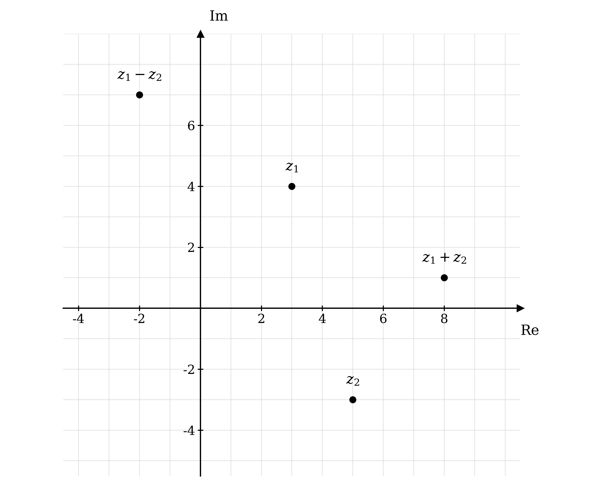
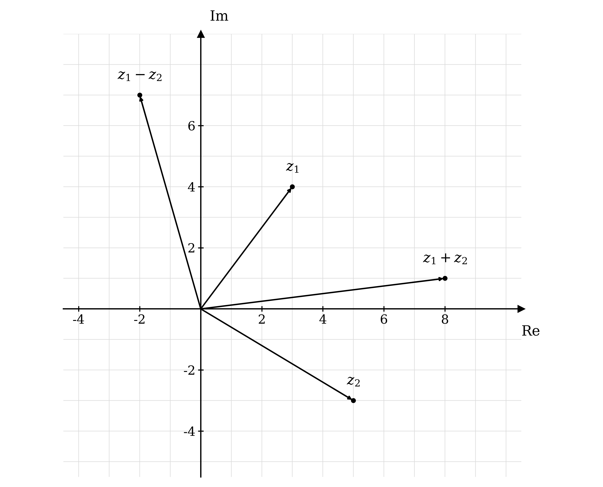
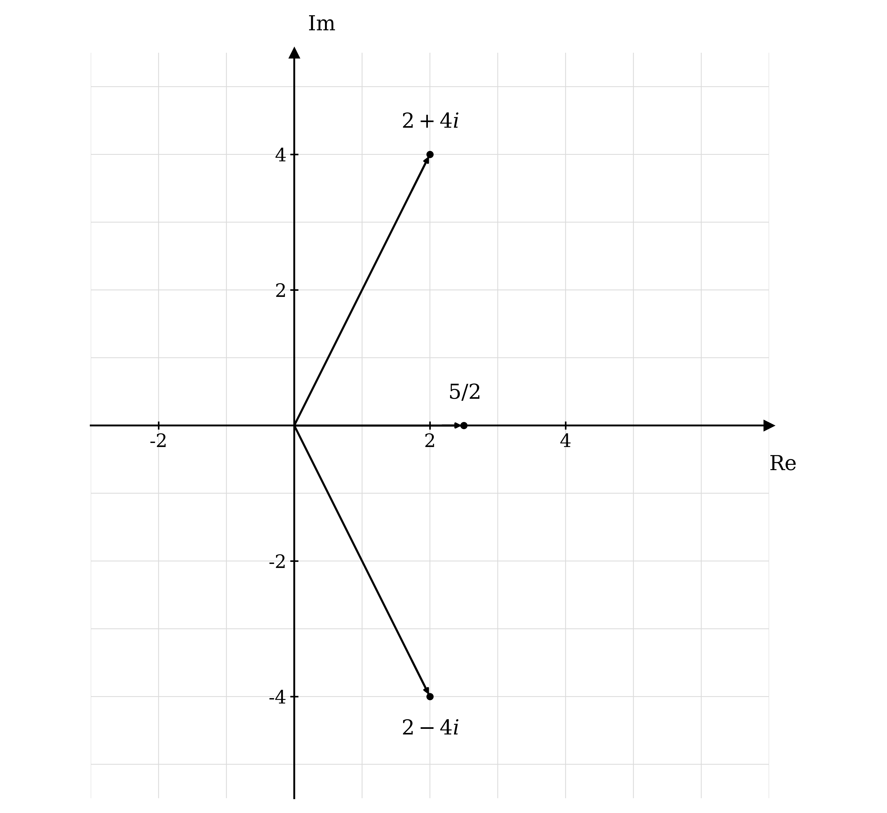
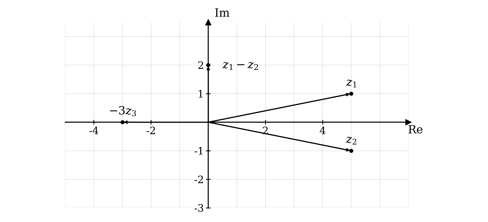
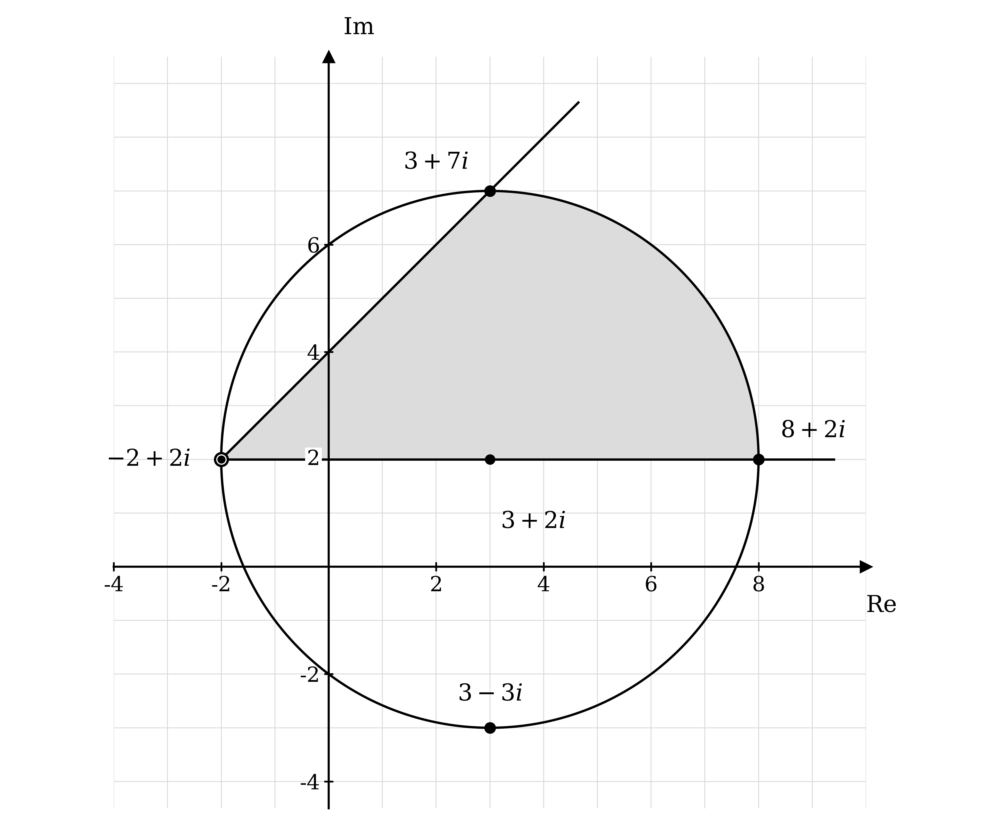
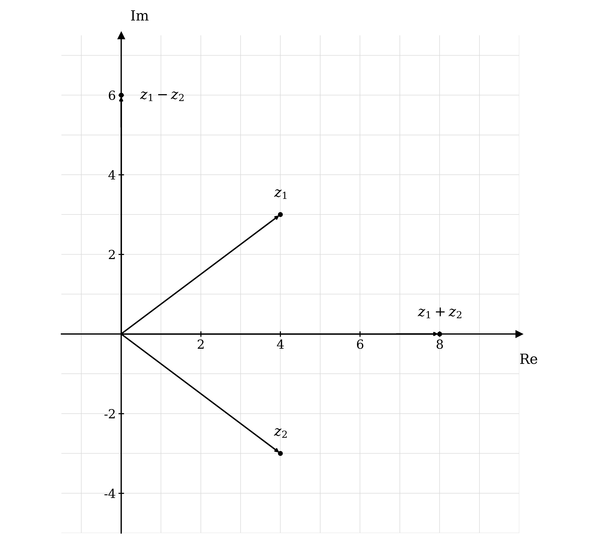
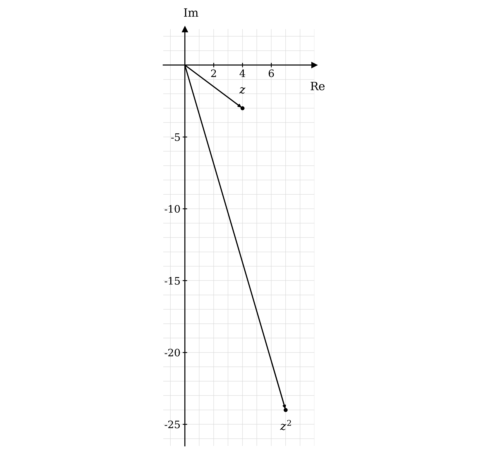

# Mark Schemes — Argand Diagrams
**Complex Numbers** · Cambridge (CIE) A-LEVEL maths (9709)

## Exam Questions (34 questions)

### Q1
The modulus is the square root of the sum of the squares of the real and imaginary parts, so square each part and add

`|z|^{2} = (7 - p)^{2} + (1 + 7p)^{2}`

**[M1]**

Expand both brackets in full

$= ( 49 - 14 p + p^{2} ) + ( 1 + 14 p + 49 p^{2} )$

Collect like terms, noting that the two terms in $p$ cancel

$= 50 + 50 p^{2}$

Take the positive square root, since a modulus is never negative

`|z| = \sqrt{50 + 50p^{2}}`

**[A1]**

> **[mark-scheme]**
> **M1**: Squaring both the real part $7 - p$ and the imaginary part $1 + 7 p$ and adding them. Award this for the correct structure even if a bracket is later expanded wrongly.
> 
> **A1**: Both brackets expanded correctly and simplified to $50 + 50 p^{2}$, leading to the printed result. Because the answer is given, the expansion must be visible and the two $14 p$ terms must be seen to cancel. A bare statement of the result scores nothing.
Set the expression from part (a) equal to 10 and square both sides to clear the root

$\sqrt{50+50p^{2}} = 10$

$50 + 50 p^{2} = 100$

**[M1]**

Rearrange to make $p^{2}$ the subject

$50 p^{2} = 50$

$p^{2} = 1$

Take the square root, remembering both signs

**Final answer:** $p = 1$** or **$p = - 1$

**[A1]**

> **[mark-scheme]**
> **M1**: Equating $\sqrt{50+50p^{2}}$ to 10 and squaring to reach a correct equation in $p^{2}$.
> 
> **A1**: Both $p = 1$ and $p = - 1$. Only one value scores nothing for this mark, since the question asks for two, and $p = \pm 1$ is accepted as a single statement of both.
Substitute each value of $p$ back into $z$ to see which complex number it produces

Taking $p = 1$ first

$z = ( 7 - 1 ) + ( 1 + 7 ) i = 6 + 8 i$

Both parts are positive, so this lies in the first quadrant and the argument is the acute angle itself

`\arg z = \tan^{-1}\left(\frac{8}{6}\right) = 0.927295\ldots`

$\mathrm{arg} z = 0 . 927$

**[B1]**

Now take $p = - 1$

$z = ( 7 + 1 ) + ( 1 - 7 ) i = 8 - 6 i$

The real part is positive and the imaginary part negative, so this lies in the fourth quadrant and the argument is the negative of the acute angle

`\tan^{-1}\left(\frac{6}{8}\right) = 0.643501\ldots`

$\mathrm{arg} z = - 0 . 644$

**[B1]**

> **[mark-scheme]**
> **B1**: Answers which round to $0 . 927$, from $p = 1$ giving $z = 6 + 8 i$.
> 
> **B1**: Answers which round to $- 0 . 644$, from $p = - 1$ giving $z = 8 - 6 i$. The negative sign is needed: $0 . 644$ on its own does not score.
> 
> Answers are in radians correct to 3 significant figures, and answers in degrees do not score. Both marks follow through from your values of $p$ in part (b). Do not round before adjusting for the quadrant.
In the fourth quadrant the real part is positive and the imaginary part is negative, which of the two numbers in part (c) is true only for $8 - 6 i$

$p = - 1$

**[B1]**

> **[mark-scheme]**
> **B1**: $p = - 1$. No working is expected here, and a correct answer alone scores. A negative argument in part (c) is equally acceptable as the justification. $p = 1$ gives $6 + 8 i$, which lies in the first quadrant, and does not score.

### Q2
The modulus `|z - z_{1}|` measures the distance from the fixed point $z_{1}$ to $z$, so this equation says that $z$ stays a fixed distance from one point

Compare the equation with `|z - z_{1}| = k` to read off the fixed point and the distance

$z_{1} = 1 - 3 i$

$k = 4$

So the locus is a circle of radius 4 centred at the point representing $1 - 3 i$, which is $( 1 , - 3 )$

The four points directly above, below, left and right of the centre make the circle easy to place

$1 + i$

$1 - 7 i$

$- 3 - 3 i$

$5 - 3 i$

**[B1 B1 B1]**

> **[mark-scheme]**
> **B1**: A circle drawn, with its centre not at the origin.
> 
> **B1**: The centre in the correct place, at the point representing $1 - 3 i$. There must be some indication of scale for this mark, so mark the centre with its coordinates, label points on the circle, or number the axes.
> 
> **B1**: A radius of 4, consistent with the scale you have used.
> 
> The axes should be labelled Re and Im, or real and imaginary. A freehand circle is fine provided it is recognisably circular and its centre and radius are clear.

The left-hand side is the distance from $1 - 3 i$ to $z$, so each inequality asks for a point at less than, or more than, distance 4 from the centre

(i)

Less than 4 means inside the circle, so choose any point in the shaded interior, for example the point $( - 1 , - 1 )$

$z = - 1 - i$

**[B1]**

(ii)

More than 4 means outside the circle, so choose any point beyond it, for example the point $( 4 , 3 )$

$z = 4 + 3 i$

**[B1]**

> **[mark-scheme]**
> **B1**: Any complex number lying strictly inside the circle, meaning any $z$ with `|z - (1 - 3i)| < 4`. The answer given here is $- 1 - i$, but there are infinitely many correct answers and any valid one scores.
> 
> **B1**: Any complex number lying strictly outside the circle, meaning any $z$ with `|z - (1 - 3i)| > 4`. The answer given here is $4 + 3 i$, and again any valid one scores.
> 
> No working is expected here. A point on the circle itself, such as $5 - 3 i$, satisfies neither inequality and does not score. The answer must be a complex number, so a pair of coordinates such as $( - 1 , - 1 )$ is condoned only if it is clear which complex number is meant.

### Q3
The expression $\mathrm{arg} ( z - z_{1} )$ is the angle of the vector running from the fixed point $z_{1}$ to $z$, measured anticlockwise from the direction of the positive real axis

Compare with $\mathrm{arg} ( z - z_{1} ) = k$ to read off the fixed point and the angle

$z_{1} = - 2 + i$

$k = \frac{π}{4}$

Fixing that angle fixes the direction but not the distance, so the locus is a half-line starting at the point representing $- 2 + i$, which is $( - 2 , 1 )$, and heading off at $\frac{π}{4}$ above the horizontal

The starting point itself is excluded, because $\mathrm{arg} 0$ has no meaning, so mark it with an open circle

**[B1 B1 B1]**

> **[mark-scheme]**
> **B1**: The point representing $- 2 + i$ shown as the start of the locus. This mark can be implied if a correct half-line is drawn from that point.
> 
> **B1**: A half-line rather than a full line, so the locus must stop at $- 2 + i$ and not continue beyond it into the opposite direction.
> 
> **B1**: The half-line at $\frac{π}{4}$ to the horizontal, heading up and to the right. There must be some indication of scale for this mark.
> 
> The axes should be labelled Re and Im, or real and imaginary. An open circle at $- 2 + i$ shows that the endpoint is excluded and is good practice, but it is not required for any of these marks. A full straight line through $- 2 + i$ loses the second mark, since the half going down and to the left has argument $- \frac{3π}{4}$, not $\frac{π}{4}$.

Each inequality describes a wedge between two half-lines out of $- 2 + i$, so pick a point strictly inside the wedge

(i)

This wedge lies between the horizontal direction and the half-line from part (a), so choose a point below the half-line but above the horizontal through $- 2 + i$, for example the point $( 5 , 3 )$

Check by finding the argument of the vector from $- 2 + i$ to that point

$z - ( - 2 + i ) = ( 5 + 3 i ) - ( - 2 + i ) = 7 + 2 i$

`\arg(7 + 2i) = \tan^{-1}\left(\frac{2}{7}\right) = 0.278\ldots`

Since $0 < 0 . 278 \dots < 0 . 785 \dots$, this point is in the wedge

$z = 5 + 3 i$

**[B1]**

(ii)

This wedge lies between the half-line from part (a) and the vertical direction, so choose a point above the half-line, for example the point $( 1 , 8 )$

$z - ( - 2 + i ) = ( 1 + 8 i ) - ( - 2 + i ) = 3 + 7 i$

`\arg(3 + 7i) = \tan^{-1}\left(\frac{7}{3}\right) = 1.166\ldots`

Since $0 . 785 \dots < 1 . 166 \dots < 1 . 571 \dots$, this point is in the second wedge

$z = 1 + 8 i$

**[B1]**

> **[mark-scheme]**
> **B1**: Any complex number strictly between the two half-lines out of $- 2 + i$ at angles 0 and $\frac{π}{4}$. The answer given here is $5 + 3 i$, but there are infinitely many correct answers and any valid one scores.
> 
> **B1**: Any complex number strictly between the half-lines at $\frac{π}{4}$ and $\frac{π}{2}$. The answer given here is $1 + 8 i$, and again any valid one scores.
> 
> No working is expected here, and the checks shown above are not required. Both inequalities are strict, so a point on either boundary half-line does not score. The angles are measured from $- 2 + i$ and not from the origin, so a number chosen by its own argument rather than the argument of $z - ( - 2 + i )$ is the commonest error.

### Q4
Each number is already in modulus-argument form, so read off its modulus and argument, then multiply or divide the moduli and add or subtract the arguments

(i)

Multiply the moduli, then add the arguments

$5 \times 4 = 20$

$\frac{π}{3} + \frac{π}{2} = \frac{2π}{6} + \frac{3π}{6} = \frac{5π}{6}$

`20\left(\cos\frac{5\pi}{6} + i\sin\frac{5\pi}{6}\right)`

**[B1]**

(ii)

Divide the moduli, then subtract the arguments

$12 \div 3 = 4$

$\frac{π}{2} - \frac{3π}{4} = \frac{2π}{4} - \frac{3π}{4} = - \frac{π}{4}$

`4\left(\cos\left(-\frac{\pi}{4}\right) + i\sin\left(-\frac{\pi}{4}\right)\right)`

**[B1]**

(iii)

Multiply the moduli, simplifying the surd

$\sqrt{3} \times \sqrt{6} = \sqrt{18} = 3 \sqrt{2}$

Add the arguments, taking care with the negative one

`\frac{\pi}{6} + \left(-\frac{3\pi}{4}\right) = \frac{2\pi}{12} - \frac{9\pi}{12} = -\frac{7\pi}{12}`

`3\sqrt{2}\left(\cos\left(-\frac{7\pi}{12}\right) + i\sin\left(-\frac{7\pi}{12}\right)\right)`

**[B1]**

(iv) This one is written as a fraction, so divide the moduli and subtract the arguments

$6 . 25 \div 0 . 5 = 12 . 5$

$3 . 05 - 1 . 42 = 1 . 63$

$12 . 5 ( \mathrm{cos} 1 . 63 + i \mathrm{sin} 1 . 63 )$

**[B1]**

> **[mark-scheme]**
> **B1**: `20\left(\cos\frac{5\pi}{6} + i\sin\frac{5\pi}{6}\right)`
> 
> **B1**: `4\left(\cos\left(-\frac{\pi}{4}\right) + i\sin\left(-\frac{\pi}{4}\right)\right)`
> 
> **B1**: `3\sqrt{2}\left(\cos\left(-\frac{7\pi}{12}\right) + i\sin\left(-\frac{7\pi}{12}\right)\right)`
> 
> **B1**: $12 . 5 ( \mathrm{cos} 1 . 63 + i \mathrm{sin} 1 . 63 )$
> 
> Each answer must be assembled into modulus-argument form, so a correct modulus and argument written separately does not score. In (iii) the modulus should be simplified to $3 \sqrt{2}$, although $\sqrt{18}$ is condoned. Accept the equivalent exponential forms, for example $20 e^{\frac{5π}{6}i}$. All four arguments already lie in $- π < θ \leq π$, and equivalent arguments differing by $2 π$ are accepted.

### Q5
The value of $r$ is the modulus, so square the real and imaginary parts, add, and take the positive square root

`r = |-5 + 12i| = \sqrt{(-5)^{2} + 12^{2}} = \sqrt{25 + 144} = \sqrt{169}`

$r = 13$

**[B1]**

The value of $θ$ is the argument, so start from the acute angle the position vector makes with the real axis

`\tan^{-1}\left(\frac{12}{5}\right) = 1.176005\ldots`

The real part is negative and the imaginary part positive, so $- 5 + 12 i$ lies in the second quadrant and the argument is $π$ minus that acute angle

$θ = π - 1 . 176005 \dots = 1 . 965587 \dots$

**[M1]**

Round to 3 significant figures and substitute both values into the form

$- 5 + 12 i = 13 ( \mathrm{cos} 1 . 97 + i \mathrm{sin} 1 . 97 )$

**[A1]**

> **[mark-scheme]**
> **B1**: $r = 13$.
> 
> **M1**: A correct method for the argument, meaning `\tan^{-1}\left(\frac{12}{5}\right)` or `\tan^{-1}\left(\frac{12}{-5}\right)` together with a quadrant adjustment that places the angle in the second quadrant. Quoting `\tan^{-1}\left(\frac{12}{5}\right) = 1.18` with no adjustment does not score.
> 
> **A1**: The full form $13 ( \mathrm{cos} 1 . 97 + i \mathrm{sin} 1 . 97 )$, with $θ$ an answer which rounds to $1 . 97$. Both the modulus and the argument must appear in the form for this mark, so a correct $r$ and $θ$ listed separately without being assembled does not score. Accept the equivalent exponential form $13 e^{1.97i}$.
Substitute $r = 14$ and $θ = - \frac{π}{6}$ into the modulus-argument form, then multiply out the bracket so the real and imaginary parts separate

`z = 14\left(\cos\left(-\frac{\pi}{6}\right) + i\sin\left(-\frac{\pi}{6}\right)\right)`

`z = 14\cos\left(-\frac{\pi}{6}\right) + \left(14\sin\left(-\frac{\pi}{6}\right)\right)i`

**[M1]**

Use the exact values `\cos\left(-\frac{\pi}{6}\right) = \frac{\sqrt{3}}{2}` and `\sin\left(-\frac{\pi}{6}\right) = -\frac{1}{2}`

`z = 14 \times \frac{\sqrt{3}}{2} + \left(14 \times \left(-\frac{1}{2}\right)\right)i`

$z = 7 \sqrt{3} - 7 i$

**[A1]**

> **[mark-scheme]**
> **M1**: Substituting $r = 14$ and $θ = - \frac{π}{6}$ into $r \mathrm{cos} θ + ( r \mathrm{sin} θ ) i$, or equivalent. Award this even if an exact trigonometric value is then misquoted.
> 
> **A1**: $7 \sqrt{3} - 7 i$. The question asks for exact values, so $12 . 1 - 7 i$ does not score. A positive imaginary part, from using $\mathrm{sin} \frac{π}{6}$ instead of `\sin\left(-\frac{\pi}{6}\right)`, does not score.
In each case compare what is written against the required form $r ( \mathrm{cos} θ + i \mathrm{sin} θ )$, where $r$ is the modulus and the same $θ$ appears in both trigonometric terms

(i)

The number in front of the bracket has to be the modulus $r$

**Final answer:** **A modulus is a distance, so it can never be negative, and **$- 4$** cannot be the modulus of **$z_{1}$

**[B1]**

(ii)

The required form has a plus sign between the two terms inside the bracket

**Final answer:** **The sign in front of **$i \mathrm{sin} \frac{π}{3}$** is a minus, and modulus-argument form must have **$+ i \mathrm{sin} θ$

**[B1]**

(iii)

The same angle $θ$ must appear in both the cosine and the sine

**Final answer:** **The two angles **$\frac{π}{6}$** and **$- \frac{π}{6}$** are different, so they cannot both be the argument of **$z_{3}$

**[B1]**

Each number can be rewritten correctly by working out its actual modulus and argument

`z_{1} = 4\left(\cos\left(-\frac{3\pi}{4}\right) + i\sin\left(-\frac{3\pi}{4}\right)\right)`

`z_{2} = 5\left(\cos\left(-\frac{\pi}{3}\right) + i\sin\left(-\frac{\pi}{3}\right)\right)`

`z_{3} = 7\left(\cos\left(-\frac{\pi}{6}\right) + i\sin\left(-\frac{\pi}{6}\right)\right)`

> **[mark-scheme]**
> **B1**: For (i), a reason identifying that the modulus cannot be negative. Accept any wording carrying that idea, such as "the modulus is a distance so it must be positive" or "$r$ cannot be $- 4$".
> 
> **B1**: For (ii), a reason identifying the minus sign before $i \mathrm{sin} θ$, where the form requires a plus.
> 
> **B1**: For (iii), a reason identifying that the angle in the cosine and the angle in the sine are different, so there is no single argument.
> 
> Each mark is for the reason, not for a corrected version of the number, so rewriting the number in correct form without saying what was wrong does not score. Only one valid reason is needed per part.

### Q6
Each side measures a distance, so the equation says $z$ is the same distance from $3 + 5 i$ as it is from $- 3 - i$

Compare with `|z - z_{1}| = |z - z_{2}|` to read off the two fixed points

$z_{1} = 3 + 5 i$

$z_{2} = - 3 - i$

Points equidistant from two fixed points form the perpendicular bisector of the segment joining them, so find the midpoint of that segment

$\text{midpoint} = \frac{(3+5i)+(-3-i)}{2} = \frac{4i}{2} = 2 i$

Find the gradient of the segment joining $( 3 , 5 )$ and $( - 3 , - 1 )$

$\text{gradient} = \frac{5-(-1)}{3-(-3)} = \frac{6}{6} = 1$

The bisector is perpendicular to the segment, so its gradient is the negative reciprocal

$\text{gradient of bisector} = - 1$

So the locus is the straight line through $( 0 , 2 )$ with gradient $- 1$

**[B1 B1 B1]**

> **[mark-scheme]**
> **B1**: The points representing $3 + 5 i$ and $- 3 - i$ shown on the diagram. This mark can be implied if the perpendicular bisector is drawn in the correct place.
> 
> **B1**: A single straight line drawn as the locus.
> 
> **B1**: The line in the correct position, passing through $2 i$ with gradient $- 1$. There must be some indication of scale for this mark.
> 
> The axes should be labelled Re and Im, or real and imaginary. Finding the midpoint and the perpendicular gradient algebraically is not required, but the line must be correctly placed, so an eyeballed bisector that misses $2 i$ does not score the third mark. Marking the right angle is good practice but is not required.

The bisector splits the diagram into two halves, one nearer each of the two fixed points, so each inequality picks a side

(i)

The distance to $3 + 5 i$ is the smaller, so choose any point on the same side of the line as $3 + 5 i$, for example the point $( 3 , 2 )$

$z = 3 + 2 i$

**[B1]**

(ii)

The distance to $- 3 - i$ is now the smaller, so choose any point on the other side of the line, for example the point $( - 5 , 3 )$

$z = - 5 + 3 i$

**[B1]**

> **[mark-scheme]**
> **B1**: Any complex number strictly on the $3 + 5 i$ side of the bisector, that is any $z$ with `|z - (3 + 5i)| < |z - (-3 - i)|`. The answer given here is $3 + 2 i$, but there are infinitely many correct answers and any valid one scores.
> 
> **B1**: Any complex number strictly on the $- 3 - i$ side of the bisector. The answer given here is $- 5 + 3 i$, and again any valid one scores.
> 
> No working is expected here. A point on the bisector itself, such as $2 i$, satisfies neither inequality and does not score. Watch the direction: the smaller distance goes with the point on that same side, so a correct number placed on the wrong side is the commonest error.

### Q7
Each of these four numbers lies on an axis, so the argument can be read straight off the Argand diagram without any calculation

(i)

$5 i$ lies on the positive imaginary axis, a quarter turn anticlockwise from the positive real axis

$\mathrm{arg} ( 5 i ) = \frac{π}{2}$

(ii)

$3$ lies on the positive real axis, which is where arguments are measured from

$\mathrm{arg} ( 3 ) = 0$

**[B1]**

(iii)

$- 7$ lies on the negative real axis, a half turn from the positive real axis. The principal interval is $- π < \mathrm{arg} z \leq π$, so this takes the value $π$ rather than $- π$

$\mathrm{arg} ( - 7 ) = π$

(iv) $- 4 i$ lies on the negative imaginary axis, a quarter turn clockwise, so the argument is negative

$\mathrm{arg} ( - 4 i ) = - \frac{π}{2}$

**[B1]**

> **[mark-scheme]**
> **B1**: Both $\frac{π}{2}$ and $0$ correct.
> 
> **B1**: Both $π$ and $- \frac{π}{2}$ correct.
> 
> Each mark needs both of its answers right. No working is expected here. Answers must lie in the principal interval $- π < \mathrm{arg} z \leq π$: for $- 7$ accept $π$ only, since $- π$ is excluded from the interval, and for $- 4 i$ accept $- \frac{π}{2}$ but not $\frac{3π}{2}$. Answers in degrees do not score.
For a number not on an axis, find the acute angle $θ$ that its position vector makes with the real axis using `\theta = \tan^{-1}\left|\frac{b}{a}\right|`, then adjust according to the quadrant

(i)

Both parts are positive, so $2 + 2 i$ is in the first quadrant and the argument is $θ$ itself

`\theta = \tan^{-1}\left(\frac{2}{2}\right) = \tan^{-1}(1) = \frac{\pi}{4}`

$\mathrm{arg} ( 2 + 2 i ) = \frac{π}{4}$

**[B1]**

(ii)

The real part is positive and the imaginary part negative, so $\sqrt{3} - i$ is in the fourth quadrant and the argument is $- θ$

`\theta = \tan^{-1}\left(\frac{1}{\sqrt{3}}\right) = \frac{\pi}{6}`

$\mathrm{arg} ( \sqrt{3} - i ) = - \frac{π}{6}$

**[B1]**

(iii)

The real part is negative and the imaginary part positive, so $- 4 + 4 \sqrt{3} i$ is in the second quadrant and the argument is $π - θ$

`\theta = \tan^{-1}\left(\frac{4\sqrt{3}}{4}\right) = \tan^{-1}(\sqrt{3}) = \frac{\pi}{3}`

$π - θ = π - \frac{π}{3}$

$\mathrm{arg} ( - 4 + 4 \sqrt{3} i ) = \frac{2π}{3}$

**[B1]**

(iv) Both parts are negative, so $- \frac{7}{2} - \frac{7}{2} i$ is in the third quadrant and the argument is $- π + θ$

`\theta = \tan^{-1}\left(\frac{7/2}{7/2}\right) = \tan^{-1}(1) = \frac{\pi}{4}`

$- π + θ = - π + \frac{π}{4}$

`\arg\left(-\frac{7}{2} - \frac{7}{2}i\right) = -\frac{3\pi}{4}`

**[B1]**

> **[mark-scheme]**
> **B1**: $\frac{π}{4}$
> 
> **B1**: $- \frac{π}{6}$
> 
> **B1**: $\frac{2π}{3}$
> 
> **B1**: $- \frac{3π}{4}$
> 
> The question asks for exact values, so answers must be in terms of $π$ and a decimal such as $0 . 785$ does not score. All four answers must lie in $- π < \mathrm{arg} z \leq π$, so $\frac{7π}{4}$ for (ii), $\frac{5π}{4}$ for (iv) and similar out-of-interval equivalents do not score. Answers in degrees do not score. The commonest error is quoting the acute angle $θ$ without the quadrant adjustment, which gives $\frac{π}{3}$ in (iii) and $\frac{π}{4}$ in (iv).
Use the same method, but this time the acute angle does not come out as a neat multiple of $π$, so work in radians and round only at the end

(i)

Both parts are positive, so $3 + 4 i$ is in the first quadrant and the argument is $θ$

`\theta = \tan^{-1}\left(\frac{4}{3}\right) = 0.927295\ldots`

$\mathrm{arg} ( 3 + 4 i ) = 0 . 927$

**[B1]**

(ii)

Both parts are negative, so $- 8 - 15 i$ is in the third quadrant and the argument is $- π + θ$

`\theta = \tan^{-1}\left(\frac{15}{8}\right) = 1.080839\ldots`

$- π + θ = - π + 1 . 080839 \dots = - 2 . 060753 \dots$

$\mathrm{arg} ( - 8 - 15 i ) = - 2 . 06$

**[B1]**

(iii)

The real part is positive and the imaginary part negative, so $12 - 5 i$ is in the fourth quadrant and the argument is $- θ$

`\theta = \tan^{-1}\left(\frac{5}{12}\right) = 0.394791\ldots`

$\mathrm{arg} ( 12 - 5 i ) = - 0 . 395$

**[B1]**

(iv) The real part is negative and the imaginary part positive, so this number is in the second quadrant and the argument is $π - θ$

`\theta = \tan^{-1}\left(\frac{24/25}{7/25}\right) = \tan^{-1}\left(\frac{24}{7}\right) = 1.287002\ldots`

$π - θ = π - 1 . 287002 \dots = 1 . 854590 \dots$

`\arg\left(-\frac{7}{25} + \frac{24}{25}i\right) = 1.85`

**[B1]**

> **[mark-scheme]**
> **B1**: Answers which round to $0 . 927$
> 
> **B1**: Answers which round to $- 2 . 06$
> 
> **B1**: Answers which round to $- 0 . 395$
> 
> **B1**: Answers which round to $1 . 85$
> 
> Answers are required in radians correct to 3 significant figures, and answers in degrees do not score. Do not round the acute angle before adjusting for the quadrant, since rounding early can shift the final digit. All four answers must lie in $- π < \mathrm{arg} z \leq π$, so $4 . 22$ in place of $- 2 . 06$ and $5 . 89$ in place of $- 0 . 395$ do not score. As in part (b), quoting the acute angle without the quadrant adjustment is the commonest error.

### Q8
To add two complex numbers, collect the real parts and the imaginary parts separately

$z_{1} + z_{2} = ( 3 + 4 i ) + ( 5 - 3 i ) = ( 3 + 5 ) + ( 4 - 3 ) i$

$z_{1} + z_{2} = 8 + i$

**[B1]**

Subtract in the same way, taking care with the double negative in the imaginary part

$z_{1} - z_{2} = ( 3 + 4 i ) - ( 5 - 3 i ) = ( 3 - 5 ) + ( 4 - ( - 3 ) ) i$

$z_{1} - z_{2} = - 2 + 7 i$

**[B1]**

> **[mark-scheme]**
> **B1**: $z_{1} + z_{2} = 8 + i$. Accept $8 + 1 i$ or the terms written in the other order.
> 
> **B1**: $z_{1} - z_{2} = - 2 + 7 i$. The commonest slip is treating $- ( - 3 i )$ as $- 3 i$, which gives $- 2 + i$ and does not score.
On an Argand diagram the real part of a complex number is measured along the horizontal axis and the imaginary part along the vertical axis, so each number is plotted as a point

`z_{1} = 3 + 4i \longrightarrow (3, 4)`

`z_{2} = 5 - 3i \longrightarrow (5, -3)`

Use the two answers from part (a) for the remaining points

`z_{1} + z_{2} = 8 + i \longrightarrow (8, 1)`

`z_{1} - z_{2} = -2 + 7i \longrightarrow (-2, 7)`

Draw axes labelled Re and Im, mark a scale on each, then plot and label the four points

**[B1 B1 B1]**

> **[mark-scheme]**
> **B1**: An Argand diagram with the horizontal axis labelled Re (or "real") and the vertical axis labelled Im (or "imaginary"), and some indication of scale. Marks on the axes, a numbered scale, or correctly labelled points are all enough.
> 
> **B1**: $z_{1}$ plotted at $( 3 , 4 )$ and $z_{2}$ plotted at $( 5 , - 3 )$, both labelled.
> 
> **B1**: $z_{1} + z_{2}$ plotted at $( 8 , 1 )$ and $z_{1} - z_{2}$ plotted at $( - 2 , 7 )$, both labelled. This mark follows through from your answers to part (a), so two points that are correctly plotted from wrong values in part (a) still score.
A complex number can also be shown as the position vector running from the origin to the point representing it, so the four points from part (b) become four arrows that all start at the origin

Draw the arrow to $( 3 , 4 )$ for $z_{1}$ and the arrow to $( 5 , - 3 )$ for $z_{2}$

Draw the arrow to $( 8 , 1 )$ for $z_{1} + z_{2}$

Draw the arrow to $( - 2 , 7 )$ for $z_{1} - z_{2}$

**[B1 B1 B1]**

> **[mark-scheme]**
> **B1**: $z_{1}$ and $z_{2}$ drawn as arrows from the origin to $( 3 , 4 )$ and $( 5 , - 3 )$, both labelled.
> 
> **B1**: $z_{1} + z_{2}$ drawn as an arrow from the origin to $( 8 , 1 )$ and labelled.
> 
> **B1**: $z_{1} - z_{2}$ drawn as an arrow from the origin to $( - 2 , 7 )$ and labelled. The last two marks follow through from your answers to part (a). Allow dots instead of arrows.

### Q9
The modulus of $z = a + b i$ is its distance from the origin on an Argand diagram, so square the real part, square the imaginary part, add, and take the positive square root

(i)

Substitute $a = 3$ and $b = - 4$

`|3 - 4i| = \sqrt{3^{2} + (-4)^{2}} = \sqrt{9 + 16} = \sqrt{25}`

`|3 - 4i| = 5`

(ii)

Substitute $a = 1$ and $b = 1$

`|1 + i| = \sqrt{1^{2} + 1^{2}} = \sqrt{2}`

`|1 + i| = \sqrt{2}`

**[B1]**

(iii)

A pure imaginary number has real part 0

`|-7i| = \sqrt{0^{2} + (-7)^{2}} = \sqrt{49}`

`|-7i| = 7`

(iv) Substitute the two fractions and put them over a common denominator

`\left|-\frac{24}{25} + \frac{7}{25}i\right| = \sqrt{\left(-\frac{24}{25}\right)^{2} + \left(\frac{7}{25}\right)^{2}} = \sqrt{\frac{576}{625} + \frac{49}{625}}`

$= \sqrt{\frac{625}{625}} = \sqrt{1}$

`\left|-\frac{24}{25} + \frac{7}{25}i\right| = 1`

**[B1]**

(v) A real number has imaginary part 0

`|2| = \sqrt{2^{2} + 0^{2}} = \sqrt{4}`

`|2| = 2`

(vi) Another pure imaginary number

`|23i| = \sqrt{0^{2} + 23^{2}} = \sqrt{529}`

`|23i| = 23`

**[B1]**

(vii) Both parts are negative, but squaring makes both contributions positive

`|-5 - 7i| = \sqrt{(-5)^{2} + (-7)^{2}} = \sqrt{25 + 49}`

`|-5 - 7i| = \sqrt{74}`

(viii) A negative real number still has a positive modulus

`|-15| = \sqrt{(-15)^{2} + 0^{2}} = \sqrt{225}`

`|-15| = 15`

**[B1]**

> **[mark-scheme]**
> **B1**: Both $5$ and $\sqrt{2}$ correct.
> 
> **B1**: Both $7$ and $1$ correct.
> 
> **B1**: Both $2$ and $23$ correct.
> 
> **B1**: Both $\sqrt{74}$ and $15$ correct.
> 
> Each mark needs both of its answers right. The question asks for exact values, so $\sqrt{2}$ and $\sqrt{74}$ must be left in surd form and decimals such as $1 . 41$ or $8 . 60$ do not score. A modulus is a distance, so it is never negative: answers of $- 7$, $- 15$ or $- 5 - 7 i$ do not score. Working is not required, and a correct answer alone earns the mark.

### Q10
Each modulus measures a distance, so rewrite every term in the form `|z - z_{1}|` to see which fixed point it refers to

`|z| = |z - 0|`

`|z + 2| = |z - (-2)|`

Take the first inequality. It compares the distance to $4 i$ with the distance to 0, so the boundary is the perpendicular bisector of the segment joining them

$\text{midpoint} = 2 i$

That segment lies along the imaginary axis, so its perpendicular bisector is horizontal

$y = 2$

**[B1]**

The inequality says the distance to $4 i$ is the greater, so $z$ is nearer 0, which is the region below that line

Now the second inequality, which compares the distance to $4 i$ with the distance to $- 2$

$\text{midpoint} = \frac{4i+(-2)}{2} = - 1 + 2 i$

Find the gradient of the segment joining $( 0 , 4 )$ and $( - 2 , 0 )$

$\text{gradient} = \frac{0-4}{-2-0} = 2$

Take the negative reciprocal for the bisector, then use the midpoint

$\text{gradient of bisector} = - \frac{1}{2}$

$y = - \frac{1}{2} x + \frac{3}{2}$

**[B1]**

This time the distance to $4 i$ is the smaller, so $z$ is nearer $4 i$, which is the region above that line

Both bisectors pass through $- 1 + 2 i$, so the region satisfying both is the wedge between them opening to the right

Check with a point in it, say $z = 5$

`|5 - 4i| = \sqrt{41} \approx 6.40`

`|5| = 5`

`|5 + 2| = 7`

Since $6 . 40 > 5$ and $6 . 40 < 7$, the point $z = 5$ satisfies both inequalities

**[B1 B1 B1]**

> **[mark-scheme]**
> **B1**: The first boundary correctly identified as the perpendicular bisector of 0 and $4 i$, drawn as the horizontal line through $2 i$.
> 
> **B1**: The second boundary correctly identified as the perpendicular bisector of $4 i$ and $- 2$, drawn through $- 1 + 2 i$ with gradient $- \frac{1}{2}$.
> 
> **B1**: The correct side of the first boundary chosen, so the region lies below $y = 2$.
> 
> **B1**: The correct side of the second boundary chosen, so the region lies above the sloping bisector, on the same side as $4 i$.
> 
> **B1**: A single region shaded, being the intersection of the two, which is the wedge opening to the right from $- 1 + 2 i$.
> 
> The axes should be labelled Re and Im, or real and imaginary, and there must be some indication of scale. Both inequalities are strict, so neither boundary belongs to the region, but the line style is not marked. Getting the sides the wrong way round is the commonest error here, and the two inequalities point in opposite directions relative to $4 i$: the first moves away from it, the second moves towards it.

### Q11
(i)

The conjugate of $z = x + i y$ is `z^{\star} = x - iy`, so start from that

`\frac{1}{z^{\star}} = \frac{1}{x - iy}`

To clear the complex number from the denominator, multiply the top and bottom by its conjugate

$= \frac{1}{x-iy} \times \frac{x+iy}{x+iy} = \frac{x+iy}{(x-iy)(x+iy)}$

**[M1]**

Expanding the denominator makes it real, since the terms in $i$ cancel and $- i^{2} y^{2} = y^{2}$

$= \frac{x+iy}{x^{2}+y^{2}}$

**[A1]**

The numerator is $z$ itself, and the denominator is the square of the modulus, since `|z| = \sqrt{x^{2} + y^{2}}`

`\frac{1}{z^{\star}} = \frac{z}{|z|^{2}}`

**[A1]**

(ii)

Use the result from part (i), written so the multiplier stands alone

`\frac{1}{z^{\star}} = \frac{1}{|z|^{2}} \times z`

Since `|z|^{2}` is a positive real number, so is `\frac{1}{|z|^{2}}`, and multiplying by a positive real scales a complex number without turning it

`\arg\left(\frac{1}{z^{\star}}\right) = \arg(z)`

**[M1]**

Now relate `\arg(z^{\star})` to $\mathrm{arg} ( z )$, using the fact that `z^{\star} = x - iy` is the reflection of $z$ in the real axis, which reverses the angle

`\arg(z^{\star}) = -\arg(z) \Rightarrow \arg(z) = -\arg(z^{\star})`

**[M1]**

Substituting the second statement into the first gives the result

`\arg\left(\frac{1}{z^{\star}}\right) = -\arg(z^{\star})`

**[A1]**

(iii)

Add $z$ and its conjugate, so the imaginary parts cancel

`z + z^{\star} = (x + iy) + (x - iy) = 2x`

This is a real number, and $x < 0$ makes it negative, so it lies on the negative real axis

`\arg(z + z^{\star}) = \pi`

**[B1]**

> **[mark-scheme]**
> **M1**: Multiplying $\frac{1}{x-iy}$ by $\frac{x+iy}{x+iy}$, or an equivalent complete method for clearing the denominator.
> 
> **A1**: Reaching $\frac{x+iy}{x^{2}+y^{2}}$, with the denominator correctly real.
> 
> **A1**: Identifying the numerator as $z$ and the denominator as `|z|^{2}` to reach the printed result. Because the answer is given, this identification must be stated rather than assumed.
> 
> **M1**: Using part (i) to argue that `\frac{1}{z^{\star}}` is a positive real multiple of $z$, and so has the same argument as $z$.
> 
> **M1**: Stating `\arg(z^{\star}) = -\arg(z)`, with a justification such as reflection in the real axis or writing `z^{\star} = x - iy`.
> 
> **A1**: Combining the two statements to reach the printed result.
> 
> **B1**: $π$. The answer must be $π$ and not $- π$, since the principal interval is $- π < \mathrm{arg} z \leq π$, which excludes $- π$. Accept $180 ^{\circ}$ only if radians are also given, since the question asks for radians. No working is required here, though showing `z + z^{\star} = 2x` is good practice.
> 
> For (ii), an approach via `\tan^{-1}\left(\frac{y}{x}\right)` can be made to work but needs a separate case for each quadrant, and a solution that considers only one quadrant does not earn the second M mark.

### Q12
Neither is in correct form: $z_{1}$ has a negative number outside the bracket, and both have a minus sign before $i \mathrm{sin} θ$. The safest repair is to multiply out into $a + b i$ and start again

For $z_{1}$, use the exact values $\mathrm{cos} \frac{π}{3} = \frac{1}{2}$ and $\mathrm{sin} \frac{π}{3} = \frac{\sqrt{3}}{2}$

`z_{1} = -4\left(\frac{1}{2} - \frac{\sqrt{3}}{2}i\right) = -2 + 2\sqrt{3}i`

**[M1]**

Now find its modulus and argument. The real part is negative and the imaginary part positive, so it lies in the second quadrant

`|z_{1}| = \sqrt{4 + 12} = 4`

`\arg z_{1} = \pi - \tan^{-1}\left(\frac{2\sqrt{3}}{2}\right) = \pi - \frac{\pi}{3} = \frac{2\pi}{3}`

`z_{1} = 4\left(\cos\frac{2\pi}{3} + i\sin\frac{2\pi}{3}\right)`

**[A1]**

For $z_{2}$, use $\mathrm{cos} \frac{2π}{3} = - \frac{1}{2}$ and $\mathrm{sin} \frac{2π}{3} = \frac{\sqrt{3}}{2}$

`z_{2} = 2\left(-\frac{1}{2} - \frac{\sqrt{3}}{2}i\right) = -1 - \sqrt{3}i`

Both parts are negative, so this lies in the third quadrant

`|z_{2}| = \sqrt{1 + 3} = 2`

`\arg z_{2} = -\pi + \tan^{-1}\left(\frac{\sqrt{3}}{1}\right) = -\pi + \frac{\pi}{3} = -\frac{2\pi}{3}`

`z_{2} = 2\left(\cos\left(-\frac{2\pi}{3}\right) + i\sin\left(-\frac{2\pi}{3}\right)\right)`

**[A1]**

> **[mark-scheme]**
> **M1**: A valid method for repairing at least one of the forms. Multiplying out into $a + b i$ and rebuilding is the clearest, but working directly on the given form is equally acceptable: a negative multiplier adds $π$ to the argument, and a minus sign before $i \mathrm{sin} θ$ negates it.
> 
> **A1**: `z_{1} = 4\left(\cos\frac{2\pi}{3} + i\sin\frac{2\pi}{3}\right)`.
> 
> **A1**: `z_{2} = 2\left(\cos\left(-\frac{2\pi}{3}\right) + i\sin\left(-\frac{2\pi}{3}\right)\right)`.
> 
> Both moduli must be positive, so $- 4$ is not acceptable as the modulus of $z_{1}$, and both arguments must lie in $- π < θ \leq π$, so $\frac{4π}{3}$ for $z_{2}$ does not score. Accept the equivalent exponential forms. Note $z_{2}$'s given form needs only the sign of the argument changing, whereas $z_{1}$'s needs both repairs.
Use the corrected forms from part (a), so the moduli are 4 and 2 and the arguments are $\frac{2π}{3}$ and $- \frac{2π}{3}$

(i)

For a product, the standard results are that the moduli multiply and the arguments add

`|z_{1}z_{2}| = |z_{1}||z_{2}|`

$\mathrm{arg} ( z_{1} z_{2} ) = \mathrm{arg} z_{1} + \mathrm{arg} z_{2}$

Apply them to the corrected values

`|z_{1}z_{2}| = 4 \times 2 = 8`

`\arg(z_{1}z_{2}) = \frac{2\pi}{3} + \left(-\frac{2\pi}{3}\right) = 0`

**[M1]**

An argument of 0 means the product lies on the positive real axis

$z_{1} z_{2} = 8 ( \mathrm{cos} 0 + i \mathrm{sin} 0 )$

**[A1]**

(ii)

For a quotient, the matching results are that the moduli divide and the arguments subtract

`\left|\frac{z_{2}}{z_{1}}\right| = \frac{|z_{2}|}{|z_{1}|}`

`\arg\left(\frac{z_{2}}{z_{1}}\right) = \arg z_{2} - \arg z_{1}`

Apply them, taking the numerator first

`\left|\frac{z_{2}}{z_{1}}\right| = \frac{2}{4} = \frac{1}{2}`

`\arg\left(\frac{z_{2}}{z_{1}}\right) = -\frac{2\pi}{3} - \frac{2\pi}{3} = -\frac{4\pi}{3}`

**[M1]**

This is below $- π$, so it is outside the required interval and $2 π$ must be added

$- \frac{4π}{3} + 2 π = \frac{2π}{3}$

`\frac{z_{2}}{z_{1}} = \frac{1}{2}\left(\cos\frac{2\pi}{3} + i\sin\frac{2\pi}{3}\right)`

**[A1]**

> **[mark-scheme]**
> **M1**: Multiplying the moduli and adding the arguments, using the corrected values from part (a).
> 
> **A1**: $8 ( \mathrm{cos} 0 + i \mathrm{sin} 0 )$. Accept the simplified answer 8, since an argument of 0 puts the product on the positive real axis, but the modulus-argument form is what the question asks for.
> 
> **M1**: Dividing the moduli and subtracting the arguments in the correct order, which here is $\mathrm{arg} z_{2} - \mathrm{arg} z_{1}$ because $z_{2}$ is on top.
> 
> **A1**: `\frac{1}{2}\left(\cos\frac{2\pi}{3} + i\sin\frac{2\pi}{3}\right)`, with the argument brought inside the interval. An answer of $- \frac{4π}{3}$ does not score.
> 
> Both marks follow through from part (a). Note the quotient is the other way up from the usual: taking $\frac{z_{1}}{z_{2}}$ instead gives an argument of $\frac{4π}{3}$, reducing to $- \frac{2π}{3}$, and does not score.
(i)

Use the $a + b i$ forms found along the way in part (a)

$z_{1} = - 2 + 2 \sqrt{3} i$

$z_{2} = - 1 - \sqrt{3} i$

Add them by collecting the real and imaginary parts

$z_{1} + z_{2} = ( - 2 - 1 ) + ( 2 \sqrt{3} - \sqrt{3} ) i = - 3 + \sqrt{3} i$

Draw all three as arrows from the origin, noting $2 \sqrt{3} \approx 3 . 46$ and $\sqrt{3} \approx 1 . 73$

**[B1 B1 B1]**

(ii)

Reading the completed shape off the diagram

**Final answer:** **The arrows for **$z_{1}$** and **$z_{2}$** form two sides of a parallelogram, and the arrow for **$z_{1} + z_{2}$** is its diagonal from the origin**

**[B1]**

> **[mark-scheme]**
> **B1**: $z_{1}$ drawn as an arrow from the origin to $- 2 + 2 \sqrt{3} i$, labelled, on axes marked Re and Im with some indication of scale.
> 
> **B1**: $z_{2}$ drawn as an arrow from the origin to $- 1 - \sqrt{3} i$, labelled.
> 
> **B1**: $z_{1} + z_{2}$ drawn as an arrow from the origin to $- 3 + \sqrt{3} i$, labelled.
> 
> **B1**: An explanation identifying that the three vectors form two sides and a diagonal of a parallelogram. Accept any wording carrying that idea, such as "completing the parallelogram on $z_{1}$ and $z_{2}$ gives $z_{1} + z_{2}$ as the diagonal". A description of the shape with no reference to the sum being the diagonal does not score.
> 
> Allow dots instead of arrows. The two complex numbers have irrational parts, so plot $2 \sqrt{3}$ at about 3.46 and $\sqrt{3}$ at about 1.73 rather than on gridlines.

### Q13
The factorisation is given, so a root comes from each factor being zero. Take the linear factor first

$z + ( 5 - i ) = 0$

$z = - 5 + i$

**[B1]**

The other two roots come from the quadratic factor. Its coefficients are not all real, so the conjugate-pair result does not apply here and the formula must be used

$z^{2} - 6 i z - 30 = 0$

Apply the quadratic formula with $a = 1$, $b = - 6 i$ and $c = - 30$

$z = \frac{6i\pm\sqrt{(-6i)^{2}-4(1)(-30)}}{2}$

**[M1]**

Work out the discriminant, remembering that $( - 6 i )^{2} = 36 i^{2} = - 36$

$( - 6 i )^{2} - 4 ( 1 ) ( - 30 ) = - 36 + 120 = 84$

**[A1]**

The discriminant is a positive real number, so its square root is real and no further complex work is needed

$z = \frac{6i\pm\sqrt{84}}{2} = \frac{6i\pm2\sqrt{21}}{2}$

**[M1]**

Divide both terms by 2

$z = \pm \sqrt{21} + 3 i$

Collect all three roots together

$z = - 5 + i$

$z = \sqrt{21} + 3 i$

$z = - \sqrt{21} + 3 i$

**[A1]**

> **[mark-scheme]**
> **B1**: $z = - 5 + i$ from the linear factor. Note the sign: the factor is $z + ( 5 - i )$, so the root is $- ( 5 - i ) = - 5 + i$.
> 
> **M1**: Applying the quadratic formula, or completing the square, to $z^{2} - 6 i z - 30 = 0$ with $b = - 6 i$.
> 
> **A1**: A correct discriminant of 84, which requires $( - 6 i )^{2} = - 36$. Treating $( - 6 i )^{2}$ as $+ 36$ gives 156 and does not score.
> 
> **M1**: Simplifying $\sqrt{84}$ to $2 \sqrt{21}$, or an equivalent step towards the two roots.
> 
> **A1**: All three roots. The root from the linear factor must appear in the final answer, since the question asks for all three.
> 
> The coefficients of the cubic are not all real, so the roots do not occur in conjugate pairs. A candidate who writes down $- 5 - i$ as a second root by that route has used a result that does not apply and does not score. Completing the square, $( z - 3 i )^{2} = 21$, is an equally valid route and earns the same marks.
The expression `|z - i|` is the distance from $i$ to $z$, so work it out for each root in turn

`|(-5 + i) - i| = |-5| = 5`

`\left|(\sqrt{21} + 3i) - i\right| = \left|\sqrt{21} + 2i\right| = \sqrt{21 + 4} = \sqrt{25} = 5`

`\left|(-\sqrt{21} + 3i) - i\right| = \left|-\sqrt{21} + 2i\right| = \sqrt{21 + 4} = \sqrt{25} = 5`

**[M1]**

All three give the same value, so such a constant does exist

$c = 5$

**[A1]**

> **[mark-scheme]**
> **M1**: Working out `|z - i|` for at least two of the three roots, with the modulus applied correctly. Note `\left(\sqrt{21}\right)^{2} = 21`, and the subtraction of $i$ must be done before the modulus is taken.
> 
> **A1**: All three distances shown to be 5, and $c = 5$ stated. The question asks you to verify the result, so all three roots must be checked.
> 
> The last two roots differ only in the sign of their real part, so they are the same distance from any point on the imaginary axis. Saying so and checking only one of them is acceptable provided the reason is given.
Using $c = 5$ from part (b), the equation says $z$ stays a distance 5 from the fixed point $i$

`|z - i| = 5`

So the locus is a circle of radius 5 centred at the point representing $i$, which is $( 0 , 1 )$

Part (b) showed all three roots are exactly 5 from $i$, so all three lie on the circle

`-5 + i \longrightarrow (-5, 1)`

`\sqrt{21} + 3i \longrightarrow (4.58\ldots, 3)`

`-\sqrt{21} + 3i \longrightarrow (-4.58\ldots, 3)`

**[B1 B1 B1]**

> **[mark-scheme]**
> **B1**: A circle with its centre at the point representing $i$, so on the imaginary axis just above the origin, and not at the origin itself. There must be some indication of scale for this mark.
> 
> **B1**: A radius of 5, consistent with the scale used, so the circle passes through $- 5 + i$ and $5 + i$ on the horizontal through the centre, and through $6 i$ and $- 4 i$ on the imaginary axis.
> 
> **B1**: All three roots marked on the circle. All three are needed, and they must sit on the circle rather than inside it.
> 
> The axes should be labelled Re and Im, or real and imaginary. The value of $c$ follows through from part (b). The two roots with surd real parts sit at about $\pm 4 . 58$, so they are near but not at the widest points of the circle, and they are level with each other at height 3. Note the root $- 5 + i$ is also the leftmost point of the circle.

### Q14
A root at $z = \frac{5}{2}$ means $z - \frac{5}{2}$ is a factor, and doubling it gives a factor with integer coefficients

`2\left(z - \frac{5}{2}\right) = 2z - 5`

Divide $\text{f} ( z )$ by that factor to find the quadratic factor

$2 z^{3} - 13 z^{2} + 60 z - 100 = ( 2 z - 5 ) ( z^{2} - 4 z + 20 )$

**[M1 A1]**

The remaining roots come from setting the quadratic factor to zero, so use the quadratic formula

$z = \frac{4\pm\sqrt{(-4)^{2}-4\times1\times20}}{2} = \frac{4\pm\sqrt{16-80}}{2} = \frac{4\pm\sqrt{-64}}{2}$

**[M1]**

The number under the root is negative, and $\sqrt{-64} = 8 i$

$z = \frac{4\pm8i}{2}$

Divide both terms by 2, and collect all three roots

$z = \frac{5}{2}$

$z = 2 + 4 i$

$z = 2 - 4 i$

**[A1]**

> **[mark-scheme]**
> **M1**: Dividing $\text{f} ( z )$ by $2 z - 5$, or by $z - \frac{5}{2}$, or comparing coefficients, to find a quadratic factor.
> 
> **A1**: The correct quadratic factor $z^{2} - 4 z + 20$. If the division used $z - \frac{5}{2}$ then the quotient is $2 z^{2} - 8 z + 40$, which is equally correct and scores.
> 
> **M1**: Solving the quadratic factor by formula or by completing the square, handling the negative discriminant to produce a complex square root.
> 
> **A1**: All three roots. The given root $\frac{5}{2}$ must appear in the final answer, since the question says "solve completely", and giving only $2 \pm 4 i$ does not score this mark.
> 
> Completing the square on $z^{2} - 4 z + 20$ to $( z - 2 )^{2} = - 16$ is an equally valid route. Note the question says "use algebra", so a purely numerical or graphical approach is not acceptable.
Plot each root using its real part horizontally and its imaginary part vertically

`\frac{5}{2} \longrightarrow \left(\frac{5}{2}, 0\right)`

`2 + 4i \longrightarrow (2, 4)`

`2 - 4i \longrightarrow (2, -4)`

The real root sits on the real axis between 2 and 3, and the two complex roots sit symmetrically above and below the real axis. Draw each as a position vector from the origin

**[B1 B1]**

> **[mark-scheme]**
> **B1**: The real root $\frac{5}{2}$ plotted on the real axis, between 2 and 3, on a diagram with axes labelled Re and Im and some indication of scale.
> 
> **B1**: Both complex roots plotted at $( 2 , 4 )$ and $( 2 , - 4 )$.
> 
> The two complex roots are conjugates, so they must appear as a mirror image pair in the real axis, and a sketch showing them at different heights does not score the second mark. All three roots follow through from part (a). Allow dots instead of arrows.

### Q15
For $r$, square both parts and add, expanding each bracket

$( \sqrt{3} - 3 )^{2} = 3 - 6 \sqrt{3} + 9 = 12 - 6 \sqrt{3}$

$( \sqrt{3} + 3 )^{2} = 3 + 6 \sqrt{3} + 9 = 12 + 6 \sqrt{3}$

Adding them makes the surd terms cancel

$r = \sqrt{(12-6\sqrt{3})+(12+6\sqrt{3})} = \sqrt{24} = 2 \sqrt{6}$

**[B1]**

For $θ$, first note that $\sqrt{3} \approx 1 . 73$, so the real part $\sqrt{3} - 3$ is negative and the imaginary part $- ( \sqrt{3} + 3 )$ is negative, putting $z$ in the third quadrant

Form the ratio for the acute angle, writing the real part as $3 - \sqrt{3}$ so both are positive

$\frac{\sqrt{3}+3}{3-\sqrt{3}}$

Rationalise by multiplying top and bottom by $3 + \sqrt{3}$

$= \frac{(\sqrt{3}+3)(3+\sqrt{3})}{(3-\sqrt{3})(3+\sqrt{3})}$

Expand the top, and use the difference of two squares on the bottom

$= \frac{3\sqrt{3}+3+9+3\sqrt{3}}{9-3} = \frac{6\sqrt{3}+12}{6}$

Divide each term on the top by 6

$= 2 + \sqrt{3}$

**[M1]**

The exact angle whose tangent is $2 + \sqrt{3}$ is $\frac{5π}{12}$, and the third quadrant gives an argument of $- π$ plus that angle

$θ = - π + \frac{5π}{12} = - \frac{7π}{12}$

`z = 2\sqrt{6}\left(\cos\left(-\frac{7\pi}{12}\right) + i\sin\left(-\frac{7\pi}{12}\right)\right)`

**[A1]**

> **[mark-scheme]**
> **B1**: $r = 2 \sqrt{6}$. Accept $\sqrt{24}$.
> 
> **M1**: A correct method for the argument, meaning the ratio of the two parts formed and a quadrant adjustment placing the angle in the third quadrant.
> 
> **A1**: The assembled form `2\sqrt{6}\left(\cos\left(-\frac{7\pi}{12}\right) + i\sin\left(-\frac{7\pi}{12}\right)\right)`. The question asks for an exact argument, so a decimal such as $- 1 . 83$ does not score. Accept the equivalent exponential form $2 \sqrt{6} e^{-\frac{7π}{12}i}$.
> 
> Rationalising the ratio to $2 + \sqrt{3}$ is what makes the exact angle recognisable, but any valid route to $- \frac{7π}{12}$ scores. Note $\frac{5π}{12}$ is $75 ^{\circ}$, so a candidate working in degrees may spot it as $- 105 ^{\circ}$ and convert; that is acceptable provided the final answer is in radians. An answer of $\frac{17π}{12}$ lies outside the required interval and does not score.
Build the modulus of $w$ from the modulus of $z$ found in part (a)

`|w| = \sqrt{2} \times 2\sqrt{6} = 2\sqrt{12} = 4\sqrt{3}`

Build the argument of $w$ the same way, working inside the bracket first

`\arg(w) = 2\left(\pi - \frac{7\pi}{12}\right) = 2 \times \frac{5\pi}{12} = \frac{5\pi}{6}`

**[M1]**

That already lies in $- π < θ \leq π$, so substitute both into modulus-argument form and multiply out

`w = 4\sqrt{3}\left(\cos\frac{5\pi}{6} + i\sin\frac{5\pi}{6}\right) = 4\sqrt{3} \times \left(-\frac{\sqrt{3}}{2}\right) + \left(4\sqrt{3} \times \frac{1}{2}\right)i`

$w = - 6 + 2 \sqrt{3} i$

**[A1]**

> **[mark-scheme]**
> **M1**: Correct values for both `|w| = 4\sqrt{3}` and $\mathrm{arg} ( w ) = \frac{5π}{6}$, following through from part (a).
> 
> **A1**: $w = - 6 + 2 \sqrt{3} i$. Accept the decimal equivalent $- 6 + 3 . 46 i$, or answers which round to it.
> 
> The bracket $π + \mathrm{arg} ( z )$ must be evaluated before doubling, so $π - \frac{7π}{12} = \frac{5π}{12}$ and then $\frac{5π}{6}$. Doubling first, to give $2 π - \frac{7π}{6} = \frac{5π}{6}$, happens to give the same answer here but is not what the question says. Note $\frac{5π}{6}$ is in the second quadrant, so the real part of $w$ must be negative and the imaginary part positive.

### Q16
Take each inequality in turn, first rewriting it so the fixed point is visible

The first is a modulus, so rewrite it as a distance from a single point

`|z + 4 - 3i| = |z - (-4 + 3i)| \leq 3`

This is the disc of radius 3 centred at $- 4 + 3 i$, passing through $- 7 + 3 i$, $- 1 + 3 i$, $- 4 + 6 i$ and $- 4$

**[B1]**

The second is an argument, so rewrite the bracket the same way

$\mathrm{arg} ( z + 1 - 3 i ) = \mathrm{arg} ( z - ( - 1 + 3 i ) )$

The vertex is $- 1 + 3 i$, and the two boundary directions are

The boundary at $\mathrm{arg} = \frac{3π}{4}$ runs up and to the left, and the boundary at $\mathrm{arg} = π$ runs horizontally left

So this is the sector between those two half-lines out of $- 1 + 3 i$

**[B1 B1]**

The third compares two distances, so its boundary is a perpendicular bisector

`|z - (-8)| > |z - (-4)|`

$\text{midpoint} = - 6$

That segment lies along the real axis, so its perpendicular bisector is the vertical line $x = - 6$

The distance to $- 8$ is the greater, so $z$ is nearer $- 4$, giving the region to the right of that line

**[B1]**

Two features are worth checking before drawing, because they fix the shape

`|(-1 + 3i) - (-4 + 3i)| = 3`

That equals the radius, so the sector's vertex lies on the circle

Travelling from $- 1 + 3 i$ at $\frac{3π}{4}$, a distance of $3 \sqrt{2}$ reaches $- 4 + 6 i$, which is the top of the circle

Shade where all three overlap

![Argand diagram with Re and Im axes marked with an integer scale. A circle of radius 3 is centred at minus 4 plus 3i, whose centre is marked and labelled, with minus 7 plus 3i, minus 1 plus 3i, minus 4 plus 6i and minus 4 labelled. An open circle marks the vertex at minus 1 plus 3i, from which one half-line runs up and to the left at three pi over four, passing through the top of the circle at minus 4 plus 6i, and another runs horizontally left along the line through minus 7 plus 3i. A dashed vertical line at x equals minus 6 crosses the circle. The region inside the circle, between the two half-lines, and to the right of the dashed line is shaded](assets/011-argand-diagram-with-re-and-im-axes-marked-with-a.png)

**[B1 B1 B1]**

> **[mark-scheme]**
> **B1**: A circle of radius 3 centred at $- 4 + 3 i$, with some indication of scale.
> 
> **B1**: The vertex of the sector at $- 1 + 3 i$, with a half-line drawn at $\frac{3π}{4}$ from it.
> 
> **B1**: The second boundary of the sector drawn as the half-line at argument $π$, running horizontally left from $- 1 + 3 i$.
> 
> **B1**: The line $x = - 6$ drawn, correctly identified as the perpendicular bisector of $- 8$ and $- 4$.
> 
> **B1**: The correct side of $x = - 6$ used, so the region lies to its right.
> 
> **B1**: The region restricted to the inside of the circle and to the inside of the sector.
> 
> **B1**: A single correct region shaded, being the intersection of all three.
> 
> The axes should be labelled Re and Im, or real and imaginary. The first two inequalities are non-strict and the third is strict, but the line style is not marked. The vertex $- 1 + 3 i$ is not part of the region, because $\mathrm{arg} ( 0 )$ is undefined, and marking it with an open circle is good practice but not required.
> 
> A correct sketch shows two features that are easy to miss: the vertex $- 1 + 3 i$ lies exactly on the circle, and the $\frac{3π}{4}$ half-line meets the circle exactly at its topmost point $- 4 + 6 i$. Marks are awarded on the boundaries and the shading rather than on those intersections, but a sketch that contradicts them will usually lose a boundary mark as well.

### Q17
Rearrange the given quotient to make $z_{2}$ the subject

$z_{2} = \frac{z_{1}}{-2+i} = \frac{1+pi}{-2+i}$

To divide by a complex number, multiply the top and bottom by the conjugate of the denominator

$z_{2} = \frac{(1+pi)(-2-i)}{(-2+i)(-2-i)}$

**[M1]**

The denominator becomes real, since $( - 2 )^{2} + 1^{2} = 5$

$= \frac{(1+pi)(-2-i)}{5}$

Expand the numerator and use $i^{2} = - 1$

$= \frac{-2-i-2pi-pi^{2}}{5} = \frac{-2-i-2pi+p}{5}$

**[M1]**

Group the real and imaginary parts

$z_{2} = \frac{p-2}{5} - \frac{2p+1}{5} i$

**[A1]**

Apply the modulus formula to those two parts and set it equal to $\sqrt{58}$, squaring both sides

`\left(\frac{p - 2}{5}\right)^{2} + \left(\frac{2p + 1}{5}\right)^{2} = 58`

**[M1]**

Multiply through by 25 to clear the denominators

$( p - 2 )^{2} + ( 2 p + 1 )^{2} = 1450$

Expand both brackets

$p^{2} - 4 p + 4 + 4 p^{2} + 4 p + 1 = 1450$

Collect terms, noting that the terms in $p$ cancel

$5 p^{2} + 5 = 1450$

**[M1]**

Rearrange

$5 p^{2} = 1445 \Rightarrow p^{2} = 289$

Take the square root, remembering both signs

**Final answer:** $p = 17$** or **$p = - 17$

**[A1]**

> **[mark-scheme]**
> **M1**: Multiplying the numerator and denominator by the conjugate $- 2 - i$, or an equivalent complete method for the division.
> 
> **M1**: Expanding the numerator with $i^{2} = - 1$ used correctly, and a denominator of 5.
> 
> **A1**: A correct expression for $z_{2}$ in terms of $p$, namely $\frac{p-2}{5} - \frac{2p+1}{5} i$ or an equivalent.
> 
> **M1**: Forming a correct equation by equating the modulus of $z_{2}$ to $\sqrt{58}$ and squaring.
> 
> **M1**: Clearing the denominators, expanding and collecting to a correct equation in $p^{2}$.
> 
> **A1**: Both $p = 17$ and $p = - 17$. Accept $p = \pm 17$.
> 
> A much shorter route uses `|z_{1}| = |z_{2}| \times |-2 + i|`, giving $\sqrt{1+p^{2}} = \sqrt{58} \times \sqrt{5} = \sqrt{290}$, so $p^{2} = 289$. The question asks for clear algebraic working, and this route supplies it, so it earns all six marks provided the modulus result used is stated.
A positive argument close to $π$ places $z_{2}$ in the second quadrant, where the real part is negative and the imaginary part positive, so test the two values of $p$

Taking $p = 17$

$z_{2} = \frac{17-2}{5} - \frac{34+1}{5} i = 3 - 7 i$

That is in the fourth quadrant, so its argument is negative and cannot be $2 . 09$

Taking $p = - 17$

$z_{2} = \frac{-17-2}{5} - \frac{-34+1}{5} i = - \frac{19}{5} + \frac{33}{5} i$

This is in the second quadrant, so check its argument

`\pi - \tan^{-1}\left(\frac{33}{19}\right) = \pi - 1.048392\ldots = 2.093199\ldots`

**[M1]**

That rounds to $2 . 09$, so $p = - 17$. The question asks for the imaginary part of the conjugate, so take the conjugate first

`z_{2}^{\star} = -\frac{19}{5} - \frac{33}{5}i`

`\text{Im}\left(z_{2}^{\star}\right) = -\frac{33}{5}`

**[A1]**

> **[mark-scheme]**
> **M1**: Substituting at least one value of $p$ from part (a) into $z_{2}$ and testing its argument against $2 . 09$. Identifying that a positive argument near $π$ requires the second quadrant, and selecting $p = - 17$ on that basis, is equally acceptable.
> 
> **A1**: $- \frac{33}{5}$. Accept $- 6 . 6$, since that is exact here.
> 
> The question asks for the imaginary part of `z_{2}^{\star}`, so the sign must be reversed from that of $z_{2}$. An answer of $\frac{33}{5}$ is the imaginary part of $z_{2}$ itself and does not score. The value must be a real number, so $- \frac{33}{5} i$ does not score either.

### Q18
The coefficients are all real, so any non-real roots occur in conjugate pairs, which gives the second root immediately

$z_{2} = 5 - i$

**[B1]**

Those two roots come from a quadratic factor, so multiply the corresponding brackets

$( z - ( 5 + i ) ) ( z - ( 5 - i ) ) = z^{2} - ( 5 - i ) z - ( 5 + i ) z + ( 5 + i ) ( 5 - i )$

Collect the middle terms, where the imaginary parts cancel, and expand the constant

$= z^{2} - 10 z + ( 25 + 1 ) = z^{2} - 10 z + 26$

**[M1]**

The cubic is that quadratic multiplied by a linear factor, so divide to find it

$z^{3} - 11 z^{2} + 36 z - 26 = ( z^{2} - 10 z + 26 ) ( z - 1 )$

**[M1]**

Setting the linear factor to zero gives the real root

$z_{3} = 1$

**[A1]**

> **[mark-scheme]**
> **B1**: $z_{2} = 5 - i$, the conjugate of the given root. A reason referring to real coefficients or conjugate pairs is good practice but is not required.
> 
> **M1**: Forming the real quadratic factor with zeros $5 + i$ and $5 - i$, so reaching $z^{2} - 10 z + 26$ or an equivalent.
> 
> **M1**: Carrying out the division, or comparing coefficients, to obtain the linear factor.
> 
> **A1**: $z_{3} = 1$.
> 
> An alternative route uses the sum and product of roots: $z_{1} + z_{2} + z_{3} = 11$ gives $10 + z_{3} = 11$, so $z_{3} = 1$. Another is to find the real root first by trial, since $z = 1$ makes the cubic zero, then divide. Both earn full marks. A candidate who reaches $z_{3} = 1$ with no supporting work scores the B1 and the A1 but neither M mark.
(i)

Work out the two numbers that are not already known

Multiplying the real root by $- 3$ keeps it on the real axis but flips its sign

$- 3 z_{3} = - 3 \times 1 = - 3$

Subtracting the conjugates leaves only the imaginary parts

$z_{1} - z_{2} = ( 5 + i ) - ( 5 - i ) = 2 i$

Draw each as an arrow from the origin to its point

**[B1 B1 B1]**

(ii)

The two roots have the same real part and opposite imaginary parts, so one is the mirror image of the other in the horizontal axis

**Final answer:** **A reflection in the real axis**

**[B1]**

> **[mark-scheme]**
> **B1**: $z_{1}$ and $z_{2}$ drawn as arrows from the origin to $5 + i$ and $5 - i$, both labelled, on axes marked Re and Im with some indication of scale.
> 
> **B1**: $- 3 z_{3}$ drawn as an arrow from the origin along the negative real axis to $- 3$, labelled.
> 
> **B1**: $z_{1} - z_{2}$ drawn as an arrow from the origin up the imaginary axis to $2 i$, labelled.
> 
> **B1**: A reflection in the real axis. Accept equivalent wordings such as "reflection in the horizontal axis", "reflection in the $x$-axis", or "taking the complex conjugate". Do not accept a rotation, which is the commonest wrong answer, and do not accept "reflection" with no axis named.
> 
> The last three marks follow through from your answers to part (a). Allow dots instead of arrows.

### Q19
Read off the moduli and arguments from the two given forms

`|z_{1}| = 9`

$\mathrm{arg} z_{1} = \frac{π}{6}$

`|z_{2}| = 4`

$\mathrm{arg} z_{2} = \frac{4π}{3}$

(i)

For a product, the standard results are that the moduli multiply and the arguments add

`|z_{1}z_{2}| = |z_{1}||z_{2}|`

$\mathrm{arg} ( z_{1} z_{2} ) = \mathrm{arg} z_{1} + \mathrm{arg} z_{2}$

Apply the first of these to the two moduli

`|z_{1}z_{2}| = 9 \times 4 = 36`

Add the arguments, using a common denominator of 6

$\frac{π}{6} + \frac{4π}{3} = \frac{π}{6} + \frac{8π}{6} = \frac{9π}{6} = \frac{3π}{2}$

**[M1]**

This is larger than $π$, so it is outside the required interval and $2 π$ must be subtracted

$\frac{3π}{2} - 2 π = - \frac{π}{2}$

`z_{1}z_{2} = 36\left(\cos\left(-\frac{\pi}{2}\right) + i\sin\left(-\frac{\pi}{2}\right)\right)`

**[A1]**

(ii)

For a quotient, the matching results are that the moduli divide and the arguments subtract

`\left|\frac{z_{1}}{z_{2}}\right| = \frac{|z_{1}|}{|z_{2}|}`

`\arg\left(\frac{z_{1}}{z_{2}}\right) = \arg z_{1} - \arg z_{2}`

Apply the first of these to the two moduli

`\left|\frac{z_{1}}{z_{2}}\right| = \frac{9}{4}`

Subtract the arguments, numerator minus denominator

$\frac{π}{6} - \frac{4π}{3} = \frac{π}{6} - \frac{8π}{6} = - \frac{7π}{6}$

**[M1]**

This is below $- π$, so it is outside the required interval and $2 π$ must be added

$- \frac{7π}{6} + 2 π = \frac{5π}{6}$

`\frac{z_{1}}{z_{2}} = \frac{9}{4}\left(\cos\frac{5\pi}{6} + i\sin\frac{5\pi}{6}\right)`

**[A1]**

> **[mark-scheme]**
> **M1**: Multiplying the moduli and adding the arguments, with the combining visible.
> 
> **A1**: `36\left(\cos\left(-\frac{\pi}{2}\right) + i\sin\left(-\frac{\pi}{2}\right)\right)`, with the argument brought into $- π < θ \leq π$. An answer of $\frac{3π}{2}$ for the argument does not score, because the question specifies the interval.
> 
> **M1**: Dividing the moduli and subtracting the arguments in the correct order.
> 
> **A1**: `\frac{9}{4}\left(\cos\frac{5\pi}{6} + i\sin\frac{5\pi}{6}\right)`, again with the argument inside the interval. An answer of $- \frac{7π}{6}$ does not score.
> 
> Accept $2 . 25$ for $\frac{9}{4}$ and the equivalent exponential forms. Since the question specifies the interval, the adjustment by $2 π$ is required for the accuracy marks and is where most marks are lost on this question.

### Q20
A root at $z = - 7$ means $z + 7$ is a factor, so divide the cubic by it to find the quadratic factor

$z^{3} + 9 z^{2} + 27 z + 91 = ( z + 7 ) ( z^{2} + 2 z + 13 )$

**[M1 A1]**

The other roots come from setting the quadratic factor to zero, so use the quadratic formula

$z = \frac{-2\pm\sqrt{2^{2}-4\times1\times13}}{2} = \frac{-2\pm\sqrt{4-52}}{2} = \frac{-2\pm\sqrt{-48}}{2}$

**[M1]**

The number under the root is negative, and $\sqrt{-48} = \sqrt{48} \times \sqrt{-1} = 4 \sqrt{3} i$

$z = \frac{-2\pm4\sqrt{3}i}{2}$

Divide both terms by 2

**Final answer:** $z = - 1 + 2 \sqrt{3} i$** or **$z = - 1 - 2 \sqrt{3} i$

**[A1]**

> **[mark-scheme]**
> **M1**: Dividing the cubic by $z + 7$, or comparing coefficients, to find a quadratic factor.
> 
> **A1**: The correct quadratic factor $z^{2} + 2 z + 13$.
> 
> **M1**: Solving the quadratic factor by formula or by completing the square, and handling the negative discriminant to produce a complex square root.
> 
> **A1**: Both roots $- 1 \pm 2 \sqrt{3} i$. Accept the two written separately, and accept $\frac{-2\pm4\sqrt{3}i}{2}$ if it is then simplified. The decimal form $- 1 \pm 3 . 46 i$ is acceptable, but the exact surd form is preferred.
> 
> The two roots are conjugates, as they must be since all the coefficients are real. Completing the square on $z^{2} + 2 z + 13$ to $( z + 1 )^{2} = - 12$ is an equally valid route and earns the same marks.
Rewrite the modulus in the standard form so it is clear which fixed point the distances are measured from

`|z + 3| = |z - (-3)|`

So work out the distance from $- 3$ to each root in turn

`|-7 + 3| = |-4| = 4`

`\left|(-1 + 2\sqrt{3}i) + 3\right| = \left|2 + 2\sqrt{3}i\right| = \sqrt{4 + 12} = \sqrt{16} = 4`

`\left|(-1 - 2\sqrt{3}i) + 3\right| = \left|2 - 2\sqrt{3}i\right| = \sqrt{4 + 12} = \sqrt{16} = 4`

**[M1]**

All three give the same value, so such a constant does exist

$c = 4$

**[A1]**

> **[mark-scheme]**
> **M1**: Working out `|z + 3|` for at least two of the three roots, with the modulus applied correctly. Note that `\left(2\sqrt{3}\right)^{2} = 12`, and squaring this to 4 or to 36 is the commonest slip.
> 
> **A1**: All three distances shown to be 4, and $c = 4$ stated. The question asks you to verify the result, so all three roots must be checked.
> 
> The two complex roots are conjugates, so they are the same distance from any real number. Saying so and checking only one of them is acceptable provided the reason is given.
Using $c = 4$ from part (b), the equation says $z$ stays a distance 4 from the fixed point $- 3$

`|z - (-3)| = 4`

So the locus is a circle of radius 4 centred at the point representing $- 3$, which is $( - 3 , 0 )$

Part (b) showed all three roots are exactly 4 from $- 3$, so all three lie on the circle

`-7 \longrightarrow (-7, 0)`

`-1 + 2\sqrt{3}i \longrightarrow (-1, 3.46\ldots)`

`-1 - 2\sqrt{3}i \longrightarrow (-1, -3.46\ldots)`

**[B1 B1 B1]**

> **[mark-scheme]**
> **B1**: A circle with its centre at the point representing $- 3$, and not at the origin. There must be some indication of scale for this mark.
> 
> **B1**: A radius of 4, consistent with the scale used, so the circle passes through $- 7$ and 1 on the real axis.
> 
> **B1**: All three roots marked on the circle. All three are needed, and they must sit on the circle rather than inside it.
> 
> The axes should be labelled Re and Im, or real and imaginary. The value of $c$ follows through from part (b). The two complex roots have imaginary parts $\pm 2 \sqrt{3} = \pm 3 . 46 \dots$, so they sit a little below the top and above the bottom of the circle rather than at $\pm 4$; a sketch that puts them at the very top and bottom does not score the third mark. Note the root $z = - 7$ is also the leftmost point of the circle.

### Q21
(i)

The standard form is `|z - z_{1}|`, so rewrite each side as a subtraction to expose its fixed point

`|z + 1 - 2i| = |z - (-1 + 2i)|`

`|z - 7 + 4i| = |z - (7 - 4i)|`

So the two fixed points are $- 1 + 2 i$ and $7 - 4 i$, and the locus is the perpendicular bisector of the segment joining them

Find the midpoint of that segment

$\text{midpoint} = \frac{(-1+2i)+(7-4i)}{2} = \frac{6-2i}{2} = 3 - i$

Find the gradient of the segment joining $( - 1 , 2 )$ and $( 7 , - 4 )$

$\text{gradient} = \frac{-4-2}{7-(-1)} = \frac{-6}{8} = - \frac{3}{4}$

Take the negative reciprocal for the bisector

$\text{gradient of bisector} = \frac{4}{3}$

(ii)

The inequality says the distance to $- 1 + 2 i$ is the larger, so $z$ is nearer $7 - 4 i$ and the region is the side of the bisector containing $7 - 4 i$

**[B1 B1 B1 B1]**

> **[mark-scheme]**
> **B1**: The points representing $- 1 + 2 i$ and $7 - 4 i$ shown on the diagram. This mark can be implied if the bisector is drawn in the correct place.
> 
> **B1**: A single straight line drawn as the locus.
> 
> **B1**: The line in the correct position, passing through $3 - i$ with gradient $\frac{4}{3}$. There must be some indication of scale for this mark.
> 
> **B1**: The region on the $7 - 4 i$ side of the line shaded.
> 
> The axes should be labelled Re and Im, or real and imaginary. Finding the equation of the line, $y = \frac{4}{3} x - 5$, is a valid route but is not required. The inequality is strict, so the boundary is not part of the region, but the line style is not marked. Watch the direction: greater distance to $- 1 + 2 i$ means nearer to $7 - 4 i$, and the commonest error is extracting the fixed points with the wrong signs, giving $1 - 2 i$ and $- 7 + 4 i$.

### Q22
(i)

Square the bracket, keeping the fractions exact throughout

`z^{2} = \left(-2 + \frac{15}{4}i\right)^{2} = 4 - 2 \times 2 \times \frac{15}{4}i + \left(\frac{15}{4}\right)^{2}i^{2}`

**[M1]**

Simplify each term and replace $i^{2}$ by $- 1$

$= 4 - 15 i - \frac{225}{16}$

Write the real part over a common denominator

$= \frac{64}{16} - \frac{225}{16} - 15 i$

$z^{2} = - \frac{161}{16} - 15 i$

**[A1]**

(ii)

Apply the modulus formula to that result

`\left|z^{2}\right| = \sqrt{\left(-\frac{161}{16}\right)^{2} + (-15)^{2}} = \sqrt{\frac{25921}{256} + \frac{57600}{256}}`

**[M1]**

$= \sqrt{\frac{83521}{256}} = \frac{289}{16}$

`\left|z^{2}\right| = \frac{289}{16}`

**[A1]**

(iii)

Find the acute angle from the ratio of the imaginary part to the real part, converting the fraction first

$\frac{15}{\frac{161}{16}} = \frac{240}{161}$

`\tan^{-1}\left(\frac{240}{161}\right) = 0.979914\ldots`

Both parts of $z^{2}$ are negative, so it lies in the third quadrant and the argument is $- π$ plus that angle

`\arg\left(z^{2}\right) = -\pi + 0.979914\ldots = -2.161678\ldots`

**[M1]**

`\arg\left(z^{2}\right) = -2.16`

**[A1]**

> **[mark-scheme]**
> **M1**: A complete expansion of `\left(-2 + \frac{15}{4}i\right)^{2}` giving all terms, with $i^{2}$ appearing.
> 
> **A1**: $z^{2} = - \frac{161}{16} - 15 i$. Accept the decimal form $- 10 . 0625 - 15 i$.
> 
> **M1**: Applying $\sqrt{a^{2}+b^{2}}$ to the real and imaginary parts of $z^{2}$.
> 
> **A1**: $\frac{289}{16}$. Accept $18 . 0625$, or answers which round to $18 . 1$. The alternative route `\left|z^{2}\right| = |z|^{2} = \left(\frac{17}{4}\right)^{2} = \frac{289}{16}` is equally valid and earns both marks.
> 
> **M1**: A correct method for the argument, meaning $\mathrm{tan}^{-1}$ of the ratio of the two parts with a quadrant adjustment placing the angle in the third quadrant.
> 
> **A1**: Answers which round to $- 2 . 16$. Answers in degrees do not score, and the answer must lie in $- π < θ \leq π$, so $4 . 12$ does not score.
> 
> The alternative `\arg\left(z^{2}\right) = 2\arg z` also works: `\arg z = \pi - \tan^{-1}\left(\frac{15}{8}\right) = 2.060753\ldots`, and $2 \times 2 . 060753 \dots = 4 . 121507 \dots$, which is outside the principal interval and must be reduced by $2 π$ to give $- 2 . 161678 \dots$. That reduction is required for the final mark.

### Q23
(i)

Rewrite the bracket as a subtraction to expose the fixed point

$\mathrm{arg} ( z + 2 - 2 i ) = \mathrm{arg} ( z - ( - 2 + 2 i ) )$

So the locus is the half-line starting at $- 2 + 2 i$, heading off at $\frac{π}{4}$ above the horizontal, with the start point excluded

(ii)

Do the same for the modulus

`|z - 3 - 2i| = |z - (3 + 2i)| = 5`

So this locus is a circle of radius 5 centred at $3 + 2 i$, which is $( 3 , 2 )$

The four points directly left, right, above and below the centre place the circle

$- 2 + 2 i$

$8 + 2 i$

$3 + 7 i$

$3 - 3 i$

The first of those is the start of the half-line, so the half-line begins on the circle and passes out through the top of it at $3 + 7 i$

**[B1 B1 B1 B1]**

> **[mark-scheme]**
> **B1**: The point representing $- 2 + 2 i$ shown as the start of the half-line, and the half-line drawn rather than a full line.
> 
> **B1**: The half-line at $\frac{π}{4}$ to the horizontal, heading up and to the right.
> 
> **B1**: A circle with its centre at $3 + 2 i$ and not at the origin. There must be some indication of scale for this mark.
> 
> **B1**: A radius of 5, consistent with the scale used.
> 
> The axes should be labelled Re and Im, or real and imaginary. An open circle at $- 2 + 2 i$ is good practice but is not required. Note that $- 2 + 2 i$ sits exactly on the circle and the half-line crosses the circle exactly at its highest point $3 + 7 i$: a correct sketch shows both, but the marks above are awarded on the centre, radius, start point and direction rather than on those intersections.
Take each inequality in turn and identify the set of points it allows

The first is the wedge between two half-lines out of $- 2 + 2 i$, one running right along the horizontal and one at $\frac{π}{4}$

The lower boundary is the half-line with argument 0, which runs right from $- 2 + 2 i$

The upper boundary is the half-line found in part (a), at $\frac{π}{4}$ to the horizontal

The second allows any distance up to 5 from $3 + 2 i$, so it is the circle together with its interior

The region satisfying both is the overlap, bounded by the two half-lines and the arc of the circle between them

**[B1 B1]**

> **[mark-scheme]**
> **B1**: A region bounded by both half-lines, so lying inside the wedge and not extending below the horizontal through $- 2 + 2 i$ or above the half-line at $\frac{π}{4}$.
> 
> **B1**: The region cut off by the circle, so bounded on the right by the arc between $3 + 7 i$ and $8 + 2 i$ and not extending outside the circle.
> 
> Both inequalities are non-strict, so the boundaries belong to the region, but the line style is not marked. The single corner at $- 2 + 2 i$ is not part of the region, because $\mathrm{arg} ( 0 )$ is undefined, and marking it with an open circle is good practice but not required. Shading the whole wedge without cutting it off at the circle scores only the first mark, and shading the whole disc scores only the second.

### Q24
The value of $r$ is the modulus, so square both parts, add, and take the positive root

`r = \sqrt{(-4)^{2} + \left(-\frac{15}{2}\right)^{2}} = \sqrt{16 + \frac{225}{4}} = \sqrt{\frac{64 + 225}{4}}`

$r = \sqrt{\frac{289}{4}} = \frac{17}{2}$

**[B1]**

For the argument, start from the acute angle, simplifying the fraction first

`\tan^{-1}\left(\frac{15/2}{4}\right) = \tan^{-1}\left(\frac{15}{8}\right) = 1.080839\ldots`

Both parts are negative, so the number lies in the third quadrant and the argument is $- π$ plus that angle

$θ = - π + 1 . 080839 \dots = - 2 . 060753 \dots$

**[M1]**

Round and assemble the form

$- 4 - \frac{15}{2} i = \frac{17}{2} ( \mathrm{cos} ( - 2 . 06 ) + i \mathrm{sin} ( - 2 . 06 ) )$

**[A1]**

> **[mark-scheme]**
> **B1**: $r = \frac{17}{2}$. Accept $8 . 5$.
> 
> **M1**: A correct method for the argument, meaning $\mathrm{tan}^{-1}$ of the ratio of the two parts with a quadrant adjustment placing the angle in the third quadrant. Quoting `\tan^{-1}\left(\frac{15}{8}\right) = 1.08` with no adjustment does not score.
> 
> **A1**: The assembled form $\frac{17}{2} ( \mathrm{cos} ( - 2 . 06 ) + i \mathrm{sin} ( - 2 . 06 ) )$, with $θ$ an answer which rounds to $- 2 . 06$. Accept $8 . 5$ for the modulus and the equivalent exponential form. Both parts must appear in the form. The argument must lie in $- π < θ \leq π$, so $4 . 22$ does not score, and answers in degrees do not score.
Substitute $r = \sqrt{12}$ and $θ = - \frac{5π}{6}$ into the modulus-argument form and multiply out

`z = \sqrt{12}\cos\left(-\frac{5\pi}{6}\right) + \left(\sqrt{12}\sin\left(-\frac{5\pi}{6}\right)\right)i`

**[M1]**

The angle $- \frac{5π}{6}$ is in the third quadrant, where cosine and sine are both negative, and $\sqrt{12} = 2 \sqrt{3}$

`z = 2\sqrt{3} \times \left(-\frac{\sqrt{3}}{2}\right) + \left(2\sqrt{3} \times \left(-\frac{1}{2}\right)\right)i`

$z = - 3 - \sqrt{3} i$

**[A1]**

> **[mark-scheme]**
> **M1**: Substituting $r = \sqrt{12}$ and $θ = - \frac{5π}{6}$ into $r \mathrm{cos} θ + ( r \mathrm{sin} θ ) i$, or equivalent.
> 
> **A1**: $- 3 - \sqrt{3} i$. Accept the decimal equivalent $- 3 - 1 . 73 i$, or answers which round to it, since the question does not ask for exact values.
> 
> Both parts must be negative, because $- \frac{5π}{6}$ lies in the third quadrant. Answers of $3 + \sqrt{3} i$ or $- 3 + \sqrt{3} i$, from mishandling the signs of $\mathrm{cos}$ and $\mathrm{sin}$ at this angle, do not score.

### Q25
Rearrange the given quotient to make $z_{2}$ the subject

$z_{2} = \frac{z_{1}}{-1+i} = \frac{5+pi}{-1+i}$

To divide by a complex number, multiply the top and bottom by the conjugate of the denominator

$z_{2} = \frac{(5+pi)(-1-i)}{(-1+i)(-1-i)}$

**[M1]**

The denominator becomes real, since $( - 1 )^{2} + 1^{2} = 2$

$= \frac{(5+pi)(-1-i)}{2}$

Expand the numerator and use $i^{2} = - 1$

$= \frac{-5-5i-pi-pi^{2}}{2} = \frac{-5-5i-pi+p}{2}$

**[M1]**

Group the real and imaginary parts

$z_{2} = \frac{p-5}{2} - \frac{p+5}{2} i$

**[A1]**

> **[mark-scheme]**
> **M1**: Multiplying the numerator and denominator by the conjugate $- 1 - i$, or an equivalent complete method for the division.
> 
> **M1**: Expanding the numerator with $i^{2} = - 1$ used correctly, and a denominator of 2.
> 
> **A1**: $a = \frac{p-5}{2}$ and $b = - \frac{p+5}{2}$. Accept the equivalent forms $\frac{1}{2} ( p - 5 )$ and $- \frac{1}{2} ( p + 5 )$, or $\frac{-5-p}{2}$ for $b$. Both parts must be given in terms of $p$.
> 
> An alternative is to write $z_{2} = a + b i$ and solve $( a + b i ) ( - 1 + i ) = 5 + p i$ by comparing real and imaginary parts, which earns the same marks.
Apply the modulus formula to the two parts found in part (a), and square both sides

`\left(\frac{p - 5}{2}\right)^{2} + \left(\frac{p + 5}{2}\right)^{2} = 73`

**[M1]**

Multiply through by 4 to clear the denominators

$( p - 5 )^{2} + ( p + 5 )^{2} = 292$

Expand both brackets, noting that the terms in $p$ cancel

$p^{2} - 10 p + 25 + p^{2} + 10 p + 25 = 292$

$2 p^{2} + 50 = 292$

**[M1]**

Rearrange and take the square root, remembering both signs

$2 p^{2} = 242 \Rightarrow p^{2} = 121$

**Final answer:** $p = 11$** or **$p = - 11$

**[A1]**

> **[mark-scheme]**
> **M1**: Forming a correct equation by equating the modulus of $z_{2}$ to $\sqrt{73}$ and squaring.
> 
> **M1**: Clearing the denominators, expanding and collecting to a correct equation in $p^{2}$.
> 
> **A1**: Both $p = 11$ and $p = - 11$. Accept $p = \pm 11$.
> 
> A shorter route uses `|z_{1}| = |z_{2}| \times |-1 + i|`, giving $\sqrt{25+p^{2}} = \sqrt{73} \times \sqrt{2} = \sqrt{146}$, so $p^{2} = 121$. This is fully valid and earns all three marks.
A positive argument close to $π$ places $z_{2}$ in the second quadrant, where the real part is negative and the imaginary part positive, so test each value of $p$ from part (b)

Taking $p = 11$

$z_{2} = \frac{11-5}{2} - \frac{11+5}{2} i = 3 - 8 i$

That lies in the fourth quadrant, so its argument is negative and cannot be $2 . 78$

Taking $p = - 11$

$z_{2} = \frac{-11-5}{2} - \frac{-11+5}{2} i = - 8 + 3 i$

This is in the second quadrant, so check its argument

`\pi - \tan^{-1}\left(\frac{3}{8}\right) = \pi - 0.358770\ldots = 2.782821\ldots`

**[M1]**

That rounds to $2 . 78$, so $p = - 11$ and the imaginary part can be read off exactly

$\text{Im} ( z_{2} ) = 3$

**[A1]**

> **[mark-scheme]**
> **M1**: Substituting at least one value of $p$ from part (b) into $z_{2}$ and testing its argument against $2 . 78$. Identifying that a positive argument near $π$ requires the second quadrant, and choosing $p = - 11$ on that basis, is an equally acceptable method.
> 
> **A1**: $\text{Im} ( z_{2} ) = 3$. The value must be the real number 3, so $3 i$ does not score. The question asks for the exact value, and 3 is exact.
> 
> The commonest error is giving $z_{2} = - 8 + 3 i$ as the answer rather than its imaginary part.

### Q26
Multiply both sides of the given quotient by $z_{2}$ to make $z_{1}$ the subject

$z_{1} = z_{2} ( 1 - 3 i ) = ( - 2 + p i ) ( 1 - 3 i )$

**[M1]**

Expand the brackets, keeping $p$ as a symbol throughout

$= - 2 + 6 i + p i - 3 p i^{2}$

Replace $i^{2}$ by $- 1$, so the last term becomes real and positive

$= - 2 + 6 i + p i + 3 p$

Group the real terms and the imaginary terms

$z_{1} = ( 3 p - 2 ) + ( p + 6 ) i$

**[A1]**

> **[mark-scheme]**
> **M1**: Rearranging to $z_{1} = z_{2} ( 1 - 3 i )$ and attempting the expansion of $( - 2 + p i ) ( 1 - 3 i )$.
> 
> **A1**: Using $i^{2} = - 1$ and grouping to reach the printed result. Because the answer is given, the expansion and the substitution $i^{2} = - 1$ must both be visible. Watch the sign: $- 3 p i^{2}$ becomes $+ 3 p$, and treating it as $- 3 p$ is the commonest error.
Apply the modulus formula to the expression from part (a) and set it equal to $\sqrt{130}$

$\sqrt{(3p-2)^{2}+(p+6)^{2}} = \sqrt{130}$

Square both sides to clear the roots

$( 3 p - 2 )^{2} + ( p + 6 )^{2} = 130$

**[M1]**

Expand both brackets

$9 p^{2} - 12 p + 4 + p^{2} + 12 p + 36 = 130$

Collect terms, noting that the terms in $p$ cancel

$10 p^{2} + 40 = 130$

**[M1]**

Rearrange and take the square root, remembering both signs

$10 p^{2} = 90 \Rightarrow p^{2} = 9$

**Final answer:** $p = 3$** or **$p = - 3$

**[A1]**

> **[mark-scheme]**
> **M1**: Forming a correct equation by equating the modulus of $z_{1}$ to $\sqrt{130}$ and squaring.
> 
> **M1**: Expanding both brackets and collecting to a correct equation in $p^{2}$.
> 
> **A1**: Both $p = 3$ and $p = - 3$. The question asks for two values, so one value alone does not score, and $p = \pm 3$ is accepted as a single statement of both.
Substitute each value of $p$ from part (b) back into $z_{1} = ( 3 p - 2 ) + ( p + 6 ) i$ to see which one gives that argument

Taking $p = 3$

$z_{1} = ( 9 - 2 ) + ( 3 + 6 ) i = 7 + 9 i$

Both parts are positive, so this lies in the first quadrant and its argument is the acute angle itself

`\arg z_{1} = \tan^{-1}\left(\frac{9}{7}\right)`

**[M1]**

Taking $p = - 3$

$z_{1} = ( - 9 - 2 ) + ( - 3 + 6 ) i = - 11 + 3 i$

The real part is negative and the imaginary part positive, so this lies in the second quadrant and its argument is $π$ minus the acute angle, which is about $2 . 88$ and not `\tan^{-1}\left(\frac{9}{7}\right)`

Only the first value produces the given argument

$p = 3$

**[A1]**

> **[mark-scheme]**
> **M1**: Substituting at least one value of $p$ from part (b) into $z_{1}$ and forming its argument, or equivalently setting $\frac{p+6}{3p-2} = \frac{9}{7}$.
> 
> **A1**: $p = 3$, with $p = - 3$ rejected. A reason for the rejection is expected, and identifying that $- 11 + 3 i$ lies in the second quadrant is the clearest one. Note that $\frac{3}{-11}$ does not equal $\frac{9}{7}$ either, so a candidate who simply compares the ratios also scores. Giving both values without rejecting one does not score.

### Q27
The discriminant will turn out to be negative, so use the quadratic formula and keep the negative square root for now

$z = \frac{-(-8)\pm\sqrt{(-8)^{2}-4\times1\times25}}{2\times1}$

**[M1]**

Work out what is under the root

$z = \frac{8\pm\sqrt{64-100}}{2} = \frac{8\pm\sqrt{-36}}{2}$

A negative number under the root is what produces the complex part, since $\sqrt{-36} = \sqrt{36} \times \sqrt{-1} = 6 i$

$z = \frac{8\pm6i}{2}$

**[M1]**

Divide both terms by 2

$z = 4 \pm 3 i$

**[A1]**

> **[mark-scheme]**
> **M1**: Using the quadratic formula, or completing the square, with $a = 1$, $b = - 8$, $c = 25$. Award this for a correct substitution even if the arithmetic under the root then goes wrong.
> 
> **M1**: Handling the negative discriminant correctly, so reaching $\sqrt{-36} = 6 i$ or equivalent. Stopping at "no real roots" scores nothing for this mark.
> 
> **A1**: $4 \pm 3 i$. Accept the two roots written separately as $4 + 3 i$ and $4 - 3 i$, in either order. Completing the square to $( z - 4 )^{2} = - 9$ and then taking roots is an equally valid method and earns the same marks.
Add the two roots, noting that the imaginary parts cancel because the roots are conjugates

$z_{1} + z_{2} = ( 4 + 3 i ) + ( 4 - 3 i ) = 8$

Subtract them, and this time the real parts cancel

$z_{1} - z_{2} = ( 4 + 3 i ) - ( 4 - 3 i ) = 6 i$

Each number is drawn as an arrow from the origin to the point representing it, so plot $( 4 , 3 )$, $( 4 , - 3 )$, $( 8 , 0 )$ and $( 0 , 6 )$

**[B1 B1 B1]**

> **[mark-scheme]**
> **B1**: An Argand diagram with the axes labelled Re and Im, or real and imaginary, and some indication of scale.
> 
> **B1**: $z_{1}$ and $z_{2}$ drawn as arrows from the origin to $4 + 3 i$ and $4 - 3 i$, both labelled.
> 
> **B1**: $z_{1} + z_{2}$ drawn along the real axis to 8, and $z_{1} - z_{2}$ drawn along the imaginary axis to $6 i$, both labelled.
> 
> The question does not say which root is $z_{1}$, so the other labelling is equally correct. Taking $z_{1} = 4 - 3 i$ gives $z_{1} - z_{2} = - 6 i$, so that arrow points down the imaginary axis instead, which scores in full. Allow dots instead of arrows.

### Q28
A root makes the whole expression zero, so substitute each value in turn

Start with the real root, which needs no complex arithmetic

$\text{f} ( 7 ) = 7^{3} - 5 ( 7 )^{2} + 3 ( 7 ) - 119 = 343 - 245 + 21 - 119 = 0$

**[B1]**

For the complex root, build up the powers first, using $i^{2} = - 1$ each time

$( - 1 + 4 i )^{2} = 1 - 8 i + 16 i^{2} = 1 - 8 i - 16 = - 15 - 8 i$

$( - 1 + 4 i )^{3} = ( - 1 + 4 i ) ( - 15 - 8 i ) = 15 + 8 i - 60 i - 32 i^{2} = 47 - 52 i$

**[M1]**

Substitute the powers into $\text{f} ( z )$

$\text{f} ( - 1 + 4 i ) = ( 47 - 52 i ) - 5 ( - 15 - 8 i ) + 3 ( - 1 + 4 i ) - 119$

Collect the real parts and the imaginary parts separately

$= ( 47 + 75 - 3 - 119 ) + ( - 52 + 40 + 12 ) i = 0 + 0 i$

**Final answer:** **Both values give f(z) = 0, so 7 and **$- 1 + 4 i$** are roots**

**[A1]**

The coefficients of $\text{f} ( z )$ are all real, so any non-real roots occur in conjugate pairs

$z = - 1 - 4 i$

**[B1]**

> **[mark-scheme]**
> **B1**: Substituting $z = 7$ and showing the value is 0, with the arithmetic visible.
> 
> **M1**: Attempting $( - 1 + 4 i )^{2}$ and $( - 1 + 4 i )^{3}$, using $i^{2} = - 1$ at least once. Award this for the correct method even if one term is wrong.
> 
> **A1**: Completing the substitution correctly and reaching 0. Because this is a "show that", the expansions must be visible and a bare statement that the value is zero scores nothing. Dividing $\text{f} ( z )$ by the quadratic factor $z^{2} + 2 z + 17$ is an equally acceptable route.
> 
> **B1**: $- 1 - 4 i$, the conjugate of the given complex root. No working is needed here, but a reason referring to real coefficients or conjugate pairs is good practice.
The expression `|z - 2|` is the distance from 2 to $z$, so work it out for each root in turn

`|7 - 2| = |5| = 5`

`|(-1 + 4i) - 2| = |-3 + 4i| = \sqrt{(-3)^{2} + 4^{2}} = \sqrt{25} = 5`

`|(-1 - 4i) - 2| = |-3 - 4i| = \sqrt{(-3)^{2} + (-4)^{2}} = \sqrt{25} = 5`

**[M1]**

All three give the same value, so such a constant does exist

$c = 5$

**[A1]**

> **[mark-scheme]**
> **M1**: Working out `|z - 2|` for at least two of the three roots, with the modulus applied correctly.
> 
> **A1**: All three distances shown to be 5, and $c = 5$ stated. The question asks you to verify the result, so all three roots must be checked; testing only one does not score this mark.
> 
> The two complex roots are conjugates, so they are the same distance from any real number. Saying so and checking only one of them is acceptable provided the reason is given.
(i)

Using $c = 5$ from part (b), the equation says $z$ stays a distance 5 from the fixed point 2

`|z - 2| = 5`

So the locus is a circle of radius 5 centred at the point representing 2, which is $( 2 , 0 )$

Part (b) showed all three roots are exactly 5 from 2, so all three lie on this circle

`7 \longrightarrow (7, 0)`

`-1 + 4i \longrightarrow (-1, 4)`

`-1 - 4i \longrightarrow (-1, -4)`

(ii)

The inequality allows any distance up to 5, so the region is everything inside the circle, together with the circle itself

**[B1 B1 B1 B1]**

> **[mark-scheme]**
> **B1**: A circle with its centre at the point representing 2, and not at the origin. There must be some indication of scale for this mark.
> 
> **B1**: A radius of 5, consistent with the scale used, so the circle passes through $- 3$ and 7 on the real axis.
> 
> **B1**: All three roots marked on the circle, at $( 7 , 0 )$, $( - 1 , 4 )$ and $( - 1 , - 4 )$. All three are needed for this mark, and they must sit on the circle rather than inside it.
> 
> **B1**: The interior of the circle shaded.
> 
> The axes should be labelled Re and Im, or real and imaginary. The value of $c$ follows through from part (b). The inequality is not strict, so the boundary belongs to the region, but the line style is not marked. Note that the root $z = 7$ is also the rightmost point of the circle, so it should sit exactly on the real axis.

### Q29
(i)

The standard form is $\mathrm{arg} ( z - z_{1} )$, so rewrite the addition as a subtraction to see the fixed point

$\mathrm{arg} ( z + 1 ) = \mathrm{arg} ( z - ( - 1 ) )$

So the fixed point is $- 1$, which sits at $( - 1 , 0 )$ on the real axis

Fixing the argument fixes the direction but not the distance, so the locus is the half-line starting at $- 1$ and heading off at $\frac{π}{4}$ above the horizontal, with the starting point itself excluded

(ii)

The inequality allows any argument between 0 and $\frac{π}{4}$, so the region is the wedge between two half-lines out of $- 1$

The lower boundary is the half-line with argument 0, which runs right from $- 1$ along the real axis

The upper boundary is the half-line found in part (i), at $\frac{π}{4}$ to the horizontal

Both boundaries are included, since the inequality is not strict

**[B1 B1 B1 B1]**

> **[mark-scheme]**
> **B1**: The point representing $- 1$ shown as the start of the locus. This mark can be implied if a correct half-line is drawn from that point.
> 
> **B1**: A half-line rather than a full line, so the locus stops at $- 1$ and does not continue beyond it.
> 
> **B1**: The half-line at $\frac{π}{4}$ to the horizontal, heading up and to the right. There must be some indication of scale for this mark.
> 
> **B1**: The wedge between the half-line and the real axis to the right of $- 1$ shaded.
> 
> The axes should be labelled Re and Im, or real and imaginary. An open circle at $- 1$ is good practice but is not required. The commonest error is measuring the angle from the origin rather than from $- 1$, which shifts the whole locus one unit to the right.

### Q30
Write the square as a product of two brackets and expand, treating $i$ as an algebraic symbol for now

$z^{2} = ( 4 - 3 i ) ( 4 - 3 i ) = 16 - 12 i - 12 i + 9 i^{2}$

**[M1]**

Replace $i^{2}$ by $- 1$, which turns the last term into a real number

$= 16 - 24 i + 9 ( - 1 ) = 16 - 24 i - 9$

Collect the real terms

$z^{2} = 7 - 24 i$

**[A1]**

> **[mark-scheme]**
> **M1**: A complete expansion of $( 4 - 3 i )^{2}$ producing all four terms, with $i^{2}$ appearing. Award this even if a sign in one term is wrong.
> 
> **A1**: Using $i^{2} = - 1$ and collecting to reach the printed result. Because the answer is given, both the expansion and the substitution $i^{2} = - 1$ must be visible, and a bare statement of $7 - 24 i$ scores nothing. Using the identity $( a - b )^{2} = a^{2} - 2 a b + b^{2}$ directly is equally acceptable.
(i)

Use the result from part (a) and apply the modulus formula to $7 - 24 i$

`|z^{2}| = |7 - 24i| = \sqrt{7^{2} + (-24)^{2}}`

**[M1]**

$= \sqrt{49+576} = \sqrt{625}$

`|z^{2}| = 25`

**[A1]**

(ii)

Start from the acute angle the position vector of $7 - 24 i$ makes with the real axis

`\tan^{-1}\left(\frac{24}{7}\right) = 1.287002\ldots`

The real part is positive and the imaginary part negative, so $7 - 24 i$ lies in the fourth quadrant and the argument is the negative of that angle

**[M1]**

$\mathrm{arg} ( z^{2} ) = - 1 . 29$

**[A1]**

> **[mark-scheme]**
> **M1**: Applying $\sqrt{a^{2}+b^{2}}$ to the real and imaginary parts of $z^{2}$.
> 
> **A1**: `|z^{2}| = 25`. The alternative route `|z^{2}| = |z|^{2} = 5^{2} = 25` is equally valid and earns both marks.
> 
> **M1**: A correct method for the argument, meaning $\mathrm{tan}^{-1}$ of the ratio of the parts together with a quadrant adjustment placing the angle in the fourth quadrant.
> 
> **A1**: Answers which round to $- 1 . 29$. The negative sign is required, so $1 . 29$ does not score. Answers in degrees do not score. The alternative $\mathrm{arg} ( z^{2} ) = 2 \mathrm{arg} z$ is also valid, giving $2 \times ( - 0 . 6435 \dots ) = - 1 . 287 \dots$, and earns both marks.
Plot each number using its real part as the horizontal coordinate and its imaginary part as the vertical one, then draw each as a position vector from the origin

`z = 4 - 3i \longrightarrow (4, -3)`

`z^{2} = 7 - 24i \longrightarrow (7, -24)`

The second point is much further from the origin than the first, so choose a vertical scale that reaches past $- 24$

**[B1]**

> **[mark-scheme]**
> **B1**: Both $z$ at $( 4 , - 3 )$ and $z^{2}$ at $( 7 , - 24 )$ plotted and labelled on a diagram with Re and Im axes and some indication of scale. Both points must be present for this mark.
> 
> Both points lie in the fourth quadrant, and the second is roughly five times as far from the origin as the first, which reflects `|z^{2}| = |z|^{2}`. An exactly uniform scale is not required provided both points are recognisably in the right place. Allow dots instead of arrows.

### Q31
(i)

Each side of the equation measures a distance, so read off the two fixed points

Here `|z - 3|` is the distance from $z$ to 3, and `|z - 4i|` is the distance from $z$ to $4 i$

Points equally far from two fixed points lie on the perpendicular bisector of the segment joining them, so find that segment's midpoint

$\text{midpoint} = \frac{3+4i}{2} = \frac{3}{2} + 2 i$

Find the gradient of the segment joining $( 3 , 0 )$ and $( 0 , 4 )$

$\text{gradient} = \frac{4-0}{0-3} = - \frac{4}{3}$

The bisector is perpendicular to it, so take the negative reciprocal

$\text{gradient of bisector} = \frac{3}{4}$

(ii)

The inequality says the distance to 3 is at least the distance to $4 i$, so $z$ is nearer to $4 i$ and the region is the side of the bisector containing $4 i$

**[B1 B1 B1 B1]**

> **[mark-scheme]**
> **B1**: The points representing 3 and $4 i$ shown on the diagram. This mark can be implied if the bisector is drawn in the correct place.
> 
> **B1**: A single straight line drawn as the locus.
> 
> **B1**: The line in the correct position, passing through $\frac{3}{2} + 2 i$ with gradient $\frac{3}{4}$. There must be some indication of scale for this mark.
> 
> **B1**: The region on the $4 i$ side of the line shaded.
> 
> The axes should be labelled Re and Im, or real and imaginary. Finding the equation of the line, $y = \frac{3}{4} x + \frac{7}{8}$, is a valid route but is not required and earns no extra credit. The inequality is not strict, so the boundary belongs to the region, but the line style is not marked. The commonest error is shading the wrong side: "at least as far from 3" means nearer to $4 i$.

### Q32
Both numbers are already in modulus-argument form, so read off each modulus and argument

`|z_{1}| = 12`

$\mathrm{arg} z_{1} = \frac{π}{6}$

`|z_{2}| = 3`

$\mathrm{arg} z_{2} = \frac{5π}{12}$

(i)

For a product, the standard results are that the moduli multiply and the arguments add

`|z_{1}z_{2}| = |z_{1}||z_{2}|`

$\mathrm{arg} ( z_{1} z_{2} ) = \mathrm{arg} z_{1} + \mathrm{arg} z_{2}$

Apply the first of these to the two moduli

`|z_{1}z_{2}| = 12 \times 3 = 36`

**[M1]**

Add the arguments, using a common denominator of 12

$\mathrm{arg} ( z_{1} z_{2} ) = \frac{π}{6} + \frac{5π}{12} = \frac{2π}{12} + \frac{5π}{12} = \frac{7π}{12}$

Assemble the result

`z_{1}z_{2} = 36\left(\cos\frac{7\pi}{12} + i\sin\frac{7\pi}{12}\right)`

**[A1]**

(ii)

For a quotient, the matching results are that the moduli divide and the arguments subtract

`\left|\frac{z_{1}}{z_{2}}\right| = \frac{|z_{1}|}{|z_{2}|}`

`\arg\left(\frac{z_{1}}{z_{2}}\right) = \arg z_{1} - \arg z_{2}`

Apply the first of these to the two moduli

`\left|\frac{z_{1}}{z_{2}}\right| = 12 \div 3 = 4`

**[M1]**

Subtract the arguments, in the order numerator minus denominator

`\arg\left(\frac{z_{1}}{z_{2}}\right) = \frac{\pi}{6} - \frac{5\pi}{12} = \frac{2\pi}{12} - \frac{5\pi}{12} = -\frac{3\pi}{12} = -\frac{\pi}{4}`

Assemble the result

`\frac{z_{1}}{z_{2}} = 4\left(\cos\left(-\frac{\pi}{4}\right) + i\sin\left(-\frac{\pi}{4}\right)\right)`

**[A1]**

> **[mark-scheme]**
> **M1**: Multiplying the moduli and adding the arguments, with the combining visible rather than asserted.
> 
> **A1**: `36\left(\cos\frac{7\pi}{12} + i\sin\frac{7\pi}{12}\right)`.
> 
> **M1**: Dividing the moduli and subtracting the arguments in the correct order.
> 
> **A1**: `4\left(\cos\left(-\frac{\pi}{4}\right) + i\sin\left(-\frac{\pi}{4}\right)\right)`.
> 
> Each answer must be assembled into modulus-argument form, so a correct modulus and argument written separately does not score. Accept the equivalent exponential forms $36 e^{\frac{7π}{12}i}$ and $4 e^{-\frac{π}{4}i}$, and accept arguments differing by $2 π$, for example $\frac{7π}{4}$ in place of $- \frac{π}{4}$. Reversing the subtraction in (ii) gives $\frac{π}{4}$ and does not score the final mark.

### Q33
The value of $r$ is the modulus, so square the real and imaginary parts, add, and take the positive root

$r = \sqrt{(-8)^{2}+15^{2}} = \sqrt{64+225} = \sqrt{289}$

$r = 17$

**[B1]**

The value of $θ$ is the argument, so start from the acute angle the position vector makes with the real axis

`\tan^{-1}\left(\frac{15}{8}\right) = 1.080839\ldots`

The real part is negative and the imaginary part positive, so $- 8 + 15 i$ lies in the second quadrant and the argument is $π$ minus that angle

$θ = π - 1 . 080839 \dots = 2 . 060753 \dots$

**[M1]**

Round to 2 decimal places and assemble the form

$- 8 + 15 i = 17 ( \mathrm{cos} 2 . 06 + i \mathrm{sin} 2 . 06 )$

**[A1]**

> **[mark-scheme]**
> **B1**: $r = 17$.
> 
> **M1**: A correct method for the argument, meaning $\mathrm{tan}^{-1}$ of the ratio of the parts with a quadrant adjustment placing the angle in the second quadrant. Quoting `\tan^{-1}\left(\frac{15}{8}\right) = 1.08` with no adjustment does not score.
> 
> **A1**: The assembled form $17 ( \mathrm{cos} 2 . 06 + i \mathrm{sin} 2 . 06 )$, with $θ$ an answer which rounds to $2 . 06$. Both parts must appear in the form, so a correct $r$ and $θ$ listed separately do not score. Accept the equivalent exponential form $17 e^{2.06i}$. Answers in degrees do not score, and $θ$ must lie in $- π < θ \leq π$.
Substitute $r = 8$ and $θ = \frac{π}{3}$ into the modulus-argument form, then multiply out so the real and imaginary parts separate

`z = 8\left(\cos\frac{\pi}{3} + i\sin\frac{\pi}{3}\right) = 8\cos\frac{\pi}{3} + \left(8\sin\frac{\pi}{3}\right)i`

**[M1]**

Use the exact values $\mathrm{cos} \frac{π}{3} = \frac{1}{2}$ and $\mathrm{sin} \frac{π}{3} = \frac{\sqrt{3}}{2}$

`z = 8 \times \frac{1}{2} + \left(8 \times \frac{\sqrt{3}}{2}\right)i`

$z = 4 + 4 \sqrt{3} i$

**[A1]**

> **[mark-scheme]**
> **M1**: Substituting $r = 8$ and $θ = \frac{π}{3}$ into $r \mathrm{cos} θ + ( r \mathrm{sin} θ ) i$, or equivalent.
> 
> **A1**: $4 + 4 \sqrt{3} i$. The question does not ask for exact values, so the decimal equivalent $4 + 6 . 93 i$, or answers which round to it, is equally acceptable. Swapping the two parts to give $4 \sqrt{3} + 4 i$, which comes from using $\mathrm{sin}$ for the real part, does not score.

### Q34
(i)

Expand the two brackets and use $i^{2} = - 1$

$z w = ( 12 - 5 i ) ( 3 + 4 i ) = 36 + 48 i - 15 i - 20 i^{2}$

$= 36 + 33 i + 20$

$z w = 56 + 33 i$

**[M1 A1]**

(ii)

Find the three moduli

`|z| = \sqrt{12^{2} + (-5)^{2}} = \sqrt{169} = 13`

`|w| = \sqrt{3^{2} + 4^{2}} = \sqrt{25} = 5`

`|zw| = \sqrt{56^{2} + 33^{2}} = \sqrt{4225} = 65`

Comparing the product of the first two with the third confirms the modulus result

`|z||w| = 13 \times 5 = 65 = |zw|`

**[B1]**

Now find the three arguments, adjusting each for its quadrant

`\arg z = -\tan^{-1}\left(\frac{5}{12}\right) = -0.394791\ldots`

`\arg w = \tan^{-1}\left(\frac{4}{3}\right) = 0.927295\ldots`

`\arg(zw) = \tan^{-1}\left(\frac{33}{56}\right) = 0.532504\ldots`

Adding the first two gives the third, which confirms the argument result

$\mathrm{arg} z + \mathrm{arg} w = - 0 . 394791 \dots + 0 . 927295 \dots = 0 . 532504 \dots = \mathrm{arg} ( z w )$

**[B1]**

> **[mark-scheme]**
> **M1**: A complete expansion of $( 12 - 5 i ) ( 3 + 4 i )$ giving all four terms, with $i^{2} = - 1$ used.
> 
> **A1**: $z w = 56 + 33 i$.
> 
> **B1**: All three moduli correct, $13$, $5$ and $65$, together with a statement comparing $13 \times 5$ with $65$. The comparison must be shown, since the question says "show that", so three correct moduli with no comparison does not score.
> 
> **B1**: All three arguments correct, and a statement comparing their sum. Accept the arguments in exact inverse-tangent form or as decimals. Values which round to $- 0 . 395$, $0 . 927$ and $0 . 533$ are acceptable, but the addition must be visible.
> 
> Note that $z$ lies in the fourth quadrant so its argument is negative, and this sign is what makes the addition work. A positive $\mathrm{arg} z$ gives a sum that does not match and does not score the second mark.
(i)

Divide the moduli found in part (a)

`\left|\frac{z}{w}\right| = \frac{|z|}{|w|} = \frac{13}{5}`

**[B1]**

Subtract the arguments found in part (a), taking care with the negative first term

`\arg\left(\frac{z}{w}\right) = \arg z - \arg w = -0.394791\ldots - 0.927295\ldots`

$= - 1 . 322086 \dots$

`\arg\left(\frac{z}{w}\right) = -1.32`

**[M1]**

(ii)

The modulus is $r$ and the argument is $θ$, so put both into the form

$\frac{z}{w} = \frac{13}{5} ( \mathrm{cos} ( - 1 . 32 ) + i \mathrm{sin} ( - 1 . 32 ) )$

**[A1]**

> **[mark-scheme]**
> **B1**: `\left|\frac{z}{w}\right| = \frac{13}{5}`. Accept $2 . 6$.
> 
> **M1**: Subtracting the two arguments in the correct order, so $\mathrm{arg} z - \mathrm{arg} w$ rather than the reverse. The subtraction must be visible.
> 
> **A1**: The assembled form $\frac{13}{5} ( \mathrm{cos} ( - 1 . 32 ) + i \mathrm{sin} ( - 1 . 32 ) )$, with $θ$ an answer which rounds to $- 1 . 32$. Accept $2 . 6$ for the modulus and the equivalent exponential form. Both follow through from part (a). Reversing the subtraction gives $1 . 32$ and does not score the final mark.
