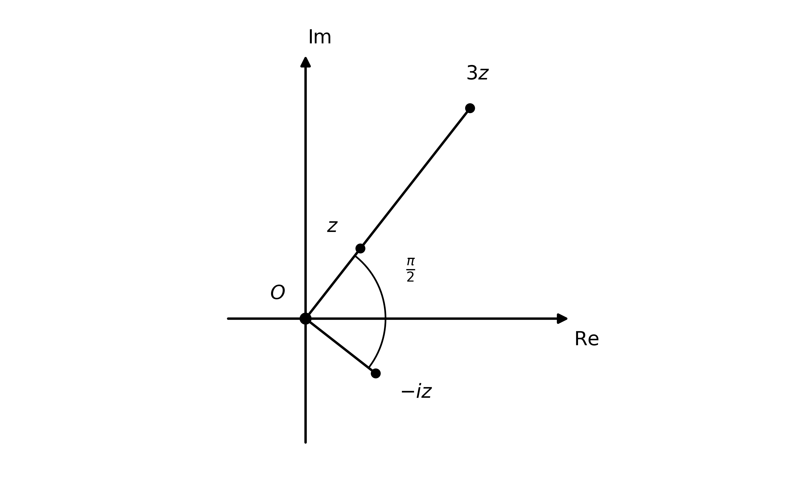
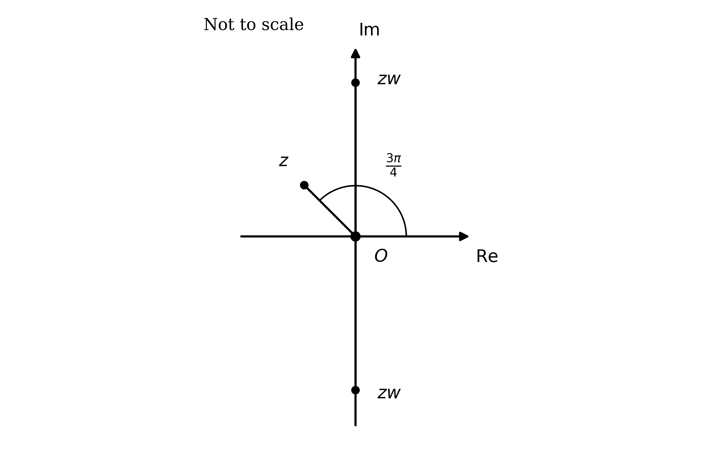
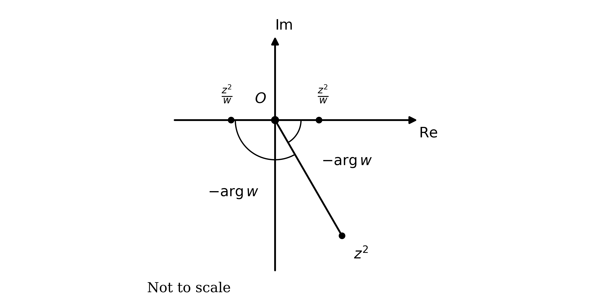
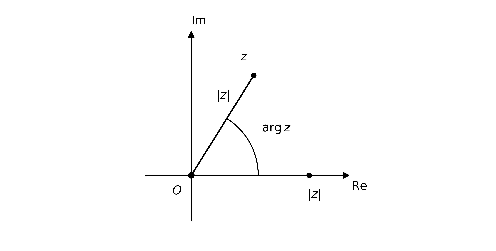
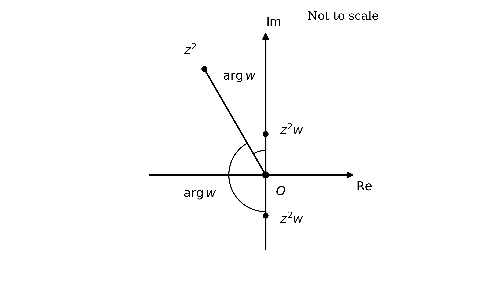
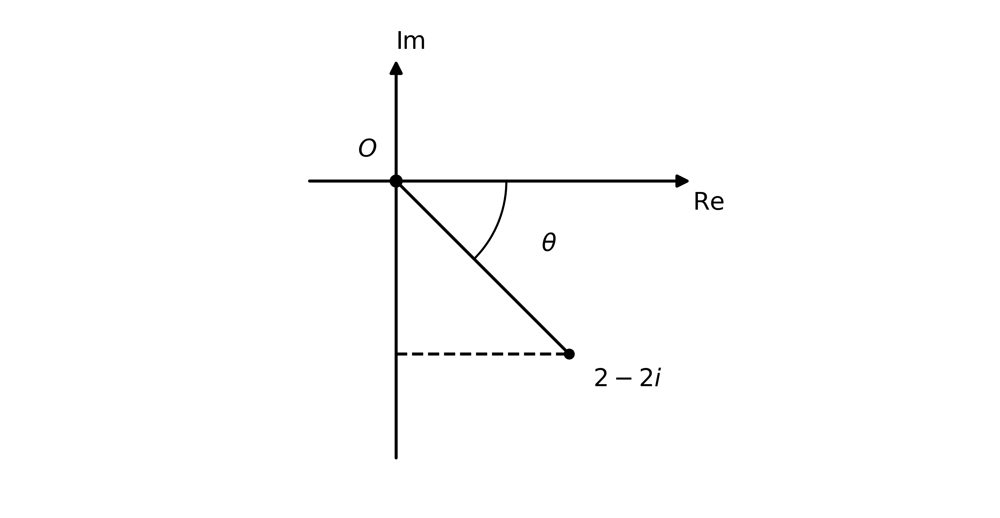
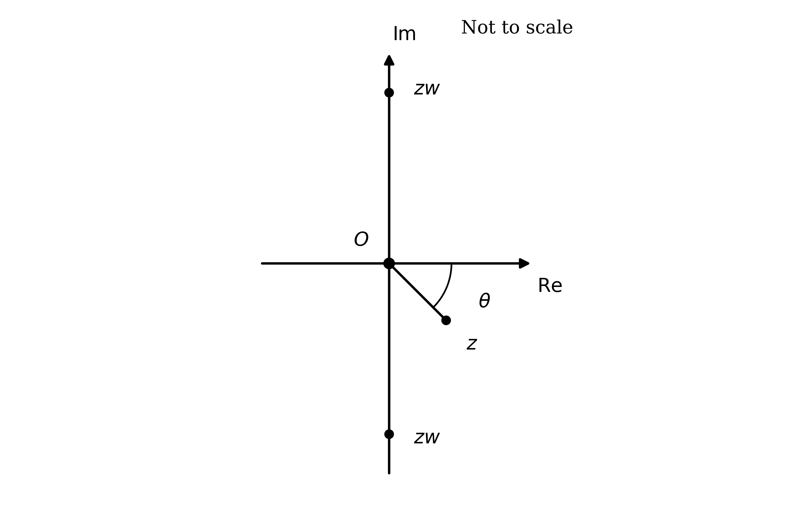
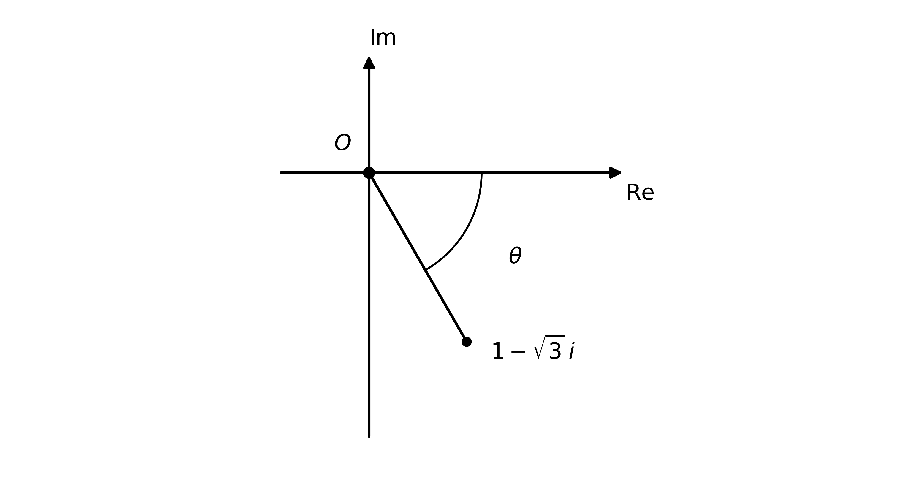

# Mark Schemes — Further Complex Numbers
**Complex Numbers** · Cambridge (CIE) A-LEVEL maths (9709)

## Exam Questions (22 questions)

### Q1
A square root of $z$ is a number whose square is $z$, so square the given number and compare the result with $z$

When two complex numbers are multiplied in modulus-argument form the moduli multiply and the arguments add, so for `z_{1} = r_{1} \left( \text{cos} \; \theta_{1} + i \, \text{sin} \; \theta_{1} \right)` and `z_{2} = r_{2} \left( \text{cos} \; \theta_{2} + i \, \text{sin} \; \theta_{2} \right)`

`z_{1} z_{2} = r_{1} r_{2} \left( \text{cos} \left( \theta_{1} + \theta_{2} \right) + i \, \text{sin} \left( \theta_{1} + \theta_{2} \right) \right)`

Apply this with both numbers equal to `3 \left( \text{cos} \dfrac{\pi}{3} + i \, \text{sin} \dfrac{\pi}{3} \right)`

`\left( 3 \left( \text{cos} \dfrac{\pi}{3} + i \, \text{sin} \dfrac{\pi}{3} \right) \right)^{2} = (3)(3) \left( \text{cos} \left( \dfrac{\pi}{3} + \dfrac{\pi}{3} \right) + i \, \text{sin} \left( \dfrac{\pi}{3} + \dfrac{\pi}{3} \right) \right)`

**[M1]**

Simplify the modulus and the argument

`= 9 \left( \text{cos} \dfrac{2 \pi}{3} + i \, \text{sin} \dfrac{2 \pi}{3} \right) = z`

Squaring the number returns $z$, which is what a square root has to do

**Final answer:** `3 \left( \text{cos} \dfrac{\pi}{3} + i \, \text{sin} \dfrac{\pi}{3} \right)`** is a square root of **$z$

**[A1]**

> **[mark-scheme]**
> **M1**: Correct method for squaring in modulus-argument form, multiplying the moduli and adding the arguments. The relationship between the arguments must be visible, either as a quoted rule or as a line showing $\frac{π}{3} + \frac{π}{3}$.
> 
> **A1**: Correct simplification to `9 \left( \text{cos} \dfrac{2 \pi}{3} + i \, \text{sin} \dfrac{2 \pi}{3} \right)`, together with a statement that this equals $z$ and so the number is a square root. Because the result is given, the conclusion must be written down.
Square this number the same way, multiplying the moduli and adding the arguments

`\left( 3 \left( \text{cos} \left( - \dfrac{2 \pi}{3} \right) + i \, \text{sin} \left( - \dfrac{2 \pi}{3} \right) \right) \right)^{2} = (3)(3) \left( \text{cos} \left( - \dfrac{2 \pi}{3} - \dfrac{2 \pi}{3} \right) + i \, \text{sin} \left( - \dfrac{2 \pi}{3} - \dfrac{2 \pi}{3} \right) \right)`

**[M1]**

Simplify the modulus and the argument

`= 9 \left( \text{cos} \left( - \dfrac{4 \pi}{3} \right) + i \, \text{sin} \left( - \dfrac{4 \pi}{3} \right) \right)`

The argument $- \frac{4π}{3}$ is not the one $z$ was given with, so use the fact that sine and cosine have period $2 π$ to add $2 π$ to it without changing the number

`= 9 \left( \text{cos} \left( - \dfrac{4 \pi}{3} + 2 \pi \right) + i \, \text{sin} \left( - \dfrac{4 \pi}{3} + 2 \pi \right) \right)`

**[M1]**

Evaluate the argument, since $- \frac{4π}{3} + 2 π = \frac{2π}{3}$

`= 9 \left( \text{cos} \dfrac{2 \pi}{3} + i \, \text{sin} \dfrac{2 \pi}{3} \right) = z`

**Final answer:** `3 \left( \text{cos} \left( - \dfrac{2 \pi}{3} \right) + i \, \text{sin} \left( - \dfrac{2 \pi}{3} \right) \right)`** is also a square root of **$z$

**[A1]**

> **[mark-scheme]**
> **M1**: Correct method for squaring in modulus-argument form, reaching an argument of $- \frac{4π}{3}$ or an unsimplified equivalent.
> 
> **M1**: Correct use of the period of sine and cosine, adding $2 π$ to the argument. Accept subtracting $2 π$ from $\frac{2π}{3}$ if the argument is worked in the other direction.
> 
> **A1**: Correct simplification to `9 \left( \text{cos} \dfrac{2 \pi}{3} + i \, \text{sin} \dfrac{2 \pi}{3} \right)`, with a statement that this equals $z$ and so the number is a second square root. Because the result is given, the conclusion must be written down.
Start from the right-hand side and treat the minus sign as a factor of $- 1$, so that the given form can be substituted in

`- 3 \left( \text{cos} \dfrac{\pi}{3} + i \, \text{sin} \dfrac{\pi}{3} \right) = \left( - 1 \right) \times 3 \left( \text{cos} \dfrac{\pi}{3} + i \, \text{sin} \dfrac{\pi}{3} \right)`

Replace $- 1$ by the modulus-argument form given in the question, which has modulus 1 and argument $- π$

`= 1 \left( \text{cos} \left( - \pi \right) + i \, \text{sin} \left( - \pi \right) \right) \times 3 \left( \text{cos} \dfrac{\pi}{3} + i \, \text{sin} \dfrac{\pi}{3} \right)`

**[M1]**

Multiply the moduli and add the arguments

`= (1)(3) \left( \text{cos} \left( - \pi + \dfrac{\pi}{3} \right) + i \, \text{sin} \left( - \pi + \dfrac{\pi}{3} \right) \right)`

Evaluate the argument, since $- π + \frac{π}{3} = - \frac{2π}{3}$

`3 \left( \text{cos} \left( - \dfrac{2 \pi}{3} \right) + i \, \text{sin} \left( - \dfrac{2 \pi}{3} \right) \right) = - 3 \left( \text{cos} \dfrac{\pi}{3} + i \, \text{sin} \dfrac{\pi}{3} \right)`

**[A1]**

The two square roots found in parts (a) and (b) therefore differ by a factor of $- 1$

**Final answer:** **The two square roots of **$z$** are negatives of each other, exactly as the two square roots of a positive real number are**

**[B1]**

> **[mark-scheme]**
> **M1**: Correct method, writing `-3 \left( \text{cos} \dfrac{\pi}{3} + i \, \text{sin} \dfrac{\pi}{3} \right)` as a product involving $- 1$ and substituting the given modulus-argument form for $- 1$. Working from either side is acceptable.
> 
> **A1**: Correct multiplication reaching the printed result, with the arguments added and evaluated. Because the result is given, every step must be visible.
> 
> **B1**: A statement that the two square roots are negatives of one another, matching the way a positive real number has square roots $\pm \sqrt{a}$. Accept any wording that makes the "one is minus the other" comparison. Accept an equivalent geometric statement, such as the two roots being half a turn apart on the Argand diagram.

### Q2
Exponential form is $z = r e^{iθ}$, so each number needs its modulus and its argument

The number $3$ sits on the positive real axis, so its distance from the origin is 3 and the angle it makes with the positive real axis is zero

`|3| = 3`

$\text{arg}  3 = 0$

$3 = 3 e^{0i}$

**[B1]**

The number $- i$ sits on the negative imaginary axis, one unit from the origin, so the angle turned from the positive real axis is a quarter turn clockwise

`|- i| = \sqrt{0^{2} + \left( - 1 \right)^{2}} = 1`

`\text{arg} \left( - i \right) = - \dfrac{\pi}{2}`

$- i = e^{-\frac{π}{2}i}$

**[B1]**

> **[mark-scheme]**
> **B1**: Correct exponential form for 3. Accept $3 e^{0i}$, $3 e^{0}$ or simply 3, since the argument is zero.
> 
> **B1**: Correct exponential form for $- i$. Accept $e^{-\frac{π}{2}i}$ or $1 e^{-\frac{π}{2}i}$. The equivalent form $e^{\frac{3π}{2}i}$ also scores, because the syllabus allows either interval for the argument.
(i)

Replace 3 by its exponential form from part (a), then collect the moduli and the exponentials separately

`3 z = \left( 3 e^{0 i} \right) \left( r e^{i \theta} \right) = (3)(r) \left( e^{0 i} \right) \left( e^{i \theta} \right)`

Use $a^{m} a^{n} = a^{m+n}$ to add the exponents

$3 z = 3 r e^{0i+iθ}$

Since $0 i + i θ = i θ$, the argument is unchanged

$3 z = 3 r e^{iθ}$

**[B1]**

(ii)

Replace $- i$ by its exponential form from part (a) and collect the factors in the same way

`- i z = \left( e^{- \frac{\pi}{2} i} \right) \left( r e^{i \theta} \right) = r e^{- \frac{\pi}{2} i + i \theta}`

Factorise $i$ out of the exponent

`- i z = r e^{i \left( \theta - \frac{\pi}{2} \right)}`

**[B1]**

> **[mark-scheme]**
> **B1**: Correct answer for (i), $3 r e^{iθ}$. Follow through from part (a) is allowed.
> 
> **B1**: Correct answer for (ii), `r e^{i \left( \theta - \frac{\pi}{2} \right)}`. Accept $r e^{iθ-\frac{π}{2}i}$ as an equivalent form. Follow through from part (a) is allowed.
> 
> The two answers are marked independently.
A transformation of the Argand diagram is fixed by what it does to the modulus, which is the distance from the origin, and to the argument, which is the angle turned from the positive real axis

(i)

Read the modulus and argument off $3 z = 3 r e^{iθ}$ and compare each with that of $z$

`|3 z| = 3 r = 3 |z|`

`\text{arg} \left( 3 z \right) = \theta = \text{arg} \; z`

The distance from the origin is tripled while the direction is unchanged

**Final answer:** **An enlargement, scale factor 3, centre the origin**

**[B1]**

(ii)

Do the same for `- i z = r e^{i \left( \theta - \frac{\pi}{2} \right)}`

`|- i z| = r = |z|`

`\text{arg} \left( - i z \right) = \theta - \dfrac{\pi}{2} = \text{arg} \; z - \dfrac{\pi}{2}`

The distance from the origin is unchanged and the argument decreases by $\frac{π}{2}$, and a decrease in the argument is a clockwise turn

**Final answer:** **A rotation of **$\frac{π}{2}$** radians clockwise about the origin**

**[B1]**

> **[mark-scheme]**
> No working is required. Each transformation may be written down directly, and there are several valid routes to it, so both marks are for the answer rather than for a method. There is one mark for each transformation.
> 
> **B1**: Enlargement identified, with both the scale factor 3 and the centre at the origin. Accept "stretch" or "scaling" for enlargement. The scale factor alone, with no centre, does not earn this mark.
> 
> **B1**: Rotation identified, with the angle $\frac{π}{2}$, the clockwise sense and the centre at the origin. Accept 90° for the angle, and accept "a rotation of $- \frac{π}{2}$ about the origin" as an equivalent statement of the sense. Omitting the direction of turn does not earn this mark.

### Q3
The modulus of a product is the product of the moduli, so `\left| z_{1} z_{2} \right| = \left| z_{1} \right| \left| z_{2} \right|` applied to $z w$ gives

`\left| z w \right| = \left| z \right| \left| w \right|`

Set this equal to the value given in the question and divide by `\left| z \right|`, which is non-zero

`\left| z \right| \left| w \right| = 5 \left| z \right|`

`\left| w \right| = 5`

**[B1]**

> **[mark-scheme]**
> **B1**: Correct value `\left| w \right| = 5`.
The real part of $z$ is negative and the imaginary part is positive, so $- 3 + 3 i$ lies in the second quadrant and the argument is $π$ minus the acute angle made with the negative real axis

`\text{arg} \; z = \pi - \text{tan}^{-1} \left( \dfrac{3}{3} \right) = \pi - \dfrac{\pi}{4}`

Subtract the fractions

$\text{arg}  z = \frac{3π}{4}$

**[B1]**

The question states that `\text{Re} \left( z w \right) = 0`, so $z w$ must lie on the imaginary axis, pointing either straight up or straight down

**Final answer:** `\text{arg} \left( z w \right) = \dfrac{\pi}{2}`** or **`\text{arg} \left( z w \right) = - \dfrac{\pi}{2}`

**[B1]**

> **[mark-scheme]**
> **B1**: Correct argument $\frac{3π}{4}$ obtained with the second-quadrant adjustment visible, such as $π - \text{tan}^{-1} 1$. Because the result is given, a bare answer does not score.
> 
> **B1**: Both values $\frac{π}{2}$ and $- \frac{π}{2}$ stated. Accept $\frac{3π}{2}$ in place of $- \frac{π}{2}$, since the syllabus allows either interval for the argument unless the question specifies one. One value only does not score.
The argument of a product is the sum of the arguments, so `\text{arg} \left( z w \right) = \text{arg} \; z + \text{arg} \; w`, which rearranges to

`\text{arg} \; w = \text{arg} \left( z w \right) - \text{arg} \; z`

Take the first value from part (b)

$\text{arg}  w = \frac{π}{2} - \frac{3π}{4} = - \frac{π}{4}$

**[M1]**

Now take the second value

$\text{arg}  w = - \frac{π}{2} - \frac{3π}{4} = - \frac{5π}{4}$

This lies outside the required interval, so add $2 π$, which does not change the complex number

$\text{arg}  w = - \frac{5π}{4} + 2 π = \frac{3π}{4}$

**Final answer:** $\text{arg}  w = - \frac{π}{4}$** or **$\text{arg}  w = \frac{3π}{4}$

**[A1]**

> **[mark-scheme]**
> **M1**: Correct rearrangement to `\text{arg} \; w = \text{arg} \left( z w \right) - \text{arg} \; z` with at least one value from part (b) substituted. Follow through from part (b) is allowed.
> 
> **A1**: Both values correct and inside the interval, $- \frac{π}{4}$ and $\frac{3π}{4}$. The adjustment by $2 π$ must have been carried out, so $- \frac{5π}{4}$ left unadjusted does not score.
Exponential form is $w = r e^{iθ}$, so combine the modulus from part (a) with each argument from part (c)

**Final answer:** $w = 5 e^{-\frac{π}{4}i}$** or **$w = 5 e^{\frac{3π}{4}i}$

**[B1]**

> **[mark-scheme]**
> **B1**: Both possibilities correct in exponential form. Follow through from parts (a) and (c) is allowed. One value only does not score.
Multiplying by $w$ scales the distance from the origin by `\left| w \right|` and turns the point through $\text{arg}  w$, so take those two effects in turn

Both values of $w$ have the same modulus, so the scaling is the same in each case

`\left| z w \right| = 5 \left| z \right|`

**Final answer:** **In both cases there is an enlargement, scale factor 5, centre the origin**

**[B1]**

For $w = 5 e^{-\frac{π}{4}i}$ the argument decreases, and a decrease in the argument is a clockwise turn

`\text{arg} \left( z w \right) = \dfrac{\pi}{2} = \text{arg} \; z - \dfrac{\pi}{4}`

**Final answer:** **This case also has a rotation of **$\frac{π}{4}$** radians clockwise about the origin**

**[B1]**

For $w = 5 e^{\frac{3π}{4}i}$ write the argument of $z w$ as $- \frac{π}{2} + 2 π$ so that it can be compared with $\text{arg}  z$ directly

`\text{arg} \left( z w \right) = - \dfrac{\pi}{2} + 2 \pi = \dfrac{3 \pi}{2} = \text{arg} \; z + \dfrac{3 \pi}{4}`

The argument increases, which is an anticlockwise turn

**Final answer:** **This case also has a rotation of **$\frac{3π}{4}$** radians anticlockwise about the origin**

**[B1]**

> **[mark-scheme]**
> **B1**: Enlargement of scale factor 5 centred on the origin, identified for both cases. Accept "stretch" or "scaling" for enlargement.
> 
> **B1**: Rotation of $\frac{π}{4}$ clockwise about the origin identified for $w = 5 e^{-\frac{π}{4}i}$. Accept 45° for the angle, and accept a rotation of $- \frac{π}{4}$ as an equivalent statement of the sense. The direction of turn is needed.
> 
> **B1**: Rotation of $\frac{3π}{4}$ anticlockwise about the origin identified for $w = 5 e^{\frac{3π}{4}i}$. Accept 135° for the angle. The direction of turn is needed.
> 
> The two effects may be described in either order, and a single combined description such as "an enlargement of scale factor 5 and a rotation of $\frac{π}{4}$ clockwise, both about the origin" earns the relevant marks.

### Q4
The modulus-argument form is `z = r \left( \text{cos} \; \theta + i \, \text{sin} \; \theta \right)`, so compare it with the given number to identify the modulus and the argument

$r = 6$

$θ = 2$

Exponential form writes the same complex number as $z = r e^{iθ}$

$6 e^{2i}$

**[B1]**

> **[mark-scheme]**
> **B1**: Correct exponential form, with modulus 6 and argument 2 in the right positions. Accept $6 e^{2i}$ or $6 e^{i2}$.
(i)

The modulus is the distance of the point from the origin, so use `|z| = \sqrt{x^{2} + y^{2}}` with $x = 3$ and $y = 3$

`|w| = \sqrt{3^{2} + 3^{2}} = \sqrt{18}`

Simplify the surd, since $18 = 9 \times 2$

`|w| = 3 \sqrt{2}`

**[B1]**

The argument satisfies $\text{tan}  θ = \frac{y}{x}$, and $3 + 3 i$ lies in the first quadrant, so the principal value of $\text{tan}^{-1}$ is the argument itself

`\text{arg} \; w = \text{tan}^{-1} \left( \dfrac{3}{3} \right) = \text{tan}^{-1} 1`

$\text{arg}  w = \frac{π}{4}$

**[B1]**

(ii)

Substitute $r = 3 \sqrt{2}$ and $θ = \frac{π}{4}$ into `z = r \left( \text{cos} \; \theta + i \, \text{sin} \; \theta \right)`

`3 \sqrt{2} \left( \text{cos} \; \dfrac{\pi}{4} + i \, \text{sin} \; \dfrac{\pi}{4} \right)`

**[B1]**

The same two values in $z = r e^{iθ}$ give the exponential form

$3 \sqrt{2} e^{\frac{π}{4}i}$

**[B1]**

> **[mark-scheme]**
> **B1**: Correct exact modulus $3 \sqrt{2}$. Accept $\sqrt{18}$ as an equivalent exact form. A decimal such as 4.24 does not score, because exact values are required.
> 
> **B1**: Correct exact argument $\frac{π}{4}$, from $\text{tan}^{-1}$ of the imaginary part divided by the real part. A decimal such as 0.785 does not score. Accept 45° only if the modulus-argument form in (ii) is then given consistently in degrees.
> 
> **B1**: Correct modulus-argument form, consistent with the modulus and argument found in (i). Follow through from (i) is allowed.
> 
> **B1**: Correct exponential form, consistent with the modulus and argument found in (i). Accept $3 \sqrt{2} e^{\frac{π}{4}i}$ or $3 \sqrt{2} e^{\frac{1}{4}πi}$. Follow through from (i) is allowed.

### Q5
Write the product with the moduli collected together and the exponentials collected together, so the laws of indices can be applied to the exponents

`z_{1} z_{2} = \left( 8 e^{- i} \right) \left( 2 e^{2 i} \right) = (8)(2) \left( e^{- i} \right) \left( e^{2 i} \right)`

Use $a^{m} a^{n} = a^{m+n}$ to add the exponents

$z_{1} z_{2} = 16 e^{-i+2i}$

Simplify the exponent

$z_{1} z_{2} = 16 e^{i}$

**[B1]**

Do the same for the quotient, collecting the moduli and the exponentials separately

`\dfrac{z_{1}}{z_{2}} = \dfrac{8 e^{- i}}{2 e^{2 i}} = \left( \dfrac{8}{2} \right) \left( \dfrac{e^{- i}}{e^{2 i}} \right)`

Use $\frac{a^{m}}{a^{n}} = a^{m-n}$ to subtract the exponents

$\frac{z_{1}}{z_{2}} = 4 e^{-i-2i}$

Simplify the exponent

$\frac{z_{1}}{z_{2}} = 4 e^{-3i}$

**[B1]**

> **[mark-scheme]**
> **B1**: Correct product $16 e^{i}$ in exponential form. Accept $16 e^{1i}$.
> 
> **B1**: Correct quotient $4 e^{-3i}$ in exponential form.
> 
> The two answers are marked independently, so a correct product and an incorrect quotient still earns the first mark.
Exponential form is $z = r e^{iθ}$ and modulus-argument form is `z = r \left( \text{cos} \; \theta + i \, \text{sin} \; \theta \right)`, so the same $r$ and $θ$ carry across from part (a)

For the product, $r = 16$ and $θ = 1$

`z_{1} z_{2} = 16 \left( \text{cos} \; 1 + i \, \text{sin} \; 1 \right)`

**[B1]**

For the quotient, $r = 4$ and $θ = - 3$, which already lies in the interval $- π < θ \leq π$

`\dfrac{z_{1}}{z_{2}} = 4 \left( \text{cos} \left( - 3 \right) + i \, \text{sin} \left( - 3 \right) \right)`

**[B1]**

> **[mark-scheme]**
> **B1**: Correct modulus-argument form for the product, `16 \left( \text{cos} \; 1 + i \, \text{sin} \; 1 \right)`.
> 
> **B1**: Correct modulus-argument form for the quotient, `4 \left( \text{cos} \left( - 3 \right) + i \, \text{sin} \left( - 3 \right) \right)`. Accept `4 \left( \text{cos} \; 3 - i \, \text{sin} \; 3 \right)` as an equivalent form.
> 
> Follow through from part (a) is allowed, so a correct conversion of an incorrect exponential form still earns the mark.

### Q6
(i)

A modulus cannot be negative, so the leading minus sign cannot stay outside the bracket. Take it inside instead

`- 5 \left( \text{cos} \; 2 - i \, \text{sin} \; 2 \right) = 5 \left( - \text{cos} \; 2 + i \, \text{sin} \; 2 \right)`

The bracket now needs to look like $\text{cos}  θ + i  \text{sin}  θ$ for a single angle $θ$. The identities `\text{cos} \left( \pi - x \right) \equiv - \text{cos} \; x` and `\text{sin} \left( \pi - x \right) \equiv \text{sin} \; x` turn both terms into functions of $π - 2$ at once

`= 5 \left( \text{cos} \left( \pi - 2 \right) + i \, \text{sin} \left( \pi - 2 \right) \right)`

**[M1]**

The modulus is 5 and the argument is $π - 2$

`5 e^{\left( \pi - 2 \right) i}`

**[A1]**

(ii)

Use `|z| = \sqrt{x^{2} + y^{2}}`, expanding each squared bracket

`\sqrt{\left( \sqrt{2} - \sqrt{6} \right)^{2} + \left( \sqrt{2} + \sqrt{6} \right)^{2}} = \sqrt{\left( 8 - 2 \sqrt{12} \right) + \left( 8 + 2 \sqrt{12} \right)}`

The surd terms cancel, which is what makes the modulus come out whole

$= \sqrt{16} = 4$

**[B1]**

For the quadrant, compare the surds. Since $\sqrt{2} < \sqrt{6}$, the real part $\sqrt{2} - \sqrt{6}$ is negative, and the imaginary part `- \left( \sqrt{2} + \sqrt{6} \right)` is negative as well, so the number lies in the third quadrant

Measuring clockwise from the positive real axis reaches the negative real axis at $- π$, and the point sits an acute angle back from there, so add that angle on

`\text{arg} = - \pi + \text{tan}^{-1} \left( \dfrac{\sqrt{6} + \sqrt{2}}{\sqrt{6} - \sqrt{2}} \right)`

Rationalising the fraction gives $2 + \sqrt{3}$, whose inverse tangent is $\frac{5π}{12}$

$= - π + \frac{5π}{12} = - \frac{7π}{12}$

Pair the argument with the modulus

$4 e^{-\frac{7π}{12}i}$

**[B1]**

> **[exam-tip]**
> A minus sign in front of a modulus-argument bracket is never part of the modulus, because a modulus is a distance and distances are not negative. Push it inside and absorb it into the angle instead. Here that turns $- \text{cos}  2$ into `\text{cos} \left( \pi - 2 \right)` and leaves the sine alone, which is exactly the pair of identities you need.

> **[mark-scheme]**
> **M1**: Correct method for part (i), moving the minus sign inside the bracket and using `\text{cos} \left( \pi - x \right) \equiv - \text{cos} \; x` together with `\text{sin} \left( \pi - x \right) \equiv \text{sin} \; x` to reach a single argument. Accept the equivalent route of writing $- 1 = e^{iπ}$ and $\text{cos}  2 - i  \text{sin}  2 = e^{-2i}$, then combining the exponents.
> 
> **A1**: Correct answer `5 e^{\left( \pi - 2 \right) i}`. Accept `5 e^{i \left( \pi - 2 \right)}`. A decimal argument such as 1.14 does not score, because exact values are required.
> 
> **B1**: Correct modulus 4 for part (ii), with the expansion of the brackets shown.
> 
> **B1**: Correct exact argument $- \frac{7π}{12}$, obtained with the third-quadrant adjustment, combined with the modulus to give $4 e^{-\frac{7π}{12}i}$. Accept the equivalent argument $\frac{17π}{12}$. An argument of $\frac{5π}{12}$, from using $\text{tan}^{-1}$ without adjusting for the quadrant, does not score.

### Q7
Write $z$ in exponential form as $z = r e^{iθ}$ and square it, so that the modulus and argument of $z^{2}$ can be compared with those of $z$

`z^{2} = \left( r e^{i \theta} \right)^{2} = r^{2} e^{i \left( 2 \theta \right)}`

`\left| z^{2} \right| = r^{2}`

`\text{arg} \left( z^{2} \right) = 2 \theta`

**[M1]**

Now compare the triangle formed by $O$, 1 and $z$ with the triangle formed by $O$, $z$ and $z^{2}$. In the first, the sides from $O$ have lengths 1 and $r$ with angle $θ$ between them. In the second they have lengths $r$ and $r^{2}$, again with angle $θ$ between them, since $2 θ - θ = θ$. Each side of the second is the matching side of the first multiplied by $r$

**Final answer:** **Triangles **$O 1 z$** and **$O z z^{2}$** are similar, with scale factor **$r$

**[A1]**

So the construction is to build, on the side $O z$, a triangle similar to $O 1 z$, with $O z$ taking the role that $O 1$ had. The third vertex of that triangle is $z^{2}$

**[B1]**

> **[mark-scheme]**
> **M1**: Correct method, obtaining `\left| z^{2} \right| = r^{2}` and `\text{arg} \left( z^{2} \right) = 2 \theta`, by squaring the exponential form or by using the results that moduli multiply and arguments add.
> 
> **A1**: The similarity of triangles $O 1 z$ and $O z z^{2}$ identified, with the scale factor $r$ stated and the correspondence made clear. Accept a description of the construction that makes the same point without the word "similar", provided both the angle $θ$ at $O$ and the scaling by $r$ are stated.
> 
> **B1**: A sketch showing $O$, 1, $z$ and $z^{2}$ in consistent positions, with both triangles drawn. Accept any position of $z$ provided the diagram is self-consistent. The equal angles at $O$ or the side lengths should be indicated.
Multiplying by $2 - i$ has no single simple geometrical effect, but the bracket can be split into two terms whose effects are each straightforward

`\left( 2 - i \right) z = 2 z - i z = 2 z + \left( - i z \right)`

**[M1]**

Each of those two points can be constructed from $z$ on its own. Doubling multiplies the modulus by 2 and leaves the argument alone, while multiplying by $- i$ leaves the modulus alone and decreases the argument by $\frac{π}{2}$, since $- i = e^{-\frac{π}{2}i}$

**Final answer:** **Enlarge **$z$** by scale factor 2, centre the origin, to reach **$2 z$

**Final answer:** **Rotate **$z$** by **$\frac{π}{2}$** radians clockwise about the origin to reach **$- i z$

**[A1]**

Adding two complex numbers on an Argand diagram places the sum at the fourth vertex of the parallelogram whose other three vertices are the origin and the two points, so complete that parallelogram

**Final answer:** **The fourth vertex of the parallelogram with vertices **$O$**, **$2 z$** and **$- i z$** is the point **`\left( 2 - i \right) z`

**[B1]**

> **[mark-scheme]**
> **M1**: Splitting the product as `2 z + \left( - i z \right)`, or any equivalent decomposition into two terms that can each be constructed.
> 
> **A1**: Both constructions described correctly: an enlargement of scale factor 2 centred on the origin for $2 z$, and a rotation of $\frac{π}{2}$ clockwise about the origin for $- i z$. The direction of the rotation is needed.
> 
> **B1**: The parallelogram rule used to combine them, with a sketch showing $z$, $2 z$, $- i z$ and `\left( 2 - i \right) z` in consistent positions and the parallelogram completed. Do not require the right angle to be marked, but accept and credit a sketch that identifies the shape as a rectangle.

### Q8
(i)

Collect the moduli and the exponentials separately, then add the exponents

`z_{1} z_{2} = \left( 14 e^{9 i} \right) \left( 10 e^{- 2 i} \right) = 140 e^{9 i + \left( - 2 i \right)}`

Simplify the exponent

$z_{1} z_{2} = 140 e^{7i}$

**[B1]**

For the quotient, take care over which way round the division goes: it is $z_{2}$ divided by $z_{1}$, so the moduli divide and the exponent of $z_{1}$ is subtracted

$\frac{z_{2}}{z_{1}} = \frac{10e^{-2i}}{14e^{9i}} = \frac{10}{14} e^{-2i-9i}$

Simplify the fraction and the exponent

$\frac{z_{2}}{z_{1}} = \frac{5}{7} e^{-11i}$

**[B1]**

(ii)

Check each argument against the interval before converting. Since $π < 7$, the value 7 is outside, so subtract $2 π$

$7 - 2 π$

Check the result: $2 π$ is a little more than 6, so $0 < 7 - 2 π < π$ and one subtraction is enough

`z_{1} z_{2} = 140 \left( \text{cos} \left( 7 - 2 \pi \right) + i \, \text{sin} \left( 7 - 2 \pi \right) \right)`

**[B1]**

Now the quotient. Since $- 11 < - π$, the value $- 11$ is outside the interval, and adding $2 π$ once only reaches about -4.7, which is still below $- π$. Add $2 π$ a second time

$- 11 + 4 π$

Check the result: $4 π$ is a little more than 12, so $0 < - 11 + 4 π < π$ and the argument is now inside the interval

`\dfrac{z_{2}}{z_{1}} = \dfrac{5}{7} \left( \text{cos} \left( 4 \pi - 11 \right) + i \, \text{sin} \left( 4 \pi - 11 \right) \right)`

**[B1]**

> **[mark-scheme]**
> **B1**: Correct product $140 e^{7i}$ in exponential form.
> 
> **B1**: Correct quotient $\frac{5}{7} e^{-11i}$ in exponential form. An answer of $\frac{7}{5} e^{11i}$, from dividing the wrong way round, does not score.
> 
> **B1**: Correct modulus-argument form for the product, with the argument given exactly as $7 - 2 π$. A decimal such as 0.717 does not score, and an unadjusted argument of 7 does not score.
> 
> **B1**: Correct modulus-argument form for the quotient, with the argument given exactly as $4 π - 11$. Accept $- 11 + 4 π$. An argument of $- 11 + 2 π$, adjusted only once and so still outside the interval, does not score.
> 
> The two answers in part (i) are marked independently, so a correct product still earns the first mark even if the quotient is inverted.
> 
> Follow through from part (i) is allowed in part (ii).

### Q9
Both conditions involve $z^{2}$, so find the modulus and argument of $z$ first and carry them through the squaring

`\left| z \right| = \sqrt{\left( \sqrt{3} \right)^{2} + \left( - 1 \right)^{2}} = \sqrt{4} = 2`

The real part is positive and the imaginary part is negative, so $z$ lies in the fourth quadrant, which means its argument is negative

`\text{arg} \; z = - \text{tan}^{-1} \left( \dfrac{1}{\sqrt{3}} \right) = - \dfrac{\pi}{6}`

Squaring a complex number squares the modulus and doubles the argument

`\left| z^{2} \right| = 2^{2} = 4`

`\text{arg} \left( z^{2} \right) = 2 \times \left( - \dfrac{\pi}{6} \right) = - \dfrac{\pi}{3}`

**[B1]**

Now use the modulus condition. The modulus of a quotient is the quotient of the moduli, so `\left| \dfrac{z^{2}}{w} \right| = \dfrac{\left| z^{2} \right|}{\left| w \right|}`, and this equals `\dfrac{1}{2} \left| z \right|`

`\dfrac{4}{\left| w \right|} = \dfrac{1}{2} \times 2 = 1`

`\left| w \right| = 4`

**[B1]**

The question states that `\text{Im} \left( \dfrac{z^{2}}{w} \right) = 0`, so $\frac{z^{2}}{w}$ must lie on the real axis, pointing either along the positive real axis or along the negative real axis

`\text{arg} \left( \dfrac{z^{2}}{w} \right) = 0`* or *`\text{arg} \left( \dfrac{z^{2}}{w} \right) = \pi`

The argument of a quotient is the difference of the arguments, and since $w$ is in the denominator its argument is subtracted

`\text{arg} \left( \dfrac{z^{2}}{w} \right) = \text{arg} \left( z^{2} \right) - \text{arg} \; w`

Rearrange to make $\text{arg}  w$ the subject

`\text{arg} \; w = \text{arg} \left( z^{2} \right) - \text{arg} \left( \dfrac{z^{2}}{w} \right)`

**[M1]**

Take each position of $\frac{z^{2}}{w}$ in turn

$\text{arg}  w = - \frac{π}{3} - 0 = - \frac{π}{3}$

$\text{arg}  w = - \frac{π}{3} - π = - \frac{4π}{3}$

The second value is below $- π$, so add $2 π$ to bring it into the standard interval

$\text{arg}  w = - \frac{4π}{3} + 2 π = \frac{2π}{3}$

Pair each argument with the modulus

**Final answer:** $w = 4 e^{-\frac{π}{3}i}$** or **$w = 4 e^{\frac{2π}{3}i}$

**[A1]**

> **[mark-scheme]**
> **B1**: Correct modulus and argument of $z^{2}$, namely 4 and $- \frac{π}{3}$. Accept these reached either by squaring the modulus and doubling the argument, or by expanding $z^{2}$ into Cartesian form first and working from $2 - 2 \sqrt{3} i$.
> 
> **B1**: Correct modulus `\left| w \right| = 4`.
> 
> **M1**: Correct method, identifying both possible values of `\text{arg} \left( \dfrac{z^{2}}{w} \right)` as 0 and $π$ and using the argument relationship for a quotient to reach $\text{arg}  w$. Accept the equivalent geometrical statement that $z^{2}$ is rotated through $\frac{π}{3}$ anticlockwise or $\frac{2π}{3}$ clockwise.
> 
> **A1**: Both possibilities correct in exponential form, $4 e^{-\frac{π}{3}i}$ and $4 e^{\frac{2π}{3}i}$. Both are needed. Accept $\frac{5π}{3}$ in place of $- \frac{π}{3}$, since the question does not specify an interval.

### Q10
In exponential form the number in the exponent is the argument, which is the angle turned from the positive real axis, so changing it rotates the point about the origin

**Final answer:** **Adding **$2 π$** to the argument is a rotation of **$2 π$** radians about the origin, which is a complete turn**

**[B1]**

A complete turn brings the point back to where it started, whatever the starting angle was, and the modulus $r$ is the same on both sides

**Final answer:** **The point returns to its starting position for every value of **$θ$**, so the two expressions represent the same complex number**

**[B1]**

> **[mark-scheme]**
> **B1**: A statement that adding $2 π$ to the argument corresponds to a full rotation about the origin. Accept 360° for $2 π$.
> 
> **B1**: A statement that the rotation returns the point to the same position, so the two expressions are the same complex number. A bare assertion that the two sides are equal, with no reference to the rotation or to position on the Argand diagram, does not earn this mark.
Give the unknown square root its own modulus and argument, writing it as $ρ e^{iα}$, then square it. Squaring squares the modulus and doubles the argument

`\left( \rho e^{i \alpha} \right)^{2} = \rho^{2} e^{i \left( 2 \alpha \right)}`

A square root of $z$ satisfies `\left( \rho e^{i \alpha} \right)^{2} = z`, so equate this to $z$ in the form given

`\rho^{2} e^{i \left( 2 \alpha \right)} = r e^{i \theta}`

**[M1]**

Two complex numbers in exponential form are equal when their moduli and arguments match, so compare each

$ρ^{2} = r \Rightarrow ρ = \sqrt{r}$

$2 α = θ \Rightarrow α = \frac{θ}{2}$

$\sqrt{r}  e^{i\frac{θ}{2}}$

**[A1]**

Part (a) shows $z$ may equally be written as `r e^{i \left( \theta + 2 \pi \right)}`, and equating against that version gives a second, different argument

`\rho^{2} e^{i \left( 2 \alpha \right)} = r e^{i \left( \theta + 2 \pi \right)}`

$2 α = θ + 2 π \Rightarrow α = \frac{θ}{2} + π$

The modulus is unchanged, so this gives the second square root

`\sqrt{r} \, e^{i \left( \frac{\theta}{2} + \pi \right)}`

**[A1]**

> **[mark-scheme]**
> **M1**: Correct method, writing a square root as $ρ e^{iα}$ or equivalent, squaring it to `\rho^{2} e^{i \left( 2 \alpha \right)}` and equating to $z$. Any letters may be used for the unknown modulus and argument.
> 
> **A1**: First square root correct, $\sqrt{r}  e^{i\frac{θ}{2}}$.
> 
> **A1**: Second square root correct, `\sqrt{r} \, e^{i \left( \frac{\theta}{2} + \pi \right)}`, obtained by using the result of part (a). Accept $\sqrt{r}  e^{i\frac{θ+2π}{2}}$ or $- \sqrt{r}  e^{i\frac{θ}{2}}$ as equivalent forms. Both roots are needed, and a second root obtained by subtracting $2 π$ instead, giving $\frac{θ}{2} - π$, is also accepted.

### Q11
The note allows $i$ to be treated as a constant, so differentiate term by term with respect to $θ$

$\frac{\text{d}z}{\text{d}θ} = - \text{sin}  θ + i  \text{cos}  θ$

**[M1]**

The target has $i$ as a factor, so the leading minus sign needs to become one. Since $i^{2} = - 1$, the first term can be rewritten with $i^{2}$ in place of $- 1$

$= i^{2}  \text{sin}  θ + i  \text{cos}  θ$

Both terms now carry a factor of $i$, so take it out

`= i \left( i \, \text{sin} \; \theta + \text{cos} \; \theta \right) = i \left( \text{cos} \; \theta + i \, \text{sin} \; \theta \right)`

The bracket is $z$ itself

$\frac{\text{d}z}{\text{d}θ} = i z$

**[A1]**

> **[mark-scheme]**
> **M1**: Correct differentiation term by term, giving $- \text{sin}  θ + i  \text{cos}  θ$.
> 
> **A1**: Correct manipulation to `i \left( \text{cos} \; \theta + i \, \text{sin} \; \theta \right)`, with the use of $i^{2} = - 1$ visible, and the conclusion that this equals $i z$ stated. Because the result is given, the factorising step must be shown.

### Q12
Each case is settled by asking what happens to the modulus, which is the distance from the origin, and to the argument, which is the angle turned from the positive real axis. Writing $z$ in exponential form as `z = |z| e^{i \, \text{arg} \; z}` keeps the two separate

(i)

The multiplier $- 2$ is a real number with modulus 2 and argument $π$, so write it in exponential form and multiply

`- 2 z = \left( 2 e^{\pi i} \right) \left( |z| e^{i \, \text{arg} \; z} \right) = 2 |z| e^{i \left( \text{arg} \; z + \pi \right)}`

The modulus has doubled

**Final answer:** **An enlargement, scale factor 2, centre the origin**

**[B1]**

The argument has increased by $π$

**Final answer:** **A rotation of **$π$** radians about the origin**

**[B1]**

(ii)

Here the image is a real number, so compare its modulus and argument with those of $z$ directly. A positive real number lies on the positive real axis, so its argument is zero, and its distance from the origin is `|z|` itself

`\left| \, |z| \, \right| = |z|`

`\text{arg} \left( |z| \right) = 0`

The distance from the origin is the same for both points, so nothing is enlarged. The argument has been reduced from $\text{arg}  z$ to zero, and a decrease in the argument is a clockwise turn

**Final answer:** **A rotation of **$\text{arg}  z$** radians clockwise about the origin**

**[B1]**

(iii)

Write $w$ in exponential form and divide, so the moduli divide and the arguments subtract

`\dfrac{z}{w} = \dfrac{|z| e^{i \, \text{arg} \; z}}{|w| e^{i \, \text{arg} \; w}} = \dfrac{|z|}{|w|} e^{i \left( \text{arg} \; z - \text{arg} \; w \right)}`

The modulus has been multiplied by `\dfrac{1}{|w|}`

**Final answer:** **An enlargement, scale factor **`\dfrac{1}{|w|}`**, centre the origin**

**[B1]**

The argument has decreased by $\text{arg}  w$

**Final answer:** **A rotation of **$\text{arg}  w$** radians clockwise about the origin**

**[B1]**

> **[exam-tip]**
> Part (ii) looks unlike the others because `|z|` is not $z$ multiplied by anything obvious, but it still yields to the same question: what are its modulus and its argument? Once you see that the modulus is unchanged and the argument has become zero, the transformation has to be a pure rotation, and the angle has to be whatever undoes $\text{arg}  z$.

> **[mark-scheme]**
> No working is required anywhere in this question. Each transformation may be written down directly, and there are several valid routes to it, so every mark is for a component of the answer rather than for a method. There is one mark for each transformation: parts (i) and (iii) are an enlargement together with a rotation, so carry two marks each, and part (ii) is a single rotation, so carries one. Where two transformations are needed they may be given in either order.
> 
> **B1**: For $- 2 z$, an enlargement of scale factor 2 centred on the origin. Accept "stretch" or "scaling" for enlargement. A scale factor with no centre does not score.
> 
> **B1**: For $- 2 z$, a rotation of $π$ radians about the origin. Accept 180°. Because a rotation of $π$ is the same either way, the sense need not be stated, but accept it if given.
> 
> **B1**: For `\left| z \right|`, a rotation of $\text{arg}  z$ clockwise about the origin. Accept "a rotation of $- \text{arg}  z$ about the origin" as an equivalent statement of the sense. An answer giving the angle with no direction of turn does not score. Do not penalise an answer that adds "and no change of size".
> 
> **B1**: For $\frac{z}{w}$, an enlargement of scale factor `\dfrac{1}{|w|}` centred on the origin. Accept an equivalent description such as the distance from the origin being divided by `\left| w \right|`.
> 
> **B1**: For $\frac{z}{w}$, a rotation of $\text{arg}  w$ clockwise about the origin. Accept a rotation of $- \text{arg}  w$ anticlockwise. The direction of turn is needed.

### Q13
The right-hand side is in modulus-argument form, so start by putting $u$ into that form. Use `|z| = \sqrt{x^{2} + y^{2}}` with $x = - 5 \sqrt{3}$ and $y = - 5$

`|u| = \sqrt{\left( - 5 \sqrt{3} \right)^{2} + \left( - 5 \right)^{2}} = \sqrt{75 + 25} = \sqrt{100} = 10`

**[B1]**

Both the real and imaginary parts are negative, so $u$ lies in the third quadrant. Measuring clockwise from the positive real axis reaches the negative real axis at $- π$, and the point sits a further acute angle back from there

The acute angle has tangent $\frac{5}{5\sqrt{3}}$, so add it back on to $- π$

`\text{arg} \; u = - \pi + \text{tan}^{-1} \left( \dfrac{5}{5 \sqrt{3}} \right) = - \pi + \dfrac{\pi}{6} = - \dfrac{5 \pi}{6}`

**[B1]**

So in modulus-argument form

`u = 10 \left( \text{cos} \left( - \dfrac{5 \pi}{6} \right) + i \, \text{sin} \left( - \dfrac{5 \pi}{6} \right) \right)`

Now square $z$. Multiplying two complex numbers in modulus-argument form multiplies the moduli and adds the arguments, so multiplying $z$ by itself squares the modulus and doubles the argument

`z^{2} = \left( r \left( \text{cos} \; \theta + i \, \text{sin} \; \theta \right) \right)^{2} = r^{2} \left( \text{cos} \; 2 \theta + i \, \text{sin} \; 2 \theta \right)`

Since $z$ is a square root of $u$, $z^{2} = u$, so the two expressions can be equated

`r^{2} \left( \text{cos} \; 2 \theta + i \, \text{sin} \; 2 \theta \right) = 10 \left( \text{cos} \left( \dfrac{- 5 \pi}{6} \right) + i \, \text{sin} \left( \dfrac{- 5 \pi}{6} \right) \right)`

**[B1]**

> **[mark-scheme]**
> **B1**: Correct modulus `|u| = 10`.
> 
> **B1**: Correct exact argument $- \frac{5π}{6}$, with the third-quadrant adjustment visible. A decimal such as -2.62 does not score. Accept $\frac{7π}{6}$ only if the modulus-argument form written down is then consistent with it. An argument of $\frac{π}{6}$, from using $\text{tan}^{-1}$ without adjusting for the quadrant, does not score.
> 
> **B1**: Correct squaring of $z$ in modulus-argument form to give `r^{2} \left( \text{cos} \; 2 \theta + i \, \text{sin} \; 2 \theta \right)`, equated to $u$ to reach the printed result. Because the result is given, the squaring step and the statement $z^{2} = u$ must both be visible.
The argument of a complex number is the angle turned from the positive real axis, so changing the argument rotates the point about the origin

**Final answer:** **Adding **$2 π$** to the argument is a rotation of **$2 π$** radians about the origin, which is a complete turn**

**[B1]**

A complete turn brings the point back to where it started, whatever the starting angle was, and the modulus is unchanged at 1 throughout

**Final answer:** **The point returns to its starting position for every value of **$α$**, so the two expressions represent the same complex number**

**[B1]**

> **[mark-scheme]**
> **B1**: A statement that adding $2 π$ to the argument corresponds to a full rotation about the origin. Accept 360° for $2 π$.
> 
> **B1**: A statement that the rotation returns the point to the same position, so the two expressions are the same complex number. The answer must hold for a general $α$, but no separate comment on generality is required provided nothing in the argument depends on a particular value. A bare assertion that the two sides are equal, with no reference to the rotation or to position on the Argand diagram, does not earn this mark.
Two complex numbers in modulus-argument form are equal when their moduli match and their arguments match, so compare each side of the result from part (a)

$r^{2} = 10 \Rightarrow r = \sqrt{10}$

$2 θ = - \frac{5π}{6} \Rightarrow θ = - \frac{5π}{12}$

**[M1]**

`\sqrt{10} \left( \text{cos} \left( - \dfrac{5 \pi}{12} \right) + i \, \text{sin} \left( - \dfrac{5 \pi}{12} \right) \right)`

The argument is not a standard angle, but $\frac{5π}{12} = \frac{π}{4} + \frac{π}{6}$, so the compound angle formulae give $\text{cos} \frac{5π}{12} = \frac{\sqrt{6}-\sqrt{2}}{4}$ and $\text{sin} \frac{5π}{12} = \frac{\sqrt{6}+\sqrt{2}}{4}$. Cosine is even and sine is odd, so substitute these in

`= \sqrt{10} \left( \dfrac{\sqrt{6} - \sqrt{2}}{4} - \dfrac{\sqrt{6} + \sqrt{2}}{4} i \right)`

Multiply through, using $\sqrt{10} \sqrt{6} = 2 \sqrt{15}$ and $\sqrt{10} \sqrt{2} = 2 \sqrt{5}$

$\frac{\sqrt{15}-\sqrt{5}}{2} - \frac{\sqrt{15}+\sqrt{5}}{2} i$

**[A1]**

Part (b) allows $2 π$ to be added to the argument on the right without changing the number, and $- \frac{5π}{6} + 2 π = \frac{7π}{6}$, so equating against that version gives the second root

`r^{2} \left( \text{cos} \; 2 \theta + i \, \text{sin} \; 2 \theta \right) = 10 \left( \text{cos} \dfrac{7 \pi}{6} + i \, \text{sin} \dfrac{7 \pi}{6} \right)`

$2 θ = \frac{7π}{6} \Rightarrow θ = \frac{7π}{12}$

**[M1]**

`\sqrt{10} \left( \text{cos} \dfrac{7 \pi}{12} + i \, \text{sin} \dfrac{7 \pi}{12} \right)`

Since $\frac{7π}{12} = π - \frac{5π}{12}$, the cosine changes sign while the sine does not

`= \sqrt{10} \left( - \dfrac{\sqrt{6} - \sqrt{2}}{4} + \dfrac{\sqrt{6} + \sqrt{2}}{4} i \right)`

$- \frac{\sqrt{15}-\sqrt{5}}{2} + \frac{\sqrt{15}+\sqrt{5}}{2} i$

**[A1]**

> **[mark-scheme]**
> **M1**: Correct method for the first root, equating moduli to obtain $r = \sqrt{10}$ and equating arguments to obtain $θ = - \frac{5π}{12}$.
> 
> **A1**: First root correct in both required forms, `\sqrt{10} \left( \text{cos} \left( - \dfrac{5 \pi}{12} \right) + i \, \text{sin} \left( - \dfrac{5 \pi}{12} \right) \right)` and $\frac{\sqrt{15}-\sqrt{5}}{2} - \frac{\sqrt{15}+\sqrt{5}}{2} i$. Accept `\dfrac{1}{2} \left( \sqrt{15} - \sqrt{5} \right)` for the real part. The exact values of $\text{cos} \frac{5π}{12}$ and $\text{sin} \frac{5π}{12}$ may be quoted or derived; decimals do not score, because the question asks for the form $a + b i$ with $a$ and $b$ exact.
> 
> **M1**: Correct use of part (b), adding $2 π$ to the argument on the right to reach $\frac{7π}{6}$ and hence $θ = \frac{7π}{12}$. Accept subtracting $2 π$ instead, which gives $2 θ = - \frac{17π}{6}$ and $θ = - \frac{17π}{12}$, an equivalent argument for the same second root.
> 
> **A1**: Second root correct in both required forms, `\sqrt{10} \left( \text{cos} \dfrac{7 \pi}{12} + i \, \text{sin} \dfrac{7 \pi}{12} \right)` and $- \frac{\sqrt{15}-\sqrt{5}}{2} + \frac{\sqrt{15}+\sqrt{5}}{2} i$. Accept the pair of roots written as `\pm \left( \dfrac{\sqrt{15} - \sqrt{5}}{2} - \dfrac{\sqrt{15} + \sqrt{5}}{2} i \right)`.

### Q14
Exponential form is $z = r e^{iθ}$, so compare $e^{iπ}$ with it to read off the modulus and the argument

`\left| e^{i \pi} \right| = 1`

`\text{arg} \left( e^{i \pi} \right) = \pi`

The same modulus and argument written in modulus-argument form `z = r \left( \text{cos} \; \theta + i \, \text{sin} \; \theta \right)` give

`e^{i \pi} = 1 \left( \text{cos} \; \pi + i \, \text{sin} \; \pi \right)`

**[B1]**

Substitute the exact values $\text{cos}  π = - 1$ and $\text{sin}  π = 0$

`e^{i \pi} = 1 \left( - 1 + i \times 0 \right) = 1 \times \left( - 1 \right)`

$e^{iπ} = - 1$

**[B1]**

Adding 1 to each side gives the required result

`e^{i \pi} + 1 = \left( - 1 \right) + 1 = 0`

**[B1]**

> **[mark-scheme]**
> **B1**: Correct identification of the modulus as 1 and the argument as $π$, leading to $e^{iπ}$ written in modulus-argument form as $\text{cos}  π + i  \text{sin}  π$. Accept the equivalent route of quoting $e^{iθ} = \text{cos}  θ + i  \text{sin}  θ$ and substituting $θ = π$.
> 
> **B1**: Correct evaluation of $\text{cos}  π = - 1$ and $\text{sin}  π = 0$, giving $e^{iπ} = - 1$. Both trig values are needed.
> 
> **B1**: Adding 1 and concluding that the result is 0. Because the result is given, this final line must be written down.

### Q15
(i)

Collect the moduli and the exponentials separately, then add the exponents

`z_{1} z_{2} = \left( 6 e^{4 i} \right) \left( 8 e^{- i} \right) = 48 e^{4 i + \left( - i \right)}`

Simplify the exponent

$z_{1} z_{2} = 48 e^{3i}$

**[B1]**

For the quotient, divide the moduli and subtract the exponents

`\dfrac{z_{1}}{z_{2}} = \dfrac{6 e^{4 i}}{8 e^{- i}} = \dfrac{6}{8} e^{4 i - \left( - i \right)}`

Simplify the fraction and the exponent

$\frac{z_{1}}{z_{2}} = \frac{3}{4} e^{5i}$

**[B1]**

(ii)

Part (ii) restricts the argument, so check each one against the interval before writing it down. Since $π$ is a little more than 3, the value 3 satisfies $0 < 3 < π$ and so needs no adjustment

`z_{1} z_{2} = 48 \left( \text{cos} \; 3 + i \, \text{sin} \; 3 \right)`

**[B1]**

The value 5 satisfies $π < 5 < 2 π$, so it lies outside the interval. Subtract $2 π$, which does not change the complex number

`\text{arg} \left( \dfrac{z_{1}}{z_{2}} \right) = 5 - 2 \pi`

This is negative and greater than $- π$, so it now lies in the interval, and the question asks for exact values so it is left in this form

`\dfrac{z_{1}}{z_{2}} = \dfrac{3}{4} \left( \text{cos} \left( 5 - 2 \pi \right) + i \, \text{sin} \left( 5 - 2 \pi \right) \right)`

**[B1]**

> **[mark-scheme]**
> **B1**: Correct product $48 e^{3i}$ in exponential form.
> 
> **B1**: Correct quotient $\frac{3}{4} e^{5i}$ in exponential form. Accept the modulus written as the decimal 0.75.
> 
> **B1**: Correct modulus-argument form for the product, `48 \left( \text{cos} \; 3 + i \, \text{sin} \; 3 \right)`.
> 
> **B1**: Correct modulus-argument form for the quotient, with the argument brought into the interval as $5 - 2 π$. The exact form is required, so a decimal such as -1.28 does not score, and an unadjusted argument of 5 does not score.
> 
> The two answers in part (i) are marked independently.
> 
> Follow through from part (i) is allowed in part (ii).

### Q16
Every condition here involves $z^{2}$, so start by finding the modulus and argument of $z$ and carrying them through the squaring

`\left| z \right| = \sqrt{3^{2} + \left( 3 \sqrt{3} \right)^{2}} = \sqrt{36} = 6`

Both parts of $z$ are positive, so $z$ lies in the first quadrant and the principal value of $\text{tan}^{-1}$ is the argument itself

`\text{arg} \; z = \text{tan}^{-1} \left( \dfrac{3 \sqrt{3}}{3} \right) = \text{tan}^{-1} \sqrt{3} = \dfrac{\pi}{3}`

Squaring a complex number squares the modulus and doubles the argument, since the moduli multiply and the arguments add

`\left| z^{2} \right| = 6^{2} = 36`

`\text{arg} \left( z^{2} \right) = 2 \times \dfrac{\pi}{3} = \dfrac{2 \pi}{3}`

**[B1]**

Now use the modulus condition. The modulus of a product is the product of the moduli, so `\left| z^{2} w \right| = \left| z^{2} \right| \left| w \right|`, and this equals `2 \left| z \right|`

`36 \left| w \right| = 2 \times 6 = 12`

`\left| w \right| = \dfrac{1}{3}`

**[B1]**

The question states that `\text{Re} \left( z^{2} w \right) = 0`, so $z^{2} w$ must lie on the imaginary axis, pointing either straight up or straight down

`\text{arg} \left( z^{2} w \right) = \dfrac{\pi}{2}`* or *`\text{arg} \left( z^{2} w \right) = - \dfrac{\pi}{2}`

The argument of a product is the sum of the arguments, so the turn applied to $z^{2}$ is the difference

`\text{arg} \; w = \text{arg} \left( z^{2} w \right) - \text{arg} \left( z^{2} \right)`

**[M1]**

Take each position in turn

$\text{arg}  w = \frac{π}{2} - \frac{2π}{3} = - \frac{π}{6}$

$\text{arg}  w = - \frac{π}{2} - \frac{2π}{3} = - \frac{7π}{6}$

The second value is below $- π$, so add $2 π$ to bring it into the standard interval

$\text{arg}  w = - \frac{7π}{6} + 2 π = \frac{5π}{6}$

Pair each argument with the modulus

**Final answer:** $w = \frac{1}{3} e^{-\frac{π}{6}i}$** or **$w = \frac{1}{3} e^{\frac{5π}{6}i}$

**[A1]**

> **[mark-scheme]**
> **B1**: Correct modulus and argument of $z^{2}$, namely 36 and $\frac{2π}{3}$. Accept these reached either by squaring the modulus and doubling the argument, or by expanding $z^{2}$ into Cartesian form first and working from $- 18 + 18 \sqrt{3} i$.
> 
> **B1**: Correct modulus `\left| w \right| = \dfrac{1}{3}`.
> 
> **M1**: Correct method, identifying both possible values of `\text{arg} \left( z^{2} w \right)` as $\frac{π}{2}$ and $- \frac{π}{2}$ and using `\text{arg} \left( z^{2} w \right) = \text{arg} \left( z^{2} \right) + \text{arg} \; w` to reach $\text{arg}  w$. Accept the equivalent geometrical statement that $z^{2}$ is rotated through $\frac{π}{6}$ clockwise or $\frac{5π}{6}$ anticlockwise.
> 
> **A1**: Both possibilities correct in exponential form, $\frac{1}{3} e^{-\frac{π}{6}i}$ and $\frac{1}{3} e^{\frac{5π}{6}i}$. Both are needed. Accept $\frac{11π}{6}$ in place of $- \frac{π}{6}$, since the question does not specify an interval.

### Q17
(i)

Modulus-argument form needs the modulus outside a bracket containing exactly $\text{cos}  θ + i  \text{sin}  θ$, so start by taking the factor of 2 out of the bracket

`3 \left( 2 \, \text{cos} \; 2 - 2 i \, \text{sin} \left( - 2 \right) \right) = 6 \left( \text{cos} \; 2 - i \, \text{sin} \left( - 2 \right) \right)`

The angle inside the sine is negative while the angle inside the cosine is positive, so use the identity `\text{sin} \left( - x \right) \equiv - \text{sin} \; x` to make them match

`= 6 \left( \text{cos} \; 2 - i \left( - \text{sin} \; 2 \right) \right) = 6 \left( \text{cos} \; 2 + i \, \text{sin} \; 2 \right)`

**[M1]**

This is now genuinely in modulus-argument form, with modulus 6 and argument 2

$6 e^{2i}$

**[A1]**

(ii)

Use `|z| = \sqrt{x^{2} + y^{2}}` with $x = - 2$ and $y = 2 \sqrt{3}$

`|- 2 + 2 \sqrt{3} i| = \sqrt{\left( - 2 \right)^{2} + \left( 2 \sqrt{3} \right)^{2}} = \sqrt{16} = 4`

**[B1]**

The real part is negative and the imaginary part is positive, so the point lies in the second quadrant

The acute angle made with the negative real axis has tangent $\frac{2\sqrt{3}}{2}$, and the argument is measured from the positive real axis, so subtract that acute angle from $π$

`\text{arg} \left( - 2 + 2 \sqrt{3} i \right) = \pi - \text{tan}^{-1} \left( \dfrac{2 \sqrt{3}}{2} \right) = \pi - \text{tan}^{-1} \sqrt{3} = \pi - \dfrac{\pi}{3}`

Subtract the fractions and pair the argument with the modulus

$4 e^{\frac{2π}{3}i}$

**[B1]**

> **[mark-scheme]**
> **M1**: Correct method for part (i), taking out the factor of 2 to give a modulus of 6 and using `\text{sin} \left( - x \right) \equiv - \text{sin} \; x` to reach the form `6 \left( \text{cos} \; 2 + i \, \text{sin} \; 2 \right)`. Both repairs are needed for this mark.
> 
> **A1**: Correct answer $6 e^{2i}$.
> 
> **B1**: Correct modulus 4 for part (ii).
> 
> **B1**: Correct argument $\frac{2π}{3}$, obtained with the second-quadrant adjustment, combined with the modulus to give $4 e^{\frac{2π}{3}i}$. An answer of $4 e^{-\frac{π}{3}i}$, which comes from using $\text{tan}^{-1}$ without adjusting for the quadrant, does not score.

### Q18
Writing $z$ in exponential form as `z = |z| e^{i \, \text{arg} \; z}` separates the two things a multiplication can do: the modulus fixes the distance from the origin, and the argument fixes the direction

(i)

Multiplying by the real number 4 multiplies the modulus by 4 and leaves the argument alone

**Final answer:** **An enlargement, scale factor 4, centre the origin**

**[B1]**

(ii)

Write $i$ in exponential form, since it has modulus 1 and argument $\frac{π}{2}$, then multiply

`i z = \left( e^{\frac{\pi}{2} i} \right) \left( |z| e^{i \, \text{arg} \; z} \right) = |z| e^{i \left( \text{arg} \; z + \frac{\pi}{2} \right)}`

The modulus is unchanged and the argument increases by $\frac{π}{2}$, and an increase in the argument is an anticlockwise turn

**Final answer:** **A rotation of **$\frac{π}{2}$** radians anticlockwise about the origin**

**[B1]**

(iii)

Write $w$ in exponential form as `w = |w| e^{i \, \text{arg} \; w}` and multiply as before

`w z = \left( |w| e^{i \, \text{arg} \; w} \right) \left( |z| e^{i \, \text{arg} \; z} \right) = |w| |z| e^{i \left( \text{arg} \; z + \text{arg} \; w \right)}`

The modulus is multiplied by `|w|`

**Final answer:** **An enlargement, scale factor **`|w|`**, centre the origin**

**[B1]**

The argument increases by $\text{arg}  w$, so there is a rotation as well

**Final answer:** **A rotation of **$\text{arg}  w$** radians anticlockwise about the origin**

**[B1]**

> **[exam-tip]**
> Describing the rotation in (iii) as anticlockwise through $\text{arg}  w$ covers every case at once, including a clockwise turn: if $\text{arg}  w$ is negative then an anticlockwise rotation through a negative angle is a clockwise rotation.

> **[mark-scheme]**
> No working is required anywhere in this question. Each transformation may be written down directly, and there are several valid routes to it, so every mark is for the answer rather than for a method. There is one mark for each transformation, so (i) and (ii) carry one each and (iii) carries two.
> 
> **B1**: Enlargement identified, with scale factor 4 and centre the origin. Accept "stretch" or "scaling". Omitting the centre does not earn this mark.
> 
> **B1**: Rotation identified, with the angle $\frac{π}{2}$, the anticlockwise sense and the centre the origin. Accept 90° for the angle.
> 
> **B1**: Enlargement identified, with scale factor `|w|` and centre the origin.
> 
> **B1**: Rotation identified, through $\text{arg}  w$ anticlockwise about the origin. Accept an answer split into cases, giving a clockwise rotation of `|\text{arg} \; w|` when $\text{arg}  w$ is negative, provided both cases are covered.
> 
> Both transformations in (iii) are needed, and they may be described in either order.

### Q19
(i)

Collect the moduli together and the exponentials together, then use $a^{m} a^{n} = a^{m+n}$ on the exponents

`z_{1} z_{2} = \left( 6 e^{i} \right) \left( 3 e^{- 2 i} \right) = 18 e^{i + \left( - 2 i \right)}`

Simplify the exponent

$z_{1} z_{2} = 18 e^{-i}$

**[B1]**

For the quotient, divide the moduli and use $\frac{a^{m}}{a^{n}} = a^{m-n}$

`\dfrac{z_{1}}{z_{2}} = \dfrac{6 e^{i}}{3 e^{- 2 i}} = 2 e^{i - \left( - 2 i \right)}`

Simplify the exponent

$\frac{z_{1}}{z_{2}} = 2 e^{3i}$

**[B1]**

Both arguments lie in the required interval, since $π$ is a little more than 3

(ii)

Exponential form and modulus-argument form carry the same $r$ and $θ$, so read them off each answer

`z_{1} z_{2} = 18 \left( \text{cos} \left( - 1 \right) + i \, \text{sin} \left( - 1 \right) \right)`

**[B1]**

`\dfrac{z_{1}}{z_{2}} = 2 \left( \text{cos} \; 3 + i \, \text{sin} \; 3 \right)`

**[B1]**

> **[mark-scheme]**
> **B1**: Correct product $18 e^{-i}$ in exponential form.
> 
> **B1**: Correct quotient $2 e^{3i}$ in exponential form.
> 
> **B1**: Correct modulus-argument form for the product. Accept `18 \left( \text{cos} \left( - 1 \right) + i \, \text{sin} \left( - 1 \right) \right)` or the equivalent `18 \left( \text{cos} \; 1 - i \, \text{sin} \; 1 \right)`.
> 
> **B1**: Correct modulus-argument form for the quotient, `2 \left( \text{cos} \; 3 + i \, \text{sin} \; 3 \right)`.
> 
> The two answers in part (i) are marked independently.
> 
> Follow through from part (i) is allowed in part (ii), so correct conversions of incorrect exponential forms still earn the B marks.

### Q20
(i)

Modulus-argument form and exponential form use the same $r$ and $θ$, so read them straight off

$7 e^{3i}$

**[B1]**

(ii)

This number is in Cartesian form, so use `|z| = \sqrt{x^{2} + y^{2}}` with $x = 2$ and $y = - 2$

`|2 - 2 i| = \sqrt{2^{2} + \left( - 2 \right)^{2}} = \sqrt{8}`

Simplify the surd, since $8 = 4 \times 2$

`|2 - 2 i| = 2 \sqrt{2}`

**[B1]**

The real part is positive and the imaginary part is negative, so the point lies in the fourth quadrant

A point in the fourth quadrant has a negative argument, so it is minus the acute angle whose tangent is $\frac{2}{2}$

`\text{arg} \left( 2 - 2 i \right) = - \text{tan}^{-1} \left( \dfrac{2}{2} \right) = - \text{tan}^{-1} 1 = - \dfrac{\pi}{4}`

Combine the modulus and the argument

$2 \sqrt{2} e^{-\frac{π}{4}i}$

**[B1]**

> **[mark-scheme]**
> **B1**: Correct answer $7 e^{3i}$.
> 
> **B1**: Correct exact modulus $2 \sqrt{2}$. Accept $\sqrt{8}$. A decimal such as 2.83 does not score, because exact values are required.
> 
> **B1**: Correct exact argument $- \frac{π}{4}$ combined with the modulus to give $2 \sqrt{2} e^{-\frac{π}{4}i}$. Accept $2 \sqrt{2} e^{-\frac{1}{4}πi}$. A decimal such as -0.785 does not score. The argument $\frac{7π}{4}$ does not score here, because the question specifies $- π < θ \leq π$.

### Q21
Exponential form needs a modulus and an argument, so find each in turn

The modulus of a product is the product of the moduli, so `\left| z w \right| = \left| z \right| \left| w \right|`, and this can be set equal to the value given in the question

`\left| z \right| \left| w \right| = 4 \left| z \right|`

Divide by `\left| z \right|`, which is non-zero, so the value of `\left| z \right|` is never needed

`\left| w \right| = 4`

**[B1]**

Now place $z$ on the Argand diagram. Its real part is positive and its imaginary part is negative, so it lies in the fourth quadrant

A point in the fourth quadrant has a negative argument, so it is minus the acute angle whose tangent is $\frac{5}{5}$

`\text{arg} \; z = - \text{tan}^{-1} \left( \dfrac{5}{5} \right) = - \dfrac{\pi}{4}`

**[B1]**

The question states that `\text{Re} \left( z w \right) = 0`, so $z w$ must lie on the imaginary axis, pointing either straight up or straight down

`\text{arg} \left( z w \right) = \dfrac{\pi}{2}`* or *`\text{arg} \left( z w \right) = - \dfrac{\pi}{2}`

The argument of a product is the sum of the arguments, so `\text{arg} \left( z w \right) = \text{arg} \; z + \text{arg} \; w`, which rearranges to give the angle $z$ is turned through

`\text{arg} \; w = \text{arg} \left( z w \right) - \text{arg} \; z`

**[M1]**

Take each position of $z w$ in turn

`\text{arg} \; w = \dfrac{\pi}{2} - \left( - \dfrac{\pi}{4} \right) = \dfrac{3 \pi}{4}`

`\text{arg} \; w = - \dfrac{\pi}{2} - \left( - \dfrac{\pi}{4} \right) = - \dfrac{\pi}{4}`

Pair each argument with the modulus found above

**Final answer:** $w = 4 e^{\frac{3π}{4}i}$** or **$w = 4 e^{-\frac{π}{4}i}$

**[A1]**

> **[mark-scheme]**
> **B1**: Correct modulus `\left| w \right| = 4`, obtained from `\left| z w \right| = \left| z \right| \left| w \right|`.
> 
> **B1**: Correct argument $\text{arg}  z = - \frac{π}{4}$, with the fourth-quadrant position of $z$ used. Accept $\frac{7π}{4}$ if the rest of the working is consistent with it.
> 
> **M1**: Correct method, identifying both possible values of `\text{arg} \left( z w \right)` as $\frac{π}{2}$ and $- \frac{π}{2}$ and using `\text{arg} \left( z w \right) = \text{arg} \; z + \text{arg} \; w` to reach $\text{arg}  w$. Accept the equivalent geometrical statement that $z$ is rotated through $\frac{3π}{4}$ anticlockwise or $\frac{π}{4}$ clockwise.
> 
> **A1**: Both possibilities correct in exponential form, $4 e^{\frac{3π}{4}i}$ and $4 e^{-\frac{π}{4}i}$. Both are needed. Accept the equivalent argument $\frac{7π}{4}$ in place of $- \frac{π}{4}$, since the question does not specify an interval.

### Q22
Start by putting $u$ into modulus-argument form. Use `|z| = \sqrt{x^{2} + y^{2}}` with $x = 1$ and $y = - \sqrt{3}$

`|u| = \sqrt{1^{2} + \left( - \sqrt{3} \right)^{2}} = \sqrt{4} = 2`

**[B1]**

The real part is positive and the imaginary part is negative, so $u$ lies in the fourth quadrant

A point in the fourth quadrant has a negative argument, so it is minus the acute angle whose tangent is $\frac{\sqrt{3}}{1}$

`\text{arg} \; u = - \text{tan}^{-1} \left( \dfrac{\sqrt{3}}{1} \right) = - \dfrac{\pi}{3}`

**[B1]**

So $u$ in modulus-argument form is

`u = 2 \left( \text{cos} \left( - \dfrac{\pi}{3} \right) + i \, \text{sin} \left( - \dfrac{\pi}{3} \right) \right)`

Now square $z$. Multiplying in modulus-argument form multiplies the moduli and adds the arguments

`z_{1} z_{2} = r_{1} r_{2} \left( \text{cos} \left( \theta_{1} + \theta_{2} \right) + i \, \text{sin} \left( \theta_{1} + \theta_{2} \right) \right)`

Apply this with both numbers equal to $z$, which squares the modulus and doubles the argument

`z^{2} = \left( r \left( \text{cos} \; \theta + i \, \text{sin} \; \theta \right) \right)^{2} = r^{2} \left( \text{cos} \; 2 \theta + i \, \text{sin} \; 2 \theta \right)`

Since $z$ is a square root of $u$, $z^{2} = u$, so the two expressions can be equated

`r^{2} \left( \text{cos} \; 2 \theta + i \, \text{sin} \; 2 \theta \right) = 2 \left( \text{cos} \left( - \dfrac{\pi}{3} \right) + i \, \text{sin} \left( - \dfrac{\pi}{3} \right) \right)`

**[B1]**

> **[mark-scheme]**
> **B1**: Correct exact modulus `|u| = 2`.
> 
> **B1**: Correct exact argument $- \frac{π}{3}$, with the fourth-quadrant reasoning visible. Accept $- \frac{1}{3} π$. A decimal such as -1.05 does not score. Accept $\frac{5π}{3}$ only if the modulus-argument form written down is then consistent with it.
> 
> **B1**: Correct squaring of $z$ in modulus-argument form to give `r^{2} \left( \text{cos} \; 2 \theta + i \, \text{sin} \; 2 \theta \right)`, equated to $u$ to reach the printed result. Because the result is given, the squaring step and the statement $z^{2} = u$ must both be visible.
The argument of a complex number is the angle turned from the positive real axis, so changing the argument rotates the point about the origin

**Final answer:** **Adding **$2 π$** to the argument is a rotation of **$2 π$** radians about the origin, which is a complete turn**

**[B1]**

A complete turn brings the point back to where it started, and the modulus has not changed either

**Final answer:** **The point returns to its starting position, so the two expressions represent the same complex number**

**[B1]**

> **[mark-scheme]**
> **B1**: A statement that adding $2 π$ to the argument corresponds to a full rotation about the origin. Accept 360° for $2 π$.
> 
> **B1**: A statement that the rotation returns the point to the same position, so the two expressions are the same complex number. A bare assertion that the two are equal, with no reference to the rotation or to the position on the Argand diagram, does not earn this mark.
(i)

Two complex numbers in modulus-argument form are equal when their moduli match and their arguments match, so compare each side of the result from part (a)

$r^{2} = 2 \Rightarrow r = \sqrt{2}$

Matching the arguments with the first version of the right-hand side gives one value of $θ$

$2 θ = - \frac{π}{3} \Rightarrow θ = - \frac{π}{6}$

Part (b) allows $2 π$ to be added to the argument on the right without changing the number

$- \frac{π}{3} + 2 π = \frac{5π}{3}$

Matching that argument gives the second value

$2 θ = \frac{5π}{3} \Rightarrow θ = \frac{5π}{6}$

**[M1]**

Both values of $θ$ lie in the required interval, so pair each with the modulus

**Final answer:** `\sqrt{2} \left( \text{cos} \left( - \dfrac{\pi}{6} \right) + i \, \text{sin} \left( - \dfrac{\pi}{6} \right) \right)`** and **`\sqrt{2} \left( \text{cos} \dfrac{5 \pi}{6} + i \, \text{sin} \dfrac{5 \pi}{6} \right)`

**[A1]**

(ii)

Substitute the exact values `\text{cos} \left( - \dfrac{\pi}{6} \right) = \dfrac{\sqrt{3}}{2}` and `\text{sin} \left( - \dfrac{\pi}{6} \right) = - \dfrac{1}{2}` into the first root

`\sqrt{2} \left( \dfrac{\sqrt{3}}{2} - \dfrac{1}{2} i \right)`

**[M1]**

Multiply out, using $\sqrt{2} \times \sqrt{3} = \sqrt{6}$

$\frac{\sqrt{6}}{2} - \frac{\sqrt{2}}{2} i$

Do the same for the second root, where $\text{cos} \frac{5π}{6} = - \frac{\sqrt{3}}{2}$ and $\text{sin} \frac{5π}{6} = \frac{1}{2}$

`\sqrt{2} \left( - \dfrac{\sqrt{3}}{2} + \dfrac{1}{2} i \right)`

$- \frac{\sqrt{6}}{2} + \frac{\sqrt{2}}{2} i$

**[A1]**

> **[mark-scheme]**
> **M1**: Correct method, equating moduli to obtain $r = \sqrt{2}$ and equating arguments to obtain both values of $θ$, using the second form of the argument from part (b) for the second value.
> 
> **A1**: Both roots correct in modulus-argument form, `\sqrt{2} \left( \text{cos} \left( - \dfrac{\pi}{6} \right) + i \, \text{sin} \left( - \dfrac{\pi}{6} \right) \right)` and `\sqrt{2} \left( \text{cos} \dfrac{5 \pi}{6} + i \, \text{sin} \dfrac{5 \pi}{6} \right)`. Both are needed. An argument of $\frac{11π}{6}$ does not score, because the question specifies $- π < α \leq π$.
> 
> **M1**: Correct substitution of the exact values of cosine and sine of the arguments into at least one root.
> 
> **A1**: Both roots correct in exact Cartesian form, $\frac{\sqrt{6}}{2} - \frac{\sqrt{2}}{2} i$ and $- \frac{\sqrt{6}}{2} + \frac{\sqrt{2}}{2} i$. Accept $\frac{1}{2} \sqrt{6} - \frac{1}{2} \sqrt{2} i$ or the pair written as `\pm \left( \dfrac{\sqrt{6}}{2} - \dfrac{\sqrt{2}}{2} i \right)`. Decimals such as 1.22 - 0.707i do not score, because exact values are required.
