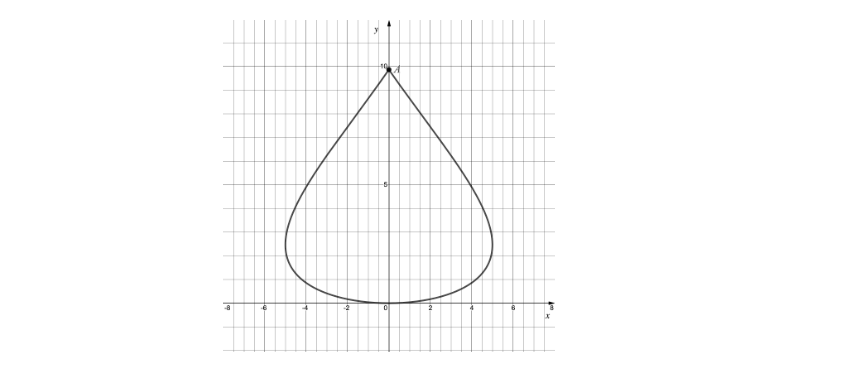
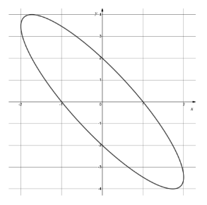
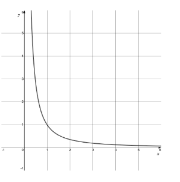
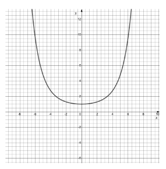
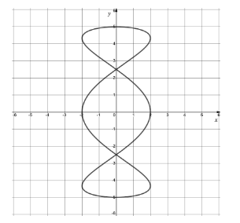
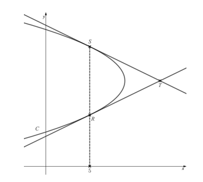
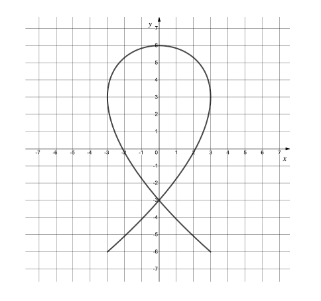

# Exam Questions — Differentiation of Parametric Equations
**Differentiation** · Cambridge (CIE) A-LEVEL maths (9709)
> Source: [https://www.savemyexams.com/a-level/maths/cie/20/pure-3/topic-questions/](https://www.savemyexams.com/a-level/maths/cie/20/pure-3/topic-questions/) · 22 questions across 1 sets

## Exam Questions (22 questions)

### Q1 — easy — 8 marks

**Q1** [2 marks]

The diagram shows the curve $C$ with parametric equations

$x = 5  \text{sin}  θ$, $y = θ^{2}$,

for $- π \leq θ \leq π$.

The curve is symmetric about the $y$-axis, passes through the origin, and has a cusp at the point $A$.

Find the exact coordinates of the point $A$.

**Q1** [2 marks]

(i) Write down the value of $\frac{\text{d}y}{\text{d}θ}$ at the origin.

(ii) Write down the value of $\frac{\text{d}x}{\text{d}θ}$ at the points where $x = - 5$ and $x = 5$.

**Q1** [4 marks]

(i) Find $\frac{\text{d}x}{\text{d}θ}$ and $\frac{\text{d}y}{\text{d}θ}$.

(ii) Hence find an expression for $\frac{\text{d}y}{\text{d}x}$ in terms of $θ$.

(iii) Find the gradient of the curve at the point where $θ = \frac{π}{3}$.

### Q2 — easy — 7 marks

**Q2** [2 marks]

The parametric equations of a curve are

$x = 6 t$, $y = 8 t^{2} - 8 t + 3$,

where $0 \leq t \leq 1$.

Find the coordinates of the point on the curve where $t = 0 . 2$.

**Q2** [3 marks]

(i) Find $\frac{\text{d}x}{\text{d}t}$ and $\frac{\text{d}y}{\text{d}t}$.

(ii) Hence find $\frac{\text{d}y}{\text{d}x}$ in terms of $t$.

**Q2** [2 marks]

Find the coordinates of the stationary point on the curve.

### Q3 — easy — 4 marks

**Q3** [2 marks]

Given

$x = e^{t}$ and $y = 2 t^{3} + 3 t$

find $\frac{\text{d}x}{\text{d}t}$ and $\frac{\text{d}y}{\text{d}t}$.

**Q3** [2 marks]

Hence, or otherwise, find $\frac{\text{d}y}{\text{d}x}$ in terms of $t$.

### Q4 — easy — 6 marks

**Q4** [3 marks]

The curve $C$ has parametric equations

$x = 5 t^{2} - 1$ and $y = 3 t$, $t > 0$

(i) Find $\frac{\text{d}x}{\text{d}t}$ and $\frac{\text{d}y}{\text{d}t}$.

(ii) Hence find $\frac{\text{d}y}{\text{d}x}$ in terms of $t$.

**Q4** [3 marks]

(i) Find the gradient of the tangent to $C$ at the point $( 4 , 3 )$.

(ii) Hence find the equation of the tangent to $C$ at the point $( 4 , 3 )$.

### Q5 — easy — 8 marks

**Q5** [3 marks]

The curve $C$ has parametric equations

$x = 2 t^{3}$ and $y = 4 t - 1$, $t > 0$

(i) Find $\frac{\text{d}x}{\text{d}t}$ and $\frac{\text{d}y}{\text{d}t}$.

(ii) Hence find $\frac{\text{d}y}{\text{d}x}$ in terms of $t$.

**Q5** [5 marks]

(i) Find the gradient of the tangent to $C$ at the point $( 16 , 7 )$.

(ii) Hence find the gradient of the normal to $C$ at the point $( 16 , 7 )$.

(iii) Find the equation of the normal to $C$ at the point $( 16 , 7 )$.

### Q6 — easy — 7 marks

**Q6** [2 marks]

The parametric equations of a curve are

$x = t - 1$, $y = 2 \mathrm{ln} t$,

where $t > 0$.

Find $\frac{\text{d}x}{\text{d}t}$ and $\frac{\text{d}y}{\text{d}t}$.

**Q6** [3 marks]

Find an expression for $\frac{\text{d}y}{\text{d}x}$ in terms of $t$, and find the gradient of the curve at the point where $t = 1$.

**Q6** [2 marks]

Hence find the equation of the tangent to the curve at the point where $t = 1$.

### Q7 — medium — 8 marks

**Q7** [4 marks]

The parametric equations of a curve are

$x = 10 t$, $y = 4 . 9 t^{2} - 4 . 9 t + 2$,

for $0 \leq t \leq 1$.

(i) Write down the value of $y$ at the point where $t = 0$.

(ii) Find the minimum value of $y$ on the curve.

**Q7** [4 marks]

Find the value of $x$ at the point where $y = 1 . 4$ and $t > 0 . 5$.

### Q8 — very_hard — 9 marks

**Q8** [9 marks]

The parametric equations of a curve $C$ are

$x = 3 t$, $y = t + \frac{1}{t}$,

where $t > 0$.

Find the equation of the normal to $C$ at the point where $C$ intersects the line $y = x$.

### Q9 — medium — 7 marks

**Q9** [3 marks]

The diagram shows the ellipse $E$ with parametric equations

`x = 2 \, \text{cos} \left( \theta + \dfrac{\pi}{3} \right)`, $y = 4  \text{sin}  θ$,

for $- π \leq θ \leq π$.

Find an expression for $\frac{\text{d}y}{\text{d}x}$ in terms of $θ$.

**Q9** [4 marks]

Find the equation of the tangent to $E$ at the point where $θ = - \frac{π}{6}$, giving your answer in the form $y = a - b x$, where $a$ and $b$ are real numbers that should be given in exact form.

### Q10 — hard — 6 marks

**Q10** [6 marks]

The diagram shows the curve with parametric equations

$x = e^{2t}$, $y = e^{-3t}$.

(i) Verify that the curve passes through the point $( 1 , 1 )$.

(ii) Show that the line with equation $y = x$ is not the normal to the curve at the point $( 1 , 1 )$.

### Q11 — very_hard — 8 marks

**Q11** [5 marks]

The diagram shows the curve with parametric equations

$x = 4 t$, $y = e^{t^{2}}$.

The tangents to the curve that pass through the origin meet the curve at the points $A$ and $B$.

Show that the values of $t$ at $A$ and $B$ are $t = - \frac{\sqrt{2}}{2}$ and $t = \frac{\sqrt{2}}{2}$.

**Q11** [3 marks]

Hence, or otherwise, show that the area of the triangle $O A B$ is $2 \sqrt{2} e^{\frac{1}{2}}$ square units.

### Q12 — medium — 5 marks

**Q12** [3 marks]

The parametric equations of a curve are

$x = \text{sin}  2 t$, $y = e^{t}$.

Find an expression for $\frac{\text{d}y}{\text{d}x}$ in terms of $t$.

**Q12** [2 marks]

Verify that the curve passes through the point $( 0 , 1 )$, and find the gradient of the curve at that point.

### Q13 — medium — 8 marks

**Q13** [3 marks]

The parametric equations of a curve $C$ are

$x = \frac{1}{t^{2}}$, $y=t+\frac{1}{t}$,

where $t > 0$.

Find an expression, in terms of $t$, for $\frac{\text{d}y}{\text{d}x}$.

**Q13** [5 marks]

(i) Find the gradient of the tangent to $C$ at the point where $t = \frac{1}{2}$.

(ii) Hence find the equation of the normal to $C$ at the point where $t = \frac{1}{2}$.

### Q14 — hard — 7 marks

**Q14** [4 marks]

The parametric equations of a curve $C$ are

$x = t^{2} - 4$, $y = 3 t$.

Show that $t = 2$ at the point $( 0 , 6 )$, and find the value of $\frac{\text{d}y}{\text{d}x}$ at this point.

**Q14** [3 marks]

The tangent at the point $( 0 , 6 )$ is parallel to the normal at the point $P$.

Find the exact coordinates of the point $P$.

### Q15 — medium — 7 marks

**Q15** [3 marks]

The diagram shows the curve $C$ with parametric equations

$x = 2  \text{cos}  3 θ$, $y = 5  \text{sin}  θ$,

for $0 \leq θ \leq 2 π$.

Find an expression for $\frac{\text{d}y}{\text{d}x}$ in terms of $θ$.

**Q15** [4 marks]

(i) Show that the gradient of the tangent to $C$ at the point where $θ = \frac{π}{4}$ is $- \frac{5}{6}$.

(ii) Hence find the equation of the tangent to $C$ at the point where $θ = \frac{π}{4}$.

### Q16 — very_hard — 10 marks

**Q16** [10 marks]

The parametric equations of a curve $C$ are

$x = 9 - t^{2}$, $y = 5 - t$.

The tangents to $C$ at the points $R$ and $S$ meet at the point $T$, as shown in the diagram.

Given that the $x$-coordinate of both $R$ and $S$ is 5, find the area of the triangle $R S T$.

### Q17 — medium — 8 marks

**Q17** [3 marks]

The parametric equations of a curve are

$x = 8 t - 4$, $y = 16 t^{2} - 16 t + 5$,

for $0 \leq t \leq 1$.

Find $\frac{\text{d}x}{\text{d}t}$ and $\frac{\text{d}y}{\text{d}t}$, and hence find $\frac{\text{d}y}{\text{d}x}$ in terms of $t$.

**Q17** [2 marks]

Find the difference between the greatest and least values of $y$.

**Q17** [3 marks]

Find the value of $y$ when $x = 3$.

### Q18 — medium — 9 marks

**Q18** [2 marks]

The parametric equations of a curve are

$x = 12 t$, $y = 9 t^{2} - 9 t + 4$,

for $0 \leq t \leq 1$.

Find the $y$-coordinate of the point on the curve where $t = 0 . 3$.

**Q18** [3 marks]

Find the minimum value of $y$ on the curve.

**Q18** [4 marks]

Find the values of $x$ when $y = 2 . 9$, giving your answers correct to 1 decimal place.

### Q19 — medium — 8 marks

**Q19** [3 marks]

The parametric equations of a curve $C$ are

$x = 6 t^{2} + 2$, $y = \frac{1}{t}$,

where $t > 0$.

Find an expression, in terms of $t$, for $\frac{\text{d}y}{\text{d}x}$.

**Q19** [5 marks]

(i) Find the gradient of the tangent to $C$ at the point $( 8 , 1 )$.

(ii) Hence write down the gradient of the normal to $C$ at the point $( 8 , 1 )$.

(iii) Find the equation of the normal to $C$ at the point $( 8 , 1 )$.

### Q20 — hard — 7 marks

**Q20** [3 marks]

The parametric equations of a curve $C$ are

$x = t^{2}$, $y = 2  \text{sin}  t$,

where $0 \leq t \leq 2 π$.

Show that, in terms of $t$,

$\frac{\text{d}y}{\text{d}x} = \frac{\text{cos}t}{t}$

**Q20** [4 marks]

Show that the distance between the maximum and minimum points on $C$ is $2 \sqrt{π^{4}+4}$ units.

### Q21 — medium — 6 marks

**Q21** [3 marks]

The parametric equations of a curve are

$x = e^{2t}$, $y = 3 t^{2} + 1$.

Find an expression for $\frac{\text{d}y}{\text{d}x}$ in terms of $t$.

**Q21** [3 marks]

The curve passes through the point $P  ( 1 , 1 )$.

(i) Find the value of $t$ at the point $P$.

(ii) Find the gradient of the curve at the point $P$.

(iii) State what the value of the gradient tells you about the point $P$.

### Q22 — medium — 9 marks

**Q22** [2 marks]

The diagram shows the curve $C$ with parametric equations

$x = 3  \text{sin}  3 θ$, $y = 6  \text{cos}  2 θ$,

for $- \frac{π}{2} \leq θ \leq \frac{π}{2}$.

(i) Write down the value of $\frac{\text{d}y}{\text{d}θ}$ at the point $( 0 , 6 )$.

(ii) Write down the value of $\frac{\text{d}x}{\text{d}θ}$ at the points $( - 3 , 3 )$ and $( 3 , 3 )$.

**Q22** [3 marks]

Find an expression for $\frac{\text{d}y}{\text{d}x}$ in terms of $θ$.

**Q22** [4 marks]

(i) Find the values of $x$, $y$ and $\frac{\text{d}y}{\text{d}x}$ at the point where $θ = \frac{π}{12}$.

(ii) Hence show that the equation of the tangent to $C$ at the point where $θ = \frac{π}{12}$ is

`2\sqrt{2}x + 3y - \left( 9\sqrt{3} + 6 \right) = 0`
