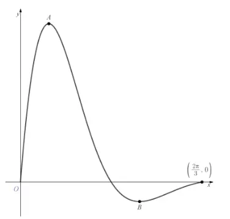
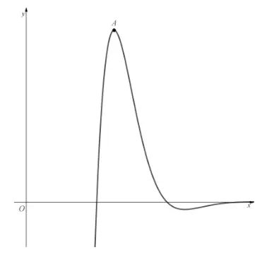
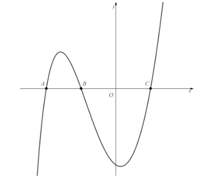

# Exam Questions — Further Differentiation
**Differentiation** · Cambridge (CIE) A-LEVEL maths (9709)
> Source: [https://www.savemyexams.com/a-level/maths/cie/20/pure-3/topic-questions/](https://www.savemyexams.com/a-level/maths/cie/20/pure-3/topic-questions/) · 35 questions across 1 sets

## Exam Questions (35 questions)

### Q1 — easy — 8 marks

**Q1** [8 marks]

(i) Differentiate $\text{tan}  x + \text{ln}  x$

(ii) Use the product rule to differentiate $\text{e}^{x} \text{cos}  x$

(iii) Use the quotient rule to differentiate $\frac{\text{sin}x}{x}$

(iv) Use the chain rule to differentiate $\text{e}^{x^{2}-3x+17}$

### Q2 — easy — 6 marks

**Q2** [3 marks]

Differentiate `\left(x^{3} - 2x\right)\text{ln} \; x` with respect to $x$.

**Q2** [3 marks]

Differentiate $\text{e}^{x}  \text{cos}  2 x$ with respect to $x$.

### Q3 — easy — 2 marks

**Q3** [2 marks]

Write down $\frac{\text{d}y}{\text{d}x}$ when

(i) $y = \text{sec}  5 x$

(ii) $y = \text{cosec}  3 x$

### Q4 — easy — 5 marks

**Q4** [2 marks]

Given that the derivative of $\text{tan}^{-1} x$ is $\frac{1}{1+x^{2}}$, use the chain rule to show that the derivative of $\text{tan}^{-1} ( a x )$ is

$\frac{a}{1+a^{2}x^{2}}$

where $a$ is a real constant.

**Q4** [3 marks]

Hence find the coordinates of the point(s) where the curve $y = \text{tan}^{-1} ( 2 x )$ has a gradient of $1$. Give the coordinates as exact values.

### Q5 — easy — 6 marks

**Q5** [3 marks]

Differentiate $\frac{\text{cos}x}{\text{sin}x}$ with respect to $x$.

**Q5** [3 marks]

Differentiate $\frac{2x^{2}-3x+4}{\text{sin}3x}$ with respect to $x$.

### Q6 — easy — 4 marks

**Q6** [4 marks]

Find $\frac{\text{d}y}{\text{d}x}$ for

(i) `y = \text{sin}\left(3x^{2}\right)`

(ii) `y = 2\text{ln}\left(x^{3}\right)`

### Q7 — easy — 4 marks

**Q7** [4 marks]

The curve with equation $y = \text{e}^{x^{2}-9}$ passes through the point $( - 3 , 1 )$.

(i) Find an expression for $\frac{\text{d}y}{\text{d}x}$.

(ii) Find the equation of the tangent to the curve at the point $( - 3 , 1 )$.

### Q8 — easy — 12 marks

**Q8** [4 marks]

The function $\text{f} ( x )$ is defined as

`\text{f}(x) = \left(x^{2} - 4x + 4\right)\text{ln} \; x, \quad x > 0`

Show that the graph of $y = \text{f} ( x )$ meets the $x$-axis at the points $( 1 , 0 )$ and $( 2 , 0 )$.

**Q8** [4 marks]

Find $\text{f} ' ( x )$.

**Q8** [2 marks]

Find the gradient of the tangent at the point $( 1 , 0 )$.

**Q8** [2 marks]

Hence find the equation of the tangent at the point $( 1 , 0 )$, giving your answer in the form $a x + b y + c = 0$, where $a$, $b$ and $c$ are integers to be found.

### Q9 — easy — 5 marks

**Q9** [2 marks]

A curve has equation $y = 5 \text{e}^{-2x}$.

Find an expression for $\frac{\text{d}y}{\text{d}x}$.

**Q9** [3 marks]

(i) Find the gradient of the tangent at the point where $x = 1$, giving your answer in the form $- a \text{e}^{-2}$, where $a$ is a positive integer to be found.

(ii) Hence show that the gradient of the normal to the curve at the point where $x = 1$ is $\frac{1}{10} \text{e}^{2}$.

### Q10 — very_hard — 5 marks

**Q10** [5 marks]

A sequence of functions is defined by the recurrence relation

$u_{k+1} ( x ) = \frac{\text{d}}{\text{d}x} u_{k} ( x ) ,  u_{1} ( x ) = \text{sin} ( x \sqrt{2} )$

Based on that sequence, the function $\text{f}_{n} ( x )$ is defined by

`\text{f}_{n}(x) = \sum_{r=1}^{n} u_{r}(x)`

Calculate the value of `\text{f}_{41}\left(\dfrac{\pi\sqrt{2}}{4}\right)`.

### Q11 — hard — 4 marks

**Q11** [4 marks]

A curve has equation $y = 3^{x} + 2^{-x}$.

Show that the gradient of the normal to the curve at the point `\left(1, \dfrac{7}{2}\right)` is

$\frac{2}{\text{ln}2-6\text{ln}3}$

### Q12 — medium — 8 marks

**Q12** [8 marks]

Use an appropriate method to differentiate each of the following.

(i) $\text{tan}  3 x + \text{e}^{7-2x^{2}}$

(ii) `\left(x^{2} + 2x - 8\right)\text{cos}(3 - x)`

(iii) $\frac{\text{ln}7x}{\text{sin}(x^{2}+5)}$

(iv) $\sqrt{\text{cos}4x}$

### Q13 — hard — 6 marks

**Q13** [3 marks]

Differentiate `\left(5 + \text{sin}^{2} \; 3x\right)\text{e}^{x^{2} - 3x + 2}` with respect to $x$, simplifying your answer where possible.

**Q13** [3 marks]

Differentiate `3^{\sqrt{x}}\left(\sqrt{x} - \dfrac{1}{\sqrt{x}}\right)` with respect to $x$, simplifying your answer where possible.

### Q14 — hard — 6 marks

**Q14** [6 marks]

The diagram below shows the graph of $y = \text{f} ( x )$, where $\text{f} ( x )$ is the function defined by

$\text{f} ( x ) = \frac{\text{sin}3x}{\text{e}^{2x-3}} ,  0 \leq x \leq \frac{2π}{3}$

The points $A$ and $B$ are maximum and minimum points, respectively.

Find the range of $\text{f} ( x )$, giving your answer correct to 3 decimal places.

### Q15 — very_hard — 6 marks

**Q15** [6 marks]

Use calculus to find the coordinates of the stationary points of the curve

`y = \dfrac{x}{3} - \text{tan}^{-1}\left(\dfrac{2x}{3}\right)`

and determine whether each one is a maximum or a minimum. The coordinates should be given as exact values.

### Q16 — hard — 4 marks

**Q16** [4 marks]

Find the derivative of the function `\text{f}(x) = \text{sin}\left(\text{cos}\left(\text{ln}\left(\dfrac{1}{x}\right)\right)\right)`, $x > 0$.

### Q17 — hard — 6 marks

**Q17** [4 marks]

Show that the derivative of $y = 4^{-x^{4}}$ is

$\frac{\text{d}y}{\text{d}x} = - ( \text{ln}  4 ) x^{3}  4^{1-x^{4}}$

**Q17** [2 marks]

Hence find the equation of the tangent to the curve at the point `\left(1, \dfrac{1}{4}\right)`, giving your answer in the form $y = a x + b$, where $a$ and $b$ are to be given as exact values.

### Q18 — hard — 3 marks

**Q18** [3 marks]

By writing $y = \frac{\text{f}(x)}{\text{g}(x)}$ as `y = \text{f}(x)\left[\text{g}(x)\right]^{-1}` and then using the product and chain rules, show that

`\dfrac{\text{d}y}{\text{d}x} = \dfrac{\text{g}(x)\text{f}'(x) - \text{f}(x)\text{g}'(x)}{\left(\text{g}(x)\right)^{2}}`

### Q19 — medium — 6 marks

**Q19** [3 marks]

Differentiate `\left(2\text{sin} \; 3x - \text{cos} \; 3x\right)\text{e}^{6 - x}` with respect to $x$, simplifying your answer as far as possible.

**Q19** [3 marks]

Differentiate `\left(x^{2} - x\right)^{2}\text{ln} \; 5x` with respect to $x$, simplifying your answer as far as possible.

### Q20 — medium — 8 marks

**Q20** [8 marks]

Use an appropriate method to differentiate each of the following.

(i) $\text{sin}  2 x - \text{e}^{7x}$

(ii) $x^{2} \text{ln}  x$

(iii) $\frac{\text{cos}3x}{\text{tan}2x}$

(iv) $\text{ln} ( \text{tan}  x )$

### Q21 — hard — 5 marks

**Q21** [5 marks]

The diagram below shows part of the graph of $y = \text{f} ( x )$, where $\text{f} ( x )$ is the function defined by

$\text{f} ( x ) = \frac{\text{sin}x}{1-\text{e}^{x}} ,  x > 0$

Point $A$ is a maximum point on the graph.

Show that the $x$-coordinate of $A$ is a solution to the equation

`\dfrac{\text{cos} \; x + \text{e}^{x}\left(\text{sin} \; x - \text{cos} \; x\right)}{\text{e}^{2x} - 2\text{e}^{x} + 1} = 0`

### Q22 — hard — 6 marks

**Q22** [2 marks]

Given that $x = \text{sec}  7 y$, find $\frac{\text{d}y}{\text{d}x}$ in terms of $y$.

**Q22** [4 marks]

Hence find $\frac{\text{d}y}{\text{d}x}$ in terms of $x$.

### Q23 — hard — 6 marks

**Q23** [6 marks]

A curve has equation $y = \text{e}^{-3x} + \text{ln}  x$, $x > 0$.

Show that the equation of the tangent to the curve at the point with $x$-coordinate $1$ is

`y = \left(\dfrac{\text{e}^{3} - 3}{\text{e}^{3}}\right)x + \dfrac{4 - \text{e}^{3}}{\text{e}^{3}}`

### Q24 — hard — 3 marks

**Q24** [3 marks]

For `y = \text{ln}\left(ax^{n}\right)`, where $a > 0$ is a real number and $n \geq 1$ is an integer, show that

$\frac{\text{d}y}{\text{d}x} = \frac{n}{x}$

### Q25 — hard — 5 marks

**Q25** [2 marks]

Use the chain rule to show that the derivative of `y = \text{tan}^{-1}\left(\dfrac{x}{a}\right)`, where $a \neq 0$ is a real constant, is

$\frac{\text{d}y}{\text{d}x} = \frac{a}{a^{2}+x^{2}}$

**Q25** [3 marks]

Hence find the coordinates of any stationary point(s) on the curve with equation

`y = -\dfrac{x}{4} + \text{tan}^{-1}\left(\dfrac{x}{2}\right)`

giving your answers as exact values.

### Q26 — medium — 4 marks

**Q26** [4 marks]

Find the gradient of the normal to the curve `y = 5\text{cos}\left(\text{e}^{x} - \dfrac{\pi}{2}\right)` at the point with $x$-coordinate $0$. Give your answer correct to 3 decimal places.

### Q27 — medium — 4 marks

**Q27** [4 marks]

A curve has equation $y = \text{e}^{-3x} + \text{ln}  x$, $x > 0$.

Find the gradient of the normal to the curve at the point `\left(1, \text{e}^{-3}\right)`, giving your answer correct to 3 decimal places.

### Q28 — easy — 8 marks

**Q28** [8 marks]

(i) Differentiate $4 \text{cos}  x - 3 \text{sin}  x$

(ii) Use the product rule to differentiate $\text{e}^{x} \text{ln}  x$

(iii) Use the quotient rule to differentiate $\frac{\text{tan}x}{x}$

(iv) Use the chain rule to differentiate `\text{cos}\left(x^{2} - 7x + 1\right)`

### Q29 — medium — 9 marks

**Q29** [4 marks]

The diagram below shows part of the graph of $y = \text{f} ( x )$, where $\text{f} ( x )$ is the function defined by

`\text{f}(x) = \left(x^{2} - 1\right)\text{ln}(x + 3), \quad x > -3`

Points $A$, $B$ and $C$ are the three places where the graph meets the $x$-axis.

Find $\text{f} ' ( x )$.

**Q29** [2 marks]

Show that the coordinates of point $A$ are $( - 2 , 0 )$.

**Q29** [3 marks]

Find the equation of the tangent to the curve at point $A$.

### Q30 — medium — 3 marks

**Q30** [3 marks]

Differentiate $\frac{5x^{7}}{\text{sin}2x}$ with respect to $x$.

### Q31 — medium — 6 marks

**Q31** [4 marks]

Find $\frac{\text{d}y}{\text{d}x}$ for `y = \text{cos}\left(x^{2} - 3x + 7\right) + \text{sin}\left(\text{e}^{x}\right)`.

**Q31** [2 marks]

Find $\frac{\text{d}y}{\text{d}x}$ for `y = \text{ln}\left(2x^{3}\right)`.

### Q32 — medium — 6 marks

**Q32** [5 marks]

Show that if $y = \text{cosec}  2 x$, then

$\frac{\text{d}y}{\text{d}x} = - 2 \text{cosec}  2 x  \text{cot}  2 x$

**Q32** [1 mark]

Hence find the gradient of the tangent to the curve $y = \text{cosec}  2 x$ at the point with coordinates `\left(\dfrac{\pi}{3}, \dfrac{2\sqrt{3}}{3}\right)`.

### Q33 — medium — 4 marks

**Q33** [4 marks]

Find the equation of the tangent to the curve $y = \text{e}^{3x^{2}+5x-2}$ at the point $( - 2 , 1 )$, giving your answer in the form $a x + b y + c = 0$, where $a$, $b$ and $c$ are integers.

### Q34 — medium — 6 marks

**Q34** [3 marks]

Differentiate with respect to $x$, simplifying your answers as far as possible:

`\left(4\text{cos} \; x - 3\text{sin} \; x\right)\text{e}^{3x - 5}`

**Q34** [3 marks]

`\left(x^{3} - 4x^{2} + 7\right)\text{ln} \; x`

### Q35 — medium — 4 marks

**Q35** [2 marks]

Use the chain rule to differentiate $\text{tan}^{-1} ( a x )$, where $a$ is a real constant.

**Q35** [2 marks]

What does your answer to part (a) tell you about the number of stationary points on the curve $y = \text{tan}^{-1} ( 3 x )$?
