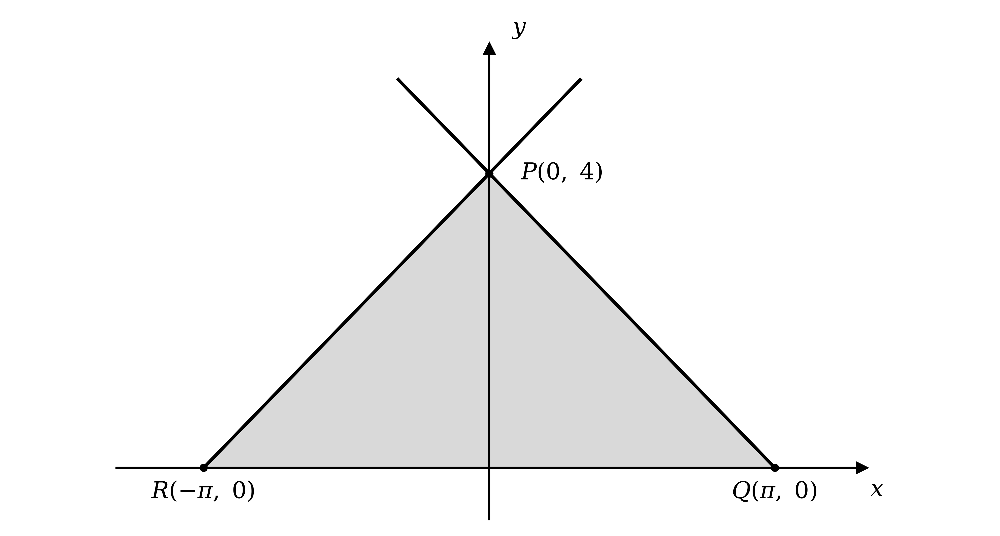
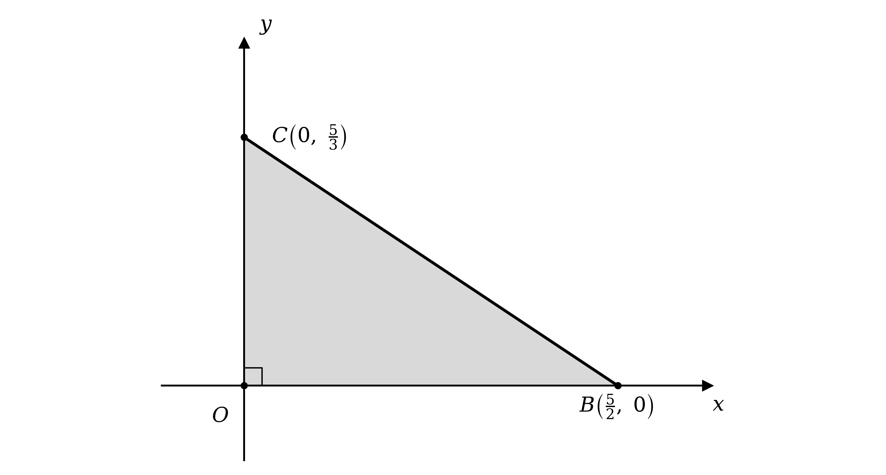

# Mark Schemes — Implicit Differentiation
**Differentiation** · Cambridge (CIE) A-LEVEL maths (9709)

## Exam Questions (31 questions)

### Q1
Differentiate both sides with respect to $x$, treating $y$ as a function of $x$ so that the $- 4 y^{2}$ term gives $- 8 y \frac{\text{d}y}{\text{d}x}$

$24 x - 8 y \frac{\text{d}y}{\text{d}x} = 0$

Rearrange to make $\frac{\text{d}y}{\text{d}x}$ the subject, then cancel the common factor of 8

$\frac{\text{d}y}{\text{d}x} = \frac{24x}{8y} = \frac{3x}{y}$

To find the gradient at the given point, substitute $x = 1$ and $y = 3$

`\dfrac{\text{d}y}{\text{d}x} = \dfrac{3\left(1\right)}{3}`

**[M1]**

$\text{Gradient} = 1$

**[A1]**

> **[mark-scheme]**
> **M1**: Correct implicit differentiation giving a term of the form $k y \frac{\text{d}y}{\text{d}x}$, together with substitution of $x = 1$ and $y = 3$. You may substitute before or after rearranging, and you may write $y '$ in place of $\frac{\text{d}y}{\text{d}x}$ throughout.
> 
> **A1**: Correct gradient of 1.
A tangent touches the curve at the given point, so it is the straight line through $( 1 , 3 )$ whose gradient is the value found in part (a)

Use the equation of a straight line through a known point, `y - y_{1} = m\left(x - x_{1}\right)`, with $m = 1$ and `\left(x_{1} , y_{1}\right) = (1 , 3)`

`y - 3 = 1\left(x - 1\right)`

**[M1]**

Expand and rearrange into the form $y = m x + c$

$y = x + 2$

**[A1]**

> **[mark-scheme]**
> **M1**: Correct use of the point $( 1 , 3 )$ together with your gradient from part (a) in a straight line equation. Accept the form $y = m x + c$ with the coordinates substituted to find $c$.
> 
> **A1**: Correct equation of the tangent. Accept any equivalent form, for example $y - 3 = x - 1$, $x - y + 2 = 0$ or $y = x + 2$. If you reach a correct equation and then make a slip simplifying it, the mark is still earned.

### Q2
To test whether a point lies on a curve, substitute its coordinates into the equation and check that the two sides agree

Take the left-hand side first, with $y = \frac{π}{2}$

`2\,\text{cos} \; 2\left(\dfrac{\pi}{2}\right) = 2\,\text{cos} \; \pi`

`= 2\left(-1\right) = -2`

**[M1]**

Now the right-hand side, with $x = - \frac{4}{π}$ and $y = \frac{π}{2}$, where the factors of $π$ cancel

`xy = \left(-\dfrac{4}{\pi}\right)\left(\dfrac{\pi}{2}\right) = -2`

Both sides take the same value, so the point satisfies the equation

**Final answer:** **The point **`\left(-\dfrac{4}{\pi} , \dfrac{\pi}{2}\right)`** lies on the curve**

**[A1]**

> **[mark-scheme]**
> **M1**: Substitution of both coordinates into the equation of the curve, with an attempt to evaluate at least one side.
> 
> **A1**: Both sides correctly evaluated to $- 2$, together with a conclusion. Because the result is given, both evaluations must be visible. You may instead substitute into a rearranged form such as $2  \text{cos}  2 y - x y = 0$ and show the result is zero.
Differentiate both sides with respect to $x$, treating $y$ as a function of $x$

On the left, the chain rule applied to $2  \text{cos}  2 y$ brings out a factor of 2 from the inner function and a further factor of $\frac{\text{d}y}{\text{d}x}$

`\dfrac{\text{d}}{\text{d}x}\left(2\,\text{cos} \; 2y\right) = -4\,\text{sin} \; 2y \dfrac{\text{d}y}{\text{d}x}`

**[B1]**

On the right, $x y$ is a product of two functions of $x$, so apply the product rule

`\dfrac{\text{d}}{\text{d}x}\left(uv\right) = u\dfrac{\text{d}v}{\text{d}x} + v\dfrac{\text{d}u}{\text{d}x}`

Take $u = x$ and $v = y$, then differentiate each with respect to $x$, remembering that $y$ is itself a function of $x$

$u = x ,  v = y$

$\frac{\text{d}u}{\text{d}x} = 1 ,  \frac{\text{d}v}{\text{d}x} = \frac{\text{d}y}{\text{d}x}$

Substitute into the product rule

`\dfrac{\text{d}}{\text{d}x}\left(xy\right) = x\dfrac{\text{d}y}{\text{d}x} + y`

**[B1]**

Putting the two differentiated sides back together gives

$- 4  \text{sin}  2 y \frac{\text{d}y}{\text{d}x} = x \frac{\text{d}y}{\text{d}x} + y$

Collect the terms in $\frac{\text{d}y}{\text{d}x}$ on one side and factorise

`\left(x + 4\,\text{sin} \; 2y\right)\dfrac{\text{d}y}{\text{d}x} = -y`

Divide through by the bracket

$\frac{\text{d}y}{\text{d}x} = \frac{-y}{x+4\text{sin}2y}$

**[M1]**

> **[mark-scheme]**
> **B1**: Correct differentiation of $2  \text{cos}  2 y$ with respect to $x$, giving $- 4  \text{sin}  2 y \frac{\text{d}y}{\text{d}x}$. Both the factor of 2 from the chain rule and the factor of $\frac{\text{d}y}{\text{d}x}$ are needed. You may write $y '$ in place of $\frac{\text{d}y}{\text{d}x}$ throughout.
> 
> **B1**: Correct use of the product rule on $x y$, giving $x \frac{\text{d}y}{\text{d}x} + y$.
> 
> **M1**: Collecting the terms in $\frac{\text{d}y}{\text{d}x}$ from your differentiated equation, factorising, and dividing to make $\frac{\text{d}y}{\text{d}x}$ the subject. Accept any equivalent form of the answer, for example $\frac{y}{-x-4\text{sin}2y}$ or $- \frac{y}{x+4\text{sin}2y}$.

### Q3
Differentiate both sides with respect to $x$, treating $y$ as a function of $x$, so the chain rule applied to $\text{sin}  y$ gives $\text{cos}  y \frac{\text{d}y}{\text{d}x}$

$1 - \text{cos}  y \frac{\text{d}y}{\text{d}x} = 0$

**[M1 A1]**

Collect the derivative on one side

$\text{cos}  y \frac{\text{d}y}{\text{d}x} = 1$

Divide through by $\text{cos}  y$

$\frac{\text{d}y}{\text{d}x} = \frac{1}{\text{cos}y}$

The reciprocal of $\text{cos}  y$ is $\text{sec}  y$, which gives the required result

$\frac{\text{d}y}{\text{d}x} = \text{sec}  y$

**[A1]**

> **[mark-scheme]**
> **M1**: Correct use of the chain rule to differentiate $\text{sin}  y$ with respect to $x$, giving a term of the form $k  \text{cos}  y \frac{\text{d}y}{\text{d}x}$. You may write $y '$ in place of $\frac{\text{d}y}{\text{d}x}$ throughout.
> 
> **A1**: A correct differentiated equation, in any equivalent form, for example $1 - \text{cos}  y \frac{\text{d}y}{\text{d}x} = 0$ or $\text{cos}  y \frac{\text{d}y}{\text{d}x} = 1$.
> 
> **A1**: The printed result obtained from full and correct working. Because the answer is given, the step from $\frac{1}{\text{cos}y}$ to $\text{sec}  y$ must be visible. An answer left as $\frac{1}{\text{cos}y}$ does not earn this mark.

### Q4
Differentiate both sides with respect to $x$, treating $y$ as a function of $x$

The right-hand side $x y$ is a product of two functions of $x$, so apply the product rule

`\dfrac{\text{d}}{\text{d}x}\left(uv\right) = u\dfrac{\text{d}v}{\text{d}x} + v\dfrac{\text{d}u}{\text{d}x}`

Take $u = x$ and $v = y$, then differentiate each with respect to $x$, remembering that $y$ is itself a function of $x$

$u = x ,  v = y$

$\frac{\text{d}u}{\text{d}x} = 1 ,  \frac{\text{d}v}{\text{d}x} = \frac{\text{d}y}{\text{d}x}$

Substitute into the product rule

`\dfrac{\text{d}}{\text{d}x}\left(xy\right) = x\dfrac{\text{d}y}{\text{d}x} + y`

**[B1]**

Differentiating the left-hand side term by term then gives the full equation

$6 x - 2 \frac{\text{d}y}{\text{d}x} = x \frac{\text{d}y}{\text{d}x} + y$

Collect the terms in $\frac{\text{d}y}{\text{d}x}$ on one side and the rest on the other, then factorise

`\left(x + 2\right)\dfrac{\text{d}y}{\text{d}x} = 6x - y`

**[M1]**

Divide through by the bracket

$\frac{\text{d}y}{\text{d}x} = \frac{6x-y}{x+2}$

**[A1]**

> **[mark-scheme]**
> **B1**: Correct use of the product rule on $x y$, giving $x \frac{\text{d}y}{\text{d}x} + y$. You may write $y '$ in place of $\frac{\text{d}y}{\text{d}x}$ throughout.
> 
> **M1**: Correct differentiation of the left-hand side, together with an attempt to collect the terms in $\frac{\text{d}y}{\text{d}x}$ and factorise.
> 
> **A1**: Correct expression for $\frac{\text{d}y}{\text{d}x}$. Accept any equivalent form, for example $\frac{y-6x}{-x-2}$.
The curve is stationary where its gradient is zero, so set the expression from part (a) equal to zero

$\frac{6x-y}{x+2} = 0$

A fraction is zero only when its numerator is zero, so the denominator can be set aside

$6 x - y = 0$

**[M1]**

Rearranging gives the equation of the line, so every stationary point satisfies it

$y = 6 x$

**[A1]**

> **[mark-scheme]**
> **M1**: Setting your expression for $\frac{\text{d}y}{\text{d}x}$ equal to zero and equating the numerator to zero.
> 
> **A1**: Correct rearrangement to the printed result. Because the answer is given, the step from $6 x - y = 0$ to $y = 6 x$ must be visible.

### Q5
Differentiate both sides with respect to $x$, treating $y$ as a function of $x$

The term $9 x y^{2}$ is a product of $9 x$ and $y^{2}$, so apply the product rule

`\dfrac{\text{d}}{\text{d}x}\left(uv\right) = u\dfrac{\text{d}v}{\text{d}x} + v\dfrac{\text{d}u}{\text{d}x}`

Take $u = 9 x$ and $v = y^{2}$. Differentiating $v$ needs the chain rule, since $y$ is a function of $x$

$u = 9 x ,  v = y^{2}$

$\frac{\text{d}u}{\text{d}x} = 9 ,  \frac{\text{d}v}{\text{d}x} = 2 y \frac{\text{d}y}{\text{d}x}$

Substitute into the product rule

`\dfrac{\text{d}}{\text{d}x}\left(9xy^{2}\right) = 9x\left(2y\dfrac{\text{d}y}{\text{d}x}\right) + y^{2}\left(9\right) = 9y^{2} + 18xy\dfrac{\text{d}y}{\text{d}x}`

**[B1 B1]**

Differentiating the whole equation then gives

$3 x^{2} + 9 y^{2} + 18 x y \frac{\text{d}y}{\text{d}x} = 0$

Collect the derivative on one side

$18 x y \frac{\text{d}y}{\text{d}x} = - 3 x^{2} - 9 y^{2}$

Divide through by $18 x y$, cancelling a factor of 3 to keep the numbers small

$\frac{\text{d}y}{\text{d}x} = \frac{-x^{2}-3y^{2}}{6xy}$

To find the gradient at the given point, substitute $x = 3$ and $y = 1$

`\dfrac{\text{d}y}{\text{d}x} = \dfrac{-\left(3\right)^{2} - 3\left(1\right)^{2}}{6\left(3\right)\left(1\right)} = \dfrac{-12}{18}`

**[M1]**

$\text{Gradient} = - \frac{2}{3}$

**[A1]**

> **[mark-scheme]**
> **B1**: Correct implicit derivative of the $y^{2}$ factor, giving a term of the form $k x y \frac{\text{d}y}{\text{d}x}$. You may write $y '$ in place of $\frac{\text{d}y}{\text{d}x}$ throughout.
> 
> **B1**: Correct use of the product rule on $9 x y^{2}$, giving the complete derivative $9 y^{2} + 18 x y \frac{\text{d}y}{\text{d}x}$.
> 
> **M1**: Substitution of $x = 3$ and $y = 1$ into your differentiated equation, and solving for $\frac{\text{d}y}{\text{d}x}$. You may substitute before or after rearranging.
> 
> **A1**: Correct gradient $- \frac{2}{3}$. Accept the unsimplified $- \frac{12}{18}$ or the decimal $- 0 . 667$ or better.
A normal is perpendicular to the curve at the point of contact, so its gradient is the negative reciprocal of the gradient found in part (a)

$m_{\text{normal}} = - \frac{1}{-\frac{2}{3}} = \frac{3}{2}$

**[B1]**

Use the equation of a straight line through a known point, `y - y_{1} = m\left(x - x_{1}\right)`, with $m = \frac{3}{2}$ and `\left(x_{1} , y_{1}\right) = (3 , 1)`

`y - 1 = \dfrac{3}{2}\left(x - 3\right)`

**[M1]**

Multiply through by 2 to clear the fraction, since the required form has integer coefficients

$2 y - 2 = 3 x - 9$

Collect every term on one side

$3 x - 2 y - 7 = 0$

**[A1]**

> **[mark-scheme]**
> **B1**: Correct gradient of the normal, $\frac{3}{2}$, obtained as the negative reciprocal of your gradient from part (a).
> 
> **M1**: Correct use of the point $( 3 , 1 )$ together with your normal gradient in a straight line equation. Accept the form $y = m x + c$ with the coordinates substituted to find $c$.
> 
> **A1**: Correct equation in the required form. Any integer multiple is accepted, for example $- 3 x + 2 y + 7 = 0$ or $6 x - 4 y - 14 = 0$. An equation left with fractional coefficients, such as $x - \frac{2}{3} y - \frac{7}{3} = 0$, does not earn this mark because the question asks for integers.

### Q6
Every point on the $x$-axis has $y = 0$, so substitute this into the equation of the curve

`\left(0\right)^{2} - 4x + 2 = 0`

**[M1]**

Solve for $x$

$4 x = 2$

$x = \frac{1}{2}$

The curve meets the $x$-axis where $y = 0$, so this is the required point

**Final answer:** **The curve intersects the x-axis at **`\left(\dfrac{1}{2} , 0\right)`

**[A1]**

> **[mark-scheme]**
> **M1**: Substitution of $y = 0$ into the equation of the curve, and an attempt to solve for $x$.
> 
> **A1**: Correct value $x = \frac{1}{2}$, together with a conclusion identifying the point of intersection. Because the answer is given, the substitution of $y = 0$ must be visible.
Differentiate both sides with respect to $x$, treating $y$ as a function of $x$ so that the $y^{2}$ term gives $2 y \frac{\text{d}y}{\text{d}x}$

$2 y \frac{\text{d}y}{\text{d}x} - 4 = 0$

**[M1]**

Collect the derivative on one side and divide by $2 y$

$\frac{\text{d}y}{\text{d}x} = \frac{2}{y}$

**[A1]**

> **[mark-scheme]**
> **M1**: Correct implicit differentiation of $y^{2}$ to give a term of the form $k y \frac{\text{d}y}{\text{d}x}$, together with an attempt at the remaining terms. You may write $y '$ in place of $\frac{\text{d}y}{\text{d}x}$ throughout.
> 
> **A1**: Correct derivative in any equivalent form. Accept $\frac{\text{d}y}{\text{d}x} = \frac{4}{2y}$ or the differentiated equation $2 y \frac{\text{d}y}{\text{d}x} - 4 = 0$ left unrearranged.
A stationary point requires the gradient to be zero, so set the derivative from part (b) equal to zero

$\frac{2}{y} = 0$

A fraction equals zero only when its numerator is zero, so multiplying through by $y$ gives

$2 = 0$

This is impossible, so the gradient is never zero

**Final answer:** **The curve has no stationary points**

**[B1]**

> **[exam-tip]**
> It is worth seeing why this happens geometrically. Rearranged, the equation is $y^{2} = 4 x - 2$, which is a parabola lying on its side with its turning point at `\left(\dfrac{1}{2} , 0\right)`, the point from part (a). That turning point has a vertical tangent rather than a horizontal one, so the curve never flattens out and the gradient has nowhere to be zero. Whenever an expression for $\frac{\text{d}y}{\text{d}x}$ turns out to be a fraction with a constant numerator, you can expect this kind of answer.

> **[mark-scheme]**
> **B1**: Setting your expression for $\frac{\text{d}y}{\text{d}x}$ equal to zero, showing that the resulting equation has no solutions, and stating the conclusion. A bare statement that there are no stationary points, with no supporting work, does not earn this mark. Accept any clear form of the contradiction, for example "$2 \neq 0$" or "the numerator is never zero".

### Q7
Differentiate both sides with respect to $x$, treating $y$ as a function of $x$ so that the $3 y^{2}$ term gives $6 y \frac{\text{d}y}{\text{d}x}$ by the chain rule

$6 y \frac{\text{d}y}{\text{d}x} - 6 x^{2} = 0$

**[M1]**

Rearrange to make $\frac{\text{d}y}{\text{d}x}$ the subject, then cancel the factor of 6

$\frac{\text{d}y}{\text{d}x} = \frac{6x^{2}}{6y} = \frac{x^{2}}{y}$

To find the gradient at the given point, substitute $x = 1$ and $y = 2$

`\dfrac{\text{d}y}{\text{d}x} = \dfrac{\left(1\right)^{2}}{2}`

**[M1]**

$\text{Gradient} = \frac{1}{2}$

**[A1]**

> **[mark-scheme]**
> **M1**: Correct implicit differentiation of $3 y^{2}$ to give $6 y \frac{\text{d}y}{\text{d}x}$, together with an attempt at the $- 2 x^{3}$ term. You may write $y '$ in place of $\frac{\text{d}y}{\text{d}x}$ throughout.
> 
> **M1**: Substitution of $x = 1$ and $y = 2$ into your differentiated equation, and solving for $\frac{\text{d}y}{\text{d}x}$. There must be evidence of a correct implicit derivative to earn this mark. You may substitute before or after rearranging.
> 
> **A1**: Correct gradient. Accept $\frac{1}{2}$ or $0 . 5$. An unsimplified `\dfrac{6\left(1\right)^{2}}{6\left(2\right)}` is accepted provided it is evaluated.

### Q8
Each equation is differentiated term by term with respect to $x$, treating $y$ as a function of $x$, so every term in $y$ picks up a factor of $\frac{\text{d}y}{\text{d}x}$ from the chain rule

`\dfrac{\text{d}}{\text{d}x}\left(y^{n}\right) = n y^{n-1}\dfrac{\text{d}y}{\text{d}x}`

(i)

Differentiate $x^{2} + y = 3$ with respect to $x$, noting that the derivative of the constant on the right is zero

$2 x + \frac{\text{d}y}{\text{d}x} = 0$

**[B1]**

Rearrange to make $\frac{\text{d}y}{\text{d}x}$ the subject

$\frac{\text{d}y}{\text{d}x} = - 2 x$

**[B1]**

(ii)

Differentiate $5 x^{4} + y^{2} - 4 = 0$ with respect to $x$, so that the $y^{2}$ term gives $2 y \frac{\text{d}y}{\text{d}x}$

$20 x^{3} + 2 y \frac{\text{d}y}{\text{d}x} = 0$

**[B1]**

Isolate the derivative by dividing through by $2 y$

$\frac{\text{d}y}{\text{d}x} = - \frac{10x^{3}}{y}$

**[B1]**

(iii)

Differentiate $\text{sin}  3 x - 3 y = 0$ with respect to $x$, using the chain rule on $\text{sin}  3 x$ to bring out the factor of 3

$3  \text{cos}  3 x - 3 \frac{\text{d}y}{\text{d}x} = 0$

**[B1]**

Divide through by 3 to make $\frac{\text{d}y}{\text{d}x}$ the subject

$\frac{\text{d}y}{\text{d}x} = \text{cos}  3 x$

**[B1]**

(iv)

Differentiate $\text{e}^{x} + \text{e}^{y} = 2 x$ with respect to $x$, so that the $\text{e}^{y}$ term gives $\text{e}^{y} \frac{\text{d}y}{\text{d}x}$

$\text{e}^{x} + \text{e}^{y} \frac{\text{d}y}{\text{d}x} = 2$

**[B1]**

Collect the derivative on one side and divide by $\text{e}^{y}$

$\frac{\text{d}y}{\text{d}x} = \frac{2-\text{e}^{x}}{\text{e}^{y}}$

**[B1]**

> **[mark-scheme]**
> **B1**: Correct differentiation of $x^{2} + y = 3$, with the $y$ term giving $\frac{\text{d}y}{\text{d}x}$.
> 
> **B1**: Correct expression $\frac{\text{d}y}{\text{d}x} = - 2 x$.
> 
> **B1**: Correct differentiation of $5 x^{4} + y^{2} - 4 = 0$, with the $y^{2}$ term giving $2 y \frac{\text{d}y}{\text{d}x}$.
> 
> **B1**: Correct expression $\frac{\text{d}y}{\text{d}x} = - \frac{10x^{3}}{y}$. Accept the unsimplified $- \frac{20x^{3}}{2y}$.
> 
> **B1**: Correct differentiation of $\text{sin}  3 x - 3 y = 0$, including the factor of 3 from the chain rule on $\text{sin}  3 x$.
> 
> **B1**: Correct expression $\frac{\text{d}y}{\text{d}x} = \text{cos}  3 x$. Accept the unsimplified $\frac{-3\text{cos}3x}{-3}$.
> 
> **B1**: Correct differentiation of $\text{e}^{x} + \text{e}^{y} = 2 x$, with the $\text{e}^{y}$ term giving $\text{e}^{y} \frac{\text{d}y}{\text{d}x}$.
> 
> **B1**: Correct expression $\frac{\text{d}y}{\text{d}x} = \frac{2-\text{e}^{x}}{\text{e}^{y}}$. Accept any equivalent form, for example `\left(2 - \text{e}^{x}\right)\text{e}^{-y}`.
> 
> You may write $y '$ in place of $\frac{\text{d}y}{\text{d}x}$ throughout.

### Q9
The variable sits in the exponent, so the power rule cannot be applied directly. Introducing a variable for the expression allows logarithms to bring the exponent down

Let $y = a^{x^{k}}$

Take natural logarithms of both sides

$\text{ln}  y = \text{ln}  a^{x^{k}}$

Apply the power law of logarithms, which moves the whole exponent $x^{k}$ to the front. Since $a$ is a constant, $\text{ln}  a$ is a constant too

$\text{ln}  y = x^{k}  \text{ln}  a$

**[B1]**

Differentiate both sides with respect to $x$, treating $y$ as a function of $x$. The right-hand side is now a constant multiple of $x^{k}$, so the power rule applies to it

$\frac{1}{y} \frac{\text{d}y}{\text{d}x} = k x^{k-1}  \text{ln}  a$

**[M1]**

Multiply both sides by $y$

$\frac{\text{d}y}{\text{d}x} = y k x^{k-1}  \text{ln}  a$

Replace $y$ by $a^{x^{k}}$ to give the required result

`\dfrac{\text{d}}{\text{d}x}\left(a^{x^{k}}\right) = k a^{x^{k}} x^{k-1}\,\text{ln} \; a`

**[A1]**

> **[mark-scheme]**
> **B1**: Setting $y = a^{x^{k}}$, taking logarithms of both sides, and correctly applying the power law to obtain $\text{ln}  y = x^{k}  \text{ln}  a$. Both the taking of logarithms and the use of the power law need to be visible.
> 
> **M1**: Correct implicit differentiation of your logarithmic equation, giving $\frac{1}{y} \frac{\text{d}y}{\text{d}x}$ on the left and applying the power rule to $x^{k}$ on the right, with $\text{ln}  a$ treated as a constant. You may write $y '$ in place of $\frac{\text{d}y}{\text{d}x}$ throughout.
> 
> **A1**: The printed result obtained from full and correct working, including the substitution of $a^{x^{k}}$ back in place of $y$. An answer left in terms of $y$ does not earn this mark. Any valid derivation is accepted, since the question does not require a particular method.

### Q10
Two lines are parallel when their gradients are equal, so the plan is to find the normal gradient at each point and compare them

Differentiate the equation with respect to $x$. The term $2 x y^{3}$ is a product of $2 x$ and $y^{3}$, so apply the product rule

`\dfrac{\text{d}}{\text{d}x}\left(uv\right) = u\dfrac{\text{d}v}{\text{d}x} + v\dfrac{\text{d}u}{\text{d}x}`

Take $u = 2 x$ and $v = y^{3}$. Differentiating $v$ needs the chain rule, since $y$ is a function of $x$

$u = 2 x ,  v = y^{3}$

$\frac{\text{d}u}{\text{d}x} = 2 ,  \frac{\text{d}v}{\text{d}x} = 3 y^{2} \frac{\text{d}y}{\text{d}x}$

Substitute into the product rule

`\dfrac{\text{d}}{\text{d}x}\left(2xy^{3}\right) = 2x\left(3y^{2}\dfrac{\text{d}y}{\text{d}x}\right) + y^{3}\left(2\right) = 2y^{3} + 6xy^{2}\dfrac{\text{d}y}{\text{d}x}`

**[B1]**

Differentiating the whole equation, and noting that the constant gives zero

$6 x + 2 y^{3} + 6 x y^{2} \frac{\text{d}y}{\text{d}x} = 0$

**[B1]**

Collect the derivative on one side, divide by the bracket, then cancel the common factor of 2

$\frac{\text{d}y}{\text{d}x} = \frac{-6x-2y^{3}}{6xy^{2}} = \frac{-3x-y^{3}}{3xy^{2}}$

Each point is only given by its $x$-coordinate, so find the matching $y$ from the equation of the curve

At $x = - 4$

`3\left(-4\right)^{2} + 2\left(-4\right)y^{3} + 16 = 0 \Rightarrow y^{3} = 8 \text{ and } y = 2`

At $x = 4$

`3\left(4\right)^{2} + 2\left(4\right)y^{3} + 16 = 0 \Rightarrow y^{3} = -8 \text{ and } y = -2`

Evaluate the gradient of the curve at each point

`\text{At } (-4 , 2)\text{: } \dfrac{\text{d}y}{\text{d}x} = \dfrac{-3\left(-4\right) - 8}{3\left(-4\right)\left(2\right)^{2}} = -\dfrac{1}{12}`

`\text{At } (4 , -2)\text{: } \dfrac{\text{d}y}{\text{d}x} = \dfrac{-3\left(4\right) - \left(-2\right)^{3}}{3\left(4\right)\left(-2\right)^{2}} = -\dfrac{1}{12}`

A normal is perpendicular to the curve, so take the negative reciprocal of each gradient

$m_{\text{normal}} = - \frac{1}{-\frac{1}{12}} = 12 \text{at both points}$

**[M1]**

The two normals have the same gradient, which is exactly the condition for them to be parallel

**Final answer:** **Both normals have gradient 12, so they are parallel**

**[A1]**

> **[mark-scheme]**
> **B1**: Correct use of the product rule on $2 x y^{3}$, giving $2 y^{3} + 6 x y^{2} \frac{\text{d}y}{\text{d}x}$. You may write $y '$ in place of $\frac{\text{d}y}{\text{d}x}$ throughout.
> 
> **B1**: The remaining terms differentiated correctly, giving $6 x$ and zero from the constant.
> 
> **M1**: Both $y$-coordinates found, both gradients of the curve evaluated, and the negative reciprocal applied to obtain the gradient of a normal.
> 
> **A1**: Both normal gradients shown to be 12, together with a conclusion that the normals are parallel. Because the result is given, the working for both points must be visible. An argument that stops at "the two tangent gradients are equal, so the tangents are parallel and therefore the normals are parallel" is valid reasoning and is accepted, but you are safer stating the normal gradients themselves, since the perpendicular step is what this mark is looking for.
Each normal passes through its own point with gradient 12, so form each equation using `y - y_{1} = m\left(x - x_{1}\right)`

Through $( - 4 , 2 )$

`y - 2 = 12\left(x + 4\right)`

**[M1]**

Through $( 4 , - 2 )$

`y + 2 = 12\left(x - 4\right)`

Expand and rearrange each into the form $y = m x + c$

$y = 12 x + 50 \text{and} y = 12 x - 50$

**[A1]**

A line meets the $y$-axis where $x = 0$, so substitute this into each equation

`y = 12\left(0\right) + 50 = 50 \text{ and } y = 12\left(0\right) - 50 = -50`

**[M1]**

Both points lie on the $y$-axis, so the distance between them is just the difference of their $y$-coordinates

`\text{Distance} = 50 - \left(-50\right)`

$\text{Distance} = 100$

**[A1]**

> **[mark-scheme]**
> **M1**: Correct use of one of the points together with the normal gradient from part (a) in a straight line equation.
> 
> **A1**: Both normal equations correct. Accept any equivalent form, for example $12 x - y + 50 = 0$ and $12 x - y - 50 = 0$.
> 
> **M1**: Setting $x = 0$ in both of your normal equations to find where each meets the $y$-axis.
> 
> **A1**: Correct distance of 100. Because both points lie on the $y$-axis, subtracting the two $y$-coordinates is sufficient; the full distance formula is accepted but not required.

### Q11
Differentiate both sides with respect to $x$, treating $y$ as a function of $x$, so the $y^{2}$ term gives $2 y \frac{\text{d}y}{\text{d}x}$ and the constant on the right gives zero

$\frac{2x}{4} + \frac{2y}{9} \frac{\text{d}y}{\text{d}x} = 0$

**[M1]**

Move the $x$ term across and divide by the coefficient of the derivative

$\frac{\text{d}y}{\text{d}x} = - \frac{\frac{2x}{4}}{\frac{2y}{9}}$

Dividing by a fraction is the same as multiplying by its reciprocal, which clears both fractions at once

$\frac{\text{d}y}{\text{d}x} = - \frac{2x}{4} \times \frac{9}{2y} = - \frac{9x}{4y}$

**[A1]**

At a point where the curve meets the line, the coordinates satisfy $y = k x$, so replace $y$ in the derivative

`\dfrac{\text{d}y}{\text{d}x} = -\dfrac{9x}{4\left(kx\right)}`

**[M1]**

The factor of $x$ cancels, since $x \neq 0$ at such a point

$\frac{\text{d}y}{\text{d}x} = - \frac{9}{4k}$

This expression contains only the constant $k$, so it takes the same value whatever the coordinates of the point are

**Final answer:** **The gradient depends only on k, so it is independent of x and y**

**[A1]**

> **[mark-scheme]**
> **M1**: Correct implicit differentiation of the equation, producing a term of the form $c y \frac{\text{d}y}{\text{d}x}$ with $c \neq 0$. You may write $y '$ in place of $\frac{\text{d}y}{\text{d}x}$ throughout, and you may clear the fractions by multiplying through by 36 first.
> 
> **A1**: Correct derivative $- \frac{9x}{4y}$. Accept any equivalent form, for example $\frac{9x}{-4y}$ or the unsimplified $- \frac{2x}{4} \div \frac{2y}{9}$.
> 
> **M1**: Substitution of $y = k x$ into your expression for $\frac{\text{d}y}{\text{d}x}$.
> 
> **A1**: Correct simplified gradient $- \frac{9}{4k}$, together with a statement that it depends only on $k$ and so is independent of $x$ and $y$. Because the result is given, the cancelling of $x$ and the concluding statement must both be visible; reaching $- \frac{9}{4k}$ without a conclusion does not earn this mark.

### Q12
Start by noting what the equation says. An exponential equals 1 only when its index is zero, so $\text{sin}  ( x y ) = 0$, which means $x y$ is a whole number multiple of $π$

At $A$ the product $x y$ is $\frac{1}{2} π \times 2 = π$, and at $B$ it is $- \frac{1}{2} π \times 2 = - π$, so at both points

$\text{cos}  ( x y ) = \text{cos}  ( \pm π ) = - 1$

**[B1]**

Now differentiate the equation with respect to $x$. The chain rule applies twice, through the exponential and then the sine, and the product rule is needed on the innermost function $x y$. Differentiate $x y$ first, with $u = x$ and $v = y$

$\frac{\text{d}u}{\text{d}x} = 1 ,  \frac{\text{d}v}{\text{d}x} = \frac{\text{d}y}{\text{d}x}$

`\dfrac{\text{d}}{\text{d}x}\left(xy\right) = x\dfrac{\text{d}y}{\text{d}x} + y`

Working outwards through the sine and the exponential, and multiplying by this inner derivative

`\text{e}^{\text{sin} \; (xy)}\,\text{cos} \; (xy)\left(x\dfrac{\text{d}y}{\text{d}x} + y\right) = 0`

**[M1]**

An exponential is never zero, and the working above shows $\text{cos}  ( x y ) = - 1$ at both points, so neither factor can vanish. The bracket must therefore be zero

$x \frac{\text{d}y}{\text{d}x} + y = 0$

$\frac{\text{d}y}{\text{d}x} = - \frac{y}{x}$

**[A1]**

Evaluate the gradient at each point

$\text{At} A \text{:} \frac{\text{d}y}{\text{d}x} = - \frac{2}{\frac{1}{2}π} = - \frac{4}{π} \text{and at} B \text{:} \frac{\text{d}y}{\text{d}x} = - \frac{2}{-\frac{1}{2}π} = \frac{4}{π}$

**[M1]**

Form each tangent using `y - y_{1} = m\left(x - x_{1}\right)` and rearrange

`y - 2 = -\dfrac{4}{\pi}\left(x - \dfrac{1}{2}\pi\right) \Rightarrow y = -\dfrac{4}{\pi}x + 4`

`y - 2 = \dfrac{4}{\pi}\left(x + \dfrac{1}{2}\pi\right) \Rightarrow y = \dfrac{4}{\pi}x + 4`

The point $P$ lies on both tangents, so set the two right-hand sides equal

$- \frac{4}{π} x + 4 = \frac{4}{π} x + 4 \Rightarrow x = 0 \text{and} y = 4$

$P = ( 0 , 4 )$

**[A1]**

Each tangent meets the $x$-axis where $y = 0$, which locates $Q$ and $R$

$0 = - \frac{4}{π} x + 4 \Rightarrow x = π \text{and} 0 = \frac{4}{π} x + 4 \Rightarrow x = - π$

$Q = ( π , 0 ) \text{and} R = ( - π , 0 )$

**[M1]**

Both $Q$ and $R$ lie on the $x$-axis, so $Q R$ makes a convenient base, and the height is the distance from $P$ up to that axis

`\text{Base } QR = \pi - \left(-\pi\right) = 2\pi \text{ and height} = 4`

**[M1]**

Apply the formula for the area of a triangle

$\text{Area} = \frac{1}{2} \times 2 π \times 4$

$\text{Area of triangle} P Q R = 4 π \text{square units}$

**[A1]**

> **[mark-scheme]**
> **B1**: Recognising that $\text{e}^{\text{sin}(xy)} = 1$ forces $\text{sin}  ( x y ) = 0$, together with the value of $x y$ at the two given points, so that $\text{cos}  ( x y ) = - 1$ there.
> 
> **M1**: Correct implicit differentiation of $\text{e}^{\text{sin}(xy)} = 1$, with the chain rule applied through both the exponential and the sine, and the product rule used on $x y$. You may write $y '$ in place of $\frac{\text{d}y}{\text{d}x}$ throughout.
> 
> **A1**: Correct derivative $- \frac{y}{x}$. The cancelling of the exponential and cosine factors needs to be justified, since dividing by a factor that could be zero is not valid in general.
> 
> **M1**: Substitution of the coordinates of $A$ and $B$ to obtain both numerical gradients. These values may be implied by correct later tangent work.
> 
> **A1**: Both tangent equations correct and the coordinates of $P$ obtained. Accept any equivalent form of the tangents.
> 
> **M1**: Setting $y = 0$ in both tangent equations to find $Q$ and $R$.
> 
> **M1**: A correct method for the area of the triangle, for example $\frac{1}{2} \times \text{base} \times \text{height}$ using your three points.
> 
> **A1**: Correct area. Accept the exact form $4 π$ or the decimal $12 . 6$ or better, since the question does not ask for an exact value. The units may be omitted.

### Q13
(i)

The right-hand side contains $\text{cosec}  x$, which is a reciprocal function, so write it as $\frac{1}{\text{sin}x}$ and differentiate it by the quotient rule with $u = 1$ and $v = \text{sin}  x$

`\dfrac{\text{d}}{\text{d}x}\left(\dfrac{1}{\text{sin} \; x}\right) = \dfrac{\text{sin} \; x \times 0 - 1 \times \text{cos} \; x}{\text{sin}^{2}x} = \dfrac{-\text{cos} \; x}{\text{sin}^{2}x}`

Split that fraction into two reciprocal functions

$\frac{-\text{cos}x}{\text{sin}^{2}x} = - \frac{1}{\text{sin}x} \times \frac{\text{cos}x}{\text{sin}x} = - \text{cosec}  x  \text{cot}  x$

Now turn to the left-hand side. The term $\text{e}^{xy}$ needs the chain rule: differentiate the exponential, which reproduces itself, then multiply by the derivative of the exponent $x y$. That exponent is a product, so apply the product rule with $u = x$ and $v = y$

$\frac{\text{d}u}{\text{d}x} = 1 ,  \frac{\text{d}v}{\text{d}x} = \frac{\text{d}y}{\text{d}x}$

`\dfrac{\text{d}}{\text{d}x}\left(xy\right) = x\dfrac{\text{d}y}{\text{d}x} + y`

Multiplying the exponential by this inner derivative completes the chain rule

`\dfrac{\text{d}}{\text{d}x}\left(\text{e}^{xy}\right) = \left(x\dfrac{\text{d}y}{\text{d}x} + y\right)\text{e}^{xy}`

**[B1]**

Before differentiating $\text{ln}  ( x y )$, split it using the law $\text{ln}  ( x y ) = \text{ln}  x + \text{ln}  y$, which avoids a chain rule around a product

`\dfrac{\text{d}}{\text{d}x}\left(\text{ln} \; x + \text{ln} \; y\right) = \dfrac{1}{x} + \dfrac{1}{y}\dfrac{\text{d}y}{\text{d}x}`

**[B1]**

Assemble the differentiated equation, remembering that the constant 4 gives zero

`\left(x\dfrac{\text{d}y}{\text{d}x} + y\right)\text{e}^{xy} + \dfrac{1}{x} + \dfrac{1}{y}\dfrac{\text{d}y}{\text{d}x} = -\text{cosec} \; x \, \text{cot} \; x`

Expand the bracket, then gather the terms in $\frac{\text{d}y}{\text{d}x}$ on the left and everything else on the right

`\dfrac{\text{d}y}{\text{d}x}\left(x\text{e}^{xy} + \dfrac{1}{y}\right) = -\text{cosec} \; x \, \text{cot} \; x - y\text{e}^{xy} - \dfrac{1}{x}`

Divide through by the bracket

$\frac{\text{d}y}{\text{d}x} = \frac{-\text{cosec}x\text{cot}x-y\text{e}^{xy}-\frac{1}{x}}{x\text{e}^{xy}+\frac{1}{y}}$

**[M1]**

(ii)

Both terms on the left contain the same inner function $x^{2} y$, so differentiate that once and reuse it. It is a product, so apply the product rule with $u = x^{2}$ and $v = y$

$\frac{\text{d}u}{\text{d}x} = 2 x ,  \frac{\text{d}v}{\text{d}x} = \frac{\text{d}y}{\text{d}x}$

`\dfrac{\text{d}}{\text{d}x}\left(x^{2}y\right) = x^{2}\dfrac{\text{d}y}{\text{d}x} + 2xy`

Applying the chain rule to each term on the left, and differentiating $4 \text{e}^{y}$ on the right

`\left(x^{2}\dfrac{\text{d}y}{\text{d}x} + 2xy\right)\left(-4\,\text{sin} \; (x^{2}y) - 3\text{e}^{x^{2}y}\right) = 4\text{e}^{y}\dfrac{\text{d}y}{\text{d}x}`

**[B1]**

Expand the left-hand side and collect every term containing $\frac{\text{d}y}{\text{d}x}$ on one side

`\dfrac{\text{d}y}{\text{d}x}\left(x^{2}\left(-4\,\text{sin} \; (x^{2}y) - 3\text{e}^{x^{2}y}\right) - 4\text{e}^{y}\right) = 2xy\left(4\,\text{sin} \; (x^{2}y) + 3\text{e}^{x^{2}y}\right)`

Divide through by the bracket and expand it

$\frac{\text{d}y}{\text{d}x} = \frac{8xy\text{sin}(x^{2}y)+6xy\text{e}^{x^{2}y}}{-4x^{2}\text{sin}(x^{2}y)-3x^{2}\text{e}^{x^{2}y}-4\text{e}^{y}}$

**[M1]**

> **[mark-scheme]**
> **B1**: Correct differentiation of $\text{e}^{xy}$, giving `\left(x\dfrac{\text{d}y}{\text{d}x} + y\right)\text{e}^{xy}`, with both the chain rule and the product rule on the exponent used correctly. You may write $y '$ in place of $\frac{\text{d}y}{\text{d}x}$ throughout.
> 
> **B1**: Correct differentiation of $\text{ln}  ( x y )$ and of $\text{cosec}  x$. For the logarithm, accept either the split form $\frac{1}{x} + \frac{1}{y} \frac{\text{d}y}{\text{d}x}$ or the chain rule form `\dfrac{1}{xy}\left(x\dfrac{\text{d}y}{\text{d}x} + y\right)`. For $\text{cosec}  x$, accept $- \text{cosec}  x  \text{cot}  x$ or the equivalent $\frac{-\text{cos}x}{\text{sin}^{2}x}$, however it is obtained.
> 
> **M1**: Collecting the terms in $\frac{\text{d}y}{\text{d}x}$, factorising and dividing to make it the subject. Accept any equivalent form of the answer, including one with the fractions cleared by multiplying through by $x y$.
> 
> **B1**: Correct differentiation of $4  \text{cos}  ( x^{2} y ) - 3 \text{e}^{x^{2}y} = 4 \text{e}^{y}$, with the chain rule applied to both left-hand terms using `\dfrac{\text{d}}{\text{d}x}\left(x^{2}y\right) = x^{2}\dfrac{\text{d}y}{\text{d}x} + 2xy`.
> 
> **M1**: Collecting the terms in $\frac{\text{d}y}{\text{d}x}$, factorising and dividing to make it the subject. Accept any equivalent form, including one where the numerator and denominator have both been multiplied by $- 1$.

### Q14
First locate the two points by substituting $y = 1$ into the equation of the curve, using $\text{ln}  1 = 0$

`0 + x^{2}\left(1\right)^{2} = 9 \Rightarrow x^{2} = 9 \text{ and } x = \pm 3`

$\text{The two points are} ( 3 , 1 ) \text{and} ( - 3 , 1 )$

**[B1]**

Differentiate the equation with respect to $x$, treating $y$ as a function of $x$. The term $x^{2} y^{2}$ is a product of $x^{2}$ and $y^{2}$, so apply the product rule

`\dfrac{\text{d}}{\text{d}x}\left(uv\right) = u\dfrac{\text{d}v}{\text{d}x} + v\dfrac{\text{d}u}{\text{d}x}`

Take $u = x^{2}$ and $v = y^{2}$. Differentiating $v$ needs the chain rule, since $y$ is a function of $x$

$\frac{\text{d}u}{\text{d}x} = 2 x ,  \frac{\text{d}v}{\text{d}x} = 2 y \frac{\text{d}y}{\text{d}x}$

`\dfrac{\text{d}}{\text{d}x}\left(x^{2}y^{2}\right) = 2x^{2}y\dfrac{\text{d}y}{\text{d}x} + 2xy^{2}`

The $\text{ln}  y$ term gives $\frac{1}{y} \frac{\text{d}y}{\text{d}x}$, so differentiating the whole equation gives

$\frac{1}{y} \frac{\text{d}y}{\text{d}x} + 2 x^{2} y \frac{\text{d}y}{\text{d}x} + 2 x y^{2} = 0$

**[M1]**

Collect the terms in $\frac{\text{d}y}{\text{d}x}$ and divide by the bracket

$\frac{\text{d}y}{\text{d}x} = \frac{-2xy^{2}}{\frac{1}{y}+2x^{2}y}$

**[A1]**

Evaluate the gradient at the first point, $( 3 , 1 )$

`\dfrac{\text{d}y}{\text{d}x} = \dfrac{-2\left(3\right)\left(1\right)^{2}}{1 + 2\left(3\right)^{2}\left(1\right)} = -\dfrac{6}{19}`

Use this gradient with the point $( 3 , 1 )$, then rearrange into the form $y = m x + c$

`y - 1 = -\dfrac{6}{19}\left(x - 3\right) \Rightarrow y = -\dfrac{6}{19}x + \dfrac{37}{19}`

**[M1]**

Now the second point, $( - 3 , 1 )$, where only the sign of $x$ has changed

`\dfrac{\text{d}y}{\text{d}x} = \dfrac{-2\left(-3\right)\left(1\right)^{2}}{1 + 2\left(-3\right)^{2}\left(1\right)} = \dfrac{6}{19}`

Form the second tangent in the same way

`y - 1 = \dfrac{6}{19}\left(x + 3\right) \Rightarrow y = \dfrac{6}{19}x + \dfrac{37}{19}`

Both tangents have the same constant term, so both cross the $y$-axis at the same height, and that crossing point is where they meet

**Final answer:** **The tangents meet at **`\left(0 , \dfrac{37}{19}\right)`

**[A1]**

> **[mark-scheme]**
> **B1**: Both points found, that is $x = \pm 3$ when $y = 1$. Both are needed, since the question is about two tangents.
> 
> **M1**: Correct implicit differentiation of the equation, with the product rule used on $x^{2} y^{2}$. You may write $y '$ in place of $\frac{\text{d}y}{\text{d}x}$ throughout.
> 
> **A1**: Correct derivative in any form. Accept $\frac{-2xy^{2}}{\frac{1}{y}+2x^{2}y}$, the cleared version $\frac{-2xy^{3}}{1+2x^{2}y^{2}}$, or the differentiated equation left unrearranged.
> 
> **M1**: Substitution of both points into your derivative to obtain numerical gradients, together with an attempt to form the equation of at least one tangent.
> 
> **A1**: Both tangent equations obtained correctly and the conclusion stated. Because the answer is given, the reasoning must be visible: either identify the shared constant term as the common $y$-intercept, or substitute $x = 0$ into both tangents and show each gives $y = \frac{37}{19}$, or solve the two tangent equations simultaneously. A bare statement that the tangents meet at the given point does not earn this mark.

### Q15
The point is only partly specified, so start by finding its $y$-coordinate. Substitute $x = - 2$ into the equation of the curve

`\left(-2\right)^{2}y^{2} - 5\left(-2\right) = 22y`

Rearrange into a quadratic in $y$, then divide through by 2

$4 y^{2} - 22 y + 10 = 0 \Rightarrow 2 y^{2} - 11 y + 5 = 0$

**[M1]**

Factorise and solve

`\left(2y - 1\right)\left(y - 5\right) = 0 \Rightarrow y = \dfrac{1}{2} \text{ or } y = 5`

The question requires $y$ to be an integer, so the first root is rejected

$y = 5 \text{, so the point is} ( - 2 , 5 )$

**[A1]**

Now differentiate the equation of the curve with respect to $x$. The term $x^{2} y^{2}$ is a product of $x^{2}$ and $y^{2}$, so apply the product rule

`\dfrac{\text{d}}{\text{d}x}\left(uv\right) = u\dfrac{\text{d}v}{\text{d}x} + v\dfrac{\text{d}u}{\text{d}x}`

Take $u = x^{2}$ and $v = y^{2}$. Differentiating $v$ needs the chain rule, since $y$ is a function of $x$

$u = x^{2} ,  v = y^{2}$

$\frac{\text{d}u}{\text{d}x} = 2 x ,  \frac{\text{d}v}{\text{d}x} = 2 y \frac{\text{d}y}{\text{d}x}$

Substitute into the product rule

`\dfrac{\text{d}}{\text{d}x}\left(x^{2}y^{2}\right) = x^{2}\left(2y\dfrac{\text{d}y}{\text{d}x}\right) + y^{2}\left(2x\right) = 2x^{2}y\dfrac{\text{d}y}{\text{d}x} + 2xy^{2}`

**[B1]**

Differentiating the whole equation gives

$2 x^{2} y \frac{\text{d}y}{\text{d}x} + 2 x y^{2} - 5 = 22 \frac{\text{d}y}{\text{d}x}$

Substitute the coordinates straight into this, rather than rearranging first

`2\left(-2\right)^{2}\left(5\right)\dfrac{\text{d}y}{\text{d}x} + 2\left(-2\right)\left(5\right)^{2} - 5 = 22\dfrac{\text{d}y}{\text{d}x}`

**[M1]**

Evaluate the numerical terms

$40 \frac{\text{d}y}{\text{d}x} - 100 - 5 = 22 \frac{\text{d}y}{\text{d}x}$

Collect the terms in $\frac{\text{d}y}{\text{d}x}$ on one side

$18 \frac{\text{d}y}{\text{d}x} = 105$

Divide through and cancel the common factor of 3

$\text{Gradient} = \frac{35}{6}$

**[A1]**

> **[mark-scheme]**
> **M1**: Substitution of $x = - 2$ into the equation of the curve and an attempt to solve the resulting quadratic in $y$.
> 
> **A1**: Correct value $y = 5$, with the non-integer root $\frac{1}{2}$ rejected. A solution that leaves both roots standing does not earn this mark.
> 
> **B1**: Correct use of the product rule on $x^{2} y^{2}$, giving $2 x^{2} y \frac{\text{d}y}{\text{d}x} + 2 x y^{2}$. You may write $y '$ in place of $\frac{\text{d}y}{\text{d}x}$ throughout.
> 
> **M1**: Substitution of $x = - 2$ and your value of $y$ into your differentiated equation, and an attempt to solve for $\frac{\text{d}y}{\text{d}x}$. You may instead rearrange to make $\frac{\text{d}y}{\text{d}x}$ the subject first and then substitute.
> 
> **A1**: Correct gradient. Accept $\frac{35}{6}$, the unsimplified $\frac{105}{18}$, or the decimal $5 . 83$ or better.

### Q16
Both equations are differentiated term by term with respect to $x$, treating $y$ as a function of $x$, then rearranged so that $\frac{\text{d}y}{\text{d}x}$ is the subject

(i)

Every term on the left is a product, so each one needs the product rule, `\dfrac{\text{d}}{\text{d}x}\left(uv\right) = u\dfrac{\text{d}v}{\text{d}x} + v\dfrac{\text{d}u}{\text{d}x}`

For $2 y \text{e}^{x}$, take $u = 2 y$ and $v = \text{e}^{x}$

$\frac{\text{d}u}{\text{d}x} = 2 \frac{\text{d}y}{\text{d}x} ,  \frac{\text{d}v}{\text{d}x} = \text{e}^{x}$

`\dfrac{\text{d}}{\text{d}x}\left(2y\text{e}^{x}\right) = 2y\text{e}^{x} + 2\text{e}^{x}\dfrac{\text{d}y}{\text{d}x}`

For $5 x^{2} y^{2}$, take $u = 5 x^{2}$ and $v = y^{2}$

$\frac{\text{d}u}{\text{d}x} = 10 x ,  \frac{\text{d}v}{\text{d}x} = 2 y \frac{\text{d}y}{\text{d}x}$

`\dfrac{\text{d}}{\text{d}x}\left(5x^{2}y^{2}\right) = 10xy^{2} + 10x^{2}y\dfrac{\text{d}y}{\text{d}x}`

Putting these together, and noting that the constant on the right differentiates to zero

$2 y \text{e}^{x} + 2 \text{e}^{x} \frac{\text{d}y}{\text{d}x} + 10 x y^{2} + 10 x^{2} y \frac{\text{d}y}{\text{d}x} = 0$

**[B1]**

Collect the terms in $\frac{\text{d}y}{\text{d}x}$ on one side and factorise

`\dfrac{\text{d}y}{\text{d}x}\left(2\text{e}^{x} + 10x^{2}y\right) = -2y\text{e}^{x} - 10xy^{2}`

Divide through by the bracket, then cancel the common factor of 2

$\frac{\text{d}y}{\text{d}x} = \frac{-y\text{e}^{x}-5xy^{2}}{\text{e}^{x}+5x^{2}y}$

**[M1]**

(ii)

The left-hand side is a product of $3 x$ and $\text{tan}  y$, so apply the product rule with $u = 3 x$ and $v = \text{tan}  y$

$\frac{\text{d}u}{\text{d}x} = 3 ,  \frac{\text{d}v}{\text{d}x} = \text{sec}^{2} y \frac{\text{d}y}{\text{d}x}$

`\dfrac{\text{d}}{\text{d}x}\left(3x\,\text{tan} \; y\right) = 3x\,\text{sec}^{2}y\dfrac{\text{d}y}{\text{d}x} + 3\,\text{tan} \; y`

Differentiating the whole equation gives

$3 x  \text{sec}^{2} y \frac{\text{d}y}{\text{d}x} + 3  \text{tan}  y = 4 x$

**[B1]**

Only one term contains the derivative, so move the other to the right and factorise

`\dfrac{\text{d}y}{\text{d}x}\left(3x\,\text{sec}^{2}y\right) = 4x - 3\,\text{tan} \; y`

Divide through by the bracket

$\frac{\text{d}y}{\text{d}x} = \frac{4x-3\text{tan}y}{3x\text{sec}^{2}y}$

**[M1]**

> **[mark-scheme]**
> **B1**: Correct differentiation of $2 y \text{e}^{x} + 5 x^{2} y^{2} = 8$, with the product rule used on both terms on the left. You may write $y '$ in place of $\frac{\text{d}y}{\text{d}x}$ throughout.
> 
> **M1**: Collecting the terms in $\frac{\text{d}y}{\text{d}x}$, factorising and dividing to make it the subject. Accept the uncancelled $\frac{-2y\text{e}^{x}-10xy^{2}}{2\text{e}^{x}+10x^{2}y}$ or any equivalent form.
> 
> **B1**: Correct differentiation of $3 x  \text{tan}  y = 2 x^{2}$, with the product rule used on the left and $\text{tan}  y$ differentiating to $\text{sec}^{2} y \frac{\text{d}y}{\text{d}x}$.
> 
> **M1**: Factorising out $\frac{\text{d}y}{\text{d}x}$ and dividing to make it the subject. Accept any equivalent form, including one written with $\frac{3x}{\text{cos}^{2}y}$ in place of $3 x  \text{sec}^{2} y$.

### Q17
Substitute $y = 0$ into the equation of the curve, remembering that $\text{e}^{0} = 1$

`\left(0\right)^{2} + 4x^{2} - \text{e}^{0} = 0 \Rightarrow 4x^{2} - 1 = 0`

Solve for $x$, then take the positive root as the question requires

$x^{2} = \frac{1}{4} \Rightarrow x = \pm \frac{1}{2}$

$x = \frac{1}{2}$

**[B1]**

> **[mark-scheme]**
> **B1**: Correct positive value. Accept $\frac{1}{2}$ or $0 . 5$. The negative root must be rejected, so an answer given as $\pm \frac{1}{2}$ does not earn this mark.
Differentiate both sides with respect to $x$, treating $y$ as a function of $x$, so that both the $y^{2}$ term and the $\text{e}^{y}$ term pick up a factor of $\frac{\text{d}y}{\text{d}x}$

$2 y \frac{\text{d}y}{\text{d}x} + 8 x - \text{e}^{y} \frac{\text{d}y}{\text{d}x} = 0$

**[B1 B1]**

Rather than rearranging first, substitute the coordinates straight away, using $x = \frac{1}{2}$ from part (a) and $y = 0$

`2\left(0\right)\dfrac{\text{d}y}{\text{d}x} + 8\left(\dfrac{1}{2}\right) - \text{e}^{0}\dfrac{\text{d}y}{\text{d}x} = 0`

**[M1]**

The first term vanishes because $y = 0$, and $\text{e}^{0} = 1$, which leaves a simple equation

$4 - \frac{\text{d}y}{\text{d}x} = 0$

$\text{Gradient} = 4$

**[A1]**

> **[exam-tip]**
> You do not have to rearrange an implicit equation into the form $\frac{\text{d}y}{\text{d}x} = \dots$ before putting numbers in. Substituting the coordinates first is often much quicker, and it is especially worth doing when one of them is zero, as here: $y = 0$ wipes out the $2 y \frac{\text{d}y}{\text{d}x}$ term entirely and turns $\text{e}^{y}$ into 1, so what is left is a short linear equation in $\frac{\text{d}y}{\text{d}x}$. Both routes earn the same marks, so choose whichever leaves you less algebra.

> **[mark-scheme]**
> **B1**: Correct implicit derivative of the terms in $y$, giving $2 y \frac{\text{d}y}{\text{d}x} - \text{e}^{y} \frac{\text{d}y}{\text{d}x}$. You may write $y '$ in place of $\frac{\text{d}y}{\text{d}x}$ throughout.
> 
> **B1**: Correct derivative of $4 x^{2}$, giving $8 x$.
> 
> **M1**: Substitution of $y = 0$ and your positive value of $x$ from part (a) into your differentiated equation, and an attempt to solve for $\frac{\text{d}y}{\text{d}x}$. You may instead rearrange to make $\frac{\text{d}y}{\text{d}x}$ the subject first and then substitute.
> 
> **A1**: Correct gradient of 4.

### Q18
To verify that a point lies on a curve, substitute its coordinates into the equation and check that the two sides agree

Take the left-hand side, with $x = - 1$ and $y = 0$, using $\text{e}^{0} = 1$

`3\left(-1\right)\text{e}^{0} + 2\left(-1\right) + 5 = -3 - 2 + 5 = 0`

Now the right-hand side, with $y = 0$

`4\left(0\right) = 0`

Both sides take the same value, so the point satisfies the equation

**Final answer:** **The point (-1, 0) lies on the curve**

**[B1]**

To find the gradient there, differentiate the equation with respect to $x$. The term $3 x \text{e}^{y}$ is a product of $3 x$ and $\text{e}^{y}$, so apply the product rule

`\dfrac{\text{d}}{\text{d}x}\left(uv\right) = u\dfrac{\text{d}v}{\text{d}x} + v\dfrac{\text{d}u}{\text{d}x}`

Take $u = 3 x$ and $v = \text{e}^{y}$. Differentiating $v$ needs the chain rule, since $y$ is a function of $x$

$u = 3 x ,  v = \text{e}^{y}$

$\frac{\text{d}u}{\text{d}x} = 3 ,  \frac{\text{d}v}{\text{d}x} = \text{e}^{y} \frac{\text{d}y}{\text{d}x}$

Substitute into the product rule

`\dfrac{\text{d}}{\text{d}x}\left(3x\text{e}^{y}\right) = 3x\left(\text{e}^{y}\dfrac{\text{d}y}{\text{d}x}\right) + \text{e}^{y}\left(3\right) = 3\text{e}^{y} + 3x\text{e}^{y}\dfrac{\text{d}y}{\text{d}x}`

**[B1]**

Differentiating the remaining terms gives the full equation

$3 \text{e}^{y} + 3 x \text{e}^{y} \frac{\text{d}y}{\text{d}x} + 2 = 4 \frac{\text{d}y}{\text{d}x}$

**[B1]**

Substitute the coordinates straight into this equation, where $\text{e}^{0} = 1$ again

`3 + 3\left(-1\right)\dfrac{\text{d}y}{\text{d}x} + 2 = 4\dfrac{\text{d}y}{\text{d}x}`

Collect the terms in $\frac{\text{d}y}{\text{d}x}$ on one side

$5 = 7 \frac{\text{d}y}{\text{d}x} \Rightarrow \frac{\text{d}y}{\text{d}x} = \frac{5}{7}$

**[M1]**

Use this gradient with the point $( - 1 , 0 )$ in `y - y_{1} = m\left(x - x_{1}\right)`

`y - 0 = \dfrac{5}{7}\left(x + 1\right)`

Multiply through by 7 to clear the fraction, since the required form has integer coefficients

$7 y = 5 x + 5$

Collect every term on one side

$5 x - 7 y + 5 = 0$

**[A1]**

> **[mark-scheme]**
> **B1**: Both sides of the equation evaluated at $( - 1 , 0 )$ and shown to be equal, together with a conclusion. A bare statement that the point lies on the curve, with no substitution shown, does not earn this mark.
> 
> **B1**: Correct use of the product rule on $3 x \text{e}^{y}$, giving $3 \text{e}^{y} + 3 x \text{e}^{y} \frac{\text{d}y}{\text{d}x}$. You may write $y '$ in place of $\frac{\text{d}y}{\text{d}x}$ throughout.
> 
> **B1**: The remaining terms differentiated correctly, giving $+ 2 = 4 \frac{\text{d}y}{\text{d}x}$.
> 
> **M1**: Substitution of $( - 1 , 0 )$ into your differentiated equation and solving for $\frac{\text{d}y}{\text{d}x}$. You may instead rearrange to make $\frac{\text{d}y}{\text{d}x}$ the subject first and then substitute.
> 
> **A1**: Correct equation in the required form. Any integer multiple is accepted, for example $7 y - 5 x - 5 = 0$ or $- 5 x + 7 y - 5 = 0$. An equation left with fractional coefficients does not earn this mark, because the question asks for integers.

### Q19
Differentiate both sides with respect to $x$, treating $y$ as a function of $x$

The derivative of $\text{ln}  y$ is $\frac{1}{y}$, with the chain rule supplying a factor of $\frac{\text{d}y}{\text{d}x}$

`\dfrac{\text{d}}{\text{d}x}\left(\text{ln} \; y\right) = \dfrac{1}{y}\dfrac{\text{d}y}{\text{d}x}`

**[B1]**

The term $2 x y^{3}$ is a product of $2 x$ and $y^{3}$, so apply the product rule

`\dfrac{\text{d}}{\text{d}x}\left(uv\right) = u\dfrac{\text{d}v}{\text{d}x} + v\dfrac{\text{d}u}{\text{d}x}`

Take $u = 2 x$ and $v = y^{3}$. Differentiating $v$ needs the chain rule, since $y$ is a function of $x$

$u = 2 x ,  v = y^{3}$

$\frac{\text{d}u}{\text{d}x} = 2 ,  \frac{\text{d}v}{\text{d}x} = 3 y^{2} \frac{\text{d}y}{\text{d}x}$

Substitute into the product rule

`\dfrac{\text{d}}{\text{d}x}\left(2xy^{3}\right) = 2x\left(3y^{2}\dfrac{\text{d}y}{\text{d}x}\right) + y^{3}\left(2\right) = 2y^{3} + 6xy^{2}\dfrac{\text{d}y}{\text{d}x}`

**[B1]**

Putting these together, and noting that the constant on the right differentiates to zero

$\frac{1}{y} \frac{\text{d}y}{\text{d}x} - 2 y^{3} - 6 x y^{2} \frac{\text{d}y}{\text{d}x} = 0$

Collect the terms in $\frac{\text{d}y}{\text{d}x}$ on one side

$\frac{1}{y} \frac{\text{d}y}{\text{d}x} - 6 x y^{2} \frac{\text{d}y}{\text{d}x} = 2 y^{3}$

**[M1]**

Factorise out the derivative

`\dfrac{\text{d}y}{\text{d}x}\left(\dfrac{1}{y} - 6xy^{2}\right) = 2y^{3}`

**[A1]**

Divide by the bracket, then multiply the numerator and denominator by $y$ to clear the fraction inside it

$\frac{\text{d}y}{\text{d}x} = \frac{2y^{3}}{\frac{1}{y}-6xy^{2}} \times \frac{y}{y}$

This gives the required result

$\frac{\text{d}y}{\text{d}x} = \frac{2y^{4}}{1-6xy^{3}}$

**[A1]**

> **[mark-scheme]**
> **B1**: Correct differentiation of $\text{ln}  y$ with respect to $x$, giving $\frac{1}{y} \frac{\text{d}y}{\text{d}x}$. You may write $y '$ in place of $\frac{\text{d}y}{\text{d}x}$ throughout.
> 
> **B1**: Correct use of the product rule on $2 x y^{3}$, giving $2 y^{3} + 6 x y^{2} \frac{\text{d}y}{\text{d}x}$.
> 
> **M1**: Collecting the terms in $\frac{\text{d}y}{\text{d}x}$ onto one side of the equation.
> 
> **A1**: A correct factorised line with $\frac{\text{d}y}{\text{d}x}$ gathered into a single bracket. Accept either `\dfrac{\text{d}y}{\text{d}x}\left(\dfrac{1}{y} - 6xy^{2}\right) = 2y^{3}` or the cleared version `\dfrac{\text{d}y}{\text{d}x}\left(1 - 6xy^{3}\right) = 2y^{4}`, reached by multiplying through by $y$ earlier.
> 
> **A1**: The printed result obtained from full and correct working. Because the answer is given, the step that clears the fraction must be visible.
The normal is taken at a specific point, so first find its $x$-coordinate by putting $y = 1$ into the equation of the curve

`\text{ln} \; 1 - 2x\left(1\right)^{3} = 8`

Since $\text{ln}  1 = 0$, this leaves a linear equation

$- 2 x = 8 \Rightarrow x = - 4$

Substitute the point $( - 4 , 1 )$ into the derivative from part (a) to get the gradient of the curve

`\dfrac{\text{d}y}{\text{d}x} = \dfrac{2\left(1\right)^{4}}{1 - 6\left(-4\right)\left(1\right)^{3}} = \dfrac{2}{25}`

**[M1]**

A normal is perpendicular to the curve, so its gradient is the negative reciprocal

$m_{\text{normal}} = - \frac{25}{2}$

Use this gradient with the point $( - 4 , 1 )$ in `y - y_{1} = m\left(x - x_{1}\right)`

`y - 1 = -\dfrac{25}{2}\left(x + 4\right)`

**[M1]**

Multiply through by 2 to clear the fraction, since the required form has integer coefficients

$2 y - 2 = - 25 x - 100$

Collect every term on one side

$25 x + 2 y + 98 = 0$

**[A1]**

> **[mark-scheme]**
> **M1**: Substitution of $y = 1$ into the equation of the curve to find $x = - 4$, together with substitution of both coordinates into your derivative from part (a) to obtain a numerical gradient.
> 
> **M1**: Correct use of the negative reciprocal to find the gradient of the normal, together with an attempt to form the equation of a straight line through $( - 4 , 1 )$.
> 
> **A1**: Correct equation in the required form. Any integer multiple is accepted, for example $- 25 x - 2 y - 98 = 0$. An equation left with fractional coefficients does not earn this mark, because the question asks for integers.

### Q20
The variable sits in the exponent, so the power rule does not apply. Introducing a variable for the expression allows logarithms to bring the exponent down

Let $y = a^{kx}$

Take natural logarithms of both sides

$\text{ln}  y = \text{ln}  a^{kx}$

Apply the power law of logarithms, which moves the whole exponent to the front. Both $k$ and $\text{ln}  a$ are constants

$\text{ln}  y = k x  \text{ln}  a$

**[B1]**

Differentiate both sides with respect to $x$, treating $y$ as a function of $x$. The right-hand side is a constant multiple of $x$, so it differentiates to that constant

$\frac{1}{y} \frac{\text{d}y}{\text{d}x} = k  \text{ln}  a$

**[M1]**

Multiply both sides by $y$

$\frac{\text{d}y}{\text{d}x} = y k  \text{ln}  a$

Replace $y$ by $a^{kx}$ to give the required result

`\dfrac{\text{d}}{\text{d}x}\left(a^{kx}\right) = k a^{kx}\,\text{ln} \; a`

**[A1]**

> **[mark-scheme]**
> **B1**: Setting $y = a^{kx}$, taking logarithms of both sides, and correctly applying the power law to obtain $\text{ln}  y = k x  \text{ln}  a$. Both the taking of logarithms and the use of the power law need to be visible.
> 
> **M1**: Correct implicit differentiation of your logarithmic equation, giving $\frac{1}{y} \frac{\text{d}y}{\text{d}x}$ on the left and treating $k  \text{ln}  a$ as a constant on the right. You may write $y '$ in place of $\frac{\text{d}y}{\text{d}x}$ throughout.
> 
> **A1**: The printed result obtained from full and correct working, including the substitution of $a^{kx}$ back in place of $y$. An answer left in terms of $y$ does not earn this mark. Any valid derivation is accepted, since the question does not require a particular method.

### Q21
Substitute $x = 1$ and $y = 1$ into the left-hand side of the equation, using $\text{ln}  1 = 0$

`\text{ln} \; \left(1 \times 1\right) + \left(1\right)\left(1\right)^{2} = 0 + 1 = 1`

This matches the right-hand side, so the point satisfies the equation

$A ( 1 , 1 ) \text{lies on the curve}$

**[B1]**

> **[mark-scheme]**
> **B1**: Substitution of both coordinates into the equation, with the left-hand side evaluated to 1, together with a conclusion. A bare statement that the point lies on the curve, with no substitution shown, does not earn this mark.
Before differentiating, split the logarithm using the law $\text{ln}  ( x y ) = \text{ln}  x + \text{ln}  y$, which avoids having to apply the chain rule to a product

$\text{ln}  x + \text{ln}  y + x y^{2} = 1$

Differentiate with respect to $x$, treating $y$ as a function of $x$. The two logarithm terms give

`\dfrac{\text{d}}{\text{d}x}\left(\text{ln} \; x + \text{ln} \; y\right) = \dfrac{1}{x} + \dfrac{1}{y}\dfrac{\text{d}y}{\text{d}x}`

**[B1]**

The term $x y^{2}$ is a product of $x$ and $y^{2}$, so apply the product rule

`\dfrac{\text{d}}{\text{d}x}\left(uv\right) = u\dfrac{\text{d}v}{\text{d}x} + v\dfrac{\text{d}u}{\text{d}x}`

Take $u = x$ and $v = y^{2}$. Differentiating $v$ needs the chain rule, since $y$ is a function of $x$

$u = x ,  v = y^{2}$

$\frac{\text{d}u}{\text{d}x} = 1 ,  \frac{\text{d}v}{\text{d}x} = 2 y \frac{\text{d}y}{\text{d}x}$

Substitute into the product rule

`\dfrac{\text{d}}{\text{d}x}\left(xy^{2}\right) = x\left(2y\dfrac{\text{d}y}{\text{d}x}\right) + y^{2}\left(1\right) = y^{2} + 2xy\dfrac{\text{d}y}{\text{d}x}`

**[B1]**

Putting these together, and noting that the constant on the right gives zero

$\frac{1}{x} + \frac{1}{y} \frac{\text{d}y}{\text{d}x} + y^{2} + 2 x y \frac{\text{d}y}{\text{d}x} = 0$

Substitute the coordinates of $A$, that is $x = 1$ and $y = 1$

$1 + \frac{\text{d}y}{\text{d}x} + 1 + 2 \frac{\text{d}y}{\text{d}x} = 0$

**[M1]**

Collect the terms and solve for the gradient

$3 \frac{\text{d}y}{\text{d}x} + 2 = 0$

$\frac{\text{d}y}{\text{d}x} = - \frac{2}{3}$

**[A1]**

Use this gradient with the point $A ( 1 , 1 )$ in `y - y_{1} = m\left(x - x_{1}\right)`

`y - 1 = -\dfrac{2}{3}\left(x - 1\right)`

**[M1]**

Rearrange into the form $y = m x + c$

$y = - \frac{2}{3} x + \frac{5}{3}$

**[A1]**

The tangent meets the $x$-axis where $y = 0$, which gives the position of $B$

$0 = - \frac{2}{3} x + \frac{5}{3} \Rightarrow x = \frac{5}{2}$

It meets the $y$-axis where $x = 0$, which gives the position of $C$

`y = -\dfrac{2}{3}\left(0\right) + \dfrac{5}{3} = \dfrac{5}{3}`

`B = \left(\dfrac{5}{2} , 0\right) \text{ and } C = \left(0 , \dfrac{5}{3}\right)`

**[M1]**

Because $O B$ lies along the $x$-axis and $O C$ along the $y$-axis, the triangle is right-angled at $O$, so these two lengths are its base and height

$\text{Area} = \frac{1}{2} \times \frac{5}{2} \times \frac{5}{3}$

$\text{Area of triangle} O B C = \frac{25}{12} \text{square units}$

**[A1]**

> **[mark-scheme]**
> **B1**: Correct differentiation of the logarithmic term. Accept either the split form $\frac{1}{x} + \frac{1}{y} \frac{\text{d}y}{\text{d}x}$ or the chain rule applied directly to $\text{ln}  ( x y )$, which gives `\dfrac{1}{xy}\left(y + x\dfrac{\text{d}y}{\text{d}x}\right)`. You may write $y '$ in place of $\frac{\text{d}y}{\text{d}x}$ throughout.
> 
> **B1**: Correct use of the product rule on $x y^{2}$, giving $y^{2} + 2 x y \frac{\text{d}y}{\text{d}x}$.
> 
> **M1**: Substitution of $x = 1$ and $y = 1$ into your differentiated equation and an attempt to solve for $\frac{\text{d}y}{\text{d}x}$. You may rearrange to make $\frac{\text{d}y}{\text{d}x}$ the subject first and then substitute.
> 
> **A1**: Correct gradient $- \frac{2}{3}$.
> 
> **M1**: Correct use of the point $A ( 1 , 1 )$ together with your gradient in a straight line equation.
> 
> **A1**: Correct equation of the tangent. Accept any equivalent form, for example $2 x + 3 y - 5 = 0$ or $3 y = - 2 x + 5$.
> 
> **M1**: Setting $y = 0$ and $x = 0$ in your tangent equation to find the two intercepts.
> 
> **A1**: Correct area. Accept the exact fraction $\frac{25}{12}$ or the decimal $2 . 08$ or better. The units may be omitted.

### Q22
The two points lie on $L$, so they both have $x = 4$. Substitute this into the equation of the curve to find their $y$-coordinates

`2\left(4\right)y^{2} - \left(4\right)^{2} = 16`

**[M1]**

Simplify and solve for $y$, keeping both roots

$8 y^{2} = 32 \Rightarrow y^{2} = 4 \text{and} y = \pm 2$

**Final answer:** **The points are (4, 2) and (4, -2)**

**[A1]**

To compare the gradients, differentiate the equation of the curve with respect to $x$. The term $2 x y^{2}$ is a product of $2 x$ and $y^{2}$, so apply the product rule

`\dfrac{\text{d}}{\text{d}x}\left(uv\right) = u\dfrac{\text{d}v}{\text{d}x} + v\dfrac{\text{d}u}{\text{d}x}`

Take $u = 2 x$ and $v = y^{2}$. Differentiating $v$ needs the chain rule, since $y$ is a function of $x$

$u = 2 x ,  v = y^{2}$

$\frac{\text{d}u}{\text{d}x} = 2 ,  \frac{\text{d}v}{\text{d}x} = 2 y \frac{\text{d}y}{\text{d}x}$

Substitute into the product rule

`\dfrac{\text{d}}{\text{d}x}\left(2xy^{2}\right) = 2x\left(2y\dfrac{\text{d}y}{\text{d}x}\right) + y^{2}\left(2\right) = 2y^{2} + 4xy\dfrac{\text{d}y}{\text{d}x}`

**[B1]**

Differentiating the whole equation then gives

$2 y^{2} + 4 x y \frac{\text{d}y}{\text{d}x} - 2 x = 0$

Substitute the first point, $x = 4$ and $y = 2$

`2\left(2\right)^{2} + 4\left(4\right)\left(2\right)\dfrac{\text{d}y}{\text{d}x} - 2\left(4\right) = 0`

**[M1]**

The constant terms cancel, leaving

$32 \frac{\text{d}y}{\text{d}x} = 0 \Rightarrow \frac{\text{d}y}{\text{d}x} = 0$

Now substitute the second point, $x = 4$ and $y = - 2$

`2\left(-2\right)^{2} + 4\left(4\right)\left(-2\right)\dfrac{\text{d}y}{\text{d}x} - 2\left(4\right) = 0`

Again the constant terms cancel

$- 32 \frac{\text{d}y}{\text{d}x} = 0 \Rightarrow \frac{\text{d}y}{\text{d}x} = 0$

Both gradients take the same value, which is what was required

**Final answer:** **The gradient is 0 at both points, so they are equal**

**[A1]**

> **[mark-scheme]**
> **M1**: Substitution of $x = 4$ into the equation of the curve and an attempt to solve for $y$.
> 
> **A1**: Both points correct, with each coordinate paired correctly. Both are needed, since the question is about comparing two gradients.
> 
> **B1**: Correct use of the product rule on $2 x y^{2}$, giving $2 y^{2} + 4 x y \frac{\text{d}y}{\text{d}x}$. You may write $y '$ in place of $\frac{\text{d}y}{\text{d}x}$ throughout.
> 
> **M1**: Substitution of your coordinates into your differentiated equation. You may instead rearrange to make $\frac{\text{d}y}{\text{d}x}$ the subject first and then substitute.
> 
> **A1**: Both gradients correctly found to be zero, together with a statement that they are equal. Because the result is given, the working for both points must be visible; finding one gradient and asserting the other by symmetry does not earn this mark.
A gradient of zero means the tangent has no steepness at all, so it runs horizontally

**Final answer:** **The tangents at both points are parallel to the x-axis**

**[B1]**

> **[mark-scheme]**
> **B1**: A clear statement that the tangents are parallel to the $x$-axis. Accept an equivalent statement, for example that the tangents are horizontal, that both tangents are the same as each other in direction, or that both points are stationary points of the curve.

### Q23
Differentiate both sides with respect to $x$, treating $y$ as a function of $x$. The term $x y^{2}$ is a product of $x$ and $y^{2}$, so apply the product rule

`\dfrac{\text{d}}{\text{d}x}\left(uv\right) = u\dfrac{\text{d}v}{\text{d}x} + v\dfrac{\text{d}u}{\text{d}x}`

Take $u = x$ and $v = y^{2}$. Differentiating $v$ needs the chain rule, since $y$ is a function of $x$

$u = x ,  v = y^{2}$

$\frac{\text{d}u}{\text{d}x} = 1 ,  \frac{\text{d}v}{\text{d}x} = 2 y \frac{\text{d}y}{\text{d}x}$

Substitute into the product rule

`\dfrac{\text{d}}{\text{d}x}\left(xy^{2}\right) = x\left(2y\dfrac{\text{d}y}{\text{d}x}\right) + y^{2}\left(1\right) = y^{2} + 2xy\dfrac{\text{d}y}{\text{d}x}`

**[B1]**

Differentiating the whole equation, and noting that the constant on the right gives zero

$y^{2} + 2 x y \frac{\text{d}y}{\text{d}x} - 8 x = 0$

**[B1]**

At a stationary point the gradient is zero, so set $\frac{\text{d}y}{\text{d}x} = 0$, which removes the middle term

$y^{2} - 8 x = 0 \Rightarrow y^{2} = 8 x$

**[M1]**

A stationary point must also lie on the curve, so substitute this into the equation of the curve

`x\left(8x\right) - 4x^{2} = 64`

Simplify and solve for $x$

$4 x^{2} = 64 \Rightarrow x^{2} = 16 \text{and} x = \pm 4$

**[M1]**

Both values must now be tested against $y^{2} = 8 x$, since a square cannot be negative

Taking $x = - 4$ gives

`y^{2} = 8\left(-4\right) = -32`

There is no real $y$ with $y^{2} = - 32$, so this value of $x$ is rejected

**Final answer:** **The stationary points occur only when x = 4**

**[A1]**

Taking $x = 4$ instead gives a positive value, so square roots exist

`y^{2} = 8\left(4\right) = 32`

Take the square root, keeping both signs, and simplify the surd

$y = \pm \sqrt{32} = \pm \sqrt{16\times2}$

$y = 4 \sqrt{2} \text{or} y = - 4 \sqrt{2}$

**[A1]**

> **[mark-scheme]**
> **B1**: Correct use of the product rule on $x y^{2}$, giving $y^{2} + 2 x y \frac{\text{d}y}{\text{d}x}$. You may write $y '$ in place of $\frac{\text{d}y}{\text{d}x}$ throughout.
> 
> **B1**: The remaining terms differentiated correctly, giving $- 8 x$ and zero on the right.
> 
> **M1**: Setting your derivative equal to zero, or equating its numerator to zero, to obtain $y^{2} = 8 x$.
> 
> **M1**: Substituting $y^{2} = 8 x$ into the equation of the curve to form an equation in $x$ only, and attempting to solve it.
> 
> **A1**: Obtaining $x = 4$ together with an explicit rejection of $x = - 4$. A solution that reaches $x = \pm 4$ and simply carries on with $x = 4$ does not earn this mark, and neither does one that leaves $x = - 4$ standing as a second answer. Any clear reason is accepted, for example that $y^{2}$ would be negative, or that there is no real square root of $- 32$.
> 
> **A1**: Both exact $y$-coordinates. Accept $\pm 4 \sqrt{2}$ or the unsimplified $\pm \sqrt{32}$. Both signs are needed, and decimals do not earn this mark because the question asks for exact values.

### Q24
A curve meets the $y$-axis where $x = 0$, so substitute this into the equation

$\text{e}^{0} = y - 0 \Rightarrow y = 1$

**[M1]**

It meets the $x$-axis where $y = 0$, so substitute this instead

$\text{e}^{0} = 0 - x \Rightarrow x = - 1$

**Final answer:** **The curve meets the axes at (0, 1) and (-1, 0)**

**[A1]**

> **[mark-scheme]**
> **M1**: Substitution of $x = 0$ and of $y = 0$ into the equation of the curve, using $\text{e}^{0} = 1$.
> 
> **A1**: Both points correct, with each coordinate paired correctly. Both are needed for this mark.
Differentiate both sides with respect to $x$, treating $y$ as a function of $x$

The left-hand side is a composite, so it needs the chain rule: differentiate the exponential, then multiply by the derivative of the exponent

The exponent $x y$ is a product, so differentiate it by the product rule with $u = x$ and $v = y$

$u = x ,  v = y$

$\frac{\text{d}u}{\text{d}x} = 1 ,  \frac{\text{d}v}{\text{d}x} = \frac{\text{d}y}{\text{d}x}$

`\dfrac{\text{d}}{\text{d}x}\left(xy\right) = x\dfrac{\text{d}y}{\text{d}x} + y`

Multiplying by the exponential completes the chain rule

`\dfrac{\text{d}}{\text{d}x}\left(\text{e}^{xy}\right) = \left(x\dfrac{\text{d}y}{\text{d}x} + y\right)\text{e}^{xy}`

**[B1]**

Differentiating the right-hand side gives $\frac{\text{d}y}{\text{d}x} - 1$, so the full equation is

`\left(x\dfrac{\text{d}y}{\text{d}x} + y\right)\text{e}^{xy} = \dfrac{\text{d}y}{\text{d}x} - 1`

Expand the bracket and collect the terms in $\frac{\text{d}y}{\text{d}x}$ on one side

$x \text{e}^{xy} \frac{\text{d}y}{\text{d}x} - \frac{\text{d}y}{\text{d}x} = - 1 - y \text{e}^{xy}$

Factorise out the derivative

`\dfrac{\text{d}y}{\text{d}x}\left(x\text{e}^{xy} - 1\right) = -1 - y\text{e}^{xy}`

**[M1]**

Divide through by the bracket, then multiply the top and bottom by $- 1$ so that the signs read more naturally

$\frac{\text{d}y}{\text{d}x} = \frac{1+y\text{e}^{xy}}{1-x\text{e}^{xy}}$

**[A1]**

> **[mark-scheme]**
> **B1**: Correct differentiation of $\text{e}^{xy}$, giving `\left(x\dfrac{\text{d}y}{\text{d}x} + y\right)\text{e}^{xy}`, with both the chain rule and the product rule on the exponent used correctly. You may write $y '$ in place of $\frac{\text{d}y}{\text{d}x}$ throughout.
> 
> **M1**: Correct differentiation of the right-hand side, together with an attempt to collect the terms in $\frac{\text{d}y}{\text{d}x}$ and factorise.
> 
> **A1**: Correct expression for $\frac{\text{d}y}{\text{d}x}$. Accept any equivalent form, for example $\frac{-1-y\text{e}^{xy}}{x\text{e}^{xy}-1}$.
Take the point on the $y$-axis first. Substitute $x = 0$ and $y = 1$ into the derivative, noting that the exponent $x y$ is zero there

`\dfrac{\text{d}y}{\text{d}x} = \dfrac{1 + \left(1\right)\text{e}^{0}}{1 - \left(0\right)\text{e}^{0}} = \dfrac{2}{1} = 2`

**[M1]**

Use this gradient with the point $( 0 , 1 )$ in `y - y_{1} = m\left(x - x_{1}\right)`

`y - 1 = 2\left(x - 0\right)`

$y = 2 x + 1$

**[A1]**

Now the point on the $x$-axis. Substitute $x = - 1$ and $y = 0$, where the exponent is again zero

`\dfrac{\text{d}y}{\text{d}x} = \dfrac{1 + \left(0\right)\text{e}^{0}}{1 - \left(-1\right)\text{e}^{0}} = \dfrac{1}{2}`

**[M1]**

Use this gradient with the point $( - 1 , 0 )$

`y - 0 = \dfrac{1}{2}\left(x + 1\right)`

Multiply through by 2 to reach the printed form

$2 y = x + 1$

**[A1]**

> **[exam-tip]**
> Look at where the two points sit before you start substituting. Each one has either $x = 0$ or $y = 0$, so the product $x y$ is zero at both, and $\text{e}^{xy}$ collapses to $\text{e}^{0} = 1$ each time. That is why the gradients come out as tidy numbers rather than something involving $\text{e}$. Checking the exponent first tells you the arithmetic is going to be gentle, and it warns you that something has gone wrong if an $\text{e}$ survives into your gradient.

> **[mark-scheme]**
> **M1**: Substitution of $( 0 , 1 )$ into your expression for $\frac{\text{d}y}{\text{d}x}$ to find the gradient of the first tangent.
> 
> **A1**: The first printed equation obtained from correct working. Because the answer is given, the gradient of 2 and its use in a line equation must both be visible.
> 
> **M1**: Substitution of $( - 1 , 0 )$ into your expression for $\frac{\text{d}y}{\text{d}x}$ to find the gradient of the second tangent.
> 
> **A1**: The second printed equation obtained from correct working, including the step that clears the fraction to give $2 y = x + 1$.
The point $Q$ lies on both tangents, so solve their equations together

Substitute $y = 2 x + 1$ into $2 y = x + 1$

`2\left(2x + 1\right) = x + 1`

**[M1]**

Expand and collect terms in $x$

$4 x + 2 = x + 1 \Rightarrow 3 x = - 1$

Solve for $x$, then substitute back to find $y$

`x = -\dfrac{1}{3} \Rightarrow y = 2\left(-\dfrac{1}{3}\right) + 1 = \dfrac{1}{3}`

`Q = \left(-\dfrac{1}{3} , \dfrac{1}{3}\right)`

**[A1]**

To find the distance from the origin, use the distance formula with $O = ( 0 , 0 )$

`OQ = \sqrt{\left(-\dfrac{1}{3} - 0\right)^{2} + \left(\dfrac{1}{3} - 0\right)^{2}}`

**[M1]**

Evaluate under the root

$O Q = \sqrt{\frac{1}{9}+\frac{1}{9}} = \sqrt{\frac{2}{9}}$

Simplify the surd by taking the square root of the numerator and denominator separately

$O Q = \frac{\sqrt{2}}{3}$

**[A1]**

> **[mark-scheme]**
> **M1**: Solving the two tangent equations simultaneously by any valid method.
> 
> **A1**: Correct coordinates of $Q$, that is `\left(-\dfrac{1}{3} , \dfrac{1}{3}\right)`.
> 
> **M1**: Correct use of the distance formula with your coordinates of $Q$ and the origin.
> 
> **A1**: Correct distance. Accept the exact form $\frac{\sqrt{2}}{3}$, any equivalent such as $\sqrt{\frac{2}{9}}$ or $\frac{1}{3} \sqrt{2}$, or the decimal $0 . 471$ or better, since the question does not ask for an exact value.

### Q25
Differentiate both sides with respect to $x$, treating $y$ as a function of $x$

The right-hand side $x y^{2}$ is a product of $x$ and $y^{2}$, so apply the product rule

`\dfrac{\text{d}}{\text{d}x}\left(uv\right) = u\dfrac{\text{d}v}{\text{d}x} + v\dfrac{\text{d}u}{\text{d}x}`

Take $u = x$ and $v = y^{2}$. Differentiating $v$ needs the chain rule, since $y$ is a function of $x$

$u = x ,  v = y^{2}$

$\frac{\text{d}u}{\text{d}x} = 1 ,  \frac{\text{d}v}{\text{d}x} = 2 y \frac{\text{d}y}{\text{d}x}$

Substitute into the product rule

`\dfrac{\text{d}}{\text{d}x}\left(xy^{2}\right) = x\left(2y\dfrac{\text{d}y}{\text{d}x}\right) + y^{2}\left(1\right) = y^{2} + 2xy\dfrac{\text{d}y}{\text{d}x}`

**[B1]**

Differentiating the left-hand side term by term then gives the full equation

$4 x - \frac{\text{d}y}{\text{d}x} = y^{2} + 2 x y \frac{\text{d}y}{\text{d}x}$

Collect the terms in $\frac{\text{d}y}{\text{d}x}$ on one side and the rest on the other, then factorise

`4x - y^{2} = \dfrac{\text{d}y}{\text{d}x}\left(1 + 2xy\right)`

**[M1]**

Divide through by the bracket

$\frac{\text{d}y}{\text{d}x} = \frac{4x-y^{2}}{1+2xy}$

**[A1]**

> **[mark-scheme]**
> **B1**: Correct use of the product rule on $x y^{2}$, giving $y^{2} + 2 x y \frac{\text{d}y}{\text{d}x}$. You may write $y '$ in place of $\frac{\text{d}y}{\text{d}x}$ throughout.
> 
> **M1**: Correct differentiation of the left-hand side, together with an attempt to collect the terms in $\frac{\text{d}y}{\text{d}x}$ and factorise.
> 
> **A1**: Correct expression for $\frac{\text{d}y}{\text{d}x}$. Accept any equivalent form, for example $\frac{y^{2}-4x}{-1-2xy}$.
The curve is stationary where its gradient is zero, so set the expression from part (a) equal to zero

$\frac{4x-y^{2}}{1+2xy} = 0$

A fraction is zero only when its numerator is zero, so the denominator can be set aside

$4 x - y^{2} = 0$

**[M1]**

Rearranging gives the required relationship

$4 x = y^{2}$

**[A1]**

> **[mark-scheme]**
> **M1**: Setting your expression for $\frac{\text{d}y}{\text{d}x}$ equal to zero and equating the numerator to zero.
> 
> **A1**: Correct rearrangement to the printed result. Because the answer is given, the step from $4 x - y^{2} = 0$ to $4 x = y^{2}$ must be visible.
A stationary point must satisfy two conditions at once: it lies on the curve, and it obeys the relationship from part (b). So solve the two equations together

Rearrange the result of part (b) to give $x$ in terms of $y$

$x = \frac{y^{2}}{4}$

Substitute this into the equation of the curve, so that only $y$ remains

`2\left(\dfrac{y^{2}}{4}\right)^{2} - y = \left(\dfrac{y^{2}}{4}\right)y^{2}`

**[M1]**

Simplify each side

$\frac{y^{4}}{8} - y = \frac{y^{4}}{4}$

Collect everything on one side

$- \frac{y^{4}}{8} - y = 0$

Factorise out $- y$, which keeps both solutions in view

`-y\left(\dfrac{y^{3}}{8} + 1\right) = 0`

**[A1]**

The first factor gives $y = 0$, and the second gives

$y^{3} = - 8 \Rightarrow y = - 2$

Find the matching $x$-coordinate for each value using $x = \frac{y^{2}}{4}$

$y = 0 \Rightarrow x = \frac{0^{2}}{4} = 0$

`y = -2 \Rightarrow x = \dfrac{\left(-2\right)^{2}}{4} = 1`

**Final answer:** **Stationary points: (0, 0) and (1, -2)**

**[A1]**

> **[mark-scheme]**
> **M1**: Substitution of $x = \frac{y^{2}}{4}$, or equivalently $y^{2} = 4 x$, into the equation of the curve to produce an equation in one variable only.
> 
> **A1**: Correct reduction to a factorised or solvable equation, for example `-y\left(\dfrac{y^{3}}{8} + 1\right) = 0` or $y^{4} + 8 y = 0$.
> 
> **A1**: Both stationary points correct, with each $x$-coordinate paired with its own $y$-coordinate. Listing the values separately without pairing them does not earn this mark, and both points are needed. Take care not to divide through by $y$ when solving, since that loses the point $( 0 , 0 )$.

### Q26
Every point on the $x$-axis has $y = 0$, so substitute this into the equation of the curve

$\frac{1}{5} x^{2} \text{e}^{0} = 5$

Since $\text{e}^{0} = 1$, this reduces to an equation in $x$ alone

$\frac{1}{5} x^{2} = 5$

**[M1]**

Multiply through by 5 and take the square root, remembering both signs

$x^{2} = 25 \Rightarrow x = \pm 5$

Pairing each value with $y = 0$ gives the two required points

**Final answer:** **The curve intersects the x-axis at (-5, 0) and (5, 0)**

**[A1]**

> **[mark-scheme]**
> **M1**: Substitution of $y = 0$ into the equation of the curve, with $\text{e}^{0}$ correctly replaced by 1, and an attempt to solve for $x$.
> 
> **A1**: Both values $x = \pm 5$ obtained, together with a conclusion naming the two points. Because the answer is given, both the substitution and the $\pm$ must be visible. A solution giving only $x = 5$ does not earn this mark.
Differentiate both sides with respect to $x$, treating $y$ as a function of $x$

The left-hand side is a product of $\frac{1}{5} x^{2}$ and $\text{e}^{y}$, so apply the product rule

`\dfrac{\text{d}}{\text{d}x}\left(uv\right) = u\dfrac{\text{d}v}{\text{d}x} + v\dfrac{\text{d}u}{\text{d}x}`

Take $u = \frac{1}{5} x^{2}$ and $v = \text{e}^{y}$. Differentiating $v$ needs the chain rule, since $y$ is a function of $x$

$u = \frac{1}{5} x^{2} ,  v = \text{e}^{y}$

$\frac{\text{d}u}{\text{d}x} = \frac{2}{5} x ,  \frac{\text{d}v}{\text{d}x} = \text{e}^{y} \frac{\text{d}y}{\text{d}x}$

The right-hand side is a constant, so it differentiates to zero. Substituting into the product rule gives

$\frac{2}{5} x \text{e}^{y} + \frac{1}{5} x^{2} \text{e}^{y} \frac{\text{d}y}{\text{d}x} = 0$

**[M1]**

Collect the derivative on one side

$\frac{1}{5} x^{2} \text{e}^{y} \frac{\text{d}y}{\text{d}x} = - \frac{2}{5} x \text{e}^{y}$

Divide both sides by $\frac{1}{5} x^{2} \text{e}^{y}$, which is valid because $\text{e}^{y}$ is never zero, so the exponential factors cancel completely

$\frac{\text{d}y}{\text{d}x} = - \frac{2}{x}$

**[A1]**

> **[mark-scheme]**
> **M1**: Correct use of the product rule on $\frac{1}{5} x^{2} \text{e}^{y}$, producing a term of the form $k \text{e}^{y} \frac{\text{d}y}{\text{d}x}$. You may write $y '$ in place of $\frac{\text{d}y}{\text{d}x}$ throughout.
> 
> **A1**: Correct derivative. Accept the simplified $- \frac{2}{x}$ or any correct unsimplified equivalent, for example $\frac{-\frac{2}{5}x\text{e}^{y}}{\frac{1}{5}x^{2}\text{e}^{y}}$. Do not be concerned that no $y$ appears in the answer, since the exponential factors cancel.
Both points lie on the $x$-axis, so substitute each $x$-coordinate into the derivative from part (b)

At $( - 5 , 0 )$

$\frac{\text{d}y}{\text{d}x} = - \frac{2}{-5}$

**[M1]**

$\text{Gradient at} ( - 5 , 0 ) = \frac{2}{5}$

At $( 5 , 0 )$

$\frac{\text{d}y}{\text{d}x} = - \frac{2}{5}$

$\text{Gradient at} ( 5 , 0 ) = - \frac{2}{5}$

**[A1]**

> **[mark-scheme]**
> **M1**: Substitution of $x = - 5$ and $x = 5$ into your expression for $\frac{\text{d}y}{\text{d}x}$.
> 
> **A1**: Both gradients correct. Accept $\frac{2}{5}$ and $- \frac{2}{5}$, or the decimals $0 . 4$ and $- 0 . 4$. If only one of the two gradients is correct, the method mark is still available but this mark is not.

### Q27
The expression $a^{x}$ has the variable in the exponent, so it cannot be differentiated by the power rule. Introducing a variable for it allows logarithms to bring the exponent down

Let $y = a^{x}$

Take natural logarithms of both sides

$\text{ln}  y = \text{ln}  a^{x}$

Apply the power law of logarithms, which moves the exponent to the front. Since $a$ is a constant, $\text{ln}  a$ is a constant too

$\text{ln}  y = x  \text{ln}  a$

**[B1]**

Differentiate both sides with respect to $x$, treating $y$ as a function of $x$, so the left-hand side gives $\frac{1}{y} \frac{\text{d}y}{\text{d}x}$ and the right-hand side differentiates as a constant multiple of $x$

$\frac{1}{y} \frac{\text{d}y}{\text{d}x} = \text{ln}  a$

**[M1]**

Replace $y$ by $a^{x}$ throughout

`\dfrac{1}{a^{x}}\dfrac{\text{d}}{\text{d}x}\left(a^{x}\right) = \text{ln} \; a`

Multiply both sides by $a^{x}$ to give the required result

`\dfrac{\text{d}}{\text{d}x}\left(a^{x}\right) = a^{x}\,\text{ln} \; a`

**[A1]**

> **[mark-scheme]**
> **B1**: Setting $y = a^{x}$, taking logarithms of both sides, and correctly applying the power law to obtain $\text{ln}  y = x  \text{ln}  a$. Both the taking of logarithms and the use of the power law need to be visible.
> 
> **M1**: Correct implicit differentiation of your logarithmic equation, giving $\frac{1}{y} \frac{\text{d}y}{\text{d}x}$ on the left and treating $\text{ln}  a$ as a constant on the right. You may write $y '$ in place of $\frac{\text{d}y}{\text{d}x}$ throughout.
> 
> **A1**: The printed result obtained from full and correct working, including the substitution of $a^{x}$ back in place of $y$. Because the answer is given, an answer left in terms of $y$ does not earn this mark.

### Q28
Both equations are differentiated term by term with respect to $x$, treating $y$ as a function of $x$, then rearranged so that $\frac{\text{d}y}{\text{d}x}$ is the subject

(i)

The term $2 x y$ is a product of $2 x$ and $y$, so apply the product rule

`\dfrac{\text{d}}{\text{d}x}\left(uv\right) = u\dfrac{\text{d}v}{\text{d}x} + v\dfrac{\text{d}u}{\text{d}x}`

Take $u = 2 x$ and $v = y$, then differentiate each with respect to $x$

$u = 2 x ,  v = y$

$\frac{\text{d}u}{\text{d}x} = 2 ,  \frac{\text{d}v}{\text{d}x} = \frac{\text{d}y}{\text{d}x}$

Substitute into the product rule

`\dfrac{\text{d}}{\text{d}x}\left(2xy\right) = 2x\dfrac{\text{d}y}{\text{d}x} + 2y`

The $y^{2}$ term gives $2 y \frac{\text{d}y}{\text{d}x}$ by the chain rule, so differentiating the whole equation gives

$2 y + 2 x \frac{\text{d}y}{\text{d}x} + 2 y \frac{\text{d}y}{\text{d}x} = 0$

**[B1]**

Collect the terms in $\frac{\text{d}y}{\text{d}x}$ on one side and factorise

`\dfrac{\text{d}y}{\text{d}x}\left(2x + 2y\right) = -2y`

Divide through by the bracket, cancelling the common factor of 2

$\frac{\text{d}y}{\text{d}x} = \frac{-y}{x+y}$

**[A1]**

(ii)

Differentiate each side, using the chain rule on $3  \text{sin}  y$ to bring out a factor of $\frac{\text{d}y}{\text{d}x}$

$3  \text{cos}  y \frac{\text{d}y}{\text{d}x} - \frac{\text{d}y}{\text{d}x} = 2$

**[B1]**

Both terms on the left share a factor of $\frac{\text{d}y}{\text{d}x}$, so factorise it out

`\dfrac{\text{d}y}{\text{d}x}\left(3\,\text{cos} \; y - 1\right) = 2`

Divide through by the bracket

$\frac{\text{d}y}{\text{d}x} = \frac{2}{3\text{cos}y-1}$

**[A1]**

> **[mark-scheme]**
> **B1**: Correct differentiation of $2 x y + y^{2} = 4$, with the product rule used on $2 x y$ and the $y^{2}$ term giving $2 y \frac{\text{d}y}{\text{d}x}$. You may write $y '$ in place of $\frac{\text{d}y}{\text{d}x}$ throughout.
> 
> **A1**: Correct expression for $\frac{\text{d}y}{\text{d}x}$, after collecting the terms in $\frac{\text{d}y}{\text{d}x}$, factorising and dividing to make it the subject. Accept any equivalent form, for example $\frac{-2y}{2x+2y}$ left uncancelled, or $- \frac{y}{x+y}$.
> 
> **B1**: Correct differentiation of $3  \text{sin}  y - y = 2 x - 1$, with $3  \text{sin}  y$ giving $3  \text{cos}  y \frac{\text{d}y}{\text{d}x}$ and the constant on the right differentiating to zero.
> 
> **A1**: Correct expression for $\frac{\text{d}y}{\text{d}x}$, after factorising it out and dividing to make it the subject. Accept any equivalent form, for example $\frac{-2}{1-3\text{cos}y}$.

### Q29
Differentiate both sides with respect to $x$, treating $y$ as a function of $x$

On the left, the derivative of $\text{ln}  y$ is $\frac{1}{y}$, with the chain rule supplying a factor of $\frac{\text{d}y}{\text{d}x}$

`\dfrac{\text{d}}{\text{d}x}\left(\text{ln} \; y\right) = \dfrac{1}{y}\dfrac{\text{d}y}{\text{d}x}`

**[B1]**

On the right, $x y$ is a product of $x$ and $y$, so apply the product rule

`\dfrac{\text{d}}{\text{d}x}\left(uv\right) = u\dfrac{\text{d}v}{\text{d}x} + v\dfrac{\text{d}u}{\text{d}x}`

Take $u = x$ and $v = y$, then differentiate each with respect to $x$

$u = x ,  v = y$

$\frac{\text{d}u}{\text{d}x} = 1 ,  \frac{\text{d}v}{\text{d}x} = \frac{\text{d}y}{\text{d}x}$

Substitute into the product rule

`\dfrac{\text{d}}{\text{d}x}\left(xy\right) = x\dfrac{\text{d}y}{\text{d}x} + y`

The term on the right is $- x y$ and the constant 1 differentiates to zero, so the right-hand side gives

`\dfrac{\text{d}}{\text{d}x}\left(1 - xy\right) = -y - x\dfrac{\text{d}y}{\text{d}x}`

**[B1]**

Putting the two differentiated sides back together gives

$\frac{1}{y} \frac{\text{d}y}{\text{d}x} = - y - x \frac{\text{d}y}{\text{d}x}$

Multiply every term by $y$ to clear the fraction, which is what turns the answer into the required form

$\frac{\text{d}y}{\text{d}x} = - y^{2} - x y \frac{\text{d}y}{\text{d}x}$

Collect the terms in $\frac{\text{d}y}{\text{d}x}$ on one side and factorise

`\dfrac{\text{d}y}{\text{d}x}\left(1 + xy\right) = -y^{2}`

**[M1]**

Divide through by the bracket to reach the required result

$\frac{\text{d}y}{\text{d}x} = - \frac{y^{2}}{1+xy}$

**[A1]**

> **[mark-scheme]**
> **B1**: Correct differentiation of $\text{ln}  y$ with respect to $x$, giving $\frac{1}{y} \frac{\text{d}y}{\text{d}x}$. You may write $y '$ in place of $\frac{\text{d}y}{\text{d}x}$ throughout.
> 
> **B1**: Correct use of the product rule on $x y$, giving $- y - x \frac{\text{d}y}{\text{d}x}$ for the right-hand side.
> 
> **M1**: Clearing the fraction and collecting the terms in $\frac{\text{d}y}{\text{d}x}$ into a single factorised bracket.
> 
> **A1**: The printed result obtained from full and correct working. Because the answer is given, the factorised line `\dfrac{\text{d}y}{\text{d}x}\left(1 + xy\right) = -y^{2}` must be visible before the final answer is written down.
Substitute the coordinates of $P$, that is $x = 1$ and $y = 1$, into the result from part (a)

`\dfrac{\text{d}y}{\text{d}x} = -\dfrac{\left(1\right)^{2}}{1 + \left(1\right)\left(1\right)} = -\dfrac{1}{2}`

**[M1]**

$\text{Gradient of the curve at} P = - \frac{1}{2}$

**[A1]**

A normal is perpendicular to the curve at the point of contact, so its gradient is the negative reciprocal of the gradient just found

$m_{\text{normal}} = - \frac{1}{-\frac{1}{2}}$

$\text{Gradient of the normal at} P = 2$

**[M1]**

> **[mark-scheme]**
> **M1**: Substitution of $x = 1$ and $y = 1$ into your expression for $\frac{\text{d}y}{\text{d}x}$.
> 
> **A1**: Correct gradient of the curve, $- \frac{1}{2}$ or $- 0 . 5$.
> 
> **M1**: Correct application of the negative reciprocal to your gradient of the curve. This mark is still available if your gradient from the first step is wrong, provided the negative reciprocal is taken correctly, and it may be implied by correct use of the value in part (c).
The normal passes through $P$ with the gradient found in part (b), so use the equation of a straight line through a known point, `y - y_{1} = m\left(x - x_{1}\right)`, with $m = 2$ and `\left(x_{1} , y_{1}\right) = (1 , 1)`

`y - 1 = 2\left(x - 1\right)`

**[M1]**

Expand the bracket

$y - 1 = 2 x - 2$

Collect every term on one side, so that the coefficients are integers as required

$2 x - y - 1 = 0$

**[A1]**

> **[mark-scheme]**
> **M1**: Correct use of the point $( 1 , 1 )$ together with your normal gradient from part (b) in a straight line equation. Accept the form $y = m x + c$ with the coordinates substituted to find $c$.
> 
> **A1**: Correct equation in the required form. Any integer multiple is accepted, for example $- 2 x + y + 1 = 0$. An equation left as $y = 2 x - 1$ does not earn this mark, because the question asks for the form $a x + b y + c = 0$.

### Q30
Differentiate both sides with respect to $x$, treating $y$ as a function of $x$

The term $3 x^{2} y$ is a product of $3 x^{2}$ and $y$, so apply the product rule

`\dfrac{\text{d}}{\text{d}x}\left(uv\right) = u\dfrac{\text{d}v}{\text{d}x} + v\dfrac{\text{d}u}{\text{d}x}`

Take $u = 3 x^{2}$ and $v = y$, then differentiate each with respect to $x$

$u = 3 x^{2} ,  v = y$

$\frac{\text{d}u}{\text{d}x} = 6 x ,  \frac{\text{d}v}{\text{d}x} = \frac{\text{d}y}{\text{d}x}$

Substitute into the product rule

`\dfrac{\text{d}}{\text{d}x}\left(3x^{2}y\right) = 3x^{2}\dfrac{\text{d}y}{\text{d}x} + 6xy`

**[B1]**

Differentiating the remaining terms, and noting that the constant on the right gives zero, the full equation becomes

$6 x y + 3 x^{2} \frac{\text{d}y}{\text{d}x} + 4 - \frac{\text{d}y}{\text{d}x} = 0$

**[B1]**

Collect the terms in $\frac{\text{d}y}{\text{d}x}$ on one side and factorise

`\dfrac{\text{d}y}{\text{d}x}\left(3x^{2} - 1\right) = -6xy - 4`

Divide through by the bracket

$\frac{\text{d}y}{\text{d}x} = \frac{-6xy-4}{3x^{2}-1}$

To find the gradient at the given point, substitute $x = 2$ and $y = 3$

`\dfrac{\text{d}y}{\text{d}x} = \dfrac{-6\left(2\right)\left(3\right) - 4}{3\left(2\right)^{2} - 1} = \dfrac{-40}{11}`

**[M1]**

$\text{Gradient} = - \frac{40}{11}$

**[A1]**

> **[mark-scheme]**
> **B1**: Correct use of the product rule on $3 x^{2} y$, giving $6 x y + 3 x^{2} \frac{\text{d}y}{\text{d}x}$. You may write $y '$ in place of $\frac{\text{d}y}{\text{d}x}$ throughout.
> 
> **B1**: The remaining terms differentiated correctly, giving $+ 4 - \frac{\text{d}y}{\text{d}x}$ and zero on the right. Accept the differentiated equation left unsimplified.
> 
> **M1**: Substitution of $x = 2$ and $y = 3$ into your differentiated equation, and solving for $\frac{\text{d}y}{\text{d}x}$. You may substitute before or after rearranging.
> 
> **A1**: Correct gradient. Accept the exact fraction $- \frac{40}{11}$, any equivalent such as $\frac{-40}{11}$, or the decimal $- 3 . 64$ or better.

### Q31
To test whether a point lies on a curve, substitute its coordinates into the equation and check that the two sides agree

Take the left-hand side, with $y = π$

`3\,\text{tan} \; \pi = 3\left(0\right) = 0`

**[M1]**

Now the right-hand side, with $x = 0$ and $y = π$

`2\left(0\right)\left(\pi\right) = 0`

Both sides take the same value, so the point satisfies the equation

**Final answer:** **The point **$( 0 , π )$** lies on the curve**

**[A1]**

> **[mark-scheme]**
> **M1**: Substitution of both coordinates into the equation of the curve, with an attempt to evaluate at least one side. Using $\text{tan}  π = 0$ is expected.
> 
> **A1**: Both sides correctly shown to equal zero, together with a conclusion. Because the result is given, both evaluations must be visible.
Differentiate both sides with respect to $x$, treating $y$ as a function of $x$

On the left, the derivative of $\text{tan}  y$ is $\text{sec}^{2} y$, and the chain rule supplies a further factor of $\frac{\text{d}y}{\text{d}x}$

`\dfrac{\text{d}}{\text{d}x}\left(3\,\text{tan} \; y\right) = 3\,\text{sec}^{2}y\dfrac{\text{d}y}{\text{d}x}`

**[B1]**

On the right, $2 x y$ is a product of $2 x$ and $y$, so apply the product rule

`\dfrac{\text{d}}{\text{d}x}\left(uv\right) = u\dfrac{\text{d}v}{\text{d}x} + v\dfrac{\text{d}u}{\text{d}x}`

Take $u = 2 x$ and $v = y$, then differentiate each with respect to $x$

$u = 2 x ,  v = y$

$\frac{\text{d}u}{\text{d}x} = 2 ,  \frac{\text{d}v}{\text{d}x} = \frac{\text{d}y}{\text{d}x}$

Substitute into the product rule

`\dfrac{\text{d}}{\text{d}x}\left(2xy\right) = 2x\dfrac{\text{d}y}{\text{d}x} + 2y`

**[B1]**

Putting the two differentiated sides back together gives

$3  \text{sec}^{2} y \frac{\text{d}y}{\text{d}x} = 2 x \frac{\text{d}y}{\text{d}x} + 2 y$

Collect the terms in $\frac{\text{d}y}{\text{d}x}$ on one side and factorise

`\dfrac{\text{d}y}{\text{d}x}\left(3\,\text{sec}^{2}y - 2x\right) = 2y`

**[M1]**

Divide through by the bracket

$\frac{\text{d}y}{\text{d}x} = \frac{2y}{3\text{sec}^{2}y-2x}$

**[A1]**

> **[mark-scheme]**
> **B1**: Correct differentiation of $3  \text{tan}  y$ with respect to $x$, giving $3  \text{sec}^{2} y \frac{\text{d}y}{\text{d}x}$. You may write $y '$ in place of $\frac{\text{d}y}{\text{d}x}$ throughout.
> 
> **B1**: Correct use of the product rule on $2 x y$, giving $2 x \frac{\text{d}y}{\text{d}x} + 2 y$.
> 
> **M1**: Collecting the terms in $\frac{\text{d}y}{\text{d}x}$ from your differentiated equation and factorising.
> 
> **A1**: Correct expression for $\frac{\text{d}y}{\text{d}x}$. Accept any equivalent form, for example $\frac{-2y}{2x-3\text{sec}^{2}y}$, or a version written with $\frac{3}{\text{cos}^{2}y}$ in place of $3  \text{sec}^{2} y$.
Substitute $x = 0$ and $y = π$ into the derivative from part (b)

First evaluate the trigonometric term, using $\text{cos}  π = - 1$

`\text{sec}^{2}\pi = \left(\dfrac{1}{\text{cos} \; \pi}\right)^{2} = \left(-1\right)^{2} = 1`

Now substitute into the expression for the derivative

`\dfrac{\text{d}y}{\text{d}x} = \dfrac{2\pi}{3\left(1\right) - 2\left(0\right)}`

**[M1]**

$\text{Gradient} = \frac{2π}{3}$

**[A1]**

> **[mark-scheme]**
> **M1**: Substitution of $x = 0$ and $y = π$ into your expression for $\frac{\text{d}y}{\text{d}x}$, with $\text{sec}^{2} π$ correctly evaluated as 1.
> 
> **A1**: Correct gradient $\frac{2π}{3}$. The decimal $2 . 09$ or better is also accepted, since the question does not ask for an exact value.
A tangent touches the curve at the given point, so it is the straight line through $( 0 , π )$ with the gradient found in part (c)

Use the equation of a straight line through a known point, `y - y_{1} = m\left(x - x_{1}\right)`, with $m = \frac{2π}{3}$ and `\left(x_{1} , y_{1}\right) = (0 , \pi)`

`y - \pi = \dfrac{2\pi}{3}\left(x - 0\right)`

**[M1]**

Rearrange into the form $y = m x + c$

$y = \frac{2π}{3} x + π$

**[A1]**

> **[mark-scheme]**
> **M1**: Correct use of the point $( 0 , π )$ together with your gradient from part (c) in a straight line equation. Since the point lies on the $y$-axis, you may instead write down $c = π$ directly.
> 
> **A1**: Correct equation of the tangent. Accept any equivalent form, for example $y - π = \frac{2π}{3} x$ or $3 y = 2 π x + 3 π$. A correctly rounded decimal version such as $y = 2 . 09 x + 3 . 14$ is also accepted.
