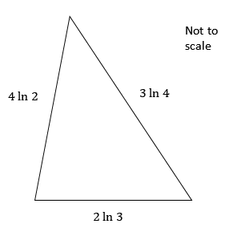

# Exam Questions — Laws of Logarithms
**Logarithms & Exponentials** · Cambridge (CIE) A-LEVEL maths (9709)
> Source: [https://www.savemyexams.com/a-level/maths/cie/20/pure-3/topic-questions/](https://www.savemyexams.com/a-level/maths/cie/20/pure-3/topic-questions/) · 35 questions across 1 sets

## Exam Questions (35 questions)

### Q1 — easy — 3 marks

**Q1** [3 marks]

Write the following in the form $a \text{ln} b$, where $a$ and $b$ are integers to be found.

$4 \text{ln} 9 + 2 \text{ln} 81 - 3 \text{ln} 27$

### Q2 — easy — 4 marks

**Q2** [4 marks]

Solve the following equations, giving your answer in exact form.

(i) $e^{2x} = 5$

(ii) $3 e^{\frac{1}{3}x} = 27$

### Q3 — easy — 2 marks

**Q3** [2 marks]

Solve the equation

$7^{2x-1} = 343$

### Q4 — easy — 4 marks

**Q4** [4 marks]

Write down the value of

(i) $\text{log}_{3} 3$

(ii) $\text{ln} e^{6}$

(iii) $\text{log}_{a} 1$

(iv) $\text{log} 1000$

### Q5 — easy — 3 marks

**Q5** [3 marks]

Show that

`4\text{log}\left(\frac{27}{16}\right) = 12\text{log} 3 - 16\text{log} 2`

### Q6 — easy — 3 marks

**Q6** [3 marks]

Show that

$3 \text{log}_{a} 4 + 2 \text{log}_{a} 256 = 22 \text{log}_{a} 2$

### Q7 — easy — 2 marks

**Q7** [2 marks]

Solve the equation

$\text{log}_{x} 16 = 2$

### Q8 — easy — 4 marks

**Q8** [4 marks]

Evaluate

(i) $\text{log}_{3} 27$

(ii) $\text{log}_{5} 625$

(iii) $\text{log}_{2} \frac{1}{4}$

(iv) $\text{log}_{a} a$

### Q9 — easy — 2 marks

**Q9** [2 marks]

A square has side length $3 \text{ln} 4$.

Show that the perimeter of the square is $24 \text{ln} 2$.

### Q10 — easy — 4 marks

**Q10** [4 marks]

Write the following in the form $a + b \text{ln} 2$, where $a$ and $b$ are integers to be found.

(i) $3^{2} + \text{ln} 4$

(ii) $\text{ln} e^{7} + \text{ln} 8$

(iii) $\text{log} 1000 + 3 \text{ln} 16$

(iv) `5\left(3^{2} + \text{ln} 64\right)`

### Q11 — very_hard — 5 marks

**Q11** [5 marks]

A triangle is drawn inside a circle such that one side of the triangle is the diameter and all three vertices of the triangle lie on the circumference.

The radius of the circle is `\left(3\text{ln} 2\right)` cm.

The two smallest angles in the triangle are $α$ and $β$ respectively, where $β = 2 α$.

Find all three sides of the triangle, giving your answers in the form $a \text{ln} 2$.

### Q12 — hard — 3 marks

**Q12** [3 marks]

Show that $4 - \text{ln} 16$ can be written in the form `4\text{ln}\left(\dfrac{e}{2}\right)`.

### Q13 — very_hard — 3 marks

**Q13** [3 marks]

Write the following as a single logarithm

`2\text{log}_{p}\left(x + 1\right) + 3\text{log}_{p}\left(x - 1\right) - \text{log}_{p}\left(x^{2} - 1\right)`

### Q14 — very_hard — 3 marks

**Q14** [3 marks]

Show that

`2\text{log}_{3} x + \text{log}_{3}\left(x^{2} - 1\right) - 2\text{log}_{3}\left(x + 1\right) \equiv \text{log}_{3}\frac{x^{2}\left(x - 1\right)}{\left(x + 1\right)}`

### Q15 — hard — 3 marks

**Q15** [3 marks]

How many real solutions does the equation have? Justify your answer.

`3\text{log}_{x}\left(x + 1\right) = \text{ln} e^{3}`

### Q16 — very_hard — 3 marks

**Q16** [3 marks]

Without using a calculator, show that

$\text{log}_{4} 8 = \text{log}_{9} 27$

### Q17 — very_hard — 4 marks

**Q17** [4 marks]

Solve the equation

$2 \times 5^{2x+1} + 21 = 41 \times 5^{x}$

giving your answers in the form $\text{log}_{a} b$, where $a$ and $b$ are rational numbers to be found.

### Q18 — medium — 5 marks

**Q18** [2 marks]

Evaluate

$4 \text{log}_{3} 729 + 3 \text{log}_{2} 64^{2} - 3 \text{log} 100 + \text{ln} e^{6}$

**Q18** [3 marks]

Evaluate

$\frac{1}{2} \text{ln} 196 + \frac{1}{3} \text{ln} 125 + \frac{1}{4} \text{ln} 81 + \frac{1}{5} \text{ln} 32$

giving your answer in the form $\text{ln} q$.

### Q19 — hard — 3 marks

**Q19** [3 marks]

Solve the equation

`\text{log}_{3}\left(x + 4\right) = 4 + 2\text{log}_{3} x`

giving your answer correct to 3 significant figures.

### Q20 — hard — 3 marks

**Q20** [3 marks]

Solve the equation

$5^{2x} - 8 \times 5^{x} + 12 = 0$

giving your answers in the form $\text{log}_{a} b$.

### Q21 — hard — 5 marks

**Q21** [2 marks]

Solve the equation

$4^{3x+2} = 16^{x+6}$

**Q21** [3 marks]

Solve the equation

$4^{2x+3} - 8 = 92$

giving your answer correct to 3 significant figures.

### Q22 — medium — 3 marks

**Q22** [3 marks]

By writing 5 as $5 \text{ln} e$, show that

$5 \text{ln} 2 + 5$

can be written as $5 \text{ln} 2 e$.

### Q23 — medium — 5 marks

**Q23** [2 marks]

Evaluate

$\text{log}_{2} 8^{2} + 3 \text{log}_{2} 16 - 2 \text{log}_{2} 2^{5}$

**Q23** [3 marks]

Evaluate

$3 \text{ln} 2 + 2 \text{ln} 5 - \frac{1}{2} \text{ln} 10000$

giving your answer in the form $\text{ln} p$.

### Q24 — hard — 4 marks

**Q24** [2 marks]

Simplify

$2 \text{ln} 3^{4} + \text{ln} 3^{3} - \text{ln} 9$

giving your answer in the form $a \text{ln} b$, where $a$ and $b$ are integers to be found.

**Q24** [2 marks]

Write

`2\text{log}_{a} x + 3\text{log}_{a}\left(x + 1\right) - \text{log}_{a} 4\left(x + 2\right)`

as a single logarithm.

### Q25 — hard — 5 marks

**Q25** [2 marks]

Solve the following equations, giving your answers in exact form.

$4 e^{3x-2} = 12$

**Q25** [3 marks]

$3 e^{2x} + 8 = 14 e^{x}$

### Q26 — hard — 4 marks

**Q26** [4 marks]

A ship sets sail from a harbour.

After some time, the ship's position is `\left(4\text{ln} 3\right)` km east of the harbour and `\left(3\text{ln} 3\right)` km north of the harbour.

Find the direct distance between the ship and the harbour at this time, giving your answer in the form `\left(p\text{ln} 3\right)` km, where $p$ is an integer to be found.

### Q27 — hard — 5 marks

**Q27** [5 marks]

Solve the equation

$6 \times 3^{x-1} = 6^{2x}$

giving your answer in the form $\frac{\text{ln}a}{\text{ln}b}$, where $a$ and $b$ are integers to be found.

### Q28 — easy — 3 marks

**Q28** [3 marks]

Show that

$2 \text{ln} x^{3} - 3 \text{ln} x^{2} = 0$

### Q29 — medium — 6 marks

**Q29** [3 marks]

Write the following as a single logarithm

$2 \text{log}_{a} 6 + 3 \text{log}_{a} 2 - \text{log}_{a} 4$

**Q29** [3 marks]

Write the following in the form $a \text{ln} b$, where *a* and *b* are integers to be found.

$2 \text{ln} 3^{4} + \text{ln} 3^{3} - \text{ln} 9$

### Q30 — medium — 4 marks

**Q30** [2 marks]

Solve the equation

$5^{2x} - 25 = 0$

**Q30** [2 marks]

Solve the equation

$3^{2x-1} = 4^{3} + 4^{2} + 1$

### Q31 — medium — 3 marks

**Q31** [3 marks]

By writing $1 = \text{log}_{a} a$, show that

$1 + 2 \text{log}_{a} b + 3 \text{log}_{a} c = \text{log}_{a} a b^{2} c^{3}$

### Q32 — medium — 7 marks

**Q32** [1 mark]

Solve the following equations, giving your answers in exact form.

$e^{x} = 5$

**Q32** [3 marks]

$3 e^{2x} = 9$

**Q32** [3 marks]

$e^{2x-1} = 4$

### Q33 — medium — 4 marks

**Q33** [4 marks]

The diagram shows a triangle. The length of each of its three sides is measured in centimetres.

Work out the perimeter of the triangle, giving your answer in the form $2 \text{ln} b$, where $b$ is an integer to be found.

### Q34 — medium — 5 marks

**Q34** [2 marks]

Evaluate

$\text{log}_{2} 4 + \text{log}_{3} 27 - \text{log}_{4} 4$

**Q34** [3 marks]

Evaluate

$3 \text{ln} 2 + \frac{1}{2} \text{ln} 81 - 2 \text{ln} 3$

giving your answer in the form $\text{ln} q$, where $q$ is an integer to be found.

### Q35 — medium — 3 marks

**Q35** [3 marks]

Solve the equation

`\text{log}_{x}\left(5x - 6\right) = 2`
