# Mark Schemes — Logarithmic & Exponential Functions
**Logarithms & Exponentials** · Cambridge (CIE) A-LEVEL maths (9709)

## Exam Questions (42 questions)

### Q1
Factorise the quadratic

$( x - 3 ) ( x - 9 ) = 0$

**[M1]**

Set each factor equal to zero

**Final answer:** $x = 3$** or **$x = 9$

**[A1]**

> **[mark-scheme]**
> **M1**: Correct attempt to factorise, $( x - 3 ) ( x - 9 )$, or correct use of the quadratic formula.
> 
> **A1**: Both correct solutions $x = 3$ and $x = 9$.
This is the quadratic from part (a) with $3^{x}$ in place of $x$, so $3^{x}$ takes the two values found there

$3^{x} = 3$* or *$3^{x} = 9$

**[M1]**

Write each right-hand side as a power of 3 and compare the exponents

$3^{x} = 3^{1}$* or *$3^{x} = 3^{2}$

**Final answer:** $x = 1$** or **$x = 2$

**[A1 A1]**

> **[mark-scheme]**
> **M1**: Correct use of the roots from part (a) to write $3^{x} = 3$ and $3^{x} = 9$ (or solving the quadratic in $3^{x}$ afresh).
> 
> **A1**: $x = 1$.
> 
> **A1**: $x = 2$.

### Q2
Rearrange so the exponential term is on its own

$e^{2x} = 16$

Take natural logarithms of both sides

$2 x = \text{ln}  16$

**[M1]**

Write 16 as $2^{4}$ and apply the power law of logarithms

$2 x = \text{ln}  2^{4} = 4  \text{ln}  2$

**[M1]**

Divide both sides by 2 to reach the required form

$x = 2  \text{ln}  2$

**[A1]**

> **[exam-tip]**
> You could stop at $x = \frac{1}{2} \text{ln}  16$, which has the same value, but the question demands the form $a  \text{ln}  a$, so you must simplify the logarithm to $2  \text{ln}  2$ to earn the final mark.

> **[mark-scheme]**
> **M1**: Correct use of natural logarithms of both sides, reaching $2 x = \text{ln}  16$ or equivalent.
> 
> **M1**: Correct use of the power law of logarithms to write $\text{ln}  16 = 4  \text{ln}  2$.
> 
> **A1**: Correct answer in the required form, $x = 2  \text{ln}  2$.

### Q3
(i)

Differentiate $e^{2x}$ by multiplying by the derivative of the exponent $2 x$

$\frac{dy}{dx} = 2 e^{2x}$

**[B1]**

(ii)

The gradient is the value of $\frac{dy}{dx}$ at $x = 0$, so substitute

$\frac{dy}{dx} = 2 e^{2(0)} = 2 e^{0}$

$= 2$

**[B1]**

> **[mark-scheme]**
> **B1**: $\frac{dy}{dx} = 2 e^{2x}$.
> 
> **B1**: Gradient $= 2$.

### Q4
Write 16 as a power of 2 and compare the exponents

$2^{x} = 2^{4}$

$x = 4$

**[B1]**

> **[mark-scheme]**
> **B1**: $x = 4$.

### Q5
Since $a > 1$, the graph is an increasing curve lying entirely above the $x$-axis, which represents exponential growth

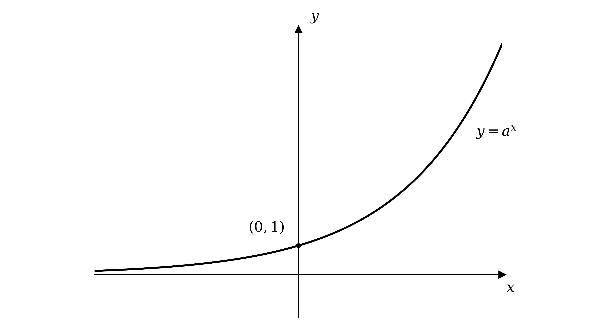

**Final answer:** **Exponential growth**

**[B1]**

The curve crosses the $y$-axis where $x = 0$, giving $y = a^{0} = 1$

$( 0 , 1 )$

**[B1]**

As $x \rightarrow - \infty$ the curve approaches but never meets the $x$-axis, so the horizontal asymptote is

$y = 0$

**[B1]**

> **[mark-scheme]**
> **B1**: Correct shape (an increasing curve lying above the $x$-axis), identified as exponential growth.
> 
> **B1**: $y$-axis intercept stated as $( 0 , 1 )$.
> 
> **B1**: Asymptote given as $y = 0$.

### Q6
(i)

Write 27 as a power of 3 and compare the exponents

$3^{a} = 27 = 3^{3}$

$a = 3$

**[B1]**

(ii)

Cube both sides to undo the cube root

$a = 5^{3}$

$a = 125$

**[B1]**

(iii)

Divide both sides by 4

$a^{2} = 16$

Take the square root of both sides, keeping both signs

$a = \pm 4$

**[B1]**

> **[mark-scheme]**
> **B1**: $a = 3$.
> 
> **B1**: $a = 125$.
> 
> **B1**: $a = \pm 4$. Both signs are required, since squaring either value gives $16$.

### Q7
Since $e > 1$, the graph of $y = e^{x}$ is an increasing curve lying entirely above the $x$-axis

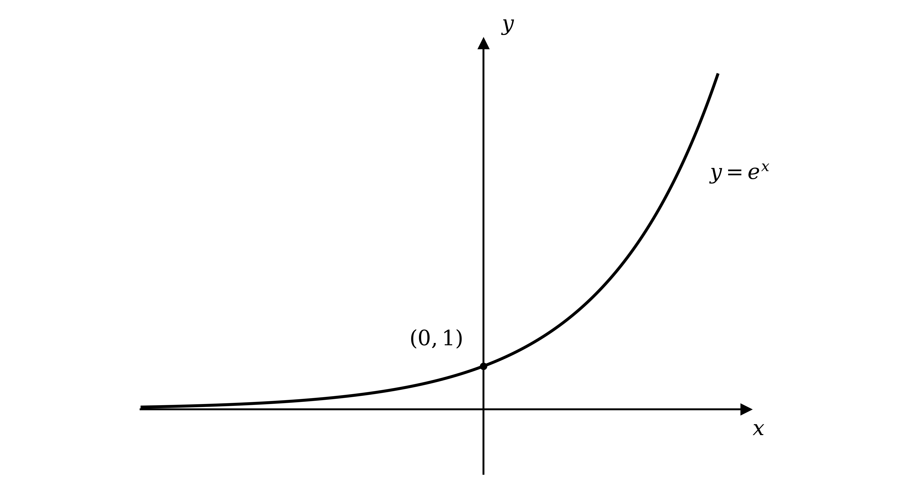

**[B1]**

The curve crosses the $y$-axis where $x = 0$, giving $y = e^{0} = 1$

$( 0 , 1 )$

**[B1]**

As $x \rightarrow - \infty$ the curve approaches but never meets the $x$-axis, so the horizontal asymptote is

$y = 0$

**[B1]**

> **[mark-scheme]**
> **B1**: Correct shape (an increasing curve lying above the $x$-axis).
> 
> **B1**: $y$-axis intercept stated as $( 0 , 1 )$.
> 
> **B1**: Asymptote given as $y = 0$.

### Q8
(i)

Convert from logarithmic to exponential form

$a = 3^{4}$

$a = 81$

**[B1]**

(ii)

Convert to exponential form, so the base cubed gives 216

$a^{3} = 216$

Take the cube root

$a = 6$

**[B1]**

(iii)

Convert to exponential form and write 128 as a power of 2

$2^{a} = 128 = 2^{7}$

$a = 7$

**[B1]**

> **[mark-scheme]**
> **B1**: $a = 81$.
> 
> **B1**: $a = 6$.
> 
> **B1**: $a = 7$.

### Q9
(i)

Evaluate the logarithm on a calculator, then multiply by 5

$5  \text{log}_{3}  7 = 5 \times 1 . 77124 \dots$

**Final answer:** $8 . 856$** (4 s.f.)**

**[B1]**

(ii)

Evaluate each logarithm and add

$2  \text{log}_{2}  3 + 3  \text{log}_{3}  2 = 3 . 16992 \dots + 1 . 89279 \dots$

**Final answer:** $5 . 063$** (4 s.f.)**

**[B1]**

> **[mark-scheme]**
> **B1**: An answer which rounds to $8 . 856$ to 4 significant figures.
> 
> **B1**: An answer which rounds to $5 . 063$ to 4 significant figures.

### Q10
Evaluate the logarithm, since $3^{2} = 9$ gives $\text{log}_{3} 9 = 2$

$2  \text{log}_{3}  9 = 2 \times 2 = 4$

**[M1]**

The equation becomes $4 = 5 x - 6$, so rearrange for $x$

$5 x = 10$

$x = 2$

**[A1]**

> **[mark-scheme]**
> **M1**: Correct evaluation of $\text{log}_{3} 9 = 2$ (so the left-hand side is $4$), forming a linear equation in $x$.
> 
> **A1**: $x = 2$.

### Q11
(i)

Rewrite with a positive index to reveal the effective base

`y = 3^{-2x} = \left(3^{-2}\right)^{x} = \left(\dfrac{1}{9}\right)^{x}`

The base $\frac{1}{9}$ lies between 0 and 1, so the model decays

**Final answer:** **Exponential decay**

**[B1]**

(ii)

The number being raised to the power $x$ is the base

`y = 20\left(2\right)^{x}`

The base $2$ is greater than 1, so the model grows

**Final answer:** **Exponential growth**

**[B1]**

(iii)

Rewrite with a positive index to reveal the effective base

`y = 30a^{-x} = 30\left(\dfrac{1}{a}\right)^{x}`

Since $a > 1$, the base $\frac{1}{a}$ lies between 0 and 1, so the model decays

**Final answer:** **Exponential decay**

**[B1]**

> **[mark-scheme]**
> **B1**: Exponential decay. The effective base $\frac{1}{9}$ lies between 0 and 1.
> 
> **B1**: Exponential growth. The base $2$ is greater than 1.
> 
> **B1**: Exponential decay. Since $a > 1$, the effective base $\frac{1}{a}$ lies between 0 and 1.

### Q12
Rewriting as `y = \left(\tfrac{1}{2}\right)^{x}` shows the base lies between 0 and 1, so the curve decreases: this is exponential decay

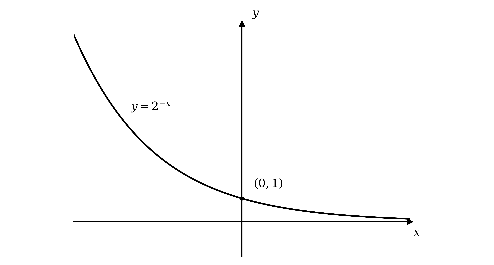

**Final answer:** **Exponential decay**

**[B1]**

The curve crosses the $y$-axis where $x = 0$, giving $y = 2^{0} = 1$

$( 0 , 1 )$

**[B1]**

As $x \rightarrow + \infty$ the curve approaches the $x$-axis, so the asymptote is $y = 0$

**[B1]**

> **[mark-scheme]**
> **B1**: Correct shape — a decreasing curve lying above the $x$-axis.
> 
> **B1**: $y$-axis intercept $( 0 , 1 )$.
> 
> **B1**: Identified as exponential decay (and asymptote $y = 0$).
Substitute $x = 3$ and evaluate the negative power as a reciprocal

$y = 2^{-3} = \frac{1}{2^{3}}$

$y = \frac{1}{8}$

**[B1]**

> **[mark-scheme]**
> **B1**: $y = \frac{1}{8}$ (accept $0 . 125$).

### Q13
$y = e^{x}$ is an increasing curve and $y = e^{-x}$ is its reflection in the $y$-axis (decreasing); they meet on the $y$-axis

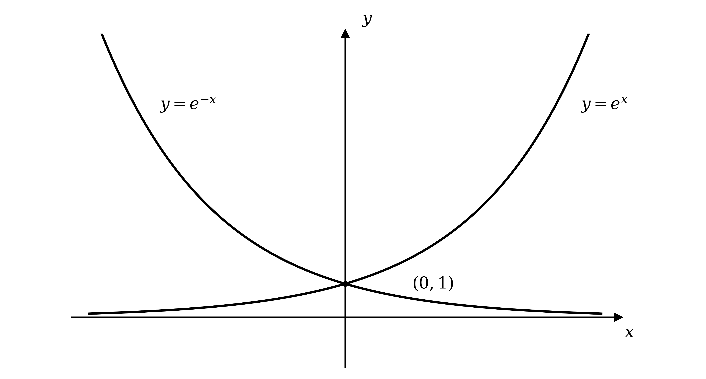

**[B1 B1]**

Both curves cross the $y$-axis where $x = 0$, giving $y = e^{0} = 1$

$( 0 , 1 )$

**[B1]**

Each curve approaches the $x$-axis, so the asymptote is

$y = 0$

**[B1]**

> **[mark-scheme]**
> **B1**: Correct shape for $y = e^{x}$ (increasing, above the $x$-axis).
> 
> **B1**: Correct shape for $y = e^{-x}$ (decreasing; a reflection of $y = e^{x}$ in the $y$-axis).
> 
> **B1**: Both curves labelled through $( 0 , 1 )$.
> 
> **B1**: Asymptote $y = 0$.
The gradient function of $y = e^{x}$ is $e^{x}$, so at $x = 0$ the gradient is $e^{0}$

$1$

**[B1]**

> **[mark-scheme]**
> **B1**: Gradient $= 1$.

### Q14
(i)

Evaluate each logarithm and add

$\text{log}_{2} 5 + \text{log}_{5} 2 = 2 . 32193 \dots + 0 . 43068 \dots$

**Final answer:** $2 . 75$** (3 s.f.)**

**[B1]**

(ii)

Evaluate each logarithm and subtract

$\text{log}  25 - \text{ln}  2 = 1 . 39794 \dots - 0 . 69315 \dots$

**Final answer:** $0 . 705$** (3 s.f.)**

**[B1]**

(iii)

Evaluate each logarithm, then combine

$2 . 30103 \dots + 2 . 43068 \dots - 1 . 30103 \dots + 2 . 30259 \dots$

**Final answer:** $5 . 73$** (3 s.f.)**

**[B1]**

> **[mark-scheme]**
> **B1**: An answer which rounds to $2 . 75$ to 3 significant figures.
> 
> **B1**: An answer which rounds to $0 . 705$ to 3 significant figures.
> 
> **B1**: An answer which rounds to $5 . 73$ to 3 significant figures.
Evaluate the two logarithms, since $\text{log}_{2} 4 = 2$ and $\text{log}_{6} 216 = 3$

$3 ( 2 ) + 3 x = 5 ( 3 )$

**[M1]**

Simplify and solve the linear equation

$6 + 3 x = 15$

$x = 3$

**[A1]**

> **[mark-scheme]**
> **M1**: Correct evaluation of both logarithms ($\text{log}_{2} 4 = 2$ and $\text{log}_{6} 216 = 3$), giving a linear equation in $x$.
> 
> **A1**: $x = 3$.

### Q15
Both are increasing exponential curves lying above the $x$-axis; $y = 3^{x}$ rises more steeply, lying above $y = 2^{x}$ for $x > 0$ and below it for $x < 0$

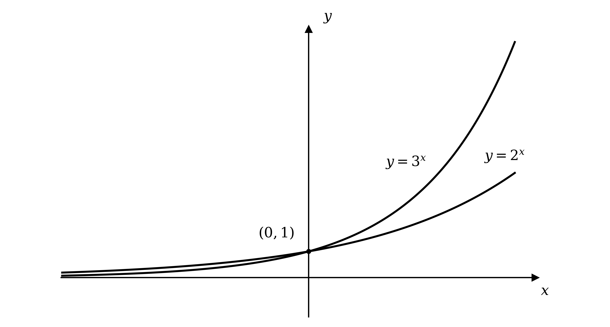

**[B1 B1]**

Neither graph crosses the $x$-axis; both cross the $y$-axis where $x = 0$, giving $y = 1$

$( 0 , 1 )$

**[B1]**

As $x \rightarrow - \infty$ both curves approach the $x$-axis, so the asymptote is

$y = 0$

**[B1]**

> **[mark-scheme]**
> **B1**: Correct shape for $y = 2^{x}$ (increasing, above the $x$-axis, through the positive $y$-axis).
> 
> **B1**: Correct shape for $y = 3^{x}$, positioned correctly relative to $y = 2^{x}$ (steeper; above it for $x > 0$, below it for $x < 0$).
> 
> **B1**: Both curves labelled through $( 0 , 1 )$.
> 
> **B1**: Asymptote $y = 0$.

### Q16
(i)

Convert to exponential form, so the base cubed gives 8

$a^{3} = 8$

$a = 2$

**[B1]**

(ii)

With no base shown the logarithm is base 10, so convert to exponential form

$a = 10^{2}$

$a = 100$

**[B1]**

(iii)

The natural logarithm and the exponential are inverses, so $\text{ln}  e^{3} = 3$

$a = 3$

**[B1]**

(iv)

Any base raised to the power 1 is itself, so $5^{1} = a$

$a = 5$

**[B1]**

> **[mark-scheme]**
> **B1**: $a = 2$.
> 
> **B1**: $a = 100$.
> 
> **B1**: $a = 3$.
> 
> **B1**: $a = 5$.

### Q17
Recognise the hidden quadratic, since `2^{2x} = \left(2^{x}\right)^{2}`, and substitute $y = 2^{x}$

$y^{2} - 24 y + 128 = 0$

Factorise and solve for $y$

$( y - 8 ) ( y - 16 ) = 0$

$2^{x} = 8$* or *$2^{x} = 16$

**[M1]**

Write each right-hand side as a power of 2 and compare exponents

$2^{x} = 2^{3}$* or *$2^{x} = 2^{4}$

$x = 3$

**[A1]**

$x = 4$

**[A1]**

> **[mark-scheme]**
> **M1**: Correct formation and solution of the quadratic in $2^{x}$, reaching $2^{x} = 8$ and $2^{x} = 16$.
> 
> **A1**: $x = 3$.
> 
> **A1**: $x = 4$.

### Q18
Recognise the hidden quadratic, since `e^{2x} = \left(e^{x}\right)^{2}`, and substitute $y = e^{x}$

$y^{2} - 8 y + 15 = 0$

Factorise and solve for $y$

$( y - 3 ) ( y - 5 ) = 0$

$e^{x} = 3$* or *$e^{x} = 5$

**[M1]**

Take natural logarithms of each to solve for $x$

$x = \text{ln}  3$* or *$x = \text{ln}  5$

**Final answer:** $x = 1 . 10$** or **$x = 1 . 61$

**[A1 A1]**

> **[mark-scheme]**
> **M1**: Correct formation and solution of the quadratic in $e^{x}$, reaching $e^{x} = 3$ and $e^{x} = 5$.
> 
> **A1**: An answer which rounds to $x = 1 . 10$ (3 significant figures).
> 
> **A1**: An answer which rounds to $x = 1 . 61$ (3 significant figures).

### Q19
(i)

Replace $x$ with $- x$ in `f\left(x\right) = 2e^{3x}`

`f\left(-x\right) = 2e^{3\left(-x\right)}`

`f\left(-x\right) = 2e^{-3x}`

**[B1]**

(ii)

$y = 2 e^{3x}$ is increasing and $y = 2 e^{-3x}$ is its reflection in the $y$-axis (decreasing), meeting on the $y$-axis

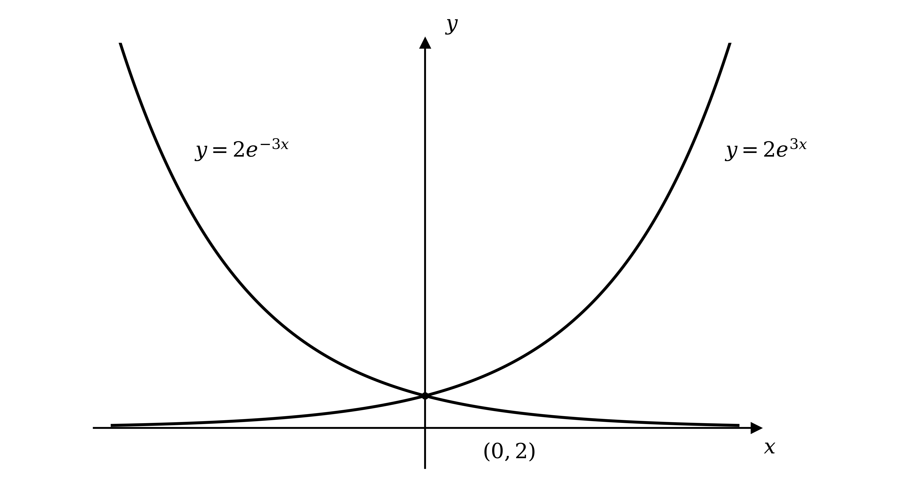

**[B1]**

Both curves cross the $y$-axis where $x = 0$, giving $y = 2 e^{0} = 2$

$( 0 , 2 )$

**[B1]**

> **[mark-scheme]**
> **B1**: `f\left(-x\right) = 2e^{-3x}`.
> 
> **B1**: Both curves correct: one increasing and one decreasing, reflections of each other in the $y$-axis.
> 
> **B1**: Intersection with the $y$-axis labelled $( 0 , 2 )$.
Multiplying the whole function by $- 1$ sends each point $( x , y )$ to $( x , - y )$

**Final answer:** **Reflection in the x-axis**

**[B1 B1]**

> **[mark-scheme]**
> **B1**: Correct identification of a reflection.
> 
> **B1**: In the $x$-axis.

### Q20
(i)

Differentiate $e^{-3x}$ by multiplying by the derivative of the exponent

$\frac{dy}{dx} = - 3 e^{-3x}$

**[B1]**

(ii)

Substitute $x = 0$ into the gradient function

$- 3 e^{-3(0)} = - 3 e^{0}$

$- 3$

**[B1]**

> **[mark-scheme]**
> **B1**: $\frac{dy}{dx} = - 3 e^{-3x}$.
> 
> **B1**: Gradient $= - 3$.
(i)

Substitute $x = 2$ into the gradient function $- 3 e^{-3x}$

$- 3 e^{-6}$

**[B1]**

(ii)

Set the gradient function equal to the given value

$- 3 e^{-3x} = - 3 e^{-12}$

Equate the exponents, since the bases match

$- 3 x = - 12$

$x = 4$

**[B1]**

> **[mark-scheme]**
> **B1**: $- 3 e^{-6}$.
> 
> **B1**: $x = 4$.

### Q21
Differentiate $e^{4x}$ by multiplying by the derivative of the exponent

$\frac{dy}{dx} = 4 e^{4x}$

**[B1]**

> **[mark-scheme]**
> **B1**: $\frac{dy}{dx} = 4 e^{4x}$.
Differentiate, keeping the constant factor and multiplying by the derivative of the exponent

$\frac{dy}{dx} = 4 e^{2x}$

**[B1]**

> **[mark-scheme]**
> **B1**: $\frac{dy}{dx} = 4 e^{2x}$.
Differentiate, multiplying by the derivative of the exponent $- 2 x$

$\frac{dy}{dx} = - 6 e^{-2x}$

**[M1]**

The gradient is the value of $\frac{dy}{dx}$ at $x = 3$, so substitute

$\frac{dy}{dx} = - 6 e^{-2(3)}$

**[M1]**

$- 6 e^{-6}   ( p = - 6 ,  q = - 6 )$

**[A1]**

> **[mark-scheme]**
> **M1**: Correct differentiation to $\frac{dy}{dx} = - 6 e^{-2x}$.
> 
> **M1**: Correct substitution of $x = 3$ into the derivative.
> 
> **A1**: $- 6 e^{-6}$, with $p = - 6$ and $q = - 6$.

### Q22
Recognise the hidden quadratic, since `e^{2x} = \left(e^{x}\right)^{2}`, and rearrange with $u = e^{x}$

$2 u^{2} - u - 10 = 0$

Factorise and solve for $u$

$( 2 u - 5 ) ( u + 2 ) = 0$

$e^{x} = \frac{5}{2}$* or *$e^{x} = - 2$

**[M1]**

Since $e^{x} > 0$ for all real $x$, reject $e^{x} = - 2$; take natural logs of the valid root

$x = \text{ln}  \frac{5}{2}$

**[A1]**

Evaluate to 3 significant figures

**Final answer:** $x = 0 . 916$** (3 s.f.)**

**[A1]**

> **[exam-tip]**
> A quadratic in $e^{x}$ can throw up a negative root, but $e^{x}$ is never negative, so a value such as $e^{x} = - 2$ has no solution and must be discarded before you take logarithms.

> **[mark-scheme]**
> **M1**: Correct formation and solution of the quadratic in $e^{x}$, reaching $e^{x} = \frac{5}{2}$ and $e^{x} = - 2$.
> 
> **A1**: Correct rejection of $e^{x} = - 2$ (since $e^{x} > 0$), reaching $x = \text{ln} \frac{5}{2}$.
> 
> **A1**: An answer which rounds to $x = 0 . 916$ (3 significant figures).

### Q23
Replace $x$ with $2 x$ in `f\left(x\right) = 3e^{2x}`

`f\left(2x\right) = 3e^{2\left(2x\right)}`

**[M1]**

`f\left(2x\right) = 3e^{4x}`

**[A1]**

> **[mark-scheme]**
> **M1**: Correct substitution of $2 x$ for $x$ in $f ( x ) = 3 e^{2x}$.
> 
> **A1**: $f ( 2 x ) = 3 e^{4x}$.
First differentiate `f\left(x\right) = 3e^{2x}` to obtain the gradient function

`f'\left(x\right) = 6e^{2x}`

**[M1]**

Then replace $x$ with $2 x$ in `f'\left(x\right)`

`f'\left(2x\right) = 6e^{4x}`

**[A1]**

> **[mark-scheme]**
> **M1**: Correct differentiation to $f ' ( x ) = 6 e^{2x}$.
> 
> **A1**: $f ' ( 2 x ) = 6 e^{4x}$. (This is $f '$ evaluated at $2 x$, not $\frac{d}{dx} f ( 2 x )$.)

### Q24
(i)

The base $0 . 4$ lies between 0 and 1, so the curve decreases from left to right, staying above the $x$-axis

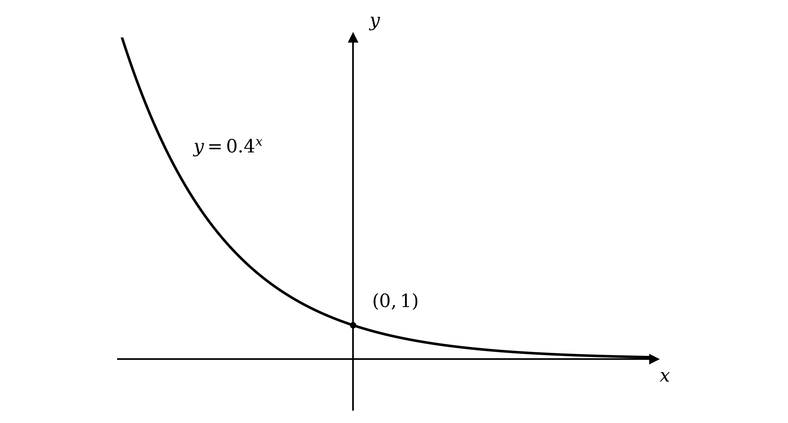

**[B1]**

The curve crosses the $y$-axis where $x = 0$, giving $y = 0 . 4^{0} = 1$

$( 0 , 1 )$

**[B1]**

(ii)

Because the base is less than 1 the function decreases

**Final answer:** **Exponential decay**

**[B1]**

> **[mark-scheme]**
> **B1**: Correct shape (a decreasing curve lying above the $x$-axis).
> 
> **B1**: $y$-axis intercept $( 0 , 1 )$.
> 
> **B1**: Identified as exponential decay.
Set $0 . 4^{x} = 0 . 064$ and write $0 . 064$ as a power of $0 . 4$

$0 . 4^{x} = 0 . 4^{3}$

$x = 3$

**[B1]**

> **[mark-scheme]**
> **B1**: $x = 3$.

### Q25
Each logarithm is base 10, so write each number as a power of 10

$\text{log}  1000 + \text{log}  10000 = 3 + 4$

$7$

**[B1]**

> **[mark-scheme]**
> **B1**: $7$.
Raising the base to a logarithm of the same base undoes it, so $6^{\text{log}_{6}a} = a$

$a = 36$

**[B1]**

> **[mark-scheme]**
> **B1**: $a = 36$.
Evaluate each part: $\text{log}_{4} 64 = 3$, $\text{log}_{2} 8 = 3$ so $3^{\text{log}_{2}8} = 3^{3} = 27$, $\text{log}_{5} 5 = 1$ and $\text{log}  100 = 2$

$\frac{2(3)+27-1}{2}$

**[M1]**

Simplify the numerator, then divide

$= \frac{32}{2}$

$= 16$

**[A1]**

> **[mark-scheme]**
> **M1**: Correctly evaluates the component logarithms and powers ($\text{log}_{4} 64 = 3$, $3^{\text{log}_{2}8} = 27$, $\text{log}_{5} 5 = 1$, $\text{log} 100 = 2$).
> 
> **A1**: $16$.

### Q26
Recognise the hidden quadratic, since `2^{2x} = \left(2^{x}\right)^{2}`, and substitute $u = 2^{x}$

$2 u^{2} - 9 u + 4 = 0$

Factorise and solve for $u$

$( 2 u - 1 ) ( u - 4 ) = 0$

$2^{x} = \frac{1}{2}$* or *$2^{x} = 4$

**[M1]**

Write each as a power of 2 and compare exponents

$2^{x} = 2^{-1}$* or *$2^{x} = 2^{2}$

$x = - 1$

**[A1]**

$x = 2$

**[A1]**

> **[mark-scheme]**
> **M1**: Correct formation and solution of the quadratic in $2^{x}$, reaching $2^{x} = \frac{1}{2}$ and $2^{x} = 4$.
> 
> **A1**: $x = - 1$.
> 
> **A1**: $x = 2$.

### Q27
Both are increasing exponential curves lying above the $x$-axis; $y = 5^{x}$ is steeper, lying above $y = 4^{x}$ for $x > 0$ and below it for $x < 0$

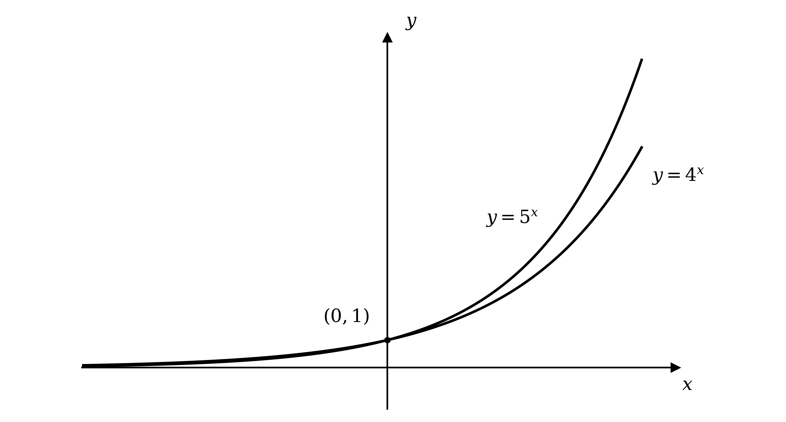

**[B1 B1]**

Neither graph crosses the $x$-axis; both cross the $y$-axis where $x = 0$, giving $y = 1$

$( 0 , 1 )$

**[B1]**

As $x \rightarrow - \infty$ both curves approach the $x$-axis, so the asymptote is

$y = 0$

**[B1]**

> **[mark-scheme]**
> **B1**: Correct shape for $y = 4^{x}$ (increasing, above the $x$-axis).
> 
> **B1**: Correct shape for $y = 5^{x}$, positioned correctly relative to $y = 4^{x}$ (steeper).
> 
> **B1**: Both curves labelled through $( 0 , 1 )$.
> 
> **B1**: Asymptote $y = 0$.
A reflection in the $y$-axis replaces $x$ with $- x$

$y = 4^{-x}$

**[B1]**

> **[mark-scheme]**
> **B1**: $y = 4^{-x}$ (accept `y = \left(\tfrac{1}{4}\right)^{x}` or $y = 0 . 25^{x}$).

### Q28
Evaluate the two logarithms, since $\text{log}  1000 = 3$ and $\text{log}_{16} 4 = \frac{1}{2}$ (because $16^{1/2} = 4$)

`2(3) = x \left(\tfrac{1}{2}\right)`

**[M1]**

Simplify and solve for $x$

$6 = \frac{1}{2} x$

$x = 12$

**[A1]**

> **[mark-scheme]**
> **M1**: Correct evaluation of both logarithms ($\text{log} 1000 = 3$ and $\text{log}_{16} 4 = \frac{1}{2}$), forming a linear equation in $x$.
> 
> **A1**: $x = 12$.
Evaluate $3  \text{log}_{5} 25 = 3 ( 2 ) = 6$, then collect the $\text{log}_{4} x$ terms

$2  \text{log}_{4}  x = 6$

**[M1]**

Divide by 2 and convert to exponential form

$\text{log}_{4}  x = 3  \Rightarrow  x = 4^{3}$

$x = 64$

**[A1]**

> **[mark-scheme]**
> **M1**: Correct use of $3  \text{log}_{5} 25 = 6$, collecting terms to reach $2  \text{log}_{4} x = 6$ (or $\text{log}_{4} x = 3$).
> 
> **A1**: $x = 64$.

### Q29
Rearrange so the two exponential terms are equal

$e^{x} = e^{-x}$

**[M1]**

Multiply both sides by $e^{x}$, which is always positive, to clear the negative exponent

$e^{2x} = 1$

**[M1]**

Since $e^{2x}$ is a strictly increasing function it takes the value 1 exactly once, where the exponent is zero

**Final answer:** $x = 0$**, the only real solution**

**[A1]**

> **[mark-scheme]**
> **M1**: Correct rearrangement to $e^{x} = e^{-x}$.
> 
> **M1**: Correct simplification to $e^{2x} = 1$ (or $x = - x$).
> 
> **A1**: Correct conclusion $x = 0$, with justification that it is the only solution (because $e^{2x}$ takes each value once).
*For every real *$x$* both terms are strictly positive, since *$e^{x} > 0$* and *$e^{-x} > 0$

**[B1]**

*Their sum is therefore always positive, so it can never equal zero*

**Final answer:** $e^{x} + e^{-x} > 0$** for all real x**

**[B1]**

> **[mark-scheme]**
> **B1**: Both terms correctly shown positive: $e^{x} > 0$ and $e^{-x} > 0$ for all real $x$.
> 
> **B1**: Correct conclusion that the sum is always positive, so the equation has no real solution.

### Q30
For $x \geq 0$ the curve starts on the $y$-axis and decreases towards the $x$-axis, staying above it

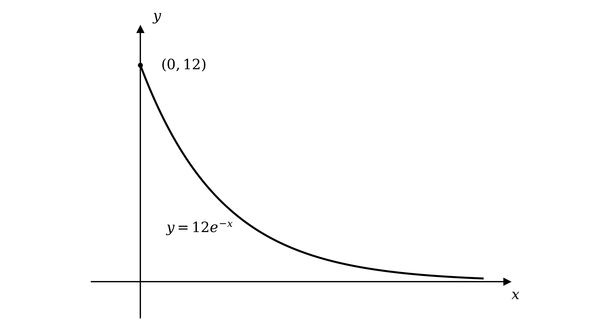

**[B1]**

The curve meets the $y$-axis where $x = 0$, giving $y = 12 e^{0} = 12$

$( 0 , 12 )$

**[B1]**

As $x \rightarrow + \infty$ the curve approaches the $x$-axis, so the asymptote is

$y = 0$

**[B1]**

> **[mark-scheme]**
> **B1**: Correct shape (a decreasing curve for $x \geq 0$, lying above the $x$-axis).
> 
> **B1**: Intersection with the $y$-axis labelled $( 0 , 12 )$.
> 
> **B1**: Asymptote $y = 0$.
Differentiate to get the gradient function

$\frac{dy}{dx} = - 12 e^{-x}$

Substitute $x = 0$

$- 12 e^{0}$

$- 12$

**[B1]**

> **[mark-scheme]**
> **B1**: Gradient $= - 12$.

### Q31
Differentiate, keeping the constant $a$ and multiplying by the derivative of the exponent $b x$

$\frac{dy}{dx} = a b e^{bx}$

**[B1]**

> **[mark-scheme]**
> **B1**: $\frac{dy}{dx} = a b e^{bx}$.
Substitute $x = 0$ into the gradient function and set it equal to 12

$a b e^{0} = 12$

$a b = 12$

**[M1]**

Divide by $a$ to make $b$ the subject

$b = \frac{12}{a}$

**[A1]**

> **[mark-scheme]**
> **M1**: Correct substitution of $x = 0$ into their gradient function, set equal to 12 (reaching $a b = 12$).
> 
> **A1**: $b = \frac{12}{a}$.
Substitute $b = \frac{12}{a}$ into $y = a e^{bx}$

$y = a e^{\frac{12}{a}x}$

**[B1]**

> **[mark-scheme]**
> **B1**: $y = a e^{\frac{12}{a}x}$ (or equivalent).

### Q32
Expand the square, using `e^{x} \cdot e^{-x} = 1` for the middle term

`\left(e^{x}\right)^{2} - 2e^{x}e^{-x} + \left(e^{-x}\right)^{2} = 0`

$e^{2x} - 2 + e^{-2x} = 0$

**[M1]**

Multiply through by $e^{2x}$ to clear the negative power and form a quadratic

$e^{4x} - 2 e^{2x} + 1 = 0$

**[M1]**

Substitute $y = e^{2x}$ and factorise

$( y - 1 )^{2} = 0  \Rightarrow  e^{2x} = 1$

**[M1]**

Take natural logarithms, since $e^{2x} = 1$ gives $2 x = 0$

$x = 0$

**[A1]**

> **[exam-tip]**
> A square equals zero only when the thing being squared is zero, so you can go straight from `\left(e^{x}-e^{-x}\right)^{2}=0` to $e^{x} - e^{-x} = 0$, then $e^{2x} = 1$ and $x = 0$, without expanding.

> **[mark-scheme]**
> **M1**: Either correct expansion of the square, using $e^{x} e^{-x} = 1$ to reach $e^{2x} - 2 + e^{-2x} = 0$, or recognising that a square is zero only when the bracket is zero, giving $e^{x} - e^{-x} = 0$.
> 
> **M1**: Reaching an equation in $e^{2x}$ alone: either the quadratic $e^{4x} - 2 e^{2x} + 1 = 0$ (or equivalent) from the expanded form, or $e^{2x} = 1$ from $e^{x} = e^{-x}$ by the shorter route.
> 
> **M1**: Taking logarithms of both sides to solve $e^{2x} = 1$.
> 
> **A1**: $x = 0$.

### Q33
Differentiate, keeping the constant $\frac{1}{a}$ and multiplying by the derivative of the exponent $- b x$

$\frac{dy}{dx} = - \frac{b}{a} e^{-bx}$

**[B1]**

> **[mark-scheme]**
> **B1**: $\frac{dy}{dx} = - \frac{b}{a} e^{-bx}$.
Decay needs the value to fall as $x$ increases, which requires a negative exponent, so $- b < 0$

$b > 0$

**[B1]**

> **[mark-scheme]**
> **B1**: $b > 0$ (taking $a > 0$ so the coefficient is positive).
Substitute $x = 0$ into the gradient function and set it equal to 10

$- \frac{b}{a} e^{0} = 10$

$b = - 10 a$

**[M1]**

Substitute $b = - 10 a$ into $y = \frac{1}{a} e^{-bx}$, so the exponent becomes $10 a x$

$y = \frac{1}{a} e^{10ax}$

**[A1]**

> **[mark-scheme]**
> **M1**: Correct setup of the gradient at $x = 0$ equal to 10, reaching $b = - 10 a$.
> 
> **A1**: $y = \frac{1}{a} e^{10ax}$ (or equivalent).

### Q34
Every term has a factor of $e^{x}$, so factorise it out

`e^{x}\left(2e^{2x} - 11e^{x} + 12\right) = 0`

**[M1]**

Since $e^{x} > 0$ for all real $x$, the bracket must be zero; substitute $u = e^{x}$ and factorise

$2 u^{2} - 11 u + 12 = 0$

$( 2 u - 3 ) ( u - 4 ) = 0$

$e^{x} = \frac{3}{2}$* or *$e^{x} = 4$

**[M1]**

Both values are positive, so take natural logarithms of each

**Final answer:** $e^{x} = \frac{3}{2}  \Rightarrow  x = \text{ln}  \frac{3}{2}$** or **$e^{x} = 4  \Rightarrow  x = \text{ln}  4$

**[A1]**

Evaluate each to 3 significant figures

**Final answer:** $x = 0 . 405$** or **$x = 1 . 39$

**[A1 A1]**

> **[mark-scheme]**
> **M1**: Correct factorisation of $e^{x}$ (recognising $e^{x} = 0$ gives no solution).
> 
> **M1**: Correct formation and solution of the quadratic in $e^{x}$, reaching $e^{x} = \frac{3}{2}$ and $e^{x} = 4$.
> 
> **A1**: Correct exact values $x = \text{ln} \frac{3}{2}$ and $x = \text{ln} 4$.
> 
> **A1**: An answer which rounds to $x = 0 . 405$ (3 significant figures).
> 
> **A1**: An answer which rounds to $x = 1 . 39$ (3 significant figures).

### Q35
Both bases lie between 0 and 1, so both curves decrease; $y = 0 . 3^{x}$ falls more steeply, lying below $y = 0 . 5^{x}$ for $x > 0$ and above it for $x < 0$

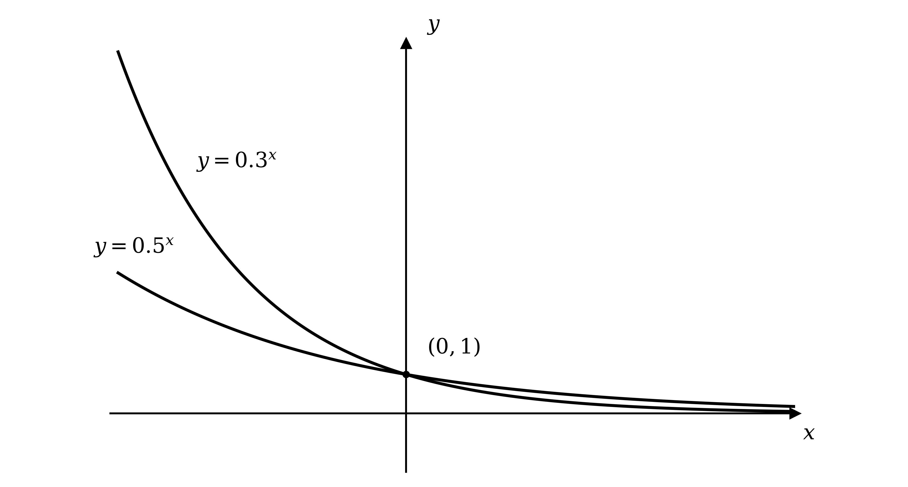

**[B1 B1]**

Neither graph crosses the $x$-axis; both cross the $y$-axis where $x = 0$, giving $y = 1$

$( 0 , 1 )$

**[B1]**

As $x \rightarrow + \infty$ both curves approach the $x$-axis, so the asymptote is

$y = 0$

**[B1]**

> **[mark-scheme]**
> **B1**: Correct shape for $y = 0 . 5^{x}$ (decreasing, above the $x$-axis).
> 
> **B1**: Correct shape for $y = 0 . 3^{x}$, positioned correctly relative to $y = 0 . 5^{x}$ (decays faster).
> 
> **B1**: Both curves labelled through $( 0 , 1 )$.
> 
> **B1**: Asymptote $y = 0$.
A reflection in the $y$-axis replaces $x$ with $- x$

$y = 0 . 5^{-x}$

**[B1]**

> **[mark-scheme]**
> **B1**: $y = 0 . 5^{-x}$ (accept $y = 2^{x}$).

### Q36
The initial velocity is the value of $v$ when $t = 0$

$v = 0 . 3 e^{k(0)} = 0 . 3 e^{0}$

$0 . 3  \text{m s}^{-1}$

**[B1]**

> **[mark-scheme]**
> **B1**: Initial velocity $0 . 3  \text{m s}^{-1}$.
Acceleration is the rate of change of velocity, so differentiate $v$ with respect to $t$

$a = \frac{dv}{dt} = 0 . 3 \times k \times e^{kt}$

**[M1]**

$a = 0 . 3 k  e^{kt}$

**[A1]**

> **[mark-scheme]**
> **M1**: Correct differentiation of $v = 0 . 3 e^{kt}$ with respect to $t$ (multiplying by $k$).
> 
> **A1**: $a = 0 . 3 k  e^{kt}$.
Substitute $v = 0 . 9$ and $t = 12$, then isolate the exponential

$0 . 3 e^{12k} = 0 . 9$

$e^{12k} = 3$

**[M1]**

Take natural logarithms of both sides

$12 k = \text{ln}  3$

**[M1]**

Divide by 12 and evaluate

**Final answer:** $k = 0 . 0916$** (3 s.f.)**

**[A1]**

> **[mark-scheme]**
> **M1**: Correct substitution of the values, rearranging to $e^{12k} = 3$.
> 
> **M1**: Correct use of natural logarithms to reach $12 k = \text{ln}  3$.
> 
> **A1**: An answer which rounds to $k = 0 . 0916$ (3 significant figures).
With $k > 0$ the exponential grows without limit, so the model gives an ever-increasing velocity

**Final answer:** **The velocity increases without bound, which is unrealistic**

**[B1]**

> **[mark-scheme]**
> **B1**: Correct recognition that the velocity grows without limit (tends to infinity) as $t$ increases, which is not physically realistic.

### Q37
Replace $x$ with $4 x$ in `f\left(x\right) = 5e^{3x}`

`f\left(4x\right) = 5e^{3\left(4x\right)}`

**[M1]**

`f\left(4x\right) = 5e^{12x}`

**[A1]**

> **[mark-scheme]**
> **M1**: Correct substitution of $4 x$ for $x$ in $f ( x ) = 5 e^{3x}$.
> 
> **A1**: $f ( 4 x ) = 5 e^{12x}$.
First differentiate `f\left(x\right) = 5e^{3x}` to obtain the gradient function

`f'\left(x\right) = 15e^{3x}`

**[M1]**

Then replace $x$ with $5 x$ in `f'\left(x\right)`

`f'\left(5x\right) = 15e^{15x}`

**[A1]**

> **[mark-scheme]**
> **M1**: Correct differentiation to $f ' ( x ) = 15 e^{3x}$.
> 
> **A1**: $f ' ( 5 x ) = 15 e^{15x}$ ($f '$ evaluated at $5 x$).

### Q38
Let $y = \text{log}_{4}  128$, so that, by the definition of a logarithm

$4^{y} = 128$

Write both sides as powers of $2$, since $4 = 2^{2}$ and $128 = 2^{7}$

`\left(2^{2}\right)^{y} = 2^{7}`

$2^{2y} = 2^{7}$

**[M1]**

The bases are equal, so the indices must be equal

$2 y = 7$

$\frac{7}{2}$

**[A1]**

> **[mark-scheme]**
> **M1**: Writing $\text{log}_{4}  128 = y$ as $4^{y} = 128$ and expressing both sides as powers of $2$ to reach $2^{2y} = 2^{7}$. The power law route, $\text{log}_{4} 128 = 7  \text{log}_{4} 2 = 7 \times \frac{1}{2}$, is equally valid.
> 
> **A1**: $\frac{7}{2}$ (accept $3 . 5$).
Evaluate each part: $\text{log}_{6} 216 = 3$, $\text{ln}  e^{5} = 5$, $\text{log}_{5} 625 = 4$ so $4^{\text{log}_{5}625} = 4^{4} = 256$, and $\text{log}  10000 = 4$

$\frac{3(3)-5+256}{4}$

**[M1]**

Simplify the numerator, then divide

$= \frac{260}{4}$

$= 65$

**[A1]**

> **[mark-scheme]**
> **M1**: Correctly evaluates the component terms ($3  \text{log}_{6} 216 = 9$, $\text{ln}  e^{5} = 5$, $4^{\text{log}_{5}625} = 256$, $\text{log} 10000 = 4$).
> 
> **A1**: $65$.

### Q39
Rewrite the first term using the index laws, since `3^{2(x+1)} = 3^{2}\cdot 3^{2x} = 9\left(3^{x}\right)^{2}`

`9\left(3^{x}\right)^{2} + 3 = 28\left(3^{x}\right)`

**[B1]**

Substitute $u = 3^{x}$ to form a quadratic, then factorise

$9 u^{2} - 28 u + 3 = 0$

$( 9 u - 1 ) ( u - 3 ) = 0$

$3^{x} = \frac{1}{9}$* or *$3^{x} = 3$

**[M1]**

Write each as a power of 3 and compare exponents

$x = - 2$

**[A1]**

$x = 1$

**[A1]**

> **[mark-scheme]**
> **B1**: Correct rewrite of $3^{2(x+1)}$ as `9\left(3^x\right)^2` (or `9 \cdot 3^{2x}`).
> 
> **M1**: Correct formation and solution of the quadratic in $3^{x}$, reaching $3^{x} = \frac{1}{9}$ and $3^{x} = 3$.
> 
> **A1**: $x = - 2$.
> 
> **A1**: $x = 1$.

### Q40
Apply the power law to the left-hand side, since `\text{log}\left(x^{2}\right) = 2\,\text{log} \; x`

`2\,\text{log} \; x = \left(\text{log} \; x\right)^{2}`

**[M1]**

Substitute $u = \text{log}  x$ to form a quadratic, then factorise

$u^{2} - 2 u = 0$

$u ( u - 2 ) = 0$

$\text{log}  x = 0$* or *$\text{log}  x = 2$

**[M1]**

Convert each back to $x$ using base 10

$x = 1$

**[A1]**

$x = 100$

**[A1]**

> **[mark-scheme]**
> **M1**: Correct use of `\text{log}\left(x^2\right) = 2\,\text{log}\,x`.
> 
> **M1**: Correct formation and solution of the quadratic in $\text{log}  x$, reaching $\text{log}  x = 0$ and $\text{log}  x = 2$.
> 
> **A1**: $x = 1$.
> 
> **A1**: $x = 100$.

### Q41
For $x \geq 0$ the curve starts on the $y$-axis and increases steeply to the right

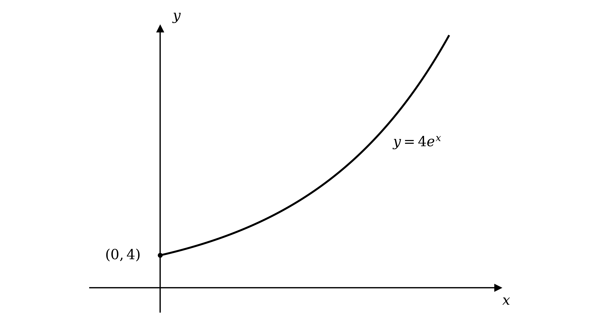

**[B1]**

The curve meets the $y$-axis where $x = 0$, giving $y = 4 e^{0} = 4$

$( 0 , 4 )$

**[B1]**

On the restricted domain $x \geq 0$ the curve increases from `\left(0 , 4\right)` and does not approach any line, so

**Final answer:** **There are no asymptotes for **$x \geq 0$

**[B1]**

> **[mark-scheme]**
> **B1**: Correct shape (an increasing curve for $x \geq 0$, lying above the $x$-axis).
> 
> **B1**: Intersection with the $y$-axis labelled $( 0 , 4 )$.
> 
> **B1**: A statement that there are no asymptotes on the domain $x \geq 0$. An answer of $y = 0$ does not earn this mark, because the curve only approaches the $x$-axis for negative $x$, which is outside the given domain.
Differentiate to get the gradient function

$\frac{dy}{dx} = 4 e^{x}$

Substitute $x = 3$

$4 e^{3}$

**Final answer:** $80 . 3$** (3 s.f.)**

**[B1]**

> **[mark-scheme]**
> **B1**: An answer which rounds to $80 . 3$ (3 significant figures).
The initial population is the value of $P$ when $t = 0$

$P = 4 e^{0}$

$4$

**[B1]**

> **[mark-scheme]**
> **B1**: Initial population $= 4$.

### Q42
Rewriting as `y = \left(\tfrac{1}{0.2}\right)^{x} = 5^{x}` shows the base is greater than 1, so the curve increases: this is exponential growth

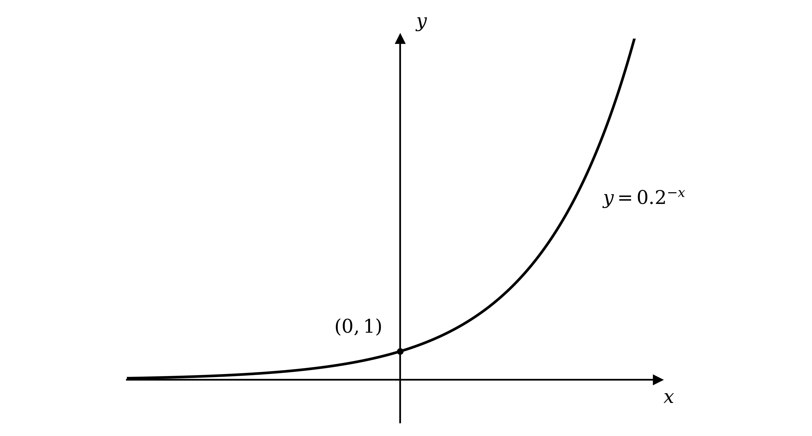

**Final answer:** **Exponential growth**

**[B1]**

The curve crosses the $y$-axis where $x = 0$, giving $y = 0 . 2^{0} = 1$

$( 0 , 1 )$

**[B1]**

As $x \rightarrow - \infty$ the curve approaches the $x$-axis, so the asymptote is $y = 0$

**[B1]**

> **[mark-scheme]**
> **B1**: Correct shape (an increasing curve lying above the $x$-axis).
> 
> **B1**: $y$-axis intercept $( 0 , 1 )$.
> 
> **B1**: Identified as exponential growth.
Rewrite $0 . 2^{-x}$ as $5^{x}$ and write 625 as a power of 5

$5^{x} = 625 = 5^{4}$

$x = 4$

**[B1]**

> **[mark-scheme]**
> **B1**: $x = 4$.
