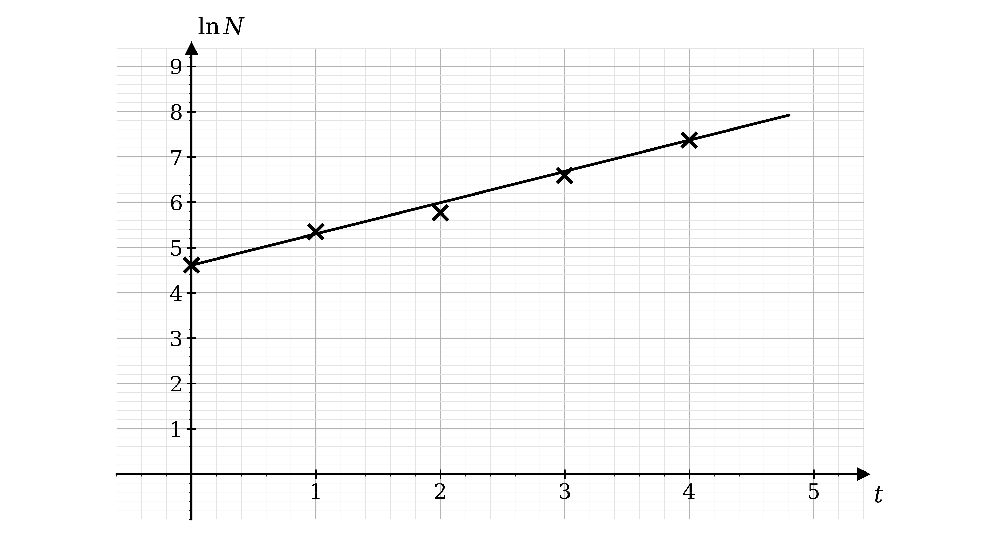
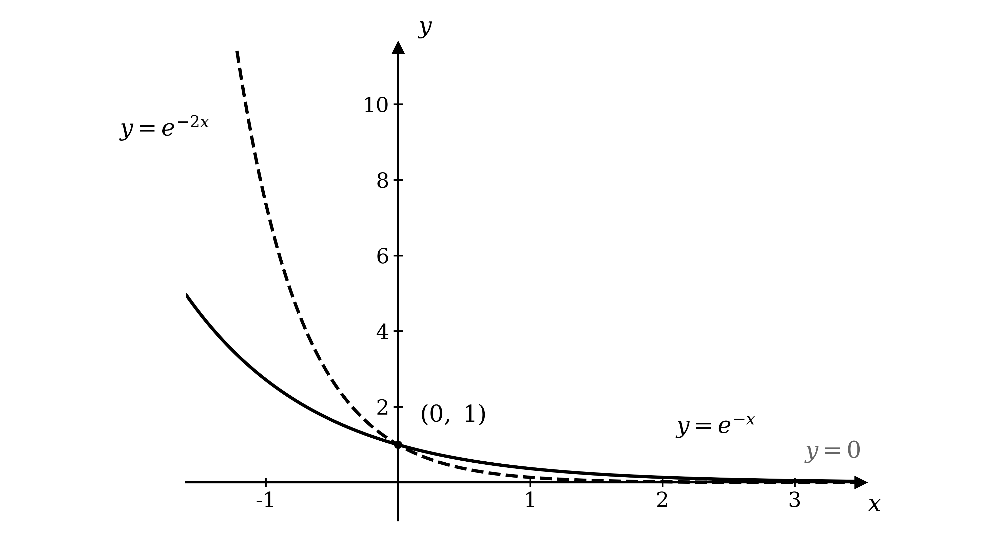
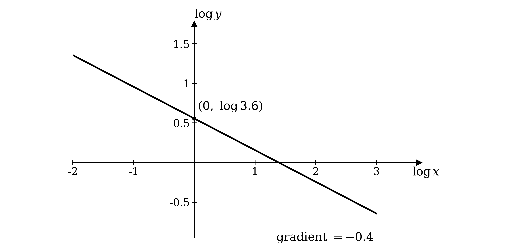
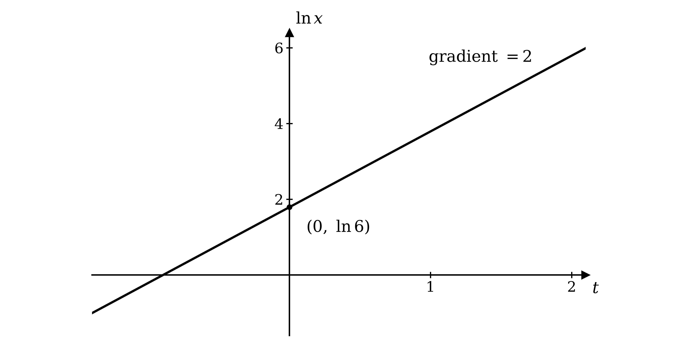
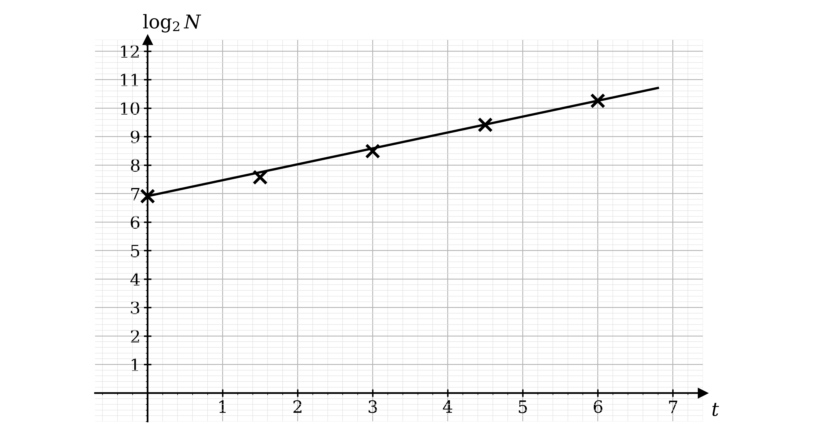
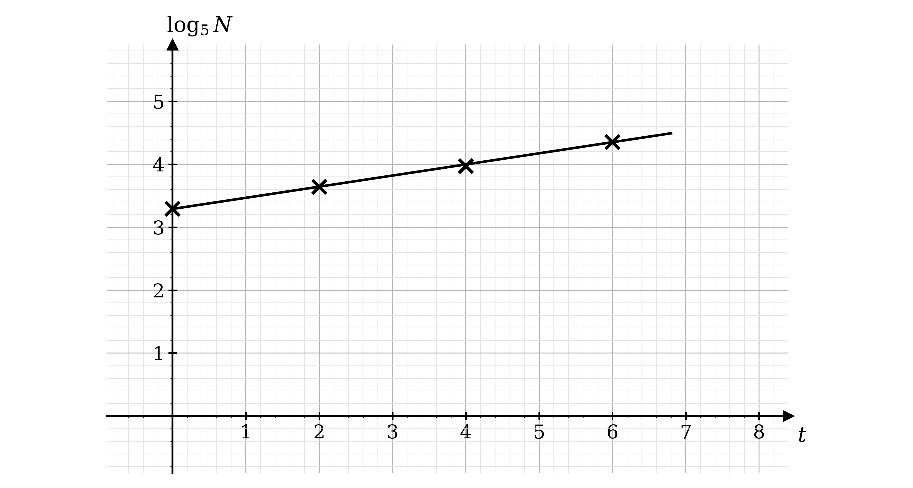
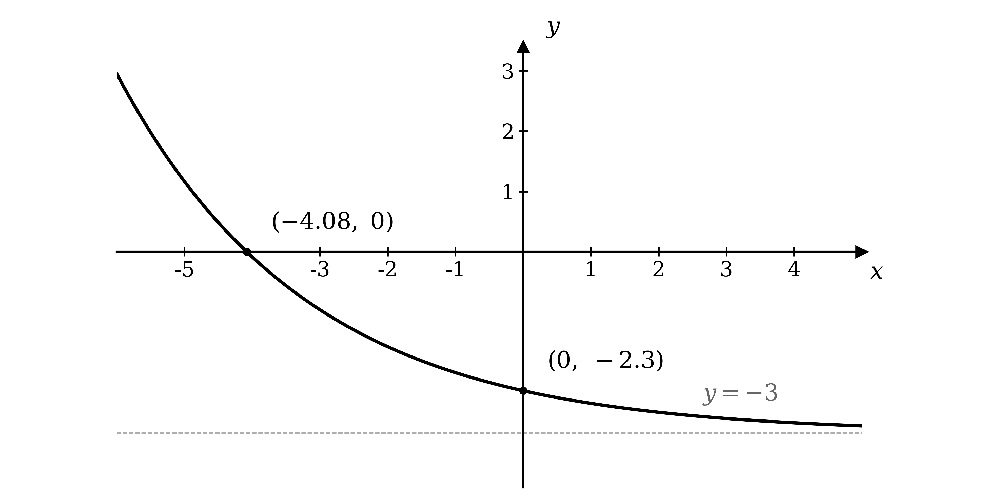
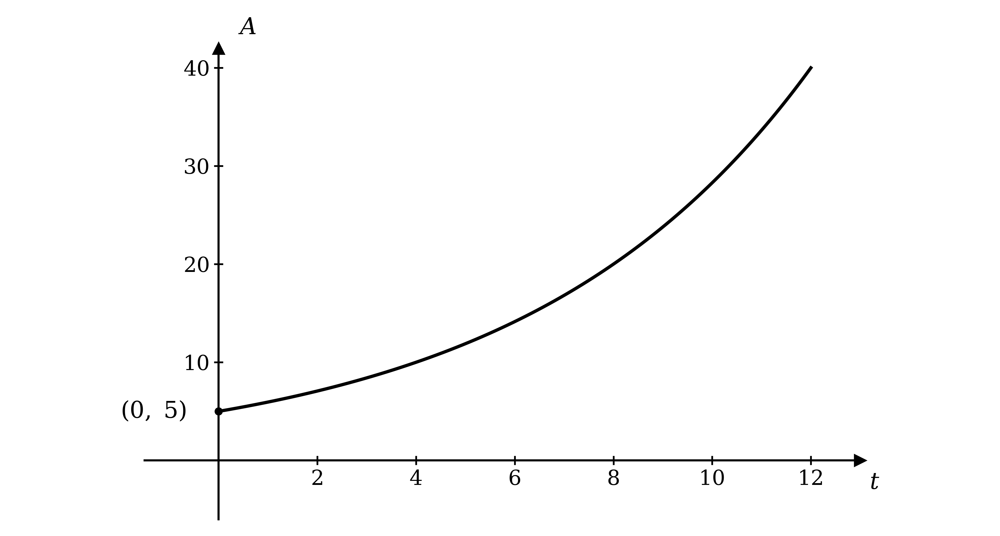
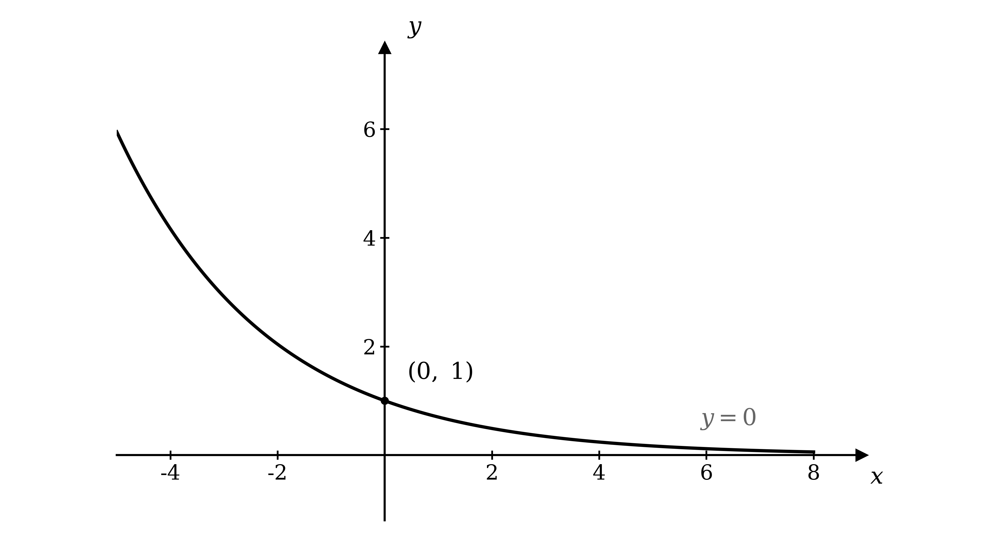
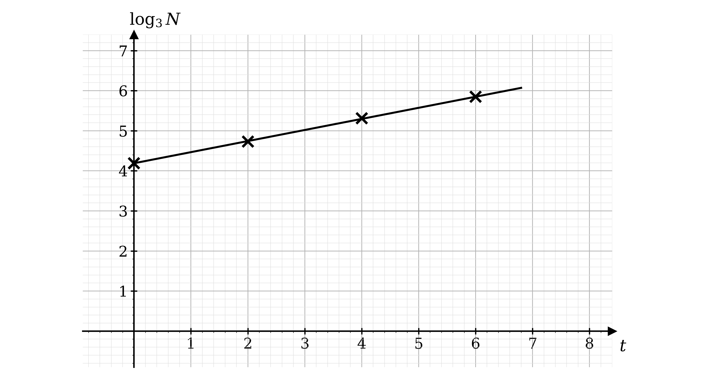

# Mark Schemes — Modelling with Logarithms & Exponentials
**Logarithms & Exponentials** · Cambridge (CIE) A-LEVEL maths (9709)

## Exam Questions (42 questions)

### Q1
Each column of the table gives one point, with $t$ across and $\text{ln}  N$ up, so plot the five pairs $( 0 , 4 . 61 )$, $( 1 , 5 . 35 )$, $( 2 , 5 . 77 )$, $( 3 , 6 . 59 )$ and $( 4 , 7 . 37 )$

**[B1]**

> **[mark-scheme]**
> **B1**: All five points plotted correctly on the grid, to within half a small square.
The gradient of the line is the change in $\text{ln}  N$ divided by the change in $t$ between the two given points

$m = \frac{7.37-4.61}{4-0} = \frac{2.76}{4}$

$m = 0 . 69$

**[B1]**

Compare the required form with the equation of a straight line, $y = m x + c$, reading $\text{ln}  N$ in place of $y$ and $t$ in place of $x$

$\text{ln}  N = m t + \text{ln}  c$

The gradient just found is $m$, and one of the given points has $t = 0$, so its $\text{ln}  N$ value is the vertical intercept

$\text{ln}  N = 0 . 69 t + 4 . 61$

**[B1]**

> **[mark-scheme]**
> **B1**: The gradient found as $\frac{7.37-4.61}{4-0}$, giving $0 . 69$.
> 
> **B1**: $\text{ln}  N = 0 . 69 t + 4 . 61$. Accept $c = 100$ stated separately alongside the equation.
The model $N = A e^{kt}$ becomes $\text{ln}  N = k t + \text{ln}  A$ when logarithms are taken, so comparing with part (b) matches $k$ to the gradient

$k = 0 . 69$

**[B1]**

To recover $A$, raise $e$ to the power of each side of the equation in part (b)

$N = e^{0.69t+4.61} = e^{4.61} \times e^{0.69t}$

Comparing this with $N = A e^{kt}$ identifies the constant factor as $A$, so evaluate it

$A = e^{4.61} = 100 . 48 \dots$

$A = 100$

**[B1]**

> **[mark-scheme]**
> **B1**: $k = 0 . 69$, obtained by comparing the gradient with the linear form of the model.
> 
> **B1**: $A = 100$. Accept any value in the range $100$ to $101$, since $e^{4.61} = 100 . 5$ and the question asks only for an estimate. Accept $A$ read directly from the table as the value of $N$ at $t = 0$.

### Q2
At the moment of release $t = 0$, and since $e^{0} = 1$ the model gives $B = A$, so $A$ is the initial number of birds

$A = 24$

**[B1]**

> **[mark-scheme]**
> **B1**: $A = 24$ stated. This may also be implied by correct use of $24$ in part (b).
Substitute $t = 2$ into the model, using the value of $A$ from part (a)

$B = 24 e^{0.4\times2} = 24 e^{0.8}$

**[M1]**

Evaluate, keeping the unrounded value before deciding on the final form

$B = 53 . 413 \dots$

The model counts individual birds, so give the answer as a whole number

$53  \text{birds}$

**[A1]**

> **[mark-scheme]**
> **M1**: Substitution of $t = 2$ into the model, giving $24 e^{0.8}$ or equivalent.
> 
> **A1**: $53$ birds. Accept the unrounded value rounded to 3 significant figures, $53 . 4$, and condone $54$.
Doubling means the population reaches twice its initial value, which is $2 \times 24$

$48 = 24 e^{0.4t}$

Divide both sides by $24$ to isolate the exponential

$2 = e^{0.4t}$

Take natural logarithms of both sides, since the unknown is in the index

$\text{ln}  2 = 0 . 4 t$

**[M1]**

Divide by $0 . 4$ and evaluate

$t = \frac{\text{ln}2}{0.4} = 1 . 7328 \dots$

**Final answer:** $t = 1 . 73  \text{years}$** (3 s.f.)**

**[A1]**

> **[mark-scheme]**
> **M1**: Reduction to $e^{0.4t} = 2$ followed by taking logarithms of both sides. Starting from $48 = 24 e^{0.4t}$ or directly from $2 = e^{0.4t}$ are equally acceptable.
> 
> **A1**: Answers which round to $1 . 73$. Accept the exact forms $\frac{\text{ln}2}{0.4}$ and $2 . 5  \text{ln}  2$, and accept the answer with or without units.

### Q3
(i)

Dividing powers of the same base means subtracting the indices

$\frac{e^{-2x}}{e^{4x}} = e^{-2x-4x}$

$e^{-6x}$

**[B1]**

(ii)

Write the reciprocal as a negative index, so that the minus sign is already in place

`\left(\dfrac{1}{5}\right)^{x} = 5^{-x}`

Since $\text{ln}$ and $e$ are inverse functions, any positive number $a$ can be written as $a = e^{\text{ln}a}$

$5^{-x} = e^{\text{ln}5^{-x}}$

Bring the power down using the law $\text{ln}  a^{n} = n  \text{ln}  a$

$e^{-(\text{ln}5)x}$

**[B1]**

(iii)

Write the reciprocal as a negative index

`\left(\dfrac{1}{2}\right)^{x} = 2^{-x}`

Apply the same identity, then bring the power down

$2^{-x} = e^{\text{ln}2^{-x}}$

$e^{-(\text{ln}2)x}$

**[B1]**

> **[mark-scheme]**
> **B1**: $e^{-6x}$ for part (i).
> 
> **B1**: $e^{-(\text{ln}5)x}$ for part (ii). Accept answers which round to $e^{-1.61x}$, and accept $e^{-x\text{ln}5}$.
> 
> **B1**: $e^{-(\text{ln}2)x}$ for part (iii). Accept answers which round to $e^{-0.693x}$, and accept $e^{-x\text{ln}2}$.
> 
> Each mark is for the final form only, so no working is required. An answer left as $e^{(\text{ln}0.2)x}$ or $e^{(\text{ln}0.5)x}$ is not in the requested form and does not score, because the question specifies $k > 0$.

### Q4
The initial acceleration is the value when $t = 0$, and since $e^{0} = 1$ the exponential factor disappears

$a = 10 e^{0} = 10 \times 1$

$10  \text{m s}^{-2}$

**[B1]**

> **[mark-scheme]**
> **B1**: $10$ stated, with or without units. Accept "the acceleration at lift-off is $10  \text{m s}^{-2}$" or any equivalent statement of the initial value.
Substitute $t = 15$ into the model

$a = 10 e^{0.1\times15} = 10 e^{1.5}$

**[M1]**

Evaluate, keeping the unrounded value before rounding

$a = 44 . 8168 \dots$

**Final answer:** $a = 44 . 8  \text{m s}^{-2}$** (3 s.f.)**

**[A1]**

> **[mark-scheme]**
> **M1**: Substitution of $t = 15$, giving $10 e^{1.5}$ or equivalent.
> 
> **A1**: Answers which round to $44 . 8$. Units are not required.
Set the acceleration equal to $100$ and divide by $10$ to isolate the exponential

$100 = 10 e^{0.1t}$

$e^{0.1t} = 10$

**[M1]**

Take natural logarithms of both sides, since the unknown is in the index, and use $\text{ln}  e^{X} = X$

$0 . 1 t = \text{ln}  10$

**[A1]**

Divide by $0 . 1$, which is the same as multiplying by $10$, and evaluate

$t = 10  \text{ln}  10 = 23 . 0258 \dots$

**Final answer:** $t = 23 . 0  \text{s}$** (3 s.f.)**

**[A1]**

> **[mark-scheme]**
> **M1**: The equation $a = 100$ formed and rearranged to $e^{0.1t} = 10$, or equivalent isolation of the exponential term.
> 
> **A1**: The correct linear logarithmic equation, $0 . 1 t = \text{ln}  10$ or equivalent.
> 
> **A1**: $23 . 0$. The exact form $10  \text{ln}  10$ is accepted and scores this mark in full. A bare $23$ is not accepted, since non-exact answers are required correct to 3 significant figures.

### Q5
A change from $e^{-x}$ to $e^{-2x}$ multiplies the $x$ in the exponent by $2$, which is a horizontal stretch of scale factor $\frac{1}{2}$, so the new curve falls away twice as fast

**[B1]**

Both curves meet the $y$-axis at the same place, because setting $x = 0$ gives $e^{0} = 1$ in each case

$( 0 , 1 )$

**[B1]**

As $x$ increases, $e^{-2x}$ approaches zero without ever reaching it, and the stretch does not move the horizontal asymptote

$y = 0$

**[B1]**

> **[mark-scheme]**
> **B1**: A decreasing curve drawn through the first and second quadrants which is steeper than the given curve and approaches the $x$-axis from above. The two curves must be shown crossing on the $y$-axis.
> 
> **B1**: The intersection with the $y$-axis labelled $( 0 , 1 )$. Accept the value $1$ marked on the $y$-axis.
> 
> **B1**: $y = 0$ stated as the asymptote. Accept a description such as "the $x$-axis", but the mark is not earned by a dashed line on the diagram alone, since the question asks for an equation.

### Q6
(i)

The sign of the coefficient of the variable in the exponent decides the behaviour, and here it is $2$, which is positive

$\text{As}  x  \text{increases} ,  5 e^{2x}  \text{increases}$

**Final answer:** **Exponential growth**

**[B1]**

(ii)

The coefficient of $t$ in the exponent is $- 1$, which is negative

$\text{As}  t  \text{increases} ,  100 e^{-t}  \text{decreases}$

**Final answer:** **Exponential decay**

**[B1]**

(iii)

Here $k$ is positive, so the coefficient of $a$ in the exponent, $- k$, is negative

$\text{As}  a  \text{increases} ,  20 e^{-ka}  \text{decreases}$

**Final answer:** **Exponential decay**

**[B1]**

(iv)

Both $A$ and $k$ are positive, so the coefficient of $t$ in the exponent is positive

$\text{As}  t  \text{increases} ,  A e^{kt}  \text{increases}$

**Final answer:** **Exponential growth**

**[B1]**

> **[mark-scheme]**
> **B1**: Exponential growth stated for part (i).
> 
> **B1**: Exponential decay stated for part (ii).
> 
> **B1**: Exponential decay stated for part (iii).
> 
> **B1**: Exponential growth stated for part (iv).
> 
> A reason is not required for any of these marks, but a correct classification contradicted by a stated reason does not score. Accept "growth" and "decay" without the word "exponential".

### Q7
The equation is a product, and taking logarithms is what turns a product into a sum, so apply $\text{ln}$ to both sides

`\text{ln}\;y = \text{ln}\left(Ae^{kx}\right)`

**[B1]**

Split the right-hand side into two terms using the law $\text{log}_{a} x y = \text{log}_{a} x + \text{log}_{a} y$

$\text{ln}  y = \text{ln}  e^{kx} + \text{ln}  A$

**[B1]**

Since $\text{ln}$ and $e$ are inverse functions, $\text{ln}  e^{kx}$ is simply $k x$, which gives the required form

$\text{ln}  y = k x + \text{ln}  A$

**[B1]**

> **[mark-scheme]**
> **B1**: Logarithms taken of both sides, giving `\text{ln}\;y = \text{ln}\left(Ae^{kx}\right)` or equivalent.
> 
> **B1**: The right-hand side split into two logarithm terms, giving $\text{ln}  y = \text{ln}  e^{kx} + \text{ln}  A$. Accept the terms in either order.
> 
> **B1**: $\text{ln}  e^{kx}$ simplified to $k x$ to reach the printed result. Because the answer is given, all three steps must be visible, and a bare statement of the final form scores nothing.
(i)

The word "hence" signals that no calculation is needed, so compare $y = 2 e^{0.01x}$ with the general form $y = A e^{kx}$ from part (a)

$A = 2 ,  k = 0 . 01$

**[B1]**

Substitute these into the linear form established in part (a)

$\text{ln}  y = 0 . 01 x + \text{ln}  2$

**[B1]**

(ii)

Working the other way, compare $\text{ln}  y = 0 . 3 x + \text{ln}  5$ with $\text{ln}  y = k x + \text{ln}  A$

$A = 5 ,  k = 0 . 3$

**[B1]**

Substitute these into the exponential form

$y = 5 e^{0.3x}$

**[B1]**

> **[mark-scheme]**
> **B1**: $A = 2$ and $k = 0 . 01$ identified in part (b)(i). This may be implied by a correct final answer.
> 
> **B1**: $\text{ln}  y = 0 . 01 x + \text{ln}  2$ for part (b)(i).
> 
> **B1**: $A = 5$ and $k = 0 . 3$ identified in part (b)(ii). This may be implied by a correct final answer.
> 
> **B1**: $y = 5 e^{0.3x}$ for part (b)(ii).
> 
> In part (b) no working is required, since the question says "hence" and the values may be written down by comparison.

### Q8
(i)

Multiplying powers of the same base means adding the indices

$e^{3x} \times e^{2x} = e^{3x+2x}$

$e^{5x}$

**[B1]**

(ii)

Since $\text{ln}$ and $e$ are inverse functions, any positive number $a$ can be written as $a = e^{\text{ln}a}$, so apply that to $5^{x}$

$5^{x} = e^{\text{ln}5^{x}}$

Bring the power down using the law $\text{ln}  a^{n} = n  \text{ln}  a$

$e^{(\text{ln}5)x}$

**[B1]**

(iii)

Use the same identity on $2^{x}$

$2^{x} = e^{\text{ln}2^{x}}$

Bring the power down as before

$e^{(\text{ln}2)x}$

**[B1]**

> **[mark-scheme]**
> **B1**: $e^{5x}$ for part (i).
> 
> **B1**: $e^{(\text{ln}5)x}$ for part (ii). Accept the equivalent decimal form, for example answers which round to $e^{1.61x}$, and accept $e^{x\text{ln}5}$.
> 
> **B1**: $e^{(\text{ln}2)x}$ for part (iii). Accept answers which round to $e^{0.693x}$, and accept $e^{x\text{ln}2}$.
> 
> Each mark is for the final form only, so no working is required.

### Q9
The base $\frac{3}{5}$ is less than $1$, so the curve decays, and the $- 4$ translates the whole graph down by 4 units, taking the asymptote with it

**[B1]**

For the $y$-intercept substitute $x = 0$, which leaves the index as $1$

`y = \left(\dfrac{3}{5}\right)^{1} - 4 = 0.6 - 4`

$( 0 , - 3 . 4 )$

**[B1]**

For the $x$-intercept set $y = 0$, which puts the unknown in the index

`\left(\dfrac{3}{5}\right)^{2x + 1} = 4`

Take natural logarithms of both sides and bring the power down

$( 2 x + 1 )  \text{ln} \frac{3}{5} = \text{ln}  4$

Divide by $\text{ln} \frac{3}{5}$, which is negative, then solve the linear equation

$2 x + 1 = \frac{\text{ln}4}{\text{ln}0.6} = - 2 . 71382 \dots$

$x = \frac{-2.71382\dots-1}{2} = - 1 . 85691 \dots$

**Final answer:** $( - 1 . 86 , 0 )$** (3 s.f.)**

**[B1]**

As $x$ increases the exponential term approaches zero, so $y$ approaches $- 4$ from above

$y = - 4$

**[B1]**

> **[mark-scheme]**
> **B1**: A decreasing curve drawn approaching a horizontal asymptote below the $x$-axis, crossing both axes once each. The curve must not cross its asymptote.
> 
> **B1**: $( 0 , - 3 . 4 )$. Accept $y = - 3 . 4$.
> 
> **B1**: Answers which round to $( - 1 . 86 , 0 )$. Accept $x = - 1 . 86$, and accept the exact form `x = \dfrac{1}{2}\left(\dfrac{\text{ln}\;4}{\text{ln}\;0.6} - 1\right)`. Logarithms to any base are acceptable in the working.
> 
> **B1**: $y = - 4$. An asymptote given as $y = 0$ does not score.

### Q10
The apes are introduced into an unpopulated forest with room to expand, so the population is expected to rise over time

**Final answer:** $k$** is positive**

**[B1]**

A positive value of $k$ makes $e^{km}$ increase as $m$ increases, which is what population growth requires. A negative value would make the population fall

**Final answer:** **Because a positive **$k$** gives exponential growth, and the population is increasing**

**[B1]**

> **[mark-scheme]**
> **B1**: $k$ stated to be positive.
> 
> **B1**: A supporting reason, referring either to the population increasing, or to a positive $k$ giving growth, or to the 50% increase in part (b). The statement alone does not earn both marks, since the question asks for a reason.
An increase of 50% means the population reaches $1 . 5$ times its starting value of $16$

$24 = 16 e^{8k}$

Divide both sides by $16$, which removes the starting value from the problem

$e^{8k} = 1 . 5$

**[M1]**

Take natural logarithms of both sides and divide by $8$

$k = \frac{\text{ln}1.5}{8} = 0 . 0506831 \dots$

**Final answer:** $k = 0 . 0507$** (3 s.f.)**

**[A1]**

> **[mark-scheme]**
> **M1**: The target population identified as $24$ and substituted, reduced to $e^{8k} = 1 . 5$ or equivalent, followed by taking logarithms.
> 
> **A1**: Answers which round to $0 . 0507$. Accept the exact form $\frac{\text{ln}1.5}{8}$.
The model stops describing reality once the population passes what the forest can sustain, so find the time at which it reaches 3000

$3000 = 16 e^{km}$

Divide by $16$ and take natural logarithms of both sides

$k m = \text{ln}  187 . 5$

**[M1]**

Divide by $k$, using the unrounded value from part (b)

$m = \frac{\text{ln}187.5}{0.0506831\dots} = 103 . 27 \dots$

**Final answer:** **The model is reliable for about 103 months**

**[A1]**

> **[mark-scheme]**
> **M1**: The equation $3000 = 16 e^{km}$ formed and logarithms taken, using their value of $k$.
> 
> **A1**: Answers which round to $103$ months. Accept $103 . 3$ and accept the answer given as a time in months or converted to years, provided it is stated as the length of time the model remains reliable.

### Q11
The required form needs $q$ rational, and the only way to get a rational coefficient of $x$ is to choose the base so that the power term simplifies exactly. The base of the power is $5$, so take logarithms to base 5

`\text{log}_{5}\;y = \text{log}_{5}\left(\dfrac{2}{3} \times 5^{-0.2x}\right)`

**[M1]**

Split the right-hand side using the law $\text{log}_{a} x y = \text{log}_{a} x + \text{log}_{a} y$

$\text{log}_{5}  y = \text{log}_{5} \frac{2}{3} + \text{log}_{5}  5^{-0.2x}$

Working in base 5 makes $\text{log}_{5}  5^{-0.2x}$ simplify to $- 0 . 2 x$, and adding a negative term is the same as subtracting

$\text{log}_{5}  y = \text{log}_{5} \frac{2}{3} - 0 . 2 x$

**[A1]**

So the three constants required are

$b = 5 ,  p = \frac{2}{3} ,  q = \frac{1}{5}$

**[A1]**

> **[exam-tip]**
> When a question does not tell you which base to use, let the conditions choose it for you. Here $q$ must be rational, and only base 5 makes the term $\text{log}_{b}  5^{-0.2x}$ come out as the clean $- 0 . 2 x$. Choosing base 10 or base $e$ instead would leave you with $q = 0 . 2  \text{log}  5$, which is irrational and so breaks the condition the question set.

> **[mark-scheme]**
> **M1**: Logarithms taken to base 5 of both sides.
> 
> **A1**: The right-hand side split and $\text{log}_{5}  5^{-0.2x}$ simplified to $- 0 . 2 x$, reaching $\text{log}_{5}  y = \text{log}_{5} \frac{2}{3} - 0 . 2 x$.
> 
> **A1**: All three of $b = 5$, $p = \frac{2}{3}$ and $q = \frac{1}{5}$ identified. Accept $q = 0 . 2$. All three are needed for this mark.
Part (a) is in the form $y = m x + c$ with $\text{log}_{5}  y$ in place of $y$, so the graph is a straight line. The gradient is $- 0 . 2$, so it falls from left to right

**[B1]**

The vertical intercept is the constant term. Since $\frac{2}{3}$ is less than $1$, its logarithm is negative, so the line crosses below the origin

**Final answer:** **Gradient **$- 0 . 2$**, vertical intercept **$\text{log}_{5} \frac{2}{3} = - 0 . 252$** (3 s.f.)**

**[B1]**

> **[mark-scheme]**
> **B1**: A straight line with negative gradient drawn on axes of $\text{log}_{5}  y$ against $x$. A curve does not score.
> 
> **B1**: Both the gradient of $- 0 . 2$ and the negative vertical intercept identified, either labelled on the sketch or stated alongside it. Accept the intercept as $\text{log}_{5} \frac{2}{3}$ or as a value which rounds to $- 0 . 252$. Both are needed for this mark.

### Q12
Taking logarithms turns the product into a sum, so apply $\text{log}$ to both sides

`\text{log}\;y = \text{log}\left(3.6x^{-0.4}\right) = \text{log}\;3.6 + \text{log}\;x^{-0.4}`

**[M1]**

Bring the power down using the law $\text{log}  x^{n} = n  \text{log}  x$. The index is negative, so adding that term is the same as subtracting

`\text{log}\;y = \text{log}\;3.6 + \left(-0.4\right)\text{log}\;x`

$\text{log}  y = \text{log}  3 . 6 - 0 . 4  \text{log}  x$

**[A1]**

> **[mark-scheme]**
> **M1**: Logarithms taken of both sides and the right-hand side split into two terms, giving $\text{log}  3 . 6 + \text{log}  x^{-0.4}$ or equivalent.
> 
> **A1**: $\text{log}  y = \text{log}  3 . 6 - 0 . 4  \text{log}  x$, so $A = 3 . 6$ and $b = 0 . 4$. An answer of $b = - 0 . 4$ does not score, since the required form already carries the minus sign.
Part (a) is in the form $y = m x + c$ with $\text{log}  y$ in place of $y$ and $\text{log}  x$ in place of $x$, so the graph is a straight line. The gradient is $- 0 . 4$, so it falls from left to right

**[B1]**

The vertical intercept is the constant term, which is $\text{log}  3 . 6$

**Final answer:** **Gradient **$- 0 . 4$**, vertical intercept **$\text{log}  3 . 6 = 0 . 556$** (3 s.f.)**

**[B1]**

> **[mark-scheme]**
> **B1**: A straight line with negative gradient drawn on axes of $\text{log}  y$ against $\text{log}  x$. A curve does not score, and a line with positive gradient does not score.
> 
> **B1**: Both the gradient of $- 0 . 4$ and the vertical intercept of $\text{log}  3 . 6$ identified, either labelled on the sketch or stated alongside it. Accept the intercept as $0 . 556$ or any value which rounds to it. Both are needed for this mark.

### Q13
The model gives a non-zero acceleration for every value of $t$, including negative ones, because $e^{kt}$ is never zero

**Final answer:** **Before lift-off the rocket is stationary on the ground, so its acceleration should be zero, but the model predicts a positive acceleration for negative **$t$

**[B1 B1]**

> **[mark-scheme]**
> **B1**: A statement that the model gives a non-zero, or positive, acceleration when $t$ is negative.
> 
> **B1**: A statement that the rocket has not yet launched at negative times, so its acceleration should be zero. Both marks require the contradiction to be made clear, not just a comment that the model "does not work".
Substitute the first reading into the model

$12 = R e^{5k}$

Now substitute the second reading

$50 = R e^{20k}$

Divide the second equation by the first, which eliminates $R$ entirely

$\frac{50}{12} = \frac{Re^{20k}}{Re^{5k}} = e^{15k}$

**[M1]**

Take natural logarithms of both sides and divide by $15$

$k = \frac{\text{ln}\frac{25}{6}}{15} = 0 . 0951411 \dots$

**Final answer:** $k = 0 . 0951$** (3 s.f.)**

**[A1]**

Substitute this back into the first equation, using the unrounded value

$R = \frac{12}{e^{5\times0.0951411\dots}} = 7 . 4573 \dots$

**Final answer:** $R = 7 . 46$** (3 s.f.)**

**[A1]**

> **[mark-scheme]**
> **M1**: Both readings substituted and the equations divided to eliminate $R$, giving $e^{15k} = \frac{50}{12}$ or equivalent. Accept taking logarithms of both equations and subtracting.
> 
> **A1**: Answers which round to $0 . 0951$ for $k$. Accept the exact form $\frac{1}{15} \text{ln} \frac{25}{6}$.
> 
> **A1**: Answers which round to $7 . 46$ for $R$. Accept any value in the range $7 . 45$ to $7 . 47$, which covers the use of a rounded value of $k$.
Fit the linear model through the same two readings by finding its gradient

$c = \frac{50-12}{20-5} = \frac{38}{15} = 2 . 5333 \dots$

Substitute one reading back to find $R$, which for a linear model is the acceleration at lift-off

$R = 12 - 5 \times 2 . 5333 \dots = - 0 . 667$

A rocket cannot be accelerating backwards at the moment it leaves the ground

**Final answer:** **The linear model gives a negative acceleration at lift-off, which is impossible**

**[B1]**

> **[mark-scheme]**
> **B1**: A reason based on the figures, ideally that the linear model gives a negative acceleration at $t = 0$. Accept an argument that the linear model predicts acceleration continuing to rise at a constant rate indefinitely, or that it does not pass through a sensible value at lift-off. A bare "it does not fit the data" does not score, since the question asks you to use the figures.

### Q14
(i)

Both models start at $85 ^{\circ} \text{C}$ when $t = 0$, which gives the constant term directly

$T = a + b \times 0 = a  \text{, so}  a = 85$

For a linear model the gradient is the total change divided by the time taken

$b = \frac{50-85}{7-0} = \frac{-35}{7} = - 5$

$T = 85 - 5 t$

**[B1 B1]**

(ii)

For the exponential model, substituting $t = 0$ gives $e^{0} = 1$, so $A$ is again the starting temperature

$A = 85$

Substitute the second reading, $T = 50$ when $t = 7$, and divide by $85$

$50 = 85 e^{-7k}  \text{, so}  e^{-7k} = \frac{50}{85}$

**[M1]**

Take natural logarithms of both sides and divide by $- 7$

$k = \frac{-\text{ln}\frac{50}{85}}{7} = 0 . 0758040 \dots$

**Final answer:** $T = 85 e^{-0.0758t}$** (3 s.f.)**

**[A1]**

> **[mark-scheme]**
> **B1**: $a = 85$ for the linear model.
> 
> **B1**: $b = - 5$, so $T = 85 - 5 t$.
> 
> **M1**: $A = 85$ identified and the second reading substituted, reduced to $e^{-7k} = \frac{50}{85}$ or equivalent.
> 
> **A1**: Answers which round to $0 . 0758$ for $k$, so $T = 85 e^{-0.0758t}$. Accept the exact form $\frac{1}{7} \text{ln} \frac{85}{50}$.
The rate of change of temperature is $\frac{\text{d}T}{\text{d}t}$. For the linear model the gradient is constant, so it is the same at every time

$\frac{\text{d}T}{\text{d}t} = - 5  ^{\circ} \text{C per hour}$

Differentiate the exponential model, which brings down a factor of $- k$

$\frac{\text{d}T}{\text{d}t} = - 85 k e^{-kt}$

Substitute $t = 3$, using the unrounded value of $k$

$\frac{\text{d}T}{\text{d}t} = - 85 \times 0 . 0758040 \dots \times e^{-0.227412\dots} = - 5 . 1325 \dots$

**[M1]**

Compare the two values, both of which are negative because the drink is cooling

**Final answer:** **The exponential model cools slightly faster at 3 hours, at **$- 5 . 13 ^{\circ} \text{C}$** per hour against **$- 5 ^{\circ} \text{C}$** per hour**

**[A1]**

> **[mark-scheme]**
> **M1**: The exponential model differentiated to $- 85 k e^{-kt}$ or equivalent, and $t = 3$ substituted.
> 
> **A1**: Both rates stated and compared. Answers which round to $- 5 . 13$ for the exponential model, against the constant $- 5$ for the linear model. A bare pair of values with no comparison does not earn this mark, since the question asks you to compare.
Both models were built from only two readings and take no account of how the flask is actually used

**Final answer:** **Opening the flask lets heat escape, so the drink cools faster than either model predicts**

**[B1]**

> **[mark-scheme]**
> **B1**: Any sensible reason, for example that the flask is opened during use, that the room is colder than assumed, that the model was fitted from only two readings, or that the drink is not left undisturbed.

### Q15
The gradient is the change in $\text{ln}  D$ divided by the change in $t$ between the two given points

$m = \frac{2-3.5}{3-0} = \frac{-1.5}{3} = - \frac{1}{2}$

**[M1]**

Taking natural logarithms of $D = A e^{-kt}$ gives $\text{ln}  D = - k t + \text{ln}  A$, which is in the form $y = m x + c$ with $\text{ln}  D$ in place of $y$ and $t$ in place of $x$, so the gradient is $- k$

$k = 0 . 5$

**[A1]**

The point at $t = 0$ gives the vertical intercept, which is $\text{ln}  A$, so raise $e$ to the power of each side

$A = e^{3.5} = 33 . 115 \dots$

**Final answer:** $A = 33 . 1$** (3 s.f.)**

**[A1]**

> **[mark-scheme]**
> **M1**: A correct gradient calculation using the two labelled points, giving $\frac{2-3.5}{3-0}$ or equivalent.
> 
> **A1**: $k = 0 . 5$. An answer of $k = - 0 . 5$ does not score, since the model already carries the minus sign in the index.
> 
> **A1**: Answers which round to $33 . 1$ for $A$. Accept the exact form $e^{3.5}$.
The rate of change of concentration is $\frac{\text{d}D}{\text{d}t}$, so differentiate the model, which brings down a factor of $- k$

$\frac{\text{d}D}{\text{d}t} = - k A e^{-kt} = - 0 . 5 e^{3.5} e^{-0.5t}$

**[M1]**

The concentration is falling, so a rate of decrease of $12$ means the derivative equals $- 12$. Combine the powers of $e$ and divide by $- 0 . 5$

$- 0 . 5 e^{3.5-0.5t} = - 12  \text{, so}  e^{3.5-0.5t} = 24$

Take natural logarithms of both sides and solve for $t$

$3 . 5 - 0 . 5 t = \text{ln}  24  \text{, so}  t = \frac{3.5-\text{ln}24}{0.5} = 0 . 643892 \dots  \text{hours}$

Convert to minutes by multiplying by 60

$0 . 643892 \dots \times 60 = 38 . 63 \dots$

$39  \text{minutes}$

**[A1]**

> **[exam-tip]**
> Watch the sign when a question talks about a rate of decrease. The derivative of a decaying exponential is always negative, so a rate of decrease of 12 means $\frac{\text{d}D}{\text{d}t} = - 12$, not $+ 12$. Setting it to $+ 12$ produces a negative inside a logarithm and the calculation fails, which is at least a clear signal that the sign needs revisiting.

> **[mark-scheme]**
> **M1**: The model differentiated to $- k A e^{-kt}$ or equivalent, and set equal to $- 12$. Accept the derivative set equal to $12$ provided the working then handles the sign correctly.
> 
> **A1**: $39$ minutes. Accept any answer in the range $38$ to $39$ minutes. An answer left as $0 . 644$ hours does not score, since the question asks for the nearest minute.

### Q16
To undo the logarithm, raise $e$ to the power of each side

$x = e^{2t+\text{ln}6}$

Split the index into a product using the law $a^{m+n} = a^{m} a^{n}$

$x = e^{2t} \times e^{\text{ln}6}$

**[M1]**

Since $e$ and $\text{ln}$ are inverse functions, $e^{\text{ln}6}$ is simply $6$

$x = 6 e^{2t}$

**[A1]**

> **[mark-scheme]**
> **M1**: Both sides exponentiated and the index split, giving $e^{2t} \times e^{\text{ln}6}$ or equivalent.
> 
> **A1**: $x = 6 e^{2t}$. An answer left as $x = e^{2t+\text{ln}6}$ is correct but not in the requested form, so it does not earn this mark on its own.
The equation is already in the form $y = m x + c$ with $\text{ln}  x$ in place of $y$ and $t$ in place of $x$, so plotting $\text{ln}  x$ against $t$ gives a straight line of gradient $2$

**[B1]**

The vertical intercept is the constant term, which is $\text{ln}  6$

**Final answer:** **Gradient **$2$**, vertical intercept **$\text{ln}  6 = 1 . 79$** (3 s.f.)**

**[B1]**

> **[exam-tip]**
> Read the axes before you draw anything. Part (b) asks for $\text{ln}  x$ against $t$, and the whole purpose of taking logarithms is that this produces a straight line. If your sketch is a curve, you have plotted $x$ against $t$ instead and answered a different question. A useful check is that the equation as given is already in the shape $y = m x + c$, and anything in that shape is a straight line.

> **[mark-scheme]**
> **B1**: A straight line with positive gradient drawn on axes of $\text{ln}  x$ against $t$. A curve does not score, whatever its shape.
> 
> **B1**: Both the gradient of $2$ and the vertical intercept of $\text{ln}  6$ identified, either labelled on the sketch or stated alongside it. Accept the intercept as $1 . 79$ or any value which rounds to it. Both are needed for this mark.

### Q17
Since $\text{ln}$ and $e$ are inverse functions, write the base as a power of $e$ using $a = e^{\text{ln}a}$, then bring the power down

`\left(0.8\right)^{x} = e^{\left(\text{ln}\;0.8\right)x}`

Evaluate the coefficient

$k = \text{ln}  0 . 8 = - 0 . 22314 \dots$

**Final answer:** $e^{-0.223x}$** (3 s.f.)**

**[B1]**

> **[mark-scheme]**
> **B1**: $e^{-0.223x}$ for part (a). Accept the exact form `e^{\left(\text{ln}\;0.8\right)x}` and answers which round to $- 0 . 223$.
(i)

Split the index using the law $a^{m+n} = a^{m} a^{n}$, which separates off the constant factor

`\left(\dfrac{2}{3}\right)^{4t + 1} = \left(\dfrac{2}{3}\right)^{1} \times \left(\dfrac{2}{3}\right)^{4t}`

**[M1]**

The first factor is $A$. Write the second as a power of $e$, keeping the full index $4 t$

`\left(\dfrac{2}{3}\right)^{4t} = e^{4t\;\text{ln}\frac{2}{3}} \; \text{, where} \; 4\;\text{ln}\dfrac{2}{3} = -1.62186 \ldots`

**Final answer:** $0 . 667 e^{-1.62t}$** (3 s.f.)**

**[A1]**

(ii)

The base $\frac{2}{3}$ is less than $1$, so its logarithm is negative, which makes $k$ negative and the function fall as $t$ increases

**Final answer:** **Exponential decay, because **$k$** is negative**

**[B1]**

(iii)

The initial value is the value at $t = 0$, and since $e^{0} = 1$ the exponential factor disappears, leaving $A$

$\frac{2}{3}$

**[B1]**

> **[mark-scheme]**
> **M1**: The index split as `\left(\tfrac{2}{3}\right)^{1} \times \left(\tfrac{2}{3}\right)^{4t}`, or the constant factor otherwise extracted.
> 
> **A1**: $0 . 667 e^{-1.62t}$. Accept $A$ given as the exact $\frac{2}{3}$, and accept the exact form $\frac{2}{3} e^{4t\text{ln}\frac{2}{3}}$. Answers which round to $- 1 . 62$ are accepted for $k$. A value of $- 0 . 405$, which omits the factor of 4, does not score.
> 
> **B1**: Exponential decay stated, together with a reason referring either to $k$ being negative or to the base being less than 1. The classification alone does not earn this mark.
> 
> **B1**: $\frac{2}{3}$. Accept $0 . 667$ or any answer which rounds to it, and accept "the value of $A$" as the answer if $A$ has been correctly identified.

### Q18
Taking logarithms of the model gives $\text{log}  P = k  \text{log}  a + \text{log}  P_{1}$, so plotting $\text{log}  P$ against $\text{log}  a$ gives a straight line of gradient $k$ and intercept $\text{log}  P_{1}$

$\text{log}  P = k  \text{log}  a + \text{log}  P_{1}$

In the first year $a = 1$, so $\text{log}  a = 0$ and that reading is the intercept

$\text{log}  P_{1} = 3 . 74$

Raise 10 to the power of each side to recover $P_{1}$

$P_{1} = 10^{3.74} = 5495 . 4 \dots$

**Final answer:** $P_{1} = 5500$** dollars (3 s.f.)**

**[M1 A1]**

For the gradient, use the fourth year, remembering that the horizontal variable is $\text{log}  a$ and not $a$

$k = \frac{4.01-3.74}{\text{log}4-\text{log}1} = \frac{0.27}{0.60206\dots} = 0 . 44846 \dots$

**Final answer:** $k = 0 . 448$** (3 s.f.)**

**[A1]**

> **[mark-scheme]**
> **M1**: The model linearised to $\text{log}  P = k  \text{log}  a + \text{log}  P_{1}$, and the first year reading identified as the intercept because $\text{log}  1 = 0$.
> 
> **A1**: Answers which round to $5500$ for $P_{1}$. Accept $5495$ and accept the exact form $10^{3.74}$.
> 
> **A1**: Answers which round to $0 . 448$ for $k$. The gradient must be taken with respect to $\text{log}  a$, so a value of $0 . 09$, obtained by dividing by 3, does not score. Accept a value obtained from any valid pair of readings.

### Q19
Convert each reading to a base 2 logarithm before plotting, working to 3 significant figures

$\text{log}_{2}  120 = 6 . 91  \text{,}  \text{log}_{2}  190 = 7 . 57  \text{,}  \text{log}_{2}  360 = 8 . 49$

$\text{log}_{2}  680 = 9 . 41  \text{,}  \text{log}_{2}  1230 = 10 . 26$

Plot the five pairs against $t$ and draw a single straight line passing as close as possible to all of them

**[B1]**

Take the gradient from the two end points of the line

$m = \frac{10.26-6.91}{6-0} = \frac{3.35}{6} = 0 . 55833 \dots$

Compare with the equation of a straight line, $y = m x + c$, reading $\text{log}_{2}  N$ in place of $y$ and $t$ in place of $x$, so the gradient is $m$ and the vertical intercept is $\text{log}_{2}  N_{0}$

The line crosses the vertical axis at $t = 0$, where the reading is $N = 120$, so the equation of the line is

$\text{log}_{2}  N = 0 . 558 t + \text{log}_{2}  120$

**[B1]**

Taking base $a$ logarithms of $N = N_{0} a^{kt}$ gives $\text{log}_{a}  N = k t + \text{log}_{a}  N_{0}$, so comparing the two identifies all three constants at once

$a = 2 ,  k = 0 . 558 ,  N_{0} = 120$

**[B1]**

> **[mark-scheme]**
> **B1**: The logarithm values correctly evaluated and all five points plotted, with a single straight line of best fit drawn passing close to all of them.
> 
> **B1**: A gradient calculated from two points on the line and the equation of the line stated. Accept any gradient in the range $0 . 54$ to $0 . 58$.
> 
> **B1**: All three of $a = 2$, $k$ equal to their gradient, and $N_{0} = 120$. Accept values of $N_{0}$ in the range $118$ to $122$. All three are needed for this mark.
Substitute $t = 12$ into the equation of the line

$\text{log}_{2}  N = 0 . 558 \times 12 + 6 . 91 = 13 . 606$

Raise 2 to the power of each side to recover $N$

$N = 2^{13.606} = 12462 \dots$

**Final answer:** $N \approx 12  500  \text{bacteria}$** (3 s.f.)**

**[B1]**

The data only runs to 6 hours, so a prediction at 12 hours lies twice as far out as any observation supporting it

**Final answer:** **The prediction is unreliable, because it extrapolates well beyond the range of the data, and real bacterial growth is limited by nutrients and space**

**[B1]**

> **[mark-scheme]**
> **B1**: Answers which round to $12  500$, or a value consistent with their gradient. Accept any answer in the range $11  500$ to $13  500$, which covers the spread of acceptable gradients.
> 
> **B1**: A comment identifying the prediction as unreliable, with a reason. Accept extrapolation beyond the data, the six-hour limit of the observations, or a practical limit on bacterial growth such as nutrients or space. A bare "unreliable" with no reason does not score.

### Q20
Substituting $t = 0$ gives $e^{0} = 1$, so the model reduces to $m = M_{0}$

**Final answer:** $M_{0}$** is the mass of carbon-14 in the object at the start, when **$t = 0$

**[B1]**

> **[mark-scheme]**
> **B1**: A statement that $M_{0}$ is the initial mass of carbon-14, or the mass when $t = 0$.
The half-life means the mass falls to half its original value when $t = 5700$, so substitute $m = \frac{1}{2} M_{0}$

$\frac{1}{2} M_{0} = M_{0} e^{-5700k}$

Divide both sides by $M_{0}$, which removes it whatever its value

$e^{-5700k} = \frac{1}{2}$

**[M1]**

Take natural logarithms of both sides

$- 5700 k = \text{ln} \frac{1}{2}$

**[A1]**

The required form needs $a$ to be an integer, so use $\text{ln} \frac{1}{2} = - \text{ln}  2$, which cancels the minus sign

$k = \frac{\text{ln}2}{5700}$

**[A1]**

> **[mark-scheme]**
> **M1**: The half-life substituted and the equation reduced to $e^{-5700k} = \frac{1}{2}$ or equivalent, with $M_{0}$ divided out.
> 
> **A1**: Logarithms taken correctly, giving $- 5700 k = \text{ln} \frac{1}{2}$ or equivalent.
> 
> **A1**: $k = \frac{\text{ln}2}{5700}$, so $a = 2$ and $b = 5700$. An answer of $\frac{\text{ln}\frac{1}{2}}{-5700}$ is correct but does not have integer $a$, so it does not earn this mark on its own.
Substitute $M_{0} = 200$ and $t = 20  000$, using the exact value of $k$

$m = 200 e^{-\frac{\text{ln}2}{5700}\times20000}$

**[M1]**

Evaluate the index, then the whole expression

$m = 200 e^{-2.43209\dots} = 17 . 570 \dots$

**Final answer:** $m = 18  \text{g}$** (nearest gram)**

**[A1]**

> **[mark-scheme]**
> **M1**: $M_{0} = 200$ and $t = 20  000$ substituted into the model using the value of $k$ from part (b).
> 
> **A1**: $18$ g. Accept $17 . 6$ only if the answer is then correctly rounded to the nearest gram, since the question specifies that accuracy.
Set up the equation for the bone using the two given masses, then divide

$3 \times 10^{-6} = 1 \times 10^{-2} \times e^{-kt}  \text{, so}  e^{-kt} = 3 \times 10^{-4}$

Take natural logarithms of both sides, then substitute $k = \frac{\text{ln}2}{h}$ where $h$ is the half-life

`t = \dfrac{-\text{ln}\left(3 \times 10^{-4}\right)}{k} = \dfrac{h\;\text{ln}\left(3333.33 \ldots\right)}{\text{ln}\;2} = 11.70275 \ldots h`

**[M1]**

A longer half-life means slower decay, so the same surviving fraction implies an older bone. The largest half-life therefore gives the upper estimate

$h = 5740  \text{gives}  t = 11 . 70275 \dots \times 5740 = 67173 . 8 \dots$

\$f{Upper estimate $67  000$ years}** (2 s.f.)**

**[A1]**

The smallest half-life gives the lower estimate

$h = 5660  \text{gives}  t = 11 . 70275 \dots \times 5660 = 66237 . 6 \dots$

\$f{Lower estimate $66  000$ years}** (2 s.f.)**

**[A1]**

> **[exam-tip]**
> Think about which way round the bounds go before you calculate anything. A longer half-life means the carbon-14 decays more slowly, so it takes longer to fall to the observed level, which makes the bone older. It is tempting to assume that the larger half-life gives the smaller answer because it sits in the denominator of $k$, but $k$ then divides again when you solve for $t$, so the effect reverses. Sketching the two decay curves side by side settles it quickly.

> **[mark-scheme]**
> **M1**: The equation for the bone formed, reduced to $e^{-kt} = 3 \times 10^{-4}$, and logarithms taken to give an expression for $t$ in terms of the half-life.
> 
> **A1**: Answers which round to $67  000$ for the upper estimate, obtained using a half-life of $5740$.
> 
> **A1**: Answers which round to $66  000$ for the lower estimate, obtained using a half-life of $5660$. Both bounds must be correctly matched to their half-life, so answers with the two the wrong way round do not score this mark.

### Q21
The number introduced is the population at $t = 0$, and since $e^{0} = 1$ the model gives $D = 20$

$20  \text{deer}$

**[B1]**

> **[mark-scheme]**
> **B1**: $20$ stated.
Doubling means the population reaches twice its initial value, which is $2 \times 20$

$40 = 20 e^{0.1t}$

Divide both sides by $20$ and take natural logarithms, since the unknown is in the index

$\text{ln}  2 = 0 . 1 t$

**[M1]**

Divide by $0 . 1$ and evaluate

$t = \frac{\text{ln}2}{0.1} = 6 . 9314 \dots$

**Final answer:** $t = 6 . 93  \text{years}$** (3 s.f.)**

**[A1]**

> **[mark-scheme]**
> **M1**: The equation $40 = 20 e^{0.1t}$ formed, reduced to $e^{0.1t} = 2$, and logarithms taken.
> 
> **A1**: Answers which round to $6 . 93$. Accept the exact form $\frac{\text{ln}2}{0.1}$ or $10  \text{ln}  2$.
An exponential model grows without limit, but a real sanctuary has finite food, space and resources

**Final answer:** **The model predicts unlimited growth, so it cannot remain valid for large **$t$

**[B1]**

> **[mark-scheme]**
> **B1**: Any valid criticism, for example that the model predicts unlimited growth, that it ignores limited food or space, that it takes no account of predators or disease, or that it does not give whole numbers of deer.
Find the time at which the second condition is met by setting the population equal to $400$

$400 = 20 e^{0.1t}$

Divide by $20$ and take natural logarithms of both sides

$\text{ln}  20 = 0 . 1 t$

**[M1]**

Divide by $0 . 1$ and evaluate

$t = \frac{\text{ln}20}{0.1} = 29 . 957 \dots$

The population does not reach 400 until nearly 30 years, which is later than the fixed 25 year limit, so the fixed limit is what triggers the separation

$t = 25  \text{years}$

**[A1]**

> **[mark-scheme]**
> **M1**: The equation $400 = 20 e^{0.1t}$ formed and logarithms taken to reach $t = \frac{\text{ln}20}{0.1}$ or equivalent.
> 
> **A1**: $25$ years, with the comparison shown. A final answer of $29 . 96$ does not score, since the question asks for the earliest of the two times. The value $29 . 96$ must appear in the working for the comparison to be visible.

### Q22
Convert each reading to a base 5 logarithm before plotting, working to 3 significant figures

$\text{log}_{5}  200 = 3 . 29  \text{,}  \text{log}_{5}  350 = 3 . 64$

$\text{log}_{5}  600 = 3 . 97  \text{,}  \text{log}_{5}  1100 = 4 . 35$

**[B1]**

Plot the four pairs against $t$ and draw a single straight line passing as close as possible to all of them

**[B1]**

> **[mark-scheme]**
> **B1**: The four logarithm values correctly evaluated, to within $0 . 01$. Accept values read as $3 . 3$, $3 . 6$, $4 . 0$ and $4 . 4$ if the plotting is consistent with them.
> 
> **B1**: All four points plotted correctly and a single straight line of best fit drawn passing close to all of them.
Take the gradient from the two end points of the line

$m = \frac{4.35-3.29}{6-0} = \frac{1.06}{6} = 0 . 17666 \dots$

**[B1]**

Compare the required form with the equation of a straight line, $y = m x + c$, reading $\text{log}_{5}  N$ in place of $y$ and $t$ in place of $x$

$\text{log}_{5}  N = m t + \text{log}_{5}  c$

The line crosses the vertical axis at $t = 0$, where the reading is $N = 200$, so that intercept is $\text{log}_{5}  200$ and therefore $c = 200$

$\text{log}_{5}  N = 0 . 177 t + \text{log}_{5}  200$

**[B1]**

> **[mark-scheme]**
> **B1**: A gradient calculated from two points on the line. Accept any value in the range $0 . 17$ to $0 . 19$, which covers both computed and read-off values.
> 
> **B1**: $\text{log}_{5}  N = 0 . 177 t + \text{log}_{5}  200$, or the same equation with their gradient. Accept $c = 200$ stated separately, and accept values of $c$ in the range $195$ to $205$.
Taking base $a$ logarithms of $N = N_{0} a^{kt}$ gives $\text{log}_{a}  N = k t + \text{log}_{a}  N_{0}$. The equation in part (b) is written in base 5, which identifies $a$

$a = 5$

**[B1]**

The coefficient of $t$ matches $k$, and the constant term matches $\text{log}_{a}  N_{0}$, so $N_{0}$ is the value already identified as $c$

$k = 0 . 177 ,  N_{0} = 200$

**[B1]**

> **[mark-scheme]**
> **B1**: $a = 5$, identified from the base of the logarithms.
> 
> **B1**: Both $k$ equal to their gradient and $N_{0} = 200$. Both values are needed for this mark.

### Q23
Split the index using the law $a^{m+n} = a^{m} a^{n}$, which separates off a constant factor

`\left(0.7\right)^{x + 1} = 0.7^{1} \times 0.7^{x} = 0.7 \times 0.7^{x}`

**[M1]**

Write the remaining power as a power of $e$ using $a = e^{\text{ln}a}$, then evaluate the coefficient

`0.7^{x} = e^{\left(\text{ln}\;0.7\right)x} \; \text{, where} \; \text{ln}\;0.7 = -0.356675 \ldots`

**Final answer:** $0 . 7 e^{-0.357x}$** (3 s.f.)**

**[A1]**

> **[mark-scheme]**
> **M1**: The index split as $0 . 7 \times 0 . 7^{x}$, or the constant factor otherwise extracted.
> 
> **A1**: $0 . 7 e^{-0.357x}$. Accept the exact form `0.7e^{\left(\text{ln}\;0.7\right)x}`, and answers which round to $0 . 357$ for $k$.
Part (a) gives $y = 0 . 7 e^{-0.357x} - 3$. The index is negative, so the curve decays, and the $- 3$ translates the whole graph down by 3 units, taking the asymptote with it

**[B1]**

Substitute $x = 0$, remembering that `\left(0.7\right)^{1} = 0.7`

$y = 0 . 7 - 3 = - 2 . 3$

$( 0 , - 2 . 3 )$

As $x$ increases the exponential term approaches zero, so $y$ approaches $- 3$ from above

$y = - 3$

**[B1]**

> **[mark-scheme]**
> **B1**: A decreasing curve drawn approaching a horizontal asymptote below the $x$-axis, crossing both axes once. The curve must not cross its asymptote.
> 
> **B1**: Both $( 0 , - 2 . 3 )$ and $y = - 3$ given. Both are needed for this mark. An asymptote given as $y = 0$ does not score.

### Q24
In the first year $a = 1$, and any number raised to the power of $1$ is $1$, so the model gives $P_{1}$ directly whatever $k$ is

$3100 = P_{1} \times 1^{k}$

$P_{1} = 3100$

**[B1]**

Now use the fourth year, where $a = 4$ and $P = 6200$, and divide by $3100$

$6200 = 3100 \times 4^{k}  \text{, so}  4^{k} = 2$

Since $4^{\frac{1}{2}} = \sqrt{4} = 2$, the power is a half

$k = \frac{1}{2}$

**[B1]**

> **[mark-scheme]**
> **B1**: $P_{1} = 3100$, obtained from the first year reading.
> 
> **B1**: $k = 0 . 5$. Accept $\frac{1}{2}$. Accept a value obtained from any valid pair of readings, so answers which round to $0 . 5$ are acceptable.
Taking logarithms turns the product into a sum, so apply $\text{log}$ to both sides of the model

`\text{log}\;P = \text{log}\left(P_{1}a^{k}\right) = \text{log}\;a^{k} + \text{log}\;P_{1}`

**[B1]**

Bring the power down using the law $\text{log}  x^{n} = n  \text{log}  x$, then substitute the values from part (a)

$\text{log}  P = 0 . 5  \text{log}  a + \text{log}  3100$

**[B1]**

> **[mark-scheme]**
> **B1**: Logarithms taken of both sides and the right-hand side split into two terms.
> 
> **B1**: The power brought down and the values from part (a) substituted, reaching $\text{log}  P = 0 . 5  \text{log}  a + \text{log}  3100$. Because the answer is given in general form, the working must be visible. Logarithms to any base are acceptable.
The model was built from only the first four years of trading, so using it for year 12 means extrapolating far beyond the data it was fitted to

**Final answer:** **The prediction lies well outside the range of the data used to build the model, so it may not be reliable**

**[B1]**

> **[mark-scheme]**
> **B1**: Any valid problem, for example that year 12 lies far outside the range of the data used, that the model assumes growth continues indefinitely, or that it takes no account of changing trading conditions.

### Q25
Taking logarithms turns the product on the right into a sum, so apply $\text{log}_{2}$ to both sides

`\text{log}_{2}\;y = \text{log}_{2}\left(0.1 \times 2^{0.01x}\right)`

Split the right-hand side using the law $\text{log}_{a} x y = \text{log}_{a} x + \text{log}_{a} y$, and note that working in base 2 makes $\text{log}_{2}  2^{0.01x}$ simplify to $0 . 01 x$

$\text{log}_{2}  y = \text{log}_{2}  0 . 1 + 0 . 01 x$

**[M1]**

The printed result has a subtraction, so rewrite $0 . 1$ as $\frac{1}{10}$ and use $\text{log}_{a} \frac{1}{n} = - \text{log}_{a} n$

$\text{log}_{2}  0 . 1 = \text{log}_{2} \frac{1}{10} = - \text{log}_{2}  10$

$\text{log}_{2}  y = 0 . 01 x - \text{log}_{2}  10$

**[A1]**

> **[mark-scheme]**
> **M1**: Logarithms taken of both sides and the right-hand side split, giving $\text{log}_{2}  0 . 1 + 0 . 01 x$ or equivalent, with $\text{log}_{2}  2^{0.01x}$ simplified to $0 . 01 x$.
> 
> **A1**: $\text{log}_{2}  0 . 1$ converted to $- \text{log}_{2}  10$ to reach the printed result. Because the answer is given, this conversion must be visible, and stopping at $\text{log}_{2}  0 . 1$ does not score.
Raise 3 to the power of each side to undo the logarithm

$y = 3^{6.3x+\text{log}_{3}4}$

Split the index into a product using the law $a^{m+n} = a^{m} a^{n}$

$y = 3^{6.3x} \times 3^{\text{log}_{3}4}$

**[M1]**

Raising 3 to the power of a base 3 logarithm returns the original number, so $3^{\text{log}_{3}4}$ is simply $4$

$y = 4 \times 3^{6.3x}$

**[A1]**

> **[exam-tip]**
> When a printed answer contains a minus sign but your working only ever produces a sum, look for a reciprocal hiding in the question. Here the $0 . 1$ is really $\frac{1}{10}$, and the rule $\text{log}_{a} \frac{1}{n} = - \text{log}_{a} n$ turns the sum into the difference you are asked for. The same trick appears whenever a decimal less than 1 sits in front of an exponential.

> **[mark-scheme]**
> **M1**: Both sides raised as a power of 3 and the index split, giving $3^{6.3x} \times 3^{\text{log}_{3}4}$ or equivalent.
> 
> **A1**: $y = 4 \times 3^{6.3x}$. Accept `y = 4\left(3^{6.3}\right)^{x}` and any equivalent form which identifies $A = 4$, $b = 3$ and $k = 6 . 3$.

### Q26
Taking logarithms turns the product on the right into a sum, so apply $\text{log}$ to both sides

`\text{log}\;y = \text{log}\left(2x^{\frac{3}{4}}\right)`

Split the right-hand side using the law $\text{log}_{a} x y = \text{log}_{a} x + \text{log}_{a} y$

$\text{log}  y = \text{log}  x^{\frac{3}{4}} + \text{log}  2$

**[M1]**

Bring the power down using the law $\text{log}_{a} x^{n} = n  \text{log}_{a} x$, and write the fraction as the decimal used in the printed result

$\text{log}  y = 0 . 75  \text{log}  x + \text{log}  2$

**[A1]**

> **[mark-scheme]**
> **M1**: Logarithms taken of both sides and the right-hand side split into two terms, giving $\text{log}  x^{\frac{3}{4}} + \text{log}  2$ or equivalent.
> 
> **A1**: The power brought down to reach the printed result. Because the answer is given, the working must be visible. The index may be written as $\frac{3}{4}$ or $0 . 75$ during the working, but the final line must match the printed form.
Reverse the first step by taking the coefficient of $\text{log}  x$ back up as a power

$\text{log}  y = \text{log}  x^{4.7} + \text{log}  12$

**[M1]**

Combine the two logarithms into one using the law $\text{log}_{a} x + \text{log}_{a} y = \text{log}_{a} x y$, so that both sides are a single logarithm

`\text{log}\;y = \text{log}\left(12x^{4.7}\right)`

Since the logarithms are equal and to the same base, the arguments must be equal

$y = 12 x^{4.7}$

**[A1]**

> **[mark-scheme]**
> **M1**: The coefficient of $\text{log}  x$ taken back up as a power, giving $\text{log}  x^{4.7}$, or both sides raised as a power of 10.
> 
> **A1**: $y = 12 x^{4.7}$. Logarithms to any base are acceptable throughout, since the working is independent of the base chosen.

### Q27
Taking logarithms turns the product on the right into a sum, so apply $\text{ln}$ to both sides

`\text{ln}\;x = \text{ln}\left(7e^{-0.2t}\right)`

Split the right-hand side using the law $\text{log}_{a} x y = \text{log}_{a} x + \text{log}_{a} y$

$\text{ln}  x = \text{ln}  7 + \text{ln}  e^{-0.2t}$

**[M1]**

Since $\text{ln}$ and $e$ are inverse functions, $\text{ln}  e^{-0.2t}$ simplifies to $- 0 . 2 t$, which gives the required form

$\text{ln}  x = \text{ln}  7 - 0 . 2 t$

**[A1]**

> **[mark-scheme]**
> **M1**: Logarithms taken of both sides and the right-hand side split into two terms, giving $\text{ln}  7 + \text{ln}  e^{-0.2t}$ or equivalent.
> 
> **A1**: $\text{ln}  e^{-0.2t}$ simplified to $- 0 . 2 t$ to reach the printed result. Because the answer is given, the working must be visible and a bare restatement scores nothing. Accept the terms reaching the printed form in either order.
To undo the logarithm, raise $e$ to the power of each side

$y = e^{4.1x+\text{ln}8}$

Split the index into a product using the law $a^{m+n} = a^{m} a^{n}$

$y = e^{4.1x} \times e^{\text{ln}8}$

**[M1]**

Since $e$ and $\text{ln}$ are inverse functions, $e^{\text{ln}8}$ is simply $8$

$y = 8 e^{4.1x}$

**[A1]**

> **[mark-scheme]**
> **M1**: Both sides exponentiated and the index split, giving $e^{4.1x} \times e^{\text{ln}8}$ or equivalent.
> 
> **A1**: $y = 8 e^{4.1x}$. An answer of $y = e^{4.1x+\text{ln}8}$ is correct but not in the requested form, so it does not earn this mark on its own.

### Q28
The gradient is the change in $\text{ln}  D$ divided by the change in $t$ between $P$ and $Q$

$m = \frac{0.262-1.10}{2-0} = \frac{-0.838}{2} = - 0 . 419$

**[M1]**

Compare the required form with the equation of a straight line, $y = m x + c$, reading $\text{ln}  D$ in place of $y$ and $t$ in place of $x$

$\text{ln}  D = m t + \text{ln}  c$

The point $P$ has $t = 0$, so its value $1 . 10$ is the vertical intercept. Raise $e$ to the power of each side to recover $c$

$c = e^{1.10} = 3 . 0042 \dots$

$\text{ln}  D = - 0 . 419 t + \text{ln}  3 . 00$

**[A1]**

> **[mark-scheme]**
> **M1**: A correct gradient calculation using the coordinates of $P$ and $Q$, giving $\frac{0.262-1.10}{2-0}$ or equivalent.
> 
> **A1**: $\text{ln}  D = - 0 . 419 t + \text{ln}  3 . 00$. Accept the intercept left as $1 . 10$, and accept $c$ given as $3$ or $3 . 00$.
Taking natural logarithms of $D = A e^{-kt}$ gives $\text{ln}  D = - k t + \text{ln}  A$, so compare that with the equation from part (a). The coefficient of $t$ is $- k$

$k = 0 . 419$

**[B1]**

The constant term is $\text{ln}  A$, which is the value already found as $c$

**Final answer:** $A = 3 . 00$** (3 s.f.)**

**[B1]**

> **[mark-scheme]**
> **B1**: $k = 0 . 419$. An answer of $k = - 0 . 419$ does not score, since the model already carries the minus sign in the index.
> 
> **B1**: Answers which round to $3 . 00$ for $A$. Accept the exact form $e^{1.10}$.
The initial dose is the value of $D$ at $t = 0$, which is $A$. The threshold is 1% of that, so set $D = 0 . 01 A$

$0 . 01 A = A e^{-0.419t}$

Divide both sides by $A$, which removes it from the problem entirely

$e^{-0.419t} = 0 . 01$

Take natural logarithms of both sides

$- 0 . 419 t = \text{ln}  0 . 01$

**[M1]**

Divide by $- 0 . 419$ and evaluate

$t = \frac{\text{ln}100}{0.419} = 10 . 9909 \dots  \text{hours}$

Convert to minutes by multiplying by 60

$10 . 9909 \dots \times 60 = 659 . 45 \dots$

**Final answer:** $659  \text{minutes}$**, which is 10 hours and 59 minutes**

**[A1]**

> **[mark-scheme]**
> **M1**: The threshold set as 1% of the initial dose and reduced to $e^{-kt} = 0 . 01$, or a numerical equivalent using their value of $A$, followed by taking logarithms.
> 
> **A1**: $659$ minutes. Accept $10$ hours $59$ minutes, and accept any answer in the range $658$ to $660$ minutes. An answer left as $10 . 99$ hours does not score, since the question asks for the nearest minute.

### Q29
The half-life means the mass falls to half its original value when $t = 5700$, so substitute $y = 50$ and $t = 5700$

$50 = 100 e^{-5700k}$

Divide both sides by $100$ to isolate the exponential

$e^{-5700k} = \frac{1}{2}$

**[M1]**

Take natural logarithms of both sides, then divide by $- 5700$

$k = \frac{\text{ln}2}{5700} = 1 . 21605 \dots \times 10^{-4}$

**Final answer:** $k = 1 . 22 \times 10^{-4}$** (3 s.f.)**

**[A1]**

> **[mark-scheme]**
> **M1**: Substitution of $y = 50$ and $t = 5700$, reduced to $e^{-5700k} = \frac{1}{2}$ or equivalent.
> 
> **A1**: Answers which round to $1 . 22 \times 10^{-4}$. Accept the exact form $\frac{\text{ln}2}{5700}$.
Set the mass equal to the threshold of $0 . 5$ g and divide by $100$

$0 . 5 = 100 e^{-kt}  \text{, so}  e^{-kt} = 0 . 005$

Take natural logarithms of both sides

$- k t = \text{ln}  0 . 005$

**[M1]**

Divide by $- k$, using the unrounded value from part (a)

$t = \frac{\text{ln}200}{1.21605\dots\times10^{-4}} = 43570 . 2 \dots$

**Final answer:** $t = 43  600  \text{years}$** (3 s.f.)**

**[A1]**

> **[mark-scheme]**
> **M1**: The equation $0 . 5 = 100 e^{-kt}$ formed using their value of $k$, and logarithms taken.
> 
> **A1**: Answers which round to $43  600$. Accept any value in the range $43  400$ to $43  700$, which covers the use of a rounded value of $k$. Accept the answer expressed as "the object must be older than this age".
The same constant $k$ applies whatever the starting mass, so substitute the new initial mass and $t = 500$

$y = 25 e^{-1.21605\dots\times10^{-4}\times500}$

**[M1]**

Evaluate the index, then the whole expression

$y = 25 e^{-0.0608\dots} = 23 . 525 \dots$

**Final answer:** $y = 23 . 5  \text{g}$** (3 s.f.)**

**[A1]**

> **[mark-scheme]**
> **M1**: Substitution of an initial mass of $25$ and $t = 500$ into the model using their value of $k$.
> 
> **A1**: Answers which round to $23 . 5$.

### Q30
Substitute the given reading, $A = 10$ when $t = 4$, into the model

$10 = 5 e^{4k}$

Divide both sides by $5$ to isolate the exponential

$e^{4k} = 2$

**[M1]**

Take natural logarithms of both sides and divide by $4$

$k = \frac{\text{ln}2}{4} = 0 . 173286 \dots$

**Final answer:** $k = 0 . 173$** (3 s.f.)**

**[A1]**

> **[mark-scheme]**
> **M1**: Substitution of $A = 10$ and $t = 4$, reduced to $e^{4k} = 2$ or equivalent.
> 
> **A1**: Answers which round to $0 . 173$. Accept the exact forms $\frac{\text{ln}2}{4}$ and $0 . 25  \text{ln}  2$.
The initial acceleration is the value at $t = 0$, which is $5  \text{m s}^{-2}$. An increase of 200% adds twice that again, so the acceleration reaches three times its starting value

$A = 5 + 2 \times 5 = 15$

Substitute this into the model and divide by $5$

$15 = 5 e^{kt}  \text{, so}  e^{kt} = 3$

**[M1]**

Take natural logarithms and divide by $k$, using the exact value from part (a) so that nothing is rounded early

$t = \frac{\text{ln}3}{k} = \frac{4\text{ln}3}{\text{ln}2} = 6 . 33985 \dots$

**Final answer:** $t = 6 . 34  \text{s}$** (3 s.f.)**

**[A1]**

> **[mark-scheme]**
> **M1**: The target acceleration identified as $15$ and substituted, reduced to $e^{kt} = 3$ or equivalent. A target of $10$ does not earn this mark.
> 
> **A1**: Answers which round to $6 . 34$. Accept the exact form $\frac{4\text{ln}3}{\text{ln}2}$. Using the rounded $k = 0 . 173$ gives $6 . 34$ as well, so either route is acceptable.
The value of $k$ is positive, so the acceleration grows, starting from $5$ at lift-off and curving upwards. Only `t \geqslant 0` is meaningful

**[B1]**

At lift-off $t = 0$ and $e^{0} = 1$, so the curve starts at $A = 5$

$( 0 , 5 )$

**[B1]**

> **[mark-scheme]**
> **B1**: An increasing curve drawn starting on the positive vertical axis and rising with increasing steepness. Accept the curve drawn for `t \geqslant 0` only or extended to the left.
> 
> **B1**: $( 0 , 5 )$ stated or labelled on the sketch.

### Q31
Since $\text{ln}$ and $e$ are inverse functions, write the base as a power of $e$ using $a = e^{\text{ln}a}$, then bring the power down

`\left(\dfrac{3}{5}\right)^{x} = e^{\left(\text{ln}\frac{3}{5}\right)x}`

**[M1]**

Evaluate the coefficient, which is negative because $\frac{3}{5}$ is less than $1$

$k = \text{ln} \frac{3}{5} = - 0 . 51082 \dots$

**Final answer:** $e^{-0.511x}$** (3 s.f.)**

**[A1]**

> **[mark-scheme]**
> **M1**: The base written as a power of $e$ and the index brought down, giving `e^{\left(\text{ln}\frac{3}{5}\right)x}` or equivalent.
> 
> **A1**: Answers which round to $- 0 . 511$ for $k$, so $e^{-0.511x}$. Accept the exact form `e^{\left(\text{ln}\frac{3}{5}\right)x}`.
Apply the same identity as in part (a), taking care that the index is $3 t$ and not just $t$

`\left(\dfrac{4}{7}\right)^{3t} = e^{\text{ln}\left(\frac{4}{7}\right)^{3t}} = e^{3t\;\text{ln}\frac{4}{7}}`

The coefficient of $t$ is therefore three times the logarithm, so evaluate that product

$k = 3  \text{ln} \frac{4}{7} = - 1 . 67884 \dots$

**Final answer:** $e^{-1.68t}$** (3 s.f.)**

**[B1]**

The base $\frac{4}{7}$ is less than $1$, so its logarithm is negative, which makes $k$ negative and the function fall as $t$ increases

**Final answer:** **Exponential decay, because **$k$** is negative**

**[B1]**

> **[mark-scheme]**
> **B1**: Answers which round to $- 1 . 68$ for $k$, so $e^{-1.68t}$. Accept the exact form $e^{3t\text{ln}\frac{4}{7}}$. An answer of $- 0 . 560$, which omits the factor of 3, does not score.
> 
> **B1**: Exponential decay stated, together with a reason referring either to $k$ being negative or to the base being less than 1. The classification alone, with no reason, does not earn this mark, since the question asks for a justification.

### Q32
The number released is the population at $t = 0$, and since $e^{0} = 1$ the model gives $B = 16$

$16  \text{birds}$

**[B1]**

> **[mark-scheme]**
> **B1**: $16$ stated. This may also be implied by correct use of $16$ in part (b).
Substitute $t = 3$ into the model

$B = 16 e^{0.85\times3} = 16 e^{2.55}$

**[M1]**

Evaluate, keeping the unrounded value before rounding

$B = 204 . 91 \dots$

The model counts individual birds, so give the answer as a whole number

$205  \text{birds}$

**[A1]**

> **[mark-scheme]**
> **M1**: Substitution of $t = 3$ into the model, giving $16 e^{2.55}$ or equivalent.
> 
> **A1**: $205$ birds. Accept $204 . 9$ and condone $204$.
Set the population equal to $500$ and divide by $16$ to isolate the exponential

$500 = 16 e^{0.85t}$

$e^{0.85t} = 31 . 25$

Take natural logarithms of both sides, since the unknown is in the index

$0 . 85 t = \text{ln}  31 . 25$

**[M1]**

Divide by $0 . 85$ and evaluate

$t = \frac{\text{ln}31.25}{0.85} = 4 . 0494 \dots$

**Final answer:** $t = 4 . 05  \text{years}$** (3 s.f.)**

**[A1]**

> **[mark-scheme]**
> **M1**: Reduction to $e^{0.85t} = 31 . 25$ followed by taking logarithms of both sides.
> 
> **A1**: Answers which round to $4 . 05$. Accept the exact form $\frac{\text{ln}31.25}{0.85}$, and accept the answer with or without units.

### Q33
Taking logarithms turns the product on the right into a sum, so apply $\text{log}_{2}$ to both sides

`\text{log}_{2}\;y = \text{log}_{2}\left(3 \times 2^{4x}\right)`

Split the right-hand side using the law $\text{log}_{a} x y = \text{log}_{a} x + \text{log}_{a} y$

$\text{log}_{2}  y = \text{log}_{2}  2^{4x} + \text{log}_{2}  3$

Working in base 2 makes $\text{log}_{2}  2^{4x}$ simplify to $4 x$, which gives the required form

$\text{log}_{2}  y = 4 x + \text{log}_{2}  3$

**[B1]**

> **[mark-scheme]**
> **B1**: The full derivation in part (a), showing logarithms taken of both sides, the right-hand side split into two terms, and $\text{log}_{2}  2^{4x}$ simplified to $4 x$. Because the answer is given, the working must be visible.
Apply the same process to $y = A b^{kx}$, this time in base 3 to match the equation given

$\text{log}_{3}  y = \text{log}_{3}  A + \text{log}_{3}  b^{kx}$

Bring the power down using the law $\text{log}_{a} x^{n} = n  \text{log}_{a} x$

$\text{log}_{3}  y = \text{log}_{3}  A + k x  \text{log}_{3}  b$

Compare the constant terms with $\text{log}_{3}  y = 5 x + \text{log}_{3}  7$

$A = 7$

**[B1]**

Comparing the terms in $x$ gives $k  \text{log}_{3}  b = 5$. The question is written in base 3, and it is the base $b$ that carries the power of $x$, so take $b = 3$

$b = 3  \text{, so}  \text{log}_{3}  b = \text{log}_{3}  3 = 1$

That leaves $k \times 1 = 5$

$b = 3 ,  k = 5$

**[B1]**

> **[exam-tip]**
> The choice of logarithm base in a question like part (b) is a hint. The equation is written in base 3 precisely so that $\text{log}_{3}  b$ collapses to $1$ when $b = 3$, leaving $k$ visible immediately.
> 
> If you find yourself with two unknowns tangled in a single product such as $k  \text{log}_{3}  b = 5$, look at the base you have been handed before assuming the question is short of information.

> **[mark-scheme]**
> **B1**: $A = 7$.
> 
> **B1**: Both $b = 3$ and $k = 5$. Both values are needed for this mark.

### Q34
Since $\text{ln}$ and $e$ are inverse functions, write the base as a power of $e$ using $a = e^{\text{ln}a}$, then bring the power down

`\left(\dfrac{7}{10}\right)^{x} = e^{\left(\text{ln}\frac{7}{10}\right)x}`

Evaluate the coefficient, which is negative because $\frac{7}{10}$ is less than $1$

$\text{ln} \frac{7}{10} = - 0 . 35667 \dots$

**Final answer:** $e^{-0.357x}$** (3 s.f.)**

**[B1]**

> **[mark-scheme]**
> **B1**: $e^{-0.357x}$ for part (a). Accept the exact form `e^{\left(\text{ln}\frac{7}{10}\right)x}` and accept `e^{-\left(\text{ln}\frac{10}{7}\right)x}`. Answers which round to $0 . 357$ are accepted for $k$.
Part (a) shows the coefficient of $x$ is negative, so this is exponential decay and the curve falls from left to right, approaching the $x$-axis

**[B1]**

Substituting $x = 0$ gives `\left(\tfrac{7}{10}\right)^{0} = 1`, which locates the intercept

$( 0 , 1 )$

As $x$ increases the curve approaches zero without ever reaching it

$y = 0$

**[B1]**

> **[mark-scheme]**
> **B1**: A decreasing curve drawn in the first and second quadrants, approaching the $x$-axis from above as $x$ increases and rising steeply as $x$ decreases. The curve must not cross or touch the $x$-axis.
> 
> **B1**: Both $( 0 , 1 )$ and $y = 0$ given. Accept the intercept written as $y = 1$ and accept the asymptote described as "the $x$-axis". Both are needed for this mark.

### Q35
Since $\text{ln}$ and $e$ are inverse functions, any positive number $a$ can be written as $a = e^{\text{ln}a}$

`\left(\dfrac{1}{3}\right)^{x} = e^{\text{ln}\left(\frac{1}{3}\right)^{x}}`

Bring the power down using the law $\text{ln}  a^{n} = n  \text{ln}  a$, which puts it in the position of $k$

`= e^{\left(\text{ln}\frac{1}{3}\right)x}`

Evaluate the coefficient

**Final answer:** $e^{-1.10x}$** (3 s.f.)**

**[B1]**

> **[mark-scheme]**
> **B1**: $e^{-1.10x}$ for part (a). Accept the exact form `e^{\left(\text{ln}\frac{1}{3}\right)x}` and accept `e^{-\left(\text{ln}\;3\right)x}`. Answers which round to $- 1 . 10$ are accepted for the coefficient.
Apply the same identity to `\left(\dfrac{2}{7}\right)^{t}`

`\left(\dfrac{2}{7}\right)^{t} = e^{\text{ln}\left(\frac{2}{7}\right)^{t}} = e^{\left(\text{ln}\frac{2}{7}\right)t}`

Evaluate the coefficient, which is the value of $k$

$k = \text{ln} \frac{2}{7} = - 1 . 2528 \dots$

**Final answer:** $e^{-1.25t}$** (3 s.f.)**

**[B1]**

The base $\frac{2}{7}$ is less than $1$, so its logarithm is negative, and a negative coefficient of $t$ makes the function fall as $t$ increases

**Final answer:** **Exponential decay**

**[B1]**

> **[mark-scheme]**
> **B1**: $e^{-1.25t}$ for part (b). Accept the exact form `e^{\left(\text{ln}\frac{2}{7}\right)t}`. Answers which round to $- 1 . 25$ are accepted.
> 
> **B1**: Exponential decay stated. A correct reason is not required, but the mark is not earned if the stated reason contradicts the answer.

### Q36
The first year is $y = 1$ with a profit of $2500$, so substitute both into the model

$2500 = P_{0} \times 1^{k}$

**[B1]**

The second year is $y = 2$ with a profit of $3700$

$3700 = P_{0} \times 2^{k}$

**[B1]**

> **[mark-scheme]**
> **B1**: $2500 = P_{0} \times 1^{k}$. Accept the simplified $P_{0} = 2500$.
> 
> **B1**: $3700 = P_{0} \times 2^{k}$.
Any number raised to a power of $1$ is $1$, so the first equation gives $P_{0}$ straight away, whatever the value of $k$

$P_{0} = 2500$

**[B1]**

Substitute this into the second equation and divide by $2500$ to isolate the power

$2^{k} = \frac{3700}{2500} = 1 . 48$

Take logarithms of both sides and bring the power down using $\text{log}  a^{n} = n  \text{log}  a$

$k  \text{log}  2 = \text{log}  1 . 48$

Divide by $\text{log}  2$ and evaluate

$k = \frac{\text{log}1.48}{\text{log}2} = 0 . 565597 \dots$

**Final answer:** $k = 0 . 566$** (3 s.f.)**

**[B1]**

> **[mark-scheme]**
> **B1**: $P_{0} = 2500$.
> 
> **B1**: Answers which round to $0 . 566$ for $k$. Accept the exact forms $\frac{\text{log}1.48}{\text{log}2}$ and $\frac{\text{ln}1.48}{\text{ln}2}$, and accept logarithms to any base in the working.
Substitute $y = 3$ into the model with the values just found

$P = 2500 \times 3^{0.565597\dots} = 4653 . 70 \dots$

**Final answer:** $4653 . 70$** dollars**

**[B1]**

Substitute $y = 4$

$P = 2500 \times 4^{0.565597\dots} = 5476$

**Final answer:** $5476$** dollars**

**[B1]**

> **[exam-tip]**
> The year 4 prediction is a useful self-check. Since $4 = 2^{2}$, you have `4^{k} = \left(2^{k}\right)^{2} = 1.48^{2}`, which is exactly $2 . 1904$. So the fourth year comes out at exactly 5476 dollars, with no rounding whatsoever. If your calculator gives you anything other than a clean 5476 there, your value of $k$ has been rounded too early.

> **[mark-scheme]**
> **B1**: $4653 . 70$ dollars for year 3. Accept the value to 3 significant figures, $4650$, and accept any answer in the range $4653$ to $4656$, which covers the use of the rounded $k = 0 . 566$.
> 
> **B1**: $5476$ dollars for year 4. Accept any answer in the range $5476$ to $5480$, which covers the use of the rounded $k = 0 . 566$, and accept the 3 significant figure form $5480$.
Taking logarithms turns the product on the right into a sum, so apply $\text{log}$ to both sides

`\text{log}\;P = \text{log}\left(P_{0}y^{k}\right) = \text{log}\;P_{0} + \text{log}\;y^{k}`

**[B1]**

Bring the power down using the law $\text{log}  a^{n} = n  \text{log}  a$, which gives the required form

$\text{log}  P = \text{log}  P_{0} + k  \text{log}  y$

**[B1]**

> **[mark-scheme]**
> **B1**: Logarithms taken of both sides in part (d), giving $\text{log}  P_{0} + \text{log}  y^{k}$.
> 
> **B1**: The power brought down to reach the printed result. Because the answer is given, both steps must be visible. Logarithms to any base are acceptable throughout.

### Q37
Taking logarithms turns the product on the right into a sum, so apply $\text{ln}$ to both sides

`\text{ln}\;y = \text{ln}\left(5e^{0.1x}\right)`

Split the right-hand side using the law $\text{log}_{a} x y = \text{log}_{a} x + \text{log}_{a} y$

$\text{ln}  y = \text{ln}  e^{0.1x} + \text{ln}  5$

Since $\text{ln}$ and $e$ are inverse functions, $\text{ln}  e^{0.1x}$ simplifies to $0 . 1 x$, giving the required form

$\text{ln}  y = 0 . 1 x + \text{ln}  5$

**[B1]**

> **[mark-scheme]**
> **B1**: The full derivation in part (a), showing logarithms taken of both sides, the right-hand side split into two terms, and $\text{ln}  e^{0.1x}$ simplified to $0 . 1 x$. Because the answer is given, the working must be visible and a bare restatement of the result scores nothing.
Part (a) shows that $y = A e^{kx}$ always rearranges to the general form

$\text{ln}  y = k x + \text{ln}  A$

Set that alongside the equation given in the question

$\text{ln}  y = 4 . 1 x + \text{ln}  8$

The coefficient of $x$ matches $k$

$k = 4 . 1$

**[B1]**

The constant term matches $\text{ln}  A$

$A = 8$

**[B1]**

> **[mark-scheme]**
> **B1**: $k = 4 . 1$.
> 
> **B1**: $A = 8$. An answer of $A = \text{ln}  8$ does not score, since the constant term in the linear form is $\text{ln}  A$, not $A$ itself.

### Q38
The constant $m_{0}$ is the mass when $t = 0$, since $e^{0} = 1$, and the object initially contains 100 g

$m_{0} = 100$

**[B1]**

> **[mark-scheme]**
> **B1**: $m_{0} = 100$.
The half-life is defined as the time taken for the mass of carbon-14 to halve

**Final answer:** **Half of the initial 100 g is 50 g**

**[B1]**

The half-life is given as 5700 years, so this halving is reached exactly when $t = 5700$

**Final answer:** **So **$m = 50$** when **$t = 5700$

**[B1]**

> **[mark-scheme]**
> **B1**: A statement that half of 100 g is 50 g.
> 
> **B1**: A statement linking the halving to the half-life of 5700 years. Both marks in part (b) are for the explanation, and no calculation is expected.
Substitute the pair of values from part (b) into the model

$50 = 100 e^{-5700k}$

Divide both sides by 100 to isolate the exponential

$\frac{1}{2} = e^{-5700k}$

**[M1]**

Take natural logarithms of both sides, using $\text{ln}  e^{X} = X$

$\text{ln} \frac{1}{2} = - 5700 k$

Divide by $- 5700$ and evaluate, keeping the unrounded value

$k = \frac{-\text{ln}\frac{1}{2}}{5700} = \frac{\text{ln}2}{5700} = 1 . 21605 \dots \times 10^{-4}$

**Final answer:** $k = 1 . 22 \times 10^{-4}$** (3 s.f.)**

**[A1]**

> **[exam-tip]**
> Notice that the 100 g in part (c) cancels at the very first step, leaving $\frac{1}{2} = e^{-5700k}$. That is why a half-life never depends on how much material you started with, and it means you can write down $k = \frac{\text{ln}2}{\text{half-life}}$ directly for any decay question of this type.

> **[mark-scheme]**
> **M1**: Substitution of $m = 50$, $m_{0} = 100$ and $t = 5700$ into the model, reduced to $e^{-5700k} = \frac{1}{2}$ or equivalent.
> 
> **A1**: Logarithms taken and $k$ obtained as $1 . 22 \times 10^{-4}$. Because the answer is given, the working must be visible. Accept the exact forms $\frac{\text{ln}2}{5700}$ and $\frac{-\text{ln}\frac{1}{2}}{5700}$.
Substitute the new starting mass and $t = 2000$ into the model, using the unrounded value of $k$

$m = 60 e^{-1.21605\dots\times10^{-4}\times2000}$

**[M1]**

Evaluate the index, then the whole expression

$m = 60 e^{-0.24321\dots} = 47 . 046 \dots$

**Final answer:** $m = 47 . 0  \text{g}$** (3 s.f.)**

**[A1]**

> **[mark-scheme]**
> **M1**: Substitution of $m_{0} = 60$ and $t = 2000$ into the model using their value of $k$.
> 
> **A1**: Answers which round to $47 . 0$. Both the rounded and unrounded values of $k$ give $47 . 0$, so either is acceptable. A bare $47$ is not accepted, since non-exact answers are required correct to 3 significant figures.

### Q39
Each column of the table gives one point, with $t$ across and $\text{log}_{3}  N$ up, so plot the four pairs $( 0 , 4 . 19 )$, $( 2 , 4 . 73 )$, $( 4 , 5 . 31 )$ and $( 6 , 5 . 85 )$

**[B1]**

> **[mark-scheme]**
> **B1**: All four points plotted correctly on the grid, to within half a small square.
The gradient of the line is the change in $\text{log}_{3}  N$ divided by the change in $t$ between the two given points

$m = \frac{5.85-4.19}{6-0} = \frac{1.66}{6} = 0 . 27666 \dots$

**[B1]**

Compare the required form with the equation of a straight line, $y = m x + c$, reading $\text{log}_{3}  N$ in place of $y$ and $t$ in place of $x$

$\text{log}_{3}  N = m t + \text{log}_{3}  c$

One of the given points has $t = 0$, so its value $4 . 19$ is the vertical intercept. Convert that to $c$ by raising 3 to the power of each side

$c = 3^{4.19} = 99 . 80 \dots$

$\text{log}_{3}  N = 0 . 277 t + \text{log}_{3}  99 . 8$

**[B1]**

> **[mark-scheme]**
> **B1**: The gradient found as $\frac{5.85-4.19}{6-0}$, giving $0 . 277$. Answers which round to $0 . 277$ are accepted.
> 
> **B1**: $\text{log}_{3}  N = 0 . 277 t + \text{log}_{3}  99 . 8$. Accept $c = 99 . 8$ stated separately alongside the equation, and accept values of $c$ in the range $99$ to $100$.
Compare the equation from part (b) with the form given in the question. The logarithms in part (b) are to base 3, and the form uses base $a$, which identifies $a$ at once

$a = 3$

**[B1]**

The coefficient of $t$ matches $k$, and the constant term matches $\text{log}_{a}  N_{0}$, so $N_{0}$ is the value already found as $c$

$k = 0 . 277 ,  N_{0} = 99 . 8$

**[B1]**

> **[mark-scheme]**
> **B1**: $a = 3$, identified from the base of the logarithms.
> 
> **B1**: Both $k = 0 . 277$ and $N_{0} = 99 . 8$. Accept $N_{0} = 100$. Both values are needed for this mark.

### Q40
At lift-off $t = 0$, and since $e^{0} = 1$ the model reduces to $A = A_{0}$

**Final answer:** $A_{0}$** is the acceleration of the rocket at lift-off**

**[B1]**

> **[mark-scheme]**
> **B1**: A statement that $A_{0}$ is the initial acceleration, or the acceleration at lift-off, or the acceleration when $t = 0$. Any of these is sufficient.
Substitute the given reading, $A = 20$ when $t = 10$, into the model

$20 = A_{0} e^{0.2\times10} = A_{0} e^{2}$

**[M1]**

Divide by $e^{2}$ to make $A_{0}$ the subject, then evaluate

$A_{0} = \frac{20}{e^{2}} = 2 . 7067 \dots$

**Final answer:** $A_{0} = 2 . 71  \text{m s}^{-2}$** (3 s.f.)**

**[A1]**

> **[mark-scheme]**
> **M1**: Substitution of $A = 20$ and $t = 10$ into the model, giving $20 = A_{0} e^{2}$ or equivalent.
> 
> **A1**: Answers which round to $2 . 71$. Accept the exact form $\frac{20}{e^{2}}$ or $20 e^{-2}$.
Set the acceleration equal to $100$, using the exact value of $A_{0}$ from part (b) so that no rounding is carried forward

$100 = 20 e^{-2} \times e^{0.2t}$

Combine the powers of $e$ and divide by $20$

$e^{0.2t-2} = 5$

Take natural logarithms of both sides

$0 . 2 t - 2 = \text{ln}  5$

**[M1]**

Add $2$ to both sides and divide by $0 . 2$

$t = \frac{2+\text{ln}5}{0.2} = 18 . 047 \dots$

**Final answer:** $t = 18 . 0  \text{s}$** (3 s.f.)**

**[A1]**

> **[mark-scheme]**
> **M1**: The equation $A = 100$ formed using their value of $A_{0}$, rearranged to isolate the exponential, and logarithms taken of both sides.
> 
> **A1**: Answers which round to $18 . 0$. This mark is available whether the exact or the rounded value of $A_{0}$ is carried forward, since both give $18 . 0$ to 3 significant figures. A bare $18$ is not accepted, since non-exact answers are required correct to 3 significant figures.

### Q41
Taking logarithms turns the product on the right into a sum, so apply $\text{log}$ to both sides

`\text{log}\;y = \text{log}\left(2x^{3.2}\right)`

Split the right-hand side using the law $\text{log}_{a} x y = \text{log}_{a} x + \text{log}_{a} y$

$\text{log}  y = \text{log}  x^{3.2} + \text{log}  2$

Bring the power down using the law $\text{log}_{a} x^{n} = n  \text{log}_{a} x$, which gives the required form

$\text{log}  y = 3 . 2  \text{log}  x + \text{log}  2$

**[B1]**

> **[mark-scheme]**
> **B1**: The full derivation in part (a), showing logarithms taken of both sides, the right-hand side split into two terms, and the power brought down to give $3 . 2  \text{log}  x$. Because the answer is given, the working must be visible.
Part (a) shows that $y = A x^{b}$ always rearranges to the general form

$\text{log}  y = b  \text{log}  x + \text{log}  A$

Set that alongside the equation given in the question

$\text{log}  y = 1 . 8  \text{log}  x + \text{log}  5$

The coefficient of $\text{log}  x$ matches $b$

$b = 1 . 8$

**[B1]**

The constant term matches $\text{log}  A$

$A = 5$

**[B1]**

> **[mark-scheme]**
> **B1**: $b = 1 . 8$.
> 
> **B1**: $A = 5$. An answer of $A = \text{log}  5$ does not score, since the constant term in the linear form is $\text{log}  A$, not $A$ itself.

### Q42
(i)

The line of best fit is given as passing through $( 0 , 1 . 65 )$, and $t = 0$ is exactly where that point sits

$\text{ln}  D = 1 . 65$

**[B1]**

(ii)

The gradient is the change in $\text{ln}  D$ divided by the change in $t$ between the two given points

$m = \frac{0.15-1.65}{2.5-0} = \frac{-1.5}{2.5}$

$m = - 0 . 6$

**[B1]**

> **[mark-scheme]**
> **B1**: $1 . 65$ for part (a)(i).
> 
> **B1**: $- 0 . 6$ for part (a)(ii). The working must show a correct gradient calculation using the two labelled points.
Compare the required form with the equation of a straight line, $y = m x + c$, reading $\text{ln}  D$ in place of $y$ and $t$ in place of $x$

$\text{ln}  D = m t + \text{ln}  c$

So the gradient from part (a) is $m$, and the value at $t = 0$ is the vertical intercept, which plays the part of $c$

$\text{ln}  D = - 0 . 6 t + 1 . 65$

**[B1]**

> **[mark-scheme]**
> **B1**: $\text{ln}  D = - 0 . 6 t + 1 . 65$. Accept the equivalent form with $c = 5 . 21$ written explicitly.
Take natural logarithms of both sides, which turns the product into a sum

`\text{ln}\;D = \text{ln}\left(Ae^{-kt}\right) = \text{ln}\;e^{-kt} + \text{ln}\;A`

Since $\text{ln}$ and $e$ are inverse functions, $\text{ln}  e^{-kt}$ simplifies to $- k t$

$\text{ln}  D = - k t + \text{ln}  A$

**[B1]**

> **[mark-scheme]**
> **B1**: The derivation in part (c), showing logarithms taken of both sides and $\text{ln}  e^{-kt}$ simplified to $- k t$. Because the answer is given, the working must be visible.
Compare the equation from part (b) with the form just derived. The coefficient of $t$ is $- k$

$- k = - 0 . 6$

$k = 0 . 6$

**[B1]**

The constant term is $\text{ln}  A$, so raise $e$ to the power of each side to recover $A$

$A = e^{1.65} = 5 . 2070 \dots$

**Final answer:** $A = 5 . 21$** (3 s.f.)**

**[B1]**

> **[mark-scheme]**
> **B1**: $k = 0 . 6$. An answer of $k = - 0 . 6$ does not score, since the model already carries the minus sign in the index.
> 
> **B1**: Answers which round to $5 . 21$ for $A$. Accept the exact form $e^{1.65}$.
Rather than substituting into the exponential form, use the linear equation from part (b) directly with $D = 1 . 5$

$\text{ln}  1 . 5 = - 0 . 6 t + 1 . 65$

**[M1]**

Rearrange to make $t$ the subject and evaluate

$t = \frac{1.65-\text{ln}1.5}{0.6} = 2 . 0742 \dots$

**Final answer:** $t = 2 . 07  \text{hours}$** (3 s.f.)**

**[A1]**

> **[mark-scheme]**
> **M1**: The value $D = 1 . 5$ substituted into either the linear equation or the exponential model, with logarithms used to reach an equation linear in $t$.
> 
> **A1**: Answers which round to $2 . 07$. Accept the answer with or without units.
