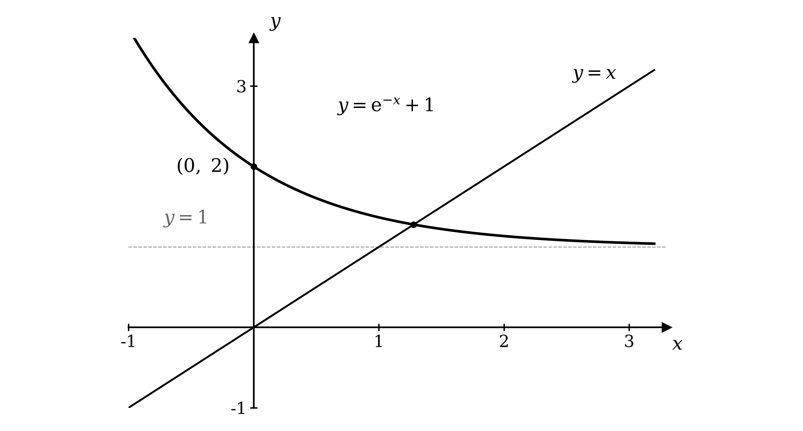

# Mark Schemes — Numerical Solutions of Equations
**Numerical Methods** · Cambridge (CIE) A-LEVEL maths (9709)

## Exam Questions (21 questions)

### Q1
Set the model equal to zero, then move the cube term across so that it stands alone

$B - t^{3} + \sqrt{t} = 0$

$B + \sqrt{t} = t^{3}$

**[M1]**

Take the cube root of both sides to reach the required form

`t = \sqrt[3]{B + \sqrt{t}}`

**[A1]**

> **[mark-scheme]**
> **M1**: Correct rearrangement to $t^{3} = B + \sqrt{t}$, or equivalent, showing at least one intermediate step.
> 
> **A1**: The given form reached correctly. Because the answer is printed in the question, the cube-root step must be visible; writing the given line down on its own earns nothing.
Substitute the starting value $t_{0} = 3$ into the iterative formula

`t_{1} = \sqrt[3]{40 + \sqrt{3}} = 3.4686`

**[M1 A1]**

Substitute each new value back into the formula to generate the next one

`t_{2} = \sqrt[3]{40 + \sqrt{3.4686}} = 3.4722`

`t_{3} = \sqrt[3]{40 + \sqrt{3.4722}} = 3.4723`

**[A1]**

The values have settled to 3 significant figures, so this is the healing time

**Final answer:** $t = 3 . 47$** seconds (3 s.f.)**

**[A1]**

> **[mark-scheme]**
> **M1**: Correct use of the iterative process at least once, that is substituting $t_{0} = 3$ to obtain a value for $t_{1}$.
> 
> **A1**: $t_{1} = 3 . 4686$ correct to 4 decimal places.
> 
> **A1**: Sufficient further iterations shown to at least 4 decimal places to justify the answer to 3 significant figures. Small errors, truncation and recovery are all condoned.
> 
> **A1**: Answers which round to $3 . 47$ to 3 significant figures. The units of seconds are not required for the mark.
If the sequence converges to a limit $α$, both $t_{n}$ and $t_{n+1}$ approach $α$

`\alpha = \sqrt[3]{40 + \sqrt{\alpha}}`

**[M1]**

Cube both sides to clear the cube root

$α^{3} = 40 + \sqrt{α}$

**[M1]**

Rearranging returns the original model with $B = 40$

$40 - α^{3} + \sqrt{α} = 0$

**Final answer:** **so the limit is a root of b(t) = 0**

**[A1]**

> **[mark-scheme]**
> **M1**: Replacing both $t_{n}$ and $t_{n+1}$ by a single limit, and writing `\alpha = \sqrt[3]{40 + \sqrt{\alpha}}`. Any letter may be used for the limit, including $t$ itself.
> 
> **M1**: Cubing both sides to reach $α^{3} = 40 + \sqrt{α}$, or equivalent.
> 
> **A1**: Rearranging to $40 - α^{3} + \sqrt{α} = 0$ and stating that this is $\text{b} ( t ) = 0$ with $B = 40$, so the limit is a root. The concluding statement is needed for this mark; reaching the equation alone is not enough.

### Q2
A root lies where the curve crosses the axis, so evaluate $\text{f} ( x )$ at each end of the interval

$\text{f} ( 1 . 5 ) = 2 ( 1 . 5 )^{2} - 2 ( 1 . 5 )^{3} + 3 = 0 . 75$

$\text{f} ( 1 . 6 ) = 2 ( 1 . 6 )^{2} - 2 ( 1 . 6 )^{3} + 3 = - 0 . 072$

**[M1]**

The two values have opposite signs, which places a root between them

**Final answer:** **There is a change of sign, so a root lies between 1.5 and 1.6**

**[A1]**

> **[mark-scheme]**
> **M1**: Correct evaluation of $\text{f} ( x )$ at both $x = 1 . 5$ and $x = 1 . 6$. You need to attempt both values, and at least one must be correct.
> 
> **A1**: Both values correct, together with a clear comparison completing the argument. Accept $0 . 75$ and $- 0 . 072$ with a statement that the signs differ, or that the product is negative. Truncated values are accepted, and you do not need to use the words "change of sign" provided the comparison itself is clear.
Test the interval whose values all round to $1 . 59$

$1 . 585 < x < 1 . 595$

Evaluate $\text{f} ( x )$ at each end of this narrower interval

$\text{f} ( 1 . 585 ) = 0 . 0607 \dots$

$\text{f} ( 1 . 595 ) = - 0 . 0274 \dots$

**[M1 A1]**

The signs differ across an interval every value of which rounds to $1 . 59$

**Final answer:** **There is a change of sign, so the root is 1.59 correct to 2 decimal places**

**[A1]**

> **[mark-scheme]**
> **M1**: Correct choice of an interval whose values all round to $1 . 59$ to 2 decimal places, and evaluation of $\text{f} ( x )$ at both ends of it. Working on a smaller interval inside $1 . 585$ to $1 . 595$ is accepted.
> 
> **A1**: Both values correct to at least 2 significant figures. Accept truncated values.
> 
> **A1**: Complete argument, with a clear comparison of the two values and the conclusion that the root is $1 . 59$ correct to 2 decimal places. Testing $1 . 5$ and $1 . 6$ again does not earn this mark, because those values do not both round to $1 . 59$.

### Q3
(i)

Take half a unit of the last significant place, which is half of $0 . 1$

$3 . 1 - 0 . 05 = 3 . 05$

$3 . 1 + 0 . 05 = 3 . 15$

$l = 3 . 05$

**[B1]**

$u = 3 . 15$

**[B1]**

(ii)

A change of sign means the curve passes from one side of the axis to the other, so it must cross the axis somewhere between the bounds

**Final answer:** **A change of sign between f(l) and f(u) shows that f(x) = 0 has a root between l and u**

**[B1]**

> **[mark-scheme]**
> **B1**: Lower bound $3 . 05$.
> 
> **B1**: Upper bound $3 . 15$. Accept `3.149\dot{9}` or a statement that $u$ is just below $3 . 15$.
> 
> **B1**: A statement that a change of sign shows there is a root of $\text{f} ( x ) = 0$ between $l$ and $u$. Accept "the curve crosses the $x$-axis between the bounds". Saying only that the two values have opposite signs, without stating what that tells you, does not earn this mark.

### Q4
Substitute the starting value $x_{0} = 5$ into the iterative formula

$x_{1} = \sqrt{\frac{40(5)}{5+1}} = 5 . 7735$

**[M1]**

Substitute each new value back into the formula to generate the next one

$x_{2} = 5 . 8391$

$x_{3} = 5 . 8439$

$x_{4} = 5 . 8443$

**[A1]**

The values have settled to 3 significant figures, so this is the value of $p$

**Final answer:** $p = 5 . 84$** (3 s.f.)**

**[A1]**

> **[mark-scheme]**
> **M1**: Correct use of the iterative process at least once, that is substituting $x_{0} = 5$ to obtain a value for $x_{1}$.
> 
> **A1**: Sufficient iterations shown to at least 4 decimal places to justify the answer to 3 significant figures. Small errors, truncation and recovery are all condoned.
> 
> **A1**: Answers which round to $5 . 84$ to 3 significant figures.
(i)

Evaluate $\text{f} ( x )$ at each end of the interval

$\text{f} ( 5 . 835 ) = 5 . 835 - \sqrt{\frac{40(5.835)}{6.835}} = - 0 . 00861 \dots$

$\text{f} ( 5 . 845 ) = 5 . 845 - \sqrt{\frac{40(5.845)}{6.845}} = 0 . 000659 \dots$

**[M1 A1]**

(ii)

Every value in this interval rounds to $5 . 84$, and the signs differ across it

**Final answer:** **There is a change of sign, so the root lies between 5.835 and 5.845, confirming p = 5.84 to 3 significant figures**

**[A1]**

> **[mark-scheme]**
> **M1**: Correct evaluation of $\text{f} ( x )$ at both $5 . 835$ and $5 . 845$. You need to attempt both values, and at least one must be correct.
> 
> **A1**: Both values correct to at least 2 significant figures. Accept truncated values.
> 
> **A1**: Complete argument, with a clear comparison of the two values and the conclusion that $p = 5 . 84$ correct to 3 significant figures. A comparison against zero showing one negative and one positive value is enough, as is a statement that the product is negative.

### Q5
The rearrangement has to leave a single $x$ on the left, so collect the other terms on the opposite side

$x^{3} - 2 = 5 x$

**[M1]**

Divide both sides by $5$ to reach the required form

$x = \frac{1}{5} ( x^{3} - 2 )$

**[A1]**

> **[mark-scheme]**
> **M1**: Correct rearrangement isolating the term in $5 x$, showing at least one intermediate step. Accept $x^{3} - 2 = 5 x$ or $5 x = x^{3} - 2$.
> 
> **A1**: The given form reached correctly. Because the answer is printed in the question, the intermediate step must be visible; writing the given line down on its own earns nothing. Accept $x = \frac{x^{3}-2}{5}$ as equivalent.
Substitute the starting value $x_{0} = 1$ into the iterative formula

`x_{1} = \dfrac{1}{5}\left((1)^{3} - 2\right) = -0.2000`

**[M1]**

Substitute each new value back into the formula to generate the next one

`x_{2} = \dfrac{1}{5}\left((-0.2)^{3} - 2\right) = -0.4016`

`x_{3} = \dfrac{1}{5}\left((-0.4016)^{3} - 2\right) = -0.4130`

**[A1]**

$x_{1} = - 0 . 2000 ,   x_{2} = - 0 . 4016 ,   x_{3} = - 0 . 4130$

**[A1]**

> **[mark-scheme]**
> **M1**: Correct use of the iterative process at least once, that is substituting $x_{0} = 1$ to obtain a value for $x_{1}$.
> 
> **A1**: $x_{1} = - 0 . 2000$ and $x_{2} = - 0 . 4016$ both correct.
> 
> **A1**: $x_{3} = - 0 . 4130$. All three values must be given to 4 decimal places as asked. Small differences in the final decimal place are condoned, and truncation or recovery from a slight rounding slip is accepted.

### Q6
(i)

Substitute the starting value $x_{0} = 1 . 5$ into the iterative formula, with the calculator in radian mode

`x_{1} = 1 - \text{tan}\left(\sqrt{3(1.5 + 1)}\right) = 1.42631`

**[M1]**

Substitute each new value back into the formula to generate the next one

$x_{2} = 1 . 47524$

$x_{3} = 1 . 44247$

**[A1]**

(ii)

Continuing the iteration, the values settle down

**Final answer:** $x = 1 . 46$** (3 s.f.)**

**[A1]**

(iii)

The ball travels along $y = x$, so the crossing point has equal coordinates

**Final answer:** $y = 1 . 46$** (3 s.f.)**

**[B1]**

> **[mark-scheme]**
> **M1**: Correct use of the iterative process at least once, working in radians. Working in degrees scores zero for this mark.
> 
> **A1**: All three of $x_{1} = 1 . 42631$, $x_{2} = 1 . 47524$ and $x_{3} = 1 . 44247$ correct to 5 decimal places. Small differences in the final decimal place are condoned.
> 
> **A1**: Answers which round to $1 . 46$ to 3 significant figures.
> 
> **B1**: $y = 1 . 46$, following through from your value in part (ii). The reasoning that the ball travels along $y = x$ need not be stated provided the value is correct.

### Q7
Write the reciprocal of the exponential using a negative index, then set the function to zero

$e^{-x} - x + 1 = 0$

**[M1]**

Add $x$ to both sides to leave a single $x$ on the left

$x = e^{-x} + 1$

**[A1]**

> **[mark-scheme]**
> **M1**: Rewriting $\frac{1}{e^{x}}$ as $e^{-x}$ and setting the expression equal to zero.
> 
> **A1**: The given form reached correctly. Because the answer is printed in the question, the rearrangement must be visible; writing the given line down on its own earns nothing.
The line $y = x$ passes through the origin at 45°. The curve $y = e^{-x} + 1$ is the standard decreasing exponential raised by one unit, so it cuts the $y$-axis at $2$ and approaches the asymptote $y = 1$ from above

**[B1 B1]**

> **[mark-scheme]**
> **B1**: Correct sketch of $y = x$, a straight line through the origin with positive gradient.
> 
> **B1**: Correct sketch of $y = e^{-x} + 1$, decreasing throughout, with the intercept $( 0 , 2 )$ marked and the asymptote $y = 1$ shown or implied by the shape. The two graphs must be drawn crossing exactly once.
Substitute the starting value $x_{0} = 2$ into the iterative formula

$x_{1} = e^{-2} + 1 = 1 . 14$

**[M1]**

Substitute each new value back into the formula to generate the next one

$x_{2} = e^{-1.1353} + 1 = 1 . 32$

**[A1]**

$x_{1} = 1 . 14 ,   x_{2} = 1 . 32 ,   x_{3} = 1 . 27$

**[A1]**

> **[mark-scheme]**
> **M1**: Correct use of the iterative process at least once, that is substituting $x_{0} = 2$ to obtain a value for $x_{1}$.
> 
> **A1**: $x_{1} = 1 . 14$ and $x_{2} = 1 . 32$ correct to 3 significant figures.
> 
> **A1**: $x_{3} = 1 . 27$. Accept truncation and small differences in the final figure. Values must be carried forward unrounded; rounding $x_{1}$ to $1 . 14$ before using it still gives $x_{2} = 1 . 32$, so this does not lose the mark.
Every value in the interval must round to the same 2 decimal places, so take half a unit either side of $1 . 28$

$p = 1 . 275 ,   q = 1 . 285$

**[B1]**

> **[mark-scheme]**
> **B1**: $p = 1 . 275$ and $q = 1 . 285$. Accept any narrower interval contained within these bounds whose values all round to $1 . 28$.

### Q8
The ball travels along $y = x$, so it enters the winning zone where that line meets the lower boundary. Setting $x = \text{f} ( x )$ gives the first iterative formula

$x_{n+1} = \text{ln} ( 3 x_{n} + 4 ) - 0 . 25 x_{n}^{2}$

**[M1]**

Substitute $x_{0} = 1 . 5$ and continue until the values settle

$x_{1} = 1 . 5776 ,   x_{2} = 1 . 5449 ,   x_{3} = 1 . 5591$

$x_{6} = 1 . 5545 ,   x_{8} = 1 . 5548$

**[A1]**

The entry point is $( 1 . 5548 , 1 . 5548 )$, so use Pythagoras for its distance from the origin

$d_{1} = 1 . 5548 \sqrt{2} = 2 . 1989 \dots$

**[A1]**

The ball leaves the zone where $y = x$ meets the upper boundary, giving a second iterative formula

$x_{n+1} = \text{ln} ( 3 x_{n} + 4 ) - 0 . 25 x_{n}^{2} + 1$

**[M1]**

Substitute $x_{0} = 2 . 1$. These values alternate either side of the root and converge slowly, so more iterations are needed

$x_{1} = 2 . 2296 ,   x_{2} = 2 . 1264 ,   x_{3} = 2 . 2094 ,   x_{4} = 2 . 1431$

$x_{10} = 2 . 1650 ,   x_{14} = 2 . 1696 ,   x_{20} = 2 . 1720 ,   \dots   x = 2 . 1728$

**[A1]**

$d_{2} = 2 . 1728 \sqrt{2} = 3 . 0729 \dots$

**Final answer:** **The ball must stop between 2.2 and 3.1 from the origin (2 s.f.)**

**[A1]**

> **[mark-scheme]**
> **M1**: Setting $y = x$ equal to the lower boundary and forming a correct iterative formula.
> 
> **A1**: Sufficient iterations from $x_{0} = 1 . 5$ for the values to settle at $1 . 55$ or better.
> 
> **A1**: Correct use of Pythagoras to reach a first distance of $2 . 1989$, or answers which round to $2 . 2$.
> 
> **M1**: Setting $y = x$ equal to the upper boundary and forming a correct second iterative formula. Accept the first formula with $+ 1$ appended.
> 
> **A1**: Sufficient iterations from $x_{0} = 2 . 1$ for the values to settle at $2 . 17$ or better. Because this sequence oscillates and converges slowly, a handful of iterations is not enough; a demonstration of a sign change in the interval $( 2 . 165 , 2 . 175 )$ is an acceptable alternative.
> 
> **A1**: Both distances stated, rounding to $2 . 2$ and $3 . 1$ to 2 significant figures. The multiplication by $\sqrt{2}$ is required for both; answers of $1 . 6$ and $2 . 2$ have stopped at the coordinates rather than the distances.

### Q9
Substitute the starting value $t_{0} = 10$ into the iterative formula

`t_{1} = 4 \; \text{ln}\left(\dfrac{120}{10}\right) = 9.93963`

**[M1]**

Substitute each new value back into the formula to generate the next one

$t_{2} = 9 . 96385 ,   t_{3} = 9 . 95411 ,   t_{4} = 9 . 95802 ,   t_{5} = 9 . 95645$

**[A1]**

The values have settled to 3 significant figures

**Final answer:** $t = 9 . 96$** days (3 s.f.)**

**[A1]**

> **[mark-scheme]**
> **M1**: Correct use of the iterative process at least once, that is substituting $t_{0} = 10$ to obtain a value for $t_{1}$.
> 
> **A1**: Sufficient iterations shown to at least 5 decimal places to justify the answer to 3 significant figures, or a demonstration of a sign change in the interval $( 9 . 955 , 9 . 965 )$. Small errors, truncation and recovery are all condoned.
> 
> **A1**: Answers which round to $9 . 96$ to 3 significant figures. The units of days are not required for the mark.
(i)

Setting the model in part (a) to zero and rearranging in the same way as the given formula shows where the $120$ came from

`Ae^{-0.25t} = 0.1t \;\;\Rightarrow\;\; t = 4 \; \text{ln}\left(\dfrac{10A}{t}\right)`

Comparing this with the printed formula gives $10 A = 120$

$A = 12 \text{mm}^{2}$

**[B1]**

(ii)

Set the new model to zero. Both terms share a factor of $T$, so take it out

`T\left(12e^{-T} - 0.1\right) = 0`

Since the bruise heals at a positive time, $T$ is not zero, so the bracket must vanish

$e^{-T} = \frac{0.1}{12}   \Rightarrow   T = \text{ln} ( 120 )$

**[M1]**

**Final answer:** $T = 4 . 79$** seconds (3 s.f.)**

**[A1]**

> **[mark-scheme]**
> **B1**: $A = 12$. The reasoning may be shown by rearranging the model in part (a) or by substituting into the given formula; the value alone is enough for the mark.
> 
> **M1**: Factorising out $T$ and solving $12 e^{-T} = 0 . 1$ by taking logarithms, or equivalent. Following through with your value of $A$ from part (i).
> 
> **A1**: Answers which round to $4 . 79$ to 3 significant figures. Accept the exact form $\text{ln} ( 120 )$. An answer of $T = 0$ alone does not earn this mark, since it is the trivial root and does not describe the bruise healing.

### Q10
At $S$ the road meets the bypass, so its coordinates satisfy both equations at once

`x = 1 + 2\,\text{ln}\left(x^{2}\right)`

There is no way to rearrange this to give $x$ exactly, but the command is to write the answer down, so a value must be there to be spotted rather than solved for. The only part that can simplify is the logarithm, and a logarithm is zero when what it acts on equals $1$, so try $x = 1$

`y = 1 + 2\,\text{ln}\left(1^{2}\right) = 1 + 0 = 1`

That gives the point $( 1 , 1 )$, which lies on the road $y = x$ as well, so the two graphs really do meet there. It is the lower of the two crossings, which is $S$

$S = ( 1 , 1 )$

**[B1]**

> **[mark-scheme]**
> **B1**: The coordinates $( 1 , 1 )$. Both are needed. No working is required, since the command is to write the answer down.
At $P$ the road and the bypass meet, so $p$ satisfies $x = 1 + 2  \text{ln} ( x^{2} )$. That is already in the form $x = \text{g} ( x )$, so the iterative formula can be read straight off it

`x_{n + 1} = 1 + 2\,\text{ln}\left(x_{n}^{2}\right)`

The question also asks for an appropriate starting value. The diagram puts $P$ just past $x = 10$, so read that off the axis and take

$x_{0} = 10$

Substitute this into the iterative formula

`x_{1} = 1 + 2\,\text{ln}\left(10^{2}\right) = 10.21034`

**[M1]**

Substitute each new value back into the formula to generate the next one

$x_{2} = 10 . 29360 ,   x_{3} = 10 . 32609 ,   x_{4} = 10 . 33870$

$x_{5} = 10 . 34357 ,   x_{6} = 10 . 34546 ,   x_{7} = 10 . 34619$

$x_{8} = 10 . 34647 ,   x_{9} = 10 . 34658 ,   x_{10} = 10 . 34663$

$x_{11} = 10 . 34664 ,   x_{12} = 10 . 34665$

**[A1]**

The values have settled to 5 significant figures

**Final answer:** $p = 10 . 347$** (5 s.f.)**

**[A1]**

> **[mark-scheme]**
> **M1**: Forming a correct iterative formula from $x = 1 + 2  \text{ln} ( x^{2} )$, stating a starting value, and using the formula at least once. Using the power law to write it as `x_{n + 1} = 1 + 4\,\text{ln}\left(x_{n}\right)` is equally acceptable.
> 
> **A1**: Sufficient iterations shown to at least 5 decimal places to justify the answer to 5 significant figures. Your starting value must be stated; any sensible value is accepted, provided the iterates are shown settling on $10 . 347$. Demonstrating a change of sign in the interval $10 . 3465 < x < 10 . 3475$ is an acceptable alternative to listing every iterate.
> 
> **A1**: Answers which round to $10 . 347$ to 5 significant figures.
The bypassed stretch runs along $y = x$ from $S ( 1 , 1 )$ to $P ( 10 . 347 , 10 . 347 )$, so use Pythagoras on the difference in coordinates

$L = \sqrt{(10.34665-1)^{2}+(10.34665-1)^{2}} = 9 . 34665 \sqrt{2}$

**[M1]**

**Final answer:** $L = 13 . 2$** (3 s.f.)**

**[A1]**

> **[mark-scheme]**
> **M1**: Correct use of Pythagoras between $S$ and $P$, or equivalent use of $L = ( p - 1 ) \sqrt{2}$, following through from your value of $p$.
> 
> **A1**: Answers which round to $13 . 2$ to 3 significant figures. An answer of $9 . 35$ has found the horizontal separation rather than the distance along the road.

### Q11
Substitute the starting value $x_{0} = 2 . 5$ into the iterative formula

`x_{1} = \dfrac{1}{5}\left(2.5^{3} - 2\right) = 2.7250`

Substitute each new value back into the formula to generate the next one

$x_{2} = 3 . 6470 ,   x_{3} = 9 . 3012 ,   x_{4} = 160 . 53$

**[M1]**

Each estimate is larger than the one before, and the growth is accelerating rather than settling

**Final answer:** **The values increase without bound, so the sequence does not converge to a root**

**[A1]**

> **[mark-scheme]**
> **M1**: Correct use of the iterative process at least twice, that is obtaining $x_{1}$ and then substituting it back to obtain $x_{2}$. At least three iterates should be shown, since two alone do not establish a trend.
> 
> **A1**: A statement that the values increase without bound, grow without limit, or diverge, so the sequence does not converge to a root. Accept any wording making that point. Simply listing the values, with no conclusion drawn, does not earn this mark.

### Q12
The rearrangement has to leave the cube term on its own, so move every other term across

$x^{3} = 3 x^{2} + 2 x - 1$

**[M1]**

Take the cube root of both sides to reach the required form

`x = \sqrt[3]{3x^{2} + 2x - 1}`

**[A1]**

> **[mark-scheme]**
> **M1**: Correct rearrangement to $x^{3} = 3 x^{2} + 2 x - 1$, showing at least one intermediate step.
> 
> **A1**: The given form reached correctly. Because the answer is printed in the question, the cube-root step must be visible; writing the given line down on its own earns nothing.
Substitute the starting value $x_{0} = 0 . 5$ into the iterative formula

`x_{1} = \sqrt[3]{3(0.5)^{2} + 2(0.5) - 1} = 0.909`

**[M1]**

Substitute each new value back into the formula to generate the next one

$x_{1} = 0 . 909 ,   x_{2} = 1 . 49 ,   x_{3} = 2 . 05$

**[A1]**

> **[exam-tip]**
> These three values are still a long way from the root near $3 . 49$, and that is fine, because the question only asks for three iterations. An iteration does not have to arrive quickly. If a question wants the root itself it will say so, and will tell you the accuracy required, which is your signal to keep pressing the equals key until consecutive values agree.

> **[mark-scheme]**
> **M1**: Correct use of the iterative process at least once, that is substituting $x_{0} = 0 . 5$ to obtain a value for $x_{1}$.
> 
> **A1**: All three values correct to 3 significant figures. Accept truncation and small differences in the final figure.

### Q13
Only the sine term needs moving, so add it to both sides

$x = 2 . 5 + \text{sin} ( 0 . 8 x )$

**[M1]**

This is the required form, with the single $x$ isolated on the left

$x = 2 . 5 + \text{sin} ( 0 . 8 x )$

**[A1]**

> **[mark-scheme]**
> **M1**: Adding $\text{sin} ( 0 . 8 x )$ to both sides of the equation, or any equivalent single correct rearrangement step.
> 
> **A1**: The given form reached correctly. Because the answer is printed in the question, the rearrangement must be visible; writing the given line down on its own earns nothing.
Substitute the starting value $x_{0} = 2$ into the iterative formula, with the calculator in radian mode

$x_{1} = 2 . 5 + \text{sin} ( 1 . 6 ) = 3 . 4996$

**[M1]**

Substitute each new value back into the formula to generate the next one

$x_{2} = 2 . 8353 ,   x_{3} = 3 . 2665 ,   x_{4} = 3 . 0042$

The values are alternating either side of the root, so continue until they settle

$x_{5} = 3 . 1730 ,   x_{6} = 3 . 0673 ,   x_{7} = 3 . 1348 ,   x_{8} = 3 . 0922$

**[A1]**

From here every further value rounds to the same 2 significant figures

**Final answer:** $x = 3 . 1$** (2 s.f.)**

**[A1]**

> **[mark-scheme]**
> **M1**: Correct use of the iterative process at least once, working in radians. Working in degrees scores zero for this mark.
> 
> **A1**: Sufficient iterations shown to at least 4 decimal places for the values to settle at 2 significant figures. Because this sequence oscillates, stopping at three iterations does not earn this mark. A demonstration of a sign change in the interval $( 3 . 05 , 3 . 15 )$ is an acceptable alternative.
> 
> **A1**: Answers which round to $3 . 1$ to 2 significant figures. Small errors, truncation and recovery are all condoned.

### Q14
A root lies where the curve crosses the axis, so evaluate $\text{f} ( x )$ at each end of the interval, working in radians

$\text{f} ( 0 . 9 ) = 3 ( 0 . 9 )^{2}  \text{sin}^{2} ( 0 . 9 ) - 2 = - 0 . 509$

$\text{f} ( 1 ) = 3 ( 1 )^{2}  \text{sin}^{2} ( 1 ) - 2 = 0 . 124$

**[M1]**

The two values lie on opposite sides of zero

**Final answer:** **There is a change of sign, so a root lies between 0.9 and 1**

**[A1]**

> **[mark-scheme]**
> **M1**: Correct evaluation of $\text{f} ( x )$ at both $x = 0 . 9$ and $x = 1$, working in radians. You need to attempt both values, and at least one must be correct. Working in degrees scores zero for this mark.
> 
> **A1**: Both values correct to at least 2 significant figures, with a clear comparison completing the argument. Accept a statement that the signs differ, or that the product is negative. Truncated values are accepted.
Evaluate $\text{f} ( x )$ at each end of the interval whose values all round to $0 . 982$

$\text{f} ( 0 . 9815 ) = - 0 . 00267 \dots$

$\text{f} ( 0 . 9825 ) = 0 . 00408 \dots$

**[M1]**

The signs differ across an interval every value of which rounds to $0 . 982$

**Final answer:** **There is a change of sign, so the root is 0.982 correct to 3 significant figures**

**[A1]**

> **[mark-scheme]**
> **M1**: Correct choice of an interval whose values all round to $0 . 982$ to 3 significant figures, and evaluation of $\text{f} ( x )$ at both ends of it. Working on a smaller interval inside $0 . 9815$ to $0 . 9825$ is accepted.
> 
> **A1**: Both values correct, with a clear comparison and the conclusion that the root is $0 . 982$ correct to 3 significant figures. Because the values are small, accept them to 1 significant figure or better. Re-testing $0 . 9$ and $1$ does not earn this mark, since those values do not both round to $0 . 982$.

### Q15
The point $P$ lies on both the road and the bypass, so its coordinates satisfy both equations at once

$p = p^{2}  \text{sin}  p$

Divide both sides by $p$, which is valid because $P$ is not at the origin

$p  \text{sin}  p = 1$

**[B1]**

> **[mark-scheme]**
> **B1**: Substituting $y = p$ and $x = p$ into the equation of the bypass to obtain $p = p^{2} \text{sin}  p$, then dividing by $p$ to reach the given equation. Both steps are needed, since the answer is printed in the question.
Substitute the starting value $x_{0} = 1$ into the iterative formula, with the calculator in radian mode

$x_{1} = \sqrt{\frac{1}{\text{sin}1}} = 1 . 09014$

**[M1]**

Substitute each new value back into the formula to generate the next one

$x_{2} = 1 . 10880 ,   x_{3} = 1 . 11295$

$x_{4} = 1 . 11388 ,   x_{5} = 1 . 11410$

**[A1]**

The values have settled to 4 significant figures

**Final answer:** $p = 1 . 114$** (4 s.f.)**

**[A1]**

> **[mark-scheme]**
> **M1**: Correct use of the iterative process at least once, working in radians. Working in degrees scores zero for this mark.
> 
> **A1**: Sufficient iterations shown to at least 5 decimal places to justify the answer to 4 significant figures, or a demonstration of a sign change in the interval $( 1 . 1135 , 1 . 1145 )$. Small errors, truncation and recovery are all condoned.
> 
> **A1**: Answers which round to $1 . 114$ to 4 significant figures.

### Q16
The iteration settles where $x$ equals the right-hand side, so the root satisfies

$x = \text{ln} ( x - 1 ) + 3$

Collect every term on one side to give a function whose root this is

$\text{f} ( x ) = x - \text{ln} ( x - 1 ) - 3$

**[B1]**

> **[mark-scheme]**
> **B1**: $\text{f} ( x ) = x - \text{ln} ( x - 1 ) - 3$, or any equivalent form. Accept $\text{f} ( x ) = \text{ln} ( x - 1 ) + 3 - x$, since both have the same roots.
Substitute the starting value $x_{0} = 2$ into the iterative formula

$x_{1} = \text{ln} ( 2 - 1 ) + 3 = 3 . 000$

**[M1]**

Substitute each new value back into the formula to generate the next one

$x_{1} = 3 . 000 ,   x_{2} = 3 . 693 ,   x_{3} = 3 . 991 ,   x_{4} = 4 . 096$

**[A1]**

> **[mark-scheme]**
> **M1**: Correct use of the iterative process at least once, that is substituting $x_{0} = 2$ to obtain $x_{1} = 3$.
> 
> **A1**: All four values correct to 3 decimal places. Small differences in the final decimal place are condoned, and truncation is accepted.
Evaluate $\text{f} ( x )$ at each end of the interval whose values all round to $4 . 146$

$\text{f} ( 4 . 1455 ) = - 0 . 000473 \dots$

$\text{f} ( 4 . 1465 ) = 0 . 000209 \dots$

**[M1]**

The signs differ across an interval every value of which rounds to $4 . 146$

**Final answer:** **There is a change of sign, so the root is 4.146 correct to 3 decimal places**

**[A1]**

> **[mark-scheme]**
> **M1**: Correct evaluation of $\text{f} ( x )$ at both $4 . 1455$ and $4 . 1465$. You need to attempt both values, and at least one must be correct. Continuing the iteration far enough to show the values settling at $4 . 146$ is an acceptable alternative method.
> 
> **A1**: Both values correct, with a clear comparison and the conclusion that $α = 4 . 146$ correct to 3 decimal places. Because the values are small, accept them to 1 significant figure or better, and accept a statement that one is negative and the other positive.

### Q17
(i)

The cut is healed when no length of it remains

$\text{f} = 0$

**[B1]**

(ii)

Put $L = 5$ and set the model to zero, then separate the exponential term

$5 e^{-t} - t = 0$

$e^{-t} = \frac{t}{5}$

Take natural logarithms of both sides, which brings the power down

`t = -\text{ln}\left(\dfrac{t}{5}\right)`

**[M1]**

> **[mark-scheme]**
> **B1**: The value $0$.
> 
> **M1**: Correct rearrangement to $e^{-t} = \frac{t}{5}$ followed by taking logarithms of both sides to reach the given form. Because the answer is printed in the question, both steps must be visible. Accept `-t = \text{ln}\left(\dfrac{t}{5}\right)` as the penultimate line, and accept `t = \text{ln}\left(\dfrac{5}{t}\right)` as an equivalent final form.
Substitute the starting value $t_{0} = 1$ into the iterative formula

`t_{1} = -\text{ln}\left(\dfrac{1}{5}\right) = 1.6094`

**[M1]**

Substitute each new value back into the formula to generate the next one

$t_{2} = 1 . 1336 ,   t_{3} = 1 . 4841 ,   t_{4} = 1 . 2146$

**[A1]**

The values are alternating either side of the root and closing in only slowly, so continue until they settle

$t_{5} = 1 . 4150 ,   t_{6} = 1 . 2623 ,   t_{7} = 1 . 3765$

$t_{8} = 1 . 2899 ,   t_{9} = 1 . 3549 ,   t_{10} = 1 . 3057$

**[A1]**

From here every further value rounds to the same 2 significant figures

**Final answer:** $t = 1 . 3$** seconds (2 s.f.)**

**[A1]**

> **[exam-tip]**
> This sequence alternates above and below the root instead of creeping towards it from one side, so three or four iterations are not enough to be confident of two significant figures. When you see values jumping either side like this, keep going until consecutive terms agree to the accuracy you have been asked for, rather than stopping at a fixed number of steps.

> **[mark-scheme]**
> **M1**: Correct use of the iterative process at least once, that is substituting $t_{0} = 1$ to obtain a value for $t_{1}$.
> 
> **A1**: The first few iterates correct to 4 decimal places, that is $1 . 6094$, $1 . 1336$, $1 . 4841$.
> 
> **A1**: Sufficient further iterations shown for the values to settle at 2 significant figures. Because this sequence oscillates, roughly ten iterations are needed; stopping at three or four does not earn this mark. A demonstration of a sign change in the interval $( 1 . 25 , 1 . 35 )$ is an acceptable alternative.
> 
> **A1**: Answers which round to $1 . 3$ to 2 significant figures. The units of seconds are not required for the mark. Small errors, truncation and recovery are all condoned.
The function represents a physical length, and beyond the healing time the formula would keep decreasing

**Final answer:** **A cut cannot have a negative length, so the model is only valid while f(t) is greater than or equal to zero**

**[B1]**

> **[mark-scheme]**
> **B1**: A statement that a length cannot be negative, so values below zero have no meaning in this context. Accept any wording making that point, including a note that the model stops applying once the cut has healed.

### Q18
Substitute the starting value $x_{0} = 0 . 5$ into the iterative formula, with the calculator in radian mode

`x_{1} = \dfrac{1}{2} \; \text{sin}^{2}\left(e^{0.5}\right) = 0.49697`

**[M1]**

Substitute each new value back into the formula to generate the next one

$x_{2} = 0 . 49734$

$x_{3} = 0 . 49730$

$x_{4} = 0 . 49731$

**[A1]**

The values have settled to 3 significant figures

**Final answer:** $x = 0 . 497$** (3 s.f.)**

**[A1]**

> **[mark-scheme]**
> **M1**: Correct use of the iterative process at least once, working in radians. Working in degrees scores zero for this mark.
> 
> **A1**: Sufficient iterations shown to at least 5 decimal places to justify the answer to 3 significant figures. Small errors, truncation and recovery are all condoned.
> 
> **A1**: The value $0 . 497$ obtained. Because the answer is given in the question, enough iterations must be visible to justify it; simply writing $0 . 497$ down earns nothing.
The ball travels along $y = x$, so it reaches the boundary at $( 0 . 497 , 0 . 497 )$. Use Pythagoras for its distance from the origin

$d = \sqrt{0.497^{2}+0.497^{2}} = 0 . 497 \sqrt{2}$

**[M1]**

**Final answer:** $d = 0 . 703$** (3 s.f.)**

**[A1]**

> **[mark-scheme]**
> **M1**: Correct use of Pythagoras with both coordinates equal to your answer from part (a), or equivalent use of $d = x \sqrt{2}$.
> 
> **A1**: Answers which round to $0 . 703$ to 3 significant figures. Follow through from your value in part (a). Using the unrounded value gives $0 . 70330$ and using $0 . 497$ gives $0 . 70286$; both round to $0 . 703$, so either is accepted.

### Q19
(i)

Evaluate the function at each value, working in radians

$\text{f} ( 1 . 6 ) = 2 ( 1 . 6 )  \text{cos} ( 4 . 8 ) - 1 = - 0 . 720$

$\text{f} ( 1 . 7 ) = 2 ( 1 . 7 )  \text{cos} ( 5 . 1 ) - 1 = 0 . 285$

**[M1 A1]**

(ii)

The two values lie on opposite sides of zero, which places a crossing point between them

**Final answer:** **There is a change of sign, so a root lies between 1.6 and 1.7**

**[A1]**

> **[mark-scheme]**
> **M1**: Correct evaluation of $\text{f} ( x )$ at both $x = 1 . 6$ and $x = 1 . 7$, working in radians. You need to attempt both values, and at least one must be correct. Working in degrees scores zero for this mark.
> 
> **A1**: Both values correct to 3 significant figures, that is $- 0 . 720$ and $0 . 285$. Accept truncated values.
> 
> **A1**: A statement that the change of sign means the equation has a root between the two values. Noting only that the signs differ, without saying what that implies, does not earn this mark.
(i)

Take half a unit either side of the last significant place

**Final answer:** $2 . 545$** and **$2 . 555$

**[B1]**

(ii)

Evaluate $\text{f} ( x )$ at each bound

$\text{f} ( 2 . 545 ) = 0 . 106$

$\text{f} ( 2 . 555 ) = - 0 . 0400$

**[M1]**

Every value in this interval rounds to $2 . 55$, and the signs differ across it

**Final answer:** **There is a change of sign, so the solution is 2.55 correct to 3 significant figures**

**[A1]**

> **[mark-scheme]**
> **B1**: Both bounds correct, $2 . 545$ and $2 . 555$.
> 
> **M1**: Correct evaluation of $\text{f} ( x )$ at both bounds, in radians. At least one value must be correct.
> 
> **A1**: A clear comparison of the two values together with the conclusion that $2 . 55$ is correct to 3 significant figures. A comparison against zero showing one positive and one negative value is enough, as is a statement that the product is negative.

### Q20
At $P$ the road and the bypass meet, so $p$ satisfies $x = 6 \sqrt{1-\frac{1}{x+1}}$. Collect the terms on one side to give a function whose root is $p$

$\text{f} ( x ) = x - 6 \sqrt{1-\frac{1}{x+1}}$

Evaluate this function at each end of the interval

$\text{f} ( 5 ) = 5 - 5 . 4772 = - 0 . 4772$

$\text{f} ( 6 ) = 6 - 5 . 5549 = 0 . 4451$

**[M1]**

The two values lie on opposite sides of zero

**Final answer:** **There is a change of sign, so **$5 < p < 6$

**[A1]**

> **[mark-scheme]**
> **M1**: Correct evaluation of $\text{f} ( x ) = x - 6 \sqrt{1-\frac{1}{x+1}}$ at both $x = 5$ and $x = 6$. You need to attempt both values, and at least one must be correct.
> 
> **A1**: Both values correct to at least 2 significant figures, with a clear comparison completing the argument. Accept a statement that the signs differ, or that the product is negative. Comparing the two sides separately is equally acceptable, noting that $6 \sqrt{1-\frac{1}{x+1}}$ is larger than $x$ at $x = 5$ and smaller at $x = 6$.
Substitute the starting value $x_{0} = 5$ into the iterative formula

$x_{1} = 6 \sqrt{1-\frac{1}{5+1}} = 5 . 4772$

**[M1]**

Substitute each new value back into the formula to generate the next one

$x_{2} = 5 . 5174$

$x_{3} = 5 . 5205$

$x_{4} = 5 . 5208$

**[A1]**

The values have settled to 2 decimal places

**Final answer:** $p = 5 . 52$** (2 d.p.)**

**[A1]**

> **[mark-scheme]**
> **M1**: Correct use of the iterative process at least once, that is substituting $x_{0} = 5$ to obtain a value for $x_{1}$.
> 
> **A1**: Sufficient iterations shown to at least 4 decimal places to justify the answer to 2 decimal places, or a demonstration of a sign change in the interval $( 5 . 515 , 5 . 525 )$. Small errors, truncation and recovery are all condoned.
> 
> **A1**: Answers which round to $5 . 52$ to 2 decimal places.

### Q21
The rearrangement has to leave the cube term on its own, so move the constant across

$x^{3} = 5 x - 3$

**[M1]**

Take the cube root of both sides to reach the required form

`x = \sqrt[3]{5x - 3}`

**[A1]**

> **[mark-scheme]**
> **M1**: Correct rearrangement to $x^{3} = 5 x - 3$, or equivalent, showing at least one intermediate step.
> 
> **A1**: The given form reached correctly. Because the answer is printed in the question, the cube-root step must be visible; writing the given line down on its own earns nothing.
Substitute the starting value $x_{0} = 1 . 8$ into the iterative formula

`x_{1} = \sqrt[3]{5(1.8) - 3} = 1.8171`

**[M1]**

Substitute each new value back into the formula to generate the next one

$x_{2} = 1 . 8257$

$x_{3} = 1 . 8300$

$x_{4} = 1 . 8321$

$x_{5} = 1 . 8332$

**[A1]**

The values have settled to 2 decimal places

**Final answer:** $x = 1 . 83$** (2 d.p.)**

**[A1]**

> **[mark-scheme]**
> **M1**: Correct use of the iterative process at least once, that is substituting $x_{0} = 1 . 8$ to obtain a value for $x_{1}$.
> 
> **A1**: Sufficient iterations shown to at least 4 decimal places to justify the answer to 2 decimal places, or a demonstration of a sign change in the interval $( 1 . 825 , 1 . 835 )$. Small errors, truncation and recovery are all condoned.
> 
> **A1**: Answers which round to $1 . 83$ to 2 decimal places.
