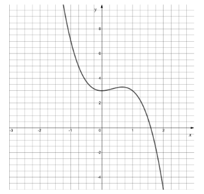
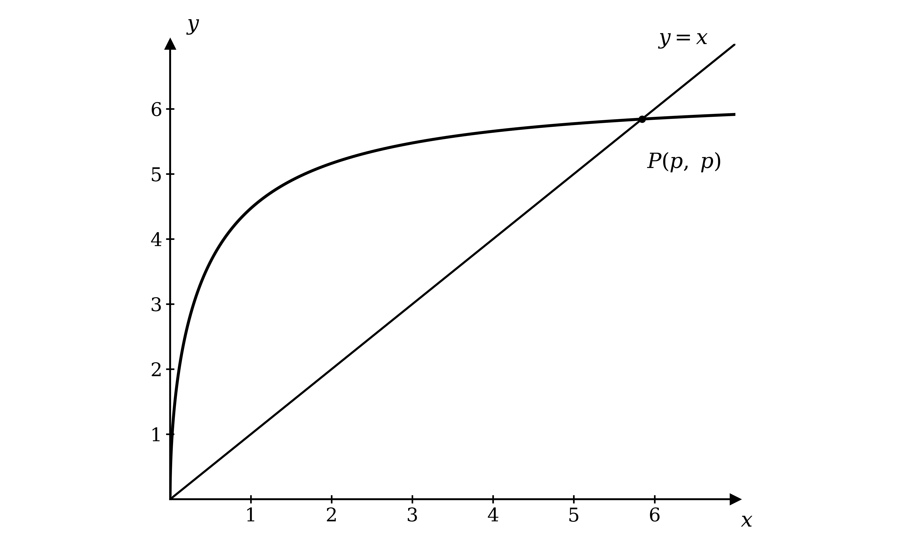
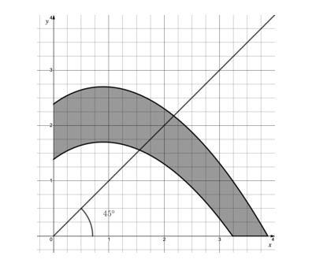
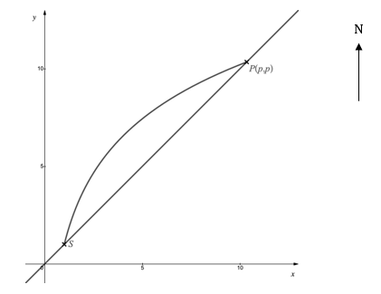
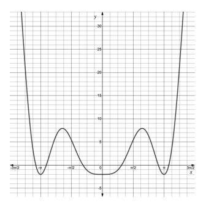
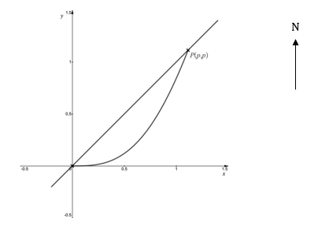
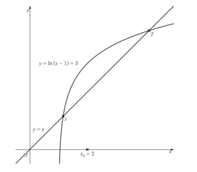
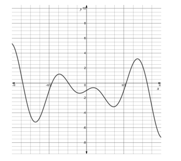
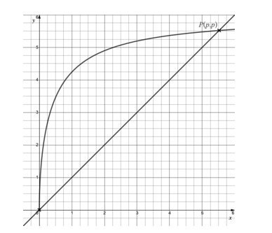

# Exam Questions — Numerical Solutions of Equations
**Numerical Methods** · Cambridge (CIE) A-LEVEL maths (9709)
> Source: [https://www.savemyexams.com/a-level/maths/cie/20/pure-3/topic-questions/](https://www.savemyexams.com/a-level/maths/cie/20/pure-3/topic-questions/) · 21 questions across 1 sets

## Exam Questions (21 questions)

### Q1 — hard — 9 marks

**Q1** [2 marks]

According to legend, unicorn tears can heal an injury almost instantly.

If a unicorn tear is applied to a burn of initial size $B \text{mm}^{2}$ on human skin, it will heal according to the model

$\text{b} ( t ) = B - t^{3} + \sqrt{t} ,   t \geq 0$

where $\text{b}$ is the area of the burn, in square millimetres, at time $t$ seconds after the unicorn tear has been applied.

Show that the equation $\text{b} ( t ) = 0$ can be written as

`t = \sqrt[3]{B + \sqrt{t}}`

**Q1** [4 marks]

Use the iterative formula

`t_{n + 1} = \sqrt[3]{40 + \sqrt{t_{n}}}`

with initial value $t_{0} = 3$ to determine how many seconds it takes a burn of size $40 \text{mm}^{2}$ to heal once a unicorn tear is applied.

Give the result of each iteration to 4 decimal places and your final answer correct to 3 significant figures.

**Q1** [3 marks]

Show that, if the sequence of estimates given by the iterative formula in part (b) converges, then it converges to a root of the equation $\text{b} ( t ) = 0$ for a burn of initial size $40 \text{mm}^{2}$.

### Q2 — medium — 5 marks

**Q2** [2 marks]

The diagram shows part of the curve $y = \text{f} ( x )$, where $\text{f} ( x ) = 2 x^{2} - 2 x^{3} + 3$.

Verify by calculation that the equation $\text{f} ( x ) = 0$ has a root between $x = 1 . 5$ and $x = 1 . 6$.

**Q2** [3 marks]

Show that this root is $1 . 59$, correct to 2 decimal places.

### Q3 — easy — 3 marks

**Q3** [3 marks]

A solution to the equation $\text{f} ( x ) = 0$ is $x = 3 . 1$, correct to two significant figures.

(i) Write down the lower bound, *l*, and the upper bound, *u*, of 3.1.

(ii) Given that $\text{f} ( x )$ is continuous on $l \leq x \leq u$, state what a change of sign between $\text{f} ( l )$ and $\text{f} ( u )$ would tell you about the equation $\text{f} ( x ) = 0$ on that interval.

### Q4 — easy — 6 marks

**Q4** [3 marks]

A bypass is to be built around a village. On the graph below the road through the village is modelled by the line $y = x$. The bypass is modelled by the equation $y = \sqrt{\frac{40x}{x+1}}$.

The bypass runs from the origin to the point $P ( p , p )$.

Use the iterative formula

$x_{n+1} = \sqrt{\frac{40x_{n}}{x_{n}+1}}$

with $x_{0} = 5$ to determine the value of $p$, correct to 3 significant figures. Give the result of each iteration to 4 decimal places.

**Q4** [3 marks]

(i) Calculate $\text{f} ( 5 . 835 )$ and $\text{f} ( 5 . 845 )$, where $\text{f} ( x ) = x - \sqrt{\frac{40x}{x+1}}$.

(ii) Hence show that your answer to part (a) is correct to 3 significant figures.

### Q5 — easy — 5 marks

**Q5** [2 marks]

Show that the equation $x^{3} - 5 x = 2$ can be rewritten as

$x = \frac{1}{5} ( x^{3} - 2 )$

**Q5** [3 marks]

Starting with $x_{0} = 1$, use the iterative formula

$x_{n+1} = \frac{1}{5} ( x_{n}^{3} - 2 )$

to find the values of $x_{1}$, $x_{2}$ and $x_{3}$. Give the result of each iteration to 4 decimal places.

### Q6 — easy — 4 marks

**Q6** [4 marks]

The game of Tanball is played on a flat table.

A player rolls a ball from a fixed point, at any angle, with the aim of it coming to rest in the winning zone.

A particular player decides to roll the ball at an angle of $\frac{π}{4}$ radians. This is illustrated by the graph below, with the ball being rolled from the origin and the shaded area being the winning zone.

The boundary of the winning zone is given by part of the curve with equation

`y = 1 - \text{tan}\left(\sqrt{3(x + 1)}\right)`

(i) Using the iterative formula `x_{n + 1} = 1 - \text{tan}\left(\sqrt{3(x_{n} + 1)}\right)`, with initial value $x_{0} = 1 . 5$ and working in radians, find the estimates $x_{1}$, $x_{2}$ and $x_{3}$. Give each to 5 decimal places.

(ii) Continue the iteration to determine the value of $x$, correct to 3 significant figures.

(iii) Write down the $y$-coordinate of the point where this player's ball crosses the winning boundary, correct to 3 significant figures.

### Q7 — hard — 8 marks

**Q7** [2 marks]

The function $\text{f}$ is defined by

$\text{f} ( x ) = \frac{1}{e^{x}} - x + 1 ,   x \in ℝ$

Show that the equation $\text{f} ( x ) = 0$ can be written in the form

$x = e^{-x} + 1$

**Q7** [2 marks]

On the same diagram, sketch the graphs of $y = x$ and $y = e^{-x} + 1$.

**Q7** [3 marks]

The equation $\text{f} ( x ) = 0$ has a root $α$. The iterative formula

$x_{n+1} = e^{-x_{n}} + 1$

with $x_{0} = 2$ is used to find $α$.

Find the values of $x_{1}$, $x_{2}$ and $x_{3}$, giving each correct to 3 significant figures.

**Q7** [1 mark]

The root $α$ lies in the interval $p < x < q$. Write down values of $p$ and $q$ from which $α$ can be deduced correct to 2 decimal places.

### Q8 — very_hard — 6 marks

**Q8** [6 marks]

The game of Funcball is played on a flat table. A player rolls a ball from a fixed point, at any angle, with the aim of it coming to rest within a winning zone.

The winning zone is modelled by the function

$\text{f} ( x ) = \text{ln} ( 3 x + 4 ) - 0 . 25 x^{2}$

The lower boundary of the winning zone has equation $y = \text{f} ( x )$, for $x , y \geq 0$.

The upper boundary of the winning zone has equation $y = \text{f} ( x ) + 1$, for $x , y \geq 0$.

A particular player decides to roll the ball at an angle of 45°, as illustrated by the graph below, with the ball being rolled from the origin and the shaded area being the winning zone.

Using iterative formulas with initial values $x_{0} = 1 . 5$ and $x_{0} = 2 . 1$ as appropriate, find the two distances from the origin between which the ball must stop for this player to win Funcball. Give your answers correct to 2 significant figures.

### Q9 — very_hard — 6 marks

**Q9** [3 marks]

According to legend, unicorn tears have magical healing powers.

Without unicorn tears, a bruise of initial size $A \text{mm}^{2}$ will heal according to the model

$\text{f} ( t ) = A e^{-0.25t} - 0 . 1 t ,   t \geq 0$

where $\text{f}$ is the area of the bruise, in square millimetres, at time $t$ days since the bruise first appeared.

Use the iterative formula

`t_{n + 1} = 4 \; \text{ln}\left(\dfrac{120}{t_{n}}\right)`

with $t_{0} = 10$ to determine how many days it takes the bruise to heal without unicorn tears. Give the result of each iteration to 5 decimal places and your final answer correct to 3 significant figures.

**Q9** [3 marks]

With unicorn tears, a bruise of the same initial size will heal according to the model

$\text{u} ( T ) = A T e^{-T} - 0 . 1 T ,   T \geq 0$

where the time $T$ is measured in seconds.

(i) Find the initial size of the bruise considered in part (a).

(ii) Find how many seconds it takes the same bruise to heal using unicorn tears.

### Q10 — very_hard — 6 marks

**Q10** [1 mark]

The village of Camberwick Green lies on a straight road, modelled by the line $y = x$ on the graph below. Rush hour traffic through the village causes both congestion and air pollution, so to ease congestion and improve air quality a bypass is to be built, modelled by part of the equation $y = 1 + 2  \text{ln} ( x^{2} )$.

The bypass leaves the road at a southern roundabout $S$ and rejoins it at a northern roundabout $P ( p , p )$.

Write down the coordinates of $S$.

**Q10** [3 marks]

Use a suitable iterative formula, with an appropriate initial value $x_{0}$, to determine the value of $p$ correct to 5 significant figures. Give the result of each iteration to 5 decimal places.

**Q10** [2 marks]

Find the length of the road through Camberwick Green that will be bypassed, giving your answer correct to 3 significant figures.

### Q11 — easy — 2 marks

**Q11** [2 marks]

The equation $x^{3} - 5 x - 2 = 0$ can be rearranged into the form

`x = \dfrac{1}{5}\left(x^{3} - 2\right)`

Using the iterative formula `x_{n + 1} = \dfrac{1}{5}\left(x_{n}^{3} - 2\right)` with $x_{0} = 2 . 5$, show that this sequence of estimates fails to converge to a root.

### Q12 — easy — 4 marks

**Q12** [2 marks]

An iterative formula is to be used to find a root of the equation

$x^{3} - 3 x^{2} - 2 x + 1 = 0$

Show that this equation can be rearranged into the form

`x = \sqrt[3]{3x^{2} + 2x - 1}`

**Q12** [2 marks]

Use the iterative formula

`x_{n + 1} = \sqrt[3]{3x_{n}^{2} + 2x_{n} - 1}`

with $x_{0} = 0 . 5$ to find the values of $x_{1}$, $x_{2}$ and $x_{3}$, giving each correct to 3 significant figures.

### Q13 — medium — 5 marks

**Q13** [2 marks]

Show that the equation

$x - \text{sin} ( 0 . 8 x ) = 2 . 5$

can be rearranged into the form $x = 2 . 5 + \text{sin} ( 0 . 8 x )$.

**Q13** [3 marks]

Use the iterative formula

$x_{n+1} = 2 . 5 + \text{sin} ( 0 . 8 x_{n} )$

with $x_{0} = 2$ and working in radians, to determine a root of the equation $x - \text{sin} ( 0 . 8 x ) = 2 . 5$, correct to 2 significant figures. Give the result of each iteration to 4 decimal places.

### Q14 — medium — 4 marks

**Q14** [2 marks]

The diagram shows part of the curve $y = \text{f} ( x )$, where $\text{f} ( x ) = 3 x^{2}  \text{sin}^{2} x - 2$ and $x$ is in radians.

Verify by calculation that the equation $\text{f} ( x ) = 0$ has a root between $x = 0 . 9$ and $x = 1$.

**Q14** [2 marks]

Show that this root is $0 . 982$, correct to 3 significant figures.

### Q15 — medium — 4 marks

**Q15** [1 mark]

The village of Crinkley Bottom lies on a straight road, modelled by the line $y = x$ on the graph below. Rush hour traffic causes much air pollution in the village, so to improve the air quality around Crinkley Bottom a bypass is to be built. The path of the bypass is modelled by part of the equation $y = x^{2}  \text{sin}  x$, where $x$ is in radians.

The bypass is built with a roundabout south of the village at the origin, and a northern roundabout which re-joins the road through Crinkley Bottom at the point $P ( p , p )$.

Show that $p$ satisfies the equation $x  \text{sin}  x = 1$.

**Q15** [3 marks]

Use the iterative formula

$x_{n+1} = \sqrt{\frac{x_{n}}{\text{sin}x_{n}}}$

with $x_{0} = 1$ to determine the position $p$ of the northern roundabout, correct to 4 significant figures. Give the result of each iteration to 5 decimal places.

### Q16 — medium — 5 marks

**Q16** [1 mark]

The diagram shows the graphs of $y = x$ and $y = \text{ln} ( x - 1 ) + 3$.

The iterative formula

$x_{n+1} = \text{ln} ( x_{n} - 1 ) + 3$

is to be used to find an estimate for a root, $α$, of the equation $\text{f} ( x ) = 0$.

Write down an expression for $\text{f} ( x )$.

**Q16** [2 marks]

Using an initial estimate $x_{0} = 2$, find the estimates $x_{1}$, $x_{2}$, $x_{3}$ and $x_{4}$, giving each correct to 3 decimal places.

**Q16** [2 marks]

Show that $α = 4 . 146$, correct to 3 decimal places.

### Q17 — medium — 7 marks

**Q17** [2 marks]

According to legend, a unicorn can heal an injury almost instantly by touching it with its horn.

When a unicorn touches a cut in human skin of length $L \text{mm}$, it will heal according to the model

$\text{f} ( t ) = L e^{-t} - t ,   t \geq 0$

where $\text{f}$ is the length of the cut in millimetres, at time $t$ seconds after the unicorn has touched the injury with its horn.

(i) Write down the value of $\text{f}$ when the cut is completely healed.

(ii) Show that, for a cut of length $5 \text{mm}$, the equation $\text{f} ( t ) = 0$ can be rearranged into the form

`t = -\text{ln}\left(\dfrac{t}{5}\right)`

**Q17** [4 marks]

Use the iterative formula

`t_{n + 1} = -\text{ln}\left(\dfrac{t_{n}}{5}\right)`

with initial value $t_{0} = 1$ to determine how many seconds it takes a cut of length $5 \text{mm}$ to heal once a unicorn has touched it with its horn.

Give the result of each iteration to 4 decimal places, and your final answer correct to 2 significant figures.

**Q17** [1 mark]

Explain why the model should also restrict the values of $\text{f} ( t )$ to be greater than or equal to zero.

### Q18 — medium — 5 marks

**Q18** [3 marks]

The game of Curveball is played on a flat table.

A player rolls a ball from a fixed point, at any angle, with the aim of it coming to rest in the winning zone.

A particular player decides to roll the ball at an angle of 45°. This is illustrated by the graph below, with the ball being rolled from the origin and the shaded area being the winning zone.

The boundary of the winning zone is given by part of the curve with equation

`y = \dfrac{1}{2} \; \text{sin}^{2}\left(e^{x}\right)`

Use the iterative formula

`x_{n + 1} = \dfrac{1}{2} \; \text{sin}^{2}\left(e^{x_{n}}\right)`

with initial value $x_{0} = 0 . 5$ and working in radians, to show that the $x$-coordinate of the point where this player's ball crosses the boundary of the winning zone is $0 . 497$, correct to 3 significant figures. Give the result of each iteration to 5 decimal places.

**Q18** [2 marks]

Use your answer to part (a) to find the minimum distance the ball must travel for this player to win Curveball.

### Q19 — easy — 6 marks

**Q19** [3 marks]

The diagram shows part of the curve $y = \text{f} ( x )$, where $\text{f} ( x ) = 2 x  \text{cos} ( 3 x ) - 1$ and $x$ is in radians.

(i) Find $\text{f} ( 1 . 6 )$ and $\text{f} ( 1 . 7 )$, giving your answers correct to 3 significant figures.

(ii) State what your results tell you about the equation $\text{f} ( x ) = 0$.

**Q19** [3 marks]

One of the solutions to the equation $\text{f} ( x ) = 0$ is $x = 2 . 55$, correct to 3 significant figures.

(i) Write down the lower and upper bounds of $2 . 55$.

(ii) Hence use the change of sign rule to confirm that $2 . 55$ is a solution of $\text{f} ( x ) = 0$, correct to 3 significant figures.

### Q20 — medium — 5 marks

**Q20** [2 marks]

The village of Greendale lies on a straight road, modelled by the line $y = x$ on the graph below. To ease rush hour congestion, a bypass is to be built around Greendale. The path of the bypass is modelled by the equation $y = 6 \sqrt{1-\frac{1}{x+1}}$.

The bypass runs from the origin to the point $P ( p , p )$.

Show by calculation that $5 < p < 6$.

**Q20** [3 marks]

Use the iterative formula

$x_{n+1} = 6 \sqrt{1-\frac{1}{x_{n}+1}}$

with $x_{0} = 5$ to determine the value of $p$, correct to 2 decimal places. Give the result of each iteration to 4 decimal places.

### Q21 — medium — 5 marks

**Q21** [2 marks]

Show that the equation $x^{3} + 3 = 5 x$ can be rewritten as

`x = \sqrt[3]{5x - 3}`

**Q21** [3 marks]

Starting with $x_{0} = 1 . 8$, use the iterative formula

`x_{n + 1} = \sqrt[3]{5x_{n} - 3}`

to determine a root of the equation $x^{3} + 3 = 5 x$, correct to 2 decimal places. Give the result of each iteration to 4 decimal places.
