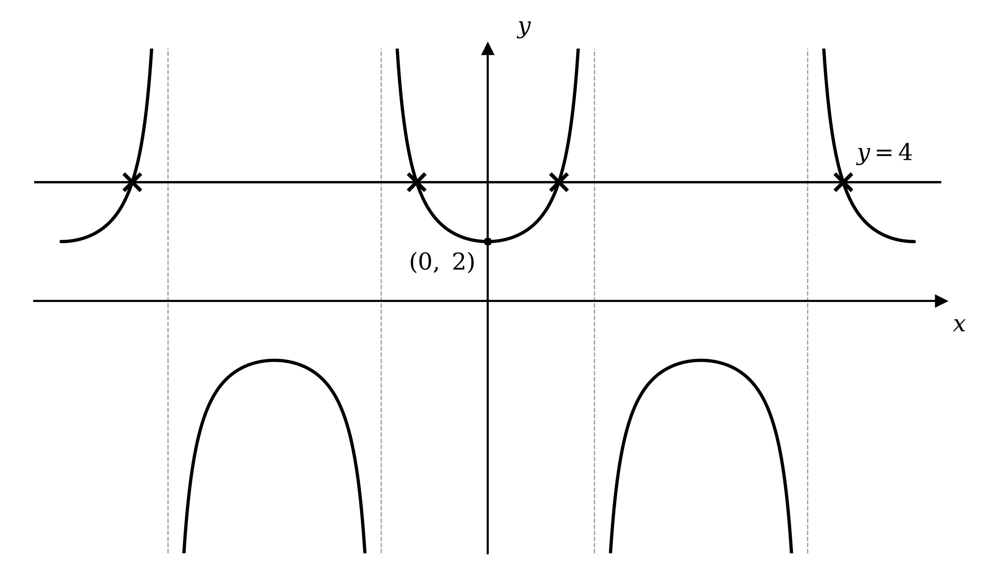
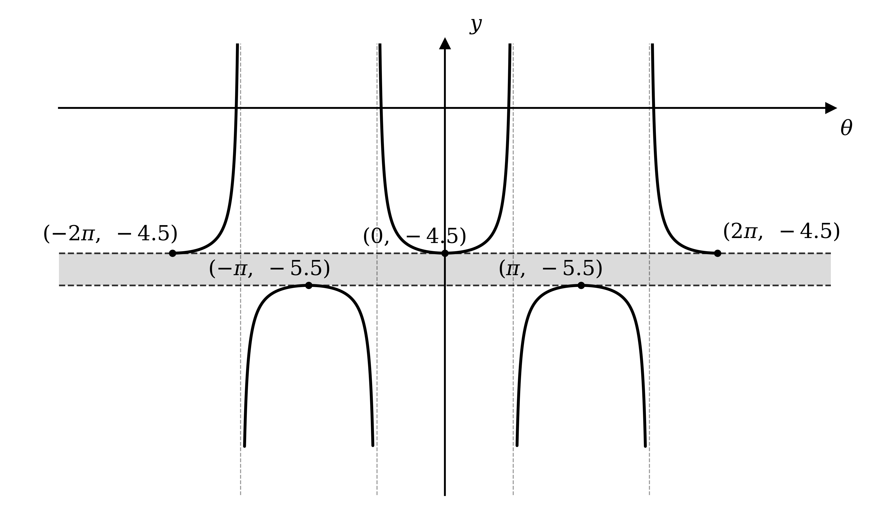
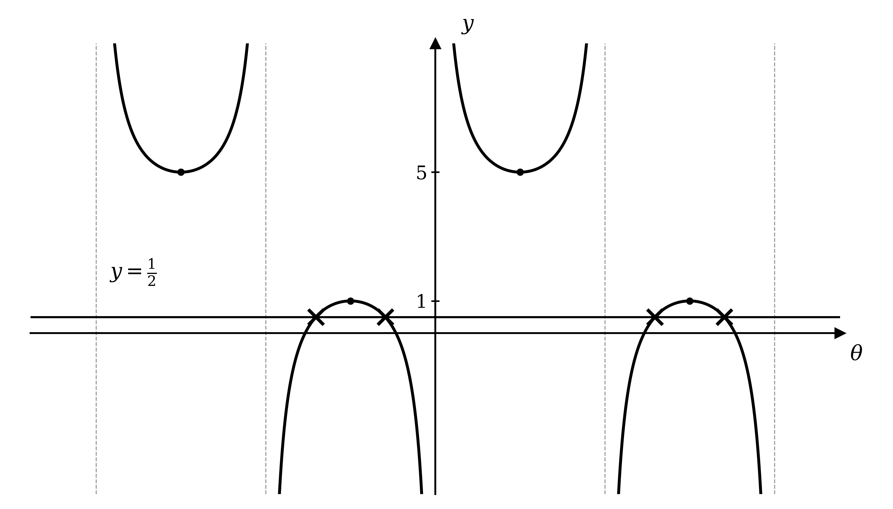

# Mark Schemes — Reciprocal Trigonometric Functions
**Trigonometry** · Cambridge (CIE) A-LEVEL maths (9709)

## Exam Questions (24 questions)

### Q1
Start from the left hand side and write each function in terms of sine and cosine

$\text{cot}  x  \text{cosec}  x  \text{sec}  x \equiv \frac{\text{cos}x}{\text{sin}x} \times \frac{1}{\text{sin}x} \times \frac{1}{\text{cos}x}$

**[M1]**

Multiply the three fractions and cancel $\text{cos}  x$

$\equiv \frac{\text{cos}x}{\text{sin}^{2}x\text{cos}x} \equiv \frac{1}{\text{sin}^{2}x} \equiv \text{cosec}^{2}  x$

**[M1]**

Finish with the identity $1 + \text{cot}^{2}  x \equiv \text{cosec}^{2}  x$, read in the other direction

$\equiv \text{cosec}^{2}  x \equiv 1 + \text{cot}^{2}  x$

**Final answer:** $\text{cot}  x  \text{cosec}  x  \text{sec}  x \equiv 1 + \text{cot}^{2}  x$** as required**

**[A1]**

> **[mark-scheme]**
> **M1**: All three functions on the left hand side written in terms of sine and cosine. Accept $\text{cot}  x$ written as $\frac{1}{\text{tan}x}$ provided the work is then completed correctly.
> 
> **M1**: The product simplified to $\frac{1}{\text{sin}^{2}x}$ or to $\text{cosec}^{2}  x$. A candidate using $\frac{1}{\text{tan}x}$ reaches this by way of $\text{tan}  x  \text{cos}  x \equiv \text{sin}  x$, which earns the mark equally.
> 
> **A1**: The identity $1 + \text{cot}^{2}  x \equiv \text{cosec}^{2}  x$ used to complete the argument, with the result reached. Starting from the right hand side and replacing $1 + \text{cot}^{2}  x$ by $\text{cosec}^{2}  x$ first is equally valid. Because the result is given, every line must be correct and the $x$ must be present throughout. Abbreviations such as $s$, $c$ or $t$ in place of the function names are accepted only if they are defined first.

### Q2
(i)

Divide every term by $\text{sin}^{2}  x$, so the first term becomes $1$

$\frac{\text{sin}^{2}x}{\text{sin}^{2}x} + \frac{\text{cos}^{2}x}{\text{sin}^{2}x} \equiv \frac{1}{\text{sin}^{2}x}$

**[M1]**

Cancel the first term

$1 + \frac{\text{cos}^{2}x}{\text{sin}^{2}x} \equiv \frac{1}{\text{sin}^{2}x}$

Use the definitions $\text{cot}  x = \frac{\text{cos}x}{\text{sin}x}$ and $\text{cosec}  x = \frac{1}{\text{sin}x}$, each squared

`1 + \left( \dfrac{\text{cos} \; x}{\text{sin} \; x} \right)^2 \equiv \left( \dfrac{1}{\text{sin} \; x} \right)^2`

**Final answer:** $1 + \text{cot}^{2}  x \equiv \text{cosec}^{2}  x$** as required**

**[A1]**

(ii)

This time divide every term by $\text{cos}^{2}  x$

$\frac{\text{sin}^{2}x}{\text{cos}^{2}x} + \frac{\text{cos}^{2}x}{\text{cos}^{2}x} \equiv \frac{1}{\text{cos}^{2}x}$

**[M1]**

Cancel the second term

$\frac{\text{sin}^{2}x}{\text{cos}^{2}x} + 1 \equiv \frac{1}{\text{cos}^{2}x}$

Use the definitions $\text{tan}  x = \frac{\text{sin}x}{\text{cos}x}$ and $\text{sec}  x = \frac{1}{\text{cos}x}$, each squared

`\left( \dfrac{\text{sin} \; x}{\text{cos} \; x} \right)^2 + 1 \equiv \left( \dfrac{1}{\text{cos} \; x} \right)^2`

**Final answer:** $\text{tan}^{2}  x + 1 \equiv \text{sec}^{2}  x$** as required**

**[A1]**

> **[mark-scheme]**
> **M1**: Every term of $\text{sin}^{2}  x + \text{cos}^{2}  x \equiv 1$ divided by $\text{sin}^{2}  x$. All three terms must be divided, not just two.
> 
> **A1**: The result $1 + \text{cot}^{2}  x \equiv \text{cosec}^{2}  x$ reached, with a concluding statement. Accept reaching $\frac{\text{cos}^{2}x}{\text{sin}^{2}x}$ as $\frac{1}{\text{tan}^{2}x}$ and then $\text{cot}^{2}  x$. Because the answer is given, every line must be correct, and the $x$ must be present throughout. Abbreviations such as $s$, $c$ or $t$ in place of the function names are accepted only if they are defined first.
> 
> **M1**: Every term of $\text{sin}^{2}  x + \text{cos}^{2}  x \equiv 1$ divided by $\text{cos}^{2}  x$. All three terms must be divided.
> 
> **A1**: The result $\text{tan}^{2}  x + 1 \equiv \text{sec}^{2}  x$ reached, with a concluding statement, and every line correct with the $x$ present. A candidate who works instead from the first result, replacing $\text{cot}^{2}  x$ and $\text{cosec}^{2}  x$ by $\frac{1}{\text{tan}^{2}x}$ and $\frac{1}{\text{sin}^{2}x}$ and rearranging, earns both marks for this identity provided the argument is complete.

### Q3
Use the definition $\text{cosec}  x = \frac{1}{\text{sin}x}$

$\text{cosec}  x = \frac{1}{\text{sin}x}$

There is an asymptote wherever $\text{sin}  x = 0$, since the fraction is undefined there

$x = - 180 ^{\circ} ,  x = 0 ^{\circ} ,  x = 180 ^{\circ}$

The turning points sit where the sine curve peaks

$\text{sin}  90 ^{\circ} = 1 \Rightarrow \text{cosec}  90 ^{\circ} = 1$

$\text{sin}  ( - 90 ^{\circ} ) = - 1 \Rightarrow \text{cosec}  ( - 90 ^{\circ} ) = - 1$

One over a shrinking value grows without limit, so each branch sweeps away towards its asymptotes

**[B1 B1]**

> **[mark-scheme]**
> **B1**: Both branches drawn with the correct shape, the branch for $0 ^{\circ} < x < 180 ^{\circ}$ lying above the line $y = 1$ with its lowest point at $( 90 ^{\circ} , 1 )$, and the branch for $- 180 ^{\circ} < x < 0 ^{\circ}$ lying below the line $y = - 1$ with its highest point at $( - 90 ^{\circ} , - 1 )$. No incorrect curvature, and neither branch may touch or cross the $x$-axis.
> 
> **B1**: All three asymptotes shown at $x = - 180 ^{\circ}$, $x = 0 ^{\circ}$ and $x = 180 ^{\circ}$, with each branch approaching them without reaching them. Accept dashed vertical lines on the sketch, or the three equations written alongside it. Work outside $- 180 ^{\circ} \leq x \leq 180 ^{\circ}$ is ignored.

### Q4
Use the definition $\text{sec}  2 x = \frac{1}{\text{cos}2x}$

$y = 2  \text{sec}  2 x = \frac{2}{\text{cos}2x}$

Read the curve as a horizontal stretch of scale factor $\frac{1}{2}$ and a vertical stretch of scale factor $2$

There is an asymptote wherever $\text{cos}  2 x = 0$

$x = - \frac{3π}{4} ,  x = - \frac{π}{4} ,  x = \frac{π}{4} ,  x = \frac{3π}{4}$

Find the turning points, where $\text{cos}  2 x$ reaches $\pm 1$

$\text{cos}  0 = 1 \Rightarrow y = 2$* at *$x = 0$

$\text{cos}  ( \pm π ) = - 1 \Rightarrow y = - 2$* at *$x = \pm \frac{π}{2}$

The interval is closed, so check the two ends as well

$\text{cos}  ( \pm 2 π ) = 1 \Rightarrow y = 2$* at *$x = \pm π$

**[B1 B1 B1]**

> **[mark-scheme]**
> **B1**: Correct secant shape throughout, with each branch curving away from the horizontal axis towards its asymptotes and no branch touching or crossing them. No incorrect curvature, and the curve must not be drawn with a ruler.
> 
> **B1**: The minimum of the central branch at $( 0 , 2 )$ and the maximum of each lower branch at `\left( -\dfrac{\pi}{2} , -2 \right)` and `\left( \dfrac{\pi}{2} , -2 \right)`, correctly placed. Accept the values marked on the axes rather than written as coordinate pairs.
> 
> **B1**: The graph drawn across the whole of $- π \leq x \leq π$, including the part branches that reach the endpoints $( - π , 2 )$ and $( π , 2 )$, and nothing drawn outside the interval. The asymptotes need not be drawn as lines or stated as equations, but the curve must behave correctly at each of them.
Solutions occur where the curve has height $4$, so add that horizontal line

$y = 4$

The line misses the two branches below the axis and cuts the three above it

**[B1]**

Count the crossings to answer the question

**Final answer:** **The line meets the curve four times, so the equation has four solutions in this interval**

**[B1]**

> **[mark-scheme]**
> **B1**: The horizontal line $y = 4$ drawn on the diagram. It must be recognisably straight and horizontal, and placed above the minimum point of the central branch.
> 
> **B1**: All four points of intersection identified and the conclusion stated. Mark the intersections with dots or crosses, or say in words that the roots are at the points of intersection. Because the number of solutions is given in the question, the concluding statement is needed as well as the marked points.

### Q5
Use the definition $\text{sec}  θ = \frac{1}{\text{cos}θ}$

$\text{sec}  θ = \frac{1}{\text{cos}θ}$

There is an asymptote wherever $\text{cos}  θ = 0$, since the fraction is undefined there

$θ = - \frac{π}{2} ,  θ = \frac{π}{2}$

**[B1]**

To find where the curve meets the vertical axis, substitute $θ = 0$

$\text{sec}  0 = \frac{1}{\text{cos}0} = \frac{1}{1} = 1$

A fraction with numerator $1$ is never zero, so the curve misses the horizontal axis

**Final answer:** **The curve meets the y-axis at (0, 1) and does not cross the theta-axis**

**[B1]**

Between the asymptotes $\text{cos}  θ$ is positive and at most $1$

$\text{sec}  θ \geq 1$* for *$- \frac{π}{2} < θ < \frac{π}{2}$

Outside them it is negative, reaching $- 1$ at each end of the interval

$\text{sec}  ( \pm π ) = \frac{1}{-1} = - 1$

**[B1 B1]**

> **[mark-scheme]**
> **B1**: Both asymptotes stated as equations, $θ = - \frac{π}{2}$ and $θ = \frac{π}{2}$. Accept $x = \pm \frac{π}{2}$ or the decimal equivalents. Dashed lines drawn on the sketch without the equations do not earn this mark, since the question asks for the equations.
> 
> **B1**: The intersection with the vertical axis given as $( 0 , 1 )$, and a statement that there is no intersection with the horizontal axis. Accept the value $1$ marked on the vertical axis in place of the coordinate pair.
> 
> **B1**: The central branch drawn correctly for $- \frac{π}{2} < θ < \frac{π}{2}$, lying on or above $y = 1$, symmetrical about the vertical axis, with its lowest point at $( 0 , 1 )$ and rising towards both asymptotes.
> 
> **B1**: Both outer branches drawn correctly, lying on or below $y = - 1$ and reaching $- 1$ at $θ = - π$ and $θ = π$. No incorrect curvature, and no part of the graph may be drawn in the region between $y = - 1$ and $y = 1$. Work outside $- π \leq θ \leq π$ is ignored.

### Q6
Use the definition $\text{cot}  x = \frac{1}{\text{tan}x}$

$\frac{1}{\text{tan}x} = 3$

Rearrange to make $\text{tan}  x$ the subject

$\text{tan}  x = \frac{1}{3}$

Take the inverse tangent, keeping the unrounded value

`x = \text{tan}^{-1} \left( \dfrac{1}{3} \right) = 0.32175 \ldots`

**[M1 A1]**

Find the other solution by subtracting the period

$x = 0 . 32175 \dots - π = - 2 . 81984 \dots$

Round each value to 3 significant figures

**Final answer:** $x = 0 . 322$** or **$x = - 2 . 82$

**[A1]**

> **[mark-scheme]**
> **M1**: Correct use of $\text{cot}  x = \frac{1}{\text{tan}x}$ to reach $\text{tan}  x = \frac{1}{3}$, followed by a correct method for at least one value of $x$. Any valid route to $\text{tan}  x = \frac{1}{3}$ earns this, including writing $\text{cot}  x$ as $\frac{\text{cos}x}{\text{sin}x}$ first.
> 
> **A1**: One correct value, which is $0 . 322$. Accept answers which round to $0 . 322$, and accept a more accurate value provided it is correct.
> 
> **A1**: The second value $- 2 . 82$, with no other values inside $- π \leq x \leq π$. Values given outside the interval are ignored. Answers given in degrees, $18 . 4 ^{\circ}$ and $- 161 . 6 ^{\circ}$, are treated as a misreading of the question, so the method marks still stand but this accuracy mark is not earned.

### Q7
This is a quadratic in $\text{cosec}  x$, so factorise it as one

`\left( \text{cosec} \; x - 4 \right) \left( \text{cosec} \; x + 2 \right) = 0`

Set each factor to zero

$\text{cosec}  x = 4$* or *$\text{cosec}  x = - 2$

Use the definition $\text{cosec}  x = \frac{1}{\text{sin}x}$

$\text{sin}  x = \frac{1}{4}$* or *$\text{sin}  x = - \frac{1}{2}$

Take the inverse sine of the first value, keeping the unrounded value

`x = \text{sin}^{-1} \left( \dfrac{1}{4} \right) = 14.4775 \ldots ^{\circ}`

**[M1]**

Use the symmetry of the sine curve for the other solution from this branch

$x = 180 ^{\circ} - 14 . 4775 \dots ^{\circ} = 165 . 5224 \dots ^{\circ}$

Now take the inverse sine of the second value

`x = \text{sin}^{-1} \left( -\dfrac{1}{2} \right) = -30^{\circ}`

This is not within the interval, so use the symmetry and the period to find two alternative solutions

$x = 180 ^{\circ} - ( - 30 ^{\circ} ) = 210 ^{\circ}$

$x = - 30 ^{\circ} + 360 ^{\circ} = 330 ^{\circ}$

Round the two non-exact values to 1 decimal place

$x = 14 . 5 ^{\circ} ,  165 . 5 ^{\circ} ,  210 ^{\circ} ,  330 ^{\circ}$

**[A1 A1]**

> **[mark-scheme]**
> **M1**: The equation treated as a quadratic in $\text{cosec}  x$ and solved, followed by a correct method leading to at least one value of $x$. Accept factorising, the quadratic formula or completing the square. A candidate who first replaces $\text{cosec}  x$ by $\frac{1}{\text{sin}x}$ and forms the quadratic $8  \text{sin}^{2} x + 2  \text{sin}  x - 1 = 0$ earns this mark equally.
> 
> **A1**: One correct value of $x$. Accept answers which round to $14 . 5 ^{\circ}$, and accept a more accurate value provided it is correct. Answers under-rounded to $14 ^{\circ}$ or $166 ^{\circ}$ do not earn a mark.
> 
> **A1**: The three remaining values $165 . 5 ^{\circ}$, $210 ^{\circ}$ and $330 ^{\circ}$, with no other values inside $0 ^{\circ} \leq x \leq 360 ^{\circ}$. Values given outside the interval are ignored. Answers given in radians are treated as a misreading of the question, so at most two of the three marks are available.

### Q8
Start from the left hand side and use the definition $\text{sec}  θ = \frac{1}{\text{cos}θ}$

$\text{sec}^{2}  θ  \text{sin}  θ \equiv \frac{1}{\text{cos}^{2}θ} \times \text{sin}  θ \equiv \frac{\text{sin}θ}{\text{cos}^{2}θ}$

**[M1]**

Split the fraction into two factors to match the right hand side

$\frac{\text{sin}θ}{\text{cos}^{2}θ} \equiv \frac{\text{sin}θ}{\text{cos}θ} \times \frac{1}{\text{cos}θ}$

**[M1]**

Use the definitions $\text{tan}  θ = \frac{\text{sin}θ}{\text{cos}θ}$ and $\text{sec}  θ = \frac{1}{\text{cos}θ}$

$\equiv \text{tan}  θ \times \text{sec}  θ$

**Final answer:** $\text{sec}^{2}  θ  \text{sin}  θ \equiv \text{tan}  θ  \text{sec}  θ$** as required**

**[A1]**

> **[mark-scheme]**
> **M1**: Correct use of $\text{sec}  θ = \frac{1}{\text{cos}θ}$ to write the left hand side as $\frac{\text{sin}θ}{\text{cos}^{2}θ}$. Starting instead from the right hand side and writing $\text{tan}  θ  \text{sec}  θ$ as $\frac{\text{sin}θ}{\text{cos}θ} \times \frac{1}{\text{cos}θ}$ earns this mark equally.
> 
> **M1**: The single fraction separated into the product $\frac{\text{sin}θ}{\text{cos}θ} \times \frac{1}{\text{cos}θ}$, or the equivalent step in the other direction.
> 
> **A1**: The identity completed correctly. Because the result is given, every line must be correct and the $θ$ must be present throughout. Abbreviations such as $s$, $c$ or $t$ in place of the function names are accepted only if they are defined first, and missing brackets do not earn this mark. Working on both sides at once is accepted provided the two sides are brought to the same expression and a concluding statement is written.

### Q9
Factorise rather than divide, so that no solution is lost

`\text{sec} \; \theta \left( \text{tan} \; \theta - 1 \right) = 0`

**[M1]**

Set each factor to zero

$\text{sec}  θ = 0$* or *$\text{tan}  θ - 1 = 0$

A fraction with numerator $1$ is never zero, so the first branch gives no solutions

$\text{tan}  θ = 1$

**[A1]**

Take the inverse tangent

$θ = \text{tan}^{-1} ( 1 ) = \frac{π}{4}$

**[A1]**

Find the other solution by adding the period

$θ = \frac{π}{4} + π = \frac{5π}{4}$

$θ = \frac{π}{4} ,  θ = \frac{5π}{4}$

**[A1]**

> **[exam-tip]**
> It is tempting to divide both sides by $\text{sec}  θ$ at the start, and here that happens to be safe, because $\text{sec}  θ$ can never equal zero. Get into the habit of factorising anyway. With a shared factor such as $\text{sin}  θ$ or $\text{tan}  θ$, which can be zero, dividing throws away solutions and the mark scheme will not credit it.

> **[mark-scheme]**
> **M1**: The equation factorised to `\text{sec} \; \theta \left( \text{tan} \; \theta - 1 \right) = 0`, with an attempt to solve at least one factor. Dividing both sides by $\text{sec}  θ$ earns this mark equally, since $\text{sec}  θ$ is never zero. Rewriting the whole equation in terms of $\text{sin}  θ$ and $\text{cos}  θ$ is also accepted.
> 
> **A1**: $\text{tan}  θ = 1$ obtained. You are not required to state or justify that $\text{sec}  θ = 0$ gives no solutions, and simply leaving that branch aside is not penalised.
> 
> **A1**: The value $\frac{π}{4}$, or any exact equivalent such as $\frac{1}{4} π$.
> 
> **A1**: The value $\frac{5π}{4}$, or any exact equivalent, with no other values inside $0 \leq θ \leq 2 π$. Values given outside the interval are ignored. Because the question asks for an exact form, decimal answers such as $0 . 785$ and $3 . 93$, or answers in degrees, do not earn the two accuracy marks for the values.

### Q10
Write all four functions in terms of sine and cosine

$\frac{\frac{1}{\text{cos}θ}\times\frac{\text{cos}θ}{\text{sin}θ}}{\frac{1}{\text{sin}θ}\times\frac{\text{sin}θ}{\text{cos}θ}} = - \sqrt{3}$

**[M1]**

Simplify the numerator and denominator separately

$\frac{\frac{1}{\text{sin}θ}}{\frac{1}{\text{cos}θ}} = - \sqrt{3}$

Divide by multiplying by the reciprocal

$\frac{\text{cos}θ}{\text{sin}θ} = \text{cot}  θ = - \sqrt{3}$

**[A1]**

Use the definition $\text{cot}  θ = \frac{1}{\text{tan}θ}$

$\text{tan}  θ = - \frac{1}{\sqrt{3}} = - \frac{\sqrt{3}}{3}$

Take the inverse tangent to find the principal value

`\theta = \text{tan}^{-1} \left( -\dfrac{\sqrt{3}}{3} \right) = -\dfrac{\pi}{6}`

**[M1 A1]**

Find the other solution by adding the period

$θ = - \frac{π}{6} + π = \frac{5π}{6}$

$θ = - \frac{π}{6} ,  θ = \frac{5π}{6}$

**[A1]**

> **[mark-scheme]**
> **M1**: All four reciprocal functions written in terms of sine and cosine. Working the numerator and the denominator separately, and recognising $\text{sec}  θ  \text{cot}  θ = \text{cosec}  θ$ and $\text{cosec}  θ  \text{tan}  θ = \text{sec}  θ$, earns this mark equally.
> 
> **A1**: The whole left hand side simplified to $\text{cot}  θ$, or to $\frac{\text{cos}θ}{\text{sin}θ}$.
> 
> **M1**: A correct method leading to at least one value of $θ$ in radians, from $\text{tan}  θ = - \frac{1}{\sqrt{3}}$ or from $\text{cot}  θ = - \sqrt{3}$ directly. Accept the unrationalised form $- \frac{1}{\sqrt{3}}$ or the rationalised $- \frac{\sqrt{3}}{3}$.
> 
> **A1**: One correct value, which is $- \frac{π}{6}$.
> 
> **A1**: The second value $\frac{5π}{6}$, with no other values inside $- π < θ \leq π$. Because the question does not ask for an exact answer, the decimal equivalents $- 0 . 524$ and $2 . 62$ are equally acceptable. The next candidate down, $- \frac{7π}{6}$, lies outside the interval, so including it is ignored rather than penalised.

### Q11
Multiply every term by $\text{sec}  θ$ to clear the fraction

`6 \; \text{sec}^2 \; \theta + 2\sqrt{3} = \left( -3 - 4\sqrt{3} \right) \text{sec} \; \theta`

**[M1]**

Collect everything on one side to form a quadratic in $\text{sec}  θ$

`6 \; \text{sec}^2 \; \theta + \left( 3 + 4\sqrt{3} \right) \text{sec} \; \theta + 2\sqrt{3} = 0`

**[A1]**

Factorise the quadratic, splitting the $2 \sqrt{3}$ between the brackets

`\left( 3 \; \text{sec} \; \theta + 2\sqrt{3} \right) \left( 2 \; \text{sec} \; \theta + 1 \right) = 0`

**[M1]**

Set each factor to zero in turn

$\text{sec}  θ = - \frac{2\sqrt{3}}{3}$* or *$\text{sec}  θ = - \frac{1}{2}$

The secant never takes a value between $- 1$ and $1$, so the second branch gives no solutions

**[A1]**

Use the definition $\text{sec}  θ = \frac{1}{\text{cos}θ}$, then rationalise the denominator

$\text{cos}  θ = - \frac{3}{2\sqrt{3}} = - \frac{\sqrt{3}}{2}$

Take the inverse cosine to find the principal value

`\theta = \text{cos}^{-1} \left( -\dfrac{\sqrt{3}}{2} \right) = \dfrac{5\pi}{6}`

**[M1]**

Use the symmetry of the cosine curve to find the other solution

$θ = 2 π - \frac{5π}{6} = \frac{7π}{6}$

$θ = \frac{5π}{6} ,  θ = \frac{7π}{6}$

**[A1]**

> **[mark-scheme]**
> **M1**: Every term multiplied by $\text{sec}  θ$ to clear the fraction. Replacing $\text{sec}  θ$ by $\frac{1}{\text{cos}θ}$ first and then multiplying by $\text{cos}  θ$ earns this mark equally.
> 
> **A1**: The correct three term quadratic `6 \, \text{sec}^2 \theta + \left( 3 + 4\sqrt{3} \right) \text{sec} \; \theta + 2\sqrt{3} = 0`, or the equivalent `2\sqrt{3} \, \text{cos}^2 \theta + \left( 3 + 4\sqrt{3} \right) \text{cos} \; \theta + 6 = 0` for a candidate working in cosine.
> 
> **M1**: The quadratic solved by any valid method. Factorising is not required; the quadratic formula or completing the square earns this mark equally.
> 
> **A1**: $\text{sec}  θ = - \frac{2\sqrt{3}}{3}$ obtained, or the equivalent $\text{cos}  θ = - \frac{\sqrt{3}}{2}$. You are not required to state or justify that the other branch gives no solutions, and simply leaving it aside is not penalised.
> 
> **M1**: A correct method leading to at least one value of $θ$ in radians.
> 
> **A1**: Both values $\frac{5π}{6}$ and $\frac{7π}{6}$, with no other values inside $0 \leq θ \leq 2 π$. Because the question asks for an exact form, decimals such as $2 . 62$ and $3 . 67$, or answers in degrees, do not earn this mark.

### Q12
Expand the two brackets on the left hand side

$\frac{\text{cosec}x}{\text{sec}x} + 1 - 1 - \frac{\text{sec}x}{\text{cosec}x}$

**[M1]**

The middle terms cancel, so write the rest in terms of sine and cosine

$\frac{\text{cos}x}{\text{sin}x} - \frac{\text{sin}x}{\text{cos}x}$

**[A1]**

Combine over the common denominator $\text{sin}  x  \text{cos}  x$

$\frac{\text{cos}^{2}x-\text{sin}^{2}x}{\text{sin}x\text{cos}x}$

Multiply top and bottom by $2$, then apply both double angle formulae

`\dfrac{2 \left( \text{cos}^2 \; x - \text{sin}^2 \; x \right)}{2 \; \text{sin} \; x \; \text{cos} \; x} = \dfrac{2 \; \text{cos} \; 2x}{\text{sin} \; 2x} = 2 \; \text{cot} \; 2x`

**[M1]**

Substitute back into the equation and collect like terms

$2  \text{cot}  2 x = \text{cot}  2 x + 3 \Rightarrow \text{cot}  2 x = 3$

Use the definition $\text{cot}  2 x = \frac{1}{\text{tan}2x}$

$\text{tan}  2 x = \frac{1}{3}$

**[A1]**

Double each end of the interval to match

$- 2 π < 2 x \leq 2 π$

Take the inverse tangent, keeping the unrounded value

`2x = \text{tan}^{-1} \left( \dfrac{1}{3} \right) = 0.32175 \ldots`

**[M1]**

Add and subtract the period to collect every value of $2 x$ in the interval

$2 x = - 5 . 96143 \dots ,  - 2 . 81984 \dots ,  0 . 32175 \dots ,  3 . 46334 \dots$

Halve each value to return to $x$, then round

$x = - 2 . 98 ,  - 1 . 41 ,  0 . 161 ,  1 . 73$

**[A1]**

> **[mark-scheme]**
> **M1**: The two brackets on the left hand side expanded, giving four terms.
> 
> **A1**: The left hand side reduced to $\text{cot}  x - \text{tan}  x$, or to $\frac{\text{cos}x}{\text{sin}x} - \frac{\text{sin}x}{\text{cos}x}$. A candidate who instead writes every function in terms of sine and cosine from the start and simplifies to $\frac{\text{cos}^{2}x-\text{sin}^{2}x}{\text{sin}x\text{cos}x}$ earns this mark equally.
> 
> **M1**: Both supplied double angle formulae used to reach $2  \text{cot}  2 x$, or an equivalent expression in $2 x$.
> 
> **A1**: $\text{cot}  2 x = 3$, or the equivalent $\text{tan}  2 x = \frac{1}{3}$.
> 
> **M1**: A correct method leading to at least one value of $2 x$ in the doubled interval. You do not have to write the doubled interval down for this mark, but the values must come from the doubled interval and not from $- π < 2 x \leq π$.
> 
> **A1**: All four values $- 2 . 98$, $- 1 . 41$, $0 . 161$ and $1 . 73$, with no other values inside $- π < x \leq π$. Accept answers which round to these. Values given outside the interval are ignored. Answers given in degrees are treated as a misreading of the question.

### Q13
Read the curve as three transformations of $y = \text{sec}  θ$: a translation of `\binom{-\frac{\pi}{2}}{0}`, a vertical stretch of scale factor $3$, then a translation of `\binom{0}{2}`

The horizontal translation shifts the asymptotes left by $\frac{π}{2}$, onto the multiples of $π$

$θ = - 2 π ,  θ = - π ,  θ = 0 ,  θ = π$

**[B1]**

Apply the stretch and the vertical translation to the turning points, where the secant is $\pm 1$

`\text{sec} \left( \theta + \dfrac{\pi}{2} \right) = 1 \Rightarrow y = 2 + 3(1) = 5`

`\text{sec} \left( \theta + \dfrac{\pi}{2} \right) = -1 \Rightarrow y = 2 + 3(-1) = -1`

Now find where each of these occurs in the interval

`\left( -\dfrac{\pi}{2} , 5 \right), \; \left( -\dfrac{3\pi}{2} , -1 \right), \; \left( \dfrac{\pi}{2} , -1 \right)`

**[B1]**

**[B1]**

> **[exam-tip]**
> It is worth spotting that `\text{sec} \left( \theta + \dfrac{\pi}{2} \right)` is the same as $- \text{cosec}  θ$, so the curve is just $y = 2 - 3  \text{cosec}  θ$. That tells you immediately why the asymptotes have moved onto the multiples of $π$, and it saves you tracking the horizontal shift through every feature of the sketch.

> **[mark-scheme]**
> **B1**: All four asymptotes given, at $θ = - 2 π$, $- π$, $0$ and $π$. Accept them drawn as dashed lines on the sketch or written as equations beside it.
> 
> **B1**: All three turning points labelled with their coordinates, the minimum at `\left( -\dfrac{\pi}{2} , 5 \right)` and the maxima at `\left( -\dfrac{3\pi}{2} , -1 \right)` and `\left( \dfrac{\pi}{2} , -1 \right)`.
> 
> **B1**: Correct shape of all three branches, the upward one lying on or above $y = 5$ and the two downward ones lying on or below $y = - 1$, each curving away towards its asymptotes without touching them, drawn across the whole of $- 2 π \leq θ \leq π$ and nowhere outside it. No incorrect curvature, and the curve must not be drawn with a ruler.
This is one over the $y$ sketched in part (a), so start from the values $y$ can take

$y \leq - 1$* or *$y \geq 5$

**[B1]**

Taking one over each value reverses the order within a branch, since the larger a positive number is the smaller its reciprocal

$0 < \frac{1}{y} \leq \frac{1}{5}$* or *$- 1 \leq \frac{1}{y} < 0$

**[M1]**

The largest comes from the smallest positive $y$

$\text{Maximum} = \frac{1}{5}$

**[A1]**

The smallest comes from the negative $y$ closest to zero

$\text{Minimum} = - 1$

**[A1]**

> **[mark-scheme]**
> **B1**: The values taken by `2 + 3 \, \text{sec} \left( \theta + \dfrac{\pi}{2} \right)` stated or clearly used, namely $y \leq - 1$ or $y \geq 5$, following from the turning points found in part (a).
> 
> **M1**: The reciprocal taken, with the order reversed within each branch. Any clear argument that the largest reciprocal comes from the smallest positive value, and the smallest reciprocal from the negative value nearest zero, earns this mark; it does not have to be written as a pair of inequalities.
> 
> **A1**: Maximum $= \frac{1}{5}$. Accept $0 . 2$.
> 
> **A1**: Minimum $= - 1$. Both this and the maximum depend on the method mark above. A candidate who simply takes one over the two turning point values without any reasoning does not earn the method mark but may still earn these two.

### Q14
Use the identity $1 + \text{cot}^{2}  x \equiv \text{cosec}^{2}  x$, rearranged to make $\text{cot}^{2}  x$ the subject

$1 + \text{cot}^{2}  x \equiv \text{cosec}^{2}  x \Rightarrow \text{cot}^{2}  x \equiv \text{cosec}^{2}  x - 1$

Substitute into the equation

`3 \left( \text{cosec}^2 \; x - 1 \right) - 4\sqrt{3} = \left( 6 - 2\sqrt{3} \right) \text{cosec} \; x - 3`

**[M1]**

Expand and collect, noting that the $- 3$ on each side cancels

`3 \; \text{cosec}^2 \; x + \left( 2\sqrt{3} - 6 \right) \text{cosec} \; x - 4\sqrt{3} = 0`

**[A1]**

Factorise the quadratic, splitting the $2 \sqrt{3}$ between the brackets

`\left( 3 \; \text{cosec} \; x + 2\sqrt{3} \right) \left( \text{cosec} \; x - 2 \right) = 0`

**[M1]**

Set each factor to zero, then use the definition $\text{cosec}  x = \frac{1}{\text{sin}x}$

$\text{sin}  x = - \frac{3}{2\sqrt{3}} = - \frac{\sqrt{3}}{2}$* or *$\text{sin}  x = \frac{1}{2}$

**[A1]**

Take the inverse sine of the first value

`x = \text{sin}^{-1} \left( -\dfrac{\sqrt{3}}{2} \right) = -\dfrac{\pi}{3}`

**[M1]**

This is not within the interval, so use the symmetry and the period to find two alternative solutions

$x = π + \frac{π}{3} = \frac{4π}{3}$

$x = 2 π - \frac{π}{3} = \frac{5π}{3}$

Take the inverse sine of the second value

`x = \text{sin}^{-1} \left( \dfrac{1}{2} \right) = \dfrac{\pi}{6}`

Use the symmetry of the sine curve for its partner

$x = π - \frac{π}{6} = \frac{5π}{6}$

$x = \frac{π}{6} ,  \frac{5π}{6} ,  \frac{4π}{3} ,  \frac{5π}{3}$

**[A1]**

> **[mark-scheme]**
> **M1**: Correct use of $1 + \text{cot}^{2} x \equiv \text{cosec}^{2} x$ to replace $\text{cot}^{2} x$, so that the equation is written in $\text{cosec}  x$ alone. The identity may be used anywhere in the working and does not have to be quoted as a separate line.
> 
> **A1**: The correct three term quadratic `3 \, \text{cosec}^2 x + \left( 2\sqrt{3} - 6 \right) \text{cosec} \; x - 4\sqrt{3} = 0`, or any equivalent arrangement with all terms on one side.
> 
> **M1**: The quadratic solved by any valid method. Factorising is not required; the quadratic formula or completing the square earns this mark equally.
> 
> **A1**: Both values obtained, $\text{sin}  x = - \frac{\sqrt{3}}{2}$ and $\text{sin}  x = \frac{1}{2}$. Accept them left as $\text{cosec}  x = - \frac{2\sqrt{3}}{3}$ and $\text{cosec}  x = 2$ at this stage, and accept the unrationalised $- \frac{3}{2\sqrt{3}}$.
> 
> **M1**: A correct method leading to at least one value of $x$ in radians.
> 
> **A1**: All four values $\frac{π}{6}$, $\frac{5π}{6}$, $\frac{4π}{3}$ and $\frac{5π}{3}$, with no other values inside $0 \leq x \leq 2 π$. Because the question asks for an exact form, decimals do not earn this mark, nor do answers in degrees.

### Q15
Multiply every term by $\text{cosec}  θ$ to clear the fraction

$2 - \text{cosec}^{2}  θ = \text{cosec}  θ$

**[M1]**

Collect everything on one side to form a quadratic in $\text{cosec}  θ$

$\text{cosec}^{2}  θ + \text{cosec}  θ - 2 = 0$

**[A1]**

Factorise, looking for two numbers with product $- 2$ and sum $1$

`\left( \text{cosec} \; \theta + 2 \right) \left( \text{cosec} \; \theta - 1 \right) = 0`

**[M1]**

Set each factor to zero, then use the definition $\text{cosec}  θ = \frac{1}{\text{sin}θ}$

$\text{sin}  θ = - \frac{1}{2}$* or *$\text{sin}  θ = 1$

**[A1]**

Take the inverse sine of the first value

`\theta = \text{sin}^{-1} \left( -\dfrac{1}{2} \right) = -\dfrac{\pi}{6}`

**[M1]**

This is not within the interval, so use the symmetry and the period to find two alternative solutions

`\theta = \pi - \left( -\dfrac{\pi}{6} \right) = \dfrac{7\pi}{6}`

$θ = - \frac{π}{6} + 2 π = \frac{11π}{6}$

The second value is the peak of the sine curve, reached once here

$θ = \text{sin}^{-1} ( 1 ) = \frac{π}{2}$

$θ = \frac{π}{2} ,  \frac{7π}{6} ,  \frac{11π}{6}$

**[A1]**

> **[mark-scheme]**
> **M1**: Every term multiplied by $\text{cosec}  θ$ to clear the fraction. Rewriting the whole equation in terms of $\text{sin}  θ$ instead, by using $\frac{2}{\text{cosec}θ} = 2  \text{sin}  θ$, earns this mark equally.
> 
> **A1**: The correct three term quadratic $\text{cosec}^{2} θ + \text{cosec}  θ - 2 = 0$, or the equivalent $2  \text{sin}^{2} θ - \text{sin}  θ - 1 = 0$ for a candidate working in sine.
> 
> **M1**: The quadratic solved by any valid method. Accept factorising, the quadratic formula or completing the square.
> 
> **A1**: Both values obtained, $\text{sin}  θ = - \frac{1}{2}$ and $\text{sin}  θ = 1$. Accept them left as $\text{cosec}  θ = - 2$ and $\text{cosec}  θ = 1$ at this stage.
> 
> **M1**: A correct method that produces at least one value of $θ$ in radians.
> 
> **A1**: All three values $\frac{π}{2}$, $\frac{7π}{6}$ and $\frac{11π}{6}$, with no other values inside $0 \leq θ \leq 2 π$. Because the question does not ask for an exact answer, the decimal equivalents $1 . 57$, $3 . 67$ and $5 . 76$ are equally acceptable, as are exact equivalents such as $\frac{7}{6} π$. You are not required to comment on the second branch producing only one solution.

### Q16
(i)

Read the curve as two transformations of $y = \text{sec}  θ$: a vertical stretch of scale factor $\frac{1}{2}$, then a translation of `\binom{0}{-5}`

Neither transformation moves the curve sideways, so the asymptotes stay where $\text{cos}  θ = 0$

$θ = - \frac{3π}{2} ,  θ = - \frac{π}{2} ,  θ = \frac{π}{2} ,  θ = \frac{3π}{2}$

**[B1]**

Apply the stretch and translation to the turning points, which occur where $\text{cos}  θ = \pm 1$

$\text{sec}  θ = 1 \Rightarrow y = - 5 + \frac{1}{2} ( 1 ) = - 4 . 5$

$\text{sec}  θ = - 1 \Rightarrow y = - 5 + \frac{1}{2} ( - 1 ) = - 5 . 5$

Now find where each of these occurs in the interval

$( - 2 π , - 4 . 5 ) ,  ( 0 , - 4 . 5 ) ,  ( 2 π , - 4 . 5 ) ,  ( - π , - 5 . 5 ) ,  ( π , - 5 . 5 )$

**[B1]**

**[B1 B1]**

(ii)

Solutions occur where the line $y = k$ meets the curve, so find the heights it never takes

The upward branches never come below $- 4 . 5$ and the downward ones never rise above $- 5 . 5$

A value of $k$ strictly inside the strip misses the curve, while the edges themselves meet it

$- 5 . 5 < k < - 4 . 5$

**[B1]**

> **[mark-scheme]**
> **B1**: All four asymptotes given, at $θ = - \frac{3π}{2}$, $- \frac{π}{2}$, $\frac{π}{2}$ and $\frac{3π}{2}$. Accept them drawn as dashed lines on the sketch or written as equations beside it.
> 
> **B1**: All five turning points labelled with their coordinates, the minima at $( - 2 π , - 4 . 5 )$, $( 0 , - 4 . 5 )$ and $( 2 π , - 4 . 5 )$ and the maxima at $( - π , - 5 . 5 )$ and $( π , - 5 . 5 )$. Accept $- \frac{9}{2}$ and $- \frac{11}{2}$ in place of the decimals.
> 
> **B1**: Correct shape of all five branch pieces, the three upward ones lying on or above $y = - 4 . 5$ and the two downward ones lying on or below $y = - 5 . 5$, each curving away towards its asymptotes without touching them. No incorrect curvature, and the curve must not be drawn with a ruler.
> 
> **B1**: The graph drawn across the whole of $- 2 π \leq θ \leq 2 π$, including the part branches that reach the endpoints, with nothing drawn outside the interval.
> 
> **B1**: $- 5 . 5 < k < - 4 . 5$. Both inequalities must be strict, because $k = - 4 . 5$ and $k = - 5 . 5$ each do give solutions, at the turning points. Accept the two inequalities written separately and joined by "and", or the open interval $( - 5 . 5 , - 4 . 5 )$, and accept $- \frac{11}{2}$ and $- \frac{9}{2}$ in place of the decimals.

### Q17
Use the identity $1 + \text{cot}^{2}  x \equiv \text{cosec}^{2}  x$ to write everything in $\text{cosec}  x$

$\text{cot}^{2}  x \equiv \text{cosec}^{2}  x - 1$

**[M1]**

Substitute this into the equation and expand the bracket

`2 \left( \text{cosec}^2 \; x - 1 \right) = 1 - 5 \; \text{cosec} \; x`

$2  \text{cosec}^{2}  x - 2 = 1 - 5  \text{cosec}  x$

Collect everything on one side to form a quadratic in $\text{cosec}  x$

$2  \text{cosec}^{2}  x + 5  \text{cosec}  x - 3 = 0$

**[M1]**

Factorise the quadratic

**Final answer:** `\left( 2 \; \text{cosec} \; x - 1 \right) \left( \text{cosec} \; x + 3 \right) = 0`** as required**

**[A1]**

> **[mark-scheme]**
> **M1**: Correct use of $1 + \text{cot}^{2}  x \equiv \text{cosec}^{2}  x$. It does not have to be quoted as a separate line, and using it anywhere in the working earns this mark.
> 
> **M1**: The bracket expanded and the terms collected to give the three term quadratic $2  \text{cosec}^{2} x + 5  \text{cosec}  x - 3 = 0$, or any correct equivalent with all terms on one side.
> 
> **A1**: The given factorised form reached. Because the answer is printed, every line must be correct and the $x$ must be present throughout.
Use part (a), setting each factor to zero

$\text{cosec}  x = \frac{1}{2}$* or *$\text{cosec}  x = - 3$

Use the definition $\text{cosec}  x = \frac{1}{\text{sin}x}$

$\text{sin}  x = 2$* or *$\text{sin}  x = - \frac{1}{3}$

**[M1]**

The sine function never leaves $- 1$ to $1$, so the first equation gives no solutions

Take the inverse sine of the surviving value, keeping the unrounded value

`x = \text{sin}^{-1} \left( -\dfrac{1}{3} \right) = -0.33983 \ldots`

This is not within the interval, so use the symmetry of the sine curve to find an alternative solution

$x = π - ( - 0 . 33983 \dots ) = 3 . 48142 \dots$

**[A1]**

Find another solution by adding the period

$x = - 0 . 33983 \dots + 2 π = 5 . 94334 \dots$

Round each value to 3 significant figures

$x = 3 . 48 ,  x = 5 . 94$

**[A1]**

> **[mark-scheme]**
> **M1**: Both factors set to zero and written in sine, using $\text{cosec}  x = \frac{1}{\text{sin}x}$, to give $\text{sin}  x = 2$ and $\text{sin}  x = - \frac{1}{3}$, followed by a correct method for at least one value of $x$ in radians. You are not required to state or justify that $\text{sin}  x = 2$ has no solutions, and simply leaving that branch aside is not penalised.
> 
> **A1**: One correct value, which is $3 . 48$. Accept answers which round to $3 . 48$.
> 
> **A1**: The second value $5 . 94$, with no other values inside $0 \leq x \leq 2 π$. Values given outside the interval are ignored, and answers given in degrees are treated as a misreading of the question.

### Q18
The right hand side is written in the doubled angle, so turn the product on the left into a single fraction in sine and cosine first

$\text{sec}  x  \text{cosec}  x = \frac{1}{\text{cos}x} \times \frac{1}{\text{sin}x} = \frac{1}{\text{sin}x\text{cos}x}$

The given formula needs a factor of $2$ in the denominator, so multiply the fraction by $\frac{2}{2}$, which leaves its value unchanged

$\frac{1}{\text{sin}x\text{cos}x} = \frac{2}{2\text{sin}x\text{cos}x} = \frac{2}{\text{sin}2x}$

**[M1]**

Substitute this back, writing the right hand side as a fraction as well, so that both sides are in the doubled angle

$\frac{2}{\text{sin}2x} - 75 = \frac{5}{\text{sin}2x}$

**[A1]**

Collect the two fractions on one side, which leaves a single fraction equal to a number

$- 75 = \frac{3}{\text{sin}2x}$

Rearrange to make the sine the subject

$\text{sin}  2 x = - \frac{3}{75} = - \frac{1}{25}$

**[A1]**

Substitute for the doubled angle

$z = 2 x$

Double each end of the interval to match

$- 2 π < z \leq 2 π$

Take the inverse sine, keeping the unrounded value

`z = \text{sin}^{-1} \left( -\dfrac{1}{25} \right) = -0.04001 \ldots`

**[M1]**

Use the symmetry of the sine curve for the second value

$z = π - ( - 0 . 04001 \dots ) = 3 . 18160 \dots$

Add and subtract the period to reach the remaining values in the interval

$z = 3 . 18160 \dots - 2 π = - 3 . 10158 \dots$

$z = - 0 . 04001 \dots + 2 π = 6 . 24317 \dots$

Halve each value to return to $x$

$x = - 1 . 55079 \dots ,  - 0 . 02000 \dots ,  1 . 59080 \dots ,  3 . 12158 \dots$

**[A1]**

Round each to 3 significant figures

$x = - 1 . 55 ,  - 0 . 0200 ,  1 . 59 ,  3 . 12$

**[A1]**

> **[exam-tip]**
> Watch the second answer. The value is $- 0 . 0200053 \dots$, and the two zeros straight after the decimal point are not significant figures, so three significant figures here means writing $- 0 . 0200$, with four decimal places. Stopping at $- 0 . 020$ gives only two significant figures and is treated as under-rounded.

> **[mark-scheme]**
> **M1**: $\text{sec}  x  \text{cosec}  x$ written as a single fraction and the supplied formula used to introduce $\text{sin}  2 x$, reaching $\frac{2}{\text{sin}2x}$ or $2  \text{cosec}  2 x$.
> 
> **A1**: A correct equation entirely in the doubled angle, such as $\frac{2}{\text{sin}2x} - 75 = \frac{5}{\text{sin}2x}$ or $2  \text{cosec}  2 x - 75 = 5  \text{cosec}  2 x$.
> 
> **A1**: $\text{sin}  2 x = - \frac{1}{25}$, or the equivalent $\text{cosec}  2 x = - 25$. Accept $- 0 . 04$.
> 
> **M1**: A correct method that produces at least one value of $2 x$ inside the doubled interval. Writing the doubled interval down is not required, but the value found must belong to it.
> 
> **A1**: Two correct values of $x$. Accept answers which round to them.
> 
> **A1**: All four values $- 1 . 55$, $- 0 . 0200$, $1 . 59$ and $3 . 12$, with no others inside $- π < x \leq π$. The second value must be given to 3 significant figures as $- 0 . 0200$; $- 0 . 020$ is under-rounded and does not earn this mark. Values given outside the interval are ignored, and answers given in degrees are treated as a misreading of the question.

### Q19
Write each function in terms of sine and cosine

$\text{tan}  θ  \text{cosec}  θ = \frac{\text{sin}θ}{\text{cos}θ} \times \frac{1}{\text{sin}θ}$

**[M1]**

Multiply the fractions and cancel $\text{sin}  θ$

$\text{tan}  θ  \text{cosec}  θ = \frac{1}{\text{cos}θ} = \text{sec}  θ$

**[A1]**

> **[mark-scheme]**
> **M1**: Both functions written in terms of sine and cosine and multiplied together. Accept $\text{cosec}  θ$ handled as $\frac{1}{\text{sin}θ}$ at any stage.
> 
> **A1**: The answer $\text{sec}  θ$. Leaving the answer as $\frac{1}{\text{cos}θ}$ does not earn this mark, because the question asks for a single trigonometric function.
Use part (a) to replace the left hand side with a single function

$\text{sec}  θ = - \frac{2\sqrt{3}}{3}$

Use the definition $\text{sec}  θ = \frac{1}{\text{cos}θ}$

$\text{cos}  θ = - \frac{3}{2\sqrt{3}}$

Rationalise the denominator

$\text{cos}  θ = - \frac{3\sqrt{3}}{2\times3} = - \frac{\sqrt{3}}{2}$

**[M1]**

Take the inverse cosine to find the principal value

`\theta = \text{cos}^{-1} \left( -\dfrac{\sqrt{3}}{2} \right) = \dfrac{5\pi}{6}`

**[A1]**

Use the symmetry of the cosine curve to find the other solution

$θ = - \frac{5π}{6}$

$θ = - \frac{5π}{6} ,  θ = \frac{5π}{6}$

**[A1]**

> **[mark-scheme]**
> **M1**: Part (a) used to write $\text{sec}  θ = - \frac{2\sqrt{3}}{3}$, then written in cosine as $\text{cos}  θ = - \frac{\sqrt{3}}{2}$. This mark follows through from your own answer to part (a). Accept the unrationalised form $- \frac{2}{\sqrt{3}}$ or $- \frac{3}{2\sqrt{3}}$ at any stage, since these are equal in value.
> 
> **A1**: One correct value, which is $\frac{5π}{6}$, or any exact equivalent such as $\frac{5}{6} π$.
> 
> **A1**: The second value $- \frac{5π}{6}$, with no other values inside $- π < θ \leq π$. Both values must be exact and in radians, so decimals such as $\pm 2 . 62$ do not earn the two accuracy marks. Note that the lower end of the interval is excluded, so $θ = - π$ could never be offered as a solution.

### Q20
(i)

Read the curve as two transformations of $y = \text{cosec}  θ$: a vertical stretch of scale factor $2$, then a translation of `\begin{pmatrix} 0 \\ 3 \end{pmatrix}`

Neither transformation moves the curve sideways, so the asymptotes stay where $\text{sin}  θ = 0$

$θ = - 2 π ,  θ = - π ,  θ = 0 ,  θ = π ,  θ = 2 π$

**[B1]**

Apply the stretch and translation to the turning points, which occur where $\text{sin}  θ = \pm 1$

$\text{cosec}  θ = 1 \Rightarrow y = 3 + 2 ( 1 ) = 5$

$\text{cosec}  θ = - 1 \Rightarrow y = 3 + 2 ( - 1 ) = 1$

Now find where each of these occurs in the interval

`\left( -\dfrac{3\pi}{2} , 5 \right), \; \left( \dfrac{\pi}{2} , 5 \right), \; \left( -\dfrac{\pi}{2} , 1 \right), \; \left( \dfrac{3\pi}{2} , 1 \right)`

**[B1]**

**[B1 B1]**

(ii)

Solutions occur where the curve has height $\frac{1}{2}$, so compare that with the turning points

The upward branches never drop below $5$, and the downward branches rise only to $1$, so only those can meet the line

Each downward branch meets the line twice

**Final answer:** **The equation has 4 solutions in this interval**

**[B1]**

> **[mark-scheme]**
> **B1**: All five asymptotes given, at $θ = - 2 π$, $- π$, $0$, $π$ and $2 π$. Accept them drawn as dashed lines on the sketch or written as equations beside it.
> 
> **B1**: All four turning points labelled with their coordinates, the minima at `\left( -\dfrac{3\pi}{2} , 5 \right)` and `\left( \dfrac{\pi}{2} , 5 \right)` and the maxima at `\left( -\dfrac{\pi}{2} , 1 \right)` and `\left( \dfrac{3\pi}{2} , 1 \right)`. Accept exact equivalents such as $- \frac{3}{2} π$.
> 
> **B1**: Correct shape of all four branches, the two upward branches lying on or above $y = 5$ and the two downward branches lying on or below $y = 1$, each curving away towards its asymptotes without touching them. No incorrect curvature, and the curve must not be drawn with a ruler.
> 
> **B1**: The graph drawn across the whole of $- 2 π \leq θ \leq 2 π$, with nothing drawn outside it.
> 
> **B1**: The answer 4. You do not have to draw the line $y = \frac{1}{2}$ or mark the intersections to earn this mark, although doing so is the clearest way to be sure of the count.

### Q21
Use the identity $1 + \text{tan}^{2}  x \equiv \text{sec}^{2}  x$ to write everything in $\text{sec}  x$

$\text{tan}^{2}  x \equiv \text{sec}^{2}  x - 1$

**[M1]**

Substitute into the equation

$\text{sec}^{2}  x - 1 = 6  \text{sec}  x - 10$

Collect everything on one side to form a quadratic in $\text{sec}  x$

$\text{sec}^{2}  x - 6  \text{sec}  x + 9 = 0$

**[M1]**

Factorise the quadratic

`\left( \text{sec} \; x - 3 \right) \left( \text{sec} \; x - 3 \right) = 0`

Write the repeated factor as a square

**Final answer:** `\left( \text{sec} \; x - 3 \right)^2 = 0`** as required**

**[A1]**

> **[mark-scheme]**
> **M1**: Correct use of $1 + \text{tan}^{2}  x \equiv \text{sec}^{2}  x$. It does not have to be quoted as a separate line, and using it anywhere in the working earns this mark.
> 
> **M1**: The terms collected to give the three term quadratic $\text{sec}^{2}  x - 6  \text{sec}  x + 9 = 0$, or any correct equivalent with all terms on one side.
> 
> **A1**: The given squared form reached. Accept the factorised pair $( \text{sec}  x - 3 ) ( \text{sec}  x - 3 ) = 0$ followed by the square, or completing the square in place of factorising. Because the answer is printed, every line must be correct and the $x$ must be present throughout.
Use part (a), noting that a square is zero only when the quantity itself is zero

$\text{sec}  x - 3 = 0 \Rightarrow \text{sec}  x = 3$

Use the definition $\text{sec}  x = \frac{1}{\text{cos}x}$

$\text{cos}  x = \frac{1}{3}$

Take the inverse cosine, keeping the unrounded value

`x = \text{cos}^{-1} \left( \dfrac{1}{3} \right) = 1.23095 \ldots`

**[M1 A1]**

Use the symmetry of the cosine curve to find the other solution

$x = 2 π - 1 . 23095 \dots = 5 . 05222 \dots$

Round each value to 3 significant figures

$x = 1 . 23 ,  x = 5 . 05$

**[A1]**

> **[mark-scheme]**
> **M1**: The squared form solved to give $\text{sec}  x = 3$, then $\text{cos}  x = \frac{1}{3}$, followed by a correct method for at least one value of $x$ in radians.
> 
> **A1**: One correct value, which is $1 . 23$. Accept answers which round to $1 . 23$.
> 
> **A1**: The second value $5 . 05$, with no other values inside $0 \leq x \leq 2 π$. This mark follows through from your first value, so $2 π$ minus your own answer is credited. Both answers must be rounded to 3 significant figures as the question asks, so a pair left unrounded does not earn this mark. Values given outside the interval are ignored, and answers given in degrees are treated as a misreading of the question.

### Q22
Write each function on the left in terms of sine and cosine

$\text{sec}  θ = \frac{1}{\text{cos}θ}$* and *$\text{cot}  θ = \frac{\text{cos}θ}{\text{sin}θ}$

Multiply the two together and cancel $\text{cos}  θ$

$\text{sec}  θ  \text{cot}  θ \equiv \frac{1}{\text{cos}θ} \times \frac{\text{cos}θ}{\text{sin}θ} \equiv \frac{1}{\text{sin}θ}$

**[M1]**

Recognise the remaining fraction as the cosecant

$\equiv \frac{1}{\text{sin}θ} \equiv \text{cosec}  θ$

**Final answer:** $\text{sec}  θ  \text{cot}  θ \equiv \text{cosec}  θ$** as required**

**[A1]**

> **[mark-scheme]**
> **M1**: Both $\text{sec}  θ$ and $\text{cot}  θ$ written in terms of sine and cosine and multiplied together. Accept $\text{cot}  θ$ written first as $\frac{1}{\text{tan}θ}$ and then converted.
> 
> **A1**: The product simplified to $\frac{1}{\text{sin}θ}$ and identified as $\text{cosec}  θ$, completing the identity. Because the result is given, every line must be correct and the $θ$ must be present throughout. Abbreviations such as $s$ or $c$ in place of the function names are accepted only if they are defined first.
Use part (a) to replace the left hand side with a single function

$\text{cosec}  θ = - 2$

Use the definition $\text{cosec}  θ = \frac{1}{\text{sin}θ}$

$\text{sin}  θ = - \frac{1}{2}$

**[M1]**

Take the inverse sine to find the principal value

`\theta = \text{sin}^{-1} \left( -\dfrac{1}{2} \right) = -\dfrac{\pi}{6}`

This is not within the interval, so use the symmetry of the sine curve to find an alternative solution

`\theta = \pi - \left( -\dfrac{\pi}{6} \right) = \dfrac{7\pi}{6}`

**[A1]**

Find another solution by adding the period

$θ = - \frac{π}{6} + 2 π = \frac{11π}{6}$

$θ = \frac{7π}{6} ,  θ = \frac{11π}{6}$

**[A1]**

> **[mark-scheme]**
> **M1**: Part (a) used to reduce the equation to $\text{cosec}  θ = - 2$, then $\text{sin}  θ = - \frac{1}{2}$ obtained, followed by a correct method for at least one value of $θ$. Ignoring part (a) and working directly from $\frac{1}{\text{cos}θ} \times \frac{\text{cos}θ}{\text{sin}θ} = - 2$ earns this mark equally.
> 
> **A1**: One correct value, which is $\frac{7π}{6}$. Because the question does not ask for an exact answer, the decimal equivalent $3 . 67$ is equally acceptable, as is any exact equivalent such as $\frac{7}{6} π$.
> 
> **A1**: The second value $\frac{11π}{6}$, or $5 . 76$, with no other values inside $0 \leq θ \leq 2 π$. Values given outside the interval are ignored. Answers given in degrees are treated as a misreading of the question.

### Q23
Multiply every term by $\text{sec}  θ$ to clear the fraction

$3  \text{sec}  θ - \text{sec}^{2}  θ = 2$

Collect everything on one side to form a quadratic in $\text{sec}  θ$

$\text{sec}^{2}  θ - 3  \text{sec}  θ + 2 = 0$

**[M1]**

Factorise, looking for two numbers with product $2$ and sum $- 3$

**Final answer:** `\left( \text{sec} \; \theta - 2 \right) \left( \text{sec} \; \theta - 1 \right) = 0`** as required**

**[A1]**

> **[mark-scheme]**
> **M1**: Both sides multiplied by $\text{sec}  θ$ and the terms collected to give a three term quadratic in $\text{sec}  θ$ equal to zero. Working instead in cosine, multiplying by $\text{cos}  θ$ to reach $2  \text{cos}^{2} θ - 3  \text{cos}  θ + 1 = 0$, earns this mark equally provided it is then converted back.
> 
> **A1**: The given factorised form reached. Because the answer is printed, every line must be correct and the $θ$ must be present throughout.
Use the factorised form from part (a), setting each factor to zero

$\text{sec}  θ = 2$* or *$\text{sec}  θ = 1$

Use the definition $\text{sec}  θ = \frac{1}{\text{cos}θ}$

$\text{cos}  θ = \frac{1}{2}$* or *$\text{cos}  θ = 1$

**[M1]**

Take the inverse cosine of the first value

`\theta = \text{cos}^{-1} \left( \dfrac{1}{2} \right) = \dfrac{\pi}{3}`

**[A1]**

Use the symmetry of the cosine curve to find the other solution from this branch

$θ = 2 π - \frac{π}{3} = \frac{5π}{3}$

**[A1]**

Take the inverse cosine of the second value

$θ = \text{cos}^{-1} ( 1 ) = 0$

The interval includes both endpoints, so add the period for a second solution

$θ = 0 + 2 π = 2 π$

$θ = 0 ,  \frac{π}{3} ,  \frac{5π}{3} ,  2 π$

**[A1]**

> **[exam-tip]**
> This interval is $0 \leq θ \leq 2 π$, so both ends are included, whereas $0 \leq θ < 2 π$ would rule out $θ = 2 π$ and leave you with three solutions instead of four. The difference is a single symbol in the question, and it costs you a mark.

> **[mark-scheme]**
> **M1**: Both factors set to zero and written in cosine, using $\text{sec}  θ = \frac{1}{\text{cos}θ}$, to give $\text{cos}  θ = \frac{1}{2}$ and $\text{cos}  θ = 1$, followed by a correct method for at least one value of $θ$. A candidate who worked part (a) in cosine and solves $2  \text{cos}^{2} θ - 3  \text{cos}  θ + 1 = 0$ directly earns this mark equally.
> 
> **A1**: The value $\frac{π}{3}$. Because the question does not ask for an exact answer, the decimal $1 . 05$ is equally acceptable, as is any exact equivalent such as $\frac{1}{3} π$.
> 
> **A1**: The value $\frac{5π}{3}$, or $5 . 24$.
> 
> **A1**: Both $θ = 0$ and $θ = 2 π$, with no other values inside $0 \leq θ \leq 2 π$. Both are needed, because the interval includes its endpoints. Values given outside the interval are ignored.

### Q24
Write the product on the left as a single fraction in sine and cosine

$\text{sec}  x  \text{cosec}  x = \frac{1}{\text{cos}x} \times \frac{1}{\text{sin}x} = \frac{1}{\text{sin}x\text{cos}x}$

**[M1]**

Multiply by $\frac{2}{2}$ so the denominator matches the given double angle formula

$\frac{1}{\text{sin}x\text{cos}x} = \frac{2}{2\text{sin}x\text{cos}x} = \frac{2}{\text{sin}2x}$

**[M1]**

Substitute back into the equation, writing both sides as fractions

$\frac{2}{\text{sin}2x} - 5 = \frac{1}{\text{sin}2x}$

Collect the fractions on the left and the constant on the right

$\frac{2}{\text{sin}2x} - \frac{1}{\text{sin}2x} = 5 \Rightarrow \frac{1}{\text{sin}2x} = 5$

Recognise the remaining fraction as the cosecant of the doubled angle

**Final answer:** $\text{cosec}  2 x = 5$** as required**

**[A1]**

> **[mark-scheme]**
> **M1**: $\text{sec}  x  \text{cosec}  x$ written as the single fraction $\frac{1}{\text{sin}x\text{cos}x}$.
> 
> **M1**: The supplied formula used to replace $2  \text{sin}  x  \text{cos}  x$ by $\text{sin}  2 x$, reaching $\frac{2}{\text{sin}2x}$ or $2  \text{cosec}  2 x$. Introducing the factor of $2$ by any correct route earns this mark.
> 
> **A1**: The given equation $\text{cosec}  2 x = 5$ reached. Because the answer is printed, every line must be correct and the $x$ must be present throughout.
Use part (a) with the definition $\text{cosec}  2 x = \frac{1}{\text{sin}2x}$

$\text{sin}  2 x = \frac{1}{5}$

Substitute for the doubled angle

$z = 2 x$

Double each end of the interval to match

$0 \leq z \leq 4 π$

Take the inverse sine, keeping the unrounded value

`z = \text{sin}^{-1} \left( \dfrac{1}{5} \right) = 0.20135 \ldots`

**[M1]**

Use the symmetry of the sine curve for the second value

$z = π - 0 . 20135 \dots = 2 . 94023 \dots$

Add the period to each of these for the values in the second revolution

$z = 0 . 20135 \dots + 2 π = 6 . 48454 \dots$

$z = 2 . 94023 \dots + 2 π = 9 . 22342 \dots$

Halve each value to return to $x$

$x = 0 . 10067 \dots ,  1 . 47011 \dots ,  3 . 24227 \dots ,  4 . 61171 \dots$

**[A1]**

Round each to 3 significant figures

$x = 0 . 101 ,  1 . 47 ,  3 . 24 ,  4 . 61$

**[A1]**

> **[mark-scheme]**
> **M1**: $\text{sin}  2 x = \frac{1}{5}$ obtained from part (a), followed by a correct method that produces at least one value of $2 x$ inside the doubled interval. Writing the doubled interval down is not required, but the value found must belong to it.
> 
> **A1**: Two correct values of $x$, which are $0 . 101$ and $1 . 47$. Accept answers which round to these.
> 
> **A1**: The remaining two values $3 . 24$ and $4 . 61$, with no other values inside $0 \leq x \leq 2 π$. All four must be rounded to 3 significant figures as the question asks, so a set left at 2 decimal places does not earn this mark. Values given outside the interval are ignored. Answers given in degrees are treated as a misreading of the question.
