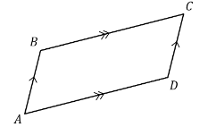
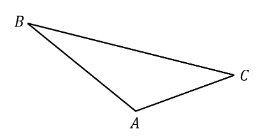
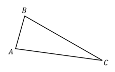

# Exam Questions — Vector Equations of Lines & The Scalar Product
**Vectors** · Cambridge (CIE) A-LEVEL maths (9709)
> Source: [https://www.savemyexams.com/a-level/maths/cie/20/pure-3/topic-questions/](https://www.savemyexams.com/a-level/maths/cie/20/pure-3/topic-questions/) · 36 questions across 1 sets

## Exam Questions (36 questions)

### Q1 — easy — 4 marks

**Q1** [4 marks]

A line passes through the two points `A \left(3 , - 2\right)` and `B \left(5 , 7\right)`.

(i) Write down the position vectors $\overset{\rightarrow}{OA}$ and $\overset{\rightarrow}{OB}$ of the two points.

(ii) Use the vector relation $\overset{\rightarrow}{AB} = \overset{\rightarrow}{OB} - \overset{\rightarrow}{OA}$ to find the vector $\overset{\rightarrow}{AB}$.

(iii) Use the answers from (i) and (ii) to write down an equation of the line in vector form.

### Q2 — easy — 4 marks

**Q2** [4 marks]

$A$ and $B$ are the points on the line `\mathbf{r} = \begin{pmatrix} 2 \\ - 1 \\ 3 \end{pmatrix} + t \begin{pmatrix} 0 \\ 4 \\ - 3 \end{pmatrix}` with $t = 1$ and $t = 3$ respectively.

(i) Find the position vectors $\overset{\rightarrow}{OA}$ and $\overset{\rightarrow}{OB}$.

(ii) By first finding the vector $\overset{\rightarrow}{AB}$, calculate the modulus `\left|\overrightarrow{AB}\right|`.

### Q3 — easy — 6 marks

**Q3** [2 marks]

Two lines $l$ and $m$ have equations `\mathbf{r} = \mathbf{i} + \mathbf{j} + 3 \mathbf{k} + s \left(\mathbf{i} - \mathbf{j} + \mathbf{k}\right)` and `\mathbf{r} = \mathbf{i} - 2 \mathbf{j} + 2 \mathbf{k} + t \left(2 \mathbf{i} + \mathbf{j} + 3 \mathbf{k}\right)` respectively. The two lines intersect at a point $P$.

Explain why, at point $P$, the values of the parameters $s$ and $t$ must satisfy the vector equation

`\begin{pmatrix} 1 + s \\ 1 - s \\ 3 + s \end{pmatrix} = \begin{pmatrix} 1 + 2 t \\ - 2 + t \\ 2 + 3 t \end{pmatrix}`

**Q3** [3 marks]

Solve the simultaneous equations $1 + s = 1 + 2 t$ and $1 - s = - 2 + t$, and show that the values found for $s$ and $t$ also satisfy the equation $3 + s = 2 + 3 t$.

**Q3** [1 mark]

Hence, find the coordinates of the point $P$.

### Q4 — easy — 4 marks

**Q4** [2 marks]

The equation of a line is given in vector form as follows

`\mathbf{r} = 2 \mathbf{i} + 6 \mathbf{j} + t \left(7 \mathbf{i} + 3 \mathbf{j}\right)`

Explain briefly what the vectors $2 i + 6 j$ and $7 i + 3 j$ in the equation above tell us, respectively, about the line.

**Q4** [2 marks]

Write down, in vector form, the equation of the line passing through $( 1 , 4 )$ in the same direction as $i + 3 j$.

### Q5 — easy — 6 marks

**Q5** [2 marks]

Two lines $l$ and $m$ have equations `\mathbf{r} = 6 \mathbf{i} - 2 \mathbf{j} + \mathbf{k} + s \left(\mathbf{i} + \mathbf{j} - \mathbf{k}\right)` and `\mathbf{r} = 3 \mathbf{i} + 3 \mathbf{j} - 2 \mathbf{k} + t \left(3 \mathbf{i} - \mathbf{j} + \mathbf{k}\right)` respectively.

Show that if the two lines intersect, then at the point of intersection the parameters $s$ and $t$ must satisfy the vector equation

`\begin{pmatrix} 6 + s \\ - 2 + s \\ 1 - s \end{pmatrix} = \begin{pmatrix} 3 + 3 t \\ 3 - t \\ - 2 + t \end{pmatrix}`

**Q5** [3 marks]

Solve the simultaneous equations $6 + s = 3 + 3 t$ and $- 2 + s = 3 - t$, and show that the values found for $s$ and $t$ do not also satisfy the equation $1 - s = - 2 + t$.

**Q5** [1 mark]

What do the results of part (b) tell you about the lines $l$ and $m$?

### Q6 — easy — 6 marks

**Q6** [3 marks]

Relative to the origin $O$, the points $A$, $B$ and $C$ have position vectors given by

$\overset{\rightarrow}{OA} = 2 i - j + 3 k$, $\overset{\rightarrow}{OB} = i - 2 j + 5 k$ and $\overset{\rightarrow}{OC} = 6 i + 3 j + k$

Find $\overset{\rightarrow}{AB}$ and $\overset{\rightarrow}{AC}$, and calculate `\left|\overrightarrow{AB}\right|` and `\left|\overrightarrow{AC}\right|`.

**Q6** [1 mark]

For two vectors $a = a_{1} i + a_{2} j + a_{3} k$ and $b = b_{1} i + b_{2} j + b_{3} k$, the scalar product `\mathbf{a} \cdot \mathbf{b}` can be calculated using the formula

`\mathbf{a} \cdot \mathbf{b} = a_{1} b_{1} + a_{2} b_{2} + a_{3} b_{3}`

Calculate the scalar product `\overrightarrow{AB} \cdot \overrightarrow{AC}`.

**Q6** [2 marks]

A defining property of the scalar product of two vectors $a$ and $b$ is

`\mathbf{a} \cdot \mathbf{b} = \left|\mathbf{a}\right| \left|\mathbf{b}\right| \text{cos} \; \theta`

where $θ$ is the angle between the two vectors.

Using this relationship, along with the answers to parts (a) and (b), find the angle between the vectors $\overset{\rightarrow}{AB}$ and $\overset{\rightarrow}{AC}$.

Give your answer in degrees correct to 1 decimal place.

### Q7 — easy — 5 marks

**Q7** [2 marks]

Write down, in vector form, the equation of the line through the point `\left(1 , 3 , - 6\right)` in the direction $4 i - j + 2 k$.

**Q7** [3 marks]

By first calculating the vectors $\overset{\rightarrow}{OA}$, $\overset{\rightarrow}{OB}$ and $\overset{\rightarrow}{AB}$, find a vector equation of the line passing through the two points `A \left(1 , 3 , 1\right)` and `B \left(3 , 4 , - 3\right)`.

### Q8 — very_hard — 6 marks

**Q8** [6 marks]

The coordinates of three points are `A \left(- 2 , 3 , - 5\right)`, `B \left(2 , - 5 , - 9\right)` and `C \left(- 10 , - 1 , - 1\right)`.

The point $M$ is the midpoint of $A B$, and the point $N$ lies on $B C$.

Given that `\left|\overrightarrow{BN}\right| = 3 \left|\overrightarrow{NC}\right|`, find the equation of the line through points $M$ and $N$ in vector form.

### Q9 — hard — 6 marks

**Q9** [6 marks]

Find the coordinates of the point on the line `\mathbf{r} = 2 \mathbf{i} - 12 \mathbf{j} + 3 \mathbf{k} + s \left(\mathbf{i} - 6 \mathbf{j} + 4 \mathbf{k}\right)` that is closest to the point `P \left(2 , 3 , - 1\right)`, and hence determine the minimum distance from point $P$ to the line.

### Q10 — hard — 4 marks

**Q10** [4 marks]

The vertices of triangle $A B C$ are the points with coordinates `A \left(- 2 , 5 , 4\right)`, `B \left(3 , 1 , 0\right)` and `C \left(- 1 , - 3 , - 1\right)`.

Use a vector method to show that $A B C$ is a right-angled triangle.

### Q11 — medium — 6 marks

**Q11** [6 marks]

Given that the coordinates of $A$ and $B$ are `\left(- 1 , 7\right)` and `\left(- 7 , - 5\right)` respectively, find the equation of each of the following lines in vector form.

(i) The line joining `\left(5 , - 6\right)` to the midpoint of $A B$.

(ii) The line passing through $B$, parallel to the line in part (i).

### Q12 — hard — 8 marks

**Q12** [5 marks]

Given that the coordinates of $A$, $B$ and $C$ are `\left(6 , 1 , - 3\right)`, `\left(- 2 , - 7 , 5\right)` and `\left(3 , 12 , - 9\right)` respectively, find the equation of each of the following lines in vector form.

(i) The line through $A$ and $B$.

(ii) The line through $B$, parallel to $\overset{\rightarrow}{OC}$.

**Q12** [3 marks]

Determine whether the point `\left(1 , 5 , - 4\right)` lies on either of the lines found in part (a).

### Q13 — hard — 5 marks

**Q13** [5 marks]

The coordinates of three points are `A \left(- 3 , 4 , 0\right)`, `B \left(2 , - 2 , - 3\right)` and `C \left(- 1 , - 1 , - 4\right)`.

Calculate the angle between $\overset{\rightarrow}{CA}$ and $\overset{\rightarrow}{CB}$. Give your answer in degrees, accurate to 1 decimal place.

### Q14 — hard — 14 marks

**Q14** [14 marks]

Determine whether each of the following pairs of lines intersect, are parallel, or are skew. For any lines that intersect, determine the point of intersection.

(i) `\mathbf{r} = 3 \mathbf{i} - 5 \mathbf{j} + \mathbf{k} + s \left(\mathbf{i} + 3 \mathbf{j} - 2 \mathbf{k}\right)` and `\mathbf{r} = \mathbf{i} + 2 \mathbf{j} + 2 \mathbf{k} + t \left(\mathbf{i} - \mathbf{j} - \mathbf{k}\right)`

(ii) `\mathbf{r} = \mathbf{i} - 2 \mathbf{j} + 3 \mathbf{k} + s \left(2 \mathbf{i} + 6 \mathbf{j} - 2 \mathbf{k}\right)` and `\mathbf{r} = 4 \mathbf{i} + 7 \mathbf{j} + t \left(- 5 \mathbf{i} - 15 \mathbf{j} + 5 \mathbf{k}\right)`

(iii) `\mathbf{r} = - \mathbf{i} - 4 \mathbf{j} - 4 \mathbf{k} + s \left(2 \mathbf{i} - 2 \mathbf{j} - 4 \mathbf{k}\right)` and `\mathbf{r} = - 4 \mathbf{i} - \mathbf{j} - 2 \mathbf{k} + t \left(3 \mathbf{i} - 3 \mathbf{j} + 6 \mathbf{k}\right)`

### Q15 — hard — 5 marks

**Q15** [5 marks]

Find the perpendicular distance of the point `P \left(6 , 0 , 3\right)` to the line `\mathbf{r} = - \mathbf{i} + 5 \mathbf{j} + 2 \mathbf{k} + s \left(3 \mathbf{i} - 6 \mathbf{j} - 2 \mathbf{k}\right)`.

### Q16 — medium — 5 marks

**Q16** [2 marks]

The coordinates of three points are `A \left(2 , - 1 , 5\right)`, `B \left(4 , 1 , 1\right)` and `C \left(- 2 , - 5 , 9\right)`.

Find $\overset{\rightarrow}{BA}$ and $\overset{\rightarrow}{BC}$.

**Q16** [3 marks]

By considering the scalar product `\overrightarrow{BA} \cdot \overrightarrow{BC}`, or otherwise, calculate the angle between $\overset{\rightarrow}{BA}$ and $\overset{\rightarrow}{BC}$. Give your answer in degrees, accurate to 1 decimal place.

### Q17 — medium — 7 marks

**Q17** [5 marks]

Find the equation of each of these lines in vector form.

(i) Through `\left(2 , - 7 , 9\right)` in the same direction as $6 i + 3 j - 9 k$.

(ii) Through `\left(4 , - 3 , 1\right)` and `\left(- 8 , 3 , - 5\right)`.

**Q17** [2 marks]

Show that the point `\left(10 , - 6 , 5\right)` does not lie on the line found in part (a)(ii).

### Q18 — hard — 10 marks

**Q18** [10 marks]

Determine whether each of the following pairs of lines intersect, are parallel, or are skew. If the lines intersect, find the coordinates of the point of intersection.

(i) `\mathbf{r} = - 7 \mathbf{i} - \mathbf{j} + 6 \mathbf{k} + s \left(\mathbf{i} + \mathbf{j} - \mathbf{k}\right)` and `\mathbf{r} = 2 \mathbf{i} + 2 \mathbf{j} + 11 \mathbf{k} + t \left(2 \mathbf{i} - \mathbf{j} + 5 \mathbf{k}\right)`

(ii) `\mathbf{r} = 3 \mathbf{i} - 3 \mathbf{j} + \mathbf{k} + s \left(\mathbf{i} - 2 \mathbf{j} + \mathbf{k}\right)` and `\mathbf{r} = - \mathbf{i} - \mathbf{j} + 5 \mathbf{k} + t \left(2 \mathbf{i} + 2 \mathbf{j} - 3 \mathbf{k}\right)`

### Q19 — medium — 5 marks

**Q19** [5 marks]

The vertices of triangle $A B C$ are the points with coordinates `A \left(5 , - 3 , 0\right)`, `B \left(- 2 , 0 , - 1\right)` and `C \left(1 , 2 , 1\right)`.

(i) Calculate the scalar products `\overrightarrow{AB} \cdot \overrightarrow{AC}`, `\overrightarrow{BA} \cdot \overrightarrow{BC}` and `\overrightarrow{CA} \cdot \overrightarrow{CB}`.

(ii) What does the result of part (i) tell you about the triangle $A B C$?

### Q20 — hard — 5 marks

**Q20** [5 marks]

$A$ and $B$ are the points on the line `\mathbf{r} = \begin{pmatrix} 1 \\ - 4 \\ 3 \end{pmatrix} + t \begin{pmatrix} 2 \\ a \\ - 1 \end{pmatrix}` with $t = - 1$ and $t = 2$ respectively.

Given that the distance from $A$ to $B$ is 9 units, find the possible values of $a$.

### Q21 — medium — 5 marks

**Q21** [3 marks]

Find the equation of each of these lines in vector form.

The line joining `\left(3 , - 2\right)` to `\left(- 1 , 5\right)`.

**Q21** [2 marks]

Find, in vector form, the equation of the line passing through `\left(3 , 1\right)` parallel to $4 i - 12 j$.

### Q22 — medium — 6 marks

**Q22** [4 marks]

The line $l$ has equation `\mathbf{r} = \begin{pmatrix} 1 \\ - 4 \\ 10 \end{pmatrix} + s \begin{pmatrix} 1 \\ - 1 \\ 3 \end{pmatrix}`.

Point $N$ is the point on line $l$ such that the line connecting $N$ and the point `P \left(3 , 4 , 1\right)` is perpendicular to $l$.

Find the position vector, $\overset{\rightarrow}{ON}$, of point $N$.

**Q22** [2 marks]

Hence find the shortest distance from point $P$ to the line $l$.

### Q23 — medium — 6 marks

**Q23** [6 marks]

Two lines $l$ and $m$ have equations `\mathbf{r} = - 3 \mathbf{i} - 6 \mathbf{j} + 8 \mathbf{k} + s \left(\mathbf{i} + \mathbf{j} - \mathbf{k}\right)` and `\mathbf{r} = 8 \mathbf{i} - 10 \mathbf{j} + 6 \mathbf{k} + t \left(2 \mathbf{i} - 3 \mathbf{j} + \mathbf{k}\right)` respectively.

Show that the two lines meet and find the position vector of the point of intersection.

### Q24 — medium — 7 marks

**Q24** [2 marks]

The coordinates of three points are `A \left(1 , 0 , - 4\right)`, `B \left(3 , - 1 , 6\right)` and `C \left(- 2 , 5 , 7\right)`.

Find $\overset{\rightarrow}{AB}$ and $\overset{\rightarrow}{AC}$.

**Q24** [3 marks]

Calculate `\left|\overrightarrow{AB}\right|` and `\left|\overrightarrow{AC}\right|`, and the scalar product `\overrightarrow{AB} \cdot \overrightarrow{AC}`.

**Q24** [2 marks]

Hence, find the angle between the vectors $\overset{\rightarrow}{AB}$ and $\overset{\rightarrow}{AC}$.

Give your answer in degrees correct to 1 decimal place.

### Q25 — very_hard — 7 marks

**Q25** [3 marks]

The following diagram depicts a large bank vault, the walls, floor and ceiling of which are all perfectly rectangular.

The corner $O$ is taken to be the origin of the coordinate system, and the units on the diagram are all given in metres.

$C E$ is the diagonal running across the room from corner $C$ to corner $E$.

By first finding the vector $\overset{\rightarrow}{CE}$, write a vector equation of the line that passes through $C$ and $E$.

**Q25** [4 marks]

A motion detector is located at point $O$, and is set to sound an alarm if anything moves within 5 metres of it.

If a small insect flies in a straight line from point $C$ to point $E$, will the alarm be triggered? You must provide clear mathematical workings to justify your answer.

### Q26 — medium — 4 marks

**Q26** [4 marks]

$A$ and $B$ are the points on the line `\mathbf{r} = \begin{pmatrix} 3 \\ - 2 \\ 5 \end{pmatrix} + t \begin{pmatrix} 1 \\ 3 \\ - 1 \end{pmatrix}` with $t = 4$ and $t = 7$ respectively.

(i) Find the position vectors $\overset{\rightarrow}{OA}$ and $\overset{\rightarrow}{OB}$.

(ii) Find `\left|\overrightarrow{AB}\right|`.

### Q27 — medium — 7 marks

**Q27** [5 marks]

Find the equation of each of these lines in vector form.

(i) Through `\left(3 , 1 , - 2\right)` in the direction `\begin{pmatrix} 0 \\ 1 \\ 5 \end{pmatrix}`

(ii) Through `\left(2 , 0 , 7\right)` and `\left(5 , 2 , - 3\right)`.

**Q27** [2 marks]

Show that the point `\left(- 4 , - 4 , 27\right)` lies on the line found in part (a)(ii).

### Q28 — medium — 5 marks

**Q28** [3 marks]

Find the equation of each of these lines in vector form.

The line joining `\left(4 , 1\right)` to `\left(7 , 6\right)`.

**Q28** [2 marks]

Find, in vector form, the equation of the line passing through `\left(2 , 5\right)` in the same direction as $2 i + j$.

### Q29 — medium — 4 marks

**Q29** [4 marks]

The vertices of triangle $A B C$ are the points with coordinates `A \left(2 , 4 , - 3\right)`, `B \left(0 , 2 , 1\right)` and `C \left(- 4 , - 2 , - 3\right)`.

(i) Show that `\overrightarrow{BA} \cdot \overrightarrow{BC} = 0`.

(ii) What does the result of part (i) tell you about the triangle $A B C$?

### Q30 — medium — 4 marks

**Q30** [4 marks]

Two lines $l$ and $m$ have equations `\mathbf{r} = 8 \mathbf{i} - 5 \mathbf{j} - 6 \mathbf{k} + s \left(- \mathbf{i} + 2 \mathbf{j} + \mathbf{k}\right)` and `\mathbf{r} = 2 \mathbf{i} + 2 \mathbf{j} - 2 \mathbf{k} + t \left(2 \mathbf{i} + \mathbf{j} + \mathbf{k}\right)` respectively.

(i) Show that the two lines do not intersect.

(ii) Are the two lines skew? Be sure to justify your answer.

### Q31 — very_hard — 9 marks

**Q31** [5 marks]

The vector $\overset{\rightarrow}{RS} = x i - 9 j + 3 k$ makes an angle $θ$ with the positive $x$-axis.

Show that $x^{2} = \frac{90}{\text{tan}^{2}θ}$.

**Q31** [4 marks]

Given that $θ$ is acute and that $\text{cos}  θ = \frac{4}{5}$, find a unit vector parallel to $\overset{\rightarrow}{RS}$.

### Q32 — hard — 8 marks

**Q32** [8 marks]

In the parallelogram $A B C D$, $A B$ is parallel to $C D$ and $B C$ is parallel to $A D$.

Given that

$\overset{\rightarrow}{AB} = 3 i - j - 2 k$

$\overset{\rightarrow}{AD} = 7 i - j + 4 k$

find the area of the parallelogram, giving your answer correct to 3 significant figures.

### Q33 — hard — 7 marks

**Q33** [3 marks]

With respect to the origin $O$, the point $R$ has position vector $i + 6 j - 2 k$ and the point $S$ has position vector $10 i + 13 k$.

Find a unit vector parallel to $\overset{\rightarrow}{RS}$.

**Q33** [2 marks]

Find the angle that $\overset{\rightarrow}{RS}$ makes with the negative $z$-axis.

**Q33** [2 marks]

The vector $\overset{\rightarrow}{TU}$ is given by $\overset{\rightarrow}{TU} = - 12 i + 8 j - 20 k$.

Explain, giving a reason for your answer, whether the vectors $\overset{\rightarrow}{RS}$ and $\overset{\rightarrow}{TU}$ are parallel.

### Q34 — medium — 7 marks

**Q34** [5 marks]

In the triangle $A B C$, the vectors $\overset{\rightarrow}{AB}$ and $\overset{\rightarrow}{AC}$ are given by

$\overset{\rightarrow}{AB} = 7 i + j - k$

$\overset{\rightarrow}{AC} = - 2 i + 5 k$

Show that angle $B A C = 119 . 6$°, correct to 1 decimal place.

**Q34** [2 marks]

Hence find the area of the triangle $A B C$, giving your answer correct to 3 significant figures.

### Q35 — medium — 7 marks

**Q35** [3 marks]

With respect to the origin $O$, the points $R$ and $S$ have position vectors given by

$\overset{\rightarrow}{OR} = - i + 5 j + 14 k$

$\overset{\rightarrow}{OS} = 7 i - 2 j + 12 k$

Find

(i) the vector $\overset{\rightarrow}{RS}$,

(ii) a unit vector parallel to $\overset{\rightarrow}{RS}$.

**Q35** [2 marks]

Find the angle that $\overset{\rightarrow}{RS}$ makes with the positive $y$-axis.

**Q35** [2 marks]

The vector $\overset{\rightarrow}{TU}$ is given by $\overset{\rightarrow}{TU} = - 24 i + 21 j + 6 k$.

Explain, giving a reason for your answer, whether the vectors $\overset{\rightarrow}{RS}$ and $\overset{\rightarrow}{TU}$ are parallel.

### Q36 — medium — 5 marks

**Q36** [5 marks]

In the triangle $A B C$, the vectors $\overset{\rightarrow}{AB}$ and $\overset{\rightarrow}{AC}$ are given by

$\overset{\rightarrow}{AB} = - 2 i + 3 j - k$

$\overset{\rightarrow}{AC} = - 5 i - 4 j - 7 k$

Show that angle $B A C = 81 . 9$°, correct to 1 decimal place.
