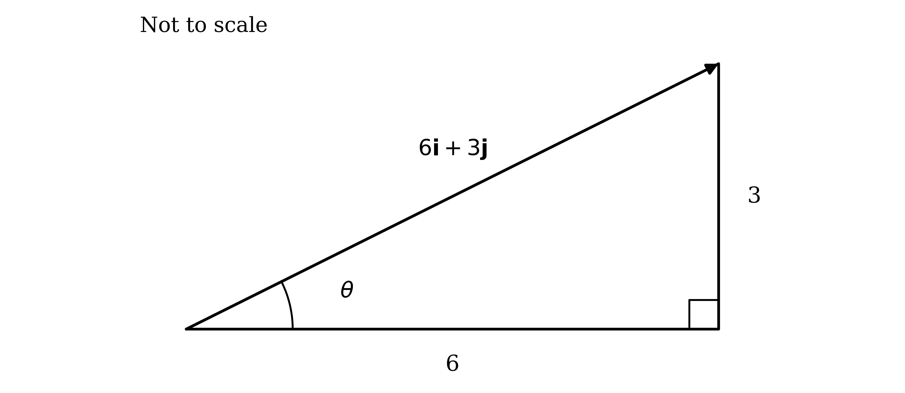
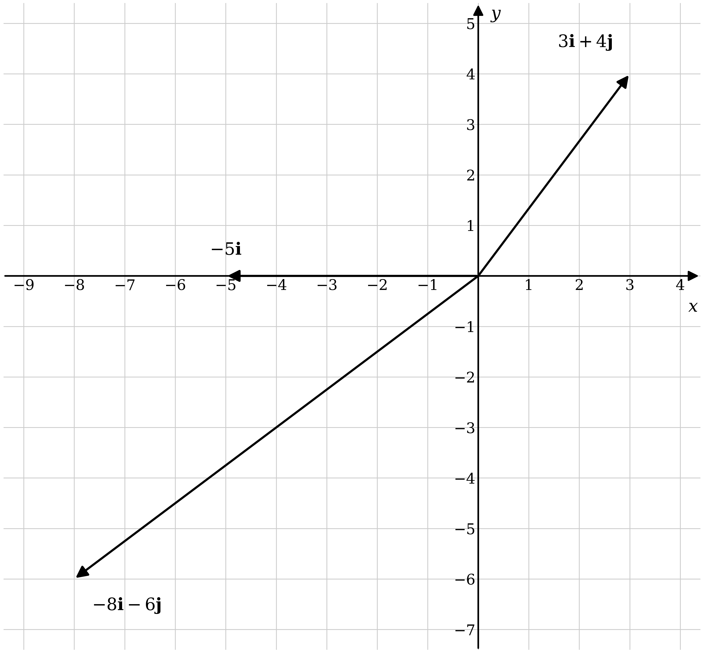
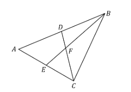
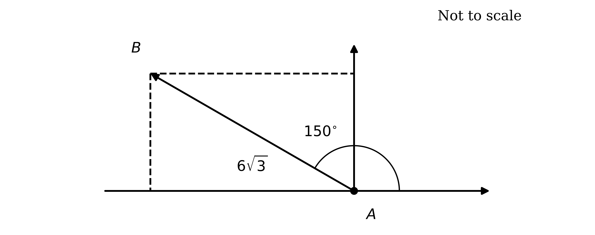
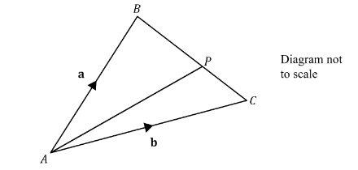
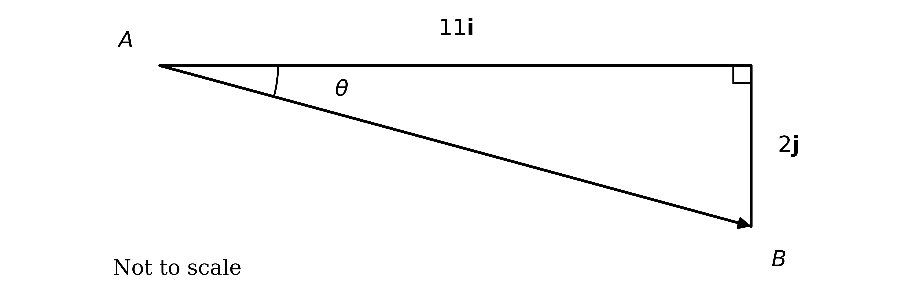

# Mark Schemes — Vectors in 2 Dimensions
**Vectors** · Cambridge (CIE) A-LEVEL maths (9709)

## Exam Questions (27 questions)

### Q1
(i)

The magnitude is the length of the vector, so use Pythagoras on its components

`\left|\overrightarrow{AB}\right| = \sqrt{6^2 + 3^2}`

**[M1]**

Evaluate under the root

`\left|\overrightarrow{AB}\right| = \sqrt{45}`

Simplify the surd, since $45 = 9 \times 5$

`\left|\overrightarrow{AB}\right| = \sqrt{9}\sqrt{5}`

`\left|\overrightarrow{AB}\right| = 3\sqrt{5}`

**[A1]**

(ii)

Sketch the vector as the hypotenuse of a right-angled triangle, so that the required angle sits between the vector and the horizontal

The $j$ component is opposite the angle and the $i$ component is adjacent to it, so use the tangent ratio

$\text{tan}  θ = \frac{3}{6}$

**[M1]**

Take the inverse tangent, keeping the unrounded value for the final rounding

`\theta = \text{tan}^{-1} \left( \dfrac{3}{6} \right) = 26.565\ldots`*°*

**Final answer:** $θ = 26 . 6$**° (1 d.p.)**

**[A1]**

> **[mark-scheme]**
> **M1**: Correct use of $\sqrt{x^{2}+y^{2}}$ with the components of $\overset{\rightarrow}{AB}$.
> 
> **A1**: Correct simplified surd $3 \sqrt{5}$, so $p = 3$ and $q = 5$. The unsimplified $\sqrt{45}$ does not earn this mark, because the answer was asked for in the form $p \sqrt{q}$ with $p$ and $q$ integers.
> 
> **M1**: Correct use of the tangent ratio with the two components the right way round, $\text{tan}  θ = \frac{3}{6}$.
> 
> **A1**: Answers which round to 26.6°. An answer in radians does not earn this mark, because degrees were asked for.
> 
> A sketch is not required for the marks, but the components must be used the correct way round: $\text{tan}  θ = \frac{6}{3}$ gives the angle to the $y$-axis instead and earns no marks.

### Q2
The distance $A B$ is the length of the displacement from $A$ to $B$, so find that displacement first by subtracting the position vectors

$\overset{\rightarrow}{AB} = b - a = ( - 3 i + j ) - ( 3 i - 7 j )$

$\overset{\rightarrow}{AB} = - 6 i + 8 j$

**[M1]**

Apply Pythagoras to its components

`\left|\overrightarrow{AB}\right| = \sqrt{(-6)^2 + 8^2} = \sqrt{100}`

$A B = 10$

**[A1]**

> **[mark-scheme]**
> **M1**: Correct displacement vector $- 6 i + 8 j$, or the two component differences used directly in $\sqrt{(x_{2}-x_{1})^{2}+(y_{2}-y_{1})^{2}}$. Subtracting the other way round, giving $6 i - 8 j$, also earns this mark, since the distance is unchanged.
> 
> **A1**: Correct answer $A B = 10$.
> 
> Adding the position vectors instead of subtracting them earns no marks.

### Q3
A unit vector has length 1, so divide the vector by its own magnitude. Find that magnitude first, using Pythagoras on the components

`\left|\overrightarrow{OA}\right| = \sqrt{(-4)^2 + 3^2} = \sqrt{25} = 5`

**[M1]**

Divide each component by 5, keeping the scalar in front

`\dfrac{1}{5} \begin{pmatrix} -4 \\ 3 \end{pmatrix}`

**[A1]**

> **[mark-scheme]**
> **M1**: Correct magnitude `\left|\overrightarrow{OA}\right| = 5`, or a clear attempt at $\sqrt{(-4)^{2}+3^{2}}$. This may be implied by a correct final answer.
> 
> **A1**: Correct unit vector `\dfrac{1}{5} \begin{pmatrix} -4 \\ 3 \end{pmatrix}`. Accept `\begin{pmatrix} -0.8 \\ 0.6 \end{pmatrix}` or $- \frac{4}{5} i + \frac{3}{5} j$. The negative of these does not earn the mark, because the question asks for the unit vector in the direction of $\overset{\rightarrow}{OA}$, which fixes the sense.
> 
> Dividing by anything other than the magnitude, or leaving the answer as `\begin{pmatrix} -4 \\ 3 \end{pmatrix}` with the division only indicated, does not earn the accuracy mark.

### Q4
A position vector is measured from the origin, so every arrow starts at $O$. The $i$ component gives the horizontal displacement and the $j$ component the vertical one, so each vector ends at the point with those coordinates

(i)

Move 3 to the right and 4 up, so the arrow runs from $O$ to $( 3 , 4 )$

**[B1]**

(ii)

There is no $j$ component, so this vector is horizontal: the arrow runs from $O$ to $( - 5 , 0 )$

**[B1]**

(iii)

Move 8 to the left and 6 down, so the arrow runs from $O$ to $( - 8 , - 6 )$

**[B1]**

> **[exam-tip]**
> Every position vector starts at the origin, so the arrowhead is what carries the information. A line drawn in the right place but without an arrowhead, or with the arrow pointing back towards the origin, describes a different vector and will not score.

> **[mark-scheme]**
> **B1**: Arrow drawn from the origin to $( 3 , 4 )$, with the arrowhead at $( 3 , 4 )$.
> 
> **B1**: Arrow drawn from the origin to $( - 5 , 0 )$, along the negative $x$-axis.
> 
> **B1**: Arrow drawn from the origin to $( - 8 , - 6 )$, with the arrowhead at $( - 8 , - 6 )$.
> 
> The axes do not need to be numbered, but the three vectors must be drawn to a consistent scale so their relative lengths and directions are correct. Labelling each arrow is not required.

### Q5
Substitute the three vectors into the given relationship

$2 i + 4 j - 2 ( 3 i + p j ) = 3 ( q i - 2 j )$

Multiply out both brackets

$2 i + 4 j - 6 i - 2 p j = 3 q i - 6 j$

Two vectors are equal only if their components match, so equate the $i$ and $j$ coefficients separately

$2 - 6 = 3 q$

$4 - 2 p = - 6$

**[M1]**

Solve the equation from the $j$ components

$- 2 p = - 10$

$p = 5$

**[A1]**

Solve the equation from the $i$ components

$- 4 = 3 q$

$q = - \frac{4}{3}$

**[A1]**

> **[mark-scheme]**
> **M1**: Correct substitution into $a - 2 b = 3 c$ followed by equating the $i$ and $j$ coefficients to form two equations. This may be implied by one correct value.
> 
> **A1**: Correct value $p = 5$.
> 
> **A1**: Correct value $q = - \frac{4}{3}$. Accept $- 1 \frac{1}{3}$; a decimal such as $- 1 . 33$ is accepted only if it is stated to 3 significant figures or better.
The magnitude is the length of the vector, so use Pythagoras on its components

`\left|\mathbf{d}\right| = \sqrt{6^2 + (-2)^2}`

**[M1]**

Evaluate under the root

`\left|\mathbf{d}\right| = \sqrt{40}`

Simplify the surd, since $40 = 4 \times 10$

`\left|\mathbf{d}\right| = 2\sqrt{10}`

**[A1]**

> **[mark-scheme]**
> **M1**: Correct use of $\sqrt{x^{2}+y^{2}}$ with the components of $d$.
> 
> **A1**: Correct exact answer $2 \sqrt{10}$. Accept the unsimplified $\sqrt{40}$. A decimal answer alone, such as 6.32, does not earn this mark because an exact value was asked for.

### Q6
(i)

Add the vectors by collecting the $i$ and $j$ components separately

$( 3 i - 5 j ) + ( - i + 3 j )$

$2 i - 2 j$

**[B1]**

(ii)

Multiply each component by the scalar 5

$5 ( 3 i - 5 j )$

$15 i - 25 j$

**[B1]**

(iii)

Multiply out both brackets, taking care with the signs in $- 2 b$

$3 ( 3 i - 5 j ) - 2 ( - i + 3 j )$

$9 i - 15 j + 2 i - 6 j$

**[M1]**

Collect the $i$ and $j$ components

$11 i - 21 j$

**[A1]**

(iv)

Treat $t$ exactly as a numerical scalar and multiply out

$( 3 i - 5 j ) - t ( - i + 3 j )$

$3 i - 5 j + t i - 3 t j$

Factorise the $i$ and $j$ components

$( 3 + t ) i - ( 5 + 3 t ) j$

**[B1]**

> **[mark-scheme]**
> **B1**: Correct sum $2 i - 2 j$.
> 
> **B1**: Correct scalar multiple $15 i - 25 j$.
> 
> **M1**: Both brackets multiplied out for $3 a - 2 b$, with the signs of $- 2 b$ correct. This may be implied by a correct final answer.
> 
> **A1**: Correct answer $11 i - 21 j$.
> 
> **B1**: Correct expression for $a - t b$. Accept the unfactorised form $3 i - 5 j + t i - 3 t j$, or $( 3 + t ) i + ( - 5 - 3 t ) j$.
> 
> Column vectors are accepted in place of $i$ and $j$ form throughout, but the two notations must not be mixed within one answer.

### Q7
(i)

To travel from $B$ to $C$, go back along $\overset{\rightarrow}{AB}$ and then out along $\overset{\rightarrow}{AC}$

$\overset{\rightarrow}{BC} = \overset{\rightarrow}{BA} + \overset{\rightarrow}{AC} = \overset{\rightarrow}{AC} - \overset{\rightarrow}{AB}$

Substitute the two given vectors

$\overset{\rightarrow}{BC} = ( 3 i - 2 j ) - ( 5 i + j )$

**[M1]**

Collect the $i$ and $j$ components

$\overset{\rightarrow}{BC} = - 2 i - 3 j$

**[A1]**

(ii)

The magnitude is the length of the vector, so use Pythagoras on its components

`\left|\overrightarrow{BC}\right| = \sqrt{(-2)^2 + (-3)^2}`

**[M1]**

Both squares are positive, so the signs of the components do not affect the result

`\left|\overrightarrow{BC}\right| = \sqrt{4 + 9}`

`\left|\overrightarrow{BC}\right| = \sqrt{13}`

**[A1]**

> **[mark-scheme]**
> **M1**: Correct method for $\overset{\rightarrow}{BC}$, using $\overset{\rightarrow}{BC} = \overset{\rightarrow}{AC} - \overset{\rightarrow}{AB}$ or equivalently $\overset{\rightarrow}{BA} + \overset{\rightarrow}{AC}$. Subtracting the wrong way round, giving $\overset{\rightarrow}{AB} - \overset{\rightarrow}{AC}$, does not earn this mark.
> 
> **A1**: Correct answer $- 2 i - 3 j$.
> 
> **M1**: Correct use of $\sqrt{x^{2}+y^{2}}$ with your components from (i).
> 
> **A1**: Correct exact answer $\sqrt{13}$. A decimal answer alone, such as 3.61, does not earn this mark because an exact value was asked for.
> 
> Column vectors are accepted in place of $i$ and $j$ form, but the two notations must not be mixed within one answer.

### Q8
Add the two vectors, component by component

`\mathbf{a} + \mathbf{b} = \begin{pmatrix} 3 \\ -p \end{pmatrix} + \begin{pmatrix} p \\ 4 \end{pmatrix} = \begin{pmatrix} 3 + p \\ 4 - p \end{pmatrix}`

Two vectors are parallel when one is a scalar multiple of the other, so introduce a constant $k$

`\begin{pmatrix} 3 + p \\ 4 - p \end{pmatrix} = k \begin{pmatrix} 9 \\ 3 \end{pmatrix}`

**[M1]**

Equate the components to get two equations

$3 + p = 9 k$

$4 - p = 3 k$

Since $9 k = 3 ( 3 k )$, substitute the second equation into the first to eliminate $k$

$3 + p = 3 ( 4 - p )$

**[M1]**

Expand and collect the terms in $p$

$3 + p = 12 - 3 p$

$4 p = 9$

$p = \frac{9}{4}$

**[A1]**

> **[mark-scheme]**
> **M1**: Correct sum `\begin{pmatrix} 3 + p \\ 4 - p \end{pmatrix}` and use of the parallel condition, writing it as a scalar multiple of $c$.
> 
> **M1**: Both component equations formed and $k$ eliminated between them, giving an equation in $p$ alone. Equating the ratios of the components, $\frac{3+p}{9} = \frac{4-p}{3}$, is an equally valid route and earns this mark.
> 
> **A1**: Correct value $p = \frac{9}{4}$. Accept $2 \frac{1}{4}$ or $2 . 25$.

### Q9
Substitute the three vectors into the given relationship

`\begin{pmatrix} 8 \\ m \end{pmatrix} + \begin{pmatrix} n \\ -2 \end{pmatrix} = \begin{pmatrix} m \\ n \end{pmatrix} - 2\begin{pmatrix} n \\ -2 \end{pmatrix}`

Equate the top components and rearrange for $m$

$8 + n = m - 2 n   \Rightarrow   m = 3 n + 8$

Equate the bottom components

$m - 2 = n + 4$

**[M1]**

Both equations involve $m$ and $n$, so substitute the first into the second to eliminate $m$

$3 n + 8 - 2 = n + 4$

Collect the terms in $n$

$2 n = - 2$

**[M1]**

Solve, then substitute back to find $m$

$n = - 1$

Substitute back into the first equation

$m = 3 ( - 1 ) + 8$

$m = 5 ,  n = - 1$

**[A1]**

> **[mark-scheme]**
> **M1**: Correct substitution and both component equations formed. Multiplying only one component of $b$ by 2 does not earn this mark.
> 
> **M1**: One unknown eliminated between the two equations.
> 
> **A1**: Both correct values, $m = 5$ and $n = - 1$. Both are needed for this mark.
Write the magnitude in terms of $k$ and set it equal to the given expression

$\sqrt{(2k+1)^{2}+(2k-1)^{2}} = 3 k \sqrt{2}$

Square both sides. On the right, `\left(3k\sqrt{2}\right)^2 = 9k^2 \times 2`

$( 2 k + 1 )^{2} + ( 2 k - 1 )^{2} = 18 k^{2}$

Expand both brackets. The terms in $k$ cancel

$4 k^{2} + 4 k + 1 + 4 k^{2} - 4 k + 1 = 18 k^{2}$

$8 k^{2} + 2 = 18 k^{2}$

**[M1]**

Collect the terms in $k^{2}$

$10 k^{2} = 2$

$k^{2} = \frac{1}{5}$

$k = \frac{1}{\sqrt{5}}$* or *$k = - \frac{1}{\sqrt{5}}$

**[A1]**

A magnitude cannot be negative, so $3 k \sqrt{2} \geq 0$ and $k$ cannot be negative. The negative root came from the squaring step and is rejected

$k = \frac{1}{\sqrt{5}} = \frac{\sqrt{5}}{5}$

$k = \frac{\sqrt{5}}{5}$

**[A1]**

> **[mark-scheme]**
> **M1**: The magnitude squared and set equal to $18 k^{2}$, with both brackets expanded, reaching $8 k^{2} + 2 = 18 k^{2}$ or equivalent.
> 
> **A1**: Correct $k^{2} = \frac{1}{5}$, with both roots $\pm \frac{1}{\sqrt{5}}$ obtained.
> 
> **A1**: Correct exact value $k = \frac{\sqrt{5}}{5}$, with the negative root rejected and a reason given, namely that a magnitude cannot be negative. Accept $\frac{1}{\sqrt{5}}$ or $\frac{1}{5} \sqrt{5}$. Giving both values as answers does not earn this mark.

### Q10
The components of a position vector are the coordinates of the point, so $A$ is the point $( 3 k , 5 k )$. Substitute these into the equation of the circle

$( 3 k - 11 )^{2} + ( 5 k - 7 )^{2} = 34$

**[M1]**

Expand both brackets

$9 k^{2} - 66 k + 121 + 25 k^{2} - 70 k + 49 = 34$

Collect like terms and bring everything to one side

$34 k^{2} - 136 k + 136 = 0$

Divide through by 34 to simplify

$k^{2} - 4 k + 4 = 0$

**[A1]**

Factorise. The quadratic is a perfect square, so it has a repeated root

$( k - 2 )^{2} = 0$

$k = 2$

**[A1]**

Substitute back into the components to get the coordinates

$x = 3 ( 2 ) = 6$

$y = 5 ( 2 ) = 10$

$A ( 6 , 10 )$

**[A1]**

> **[mark-scheme]**
> **M1**: The coordinates of $A$ identified as $( 3 k , 5 k )$ from the position vector and substituted into the equation of the circle.
> 
> **A1**: Correct quadratic, $34 k^{2} - 136 k + 136 = 0$ or the simplified $k^{2} - 4 k + 4 = 0$.
> 
> **A1**: Correct value $k = 2$. Accept it obtained by factorising, by the quadratic formula, or by completing the square.
> 
> **A1**: Correct coordinates $A ( 6 , 10 )$. Stopping at $k = 2$ without giving the coordinates does not earn this mark.

### Q11
Sketch the vector first. Turning 165° anticlockwise from the upward vertical leaves the vector pointing down and to the left, so both components will be negative. It sits 15° from the downward vertical

The 15° angle is measured from the vertical, so the vertical component uses cosine and the horizontal component uses sine

$\text{horizontal} = 2 \sqrt{6}  \text{sin}  15 ^{\circ}$

$\text{vertical} = 2 \sqrt{6}  \text{cos}  15 ^{\circ}$

**[M1]**

Use the exact value $\text{sin}  15 ^{\circ} = \frac{\sqrt{6}-\sqrt{2}}{4}$ for the horizontal size

$2 \sqrt{6} \times \frac{\sqrt{6}-\sqrt{2}}{4} = \frac{12-4\sqrt{3}}{4} = 3 - \sqrt{3}$

The vector points to the left, so the $i$ component is the negative of this

$a = - ( 3 - \sqrt{3} ) = \sqrt{3} - 3$

**[A1]**

Now the vertical size, using $\text{cos}  15 ^{\circ} = \frac{\sqrt{6}+\sqrt{2}}{4}$

$2 \sqrt{6} \times \frac{\sqrt{6}+\sqrt{2}}{4} = \frac{12+4\sqrt{3}}{4} = 3 + \sqrt{3}$

The vector points downwards, so the $j$ component is negative

$b = - ( 3 + \sqrt{3} )$

**[A1]**

> **[exam-tip]**
> The angle here is measured from the $y$-axis, not the $x$-axis, which swaps the usual roles of sine and cosine. Sketching first and then asking which component is opposite the angle you are using is safer than reaching for a memorised formula. The sketch also tells you both components are negative, which no amount of correct trigonometry will supply on its own.

> **[mark-scheme]**
> **M1**: Correct method for resolving into components, using $2 \sqrt{6}$ with $\text{sin}  15 ^{\circ}$ and $\text{cos}  15 ^{\circ}$, or equivalently with $\text{cos}  255 ^{\circ}$ and $\text{sin}  255 ^{\circ}$ measured from the positive $x$-axis.
> 
> **A1**: Correct exact $i$ component $a = \sqrt{3} - 3$. Accept $- ( 3 - \sqrt{3} )$. The negative sign is required.
> 
> **A1**: Correct exact $j$ component $b = - ( 3 + \sqrt{3} )$. Accept $- 3 - \sqrt{3}$. The negative sign is required.
> 
> Decimals do not earn the accuracy marks because exact values were asked for. A useful check is that $( \sqrt{3} - 3 )^{2} + ( 3 + \sqrt{3} )^{2} = 24$, giving a magnitude of $\sqrt{24} = 2 \sqrt{6}$ as stated.
A unit vector points the same way but has magnitude 1, so divide the vector by its magnitude, which is given as $2 \sqrt{6}$

`\dfrac{\overrightarrow{AB}}{\left|\overrightarrow{AB}\right|} = \dfrac{(\sqrt{3} - 3)\mathbf{i} - (3 + \sqrt{3})\mathbf{j}}{2\sqrt{6}}`

**[M1]**

Rationalise the denominator by multiplying the top and bottom by $\sqrt{6}$

$= \frac{(\sqrt{3}-3)\sqrt{6}i-(3+\sqrt{3})\sqrt{6}j}{12}$

Expand each numerator, using $\sqrt{18} = 3 \sqrt{2}$

$= \frac{(3\sqrt{2}-3\sqrt{6})i-(3\sqrt{6}+3\sqrt{2})j}{12}$

Divide each component by the common factor of 3

$- \frac{\sqrt{6}-\sqrt{2}}{4} i - \frac{\sqrt{6}+\sqrt{2}}{4} j$

**[A1]**

> **[mark-scheme]**
> **M1**: Division of $\overset{\rightarrow}{AB}$ by its magnitude $2 \sqrt{6}$, using your components from part (a).
> 
> **A1**: Correct unit vector $- \frac{\sqrt{6}-\sqrt{2}}{4} i - \frac{\sqrt{6}+\sqrt{2}}{4} j$. Accept the equivalent unrationalised form `\dfrac{1}{2\sqrt{6}}\left[(\sqrt{3} - 3)\mathbf{i} - (3 + \sqrt{3})\mathbf{j}\right]`, the components written as $- \text{sin}  15 ^{\circ}$ and $- \text{cos}  15 ^{\circ}$, or decimals which round to $- 0 . 259 i - 0 . 966 j$.
> 
> Both components must be negative. The negative of the whole vector does not earn the mark, because the question asks for the direction of $\overset{\rightarrow}{AB}$, which fixes the sense.

### Q12
Travelling from $A$ to $B$ and then $B$ to $C$ is the same as going straight from $A$ to $C$, so rearrange that relationship for $\overset{\rightarrow}{AB}$

$\overset{\rightarrow}{AB} + \overset{\rightarrow}{BC} = \overset{\rightarrow}{AC}   \Rightarrow   \overset{\rightarrow}{AB} = \overset{\rightarrow}{AC} - \overset{\rightarrow}{BC}$

Substitute the two given vectors

$\overset{\rightarrow}{AB} = ( 5 i - 2 j ) - ( - 3 i + k j )$

**[M1]**

Collect the $i$ and $j$ components, taking the $j$ terms together

$\overset{\rightarrow}{AB} = 8 i - ( 2 + k ) j$

**[A1]**

> **[mark-scheme]**
> **M1**: Correct route to $\overset{\rightarrow}{AB}$, using $\overset{\rightarrow}{AC} - \overset{\rightarrow}{BC}$, with both vectors substituted.
> 
> **A1**: Correct answer $8 i - ( 2 + k ) j$. Accept the expanded form $8 i + ( - 2 - k ) j$.
Write the magnitude of your answer to part (a) and set it equal to $\sqrt{89}$

`\sqrt{8^2 + \left[-(2 + k)\right]^2} = \sqrt{89}`

Square both sides. Squaring removes the minus sign from the second component

$64 + ( 2 + k )^{2} = 89$

$( 2 + k )^{2} = 25$

**[M1]**

The bracket is already a perfect square, so take the square root of both sides and keep both signs

$2 + k = 5$* or *$2 + k = - 5$

**[M1]**

Solve each equation

**Final answer:** $k = 3$** or **$k = - 7$

**[A1]**

> **[mark-scheme]**
> **M1**: The magnitude of your part (a) answer set equal to $\sqrt{89}$ and squared, reaching $( 2 + k )^{2} = 25$ or equivalent.
> 
> **M1**: Both roots taken, whether by writing $2 + k = \pm 5$ or by expanding to the quadratic $k^{2} + 4 k - 21 = 0$ and solving it.
> 
> **A1**: Both correct values, $k = 3$ and $k = - 7$. Both are needed for this mark.

### Q13
Three points lie on a line when the displacements between them are parallel, so build two displacements from $A$. A displacement is the difference of the position vectors, taken end minus start

$\overset{\rightarrow}{AC} = \overset{\rightarrow}{OC} - \overset{\rightarrow}{OA} = ( 3 i - 8 j ) - ( - 6 i - 2 j )$

**[M1]**

Collect the components of each

$\overset{\rightarrow}{AC} = 9 i - 6 j$

$\overset{\rightarrow}{AB} = ( i + m j ) - ( - 6 i - 2 j ) = 7 i + ( 2 + m ) j$

**[A1]**

The two displacements share the point $A$, so collinearity means one is a scalar multiple of the other. Introduce a constant $p$

`9\mathbf{i} - 6\mathbf{j} = p \left[ 7\mathbf{i} + (2 + m)\mathbf{j} \right]`

Equate the components to get two equations

$9 = 7 p$

$- 6 = p ( 2 + m )$

**[M1]**

The first equation contains no $m$, so solve that one first

$p = \frac{9}{7}$

**[A1]**

Substitute this value into the second equation

$- 6 = \frac{9}{7} ( 2 + m )$

Multiply both sides by $\frac{7}{9}$ to isolate the bracket

$- \frac{42}{9} = 2 + m$

Simplify the fraction, since $42$ and $9$ share a factor of 3

$- \frac{14}{3} = 2 + m$

$m = - \frac{14}{3} - \frac{6}{3}$

$m = - \frac{20}{3}$

**[A1]**

> **[mark-scheme]**
> **M1**: Correct method for a displacement vector, subtracting the position vector of the start point from that of the end point, applied to at least one pair of points.
> 
> **A1**: Both displacements correct, $\overset{\rightarrow}{AC} = 9 i - 6 j$ and $\overset{\rightarrow}{AB} = 7 i + ( 2 + m ) j$. Any other pair of displacements between the three points is equally acceptable.
> 
> **M1**: The collinearity condition written as a scalar multiple and both component equations formed.
> 
> **A1**: Correct scalar $p = \frac{9}{7}$. Follow through if the pair of displacements chosen was different, so long as it is correct for that pair.
> 
> **A1**: Correct value $m = - \frac{20}{3}$. Accept $- 6 \frac{2}{3}$ or answers which round to $- 6 . 67$.
> 
> Equating the ratios of the components, $\frac{9}{7} = \frac{-6}{2+m}$, is an equally valid route and earns the second method mark and the mark for $p$ together.

### Q14
Each of these vectors starts away from $A$, so route every one back through $A$. To go from $B$ to $C$, travel backwards along $\overset{\rightarrow}{AB}$ and then forwards along $\overset{\rightarrow}{AC}$

$\overset{\rightarrow}{BC} = - 2 a + 2 b$

**[B1]**

$E$ is the midpoint of $A C$, so $\overset{\rightarrow}{AE}$ is half of $\overset{\rightarrow}{AC}$, giving $\overset{\rightarrow}{AE} = b$

$\overset{\rightarrow}{BE} = - 2 a + b$

**[B1]**

$D$ is the midpoint of $A B$, so $\overset{\rightarrow}{AD} = a$

$\overset{\rightarrow}{CD} = - 2 b + a$

**[B1]**

> **[mark-scheme]**
> **B1**: Correct answer $\overset{\rightarrow}{BC} = - 2 a + 2 b$. Accept $2 b - 2 a$ or $2 ( b - a )$.
> 
> **B1**: Correct answer $\overset{\rightarrow}{BE} = - 2 a + b$. Accept $b - 2 a$.
> 
> **B1**: Correct answer $\overset{\rightarrow}{CD} = a - 2 b$. Accept $- 2 b + a$.
> 
> Halving $\overset{\rightarrow}{AC}$ and $\overset{\rightarrow}{AB}$ correctly is what these marks are testing; using $2 b$ in place of $b$ for $\overset{\rightarrow}{AE}$ loses the relevant mark.

$F$ lies on $E B$, so $\overset{\rightarrow}{EF}$ is some fraction of $\overset{\rightarrow}{EB}$. Call that fraction $μ$, and note $\overset{\rightarrow}{EB} = - \overset{\rightarrow}{BE} = 2 a - b$

`\overrightarrow{EF} = \mu \overrightarrow{EB} = \mu \left( 2\mathbf{a} - \mathbf{b} \right)`

**[M1]**

$F$ also lies on $C D$, so $\overset{\rightarrow}{CF}$ is some fraction $λ$ of $\overset{\rightarrow}{CD}$

`\overrightarrow{CF} = \lambda \overrightarrow{CD} = \lambda \left( \mathbf{a} - 2\mathbf{b} \right)`

**[M1]**

Now reach $F$ by a second route, going from $C$ to $E$ and then on to $F$. Since $E$ is the midpoint of $A C$, $\overset{\rightarrow}{CE} = - b$

`\overrightarrow{CF} = \overrightarrow{CE} + \overrightarrow{EF} = -\mathbf{b} + \mu \left( 2\mathbf{a} - \mathbf{b} \right)`

The two routes describe the same vector, so set them equal

`\lambda \left( \mathbf{a} - 2\mathbf{b} \right) = -\mathbf{b} + \mu \left( 2\mathbf{a} - \mathbf{b} \right)`

**[M1]**

Collect the terms in $a$ and in $b$ on each side

$λ a - 2 λ b = 2 μ a + ( - 1 - μ ) b$

$A$, $B$ and $C$ form a triangle, so $a$ and $b$ are not parallel. Any vector is therefore written in terms of them in only one way, which allows the coefficients to be compared

$λ = 2 μ$

$- 2 λ = - 1 - μ$

**[A1]**

Substitute the first equation into the second to eliminate $λ$

$- 2 ( 2 μ ) = - 1 - μ$

$- 3 μ = - 1$

$μ = \frac{1}{3}$

Substitute back to find the other parameter

`\lambda = 2 \left( \dfrac{1}{3} \right) = \dfrac{2}{3}`

**[A1]**

Interpret each fraction as a ratio. $\overset{\rightarrow}{EF} = \frac{1}{3} \overset{\rightarrow}{EB}$ means $F$ is one third of the way from $E$ to $B$, and $\overset{\rightarrow}{CF} = \frac{2}{3} \overset{\rightarrow}{CD}$ means $F$ is two thirds of the way from $C$ to $D$

**Final answer:** $E F : F B = 1 : 2$** and **$D F : F C = 1 : 2$

**Final answer:** **so each line divides the other in the ratio 1 : 2, as required**

**[A1]**

> **[mark-scheme]**
> **M1**: $\overset{\rightarrow}{EF}$, or an equivalent vector along $B E$, written as an unknown multiple of $\overset{\rightarrow}{EB}$ and expressed in terms of $a$ and $b$.
> 
> **M1**: $\overset{\rightarrow}{CF}$ written as an unknown multiple of $\overset{\rightarrow}{CD}$ and expressed in terms of $a$ and $b$.
> 
> **M1**: A second route to the same vector formed, for example $\overset{\rightarrow}{CF} = \overset{\rightarrow}{CE} + \overset{\rightarrow}{EF}$, and the two expressions set equal.
> 
> **A1**: Both coefficient equations correct, $λ = 2 μ$ and $- 2 λ = - 1 - μ$, with a statement that $a$ and $b$ are not parallel, so the coefficients may be compared. The equations alone, with no such statement anywhere in the working, do not earn this mark.
> 
> **A1**: Both parameters correct, $μ = \frac{1}{3}$ and $λ = \frac{2}{3}$.
> 
> **A1**: The conclusion stated as a ratio for both lines. Because the result is given in the question, the interpretation of each fraction as a ratio must be visible; stating the two fractions alone does not earn this mark. Accept the equivalent statements $B F : F E = 2 : 1$ and $C F : F D = 2 : 1$.
> 
> Starting from $\overset{\rightarrow}{BF} = μ \overset{\rightarrow}{BE}$, or routing through $A$ or $D$ instead of $E$, is equally valid and earns the same marks so long as two independent routes to the same vector are formed.

### Q15
Sketch the vector so the directions of its two components are visible. At 150° the vector points up and to the left, so the horizontal component is negative and the vertical component is positive

Resolve the vector into components using its magnitude and the angle it makes with the positive $x$-axis

`\overrightarrow{AB} = 6\sqrt{3} \left( \text{cos} \; 150° \, \mathbf{i} + \text{sin} \; 150° \, \mathbf{j} \right)`

**[M1]**

Use the exact values $\text{cos}  150 ^{\circ} = - \frac{\sqrt{3}}{2}$ and $\text{sin}  150 ^{\circ} = \frac{1}{2}$ for the horizontal component

`x = 6\sqrt{3} \times \left( -\dfrac{\sqrt{3}}{2} \right) = -\dfrac{6 \times 3}{2}`

$x = - 9$

**[A1]**

Now the vertical component

$y = 6 \sqrt{3} \times \frac{1}{2}$

$y = 3 \sqrt{3}$

**[A1]**

$- 9 i + 3 \sqrt{3} j$

> **[exam-tip]**
> Resolving with $\text{cos}  θ$ and $\text{sin}  θ$ of the angle measured from the positive $x$-axis puts the signs in for you. If you instead work with the acute angle inside a right-angled triangle you get the sizes of the components but not their directions, and you then have to read the signs off your sketch by hand. That second step is the one candidates forget.

> **[mark-scheme]**
> **M1**: Correct method for resolving into components, using the magnitude with $\text{cos}  150 ^{\circ}$ and $\text{sin}  150 ^{\circ}$, or using $6 \sqrt{3}  \text{cos}  30 ^{\circ}$ and $6 \sqrt{3}  \text{sin}  30 ^{\circ}$ from a correct sketch.
> 
> **A1**: Correct exact horizontal component $x = - 9$. The negative sign is required; $x = 9$ does not earn this mark.
> 
> **A1**: Correct exact vertical component $y = 3 \sqrt{3}$.
> 
> The final answer may be written as $- 9 i + 3 \sqrt{3} j$ or as a column vector. Decimals do not earn the accuracy marks because exact values were asked for.
A unit vector points the same way but has magnitude 1, so divide the vector by its magnitude, which is given as $6 \sqrt{3}$

`\dfrac{\overrightarrow{AB}}{\left|\overrightarrow{AB}\right|} = \dfrac{-9\mathbf{i} + 3\sqrt{3}\mathbf{j}}{6\sqrt{3}}`

**[M1]**

Divide each component and simplify, using $\frac{9}{6\sqrt{3}} = \frac{3}{2\sqrt{3}} = \frac{\sqrt{3}}{2}$

$- \frac{\sqrt{3}}{2} i + \frac{1}{2} j$

**[A1]**

> **[mark-scheme]**
> **M1**: Division of $\overset{\rightarrow}{AB}$ by its magnitude $6 \sqrt{3}$, using your components from part (a).
> 
> **A1**: Correct unit vector $- \frac{\sqrt{3}}{2} i + \frac{1}{2} j$. Accept the unsimplified `\dfrac{1}{6\sqrt{3}}\left(-9\mathbf{i} + 3\sqrt{3}\mathbf{j}\right)`, or decimals which round to $- 0 . 866 i + 0 . 5 j$.
> 
> The negative sign on the $i$ component is required. A check worth making is that the components of a unit vector are $\text{cos}  θ$ and $\text{sin}  θ$ for the given angle, here 150°.

### Q16
The resultant is the sum of the three vectors, so set that sum equal to the zero vector

`\begin{pmatrix} -1 \\ n \end{pmatrix} + \begin{pmatrix} 5 \\ -4 \end{pmatrix} + \begin{pmatrix} m \\ 6 \end{pmatrix} = \begin{pmatrix} 0 \\ 0 \end{pmatrix}`

Each component of the sum must be zero on its own, so treat the two directions separately

$- 1 + 5 + m = 0$

$n - 4 + 6 = 0$

**[M1]**

Solve each equation

$m = - 4 ,  n = - 2$

**[A1]**

> **[mark-scheme]**
> **M1**: The three vectors summed and set equal to the zero vector, with both component equations formed.
> 
> **A1**: Both correct values, $m = - 4$ and $n = - 2$. Both are needed for this mark.
Write the magnitude in terms of $k$ and set it equal to the given value

$\sqrt{(-3k)^{2}+k^{2}} = 2 \sqrt{15}$

Square both sides. On the right, squaring $2 \sqrt{15}$ gives $4 \times 15$

$9 k^{2} + k^{2} = 60$

Collect the terms in $k^{2}$

$10 k^{2} = 60$

$k^{2} = 6$

**[M1]**

A square has two roots, so take both

**Final answer:** $k = \sqrt{6}$** or **$k = - \sqrt{6}$

**[A1]**

> **[mark-scheme]**
> **M1**: Correct equation in $k$ formed from the magnitude and squared, reaching $k^{2} = 6$ or equivalent. Squaring $2 \sqrt{15}$ to 30 instead of 60 does not earn this mark.
> 
> **A1**: Both correct exact values, $k = \pm \sqrt{6}$. Only one of the two values, or a decimal such as $\pm 2 . 45$, does not earn this mark because two exact values were asked for.

### Q17
Follow the three vectors head to tail: $A$ to $B$, then $B$ to $C$, then $C$ back to $A$

**Final answer:** **The three vectors form a closed path which ends where it started, so the total displacement is zero**

**[B1]**

> **[mark-scheme]**
> **B1**: A statement that the three vectors form a closed path, or return to the starting point, so the resultant displacement is zero. Accept "you end up back where you started" or an equivalent description of a closed triangle.
> 
> Simply restating that the sum is zero, without giving a reason, does not earn this mark.
Rearrange the result from part (a) to make $\overset{\rightarrow}{CA}$ the subject

`\overrightarrow{CA} = -\left( \overrightarrow{AB} + \overrightarrow{BC} \right)`

Add the two given vectors inside the bracket

`\overrightarrow{CA} = -\left[ (5\mathbf{i} + 8\mathbf{j}) + (\mathbf{i} - 5\mathbf{j}) \right] = -(6\mathbf{i} + 3\mathbf{j})`

**[M1]**

Multiply through by the minus sign

$\overset{\rightarrow}{CA} = - 6 i - 3 j$

**[A1]**

Apply Pythagoras to the components, then simplify the surd, since $45 = 9 \times 5$

`\left|\overrightarrow{CA}\right| = \sqrt{(-6)^2 + (-3)^2} = \sqrt{45}`

`\left|\overrightarrow{CA}\right| = 3\sqrt{5}`

**[A1]**

> **[mark-scheme]**
> **M1**: Correct use of part (a) to reach $\overset{\rightarrow}{CA} = - ( \overset{\rightarrow}{AB} + \overset{\rightarrow}{BC} )$, with both vectors substituted. Finding $\overset{\rightarrow}{AC} = 6 i + 3 j$ first and then reversing it is an equally valid route and earns this mark.
> 
> **A1**: Correct answer $\overset{\rightarrow}{CA} = - 6 i - 3 j$. Giving $6 i + 3 j$, which is $\overset{\rightarrow}{AC}$, does not earn this mark.
> 
> **A1**: Correct magnitude $3 \sqrt{5}$. Accept $\sqrt{45}$ or answers which round to 6.71. The magnitude is the same whichever direction was found, so follow through from $\overset{\rightarrow}{AC}$ here.

### Q18
The components of a position vector are the coordinates of the point, so $A$ is the point $( 3 k , - 17 k )$. Substitute these into the equation of the curve

$- 17 k = ( 3 k )^{2} - 2$

**[M1]**

Expand the bracket and collect everything on one side

$- 17 k = 9 k^{2} - 2$

$9 k^{2} + 17 k - 2 = 0$

**[A1]**

Factorise the quadratic

$( 9 k - 1 ) ( k + 2 ) = 0$

$k = \frac{1}{9}$* or *$k = - 2$

The question states that $k$ is positive, so the negative root is rejected

$k = \frac{1}{9}$

**[A1]**

Substitute back into the components to get the coordinates

`x = 3 \left( \dfrac{1}{9} \right) = \dfrac{1}{3}`

`y = -17 \left( \dfrac{1}{9} \right) = -\dfrac{17}{9}`

`A \left( \dfrac{1}{3}, -\dfrac{17}{9} \right)`

**[A1]**

> **[mark-scheme]**
> **M1**: The coordinates of $A$ identified as $( 3 k , - 17 k )$ from the position vector and substituted into $y = x^{2} - 2$.
> 
> **A1**: Correct three-term quadratic $9 k^{2} + 17 k - 2 = 0$, or any correct rearrangement of it.
> 
> **A1**: Correct value $k = \frac{1}{9}$. Both roots must be found and $k = - 2$ must be rejected, or the working must otherwise show that only the positive root is being taken. Giving both values as answers does not earn this mark.
> 
> **A1**: Correct coordinates `A\left(\dfrac{1}{3}, -\dfrac{17}{9}\right)`. Accept the decimal equivalents to 3 significant figures, $( 0 . 333 , - 1 . 89 )$.
> 
> Solving the quadratic by the formula or by completing the square is equally acceptable.

### Q19
Find the two combinations first, component by component

`\mathbf{a} - \mathbf{b} = \begin{pmatrix} 3 \\ 5 \end{pmatrix} - \begin{pmatrix} -3k \\ k \end{pmatrix} = \begin{pmatrix} 3 + 3k \\ 5 - k \end{pmatrix}`

`\mathbf{a} + \mathbf{c} = \begin{pmatrix} 3 \\ 5 \end{pmatrix} + \begin{pmatrix} 0 \\ -4 \end{pmatrix} = \begin{pmatrix} 3 \\ 1 \end{pmatrix}`

**[M1]**

Two vectors are parallel when one is a scalar multiple of the other, so introduce a constant $p$

`\begin{pmatrix} 3 + 3k \\ 5 - k \end{pmatrix} = p \begin{pmatrix} 3 \\ 1 \end{pmatrix}`

Equate the components to get two equations

$3 + 3 k = 3 p$

$5 - k = p$

**[M1]**

Both equations contain $k$, so substitute the second into the first to eliminate $p$

$3 + 3 k = 3 ( 5 - k )$

**[M1]**

Expand and collect the terms in $k$

$3 + 3 k = 15 - 3 k$

$6 k = 12$

$k = 2$

**[A1]**

> **[mark-scheme]**
> **M1**: Both combinations found correctly, `\mathbf{a} - \mathbf{b} = \begin{pmatrix} 3 + 3k \\ 5 - k \end{pmatrix}` and `\mathbf{a} + \mathbf{c} = \begin{pmatrix} 3 \\ 1 \end{pmatrix}`.
> 
> **M1**: The parallel condition written as a scalar multiple and both component equations formed.
> 
> **M1**: The scalar eliminated between the two equations to give an equation in $k$ alone.
> 
> **A1**: Correct value $k = 2$.
> 
> Equating the ratios of the components, $\frac{3+3k}{3} = \frac{5-k}{1}$, is an equally valid route and earns the second and third method marks together.

### Q20
Three points lie on a line when the displacements between them point the same way, so build two displacements from the same point. A displacement is the difference of the position vectors, taken end minus start

$\overset{\rightarrow}{AB} = \overset{\rightarrow}{OB} - \overset{\rightarrow}{OA}$

**[M1]**

Substitute and collect the components

$\overset{\rightarrow}{AB} = - 6 i - ( - 9 i + 4 j )$

$\overset{\rightarrow}{AB} = 3 i - 4 j$

**[A1]**

Apply the same rule to $\overset{\rightarrow}{AC}$

$\overset{\rightarrow}{AC} = \overset{\rightarrow}{OC} - \overset{\rightarrow}{OA} = ( 3 i - 12 j ) - ( - 9 i + 4 j )$

$\overset{\rightarrow}{AC} = 12 i - 16 j$

**[A1]**

Test whether one is a scalar multiple of the other by taking out a common factor

`\overrightarrow{AC} = 12\mathbf{i} - 16\mathbf{j} = 4 \left( 3\mathbf{i} - 4\mathbf{j} \right)`

$\overset{\rightarrow}{AC} = 4 \overset{\rightarrow}{AB}$*, so the two vectors are parallel*

**[B1]**

Parallel vectors on their own only fix a direction, so the shared starting point is what completes the argument

**Final answer:** **The vectors **$\overset{\rightarrow}{AB}$** and **$\overset{\rightarrow}{AC}$** are parallel and both start at **$A$**, so the points A, B and C lie on the same straight line**

**[B1]**

> **[mark-scheme]**
> **M1**: Correct method for a displacement vector, subtracting the position vector of the start point from that of the end point, applied to at least one pair of points.
> 
> **A1**: Correct $\overset{\rightarrow}{AB} = 3 i - 4 j$.
> 
> **A1**: Correct $\overset{\rightarrow}{AC} = 12 i - 16 j$. Any other pair of displacements between the three points is equally acceptable, for example $\overset{\rightarrow}{BC} = 9 i - 12 j$.
> 
> **B1**: One vector shown to be a scalar multiple of the other, with the multiple stated, for example $\overset{\rightarrow}{AC} = 4 \overset{\rightarrow}{AB}$. Stating only that the vectors are parallel, without showing the multiple or the common factor, does not earn this mark.
> 
> **B1**: A conclusion that $A$, $B$ and $C$ are collinear, stated together with its reason. Both facts must appear: that the two vectors are parallel, and that they share a common point. Parallel alone does not give collinearity, so a bare statement that the points are collinear does not earn this mark.

### Q21
A displacement between two points is the difference of their position vectors, taken end minus start

$\overset{\rightarrow}{AB} = \overset{\rightarrow}{OB} - \overset{\rightarrow}{OA}$

**[M1]**

Substitute and collect the components

$\overset{\rightarrow}{AB} = 3 j - ( - 4 i - 7 j )$

$\overset{\rightarrow}{AB} = 4 i + 10 j$

**[A1]**

Apply the same rule to $\overset{\rightarrow}{AC}$

$\overset{\rightarrow}{AC} = \overset{\rightarrow}{OC} - \overset{\rightarrow}{OA} = 6 i + 18 j - ( - 4 i - 7 j )$

$\overset{\rightarrow}{AC} = 10 i + 25 j$

**[A1]**

> **[mark-scheme]**
> **M1**: Correct method for a displacement vector, subtracting the position vector of the start point from that of the end point. This may be implied by one correct answer.
> 
> **A1**: Correct answer $\overset{\rightarrow}{AB} = 4 i + 10 j$.
> 
> **A1**: Correct answer $\overset{\rightarrow}{AC} = 10 i + 25 j$.
> 
> Subtracting the wrong way round, giving $\overset{\rightarrow}{BA}$ and $\overset{\rightarrow}{CA}$, earns the method mark but neither accuracy mark.
Two vectors are parallel when one is a scalar multiple of the other, so test whether $\overset{\rightarrow}{AC}$ is a multiple of $\overset{\rightarrow}{AB}$

`\overrightarrow{AC} = 10\mathbf{i} + 25\mathbf{j} = \dfrac{5}{2} \left( 4\mathbf{i} + 10\mathbf{j} \right)`

**Final answer:** $\overset{\rightarrow}{AC} = \frac{5}{2} \overset{\rightarrow}{AB}$**, so the two vectors are parallel**

**[B1]**

These two vectors are parallel and both start at $A$, so they lie along the same line

**Final answer:** **The points A, B and C lie on the same straight line**

**[B1]**

> **[exam-tip]**
> Parallel is not the same as collinear. Two vectors can point the same way while sitting on completely separate lines, so the shared point is key in this argument. Saying only that $\overset{\rightarrow}{AB}$ and $\overset{\rightarrow}{AC}$ are parallel leaves the conclusion unproved.

> **[mark-scheme]**
> **B1**: $\overset{\rightarrow}{AC}$ shown to be a scalar multiple of $\overset{\rightarrow}{AB}$, with the multiple stated. Accept $\overset{\rightarrow}{AB} = \frac{2}{5} \overset{\rightarrow}{AC}$, or a statement that the components are in the same ratio, $\frac{10}{4} = \frac{25}{10}$. Stating only that the two vectors are parallel, without showing the multiple, does not earn this mark.
> 
> **B1**: A statement that $A$, $B$ and $C$ are collinear, or lie on the same straight line. The statement must follow from the two vectors being parallel and sharing the point $A$.

### Q22
(i)

Reversing a vector reverses its direction, so $\overset{\rightarrow}{CA}$ is the negative of $\overset{\rightarrow}{AC}$

$\overset{\rightarrow}{CA} = - \overset{\rightarrow}{AC} = - ( 4 i - 3 j )$

$\overset{\rightarrow}{CA} = - 4 i + 3 j$

**[B1]**

(ii)

To travel from $B$ to $C$, go back along $\overset{\rightarrow}{AB}$ to $A$ and then out along $\overset{\rightarrow}{AC}$

$\overset{\rightarrow}{BC} = \overset{\rightarrow}{BA} + \overset{\rightarrow}{AC} = - \overset{\rightarrow}{AB} + \overset{\rightarrow}{AC}$

Substitute the two given vectors

$\overset{\rightarrow}{BC} = - ( 7 i + j ) + ( 4 i - 3 j )$

**[M1]**

Collect the $i$ and $j$ components

$\overset{\rightarrow}{BC} = - 3 i - 4 j$

**[A1]**

> **[mark-scheme]**
> **B1**: Correct answer $- 4 i + 3 j$.
> 
> **M1**: Correct route for $\overset{\rightarrow}{BC}$, using $\overset{\rightarrow}{BA} + \overset{\rightarrow}{AC}$ or equivalently $\overset{\rightarrow}{AC} - \overset{\rightarrow}{AB}$, with the given vectors substituted.
> 
> **A1**: Correct answer $- 3 i - 4 j$.
> 
> Column vectors are accepted in place of $i$ and $j$ form, but the two notations must not be mixed within one answer.
Apply Pythagoras to the components of $\overset{\rightarrow}{BC}$ found in part (a)

`\left|\overrightarrow{BC}\right| = \sqrt{(-3)^2 + (-4)^2} = \sqrt{25}`

`\left|\overrightarrow{BC}\right| = 5`

**[B1]**

> **[mark-scheme]**
> **B1**: Correct answer 5. Follow through from your own $\overset{\rightarrow}{BC}$ in part (a) if it was incorrect there.

### Q23
Substitute the three vectors into the given relationship

`\begin{pmatrix} 7 \\ 2 \end{pmatrix} + 2\begin{pmatrix} m \\ -3 \end{pmatrix} = \begin{pmatrix} 5 \\ n \end{pmatrix}`

Two vectors are equal only if their components match, so treat the two directions separately

$7 + 2 m = 5$

$2 - 6 = n$

**[M1]**

Solve the equation from the top components

$2 m = - 2$

$m = - 1$

**[A1]**

Find the value from the bottom components, $2 - 6 = n$

$n = - 4$

**[A1]**

> **[mark-scheme]**
> **M1**: Correct substitution into $a + 2 b = c$ and both component equations formed. Multiplying only one component of $b$ by 2 does not earn this mark.
> 
> **A1**: Correct value $m = - 1$.
> 
> **A1**: Correct value $n = - 4$.
Write the magnitude in terms of $k$ and set it equal to 15

`\left|\mathbf{d}\right| = \sqrt{(-5)^2 + k^2} = \sqrt{25 + k^2} = 15`

Square both sides to remove the root

$25 + k^{2} = 225$

$k^{2} = 200$

**[M1]**

A square has two roots, so take both and simplify the surd, since $200 = 100 \times 2$

**Final answer:** $k = 10 \sqrt{2}$** or **$k = - 10 \sqrt{2}$

**[A1]**

> **[mark-scheme]**
> **M1**: Correct equation in $k$ formed from the magnitude and squared, reaching $k^{2} = 200$ or equivalent.
> 
> **A1**: Both correct exact values, $k = \pm 10 \sqrt{2}$. Accept $\pm \sqrt{200}$. Only one of the two values, or a decimal such as $\pm 14 . 1$, does not earn this mark because two exact values were asked for.

### Q24
The components of a position vector are the coordinates of the point, so $A$ is the point $( 2 k , 7 k )$

$x = 2 k$

$y = 7 k$

$A$ lies on the line, so these coordinates satisfy its equation. Substitute them into $y = 3 x + 5$

$7 k = 3 ( 2 k ) + 5$

**[M1]**

Collect the terms in $k$

$7 k = 6 k + 5$

$k = 5$

**[A1]**

Substitute back into the components to get the coordinates

$x = 2 ( 5 ) = 10$

$y = 7 ( 5 ) = 35$

$A ( 10 , 35 )$

**[A1]**

> **[mark-scheme]**
> **M1**: The coordinates of $A$ identified as $( 2 k , 7 k )$ from the position vector and substituted into $y = 3 x + 5$.
> 
> **A1**: Correct value $k = 5$.
> 
> **A1**: Correct coordinates $A ( 10 , 35 )$. Accept the answer written as a position vector, $10 i + 35 j$, since the point is unambiguous. Stopping at $k = 5$ without giving the coordinates does not earn this mark.

### Q25

(i)

To travel from $B$ to $C$, go backwards along $a$ to reach $A$, then forwards along $b$

$\overset{\rightarrow}{BC} = - a + b$

**[B1]**

(ii)

$P$ divides $B C$ in the ratio $3 : 2$, so $B P$ is 3 of the 5 equal parts of $B C$. That makes $\overset{\rightarrow}{BP}$ a scalar multiple of $\overset{\rightarrow}{BC}$

$\overset{\rightarrow}{BP} = \frac{3}{5} \overset{\rightarrow}{BC}$

**[M1]**

Substitute the result from (i)

`\overrightarrow{BP} = \dfrac{3}{5} \left( \mathbf{b} - \mathbf{a} \right)`

**[A1]**

> **[mark-scheme]**
> **B1**: Correct answer $b - a$. Accept $- a + b$.
> 
> **M1**: Correct fraction of $\overset{\rightarrow}{BC}$ used, $\overset{\rightarrow}{BP} = \frac{3}{5} \overset{\rightarrow}{BC}$. Using $\frac{3}{2}$ does not earn this mark.
> 
> **A1**: Correct answer $\frac{3}{5} ( b - a )$. Accept the expanded form $\frac{3}{5} b - \frac{3}{5} a$, or $0 . 6 b - 0 . 6 a$.
Work out the bracket from part (a) first, subtracting component by component

$b - a = ( 12 i + 3 j ) - ( 7 i + 8 j ) = 5 i - 5 j$

**[M1]**

Multiply by the scalar $\frac{3}{5}$ from part (a)

`\overrightarrow{BP} = \dfrac{3}{5} \left( 5\mathbf{i} - 5\mathbf{j} \right)`

$\overset{\rightarrow}{BP} = 3 i - 3 j$

**[A1]**

> **[mark-scheme]**
> **M1**: Correct substitution of $a$ and $b$ into your expression from part (a), reaching $b - a = 5 i - 5 j$ or equivalent.
> 
> **A1**: Correct answer $3 i - 3 j$.
> 
> Follow through from an incorrect $\overset{\rightarrow}{BP}$ in part (a) is allowed for the method mark only.

### Q26
Find the two combinations first, component by component

`\mathbf{a} - \mathbf{b} = \begin{pmatrix} -5 - k \\ 12 \end{pmatrix}`

`\mathbf{b} + \mathbf{c} = \begin{pmatrix} k + 9 \\ -24 \end{pmatrix}`

Two vectors are parallel when one is a scalar multiple of the other, so introduce a constant $p$

`\begin{pmatrix} -5 - k \\ 12 \end{pmatrix} = p \begin{pmatrix} k + 9 \\ -24 \end{pmatrix}`

**[M1]**

Equate the components to get two equations

$- 5 - k = p ( k + 9 )$

$12 = - 24 p$

**[M1]**

The second equation contains no $k$, so solve that one first

$p = - \frac{1}{2}$

**[A1]**

Substitute this value into the first equation

$- 5 - k = - \frac{1}{2} ( k + 9 )$

Multiply through by 2 to clear the fraction

$- 10 - 2 k = - k - 9$

Collect the terms in $k$

$- 1 = k$

$k = - 1$

**[A1]**

> **[mark-scheme]**
> **M1**: Both combinations found correctly and the parallel condition written as a scalar multiple, $a - b = p ( b + c )$.
> 
> **M1**: Both component equations formed.
> 
> **A1**: Correct scalar $p = - \frac{1}{2}$. Accept $- 0 . 5$.
> 
> **A1**: Correct value $k = - 1$.
> 
> Rearranging the first equation to make $k$ the subject in terms of $p$ and then substituting is an equally valid route and earns the same marks. Equating the ratios of the components, $\frac{-5-k}{k+9} = \frac{12}{-24}$, is also accepted and earns the first two marks together.

### Q27
(i)

Apply Pythagoras to the components, then simplify the surd, since $125 = 25 \times 5$

`\left|\overrightarrow{AB}\right| = \sqrt{11^2 + (-2)^2} = \sqrt{125}`

`\left|\overrightarrow{AB}\right| = 5\sqrt{5}`

**[B1]**

(ii)

Sketch the vector as the hypotenuse of a right-angled triangle. The $j$ component is negative, so the vector runs below the positive $x$-axis

The vertical component is opposite the angle and the horizontal component is adjacent to it, so use the tangent ratio

$\text{tan}  θ = \frac{2}{11}$

**[M1]**

Take the inverse tangent, keeping the unrounded value for the final rounding

`\theta = \text{tan}^{-1} \left( \dfrac{2}{11} \right) = 10.3048\ldots`*°*

**Final answer:** $θ = 10 . 30$**° (2 d.p.)**

**[A1]**

> **[mark-scheme]**
> **B1**: Correct exact magnitude $5 \sqrt{5}$. Accept $\sqrt{125}$. A decimal such as 11.2 does not earn this mark because an exact value was asked for.
> 
> **M1**: Correct use of the tangent ratio with the two components the right way round, $\text{tan}  θ = \frac{2}{11}$.
> 
> **A1**: Answers which round to 10.30°. The answer must be given to two decimal places, so 10.3° alone does not earn this mark. An answer in radians does not earn it either.
> 
> The angle lies below the positive $x$-axis. Stating it as −10.30°, or describing it as 10.30° below the axis, is accepted.
A unit vector points the same way but has magnitude 1, so divide the vector by its own magnitude, found in part (a)

`\dfrac{\overrightarrow{AB}}{\left|\overrightarrow{AB}\right|} = \dfrac{11\mathbf{i} - 2\mathbf{j}}{5\sqrt{5}}`

**[M1]**

Write the scalar in front of the vector

`\dfrac{1}{5\sqrt{5}} \left( 11\mathbf{i} - 2\mathbf{j} \right)`

**[A1]**

> **[mark-scheme]**
> **M1**: Division of $\overset{\rightarrow}{AB}$ by its magnitude, using your value from part (a).
> 
> **A1**: Correct unit vector $\frac{1}{5\sqrt{5}} ( 11 i - 2 j )$. Accept the components written separately as $\frac{11}{5\sqrt{5}} i - \frac{2}{5\sqrt{5}} j$, the rationalised form $\frac{11\sqrt{5}}{25} i - \frac{2\sqrt{5}}{25} j$, or decimals which round to $0 . 984 i - 0 . 179 j$.
> 
> The negative of this vector does not earn the mark, because the question asks for the direction of $\overset{\rightarrow}{AB}$, which fixes the sense.
