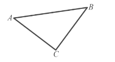
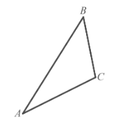

# Exam Questions — Vectors in 2 Dimensions
**Vectors** · Cambridge (CIE) A-LEVEL maths (9709)
> Source: [https://www.savemyexams.com/a-level/maths/cie/20/pure-3/topic-questions/](https://www.savemyexams.com/a-level/maths/cie/20/pure-3/topic-questions/) · 27 questions across 1 sets

## Exam Questions (27 questions)

### Q1 — easy — 4 marks

**Q1** [4 marks]

The displacement vector $\overset{\rightarrow}{AB}$ is given by $\overset{\rightarrow}{AB} = 6 i + 3 j$.

(i) Find the magnitude of $\overset{\rightarrow}{AB}$, giving your answer in the form $p \sqrt{q}$, where $p$ and $q$ are integers to be found.

(ii) Find the angle between $\overset{\rightarrow}{AB}$ and the positive $x$-axis, giving your answer in degrees correct to 1 decimal place.

### Q2 — easy — 2 marks

**Q2** [2 marks]

With respect to the origin $O$, the points $A$ and $B$ have position vectors $a = 3 i - 7 j$ and $b = - 3 i + j$ respectively.

Find the distance $A B$.

### Q3 — easy — 2 marks

**Q3** [2 marks]

With respect to the origin $O$, the point $A$ has position vector given by

`\overrightarrow{OA} = \begin{pmatrix} -4 \\ 3 \end{pmatrix}`

Find a unit vector in the direction of $\overset{\rightarrow}{OA}$.

### Q4 — easy — 3 marks

**Q4** [3 marks]

On the same diagram, sketch the following position vectors.

(i) $3 i + 4 j$

(ii) $- 5 i$

(iii) $- 8 i - 6 j$

### Q5 — easy — 5 marks

**Q5** [3 marks]

The vectors $a$, $b$, $c$ and $d$ are given by

$a = 2 i + 4 j ,  b = 3 i + p j ,  c = q i - 2 j ,  d = 6 i - 2 j$

Given that $a - 2 b = 3 c$, find the values of the constants $p$ and $q$.

**Q5** [2 marks]

Find `\left|\mathbf{d}\right|`, giving your answer as an exact value.

### Q6 — easy — 5 marks

**Q6** [5 marks]

The vectors $a$ and $b$ are given by $a = 3 i - 5 j$ and $b = - i + 3 j$.

Find

(i) $a + b$

(ii) $5 a$

(iii) $3 a - 2 b$

(iv) $a - t b$, where $t$ is a constant.

### Q7 — easy — 4 marks

**Q7** [4 marks]

In the triangle $A B C$, $\overset{\rightarrow}{AB} = 5 i + j$ and $\overset{\rightarrow}{AC} = 3 i - 2 j$.

(i) Find $\overset{\rightarrow}{BC}$ in terms of $i$ and $j$.

(ii) Calculate `\left|\overrightarrow{BC}\right|`, giving your answer as an exact value.

### Q8 — medium — 3 marks

**Q8** [3 marks]

The vectors $a$, $b$ and $c$ are given by

`\mathbf{a} = \begin{pmatrix} 3 \\ -p \end{pmatrix}, \quad \mathbf{b} = \begin{pmatrix} p \\ 4 \end{pmatrix}, \quad \mathbf{c} = \begin{pmatrix} 9 \\ 3 \end{pmatrix}`

where $p$ is a constant.

Given that $a + b$ is parallel to $c$, find the value of $p$.

### Q9 — very_hard — 6 marks

**Q9** [3 marks]

The vectors $a$, $b$ and $c$ are given by

`\mathbf{a} = \begin{pmatrix} 8 \\ m \end{pmatrix}, \quad \mathbf{b} = \begin{pmatrix} n \\ -2 \end{pmatrix}, \quad \mathbf{c} = \begin{pmatrix} m \\ n \end{pmatrix}`

where $m$ and $n$ are constants.

Given that $a + b = c - 2 b$, find the values of $m$ and $n$.

**Q9** [3 marks]

The vector $d$ is given by

`\mathbf{d} = \begin{pmatrix} 2k + 1 \\ 2k - 1 \end{pmatrix}`

Given that `\left|\mathbf{d}\right| = 3k\sqrt{2}`, find the value of $k$, justifying your answer. Give your answer as an exact value.

### Q10 — hard — 4 marks

**Q10** [4 marks]

The point $A$ lies on the circle with equation $( x - 11 )^{2} + ( y - 7 )^{2} = 34$. With respect to the origin $O$, the position vector of $A$ is $\overset{\rightarrow}{OA} = 3 k i + 5 k j$, where $k$ is a constant.

Find the value of $k$, and hence determine the coordinates of $A$.

### Q11 — very_hard — 5 marks

**Q11** [3 marks]

The vector $\overset{\rightarrow}{AB}$ has a magnitude of $2 \sqrt{6}$ and makes an angle of 165° with the positive $y$-axis, measuring anticlockwise from the positive $y$-axis.

Find $\overset{\rightarrow}{AB}$ in the form $a i + b j$, where both $a$ and $b$ are given as exact values.

**Q11** [2 marks]

Find a unit vector in the direction of $\overset{\rightarrow}{AB}$.

### Q12 — hard — 5 marks

**Q12** [2 marks]

$A$, $B$ and $C$ are the three vertices of a triangle. $\overset{\rightarrow}{AC} = 5 i - 2 j$ and $\overset{\rightarrow}{BC} = - 3 i + k j$, where $k$ is a constant.

Find $\overset{\rightarrow}{AB}$ in terms of $i$, $j$ and $k$.

**Q12** [3 marks]

Given that `\left|\overrightarrow{AB}\right| = \sqrt{89}`, find the two possible values of $k$.

### Q13 — hard — 5 marks

**Q13** [5 marks]

With respect to the origin $O$, the points $A$, $B$ and $C$ have position vectors given by

$\overset{\rightarrow}{OA} = - 6 i - 2 j ,  \overset{\rightarrow}{OB} = i + m j ,  \overset{\rightarrow}{OC} = 3 i - 8 j$

where $m$ is a constant.

Given that $A$, $B$ and $C$ lie on the same straight line, use a vector method to find the value of $m$.

### Q14 — very_hard — 9 marks

**Q14** [3 marks]

In the triangle $A B C$, $D$ is the midpoint of $A B$ and $E$ is the midpoint of $A C$.

$B E$ and $C D$ intersect at the point $F$.

Given that $\overset{\rightarrow}{AB} = 2 a$ and $\overset{\rightarrow}{AC} = 2 b$, write the vectors $\overset{\rightarrow}{BC}$, $\overset{\rightarrow}{BE}$ and $\overset{\rightarrow}{CD}$ in terms of $a$ and $b$.

**Q14** [6 marks]

By setting up and solving suitable vector equations, prove that each of $B E$ and $C D$ divides the other in the ratio $1 : 2$.

### Q15 — hard — 5 marks

**Q15** [3 marks]

The vector $\overset{\rightarrow}{AB}$ has a magnitude of $6 \sqrt{3}$ and makes an angle of 150° with the positive $x$-axis.

Find $\overset{\rightarrow}{AB}$ in the form $x i + y j$, where both $x$ and $y$ are given as exact values.

**Q15** [2 marks]

Find a unit vector in the direction of $\overset{\rightarrow}{AB}$.

### Q16 — medium — 4 marks

**Q16** [2 marks]

The vectors $a$, $b$ and $c$ are given by

`\mathbf{a} = \begin{pmatrix} -1 \\ n \end{pmatrix}, \quad \mathbf{b} = \begin{pmatrix} 5 \\ -4 \end{pmatrix}, \quad \mathbf{c} = \begin{pmatrix} m \\ 6 \end{pmatrix}`

where $m$ and $n$ are constants.

Given that the resultant of $a$, $b$ and $c$ is the zero vector, find the values of $m$ and $n$.

**Q16** [2 marks]

The vector $d$ is given by

`\mathbf{d} = \begin{pmatrix} -3k \\ k \end{pmatrix}`

Given that `\left|\mathbf{d}\right| = 2\sqrt{15}`, find the two possible values of $k$, giving your answers as exact values.

### Q17 — hard — 4 marks

**Q17** [1 mark]

In the triangle $A B C$, $\overset{\rightarrow}{AB} = 5 i + 8 j$ and $\overset{\rightarrow}{BC} = i - 5 j$.

Explain why $\overset{\rightarrow}{AB} + \overset{\rightarrow}{BC} + \overset{\rightarrow}{CA} = 0$.

**Q17** [3 marks]

Find $\overset{\rightarrow}{CA}$ and calculate its magnitude.

### Q18 — hard — 4 marks

**Q18** [4 marks]

The point $A$ lies on the curve with equation $y = x^{2} - 2$. With respect to the origin $O$, the position vector of $A$ is $\overset{\rightarrow}{OA} = 3 k i - 17 k j$, where $k$ is a positive constant.

Find the value of $k$, and hence determine the coordinates of $A$.

### Q19 — hard — 4 marks

**Q19** [4 marks]

The vectors $a$, $b$ and $c$ are given by

`\mathbf{a} = \begin{pmatrix} 3 \\ 5 \end{pmatrix}, \quad \mathbf{b} = \begin{pmatrix} -3k \\ k \end{pmatrix}, \quad \mathbf{c} = \begin{pmatrix} 0 \\ -4 \end{pmatrix}`

where $k$ is a constant.

Given that $a - b$ is parallel to $a + c$, find the value of $k$.

### Q20 — hard — 5 marks

**Q20** [5 marks]

With respect to the origin $O$, the points $A$, $B$ and $C$ have position vectors given by

$\overset{\rightarrow}{OA} = - 9 i + 4 j ,  \overset{\rightarrow}{OB} = - 6 i ,  \overset{\rightarrow}{OC} = 3 i - 12 j$

Use a vector method to show that the points $A$, $B$ and $C$ lie on the same straight line.

### Q21 — medium — 5 marks

**Q21** [3 marks]

With respect to the origin $O$, the points $A$, $B$ and $C$ have position vectors given by

$\overset{\rightarrow}{OA} = - 4 i - 7 j ,  \overset{\rightarrow}{OB} = 3 j ,  \overset{\rightarrow}{OC} = 6 i + 18 j$

Find $\overset{\rightarrow}{AB}$ and $\overset{\rightarrow}{AC}$.

**Q21** [2 marks]

Show that $\overset{\rightarrow}{AB}$ and $\overset{\rightarrow}{AC}$ are parallel, and state what this tells you about the points $A$, $B$ and $C$.

### Q22 — easy — 4 marks

**Q22** [3 marks]

In the triangle $A B C$, $\overset{\rightarrow}{AB} = 7 i + j$ and $\overset{\rightarrow}{AC} = 4 i - 3 j$.

(i) Write down $\overset{\rightarrow}{CA}$ in terms of $i$ and $j$.

(ii) Find $\overset{\rightarrow}{BC}$.

**Q22** [1 mark]

Calculate `\left|\overrightarrow{BC}\right|`.

### Q23 — medium — 5 marks

**Q23** [3 marks]

The vectors $a$, $b$ and $c$ are given by

`\mathbf{a} = \begin{pmatrix} 7 \\ 2 \end{pmatrix}, \quad \mathbf{b} = \begin{pmatrix} m \\ -3 \end{pmatrix}, \quad \mathbf{c} = \begin{pmatrix} 5 \\ n \end{pmatrix}`

Given that $a + 2 b = c$, find the values of $m$ and $n$.

**Q23** [2 marks]

The vector $d$ is given by

`\mathbf{d} = \begin{pmatrix} -5 \\ k \end{pmatrix}`

Given that `\left|\mathbf{d}\right| = 15`, find the two possible values of $k$, giving your answers as exact values.

### Q24 — medium — 3 marks

**Q24** [3 marks]

The point $A$ lies on the line with equation $y = 3 x + 5$. With respect to the origin $O$, the position vector of $A$ is $\overset{\rightarrow}{OA} = 2 k i + 7 k j$, where $k$ is a constant.

Find the value of $k$, and hence determine the coordinates of $A$.

### Q25 — medium — 5 marks

**Q25** [3 marks]

In the triangle $A B C$, $\overset{\rightarrow}{AB} = a$ and $\overset{\rightarrow}{AC} = b$. The point $P$ divides $B C$ in the ratio $3 : 2$.

(i) Write down $\overset{\rightarrow}{BC}$ in terms of $a$ and $b$.

(ii) Find $\overset{\rightarrow}{BP}$ in terms of $a$ and $b$.

**Q25** [2 marks]

Given that $a = 7 i + 8 j$ and $b = 12 i + 3 j$, find $\overset{\rightarrow}{BP}$ in terms of $i$ and $j$.

### Q26 — medium — 4 marks

**Q26** [4 marks]

The vectors $a$, $b$ and $c$ are given by

`\mathbf{a} = \begin{pmatrix} -5 \\ 17 \end{pmatrix}, \quad \mathbf{b} = \begin{pmatrix} k \\ 5 \end{pmatrix}, \quad \mathbf{c} = \begin{pmatrix} 9 \\ -29 \end{pmatrix}`

where $k$ is a constant.

Given that $a - b$ is parallel to $b + c$, find the value of $k$.

### Q27 — medium — 5 marks

**Q27** [3 marks]

The vector $\overset{\rightarrow}{AB}$ is given by $\overset{\rightarrow}{AB} = 11 i - 2 j$.

Find

(i) the magnitude of $\overset{\rightarrow}{AB}$, giving your answer as an exact value,

(ii) the angle between $\overset{\rightarrow}{AB}$ and the positive $x$-axis, giving your answer in degrees correct to two decimal places.

**Q27** [2 marks]

Find a unit vector in the direction of $\overset{\rightarrow}{AB}$.
