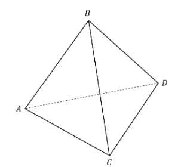

# Exam Questions — Vectors in 3 Dimensions
**Vectors** · Cambridge (CIE) A-LEVEL maths (9709)
> Source: [https://www.savemyexams.com/a-level/maths/cie/20/pure-3/topic-questions/](https://www.savemyexams.com/a-level/maths/cie/20/pure-3/topic-questions/) · 19 questions across 1 sets

## Exam Questions (19 questions)

### Q1 — easy — 4 marks

**Q1** [4 marks]

With respect to the origin $O$, the points $P$, $Q$ and $R$ have position vectors given by

$\overset{\rightarrow}{OP} = 4 i - 3 j + 12 k ,  \overset{\rightarrow}{OQ} = 3 i - 7 j + 9 k ,  \overset{\rightarrow}{OR} = 7 i - 9 j + 15 k$

Find the lengths $P Q$, $P R$ and $Q R$. Hence determine whether the triangle $P Q R$ is scalene, isosceles or equilateral.

### Q2 — easy — 4 marks

**Q2** [4 marks]

The vectors $p$ and $q$ are defined by

`\mathbf{p} = 14 \mathbf{i} + \left(a + b\right) \mathbf{j} + \left(c - b + 1\right) \mathbf{k}`

$q = a i + 6 j - 4 k$

Given that $p = 2 q$, find the values of $a$, $b$ and $c$.

### Q3 — easy — 4 marks

**Q3** [4 marks]

In the triangle $A B C$, the vectors $\overset{\rightarrow}{AB}$ and $\overset{\rightarrow}{AC}$ are given by

$\overset{\rightarrow}{AB} = i + 4 j - 2 k$

$\overset{\rightarrow}{AC} = 6 i - 2 j + 8 k$

(i) Find the vector $\overset{\rightarrow}{BC}$.

(ii) Hence, or otherwise, find the length of $B C$.

### Q4 — easy — 3 marks

**Q4** [3 marks]

With respect to the origin $O$, the points $A$ and $B$ have position vectors given by

$\overset{\rightarrow}{OA} = 3 i - 4 j + 2 k$

$\overset{\rightarrow}{OB} = - 5 i + 2 j - 8 k$

Find the exact length of $A B$.

### Q5 — easy — 5 marks

**Q5** [3 marks]

With respect to the origin $O$, the points $P$ and $Q$ have position vectors given by

$\overset{\rightarrow}{OP} = 2 i - j - 5 k$

$\overset{\rightarrow}{OQ} = - 6 i - 12 j + 11 k$

(i) Find the vector $\overset{\rightarrow}{PQ}$.

(ii) Find the length of $P Q$.

**Q5** [2 marks]

Find a unit vector parallel to $\overset{\rightarrow}{PQ}$.

### Q6 — easy — 3 marks

**Q6** [1 mark]

With respect to the origin $O$, the point $A$ has position vector $\overset{\rightarrow}{OA} = - 3 i + 4 j + 9 k$.

The vectors $\overset{\rightarrow}{AB}$ and $\overset{\rightarrow}{CD}$ are given by

$\overset{\rightarrow}{AB} = 4 i - 5 j + 2 k$

$\overset{\rightarrow}{CD} = - 2 i + \frac{5}{2} j - k$

Find the position vector of $B$.

**Q6** [2 marks]

State whether or not the vectors $\overset{\rightarrow}{AB}$ and $\overset{\rightarrow}{CD}$ are parallel, giving a reason for your answer.

### Q7 — easy — 8 marks

**Q7** [2 marks]

The diagram below shows a cube whose vertices are $O$, $A$, $B$, $C$, $D$, $E$, $F$ and $G$.

The vectors $a$, $b$ and $c$ are $\overset{\rightarrow}{OA}$, $\overset{\rightarrow}{OB}$ and $\overset{\rightarrow}{OC}$ respectively.

Find $\overset{\rightarrow}{OF}$ and $\overset{\rightarrow}{OG}$ in terms of $a$, $b$ and $c$.

**Q7** [3 marks]

(i) Explain why $\overset{\rightarrow}{GE} = a$.

(ii) Show that $\overset{\rightarrow}{OF} + \overset{\rightarrow}{FE} = \overset{\rightarrow}{OG} + \overset{\rightarrow}{GE}$. Hence state $\overset{\rightarrow}{OE}$ in terms of $a$, $b$ and $c$.

**Q7** [3 marks]

It is now given that $\overset{\rightarrow}{OA} = 5 i$.

Find the exact length of $O E$.

### Q8 — hard — 5 marks

**Q8** [5 marks]

The vectors $a$ and $b$ are defined by

$a = p q i - 24 j + 9 r k$

`\mathbf{b} = 6 \mathbf{i} + \left(p - r\right) \mathbf{j} + \left(p - 3 q\right) \mathbf{k}`

Given that $a = 3 b$ and that $r > 0$, find the values of $p$, $q$ and $r$.

### Q9 — very_hard — 6 marks

**Q9** [6 marks]

$A$, $B$, $C$ and $D$ are the vertices of a regular tetrahedron.

With respect to the origin $O$, the points $A$, $B$, $C$ and $D$ have position vectors given by

`\overrightarrow{OA} = \begin{pmatrix} 1 \\ 1 \\ 1 \end{pmatrix} , \quad \overrightarrow{OB} = \begin{pmatrix} - 8 \\ 10 \\ 1 \end{pmatrix} , \quad \overrightarrow{OC} = \begin{pmatrix} - 3 \\ 6 \\ - 10 \end{pmatrix} , \quad \overrightarrow{OD} = \begin{pmatrix} - 2 k \\ 13 \\ k \end{pmatrix}`

Find the position vector of $D$.

### Q10 — very_hard — 11 marks

**Q10** [11 marks]

The diagram below shows a cuboid whose vertices are $O$, $A$, $B$, $C$, $D$, $E$, $F$ and $G$.

$P$ is a point on the diagonal $O E$ that divides $O E$ in the ratio $a : b$, where $a > b$.

Show that if line segment $B P$ is extended it will intersect $F E$, and show that $F E$ is divided in the ratio `\left(a - b\right) : b` by the point of intersection.

### Q11 — hard — 3 marks

**Q11** [3 marks]

With respect to the origin $O$, the points $A$ and $B$ have position vectors given by

`\overrightarrow{OA} = \begin{pmatrix} 5 \\ 0 \\ - 1 \end{pmatrix}`

`\overrightarrow{OB} = \begin{pmatrix} k \\ - 2 \\ 3 k \end{pmatrix}`

Given that $A B = 6 \sqrt{k}$ and that $O B = \sqrt{14}$, find the value of $k$.

### Q12 — hard — 9 marks

**Q12** [9 marks]

The diagram below shows a cube whose vertices are $O$, $A$, $B$, $C$, $D$, $E$, $F$ and $G$.

The vectors $a$, $b$ and $c$ are $\overset{\rightarrow}{OA}$, $\overset{\rightarrow}{OB}$ and $\overset{\rightarrow}{OC}$ respectively.

Using vector methods, show that the diagonals $C D$ and $B F$ bisect each other.

### Q13 — hard — 4 marks

**Q13** [4 marks]

With respect to the origin $O$, the points $P$, $Q$ and $R$ have position vectors given by

`\overrightarrow{OP} = \begin{pmatrix} 2 \\ - 3 \\ 1 \end{pmatrix} , \quad \overrightarrow{OQ} = \begin{pmatrix} - 1 \\ - 4 \\ 3 \end{pmatrix} , \quad \overrightarrow{OR} = \begin{pmatrix} k \\ 0 \\ 3 \end{pmatrix}`

Given that the triangle $P Q R$ is isosceles and that $k > 1$, find the value of $k$.

### Q14 — medium — 4 marks

**Q14** [4 marks]

The vectors $a$ and $b$ are defined by

`\mathbf{a} = \left(p + 1\right) \mathbf{i} - 7 \mathbf{j} + \left(q - 3 p\right) \mathbf{k}`

`\mathbf{b} = 5 \mathbf{i} + \left(14 q + r\right) \mathbf{j} + \left(1 - 2 r\right) \mathbf{k}`

Given that $a = b$, find the values of $p$, $q$ and $r$.

### Q15 — medium — 3 marks

**Q15** [3 marks]

With respect to the origin $O$, the points $A$ and $B$ have position vectors given by

`\overrightarrow{OA} = \begin{pmatrix} - 1 \\ 3 \\ 14 \end{pmatrix}`

`\overrightarrow{OB} = \begin{pmatrix} 2 k \\ 3 k \\ 13 \end{pmatrix}`

Given that $A B = \sqrt{163}$ and that $k$ is an integer, find the value of $k$.

### Q16 — medium — 3 marks

**Q16** [3 marks]

With respect to the origin $O$, the points $A$ and $B$ have position vectors given by

`\overrightarrow{OA} = \begin{pmatrix} - 2 \\ 5 \\ - 7 \end{pmatrix}`

`\overrightarrow{OB} = \begin{pmatrix} - 7 \\ k \\ 3 \end{pmatrix}`

Given that $A B = 5 \sqrt{14}$, find the possible values of $k$.

### Q17 — medium — 4 marks

**Q17** [4 marks]

With respect to the origin $O$, the points $P$, $Q$ and $R$ have position vectors given by

`\overrightarrow{OP} = \begin{pmatrix} 12 \\ 3 \\ - 3 \end{pmatrix} , \quad \overrightarrow{OQ} = \begin{pmatrix} 7 \\ - 8 \\ k \end{pmatrix} , \quad \overrightarrow{OR} = \begin{pmatrix} 3 \\ 3 \\ - 12 \end{pmatrix}`

Given that the triangle $P Q R$ is equilateral, find the value of $k$.

### Q18 — medium — 8 marks

**Q18** [2 marks]

The diagram below shows a cube whose vertices are $O$, $A$, $B$, $C$, $D$, $E$, $F$ and $G$.

The vectors $a$, $b$ and $c$ are $\overset{\rightarrow}{OA}$, $\overset{\rightarrow}{OB}$ and $\overset{\rightarrow}{OC}$ respectively.

Find $\overset{\rightarrow}{OE}$ and $\overset{\rightarrow}{AG}$ in terms of $a$, $b$ and $c$.

**Q18** [2 marks]

Let $P$ be a point on $O E$, and let $Q$ be a point on $A G$.

Explain why the vectors $\overset{\rightarrow}{OP}$ and $\overset{\rightarrow}{OQ}$ can be expressed in the forms

$\overset{\rightarrow}{OP} = λ \overset{\rightarrow}{OE}$

$\overset{\rightarrow}{OQ} = a + μ \overset{\rightarrow}{AG}$

where $λ$ and $μ$ are constants with $0 \leq λ \leq 1$ and $0 \leq μ \leq 1$.

**Q18** [4 marks]

By solving the equation $\overset{\rightarrow}{OP} = \overset{\rightarrow}{OQ}$, using your results from parts (a) and (b), show that the diagonals $O E$ and $A G$ intersect each other, and determine the ratios into which they are cut by the point of intersection.

### Q19 — medium — 3 marks

**Q19** [3 marks]

The vectors $a$ and $b$ are defined by

$a = - 12 i - 7 j + 15 k$

`\mathbf{b} = 4 p \mathbf{i} + \left(p q r + 2 q r - p\right) \mathbf{j} - p q \mathbf{k}`

Given that $a = b$, find the values of $p$, $q$ and $r$.
