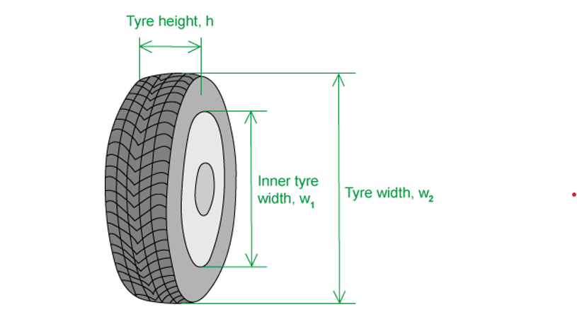
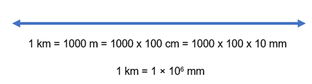
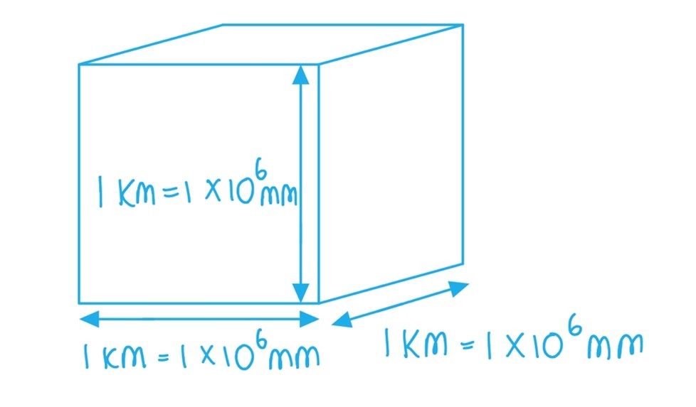
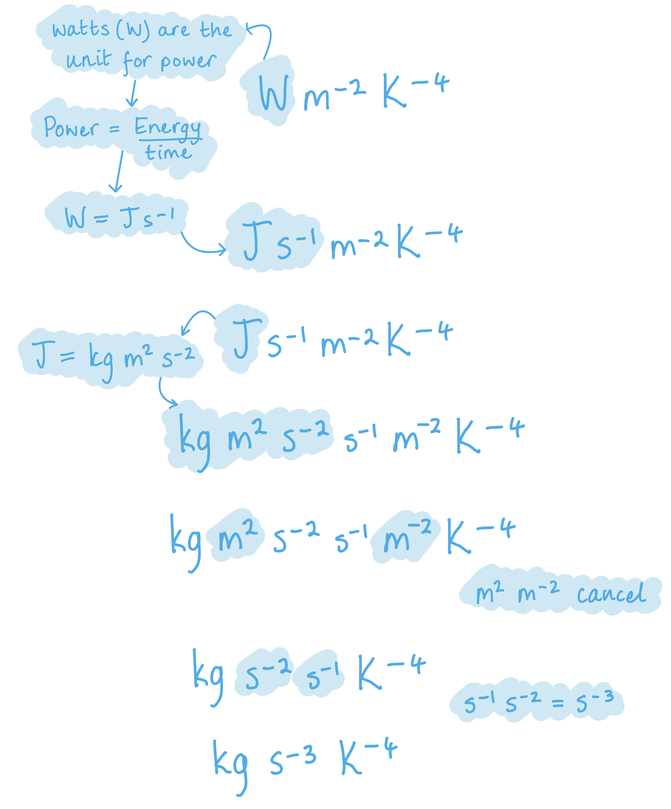
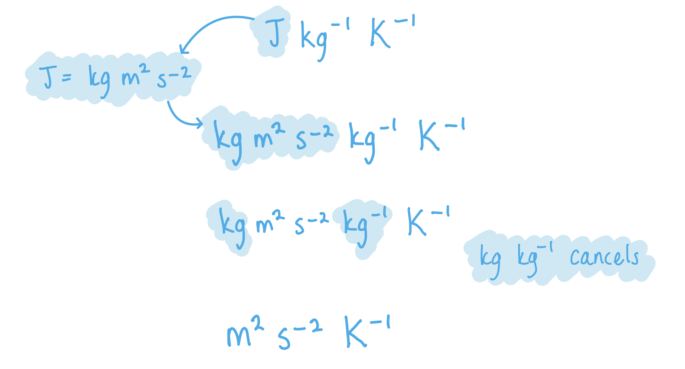

# Mark Schemes — Physical Quantities
**1. Physical Quantities & Units** · Cambridge (CIE) A-LEVEL physics (9702)

## Multiple Choice Questions (17 questions)

### Q1
**Final answer:** **The correct answer is C**

- Circumference of orbit = $2πr$
- A reasonable estimate for the radius of the Earth is $6400 \text{km} = 6 . 4 \times 10^{6} \text{m}$
- The altitude is given as $400 \text{km} = 4 \times 10^{5} \text{m}$
- Therefore, orbital radius

$r \approx 6 . 4 \times 10^{6} + 0 . 4 \times 10^{6} \approx 6 . 8 \times 10^{6} \text{m}$

- $π$ is $\approx3$
- Therefore

circumference $\approx 2 \times 3 \times 6 . 8 \times 10^{6} \approx 4 \times 10^{7} \text{m}$

- This is answer **C**

**A** is incorrect as this would require an orbital radius approximately 100 times smaller than the actual value

**B** is incorrect as this underestimates the orbital radius or uses an incorrect formula

**D** is incorrect as this overestimates the orbital radius by a factor of 10

### Q2
**Final answer:** **The correct answer is D**

- All physical quantities must have a magnitude and a unit

> **[exam-tip]**
> Remember, it is vector quantities that must have both a magnitude and direction.

### Q3
**Final answer:** **The correct answer is ****C**** because:**

- The person jumps from rest and lands with maximum velocity
- There is no rebound, so all the gravitational potential energy from the jump is transferred to kinetic energy

  - $E_{p}=mgh=m\times10\times2=20m$
  - $E_{p}=E_{k}$
  - $20m=\frac{1}{2}mv^{2}$
  - $v^{2=}\frac{2\times20m}{m}$
  - $v=\sqrt{40}\approx6ms^{-1}$
- The person's change in momentum is:

  - Change in momentum = final momentum – initial momentum
  - $\Delta p = m ( v - u )$
  - $\Delta p = m ( 6 - 0 ) = 6 m$

- Use the answer options to find an estimate for the mass of the person:
- Option **C**: 4 × 102 kg m s–1 = 6*m*

  - Rearrange to calculate mass: $m=\frac{4\times10^{2}}{6}$
  - So, $m=66.7\approx70\mathrm{kg}$
- This is a suitable estimate for the mass of an adult person, so the correct answer is **C**,** **4 × 102 kg m s–1

**A** is incorrect as $m=\frac{4\times10^{0}}{6}\approx0.7\mathrm{kg}$ is too low an estimate for the mass of a person.

**B** is incorrect as $m=\frac{4\times10^{1}}{6}\approx7\mathrm{kg}$ is too low an estimate for the mass of a person.

**D** is incorrect as $m=\frac{4\times10^{3}}{6}\approx700\mathrm{kg}$ is too high an estimate for the mass of a person.

### Q4
**Final answer:** **The correct answer is ****B**** because:**

- All physical quantities must have

  - a magnitude
  - a unit
- They don't have to have a direction, only vector quantities do

### Q5
**Final answer:** **The correct answer is ****C**** because:**

- Hydrostatic pressure = $ρgh$

  - A reasonable estimate for the density $ρ$ of sea water is 1000 kg m−3
  - A reasonable estimate for the gravitational field strength $g$ on Earth is 10 N kg−1
  - The depth $h$ of the Mariana Trench is given as 11 000 m
- So, hydrostatic pressure $\approx1000\times10\times11000\approx1.1\times10^{8}\mathrm{Pa}$
- Total pressure = hydrostatic pressure + atmospheric pressure
- Atmospheric pressure is approximately 100 kPa ≈ 1 × 105 Pa

  - This is much smaller than the hydrostatic pressure, so it can be ignored in this case
- Therefore, total pressure $\approx1\times10^{8}\mathrm{Pa}$

  - This is answer **C**

### Q6
**Final answer:** **The correct answer is ****D**** because:**

- A reasonable estimate for the mass of a sugar cube is 1 g = 1 × 10−3 kg
- A reasonable estimate for the volume of a sugar cube is 1 cm3 = 1 × 10−6 m3
- Therefore a reasonable estimate for the density of a sugar cube is:

  - $ρ=\frac{m}{V}$
  - $ρ\approx\frac{1\times10^{-3}}{1\times10^{-6}}\approx1000\mathrm{kg}m^{-3}$

Converting cm3 to m3 is a conversion that you need to be familiar with.

- 1 m = 100 cm
- Therefore, 1 m3 = 1003 cm3 = 1 000 000 cm3
- And, 1 cm = 0.01 m
- Therefore, 1 cm3 = 0.013 m3 = 0.000 001 m3

### Q7
**Final answer:** **The correct answer is ****C**** because:**

- The wavelength of UV light is about 10nm
- Using the wave equation $c=fλ$

- $f=\frac{3\times10^{8}}{10\times10^{-9}}=3\times10^{16}\mathrm{Hz}$
- *This is incorrect by a factor of  10**4*

**A** is incorrect because statement is correct, 1 atm is equal to 1×105 Pa

**B** is incorrect because the time it takes for light to reach the Earth from the Sun is calculated by * *

$\frac{1AU}{\mathrm{Speed} \mathrm{of} \mathrm{light}}=\frac{1.5\times10^{11}}{3\times10^{8}}=500s=5\times10^{2}s$

**D** is incorrect because if we calculate the life-span of the person in the question we get $\frac{2\times10^{9}}{365\times24\times60\times60}$ = 63 years, which is a reasonable estimation

### Q8
**Final answer:** **The correct answer is ****C**** because:**

- A reasonable estimate for the number of seconds in a year is 365 days × 24 hours × 60 min × 60 s
- 365 × 24 × 60 × 60 = 31 536 000 = 3 × 107 s (1 s.f.)

This is a really important estimate that you need to use a lot in calculations. Always use (365 × 24 × 60 × 60) as the estimate, not the rounded figure.

### Q9
**Final answer:** **The correct answer is ****B**** because:**

- A reasonable estimate for the mass of a litre carton on milk is 1 kg
- A reasonable estimate of the gravitational field strength on Earth is 10 N kg−1
- A reasonable estimate for the height of an adult male is 2 m
- Therefore, a reasonable estimate for the gravitational potential energy of the milk carton is:

  - $E_{p}=mg\Deltah$
  - $E_{p}\approx1\times2\times10\approx20J$

### Q10
**Final answer:** **The correct answer is ****B**** because:**

- The speed of light in free space, *c* = 3.00 × 108 m s−1 (from the data page)
- $v=\frac{s}{t}\rightarrowt=\frac{s}{v}\rightarrowt=\frac{s}{c}$
- A hydrogen nucleus contains one proton

  - A reasonable estimate for the diameter of a hydrogen nucleus is 1 × 10−15 m
- Therefore, $t=\frac{s}{c}\approx\frac{1\times10^{-15}}{3.00\times10^{8}}\approx3.3\times10^{-24}s$

### Q11
**Final answer:** **The correct answer is ****D**** because:**

- Gravitational force, or weight, is given by $W=mg$
- On Earth, $g\approx10N\mathrm{kg}^{-1}$
- The mass of a person on Earth is

  - $m=\frac{W}{g}$
  - $m\approx\frac{700}{10}\approx70\mathrm{kg}$
- 70 kg is a reasonable estimate for the mass of an adult person

**A** is incorrect as $m\approx\frac{50}{10}\approx5\mathrm{kg}$ is not a reasonable estimate for the mass of an adult person

**B** is incorrect as $m\approx\frac{300}{10}\approx30\mathrm{kg}$ is not a reasonable estimate for the mass of an adult person

**C** is incorrect as $m\approx\frac{400}{10}\approx40\mathrm{kg}$ is not a reasonable estimate for the mass of an adult person

### Q12
**Final answer:** **The correct answer is ****D**** because:**

- Volume has the symbol $V$ and its units are m3 

**A** is incorrect because the symbol for potential difference is $V$, but its units are V

**B** is incorrect because the symbol for velocity is $v$ and its units are m s−1

**C** is incorrect because the symbol for pressure is $p$ and its units are N m−2 or Pa

### Q13
**Final answer:** **The correct answer is ****D**** because:**

- Modelling the tyre as a hollow cylinder with inner width $w_{1}$, outer width $w_{2}$, and height $h$

  - Volume of a cylinder: $V=πr^{2}h$
  - The air occupies the outer width of the tyre only
  - Volume of air in tyre = total volume of tyre - volume of inner tyre
  - $V = \mathrm{\pi } h ( 1 \frac{1}{2} w_{2} )^{2} - \mathrm{\pi } h ( 1 \frac{1}{2} w_{1} )^{2}$
  - $V = \frac{ \mathrm{\pi } h}{4} ( w_{2}^{2} - w_{1}^{2} )$
- Some reasonable estimates are:* *$h$ ~ 15 cm, $w_{1}$ ~ 30 cm and $w_{2}$ ~ 60 cm
- Volume of air in tyre $\approx \frac{ \mathrm{\pi } \times 0.15}{4} ( 0.6^{2} - 0.3^{2} ) = 0.03 \mathrm{m}^{3}$

**A** is incorrect because a bus weighs at least 104 kg and would be travelling at least 10 m s-1. Therefore, its kinetic energy would be around 105 - 106 J, which is 1 or 2 orders of magnitude greater than 30 000 J.

**B** is incorrect because the standard wattage of a domestic light bulb is 60 W

**C** is incorrect  because 300 K in Celsius is 300 - 273 = 27 °C, whereas a hot oven would be at least 200 °C, which is 200 + 273 = 473 K

### Q14
**Final answer:** **The correct answer is ****D**** because:**

- Acceleration has the symbol $a$* *and the unit m s−2 

**A** is incorrect because the activity of a radioactive source has the symbol $A$ and the unit Bq

**B** is incorrect because amplitude has the symbol $x_{0}$ and the unit m

**C** is incorrect because the Avogadro constant has the symbol $N_{A}$ and the unit mol−1

### Q15
**Final answer:** **The correct answer is ****C**** because:**

- The question asks you to select the correct statement which uses quantities only
- Force and area are both quantities, not units

**A** is incorrect as while the statement is correct, a metre is a unit

**B** is incorrect as the statement is incorrect, potential difference is the energy per unit charge

**D** is incorrect as while the statement is correct, second is a unit

### Q16
**Final answer:** **The correct answer is ****B**** because:**

- 1 ml = 1 cm3
- This estimated equivalence is used when determining the density of irregularly shaped objects
- The displaced water in ml is equal to the volume of the object in cm3

### Q17
**Final answer:** **The correct answer is ****D**** because:**

- The range of visible light is about 400 – 700 nm, so 500 nm is a reasonable estimate for the wavelength of green light
- You should have a rough idea of the ranges of each section of the electromagnetic spectrum

**A** is incorrect as with a frequency of 500 pHz (500 × 10-12), this would equate to a wavelength of $λ=\frac{v}{f}=\frac{3\times10^{8}}{500\times10^{-12}}=6\times10^{17}m$. Typical radio wavelengths range from 1 mm to 100 km, so the estimated value is far too high.

**B** is incorrect as in kg, 500μg works out as 500 × 10-6 × 10-3 = 5 × 10–7 kg. The mass of a proton is 1.67 × 10–27 kg, so the estimated value is far too high

**C** is incorrect as typical values for the Young Modulus of a metal usually range from 50 to 400 GPa, so the estimated value is far too low.

## Structured Questions (8 questions)

### Q1
Estimates of the orders of magnitude of the quantities are:

| quantity | order of magnitude | unit |
|---|---|---|
| mass of a car | **1 × 10****3**** ****[1 mark]** | kg |
| thickness of a sheet of paper | **1 × 10****−1**** [1 mark]** | mm |
| density of air  (at room temperature and pressure) | **1 × 10****-3**** [1 mark]** | g cm−3 |
| time between two heartbeats | **1 × 10****0**** [1 mark]** | s |

** ****[Total: 4 marks]**

> *You should know that the mass of a car is of the order of 1 ton which is 1000 kg.*

> *You can estimate the thickness of a sheet of paper by considering a stack of 500 sheets (think about the stacks of paper that you can buy for printers), these are about 1 inch thick which is 2.5 cm or 25 mm, so 1 sheet of paper is about 25 / 500 = 0.05 mm thick.*

> *You should also know that the density of air is about 1 kg m**−3** or 0.001 g cm**-3**.*

> *You can consider a heartbeat and the number of beats per minute to calculate the time between two beats, it's roughly 1 s depending on your resting heart rate.*

### Q2
List known quantities:

- Volume = 2000 km3

Recall the metric multipliers:

- k = kilo = 103
- m = milli = 10–3

Convert km3 into mm3:

- 1 km = 1 × 106 mm **[1 mark]**
- 1 km3 = (1 × 106)3 mm3 = 1 × 1018 mm3 **[1 mark]**

Convert 2000 km3 into mm3:

- 2000 km3 = 2000 × (1 × 1018) = 2 × 1021 mm3 **[1 mark]**

**[Total: 3 marks]**

> *Recognising that there are 1 × 10**18** mm**3** in 1 km**3** is the key to answering this question correctly.*

> * Volume of a cube = length × width × height = (1 × 10**6**) × (1 × 10**6**) × (1 × 10**6**) = 1 × 10**18** mm**3*
List the known quantities and expand the multipliers:

- Wavelength of pulsar = 8.0 nm = 8.0 × 10–9 m **[1 mark]**

From the data page:

- Speed of light in free space, *c* = 3.00 × 108 m s-1

Recall the metric multiplier:

- Nano = × 10–9

Recall and rearrange the wave speed equation:

- $c=fλ$
- $f=\frac{c}{λ}$ **[1 mark]**

Calculate the frequency:

- $f=\frac{3.0\times10^{8}}{8.0\times10^{-9}}$ = 3.75 × 1016 Hz  **[1 mark]**

Write answer to an appropriate number of significant figures:

- *f* = 3.8 × 1016 Hz **[1 mark]**

**[Total: 3 marks]**

> *Make sure you read the question correctly, so you write your final answer in the correct form. 8.0 nm is the only quantity in the question. This is written to 2 significant figures. So, the final answer must also be written to 2 significant figures.*
List known quantities and expand the multipliers:

- Time from pulsar to Earth = 8.82 Gs = 8.82 × 109 s
- Frequency, *f* = 3.75 × 1016 Hz (from part (b))

Calculate the time period for one oscillation:

- $T=\frac{1}{f}$
- $T=\frac{1}{3.75\times10^{16}}$ **[1 mark]**

Find the number of oscillations:

- Number of oscillations = $\frac{\mathrm{total} \mathrm{time} \mathrm{of} \mathrm{journey}}{\mathrm{time} \mathrm{for}1\mathrm{oscillation}}$
- Number of oscillations = $( 3.75 \times 10^{16} ) \times ( 8.82 \times 10^{9} )$ = 3.3075 × 1026 **[1 mark]**

State to an appropriate number of significant figures:

- Number of oscillations = 3.31 × 1026 (3 s.f) **[1 mark]**

**[Total: 3 marks]**

> *Use the metric multipliers to correctly calculate the value of the giga prefix in standard form. Use your knowledge of time period and frequency to find the time for one oscillation of the pulsar. 8.82 Gs is the only quantity given in the question. This is to 3 significant figures, so the final answer must also be to 3 significant figures.*
To show that the distance is around 280 light years:

List known quantities:

- Time = 8.82 Gs = 8.82 × 109 s
- Distance = 280 light years

From the data page:

- Speed of light in free space, *c* = 3.00 × 108 m s-1

Calculate the distance in m:

- Distance = speed of light × time
- Distance = (3 × 108) × (8.82 × 109) = 2.646 × 1018 m **[1 mark]**

Convert distance in m to light years:

- 1 light year = c × 1 year = $( 3.00 \times 10^{8} ) \times ( 60 \times 60 \times 24 \times 365 ) = 9.46 \times 10^{15} \mathrm{m}$ **[1 mark]**

Divide the total distance by the distance in one light year

- $\frac{2.646\times10^{18}}{9.46\times10^{15}}$= 279.704 = 280 light years **[1 mark]**

**[Total: 3 marks]**

> *Don't forget that light years are a unit of distance not time.*

> *Remember to use previous parts of the question for quantities that appear missing from the question.*

### Q3
A physical quantity is:

- A property that can be measured **OR**
- Something that consists of a magnitude / numerical value and a unit; **[1 mark]**

**[Total: 1 mark]**
A** **physical quantity that can be represented by the symbol $ρ$ is:

- Density
**OR**
- Resistivity; **[1 mark]**

**[Total: 1 mark]**
A physical quantity that can be represented by $P$ or $p$ is:

Any **one **from:

- Pressure; **[1 mark]**
- Momentum; **[1 mark]**
- Power; **[1 mark]**

**[Total: 1 mark]**
The quantities represented by $ρ$, $p$, or $P$ can be distinguished from each other by:

Any **one **from:

- Looking at the units (of measurement); **[1 mark]**
- Interpreting the context of the quantity; **[1 mark]**
- Using units to check the homogeneity of physical equations; **[1 mark]**

**[Total: 1 mark]**

### Q4
(i) To find the thickness of one sheet of paper without using a micrometer:

- Use a ruler to measure the total thickness (of the stack); **[1 mark]**
- Divide the measurement by 500; **[1 mark]**

(ii) A suitable unit for the thickness of paper is:

- millimetres / mm **OR**
- micrometres / µm; **[1 mark]**

**[Total: 3 marks]**
A method the student could use to obtain an accurate value for the period of one complete oscillation:

- Measure the time for 10 complete oscillations; **[1 mark]**
- Divide the total time by 10 to find the period; **[1 mark]**
- Repeat the measurement several times and calculate a mean; **[1 mark]**

**[Total: 3 marks]**
The paper ball is thrown:

- 2 m **[1 mark]**

**[Total: 1 mark]**

> *Any value between 1 and 5 m is acceptable to gain the marks in this question. *
The tennis ball will:

- Travel further (than the paper ball); **[1 mark]**

Explanation:

- The tennis ball has a greater mass, so it experiences a smaller deceleration due to air resistance; **[1 mark]**

**[Total: 2 marks]**

### Q5
The correct SI base units and estimates for order of magnitude are:

**One**** mark for each correct row:**

| **physical quantity** | **SI base unit** | **order of magnitude** |
|---|---|---|
| acceleration of free-fall on Earth (*g*) | m s−2 | **Final answer:** **10****1** |
| Stefan-Boltzmann constant (*σ)* | **Final answer:** ** kg s****−3**** K****−4** | 10−7 |
| speed of a *β* particle | **Final answer:** **m s****-1** | **Final answer:** ** 10****8** |
| specific heat capacity of water (*c*) | **Final answer:** ** m****2**** s****−2**** K****−1** | **Final answer:** ** 10****3** |

**[Total: 4 marks]**

> *The acceleration of freefall on Earth,** g**, is 9.81 m s**−2**. This quantity is already given in SI base units and the order of magnitude is 10**1** as 10**1** = 10.*

> *The Stefan-Boltzmann constant **σ** is given in the data booklet as 5.67 × 10**−8** W m**−2** K**−4**. Rounded to the nearest power of ten, the order of magnitude is 10**−7*

> *The units of the Stefan-Boltzmann constant **σ **are:*

> *The speed of a **β** particle can be approximated to the speed of light since a **β **particle is a high-speed electron. The speed of light in a vacuum **c** is given in the data booklet as 3.00 × 10**8** m s**−1*

> *Metres and seconds are already SI base units, and rounded to the nearest power of 10, the order of magnitude is 10**8*

> *The specific heat capacity **c** of water is not given in the data booklet, but you should be familiar with it from practising calculations. The specific heat capacity of water is about 4200 J kg**−1** K**−1**, or 4.2 × 10**3** J kg**−1** K**−1*

> *Rounded to the nearest power of 10, the order of magnitude is 10**3** and the units are:*

### Q6
The correctly completed table is as follows:

| physical quantity | symbol | unit |
|---|---|---|
| velocity | $v$ | m s-1 |
| **Final answer:** **work done** | $W$ | N m |
| stress | $σ$ | **Final answer:** **N m****-2** |
| **Final answer:** **density** | $ρ$ | kg m-3 |

- One mark for each correct row:

  - work done **[1 mark]**
  - N m−2 **[1 mark]**
  - density **AND** $ρ$ **[1 mark]**

**[Total: 3 marks]**
Estimate the work done by an average adult person lifting a dining room chair 1.0 m above the ground:

Estimate the average mass of a dining room chair:

- Mass of chair = 1 kg - 10 kg **[1 mark]**

Calculate an estimate of the work done, *W*:

- *W* = *Fd *=* mgd ***[1 mark]**
- Range: *W *= 10 J - 100 J **[1 mark]**
- Example calculation:

  - $W=mgd$
  - Where $m\approx5\mathrm{kg}$, $g\approx10N\mathrm{kg}^{-1}$, and $d=1.0m$
  - $W\approx5\times10\times1.0\approx50J$

**[Total: 3 marks]**

> *In an estimation answer, a range of estimated values will be acceptable. *

### Q7
Estimate the speed of an apple as it hits the ground after falling from a tree:

- Height of apple on a tree, *h* ≈ 5 m **[1 mark]**

*Acceptable range for h = 2 to 20 m*

Use energy conservation to estimate the speed:

- Change in GPE = Gain in KE
- $mgh=\frac{1}{2}mv^{2}$
- $v^{2}=2gh\Rightarrowv=\sqrt{2gh}$
- $v\approx\sqrt{2\times9.81\times5}$
- *v* ≈ 9.91 ≈ 10 m s−1 **[1 mark]**

*Acceptable range for v = 6 to 20 m* s−1

**[Total: 2 marks]**
Estimate the number of kilowatt-hours used by a lightbulb if switched on for a whole day:

- Power output of a lightbulb ≈ 70 W **[1 mark]**

*Acceptable range for power = 20 to 100 W*

Convert from W to kWh in 24 hours:

- $P=\frac{E}{t}\RightarrowE=Pt$
- Kilowatt-hours is a unit of energy, so $E ( k W h ) = \frac{P ( W ) \times t ( h r )}{1000}$
- $E ( k W h ) \approx \frac{70 \times 24}{1000}$
- *E*(kWh) ≈ 1.68 ≈ 1.7 kWh per day **[1 mark]**

*Acceptable range for E(kWh) = 0.5 to 2.4 kWh*

**[Total: 2 marks]**
Estimate the density, in g cm−3, of the head of an adult person:

- Radius of a head, *r* ≈ 10 cm **[1 mark]**

*Acceptable range for radius = 7 to 12 cm*

- Mass of a head, *m* ≈ 5 kg = 5000 g **[1 mark]**

*Acceptable range for mass = 1 to 10 kg (1000 to 10 000 g)*

Use the equation for volume of a sphere with the density equation:

- Volume of an adult's head ≈ volume of a sphere
- Volume of a sphere:  $V=\frac{4}{3}πr^{3}$
- Density:  $ρ=\frac{m}{V}=\frac{m}{\frac{4}{3}πr^{3}}$
- `rho = (5000)/(4 / 3 pi x ( 10 ) ^3)` **[1 mark]**
- $ρ$ = 1.194 = 1.2 g cm−3 **[1 mark]**

*Acceptable range for density = 0.1 to 7.0 g cm**−3*

**[Total: 4 marks]**

> *When asked a question, such as this, where you likely have no reference to make a reasonable estimate for something, like the mass of a person's head, think about reasonable approximations you could make*

> *For example, if the mass of an adult person is about 70 kg, you could make a reasonable assumption that their head might make up about 10% of this mass, which would be 7 kg*

> *It's important that you communicate this in your answer so the examiner can see your lines of thought, and even if you are outside of the acceptable range, you could still earn extra marks for method and reasoning*
Estimate the number of people it would take to circle the Earth holding hands:

- Radius of Earth, *r* = 6.4 × 106 m
- Arm span ≈ 2 m **[1 mark]**

*Acceptable range for arm span estimate = 1 to 3 m*

Calculate the circumference of Earth:

- Circumference of a circle = 2π*r*
- Circumference of Earth = 2π* *× (6.4 × 106) = 4 × 107 m **[1 mark]**

Calculate how many people would be needed:

- Each person spans approximately 2 m
- Number of people ≈ $\frac{circumferenceofEarth}{armspan}$
- Number of people ≈ $\frac{4\times10^{7}}{2}$ **[1 mark]**
- Number of people ≈ 2 × 107 **[1 mark]**

*Acceptable range for number of people estimate = 1.3 × 10**7** to 4 × 10**7*

**[Total: 4 marks]**

> *If you have approximated the arm span of a person to a different value than 2 m, that's ok, as long as it is a **reasonable** approximation. You may have said, 1.5 m or somewhere in between, and that's ok. You would still get the marks. But, if you approximated it to 5 m, this is **not** a reasonable estimation and you would not get the first mark. However, you would still get the other two marks if your calculations were correct, no matter what number you used.*

> *Questions that ask you to **estimate** may not always contain an unknown value that you need to approximate, like arm span in this question. They may just use inexact values such as the diameter of the Earth, or the mass of a proton as 1 atomic mass unit. Don't let this throw you, the calculation is just the same as it would be if you were using exact values. If you do approximate something, like the hand span, just remember to use the 'approximately equal to' sign ≈*

### Q8
A physical quantity is...

- A physical property that can be measured and quantified; **[1 mark]**

**[Total: 1 mark]**

> *An example of a physical quantity is mass which is measured in kg.*
The quantities which are not valid physical quantities are:

| kinetic energy $E_{k}$ measured in kg m2 s-2 |   |
|---|---|
| pressure $P$ measured in N kg−1 | **Final answer:** **✓** |
| Young modulus* *$E$ measured in Pa |   |
| frequency $f$ measured in s | **Final answer:** **✓** |
| specific heat capacity* *$c$ measured in J kg−1 | **Final answer:** **✓** |
| weight $W$ measured in kg m s-2 |   |

- pressure $P$ measured in N kg−1; **[1 mark]**
- frequency $f$ measured in s; **[1 mark]**
- specific heat capacity* *$c$ measured in J kg−1; **[1 mark]**

**[Total: 3 marks]**

> *The correct physical quantities are:*

- *E**k** = kinetic energy, measured in J or kg m**2** s**-2*
- *P** = pressure, measured in Pa or N m**-2*
- *E **= Young modulus, measured in Pa or N m**-2*
- *f** = frequency in Hz or s**-1*
- *c** = specific heat capacity, measured in J kg**−1 **K**−1** *
- *W** = weight measured in N or kg m s**-2*

> *You do not need to memorise all the symbols and units listed in the specification, but you do need a good level of recognition and understanding of which units belong to which quantity. Knowing the units will help you with the maths in physics, because the units tell you some of the physical quantities that you need in the calculation. For example the units for latent heat, **L**, are joules per kilogram, so you know you need energy divided by mass in that calculation.*

> *In other courses and textbooks, you may find different symbols used for different quantities. It is important that you use the symbols given in the CIE IAL specification.*
A table scoring 4 marks:

| quantity | estimated magnitude |
|---|---|
| Weight of an adult human | **700 N**** (±100 N) ****[1 mark] ** |
| **Seconds in an hour** **[1 mark]** | 3600 s |
| Wavelength of green light | **550 nm**** OR ****550×10****−9**** m** **[1 mark]** |
| **Room temperature**** ****[1 mark]** | 20 °C |

**[Total: 4 marks]**

> *The CIE IAL specification states that you should be able to make reasonable estimates of physical quantities included within the syllabus. The ones in this question are common ones. *

> *To estimate you can use the nearest order of magnitude, or choose rounded numbers to use in your calculation. For example, an estimate for the mass of an adult human is 70 kg, an estimate for the acceleration of freefall is 10 m s**−2**, therefore an estimate of weight is 70 × 10 = 700 N. *
