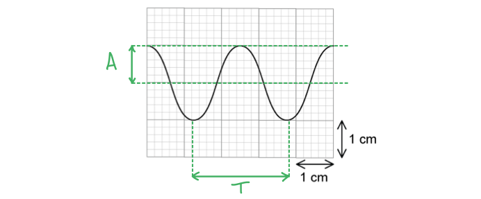
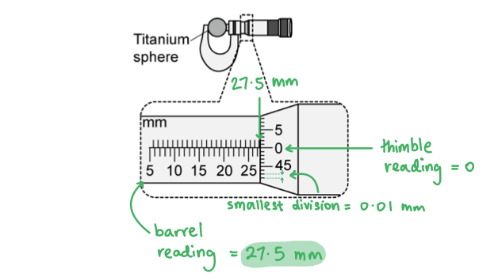
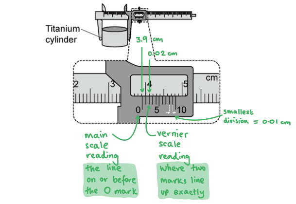
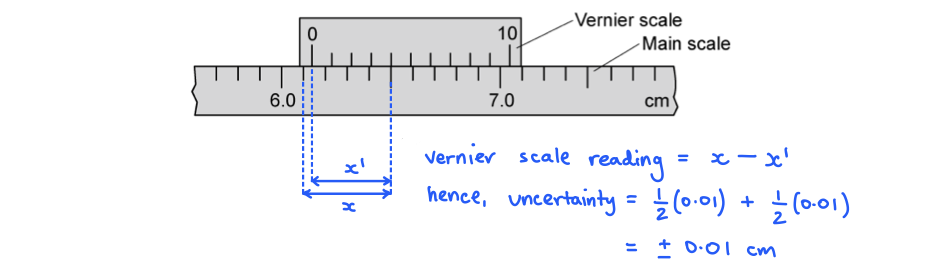
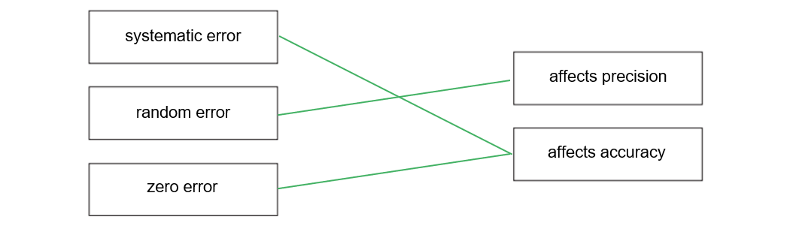

# Mark Schemes — Errors & Uncertainties
**1. Physical Quantities & Units** · Cambridge (CIE) A-LEVEL physics (9702)

## Multiple Choice Questions (22 questions)

### Q1
**Final answer:** **The correct answer is A**

- Systematic errors cause readings to differ from the true value by a consistent amount

  - This affects **accuracy**
- Since the error is repeated in every measurement, systematic errors **cannot **be reduced by averaging

**B** is incorrect because human reaction time usually varies slightly each time, making it a source of random error. Systematic errors tend to be caused by instrument faults (like zero errors) or experimental techniques.

**C** is incorrect because random errors affect precision (the scatter of results), not accuracy. Zeroing an instrument eliminates a zero error, which is a type of systematic error, not a random error.

**D** is incorrect because random errors cause readings to scatter around a mean value, which affects precision. Random errors can be reduced by taking multiple measurements and averaging.

### Q2
**Final answer:** **The correct answer is ****D**** because:**

- Looking at the equation for momentum

  - $p=mv=\frac{ms}{t}$
  - $\frac{\Deltap}{p}=\frac{\Deltam}{m}+\frac{\Deltas}{s}+\frac{\Deltat}{t}$
- We can see that for the uncertainty in momentum (Δ p) to have the least value, the uncertainties in all the quantities should be as small as possible
- The instruments which measure to a higher degree of precision will lead to less uncertainty in the value of momentum

  - The metre rule in 2 has a greater precision than 1 because the smallest scale division is in mm which is more accurate than cm.
  - The light gate in 4 has a greater precision than the wristwatch in 3 because 4.3 s is more accurate than 4.5 s
  - The balance which measures to the nearest g has a greater precision than the balance which measures to the nearest 10 g as it measures to an extra decimal point making the measurement more accurate

### Q3
**Final answer:** **The correct answer is ****D**** because:**

- If we are adding or subtracting quantities then we simply add the absolute uncertainties together

  - 0.02 + 0.03 = 0.05
- So the uncertainty in the difference in diameters is ± 0.05 mm

### Q4
**Final answer:** **The correct answer is ****C**** because:**

- Random errors affect precision, meaning they cause differences in measurements which causes a spread about the mean. Graph **C** shows a narrow curve, with a high peak so the measurements are close to each other, meaning the random error is low
- Systematic error affects accuracy, which causes all results to be too high or too low by the same amount each time. Graph **C** shows the measurements are consistent but they are much lower meaning the systematic error is high

**A **is incorrect because this graph shows a set of results with both low random and systematic errors

**B **is incorrect because this graph shows a set of results which have a low systematic error and a high random error

**D **is incorrect because this graph shows a set of results with both high random and systematic errors

### Q5
**Final answer:** **The correct answer is ****B**** because:**

- An accurate measurement is one which is close to the true value
- Precise measurements are consistent and they fluctuate slightly about a mean value
- The mean value of the measurements is 891.5 mm and the true value is 895 mm so the values are not accurate within 1mm
- The measurements are, however, consistent within 1 mm so they can be described as precise

### Q6
**Final answer:** **The correct answer is ****A**** because:**

- Random errors affect precision, meaning they cause differences in measurements which causes a spread about the mean
- Repeating the measurements at least three times and taking an average of them is one way to reduce random error because it reduces spread about the mean and also enables any anomalies to be spotted and discounted from the results

**B **is incorrect because random errors can be the result of either the person taking the measurement or the equipment being used

**C **is incorrect because systematic error affects accuracy and occurs due to the apparatus used or faults in the experimental method so adjusting the apparatus would help reduce systematic error

**D **is incorrect because systematic error affects accuracy, which causes all results to be too high or too low by the same amount each time

### Q7
**Final answer:** **The correct answer is ****C**** because:**

- The metre rule can measure to the nearest millimetre, so the answer must be recorded to 3 significant figures
- This is because:

  - A metre rule has a resolution of 1 mm = 0.1 cm = 0.001 m
  - So the measurement of 70 cm must be recorded to the same level of precision = 70.0 cm = 0.700 m

### Q8
**Final answer:** **The correct answer is**** C**** because:**

- To determine the acceleration of free fall, we will need to consider the equation

  - $s=ut+\frac{1}{2}at^{2}$
  - We can simplify this to $h=\frac{1}{2}gt^{2}$ or $g=\frac{2h}{t^{2}}$  since the falling body will initially be at rest, so *u* = 0 (*h* = height, *g* = acceleration of free fall, *t* = time)
- If the measured distance, *h*, was measured to be longer than the true distance, this would increase the measured value of *g* as the two quantities are directly proportional

**A** is incorrect because air resistance can be treated as negligible in this experiment, but even if we did factor it in, air resistance would increase the time which would lead to a decreased value of *g*

**B** is incorrect because the dimensions of the body are not relevant to the experiment

**D** is incorrect because if the time were measured to be longer than the true time, this would lead to a decreased value of *g* since it is inversely proportional to the square of the time (inverse square law)

### Q9
**Final answer:** **The correct answer is ****D**** because:**

- To determine the relationship between *g, h *and* t* we will need to consider the equation

  - $s=ut+\frac{1}{2}at^{2}$
- Since the falling body will initially be at rest, *u* = 0, the equation simplifies to

  - $h=\frac{1}{2}gt^{2}$
- Rearranging the equation above we can see

  - $g=\frac{2h}{t^{2}}$
- We can see that *g* and *h* are directly proportional so as *h* increases, *g* increases and vice versa
- We can see that *g* and *t* are inversely proportional, so as *t* increases, *g* decreases and vice versa
- Therefore, if *h* is measured correctly, *g* will be calculated correctly but if *t* is measured to be lower than it should this will cause *g* to be larger than it should be

**A **is incorrect because this would lead to a value of g which is smaller than it should be

**B & C **are incorrect because without knowing how much larger or smaller these quantities are, it’s not possible to say if *g* will be larger or smaller

### Q10
**Final answer:** **The correct answer is ****C**** because:**

- $\mathrm{average} \mathrm{speed}=\frac{\mathrm{distance}}{\mathrm{time}}=\frac{40.0}{2.50}=16.0ms^{-1}$(3 s.f.)
- To work out uncertainty in data which is multiplied or divided we add the percentage uncertainties

  - $\% \text{uncertainty} = \frac{uncertainty}{value} \times 100$
  - $( \frac{0.05}{2.50} \times 100 ) + ( \frac{0.1}{40} \times 100 ) = 2.0 \% + 0.25 \% = 2.25 \%$
- Then we find 2.25 % of 16 which is $16\times\frac{2.25}{100}=0.36$
- The precision of the uncertainty must match the precision of the value so average speed = 16.0 ± 0.4 m s–1

### Q11
**Final answer:** **The correct answer is ****D**** because:**

- The mean value of the current is $\frac{1.98+2.02}{2}=2.00A$
- The fluctuation between 1.98 A and 2.02 A is caused by random errors, so the random uncertainty is ±0.02 A
- The systematic uncertainty is ±1% which is 2.00 × $\frac{1}{100}$ = 0.02 A
- The total uncertainty = random uncertainty + systematic uncertainty

  - 0.02 + 0.02 = ±0.04 A
- So the current quoted should be 2.00 ± 0.04 A

### Q12
**Final answer:** **The correct answer is ****B**** because:**

- To find out which value has the greatest effect on the overall uncertainty, we have to compare the percentage uncertainty of each value

  - length, *l *: $\frac{0.002}{2.043} \times 100 = 0.1 \%$
  - diameter, *d** *2 : $2 \times \frac{0.02}{0.54} \times 100 = 7.4 \%$
  - force, *F *: $\frac{0.01}{19.62} \times 100 = 0.05 \%$
  - extension, *x :* $\frac{0.2}{5.2} \times 100 = 3.8 \%$
- The value with the largest percentage uncertainty is diameter

**Exam Tip:** The diameter has the largest effect on the value of Young Modulus due it being squared. When a quantity is raised to a power, you must multiply the percentage uncertainty by the power

### Q13
**Final answer:** **The correct answer is ****B**** because:**

- An accurate measurement is one which is close to the true value
- Precise measurements are consistent and they fluctuate slightly about a mean value
- The values fall outside of the 14.8 - 15.2 cm range which would be considered accurate, so the measurements in **B** can be described as not accurate
- The measurements are, however, consistent within the 14.0 - 14.4 cm range so they can be described as precise

**A **is incorrect because these measurements are not precise or accurate

**C **is incorrect because three of the measurements can be described as accurate and precise, but the outlier makes it neither of those

**D **is incorrect because these measurements are both precise and accurate

### Q14
**Final answer:** **The correct answer is ****D**** because:**

- Precise measurements are consistent, they fluctuate slightly about a mean value
- The measurements are, however, consistent so they are precise
- The true value of *g* is 9.81 m s-2 so the values are not accurate
- The measurements are, however, consistent so they are precise

### Q15
**Final answer:** **The correct answer is ****D**** because:**

- The equation for Young Modulus is:

  - $Y o u n g M o d u l u s = \frac{F o r c e ( F ) }{A r e a ( A ) } \times \frac{l e n g t h ( l ) }{e x t e n s i o n ( x ) } = \frac{l o a d \times l e n g t h}{\frac{pi}{4} \times d i a m e t e r ^{2} \times e x t e n s i o n}$
- To find the percentage uncertainty in Young Modulus we must add the uncertainties in the measurements
- We can ignore the $\frac{π}{4}$  since it is a constant with no units, and it is important to multiply the uncertainty in the diameter by 2 since the diameter is squared

  - % uncertainty = 2 + 0.2 + (2 × 1.5) + 1 = 6.2%

### Q16
**Final answer:** **The correct answer is ****A**** because:**

- The equation relating speed, distance and time is given by

  - $s p e e d ( v ) = \frac{d i s t a n c e ( s )}{t i m e ( t )}$
- The value and uncertainty in distance is:

  - s = 385 – 115 = 270 mm
  - Δ s = ± (1 + 1) = ± 2 mm
- The value and uncertainty in time is:

  - t = 3.50 – 1.50 = 2.00 s
  - Δ t = ± (0.02 + 0.02) = ± 0.04 s
- To work out the fractional uncertainty in speed:

  - $\frac{\Deltav}{v}=\frac{\Deltas}{s}+\frac{\Deltat}{t}$
  - $\frac{\Deltav}{v}=\frac{2}{270}+\frac{0.04}{2.00}$

### Q17
**Final answer:** **The correct answer is ****A**** because:**

- Systematic error affects accuracy and occurs due to the apparatus used or faults in the experimental method so adjusting the apparatus would help reduce systematic error

**B, C & D **are incorrect because these all involve repeating measurements and taking an average which is a way to reduce random error but not systematic error

### Q18
**Final answer:** **The correct answer is ****D**** because:**

- The uncertainty of a measuring instrument is estimated as plus or minus half the smallest scale division.
- For the thermometer in the question, each mark represents 1.0° C, so the uncertainty is ± 0.5° C
- The reading from this thermometer is 24.0° C, so the result can be written as 24.0 ± 0.5° C

**A & B **are incorrect because the readings are not quoted to the correct precision, and the uncertainties are incorrect

**C **is incorrect because even though the precision of the reading is correct, the uncertainty is too low

### Q19
**Final answer:** **The correct answer is ****D**** because:**

- An accurate measurement is one which is close to the true value
- Precise measurements are consistent and they fluctuate slightly about a mean value
- The true value of *g* is 9.81 m s-2 so the values given in **D** are not accurate
- The measurements in **D** are, however, consistent so they can be described as precise

**A **is incorrect because these measurements can be described as accurate and precise

**B **is incorrect because these measurements can be described as accurate but not precise

**C **is incorrect because these measurements are neither accurate or precise

### Q20
**Final answer:** **The correct answer is ****B**** because:**

- The equation relating density, mass and volume is given by

  - $d e n s i t y ( \\rho ) = \frac{m a s s ( m )}{v o l u m e ( v )}$
- The value and uncertainty in mass is:

  - *m* = 70 – 20 = 50 g
  - *Δ m* = ± (1 + 1) = ± 2 g
- The value and uncertainty in volume is:

  - *V* = 10 cm3
  - *ΔV* = ± 0.5 cm3
- To work out the uncertainty in density:

  - $\frac{\Deltaρ}{ρ}=\frac{\Deltam}{m}+\frac{\DeltaV}{V}$
  - $\frac{\Deltaρ}{ρ}=\frac{2}{50}+\frac{0.5}{10}=0.04+0.05=0.09$
  - $\frac{\Deltaρ}{ρ}=0.09,whereρ=5.0g\mathrm{cm}^{-3}$so
  - $\Delta \\rho = 5 \times 0.09 = 0.45 \mathrm{g} cm^{- 3} ( 2 s. f )$

### Q21
**Final answer:** **The correct answer is ****B**** because:**

- Precision is how close the measured values are to each other
- In a measuring instrument, the precision is indicated by the number of significant figures given by the instrument
- From the measurements, we can see that the readings are not very close to each other. This scatter of readings indicates the presence of random errors
- Even though the same instrument is used, the measurements are not given to the same number of decimal places, so the measurements are not precise
- Accuracy is how close a measured value is to the true value
- We can see that the individual measurements are not close to the average value of time. So, the measurements are not accurate, but the calculated experimental is correct

**A **is incorrect because even though the correct experimental value was achieved, the results do not show accuracy or precision so the experiment was not successful

**C **is incorrect because systematic error affects accuracy and occurs due to the apparatus used or faults in the experimental method, so if systematic errors are present then the measurements are not accurate

**D **is incorrect because the significant random errors indicate that the experiment was not successful, even though the calculated value is close to the actual value

### Q22
**Final answer:** **The correct answer is ****A**** because:**

- To determine the measurements needed to calculate the acceleration of free fall, we will need to consider the equation

  - $s=ut+\frac{1}{2}at^{2}$
  - We can simplify this to$h=\frac{1}{2}gt^{2}$ since the falling body will initially be at rest, i.e. *u* = 0  (*h* = height, *g* = acceleration of free fall, *t *= time)
- Rearranging the equation above we can see $g=\frac{2h}{t^{2}}$ so the only measurements required are the height and time of the fall

## Structured Questions (12 questions)

### Q1
To show that $n$ is equal to 2:

- List the known SI base units:

  - Mass $[ m ]$ = kg
  - Acceleration $[ a ]$ = m s−2
  - Density $[ \\rho ]$ = kg m-3
  - Area $[ A ]$ = m2
  - Velocity $[ v ]$ = m s−1
- Determine the units of $F$:

$F=ma$

$[ F ]$ = kg m s−2 **[1 mark]**

- Check the homogeneity of the units on both sides of the equation:

$F=kρAv^{n}$

$\text{kg} \mathrm{m} \mathrm{s}^{- 2} = \text{kg} \mathrm{m}^{- 3} \times \mathrm{m}^{2} \times ( \mathrm{m} \mathrm{s}^{- 1} )^{n}$

$m^{n}s^{-n}=\frac{\mathrm{kg}ms^{-2}}{\mathrm{kg}m^{-3}\timesm^{2}}$

$m^{n}s^{-n}=\frac{\mathrm{kg}ms^{-2}}{\mathrm{kg}m^{-1}}$

$m^{n}s^{-n}=m^{2}s^{-2}$

$n=2$ **[1 mark]**
(i) To calculate the percentage uncertainty in $F$:

- List the known quantities

  - Uncertainty in $ρ$ = ± 2%
  - Uncertainty in $A$ = ± 4%
  - Uncertainty in $v$ = ± 1%
- Add together the percentage uncertainties:

% uncertainty in $F$ = 2% + 4% + (2 × 1%)

% uncertainty in $F$ = ± **8%** **[1 mark]**

> **[exam-tip]**
> From the equation $F=kρAv^{2}$, the quantities $ρ$, $A$, and $v$ are multiplied together, so their percentage uncertainties are added together. $k$ can be ignored as its uncertainty is negligible. Since $v$ is squared, its percentage uncertainty must be multiplied by 2.

(ii) To determine $F$ with its absolute uncertainty:

- List the known quantities

  - Density of air, $ρ$ = 1.20 kg m-3
  - Cross-sectional area of car, $A$ = 5.1 m2
  - Speed of car, $v$ = 13.4 m s-1
  - Constant, $k$ = 0.28
- Calculate the drag force $F$:

$F=kρAv^{2}$

$F=0.28\times1.20\times5.1\times13.4^{2}$

$F=307.69...$

$F=308N$ **[1 mark]**

- Calculate the absolute uncertainty in $F$:

uncertainty in $F=0.08\times308$

uncertainty in $F=24.64$

uncertainty in $F=\pm24.6N$ **[1 mark]**

- State $F$ with its absolute uncertainty to the appropriate number of significant figures:

$F=$ $( 310 \pm 20 ) \mathrm{N}$ **[1 mark]**

> **[exam-tip]**
> The appropriate number of significant digits of a final value is related to precision. The percentage uncertainty of 8% is what decides the precision in the final value of $F$. The rule is to round the absolute uncertainty to one significant figure, (20) and then match the precision of the final value to this (the tens place value, 310). This ensures we don't claim more precision in our final result than we actually have.

### Q2
Determine the mean period of oscillation and its percentage uncertainty:

- Mean $T$ = $\frac{0.67+0.66+0.67+0.68+0.69+0.64+0.66+0.65+0.68+0.65}{10}$
- Mean $T$ = 0.67 s **[1 mark]**

Calculate the absolute uncertainty in *T*:

- Uncertainty in $T$ = ± half the range
- Uncertainty in $T$ = ± $\frac{1}{2}$ (0.69 – 0.64) = 0.025 s
- Uncertainty in $T$ = ±0.03 s **[1 mark]**

Calculate the percentage uncertainty in *T*:

- Percentage uncertainty in $T=\frac{0.03}{0.67}\times100$
- Percentage uncertainty in $T$ = 4.478 = ±4% **[1 mark]**
- Therefore, $T$ = 0.67 s ± 4%

**[Total: 3 marks]**
List the known quantities:

- Uncertainty in *L*, Δ*L* = 1.8%
- Uncertainty in *g*, Δ*g* = 1.6%

Calculate the time period, *T*:

- Time period, *T* = $\frac{\mathrm{total} \mathrm{time} \mathrm{of} \mathrm{oscillations}}{\mathrm{number} \mathrm{of} \mathrm{oscillations}}$
- $T=\frac{18.4}{20}$ = 0.92 s **[1 mark]**

Calculate the absolute uncertainty in *T*:

- `T = 2 pi sqrt( L / g ) = 2 pi ( L / g ) ^ 1 half`
- % uncertainty in *T* = $( 1 \frac{1}{2} \times 1.8 ) + ( 1 \frac{1}{2} \times 1.6 )$ = 1.7% **[1 mark]**
- Uncertainty in *T = *0.017 × 0.92 = 0.02 s (1 s.f) **[1 mark]**
- Therefore, *T* = 0.92 ± 0.02 s

**[Total: 3 marks]**

> *Break this question down into stages and make sure you propagate the uncertainty correctly.*

> *When propagating the uncertainty containing a square root of a quantity, remember that the square root of a number is the same as putting it to the power of ½.*
The readings are subject to systematic uncertainties because:

- The graph has a y-intercept; **[1 mark]**

The readings are subject to random uncertainties because:

- Points are scattered around the line of best fit; **[1 mark]**

**[Total: 2 marks]**
Determine the fractional error in *k*:

List the known quantities:

- Fractional error in *T*, $\frac{\DeltaT}{T}$ = *α*
- Fractional error in *m*, $\frac{\Deltam}{m}$ = *β*

Write an expression for the uncertainty of *k* in terms of *α* and *β*:

- Period of a mass-spring:  $T=2π\sqrt{\frac{m}{k}}\Rightarrowk=4π^{2}\frac{m}{T^{2}}$ **[1 mark]**
- $\frac{\Deltak}{k}=2\frac{\DeltaT}{T}+\frac{\Deltam}{m}$
- $\frac{\Deltak}{k}$ = 2*α* + *β ***[1 mark]**

**[Total: 2 marks]**

> *Remember the rules for propagating errors. These must be applied carefully to the rearranged form of this equation. These are:*

- *Values that are added or subtracted:*

  - *Add their **absolute** uncertainties*
  - *In this example, there are no quantities that are added or subtracted*

- *Values that are multiplied or divided:*

  - *Add their **percentage **or** fractional** uncertainties*
  - *In this example, **m** and **T** are divided so we can add %Δ**T** + %Δ**m**, or the fractional uncertainties (as shown in the mark scheme)*

- *Values that are to a power:*

  - *Multiply their **percentage **or** fractional** uncertainty by the power*
  - *In this example, T is squared, so its uncertainty is 2Δ**T*

### Q3
Calculate the pressure produced by the cube on the surface:

List the known quantities:

- Mass, *m* = 0.59 kg
- Length of cube,* L* = 6.0 cm = 0.06 m

Determine the pressure from the force and the area in contact with surface:

- Force on surface, *F* = weight = *mg *= 0.59 × 9.81* * **AND**
- Area in contact with surface, *A* = *L**2* = (0.06)2 **[1 mark]**
- Pressure:  $P=\frac{F}{A}$
- $P = \frac{m g}{L^{2}} = \frac{0.59 \times 9.81}{( 0.06 )^{2}}$ **[1 mark]**
- $P$ = 1607.75 = 1610 Pa (3 s.f.) **[1 mark]**

**[Total: 3 marks]**
List the known quantities:

- Mass, *m* = 0.59 ± 0.01 kg
- Cube length, *L* = 6.0 ± 0.1 cm
- Pressure, *P* = 1600 Pa (from **(a)**)

(i) Calculate the percentage uncertainty in the pressure:

- When multiplying data, add the fractional or percentage uncertainties
- When a quantity is raised to a power, multiply the uncertainty by the power
- Pressure:  $P=\frac{mg}{L^{2}}$
- Fractional uncertainty in *P*:  $\frac{\Delta P}{P} = \frac{\Delta m}{m} + ( 2 \times \frac{\Delta L}{L} )$
- % uncertainty in *P *= $[ ( \frac{0.01}{0.59} ) + 2 ( \frac{0.1}{6.0} ) ] \times 100 \%$ **[1 mark]**
- % uncertainty in *P *= 5.028 = 5 % **[1 mark]**

(ii) State the pressure, with its actual uncertainty:

- Actual uncertainty in *P* = 1600 × 0.05 = 80 Pa **[1 mark]**
- Pressure = 1600 ± 80 Pa **[1 mark]**

*Other acceptable answers for pressure = 1610 ± 80 or 1608 ± 81 Pa*

**[Total: 4 marks]**
Calculate the density of aluminium, in g cm−3, with its uncertainty:

List the known quantities:

- Mass, *m* = 0.59 ± 0.01 kg = 590 ± 10 g
- Cube length, *L* = 6.0 ± 0.1 cm

Calculate the density in g cm−3:

- Density:  $ρ=\frac{m}{V}$
- $\\rho = \frac{m}{L^{3}} = \frac{590}{( 6.0 )^{3}}$
- *ρ *= 2.731 = 2.7 g cm−3 **[1 mark]**

Determine the uncertainty in density:

- Uncertainty in *ρ*:  $\frac{\Delta \\rho }{\\rho } = \frac{\Delta m}{m} + ( 3 \times \frac{\Delta L}{L} )$
- $\frac{\Delta \\rho }{\\rho } = ( \frac{10}{590} ) + 3 ( \frac{0.1}{6.0} )$ **[1 mark]**
- $\frac{\Deltaρ}{ρ}$* *= 0.0669 = 0.07 **[1 mark]**

Quote the density and uncertainty to an appropriate amount of sig figs:

- Actual uncertainty in *ρ:*  $\Deltaρ$ = 2.73 × 0.07 = 0.18 = 0.2 g cm−3
- Density = 2.7 ± 0.2 g cm−3 **[1 mark]**

**[Total: 4 marks]**

> *Remember, the uncertainty must always be quoted to at least 1 sig fig less than the quantity itself - this is because you cannot know the uncertainty in a quantity to a greater precision that the quantity itself!*
(i) The type of error is:

- Systematic; **[1 mark]**
- (Because) all readings have the same error **OR **this error cannot be eliminated by repeating and averaging; **[1 mark]**

(ii) The readings are precise but not accurate because:

- Vernier callipers measure to a fraction of a millimeter / resolution of 0.1 mm, so the readings are precise **OR** if repeated, readings will be consistent / almost constant; **[1 mark]**
- But, all readings will have the same error, hence they are not accurate; **[1 mark]**

**[Total: 4 marks]**

### Q4
(i) To measure heights *h**1* and *h**2*:

- Use a metre ruler; **[1 mark]**

To ensure the measurements are as accurate as possible are:

**Final answer:** **Any ****one ****from:**

- Place the rule as close as possible to the ramp; **[1 mark]**
- Use a set square / spirit level to ensure the rule is vertical; **[1 mark]**
- Ensure the rule reads zero at the bench; **[1 mark]**
- Avoid parallax error e.g. use a set square / read the scale at eye level; **[1 mark]**

(ii) To measure the time taken:

- Use a timer / stopwatch; **[1 mark]**

To ensure the measurements are as accurate as possible are:

**Final answer:** **Any ****one ****from:**

- Start the timer immediately once the cylinder is released; **[1 mark]**
- Use a (fiducial) marker to mark the endpoint (to stop the timer at the same time); **[1 mark]**
- Repeat the experiment several times and take an average; **[1 mark]**

**[Total: 4 marks]**
The change in height Δ*h* is:

- $\Deltah=h_{1}-h_{2}$ = 67.5 − 8.6 = 58.9 cm

The uncertainty in Δ*h* is:

- The uncertainty in each measurement is 0.1 cm
- Since the values of *h* are subtracted, the uncertainty is 0.1 cm + 0.1 cm = 0.2 cm **[1 mark]**

Quote Δ*h *with its uncertainty:

- Δ*h *= 58.9 ± 0.2 cm **[1 mark]**

**[Total: 2 marks]**
(i) Calculate the mean value of *t* and its uncertainty

- Mean value of *t*:  $\frac{0.88+0.82+0.80+0.86}{4}=0.84s$**[1 mark]**
- Uncertainty in *t*:  $\pm 1 \frac{1}{2} ( r a n g e ) = \pm 1 \frac{1}{2} ( 0.88 - 0.80 ) = \pm 0.04 \mathrm{s}$**[1 mark]** ** **

(ii) Comment on the accuracy and precision of the data:

- Precision describes how close a set of measurements are to one another
- The readings are precise as they are reasonably close together; **[1 mark]**
- Accuracy describes how close the readings are to the true value
- The level of accuracy of the data cannot be determined (yet) **OR **it cannot be told whether the readings are close to the true value (yet); **[1 mark]**

(iii) Reducing *h**1* might improve the measurement of *t *because:

- The values of* t *will increase **OR** the cylinder will move more slowly; **[1 mark]**

**Final answer:** **As well as any ****one ****from:**

- So the percentage uncertainty in *t* will reduce; **[1 mark]**
- It will be easier to judge when the cylinder crosses the finish line; **[1 mark]**
- The effect of reaction time will be reduced; **[1 mark]**

**[Total: 6 marks]**
List the known quantities:

- Change in height, Δ*h* = 58.9 ± 0.2 cm
- Time taken, *t* = 0.84 ± 0.04 s
- Ramp length,* s* = 102.0 ± 0.1 cm

(i) Determine a value for *g:*

- $t^{2}=\frac{4s^{2}}{g\Deltah}\Rightarrowg=\frac{4s^{2}}{t^{2}\Deltah}$
- $g = \frac{4 \times ( 102 \times 10^{- 2} )^{2} }{( 0.84 )^{2} \times ( 58.9 \times 10^{- 2} ) }$ **[1 mark]**
- *g* = 10.014 = 10.0 m s−2 **[1 mark]** ** **

(ii) Determine the percentage uncertainty in the value of *g*

- When multiplying data, add the fractional or percentage uncertainties
- When a quantity is raised to a power, multiply the uncertainty by the power
- Fractional uncertainty in *g*:  $\frac{\Delta g}{g} = ( 2 \times \frac{\Delta s}{s} ) + \frac{\Delta ( \Delta h )}{\Delta h} + ( 2 \times \frac{\Delta t}{t} )$
- % uncertainty in *g *= $[ 2 ( \frac{0.1}{102} ) + ( \frac{0.2}{58.9} ) + 2 ( \frac{0.04}{0.84} ) ] \times 100 \%$ **[1 mark]**
- % uncertainty in *g *= 10.059 = 10 % **[1 mark]**

(iii) Deduce whether the measured value of *g* is accurate

Calculate the lower limit of *g*:

- Lower limit of g:  *g* × (1 − 0.10) = 10 × 0.90 = 9.0 m s−2 **[1 mark]**

Write a conclusion:

- The measured value of *g* is 10.0 ± 1.0 m s–2 and the accepted value of *g* is 9.81 m s–2 hence, the value is accurate (since this lies within the lower limit of *g*); **[1 mark]**

**[Total: 6 marks]**

> *When you see command words such as 'deduce', make sure to write a **conclusion** at the end in order to score top marks *

> *Knowing how to carry out the calculation is important, but examiners also want to see if you understand what you have calculated!*

### Q5
Use the data in Table 1.1 to calculate the speed $v$:

List the known quantities and convert into SI base units:

- $T$ = 1.8 N
- $l$ = 126 cm = 126 × 10−2 m
- $m$ = 5.1 g = 5.1 × 10−3 kg

Substitute the known quantities into the equation given:

- $v=\sqrt{\frac{Tl}{m}}$
- $v = \sqrt{ \frac{1.8 \times ( 126 \times 10^{- 2} )}{( 5.1 \times 10^{- 3} )} }$ **[1 mark]**
- $v$ = 21.1 m s−1 = 21 m s−1 (2 s.f.) **[1 mark]**

**[Total: 2 marks]**
Calculate the absolute uncertainty in the value of $v$:

List the known quantities:

- Uncertainty in $T$ = ± 5%
- Uncertainty in $l$ = ± 1%
- Uncertainty in $m$ = ± 2%

Calculate the percentage uncertainty in $v$:

- From the equation $v = \sqrt{ \frac{T l}{m} } = ( \frac{T l}{m} )^{1 \frac{1}{2}}$
- % uncertainty in $v$ = ½ × (5% + 1% + 2%) = 4 % **[1 mark]**

Calculate the absolute uncertainty in $v$:

- Absolute uncertainty in $v = 4 \% \times v = 0.04 \times 21$
- Absolute uncertainty in $v=0.84ms^{-1}$ **[1 mark]**

**[Total: 2 marks]**

- $T$* and *$l$* are multiplied together and divided by *$m$

  - *So, their percentage uncertainties are added together*
  - *5% + 1% + 2% = 8%*

- *The result is then put to the power of ½ *

  - *So the percentage uncertainty is halved*
  - *8% × ½ = 4%*

- *Learn the **rules** for **combining uncertainties** from the **revision notes*

### Q6
(i) Calculate the mean time for one complete swing:

- Time of 1 oscillation = $\frac{16.4}{10}$ = 1.64 s **[1 mark]**

(ii) Determine the absolute uncertainty:

- The absolute uncertainty must also be divided by 10
- Absolute uncertainty = $\pm\frac{0.1}{10}$ = ± 0.01 s **[1 mark]**

(iii) Calculate the percentage uncertainty:

- % uncertainty = $\frac{u n c e r t a i n t y}{v a l u e} \times 100 \%$
- % uncertainty = $\frac{0.01}{1.64} \times 100 \%$ **[1 mark]**
- % uncertainty = 0.6098 = 0.61%  **[1 mark]** ∴ mean time period *T* = 1.64 ± 0.01 s or 1.64 s ± 0.61% (2 s.f.)

**[Total: 4 marks]**

> *The number of significant figures you quote calculated uncertainties to is very important*

> *A significant figure is a reliably **known** digit, whereas an uncertainty is an **estimate**. Therefore, the percentage uncertainty should be given to the **same** number of significant figures as the result*

> *And remember, uncertainties should **never** be given to **more** significant figures than the result as it **cannot** be known to a greater degree of precision than the result itself*
Calculate the percentage uncertainty in the measurement of *L*:

- % uncertainty = $\frac{u n c e r t a i n t y}{v a l u e} \times 100 \%$
- % uncertainty = $\frac{1}{67} \times 100 \%$ **[1 mark]**
- % uncertainty = 1.4925 = 1.5%  **[1 mark]** ∴ length *L *= 67 ± 1 cm or 67 cm ± 1.5% (2 s.f.)

**[Total: 2 marks]**
Show that the percentage uncertainty in the value of *g* is 2.7%:

List the known quantities:

- % uncertainty in *L *= 1.5%
- % uncertainty in *T* = 0.6%

Calculate the % uncertainty in *g*:

- % uncertainty in *g* = % uncertainty in *L* + (2 × % uncertainty in *T*) **[1 mark]**
- % uncertainty in *g* = 1.5 + (2 × 0.6) **[1 mark]**
- % uncertainty in *g* = 2.7 %

**[Total: 2 marks]**

> *Make sure you learn the rules for calculating uncertainties*

> *In the relationship *$g=4π^{2}\frac{L}{T^{2}}$* there is division and **T** is raised to a power, and the factor 4π**2** can be ignored (since it is a ratio  not a measurement), so the rules for calculating the uncertainty in **g** will involve:*

- *Adding the % uncertainties together - this applies when multiplying or dividing data*
- *Multiply the % uncertainty by the power - this only applies to quantities that are raised to a power*
(i) Resolution of an instrument is defined as:

- The smallest observable / recognisable change in a reading (on the instrument); **[1 mark]**

(ii) The limiting factor of a stopwatch is:

- The reaction time of the observer / experimenter; **[1 mark]**

**[Total: 2 marks]**

### Q7
(i) A systematic error that can affect both devices is:

- Incorrect calibration (of the device); **[1 mark]**

(ii) A systematic error that can only affect the analogue voltmeter is:

- Zero error; **[1 mark]**

(iii) A random error that can affect both devices is:

- Incorrect interpolation between scale readings / divisions; **[1 mark]**

(iv) A random error that can only affect the analogue voltmeter is:

- Parallax error / incorrectly reading the scale from different angles; **[1 mark]**

**[Total: 4 marks]**
(i) Calculate the power dissipated by the resistor:

- (From Fig. 1.1): voltmeter reading = 5.5 V **[1 mark]**
- Electrical power:  $P=\frac{V^{2}}{R}$
- $P=\frac{5.5^{2}}{125}$ = 0.242 W **[1 mark]**

(ii) Calculate the percentage uncertainty in the calculated power:

- Uncertainty in voltmeter reading = half the smallest division = ± $\frac{1}{2}$ × 0.5 = ± 0.25 V
- % uncertainty in voltmeter reading = $\frac{0.25}{5.5} \times 100 \%$ = 4.5% **[1 mark]**
- % uncertainty in power = (2 × 4.5%) + 3% = 12 % **[1 mark]**

(iii) The power with its uncertainty is:

- Absolute uncertainty in P = 0.12 × 0.242 = ± 0.029 W **[1 mark]**
- Power = 0.24 ± 0.03 W (2 s.f.) **[1 mark]**

**[Total: 6 marks]**
(i) Use the trace to determine the amplitude:

- Y-plate setting = 2.5 mV cm–1
- Amplitude is measured from the mid-point to the peak of the wave
- (From trace): amplitude reading = 1 large square = 1 cm **[1 mark]**
- Amplitude, *A* = 1 × 2.5 = 2.5 mV **[1 mark]**

(ii) Use the trace to determine the frequency:

- Time-base setting = 0.50 ms cm–1
- Time period is measured from one peak to the next peak
- (From trace): time period reading = 13 small squares = 13 × 0.2 = 2.6 cm **[1 mark]**
- Time period, *T* = 2.6 × (0.5 × 10–3) = 0.0013 s **[1 mark]**
- Therefore, frequency, $f=\frac{1}{T}=\frac{1}{0.0013}$ = 769 = 770 Hz **[1 mark]**

**[Total: 5 marks]**
(i) Determine the % uncertainty in amplitude:

- Y-plate setting = 2.5 mV cm–1
- 1 division = 0.2 cm
- Uncertainty in a reading = half the smallest division = ± $\frac{1}{2}$× (0.2 × 2.5) = ± 0.25 mV **[1 mark]**
- % uncertainty in amplitude = $\frac{0.25}{2.5} \times 100 \%$ = 10% **[1 mark]**

(ii) The amplitude, with its uncertainty, is:

- Amplitude = 2.50 ± 0.25 mV **[1 mark]**

**[Total: 3 marks]**

### Q8
Distinguish between random and systematic errors:

*Systematic errors*

**Final answer:** **Any ****one ****from:**

- Cause all readings to differ from the true value by the same amount; **[1 mark]**
- Cannot be eliminated by averaging; **[1 mark]**
- Caused by errors / faults in measuring instrument / experimental set-up; **[1 mark]**

*Random errors*

**Final answer:** **Any ****one ****from:**

- Cause readings to spread / scatter around the true value; **[1 mark]**
- Can be eliminated by averaging (only if not stated for systematic error); **[1 mark]**
- Caused by factors which vary in an unpredictable way **OR** caused by errors due to experimenter / observer; **[1 mark]**

**[Total: 2 marks]**

> *For random errors the most common wrong answer is 'human error'. This is a common phrase which we all understand, so it's tempting to say it here.*

> *However, in our physics experiments, it could be argued that **all** errors are due to human error. If the experimenter forgot to check their measuring scales were at zero before starting, the error introduced to the data is systematic, but the mistake was made by a human!*

> *To avoid this, **never** say 'human error' in your physics exam. Be more specific about the nature of the problem.*
(i) The best instrument for measuring mass is:

- A digital / top-pan balance; **[1 mark]**

(ii) The best instrument for measuring the thickness of 1 disc is:

- Micrometer / screw gauge / digital callipers; **[1 mark]**

(iii) The best instrument for measuring the thickness of 20 discs is:

- Vernier callipers; **[1 mark]**

**[Total: 3 marks]**

> *It's useful to have an idea of the maximum possible readings of equipment as well as their lowest i.e. the resolution, so that you can make the best judgement for the most appropriate equipment to use in different scenarios*

> *The line between when to use a micrometer or vernier callipers can get blurred, a good range to use for each is*

- *Micrometer:  0.01 mm to 2.5 cm*
- *Vernier callipers:  0.1 mm to 15 cm*

> *For lengths between 10 - 30 cm, a 30 cm ruler is usually recommended, and anything above that should be measured using a metre rule*
(i) The mean value of thickness is:

- Mean = the sum of all the readings divided by the number of readings
- Mean = $\frac{2.012+2.001+1.998+2.008+1.994}{5}$ **[1 mark]**
- Mean = 2.0026 = 2.003 mm **[1 mark]**

(ii) The range of the results is:

- Range = the difference between the highest and lowest value
- Range = 2.012 − 1.994 = 0.018 mm **[1 mark]**

(iii) The uncertainty in the mean value of thickness is:

- Uncertainty in mean value = ± half the range
- Uncertainty in mean value = ± (½ × 0.018) **[1 mark]**
- Uncertainty in mean value = ± 0.009 mm **[1 mark]**

**[Total: 5 marks]**

> *Remember the mean value should always be quoted to the same number of **significant figures** as the readings*
The instrument used to measure thickness is the micrometer:

(i) Reduce or avoid a systematic error by:

- Checking for a zero error / zeroing the micrometer before use; **[1 mark]**

(ii) Reduce random errors by:

- Taking (at least) three readings; **[1 mark]**
- At <u>different points</u> around the disc; **[1 mark]**

**[Total: 3 marks]**

### Q9
Analysis of the data:

- Take a mean of each set of readings; **[1 mark]**
- Write a conclusion about each set of readings using the words accurate, precise, inaccurate and imprecise with correct reasoning; **[1 mark]**

*Example of analysis:*

- Balance 1 mean = 50.01 g
- Balance 2 mean = 49.99 g
- Balance 3 mean = 50.53 g
- Balance 4 mean = 50.1 g

- Balances 1 & 2 show <u>accurate</u> readings
- Because their means are close to the true value

- Balances 1 & 3 show <u>precise</u> readings
- Because all readings are close to their mean value

- Balances 3 & 4 show <u>inaccurate</u> readings
- Because their mean values are not as close to the true value as the 1 & 2

- Balances 2 & 4 show <u>imprecise</u> readings
- Because the readings are widely scattered about their mean value
- Because balance 4 measures to a lower level of precision / number of decimal places than the other three

**[Total: 2 marks]**
(i) Determine the diameter of the titanium sphere with its uncertainty:

Calculate the diameter of the sphere in cm:

- From Fig. 1.1:

  - Reading on the barrel = 27.5 mm
  - Reading on the thimble = 0
  - Final reading = 27.50 mm

- Diameter of the sphere = 2.750 cm **[1 mark]**

Calculate the uncertainty in the diameter of the sphere:

- Uncertainty in the reading = ± smallest division
- Uncertainty in the reading = ± 0.01 mm = ± 0.001 cm **[1 mark]**
- Therefore, diameter of the sphere = 2.750 ± 0.001 cm

(ii) Determine the diameter of the titanium cylinder with its uncertainty:

Calculate the diameter of the cylinder in cm:

- From Fig. 1.1:

  - Reading on the main scale = 3.9 cm
  - Reading on the vernier scale = 0.02 cm
  - Final reading = 3.92 cm

- Diameter of the cylinder = 3.92 cm **[1 mark]**

Calculate the uncertainty in the diameter of the cylinder:

- Uncertainty in the reading = ± smallest division
- Uncertainty in the reading = ± 0.01 cm **[1 mark]**
- Therefore, diameter of the cylinder = 3.92 ± 0.01 cm

**[Total: 4 marks]**
(i) Determine the density of the titanium sphere:

List the known quantities:

- Sphere diameter, *d* = 2.750 ± 0.001 cm (from **(b)**)
- Mean sphere mass, *m* = 49.99 g (from **(a)**)

Calculate the density of the sphere:

- Volume of a sphere:  $V = \frac{4}{3} \mathrm{\pi } r^{3} = \frac{4 \mathrm{\pi } }{3} ( \frac{d}{2} )^{3}$
- Density:  $\\rho = \frac{m}{V} = \frac{3 m}{4 \mathrm{\pi } } ( \frac{2}{d} )^{3}$
- Density:  $\\rho = \frac{3 \times 49.99}{4 \mathrm{\pi } } ( \frac{2}{2.750} )^{3}$
- Density:  $ρ$ = 4.5908 = 4.59 g cm–3 **[1 mark]**

Convert the uncertainties into percentage uncertainties:

- Uncertainty in mass, Δ*m* = (½ × range) = ½ × (50.12 – 49.89) = ±0.115 g **[1 mark]**
- % uncertainty in *m*:* * $\% \Delta m = \frac{0.115}{49.99} \times 100 \% = 0.23 \%$
- % uncertainty in *d*:* * $\% \Delta d = \frac{0.001}{2.750} \times 100 \% = 0.036 \%$

Calculate the percentage uncertainty in density:

- $\% \Delta \\rho = \% \Delta m + 3 ( \% \Delta d )$
- $\% \Delta \\rho$ = 0.23 + (3 × 0.036) = 0.34% **[1 mark]**

Quote the density with its associated percentage uncertainty:

- Density of titanium sphere, ρ = 4.59 g cm–3 ± 0.34%

(ii) Determine the density of the titanium cylinder:

List the known quantities:

- Cylinder diameter, *d* = 3.92 ± 0.01 cm (from (b))
- Cylinder mass, *m* = 774.8 g
- Cylinder height, *h* = 15.0 cm
- Fractional uncertainty in mass, Δ*m*/*m* = 0.03
- Fractional uncertainty in height, Δ*h*/*h* = 0.01

Calculate the density of the cylinder:

- Volume of a cylinder:  $V = \mathrm{\pi } r^{2} h = \mathrm{\pi } h ( \frac{d}{2} )^{2}$
- Density:  $\\rho = \frac{m}{V} = \frac{m}{ \mathrm{\pi } h} ( \frac{2}{d} )^{2}$
- Density:  $\\rho = \frac{774.8}{ \mathrm{\pi } \times 15.0} ( \frac{2}{3.92} )^{2}$ **[1 mark]**
- Density:  $ρ$ = 4.2799 = 4.3 g cm–3 **[1 mark]**

Calculate the percentage uncertainty in density:

- $\frac{\Delta \\rho }{\\rho } = \frac{\Delta m}{m} + \frac{\Delta h}{h} + 2 ( \frac{\Delta d}{d} )$
- $\frac{\Delta \\rho }{\\rho } = 0.03 + 0.01 + 2 ( \frac{0.01}{3.92} ) = 0.0451$
- % uncertainty in $\\rho = 4.5 \%$ **[1 mark]**

Quote the density with its associated percentage uncertainty:

- Density of titanium cylinder = 4.3 g cm–3 ± 4.5%

**[Total: 6 marks]**

> *Remember, if a quantity has a power associated with it then you must multiply the propagated uncertainty by that power. This is because a quantity with a power has a larger effect on the calculated quantity, hence its fractional uncertainty will be higher.*

> *In the case of the cylinder, the diameter is squared, hence its fractional, or percentage, uncertainty is twice as large since the measured diameter has such a great effect on the final value of ρ.*

> *In the case of the sphere, the diameter is cubed which has an even larger effect on the final value of ρ as the fractional uncertainty must be multiplied by 3.*
List the known quantities:

- True value of density = 4.51 g cm–3
- Sphere density = 4.59 g cm–3
- Cylinder density = 4.3 g cm–3
- % uncertainty in sphere density = 0.3%
- % uncertainty in cylinder density = 4.5%

Calculate the percentage difference from the sphere’s density and the true value:

- % difference (sphere) = $\frac{4.59 - 4.51}{4.51} \times 100 = 1.8 \%$

Calculate the percentage difference from the cylinder’s density and the true value:

- % difference (cylinder) = $\frac{4.51 - 4.3}{4.51} \times 100 = 4.7 \%$

Compare the percentage difference with the calculated uncertainty for the sphere:

- Sphere: 1.8 – 0.3 = 1.5% **[1 mark]**
- There is a significant error (>1%) unaccounted for by the mass or volume, hence the assumption may not be valid for the sphere; **[1 mark]**

Compare the percentage difference with the calculated uncertainty for the cylinder:

- Cylinder: 4.7 – 4.5 = 0.2% **[1 mark]**
- There is only a small error (<1%) unaccounted for by the mass or volume, hence the assumption can be said to be valid for the cylinder; **[1 mark]**

**[Total: 4 marks]**

> *Always read the question carefully, in this case, you are trying to find out if the student’s assumption is correct. *

> *According to the density equation (**ρ** = **m**/**V**), **ρ** **only** depends on **m** and **V**, so the percentage difference and the percentage uncertainties calculated in **(c)** should be the same if the assumption is correct. In other words, the difference between the percentage difference with the true value and the uncertainties calculated in **(c) **should be close to zero for the assumption to be valid.*

> *You may have automatically assumed that this assumption must be correct, but working through the maths shows it isn't. Measurement is a science in itself, and there are many ways that errors and uncertainties creep in, such as random errors or unknowns such as impurities in the metal*

### Q10
(i) An advantage of using an analogue ammeter is:

- The position on scale can be marked (as it needs to be kept constant) / easier to read quickly / easier to detect changes; **[1 mark]**

(ii) The most suitable ammeter for this experiment is the:

- 100 μA ammeter; **[1 mark]**

Calculation:

- Maximum resistance, *R* = 100 kΩ = 100 × 103 Ω
- e.m.f. of the supply, *V* = 6.0 V
- Initial current:  $V=IR\RightarrowI=\frac{V}{R}$
- Initial current:  $I=\frac{6.0}{100\times10^{3}}$ = 6 × 10−5 A = 60 μA **[1 mark]**

Conclusion:

**Final answer:** **Any ****one**** from:**

- 100 μA is high enough to detect the 60 μA current and is a suitable for detecting changes; **[1 mark]**
- 50 μA is too low to detect the 60 μA current; **[1 mark]**
- 500 μA might not be sensitive enough to detect readings / changes in readings; **[1 mark]**

(iii) Uncertainty in 100 μA ammeter readings:

- Smallest division = 2 μA
- Uncertainty in a reading = ± ½ × smallest division = ±(½ × 2)
- Uncertainty in a reading = ± 1 μA **[1 mark]**

**[Total: 5 marks]**
(i) Determine the maximum possible value of V:

- Absolute uncertainty in *V* = 2% of 2.23 V
- Absolute uncertainty in *V* = $\frac{2}{100}\times2.23$ = ±0.04 V **[1 mark]**
- Max. value of *V* = 2.23 + 0.04 + 0.01 = 2.28 V **[1 mark]**

(ii) The reading may not be accurate because:

- There may be a zero error / calibration error / systematic error; **[1 mark]**
- Which makes all readings either higher or lower than true value; **[1 mark]**

**[Total: 4 marks]**

> *Don't forget to add the ±0.01 in part **(i)**! *

> *Where the question says the meter has an accuracy of ±1 digit, this refers to the uncertainty in the final digit of the three-digit display on top of the uncertainty of 2%, hence the total uncertainty is 0.04 + 0.01 = ±0.05 V*
Determine the number of different readings the student will be able to take:

List the known quantities:

- Capacitance, $C$ = 510 μF = 510 × 10−6 F
- Potential difference when fully charged, $V$ = 6.0 V
- Current, $I$ = 60 μA = 60 × 10−6 A

Determine the total charge on the capacitor when fully charged:

- Total charge: $Q = C V = ( 510 \times 10^{- 6} ) \times 6.0$
- $Q$ = 3.06 × 10−3 C = 3.06 mC **[1 mark]**

Determine the time taken for the capacitor to fully charge:

- Current:  $I=\frac{Q}{t}\Rightarrowt=\frac{Q}{I}$
- Time:  $t=\frac{3.06\times10^{-3}}{60\times10^{-6}}$ = 51 s **[1 mark]**

If a reading is taken every 5 s...

- Number of readings = $\frac{51}{5}$ = 10.2
- Number of readings = 10 **[1 mark]**

**[Total: 3 marks]**
List the known quantities:

- Charging current, $I$ = 60 μA = 60 × 10−6 A
- Rate of p.d. increase, $\frac{V}{t}$ = 110 mV s−1 = 110 × 10−3 V s−1
- Tolerance / uncertainty in capacitance = ±10%
- Quoted value = 510 μF

(i) Calculate the true capacitance of the capacitor:

- Total charge:  $I = \frac{Q}{t} \Leftrightarrow Q = I t = ( 60 \times 10^{- 6} ) \times t$
- Rate of p.d. increase = $\frac{V}{t} \Leftrightarrow V = ( 110 \times 10^{- 3} ) \times t$
- Capacitance:  $Q=CV\RightarrowC=\frac{Q}{V}$
- $C = \frac{( 60 \times 10^{- 6} ) \times \cancel{t} }{( 110 \times 10^{- 3} ) \times \cancel{t} }$ **[1 mark]**
- $C$ = 5.45 × 10−4 F = 545 μF **[1 mark]**

(ii) Deduce whether the capacitor is within the manufacturer’s tolerance:

**EITHER**

**Method 1: Determine the uncertainty in C**

- Absolute uncertainty in *C* = $510\times\frac{10}{100}$ = ± 51 μF **[1 mark]**
- The capacitor is within the manufacturer's tolerance because 545 μF lies within the range 459 – 561 μF; **[1 mark]**

**OR**

**Method 2: Determine the percentage difference**

- Percentage difference = $\frac{545 - 510}{510} \times 100 \%$ = 6.9%; **[1 mark]**
- The % difference between the values of capacitance is 6.9% which is within 10%; **[1 mark]**

**[Total: 4 marks]**

### Q11
Determine the diameter of the circular object and its associated uncertainty:

- Main scale reading = 6.1 cm
- Vernier scale reading = 0.04 cm

Calculate the final reading by adding the two readings:

- Diameter, *d* = 6.1 + 0.04 = 6.14 cm **[1 mark]**

Determine the uncertainty in the diameter:

- Uncertainty in the measurement = ± smallest division
- The smallest division on the scale is 0.01 cm
- Hence, uncertainty in *d* = ± 0.01 cm **[1 mark]**

**[Total: 2 marks]**

> *Measurements on instruments such as a rulers or vernier scales involve a subtraction between two points on the scale. The vernier part of the reading is really a subtraction, so we use ± (smallest division) rather than ± (½ × smallest division)*

> *That means 0.01 cm is the smallest scale reading that can be made without estimation, hence the reading above is 6.14 ± 0.01 cm*
Show that the emissivity *e* has no unit:

- Units on RHS:

  - $[ P ] = W$ **[1 mark]**

- Units on LHS: **All correct for ****one mark**

  - Units of $[ T ]^{4} = K^{4}$
  - Units of $[ A ] = m^{2}$
  - Units of $[ \\sigma ] = W m^{- 2} K^{- 4}$

Compare the units on both sides:

- $[ P ] = [ e ] [ \\sigma ] [ A ] [ T^{4} ]$
- $W = ( W m^{- 2} K^{- 4} ) ( m^{2} ) ( K^{4} )$ **[1 mark]**
- RHS = LHS, hence *e* is unitless

**[Total: 3 marks]**
Determine the value of the emissivity *e* of the surface and its uncertainty:

List the known quantities:

- Power, *P* = 3.0 ± 0.1 W
- Temperature,* T* = 500 ± 1 K
- Diameter, *d* = 6.14 ± 0.01 cm = 0.0614 ± 0.0001 m (from **(a)**)
- Stefan-Boltzmann constant, *σ* = 5.67 × 10–8 W m–2 K–4

Determine the value of emissivity, *e*:

- Cross-sectional area of a circle:  $A = ( \frac{\pi d^{2}}{4} )$
- $P = e \\sigma A T^{4} = e \\sigma ( \frac{\pi d^{2}}{4} ) T^{4}$
- $e=\frac{4P}{πσd^{2}T^{4}}$
- $e=\frac{4\times3.0}{π\times(5.67\times10^{-8})\times(0.0614^{2})\times(500^{4})}$
- $e$ = 0.2859 = 0.29 (2 s.f.) **[1 mark]**

Determine the uncertainty in emissivity, Δ*e*:

- Separate the constants and the quantities:

  - $e = \frac{4}{\pi \\sigma } ( \frac{P}{d^{2} T^{4} } )$
- Propagate as fractional uncertainties:

  - $\frac{\Deltae}{e}=\frac{\DeltaP}{P}+2\frac{\Deltad}{d}+4\frac{\DeltaT}{T}$
- $\frac{\Deltae}{e}=\frac{0.1}{3.0}+\frac{2\times0.01}{6.14}+\frac{4\times1}{500}=0.04459$
- $\Deltae=0.04459\timese=0.04459\times0.2859$
- $\Deltae$ = 0.01275 = 0.01 (1 s.f.) **[1 mark]**

State the final answer to an appropriate degree of precision:

- $e$ = 0.29 ± 0.01 **[1 mark]** ** **

**[Total: 3 marks]**

> *To propagate fractional uncertainties with and without quantities raised to a power:*

> *If *$y=\frac{ab}{c}$* then *$\frac{\Deltay}{y}=\frac{\Deltaa}{a}+\frac{\Deltab}{b}+\frac{\Deltac}{c}$

> *If *$y=a^{n}b^{m}$* then *$\frac{\Delta y}{y} = ( n \frac{\Delta a}{a} ) + ( m \frac{\Delta b}{b} )$

> *This is why the fractional uncertainty in *$d^{2}$* is *$2\times\frac{\Deltad}{d}$* and the fractional uncertainty in *$T^{4}$* is *$4\times\frac{\DeltaT}{T}$

> *When quoting values with their uncertainties, an 'appropriate degree of precision' means the uncertainty should not have a greater level of precision than the value*

> *If **e** was quoted to 3 s.f., an appropriate degree of precision would be **e **= 0.286 ± 0.013*

### Q12
(i) Accuracy is defined as a measure of:

- How close a measured / calculated value is to the true value;** [1 mark]**

(ii) Precision is defined as a measure of:

- How close the measured values are to one another **OR** the consistency of values obtained by repeated measurements;** [1 mark]**

**[Total: 2 marks]**

> *Make sure not to confuse **precision** with **resolution **i.e. how many significant figures the measurement would be given to is to do with resolution, not precision*
The correct answers are:

**One mark**** for each correct line:**

**[Total: 3 marks]**
The correct sentences are as follows:

- A is **precise but not accurate**; **[1 mark]**
- B is **both accurate and precise**; **[1 mark]**
- C is **neither accurate nor precise**; **[1 mark]**
- D is **accurate but not precise**; **[1 mark]**

**[Total: 4 marks]**

> *High precision** means a small spread of values*

- *This is shown by the dots located close together i.e. targets **A** and **B*

> *Low precision **means a large spread of values*

- *This is shown by the dots located far apart from one another i.e. **C** and **D*

> *High accuracy** means close to the true value*

- *This is shown by the dots located near the centre i.e. targets** B** and **D*

> *Low accuracy **means not close to the true value*

- *This is shown by the dots located away from the centre i.e. **A** and **C*
The correct table is as follows:

|   | **improves accuracy** | **improves precision ** | **improves neither** |
|---|---|---|---|
| correcting for an incorrectly calibrated thermometer | **✓** |   |   |
| taking repeat readings of temperature and finding an average |   | **✓** |   |
| using a thermometer with a linear scale |   |   | **✓** |
| keeping your eye in line with the scale and the liquid level for each temperature reading | **✓** |   |   |

- **One mark for each correct tick**

**[Total: 3 marks]**

> *Remember: **precise** readings are ones that are close **together**:*

- *Repeat readings can give very similar measurements and can make identifying anomalous results much easier*
- *Reading the scale at eye level reduces parallax error and ensures that all readings are taken in the same way*

> *Remember: **accurate **results are ones that are close to the **true value*

- *An incorrectly calibrated thermometer would make all the readings higher or lower by the same amount, hence it would make the final value higher or lower by a set amount*
