# Exam Questions — Errors & Uncertainties
**1. Physical Quantities & Units** · Cambridge (CIE) A-LEVEL physics (9702)
> Source: [https://www.savemyexams.com/a-level/physics/cie/25/topic-questions/](https://www.savemyexams.com/a-level/physics/cie/25/topic-questions/) · 34 questions across 2 sets

## Multiple Choice Questions (22 questions)

### Q1 — medium — 1 marks

**Q1** [1 mark]

Which statement about measurement errors is correct?

### Q2 — hard — 1 marks

**Q2** [1 mark]

The uncertainty in the value of the momentum of a trolley passing between two points X and Y varies with the choice of measuring devices.

Measurements for the same trolley made by different instruments were recorded.

| 1 | distance between X and Y using a metre rule with cm divisions = 0.55 m |
|---|---|
| 2 | distance between X and Y using a metre rule with mm divisions = 0.547 m |
| 3 | timings using a wristwatch measuring to the nearest 0.5 s at X = 0.0 s and at Y = 4.5 s |
| 4 | timings using light gates measuring to the nearest 0.1 s at X = 0.0s and at Y = 4.3 s |
| 5 | mass of trolley using a balance measuring to the nearest g = 6.4 × 10–2 kg |
| 6 | mass of trolley using a balance measuring to the nearest 10g = 6 × 10–2 kg |

Which measurements, one for each quantity measured, leads to the least uncertainty in the value of the momentum of the trolley?

### Q3 — easy — 1 marks

**Q3** [1 mark]

A micrometer is used to measure the diameters of two cylinders

diameter of first cylinder = 12.78 ± 0.02 mm

diameter of second cylinder = 16.24 ± 0.03 mm

The difference in the diameters is calculated.

What is the uncertainty in this difference?

### Q4 — hard — 1 marks

**Q4** [1 mark]

A fixed quantity *x**0* is measured many times in an experiment that has experimental uncertainty. A graph is plotted to show the number *n* of times that a particular value *x* is obtained.

Which graph could be obtained if the measurement of *x**0* has a large systematic error but a small random error?

### Q5 — medium — 1 marks

**Q5** [1 mark]

A steel rule can be read to the nearest millimetre. It is used to measure the length of a bar whose true length is 895 mm. Repeated measurements give the following readings.

| **length / mm** | 892, 891, 892, 891, 891, 892 |
|---|---|

Are the readings accurate and precise to within 1 mm?

|   | **Results are accurate to within 1 mm** | **Results are precise to within 1 mm** |
|---|---|---|
| **A** | no | no |
| **B** | no | yes |
| **C** | yes | no |
| **D** | yes | yes |

### Q6 — medium — 1 marks

**Q6** [1 mark]

The measurement of a physical quantity may be subject to random errors and systematic errors.

Which statement is correct?

### Q7 — easy — 1 marks

**Q7** [1 mark]

A metre rule is used to measure the length of a piece of wire. It is found to be 70 cm long to the nearest millimetre.

How should this result be recorded in a table of results?

### Q8 — easy — 1 marks

**Q8** [1 mark]

In an experiment to determine the acceleration of free fall using a falling body, what would lead to a value that is too large?

### Q9 — hard — 1 marks

**Q9** [1 mark]

In an experiment to determine the acceleration of free fall *g*, a ball bearing is held by an electromagnet. When the current to the electromagnet is switched off, a clock starts and the ball bearing falls. After falling a distance *h*, the ball bearing strikes a switch to stop the clock which measures the time *t* of the fall.

If systematic errors cause *t* and *h* to be measured incorrectly, which error **must** cause *g* to appear greater than 9.81 m s–2?

### Q10 — medium — 1 marks

**Q10** [1 mark]

In an experiment, a radio-controlled car takes 2.50 ± 0.05 s to travel 40.0 ± 0.1 m.

What is the car’s average speed and the uncertainty in this value?

### Q11 — hard — 1 marks

**Q11** [1 mark]

A student uses a digital ammeter to measure a current. The reading of the ammeter is found to fluctuate between 1.98 A and 2.02 A.

The manufacturer of the ammeter states that any reading has a systematic uncertainty of ±1%.

Which value of current should be quoted by the student?

### Q12 — medium — 1 marks

**Q12** [1 mark]

The Young modulus of the material of a wire is to be found. The Young modulus E is given by the equation below.

$E=\frac{4Fl}{\mathrm{πd}^{2}x}$

The wire is extended by a known force and the following measurements are made.

Which measurement has the largest effect on the uncertainty in the value of the calculated Young modulus?

|   | **Measurement** | **Symbol** | **Value** |
|---|---|---|---|
| **A** | length of wire before force applied | *l* | 2.043 ± 0.002 m |
| **B** | diameter of wire | *d* | 0.54 ± 0.02 mm |
| **C** | force applied | *F* | 19.62 ± 0.01 N |
| **D** | extension of wire with force applied | *x* | 5.2 ± 0.2 mm |

### Q13 — medium — 1 marks

**Q13** [1 mark]

Four different students use a ruler to measure the length of a 15.0 cm pencil. Their measurements are recorded on four different charts.

Which chart shows measurements that are precise but **not** accurate?

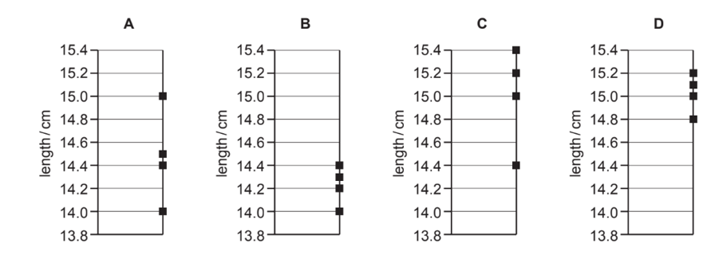

### Q14 — easy — 1 marks

**Q14** [1 mark]

A student carries out a series of determinations of the acceleration of free fall *g*. The table shows the results.

| *g* / m s-2 |
|---|
| 4.91  4.89  4.88  4.90  4.93  4.92 |

What can be said about this experiment?

### Q15 — hard — 1 marks

**Q15** [1 mark]

A steel wire is stretched in an experiment to determine the Young modulus for steel.

The uncertainties in the measurements are given below.

| **Measurement** | **Uncertainty** |
|---|---|
| load on wire  length of wire  diameter of wire  extension | ±2%  ±0.2%  ±1.5%  ±1% |

What is the percentage uncertainty in the Young modulus?

### Q16 — hard — 1 marks

**Q16** [1 mark]

The diagram shows an experiment to measure the speed of a small ball falling at constant speed through a clear liquid in a glass tube.

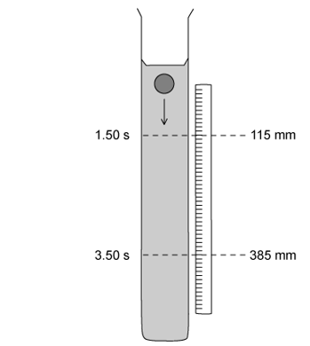

There are two marks on the tube. The top mark is positioned at 115 ± 1 mm on the adjacent rule and the lower mark at 385 ± 1 mm. The ball passes the top mark at 1.50 ± 0.02 s and passes the lower mark at 3.50 ± 0.02 s.

The constant speed of the ball is calculated to be 135 mm s-1

Which expression calculates the fractional uncertainty in the value of this speed?

### Q17 — medium — 1 marks

**Q17** [1 mark]

Which experimental technique reduces the systematic error of the quantity being investigated?

### Q18 — easy — 1 marks

**Q18** [1 mark]

The diagram shows part of a thermometer.

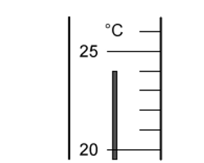

What is the correct reading on the thermometer and the uncertainty in this reading?

|   | **Reading/°C** | **Uncertainty in reading/°C** |
|---|---|---|
| **A** | 24 | ±1 |
| **B** | 24 | ±0.1 |
| **C** | 24.0 | ±0.2 |
| **D** | 24.0 | ±0.5 |

### Q19 — medium — 1 marks

**Q19** [1 mark]

Four students each made a series of measurements of the acceleration of free fall *g*. The table shows the results obtained.

Which set of results could be described as precise but not accurate?

|   | ***g***** / ms****-2** |   |   |   |
|---|---|---|---|---|
| **A** | 9.81 | 9.79 | 9.84 | 9.83 |
| **B** | 9.81 | 10.12 | 9.89 | 9.94 |
| **C** | 9.45 | 9.21 | 8.99 | 8.76 |
| **D** | 8.45 | 8.46 | 8.50 | 8.41 |

### Q20 — hard — 1 marks

**Q20** [1 mark]

A student finds the density of a liquid by measuring its mass and volume. The following is a summary of his measurements.

mass of empty beaker = (20 ± 1) g

mass of beaker + liquid = (70 ± 1) g

volume of liquid = (10.0 ± 0.5) cm3

He correctly calculates the density of the liquid as 5.0 g cm–3.

What is the uncertainty in this value?

### Q21 — hard — 1 marks

**Q21** [1 mark]

A mass is dropped from rest and falls through a distance of 2.0 m in a vacuum. An observer records the time taken for the mass to fall through this distance using a manually operated stopwatch and repeats the measurements a further two times. The average result of these measured times, displayed in the table below, was used to determine a value for the acceleration of free fall. This was calculated to be 9.8 m s–2.

|   | **First measurement** | **Second measurement** | **Third measurement** | **Average** |
|---|---|---|---|---|
| **Time/ s** | 0.6 | 0.73 | 0.59 | 0.64 |

Which statement best relates to the experiment?

### Q22 — easy — 1 marks

**Q22** [1 mark]

An experiment is done to measure the acceleration of free fall of a body from rest.

Which measurements are needed?

## Structured Questions (12 questions)

### Q1 — medium — 6 marks

**Q1** [2 marks]

The drag force $F$ acting on a car moving with speed $v$ along a straight horizontal road is given by

$F=kρAv^{n}$

where $n$ is an integer, $ρ$ is the density of air, $A$ is the cross-sectional area of the car, and $k$ is a constant with no units.

An experiment is performed to determine the drag force $F$ on the car. The measurements are shown in Table 1.1.

**Table 1.1**

| quantity | measurement | uncertainty |
|---|---|---|
| $ρ$ | 1.20 kg m-3 | ± 2% |
| $A$ | 5.1 m2 | ± 4% |
| $v$ | 13.4 m s-1 | ± 1% |

Use SI base units to show that $n$ is equal to 2.

**Q1** [4 marks]

**Extract:**

The drag force \$\$F\$\$ acting on a car moving with speed \$\$v\$\$ along a straight horizontal road is given by \$\$F = k \rho A v^{n}\$\$ where \$\$n\$\$ is an integer, \$\$\rho\$\$ is the density of air, \$\$A\$\$ is the cross-sectional area of the car, and \$\$k\$\$ is a constant with no units. The measurements are shown in Table 1.1. Table 1.1: \$\$\rho\$\$ = 1.20 kg m^-3^, uncertainty ± 2%; \$\$A\$\$ = 5.1 m^2^, uncertainty ± 4%; \$\$v\$\$ = 13.4 m s^-1^, uncertainty ± 1%.

The value of $k$ for the car in **(c)** is 0.28. The uncertainty in $k$ is negligible.

(i) Use the data in Table 1.1 to calculate the percentage uncertainty in $F$.

[1]

(ii) Determine $F$ with its absolute uncertainty. Give your values to the appropriate number of significant figures.

[3]

### Q2 — medium — 10 marks

**Q2** [3 marks]

A student participates in an experiment to measure $g$, the acceleration due to gravity on Earth. This is done using a simple pendulum.

The student suggests the period of oscillation $T$ is related to the length $L$ of the pendulum by the equation:

$T=2π\sqrt{\frac{L}{g}}$

Table 1.1 shows the ten repeat readings of period $T$.

**Table 1.1**

| 0.67 | 0.66 | 0.67 | 0.68 | 0.69 | 0.64 | 0.66 | 0.65 | 0.68 | 0.65 |
|---|---|---|---|---|---|---|---|---|---|

Determine the mean period of oscillation and its percentage uncertainty.

**Q2** [3 marks]

**Extract:**

A student participates in an experiment to measure \$\$g\$\$, the acceleration due to gravity on Earth. This is done using a simple pendulum. The student suggests the period of oscillation \$\$T\$\$ is related to the length \$\$L\$\$ of the pendulum by the equation: \$\$T = 2 \pi \sqrt{\frac{L}{g}}\$\$

In a new experiment, the length $L$ of the pendulum is measured with a percentage uncertainty of 1.8% and the acceleration due to free-fall $g$ is measured with a percentage uncertainty of 1.6%.

If the time for the pendulum to complete 20 oscillations is 18.4 s, determine the time period for one oscillation and the absolute uncertainty in this value.

**Q2** [2 marks]

Measurements of time periods for different lengths of pendula were taken using a stopwatch and plotted on the graph shown in Fig. 1.1.

**Fig. 1.1**

Explain how the graph in Fig. 1.1 indicates that the readings are subject to systematic and random uncertainties.

**Q2** [2 marks]

The period *T* for a mass *m* hanging on a spring performing simple harmonic motion is given by the equation:

$T=2π\sqrt{\frac{m}{k}}$

Such a system is used to determine the spring constant *k*. The fractional error in the measurement of the period *T* is *α* and the fractional error in the measurement of the mass *m* is *β*.

Determine the fractional error in the calculated value of *k* in terms of *α* and *β*.

### Q3 — medium — 15 marks

**Q3** [3 marks]

A cube made from aluminium is placed on a horizontal surface, as shown in Fig. 1.1.

The following measurements were made on the cube:

mass = 0.59 ± 0.01 kg

length of one side = 6.0 ± 0.1 cm

Calculate the pressure produced by the cube on the surface.

**Q3** [4 marks]

**Extract:**

A cube made from aluminium is placed on a horizontal surface. The following measurements were made on the cube: mass = 0.59 ± 0.01 kg, length of one side = 6.0 ± 0.1 cm. Calculate the pressure produced by the cube on the surface. Pressure P = mg/L^2 = (0.59 × 9.81)/(0.06)^2 = 1607.75 = 1610 Pa (3 s.f.)

(i) Calculate the percentage uncertainty in the pressure.

[2]

(ii) State the pressure, with its actual uncertainty.

pressure = .................... ± .................... Pa  [2]

**Q3** [4 marks]

**Extract:**

A cube made from aluminium is placed on a horizontal surface, as shown in Fig. 1.1. The following measurements were made on the cube: mass = 0.59 ± 0.01 kg; length of one side = 6.0 ± 0.1 cm

Calculate the density of aluminium with its uncertainty.

Express your answer to an appropriate number of significant figures.

density .................. ± .................. g cm−3

**Q3** [4 marks]

**Extract:**

A cube made from aluminium is placed on a horizontal surface, as shown in Fig. 1.1. The following measurements were made on the cube: mass = 0.59 ± 0.01 kg; length of one side = 6.0 ± 0.1 cm

The student uses vernier callipers to measure the length of the side of the cube. After completing the experiment, he realises that when the callipers are fully closed, the reading is not zero.

(i) State and explain whether this introduces a random error or a systematic error in the readings of the length.

[2]

(ii) Explain why the readings are precise but not accurate.

[2]

### Q4 — medium — 18 marks

**Q4** [4 marks]

A student used the apparatus shown to investigate the time taken for a hollow cylinder to roll down a ramp as shown in Fig. 1.1.

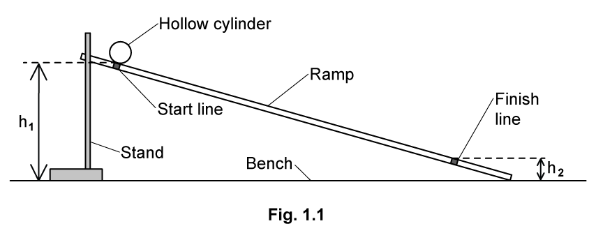

State the most appropriate instrument for the measurement of the following, and describe how they can ensure the measurements are as accurate as possible

(i) the heights *h*1 and *h*2

[2]

(ii) the time taken for the cylinder to roll down the ramp

[2]

**Q4** [2 marks]

The student wants to find the difference in height Δ*h* between the start line and finish line

The heights are recorded as

$h_{1}$ = 67.5 ± 0.1 cm

$h_{2}$ = 8.6 ± 0.1 cm

Determine the change in height Δ*h*, quoting your answer with its uncertainty

Δ*h* = …………………… ± …………………… cm

**Q4** [6 marks]

**Extract:**

A student used the apparatus shown to investigate the time taken for a hollow cylinder to roll down a ramp as shown in Fig. 1.1.
State the most appropriate instrument for the measurement of the following...
(i) the heights h1 and h2
(ii) the time taken for the cylinder to roll down the ramp

The student placed the cylinder on the start line and released it. She measured the time* t* for the cylinder to roll to the finish line. She repeated the measurements several times as shown in Table 1.1.

**Table 1.1**

| ***t***** / s** | 0.88 | 0.82 | 0.80 | 0.86 |
|---|---|---|---|---|

(i) Use the data in Table 1.1 to calculate the mean value of *t* and its uncertainty.

mean value of *t* = ............................... ± ..........................  [2]

(ii) Comment on the accuracy and precision of the data the student collected.

[2]

(iii) Explain how reducing the value of *h**1* could improve the measurement of *t*.

[2]

**Q4** [6 marks]

**Extract:**

The student wants to find the difference in height \u0394h between the start line and finish line. The heights are recorded as h\u2081 = 67.5 ± 0.1 cm and h\u2082 = 8.6 ± 0.1 cm. Determine the change in height \u0394h: \u0394h = h\u2081 - h\u2082 = 67.5 - 8.6 = 58.9 cm; uncertainty = 0.1 cm + 0.1 cm = 0.2 cm; \u0394h = 58.9 ± 0.2 cm

Table 1.1: t / s: 0.88, 0.82, 0.80, 0.86. Mean value of t = (0.88 + 0.82 + 0.80 + 0.86)/4 = 0.84 s. Uncertainty in t = ±½(range) = ±½(0.88 - 0.80) = ±0.04 s. So mean value of t = 0.84 ± 0.04 s.

The relationship between *t* and the acceleration of free fall *g* is given by

$t^{2}=\frac{4s^{2}}{g\Deltah}$

where *s* is the distance along the ramp between the start line and the finish line.

The student recorded the ramp length as *s* = 102.0 cm ± 0.1 cm

(i) Determine a value for *g*.

[2]

(ii) Determine the percentage uncertainty in the value of *g*.

[2]

(iii) Deduce whether the value of *g* is accurate.

[2]

### Q5 — medium — 4 marks

**Q5** [2 marks]

The speed *v* of a transverse wave on a uniform string is given by the expression

$v=\sqrt{\frac{Tl}{m}}$

where *T* is the tension in the string, *l* is its length and *m* is its mass.

An experiment is performed to determine the speed *v* of the wave. The measurements are shown in Table 1.1.

**Table 1.1**

| **quantity** | **measurement** | **uncertainty** |
|---|---|---|
| *T* | 1.8 N | ± 5% |
| *l* | 126 cm | ± 1% |
| *m* | 5.1 g | ± 2% |

Use the data in Table 1.1 to calculate the speed *v*.

*v* = ................................................. m s–1

*Source: Specimen 2022 Paper 2 Q1A*

**Q5** [2 marks]

**Extract:**

The speed v of a transverse wave on a uniform string is given by the expression v = √(Tl/m) where T is the tension in the string, l is its length and m is its mass. An experiment is performed to determine the speed v of the wave. The measurements are shown in Table 1.1. Table 1.1: quantity T, measurement 1.8 N, uncertainty ± 5%; quantity l, measurement 126 cm, uncertainty ± 1%; quantity m, measurement 5.1 g, uncertainty ± 2%. From part (a): v = 21.1 m s^−1 = 21 m s^−1 (2 s.f.)

Use your answer in **(a)** and the data in Table 1.1 to calculate the absolute uncertainty in the value of *v*.

absolute uncertainty = ................................................. m s–1

*Source: Specimen 2022 Paper 2 Q1B*

### Q6 — easy — 10 marks

**Q6** [4 marks]

A student uses a stopwatch to measure the time taken for one complete swing of a pendulum.

They measure the time for 10 complete oscillations to be 16.4 ± 0.1 s.

Calculate

(i) the mean value of the time taken for one complete swing

[1]

(ii) the absolute uncertainty in this mean value

[1]

(iii) the percentage uncertainty in this mean value.

[2]

**Q6** [2 marks]

The student is using the pendulum to determine a value for the acceleration of free fall *g*.

As well as the period *T* of oscillation, they also take measurements of the length *L* of the pendulum.

The value obtained, with its uncertainty, is *L* = 67 ± 1 cm.

Calculate the percentage uncertainty in the measurement of the length *L*.

**Q6** [2 marks]

**Extract:**

(a) They measure the time for 10 complete oscillations to be 16.4 ± 0.1 s. Calculate the percentage uncertainty in this mean value. % uncertainty = 0.6098 = 0.61%. mean time period T = 1.64 ± 0.01 s.
(b) The value obtained, with its uncertainty, is L = 67 ± 1 cm. Calculate the percentage uncertainty in the measurement of the length L. % uncertainty = 1.4925 = 1.5%.

The relationship between *T*, *L* and *g* is given by

$g=4π^{2}\frac{L}{T^{2}}$

Using your answers in **(a)** and **(b)**, show that the percentage uncertainty in the value of *g* is 2.7%.

**Q6** [2 marks]

There are some occasions where the resolution of an instrument is not the only limiting factor of uncertainty in a measurement.

State

(i) the meaning of the 'resolution of an instrument'

[1]

(ii) **one** limiting factor that affects the uncertainty in the measurement of time using a stopwatch.

[1]

### Q7 — medium — 18 marks

**Q7** [4 marks]

Analogue voltmeters and cathode-ray oscilloscopes (c.r.o.) are both devices which can measure potential differences.

For the analogue voltmeter and the c.r.o., describe **one** example of:

(i) a systematic error that can affect both devices

[1]

(ii) a systematic error that can only affect the analogue voltmeter

[1]

(iii) a random error that can affect both devices

[1]

(iv) a random error that can only affect the analogue voltmeter.

[1]

**Q7** [6 marks]

The potential difference across a resistor is measured using the analogue voltmeter shown in Fig. 1.1.

The resistor is labelled as having a resistance of 125 Ω ± 3%.

(i) Calculate the power dissipated by the resistor.

[2]

(ii) Calculate the percentage uncertainty in the calculated power.

[2]

(iii) Determine the value of the power, with its absolute uncertainty, to an appropriate number of significant figures.

power = ............................... ± ................................ W  [2]

**Q7** [5 marks]

A microphone connected to a cathode ray oscilloscope (c.r.o.) detects a sound wave of frequency *f*. The signal from the microphone is observed on the c.r.o. as shown in Fig. 1.2.

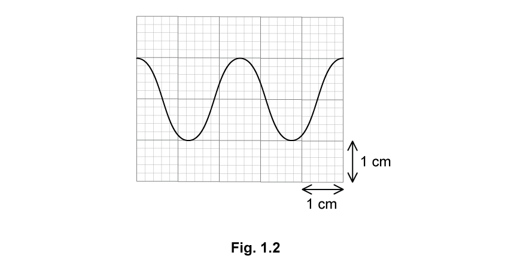

The time-base setting of the c.r.o. is 0.50 ms cm–1. The Y-plate setting is 2.5 mV cm–1.

Using the trace in Fig. 1.2, determine

(i) the amplitude of the signal, in mV

amplitude = ............................................. mV  [2]

(ii) the frequency, in Hz

frequency = .................................................... Hz  [3]

**Q7** [3 marks]

**Extract:**

A microphone connected to a cathode ray oscilloscope (c.r.o.) detects a sound wave of frequency f. The signal from the microphone is observed on the c.r.o. as shown in Fig. 1.2. The time-base setting of the c.r.o. is 0.50 ms cm^–1^. The Y-plate setting is 2.5 mV cm^–1^.

(i) Use the trace to determine the amplitude: Y-plate setting = 2.5 mV cm^–1^; Amplitude is measured from the mid-point to the peak of the wave; (From trace): amplitude reading = 1 large square = 1 cm; Amplitude, A = 1 × 2.5 = 2.5 mV. 1 division = 0.2 cm.

(i) Determine the percentage uncertainty in amplitude caused by reading the scale on the c.r.o.

[2]

(ii) State the amplitude with its actual uncertainty.

amplitude = ................................ ± ................................ mV  [1]

### Q8 — easy — 13 marks

**Q8** [2 marks]

Distinguish between random and systematic errors.

**Q8** [3 marks]

From a set of metal discs, one has a mass of 9.5 g and a thickness of approximately 2 mm.

State the instrument that should be used to measure

(i) the mass of one or more discs

[1]

(ii) the thickness of one disc

[1]

(iii) the thickness of a stack of 20 discs.

[1]

**Q8** [5 marks]

A student takes five repeat readings of the thickness of the disc. The readings are shown in Table 1.1.

**Table 1.1**

| **thickness / mm** | 2.012 | 2.001 | 1.998 | 2.008 | 1.994 |
|---|---|---|---|---|---|

Using the readings in Table 1.1, calculate

(i) the mean value of thickness

[2]

(ii) the range of the results

[1]

(iii) the uncertainty in the mean value of thickness.

[2]

**Q8** [3 marks]

**Extract:**

From a set of metal discs, one has a mass of 9.5 g and a thickness of approximately 2 mm. State the instrument that should be used to measure (ii) the thickness of one disc — Micrometer / screw gauge / digital callipers.

State how the instrument used to measure thickness can

(i) reduce or avoid a systematic error

[1]

(ii) reduce random errors

[2]

### Q9 — hard — 16 marks

**Q9** [2 marks]

An object of mass 50.00 g is placed on four different balances. For each balance, the reading is taken five times, as shown in Table 1.1.

**Table 1.1**

| **Balance** | **Mass Reading / g** |   |   |   |   |
|---|---|---|---|---|---|
| **1st** | **2nd** | **3rd** | **4th** | **5th** |   |
| **1** | 50.00 | 50.00 | 50.02 | 50.01 | 50.02 |
| **2** | 50.12 | 49.94 | 50.04 | 49.89 | 49.95 |
| **3** | 50.52 | 50.53 | 50.52 | 50.54 | 50.54 |
| **4** | 48.9 | 49.6 | 50.2 | 50.9 | 51.1 |

Analyse the data and conclude which sets of readings are accurate, precise or neither.

**Q9** [4 marks]

A titanium sphere and a titanium cylinder were used in an experiment to measure the density of titanium. The diameter of the sphere was measured using a micrometer, and the diameter of the cylinder was measured using vernier callipers, as shown in Fig. 1.1.

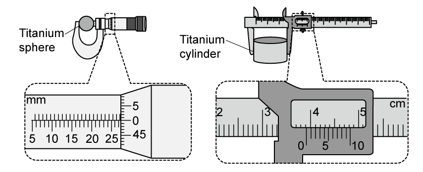

**Fig. 1.1**

Using Fig. 1.1, determine

(i) the diameter of the titanium sphere, in cm, with its uncertainty.

[2]

(ii) the diameter of the titanium cylinder, in cm, with its uncertainty.

[2]

**Q9** [6 marks]

**Extract:**

An object of mass 50.00 g is placed on four different balances. For each balance, the reading is taken five times, as shown in Table 1.1. Balance 2 readings: 50.12, 49.94, 50.04, 49.89, 49.95. (The mass of the sphere was measured using balance 2; Balance 2 mean = 49.99 g.)

A titanium sphere and a titanium cylinder were used in an experiment to measure the density of titanium. The diameter of the sphere was measured using a micrometer, and the diameter of the cylinder was measured using vernier callipers. Diameter of the titanium sphere = 2.750 ± 0.001 cm. Diameter of the titanium cylinder = 3.92 ± 0.01 cm.

The measurements for the mass and height of the cylinder with their fractional uncertainties are shown in Table 1.2.

**Table 1.2**

|   | **measurement** | **fractional uncertainty** |
|---|---|---|
| cylinder mass / g | 774.8 | 0.03 |
| cylinder height / cm | 15.0 | 0.01 |

The object used in **(a)** was the titanium sphere. The mass of the sphere was measured using the balance 2 shown in Table 1.1.

Determine

(i) the density of the titanium sphere, in g cm−3, and its associated percentage uncertainty.

[3]

(ii) the density of the titanium cylinder, in g cm−3, and its associated percentage uncertainty.

[3]

**Q9** [4 marks]

**Extract:**

(i) Density of titanium sphere, ρ = 4.59 g cm^–3^ ± 0.34% (mean sphere mass 49.99 g, sphere diameter 2.750 ± 0.001 cm).
(ii) Density of titanium cylinder = 4.3 g cm^–3^ ± 4.5% (cylinder mass 774.8 g, diameter 3.92 ± 0.01 cm, height 15.0 cm).

The true value of the density of the titanium used in both the cylinder and the sphere was found to be 4.51 g cm–3.

The student assumes that the percentage difference between the density of the titanium cylinder and the true value is solely due to the uncertainty in the volume and the uncertainty in the mass.

Assess the validity of this assumption.

### Q10 — hard — 16 marks

**Q10** [5 marks]

Fig. 1.1 shows a circuit designed by a student investigating the variation of potential difference with time as a capacitor charges and discharges whilst maintaining a constant current.

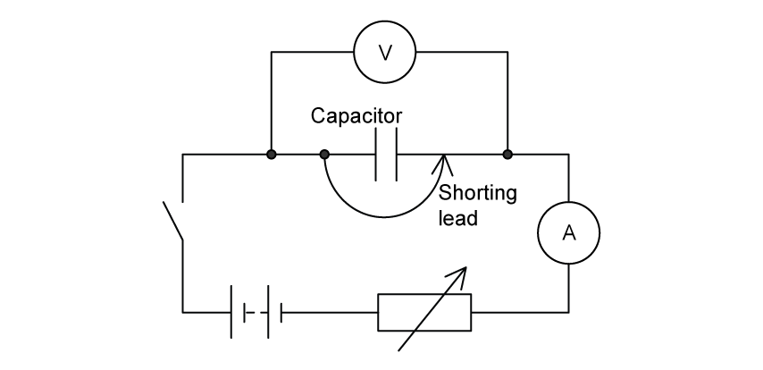

**Fig. 1.1**

The power supply has an e.m.f. of 6.0 V and negligible internal resistance. During the charging process, the maximum value of the resistance of the variable resistor is 100 kΩ.

(i) Suggest **one** advantage of using an analogue ammeter rather than a digital ammeter for this experiment.

[1]

(ii) Fig. 1.2 shows three analogue ammeters which can detect currents up to a maximum of 50 µA, 100 µA or 500 µA. Suggest, with a calculation, which of the analogue ammeters in Fig. 1.2 would be most suitable for the experiment.

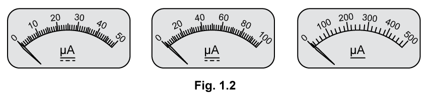

[3]

(iii) State the uncertainty in a reading of current using the ammeter you choose in **(ii)**.

[1]

**Q10** [4 marks]

A digital voltmeter with a three-digit display is used to measure the potential difference across the capacitor. A reading made during the charging process is shown in Fig. 1.3.

The manufacturers of the meter state that its accuracy is ±2% and ±1 digit.

(i) Determine the maximum possible value of the potential difference across the capacitor at the moment the reading in Fig. 1.3 was taken.

[2]

(ii) The reading on the voltmeter has high precision. State and explain why the reading may not be accurate.

[2]

**Q10** [3 marks]

**Extract:**

The power supply has an e.m.f. of 6.0 V and negligible internal resistance. During the charging process, the maximum value of the resistance of the variable resistor is 100 kΩ.

Initial current: I = V/R = 6.0/(100 × 10^3) = 6 × 10^−5 A = 60 μA

Initially, the shorting lead is connected across the capacitor, as shown in Fig. 1.1, to fully discharge it. The timer is started at the moment the shorting lead is disconnected as the capacitor begins to charge.

The student measures the potential difference across the capacitor at 5 s intervals while adjusting the variable resistor to keep the charging current constant.

The label on the capacitor states its capacitance $C$ is 510 μF.

Determine the number of different readings the student will be able to take before the capacitor becomes fully charged.

The charge on the capacitor is equal to $Q=CV$

**Q10** [4 marks]

**Extract:**

(ii) ... Initial current: \$\$I = \frac{6 . 0}{100 \times 10^{3}}\$\$ = 6 × 10^−5^ A = 60 μA

The label on the capacitor states its capacitance \$\$C\$\$ is 510 μF.

The capacitor used in the experiment has a manufacturing tolerance of ±10%. Throughout the experiment, the charging current is maintained at the value calculated in **(a)**.

The data from the experiment produces a straight-line graph for the variation of potential difference with time. This shows that the potential difference across the capacitor increases at a rate of 110 mV s−1.

(i) Calculate the true capacitance of the capacitor.

[2]

(ii) Deduce whether the capacitor is within the manufacturer’s tolerance.

[2]

### Q11 — hard — 8 marks

**Q11** [2 marks]

In an experiment to determine the emissivity of a circular surface, the diameter *d *of the object is measured using the vernier scale shown in Fig. 1.1.

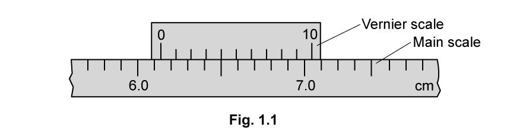

Determine the diameter of the circular object from the reading in Fig. 1.1 and its associated uncertainty.

**Q11** [3 marks]

The energy per unit time *P* radiated by an object with surface area *A* at absolute temperature *T* is given by

$P=eσAT^{4}$

where *e* is the emissivity of the object and *σ *is the Stefan-Boltzmann constant.

Show that the emissivity *e* has no unit.

**Q11** [3 marks]

**Extract:**

In an experiment to determine the emissivity of a circular surface, the diameter d of the object is measured using the vernier scale. Diameter, d = 6.1 + 0.04 = 6.14 cm; uncertainty in d = ± 0.01 cm, so d = 6.14 ± 0.01 cm.

The energy per unit time P radiated by an object with surface area A at absolute temperature T is given by P = eσAT⁴ where e is the emissivity of the object and σ is the Stefan-Boltzmann constant.

As well as diameter *d*,* *the following measurements were taken:

*P* = 3.0 ± 0.1 W

*T* = 500 ± 1 K

Determine the value of the emissivity *e* of the surface and its uncertainty. Give your answer to an appropriate degree of precision.

### Q12 — easy — 12 marks

**Q12** [2 marks]

A physics teacher tells a class:

"Measurements may give a precise value for the quantity being determined but this may not necessarily be an accurate value”

Describe what is meant by

(i) accuracy

[1]

(ii) precision

[1]

**Q12** [3 marks]

Draw lines on Fig. 1.1 to show how accuracy and precision are affected by different types of error

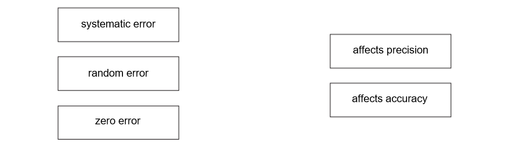

**Fig. 1.1**

**Q12** [4 marks]

The teacher uses the diagram shown in Fig. 1.2 to illustrate the difference between accuracy and precision.

The circles represent targets A, B, C and D and the dots represent arrows hitting the targets.

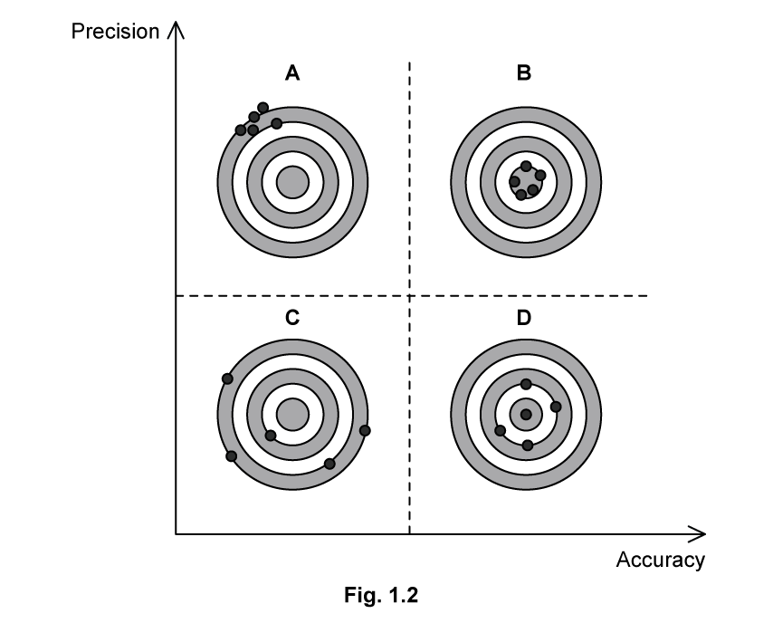

Complete the following sentences to explain how targets A, B, C and D represent differing degrees of accuracy and precision.

| **neither accurate nor precise** | **accurate but not precise** | **precise but not accurate** | **  both accurate and precise** |
|---|---|---|---|

A is ................................................................................

B is ................................................................................

C is ................................................................................

D is ................................................................................

**Q12** [3 marks]

The temperature of the air in a room is measured using a mercury-in-glass thermometer.

For each of the following, tick [**✓**] one box to indicate whether the experimental technique would improve accuracy, precision or neither. The first row has been completed as an example.

|   | **improves accuracy** | **improves precision ** | **improves neither** |
|---|---|---|---|
| correcting for an incorrectly calibrated thermometer | **✓** |   |   |
| taking repeat readings of temperature and finding an average |   |   |   |
| using a thermometer with a linear scale |   |   |   |
| keeping your eye in line with the scale and the liquid level for each temperature reading |   |   |   |
