# Mark Schemes — Scalars & Vectors
**1. Physical Quantities & Units** · Cambridge (CIE) A-LEVEL physics (9702)

## Multiple Choice Questions (16 questions)

### Q1
**Final answer:** **The correct answer is ****D**** because:**

- The diagram represents a quantity which has a magnitude and direction, so it must be a vector
- Velocity is the only vector quantity listed

**A, B** and **C** are incorrect as kinetic energy, power and speed are all scalar quantities as they all have a magnitude but no direction

### Q2
**Final answer:** **The correct answer is ****A**** because:**

- Equilibrium means the forces are balanced. For 3 forces in equilibrium, the force vectors always form a closed triangle
- Constructing vector triangles (to scale, therefore, it is recommended you use a ruler), we can see the only balanced system is A
- This is because the sizes and directions of the forces align and form a closed triangle, satisfying the condition that the net force must be zero

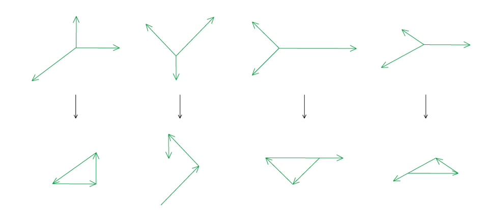

**B, C & D** are incorrect because none of these systems of coplanar forces form a closed triangle meaning the net force is not zero

### Q3
**Final answer:** **The correct answer is ****A**** because:**

- Construct a vector diagram and label the triangle

- Consider SOH CAH TOA:

  - We know the opposite and hypotenuse and want to find the angle
  - So, we must use $sinθ=\frac{Opposite}{Hypotenuse}$

- The correct angle is given by $sinθ=\frac{5}{20}$
- Rearrange to find the value of sin *θ*:

  - $sin^{-1}\frac{5}{20}=14.5^{\circ}$
- Convert into a bearing:

  - 14.5° = 014.5°

**B** is incorrect because cosine has been used instead of sine.

**C** is incorrect because, although the angle away from north is correct, this bearing does not oppose the direction of the current, so the ship would not head northwards.

**D** is incorrect, both because cosine has been used instead of sine, and because the bearing direction does not oppose the direction of the current.

Don’t be fooled by the units of km h−1. You don’t need to convert them into standard units for this question because you are using trigonometry to find a ratio. Label the sides of your triangle clearly with opposite, adjacent and hypotenuse, so you choose the correct ratio.

### Q4
**Final answer:** **The correct answer is ****C**** because:**

- First, it’s important to notice that the vector **Q*** *is negative so its direction must be reversed
- Then using either the triangle or parallelogram method it’s possible to determine the direction of the resulting vector, as shown in the diagram below

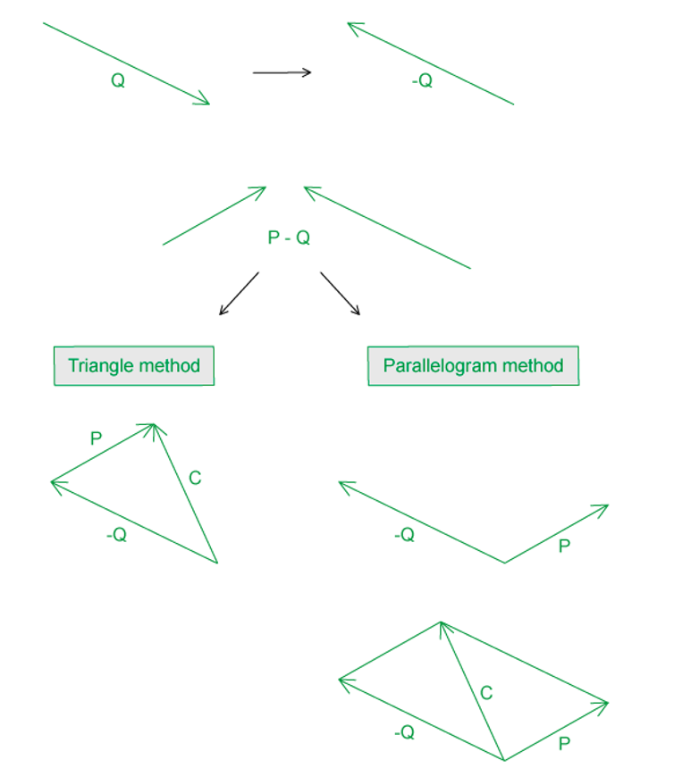

### Q5
**Final answer:** **The correct answer is ****A**** because:**

- The vector diagram will look as follows

- The horizontal component is

  - $F_{x}=F\mathrm{cos}θ$
  - $F_{x}=20\times\mathrm{cos}(30)=17N(2s.f)$
- The vertical component is

  - $F_{y}=F\mathrm{sin}θ$
  - $F_{y}=20\times\mathrm{sin}(30)=10N$
- This is option **A**

### Q6
**Final answer:** **The correct answer is ****D**** because:**

- When we construct a vector triangle, we can see the direction will be west of north
- We can calculate the angle from

  - $\sin ^{- 1 } ( \frac{85}{200} ) = 25.15^{\circ}$

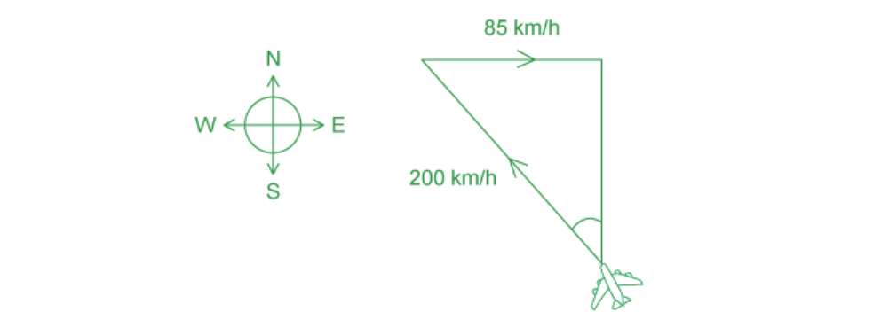

### Q7
**Final answer:** **The correct answer is ****C**** because:**

- The vector sum of the two perpendicular components should provide a resultant vector equal to the vector **R**
- If we complete the diagrams, we can see that option C is the odd one out as it produces a resultant vector in a downward direction, therefore it cannot be equal to vector **R**

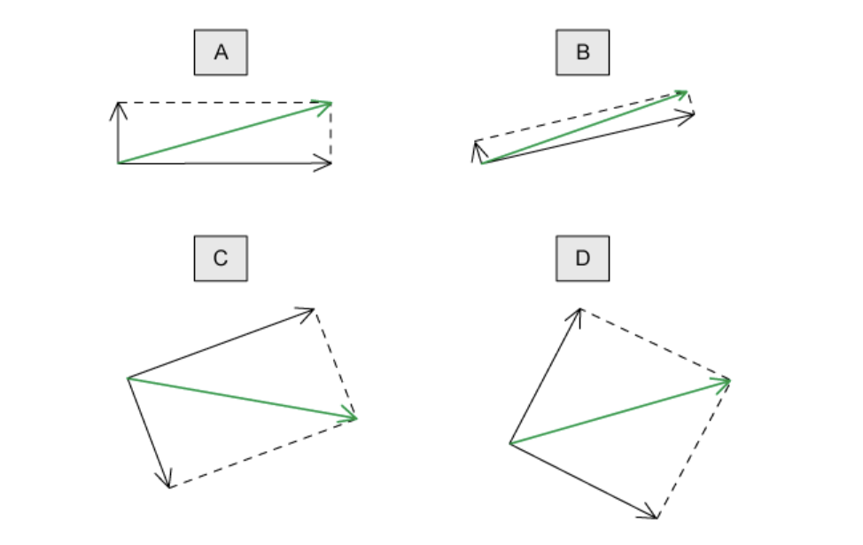

### Q8
**Final answer:** **The correct answer is ****D**** because:**

- A vector quantity has both magnitude and direction

Option **A** and **B** is incorrect because

- A scalar quantity only has magnitude

Option **C** is incorrect because

- A vector quantity has direction as well as magnitude

### Q9
**Final answer:** **The correct answer is ****B**** because:**

- Force is a vector quantity as it has magnitude and direction
- Kinetic energy is a scalar quantity as it has only magnitude

**A **is incorrect as displacement and acceleration are both vector quantities

**C **is incorrect as momentum and velocity are both vector quantities

**D **is incorrect as power and speed are both scalar quantities

### Q10
**Final answer:** **The correct answer is ****D**** because:**

- Vertical component

  - $\mathrm{sin}θ=\frac{opposite}{hypotenuse}=\frac{Q}{R}$
  - $Q=R\mathrm{sin}θ$
- Horizontal component

  - $\mathrm{cos}θ=\frac{adjacent}{hypotenuse}=\frac{P}{R}$
  - $P=R\mathrm{cos}θ$

### Q11
**Final answer:** **The correct answer is ****C**** because:**

- When three forces are in equilibrium they form a closed triangle
- By sliding the vectors past each other so they are tip to tail, the vector diagram will look as follows

- As the 5 N and 10 N forces are perpendicular to each other, pythagoras theorem can be used to calculate the hypotenuse, *F*

  - $a^{2}=b^{2}+c^{2}$
  - $a=\sqrt{(b^{2}+c^{2})}$
- Substituting in 5 N and 10 N

  - $F=\sqrt{(5^{2}+10^{2})}=11$N (2 s.f)
- This is option **C**

### Q12
**Final answer:** **The correct answer is ****B**** because:**

- The direction of the resultant force *F *can be found by using either the triangle or the parallelogram method

  - This is because $θ>90$
- For the triangle method

  - Slide the vectors past each other so they are tip to tail
  - The angle $θ$  will now be on the outside of the triangle
  - The resultant vector will be tail to tail and tip to tip

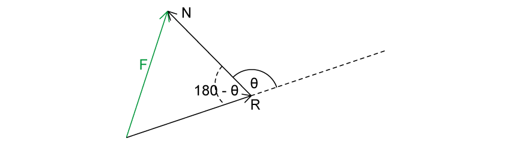

- For the parallelogram method

  - Draw lines from the tips of the vectors so they are parallel and equal to the opposite vector
  - The resultant vector will come from point *P* to where the lines meet

- The cosine rule can now be used to find the magnitude of the resultant force *F*

  - $a^{2}=b^{2}+c^{2}-2bc\mathrm{cos}(A)$
  - $F^{2}=R^{2}+N^{2}-2RN\mathrm{cos}(180-θ)$
  - $F=\sqrt{R^{2}+N^{2}-2RN\mathrm{cos}(180-θ)}$
- This is option **B**

### Q13
**Final answer:** **The correct answer is ****D**** because:**

- When you examine the individual vectors in the scenario you can immediately whittle the selection down to either B or D as both correctly represent vectors **L** and **W**
- On further inspection, you can see vector **R** is inclined 15° to the horizontal in a north-west direction so the correct answer is D

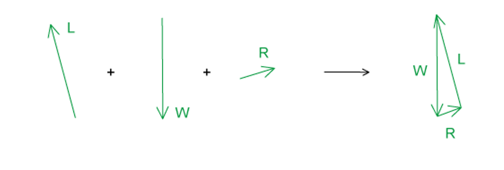

### Q14
**Final answer:** **The correct answer is ****B because:**

- The hypotenuse, adjacent and opposite sides to the angle can be labelled as follows

- The horizontal component is

  - $\mathrm{cos}θ=\frac{\mathrm{adjacent}}{\mathrm{hypotenuse}}$
  - $\mathrm{adjacent}=\mathrm{hypotenuse}\times\mathrm{cos}θ$
  - $F_{x}=F\mathrm{cos}θ$
- This is option **B**

You can use the mnemonic SOH CAH TOA as a checklist to see which trigonometric ratio you need to use. In this question, we know the hypotenuse (the resultant force), and we need to find the adjacent (the *x* component), so we use CAH, which tells us that cos *θ* is equal to the adjacent over the hypotenuse.

### Q15
**Final answer:** **The correct answer is ****A**** because:**

- The known quantities are

  - Net force, $F_{\mathrm{net}}$ = 1270 kN
  - Resistive force, $F_{R}$ = 40 kN
  - Single force pulling the boat, $F_{\mathrm{pull}}$ = 700 kN
- The free-body diagram of the boat will look as follows

- The resultant force *F* from the forces pulling the boat is equal to

  - $F_{\mathrm{net}}=F-F_{R}$
  - $F=F_{\mathrm{net}}+F_{R}=1270+40$
  - $F=1310\mathrm{kN}$
- By resolving the forces that are pulling the boat

  - $2\times700\mathrm{cos}θ=1310$
  - $\mathrm{cos}θ=\frac{1310}{2\times700}=0.9357$
- The angle $θ$ is

  - $\\theta = \cos ^{- 1} ( 0.9357 )$
  - $θ=20.656\approx21^{\circ}$
- This is option **A**

### Q16
**Final answer:** **The correct answer is ****B**** because:**

**Method 1**

- Using either the triangle or parallelogram method it’s possible to determine the direction of the resulting vector

  - In both methods, you must slide the vectors, parallel to their current direction, so that they are arranged tip to tail
  - The resultant vector is the one now joining from tail to tip on the other side
  - The 120° angle will be on the outside of the triangle or parallelogram
  
    - So, the interior angle = 180 −120 = 60°
- As shown in the diagram below, you can see that:

  - The vector triangle formed is an equilateral triangle
  - Where each angle is equal to 60° and the magnitude of each vector is 10 N
  
    - The resultant vector is the same length as the 10 N vectors, as the diagram is drawn to scale

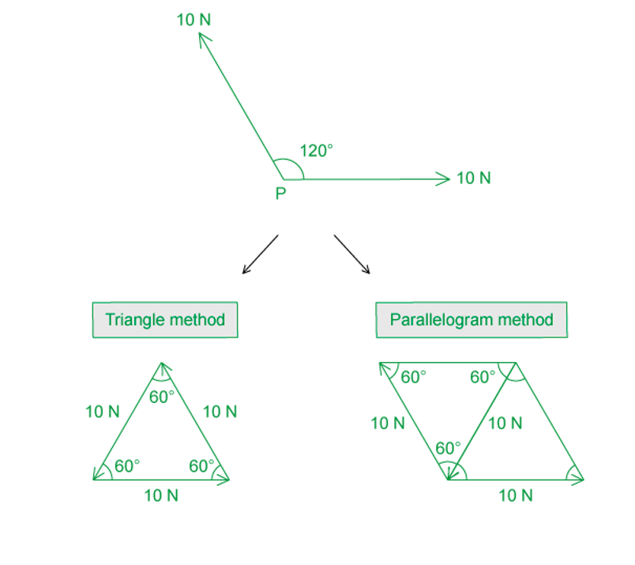

**Method 2**

- Consider the cosine rule to find the length of the resultant side:

  - $a^{2} = b^{2} + c^{2} - 2 b c \cos ( A )$
  - Label the angles and sides of the triangle

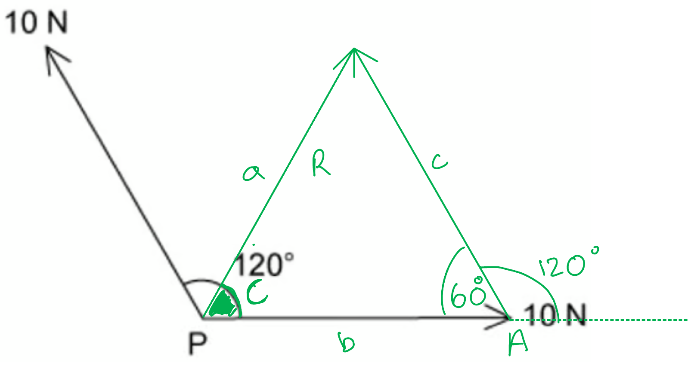

- Substitute in the known sides and angle

  - $a^{2} = 10^{2} + 10^{2} - 2 \times 10 \times 10 \times \cos ( 60 )$
- Calculate the length of the resultant side *a*:

  - *a* = 10 N
- Consider the sine rule to find the angle of the resultant side to the horizontal:

  - $\frac{a}{\sin ( A )} = \frac{c}{\sin ( C )}$
- Substitute in the known sides and angle:

  - $\frac{10}{\sin ( 60 )} = \frac{10}{\sin ( C )}$
- Rearrange the equation and calculate the angle of the resultant side to the horizontal:

  - $10 \times \sin ( C ) = 10 \times \sin ( 60 )$
  - $\sin ( C ) = \sin ( 60 )$
  - So, *C* = 60°

## Structured Questions (6 questions)

### Q1
(i) The difference between scalar and vector quantities is:

- Scalars have <u>magnitude only </u> **AND**
- Vectors have both <u>magnitude</u> and <u>direction</u>; **[1 mark]**

(ii) The vector quantities are:

- Velocity and momentum <u>only</u>; **[1 mark]**
- Power, length and density are scalars

**[Total: 2 marks]**
Draw a vector diagram of the two forces and determine the resultant:

List the known quantities:

- Force from wind 1 = 11.9 N
- Force from wind 2 = 5.5 N
- Angle between the forces = 30°

Construct a vector triangle:

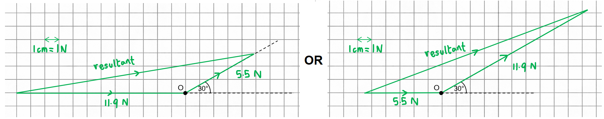

- Forces drawn end to tail with arrows and labels (either way around); **[1 mark]**
- Angle between the forces is used correctly; **[1 mark]**
- Resultant drawn correctly to form a triangle; **[1 mark]**

Determine the magnitude of the resultant:

- Resultant = 17.1 N (at least 2 sig. fig) **[1 mark]** *Acceptable range for resultant = 16.8 to 17.4 N* *Calculated answer with no sketch = no marks*

**[Total: 4 marks]**

> *The best approach to a vector drawing question is to follow these steps:*

- *First, draw one of the vectors, either is fine*
- *Next, draw the next vector with its **tail** at the **head** of the first vector*
- *Then, draw the resultant from the **tail of the first** vector to the **head of the second** vector*

> *In this example, we have used gridlines to help to show the scale, however, in an exam you will be expected to draw on plain paper with just your ruler and protractor, so make sure you get lots of practice with these!*

### Q2
The difference between scalars and vectors is:

- Scalar quantities have magnitude / size <u>only</u>; **[1 mark] **
- Vector quantities have <u>both</u> magnitude / size and direction; **[1 mark]**

**[Total: 2 marks]**
(i) Examples of scalar quantities:

**Final answer:** **Any ****three**** from:**

- Distance; **[1 mark]**
- Speed; **[1 mark]**
- Time; **[1 mark]**
- Mass; **[1 mark]**
- Power; **[1 mark]**
- Temperature; **[1 mark]**
- Electrical quantities e.g. resistance / current / potential difference; **[1 mark]**

(ii) Examples of vector quantities:

**Final answer:** **Any ****three**** from:**

- Displacement; **[1 mark]**
- Velocity; **[1 mark]**
- Acceleration; **[1 mark]**
- Momentum; **[1 mark]**
- Moments / torque; **[1 mark]**

**[Total: 6 marks]**

> *In part (i), answers such as 'kinetic energy' or 'gravitational potential energy' would not score a mark as these are **types** of energy*

> *In part (ii), answers such as 'weight' or 'tension' would not score a mark as these are **types** of forces*

> *You might think that current and potential difference **could** be vectors because they can have both magnitude and direction. However, they **cannot** be added together or resolved **as vectors **in the same way that force and velocity can, so they are classed as scalar quantities*
(i) The 'forces are in equilibrium' means:

**Final answer:** **Any**** two**** from:**

- There are no resultant / net forces (acting on the block); **[1 mark]**
- All the forces are balanced (so the block doesn't move); **[1 mark]**
- The forces form a closed vector triangle; **[1 mark]**

** **

(ii) The completed vector triangle is as follows:

- Frictional force *F* correctly drawn and labelled; **[1 mark]**
- Angle labelled 30°; **[1 mark]**

**[Total: 4 marks]**

> *When drawing forces in **equilibrium**, the arrows should always form a complete triangle with arrows matching head-to-tail*

> *The geometry of triangles and angle addition rules shown below outline why the angle between **N** and **W** is the same as the angle of inclination of the slope*

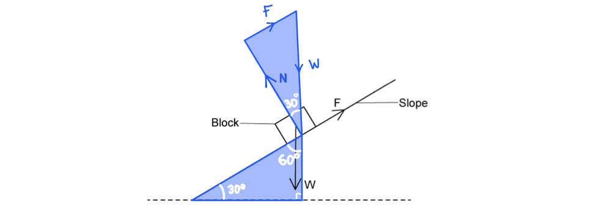
List the known quantities:

- Frictional force, *F* = 60 N
- Angle between *F* and the horizontal = 30°

(i) Resolving the vector horizontally:

- $\cos 30^{\circ} = \frac{adjacent}{hypotenuse} = \frac{F ( \rightarrow )}{60}$
- $F ( \rightarrow ) = 60 \times \cos 30^{\circ}$ **[1 mark]**
- $F ( \rightarrow )$ = 51.96 = 52 N **[1 mark]**

(ii) Resolving the vector vertically:

- $\sin 30^{\circ} = \frac{opposite}{hypotenuse} = \frac{F ( \uparrow )}{60}$
- $F ( \uparrow ) = 60 \times \sin 30^{\circ}$ **[1 mark]**
- $F ( \uparrow )$ = 30 N **[1 mark]**

**[Total: 4 marks]**

> *Drawing the triangles is essential to answering this question correctly.*

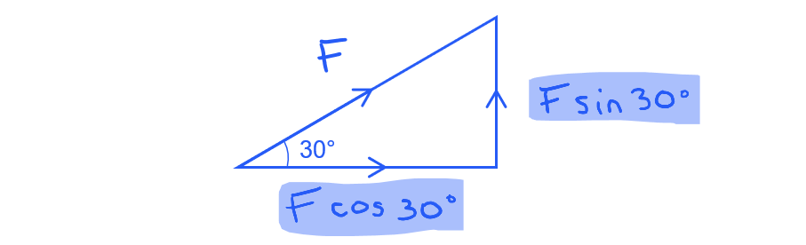

### Q3
A vector is a quantity that has:

- A magnitude/size; **[1 mark]**
- And a direction; **[1 mark]**

**[Total: 2 marks]**

> *Don't forget that vector quantities carry **two **pieces of information: a **magnitude** as well as a **direction**! This is not always obvious, e.g. 4 N is a force, therefore is a vector quantity. Its magnitude of '4 N' is clear, but what about its direction? Remember **direction **is associated with a positive sign + or a negative sign –. Strictly speaking, the example force given should be written as +4 N, which implies a force of –4 N would be directed in the **opposite direction. *
Complete the missing information:

- **One**** mark for each correct answer**

| **Quantity** | **SI unit** |
|---|---|
| Tension | **Final answer:** **N** |
| **Final answer:** **Momentum** | kg m s-1 |
| Magnetic flux density | **Final answer:** **T** |

**[Total: 3 marks]**

> *You must know the difference between the SI (standard international) unit for a quantity and other equivalent units. *
(i) Draw and label a line to show the distance travelled, *d*:

A sketch on the image that would score 1 mark should look like:

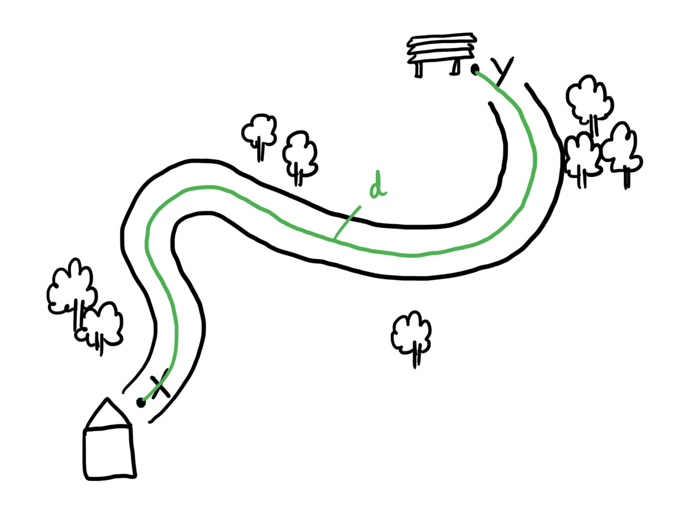

- A line joining X and Y <u>along the path as shown</u> **AND **clearly labelled with a lower case *d*; **[1 mark]**

(ii) State whether the person's distance travelled *d* is greater than, equal to, or less than their displacement between X and Y:

The distance *d* is:

- Greater (than the displacement between X and Y); **[1 mark]**

**[Total: 2 marks]**

> *Be really careful when distinguishing **distance** (a scalar) and **displacement** (a vector). *

> *Though similar, the distance measures the **length** of a given path or trajectory, whereas the displacement measures the distance travelled **in a particular direction**. Therefore, in this question, the distance the length travelled along the cycle path. The displacement, however, is a **vector** line directly from X to Y. This is sketched below: *

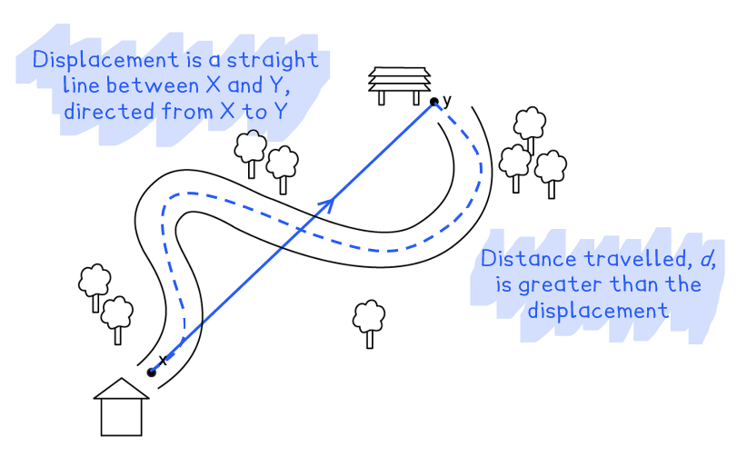
The total displacement for the person's journey is:

- Zero / 0 (m) **[1 mark]**

The total displacement is zero because:

- The person returns to their starting/initial position / to X **OR** she returns home; **[1 mark]**

**[Total: 2 marks]**

> *Displacement is a **vector** between a starting or initial position and a final position. Hence, for any object that moves an arbitrary distance (i.e., it could be a very short or very long length) **but then returns to its initial position**, its displacement is **zero**. This is because the vector between the **initial position** and **final position** would have zero magnitude, because both positions are at the same point! *

### Q4
(i) The names of forces X and Y are:

- Force X = Weight; **[1 mark]**
- Force Y = Upthrust; **[1 mark]**

(ii) Calculate the magnitude of the resistive force *F*:

List the known quantities:

- Radius, *r* = 1.5 mm = 1.5 × 10−3 m
- Velocity, *v* = 3.5 m s−1
- Constant, *k* = 0.0124 (kg m−1 s−1)

Calculate the resistive force *F*:

- Resistive force:  $F=krv$
- *F* = 0.0124 × (1.5 × 10−3) × 3.5 = 6.51 × 10−5 N **[1 mark]**

Convert to µN (10−6 N):

- *F* = 6.51 × 10−5 N  →  65.1 × 10−6 N
- *F* = 65.1 µN **[1 mark]**

(iii) Determine the magnitude and direction of the resultant force on the raindrop:

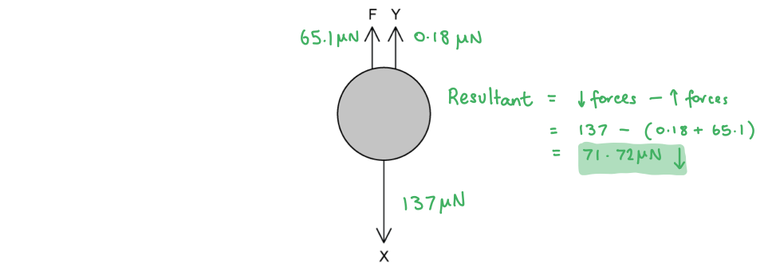

- (From Fig 1.1)  Resultant force = X − Y − *F*  **OR ** X − (Y + *F*) **[1 mark]**
- Resultant force = 137 − 0.18 − 65.1 = 71.72 µN
- Magnitude of the resultant = 72 µN (2 s.f.) **[1 mark]**
- Direction of the resultant = downwards / in the direction of X **[1 mark]**

**[Total: 7 marks]**
Show that the angle *θ* between the resultant and the vertical is about 47°:

- Resultant force (down) = 71.72 µN
- Resultant force (windy day) = 105 µN

Draw a vector triangle and use trigonometry to find the angle *θ*:

- $\mathrm{cos}θ=\frac{\mathrm{adj}}{\mathrm{hyp}}=\frac{71.72}{105}$ **[1 mark]**
- $\\theta = \cos ^{- 1} ( \frac{71.72}{105} )$ = 46.918 = 46.9° **[1 mark]**

**[Total: 2 marks]**

### Q5
List the known quantities:

- Initial velocity *v* = 15 m s–1
- Angle to the horizontal *θ* = 22°

Resolve the velocity into its vertical component:

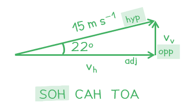

- $\mathrm{sin}22^{\circ}=\frac{opposite}{hypotenuse}=\frac{v_{v}}{15}$
- $v_{v}=15\times\mathrm{sin}22^{\circ}$
- $v_{v}=5.6ms^{-1}$ **[1 mark]**

**[Total: 2 marks]**

> *You should be able to resolve vectors into their vertical and horizontal components by applying rules of trigonometry. Remember the components are based on sin **θ **or cos **θ **depending on where the angle **θ **is drawn. In this example the angle is given to the horizontal, therefore the vertical component (opposite the angle) uses sin **θ.*
The horizontal component of velocity is directed:

- To the right; **[1 mark]**

**[Total: 1 mark]**

> *Don't forget, components of vectors **must **have a direction as well! They too are vectors; any vector can be resolved into two perpendicular vectors. *

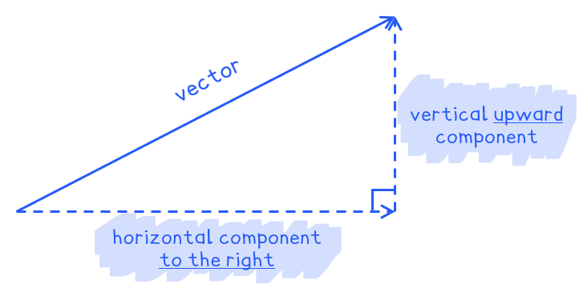
Calculate the initial velocity, *v**2** *, of the projectile:

List the known quantities:

- Vertical component of initial velocity, $v_{v}=5.8ms^{-1}$
- Horizontal component of initial velocity, $v_{h}=8.4ms^{-1}$

Calculate the resultant vector using Pythagoras’ Theorem:

- $v_{2}^{2}=v_{v}^{2}+v_{h}^{2}$ **[1 mark]**
- $v_{2}^{2}=5.8^{2}+8.4^{2}$
- $v_{2}=\sqrt{5.8^{2}+8.4^{2}}$
- $v_{2}=10.2ms^{-1}$ **[1 mark]**

**[Total: 2 marks]**

> *Two vectors perpendicular to each other will have a resultant that is the hypotenuse of a right-angled triangle. This is an important relationship to recognise in this unit of scalars and vectors and is always how you calculate the magnitude of two perpendicular vectors.*

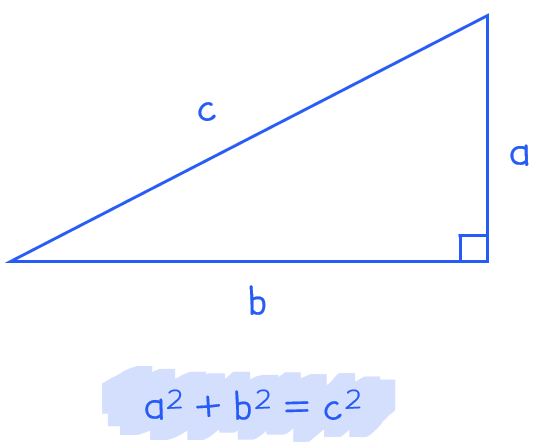
Calculate the angle of the second projectile:

Draw a diagram of the situation and state the relationship of each side of the triangle to angle $θ$:

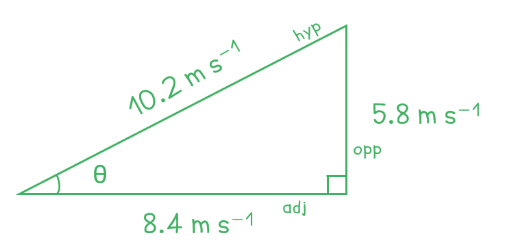

- Identify the correct angle
- 8.4 m s-1 is the adjacent side of the triangle
- 5.8 ms-1 is the opposite side of the triangle
- 10.2 m s-1 is the hypotenuse of the triangle (from part (c))

Identify the trigonometric function and calculate the angle:

- Using the opposite and adjacent sides of the triangle:
- $\mathrm{tan}θ=\frac{opposite}{adjacent}=\frac{5.8}{8.4}$ **OR **0.69 **[1 mark]**
- $\\theta = \tan ^{- 1} ( 0.69 ) = 34.6^{\circ} = 35^{\circ} ( 2 \mathrm{s} . \mathrm{f} . )$** [1 mark]**

**[Total: 2 marks]**

> *As all three sides of the triangle are known, any of the trigonometric functions can be used to determine the angle:*

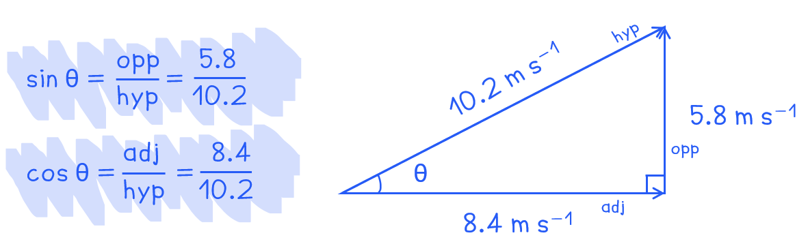

> *In this question, you are best using the opposite and adjacent sides to calculate the angle as these are the quantities given to you in the question, whereas using sin and cos rely on you using the value that you calculated for hypotenuse. *

### Q6
List the known quantities:

- Mass of the wrecking ball, *m* = 2 tonne = 2000 kg
- Tension in horizontal rope = 6400 N

(i) Write an expression for the vertical component of the tension in the cable:

- Weight:  $W=mg$
- *W* = 2000 × 9.81 = 19 620 N

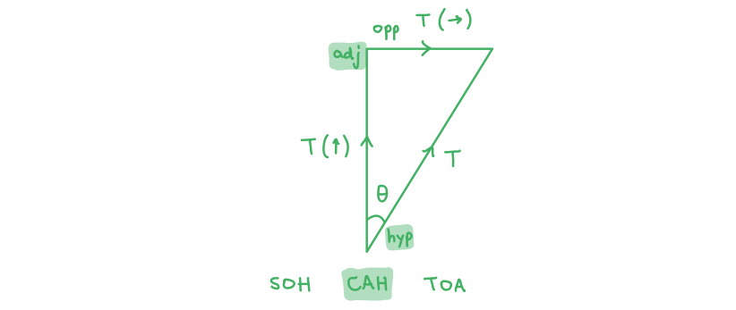

- Resolving vertically:  $T ( \uparrow ) = T \cos \\theta = W$ **[1 mark]**
- $T ( \uparrow ) = \frac{W}{\cos \\theta } = \frac{19 620}{\cos \\theta }$ **[1 mark]**

(ii) Write an expression for the horizontal component of the tension in the cable:

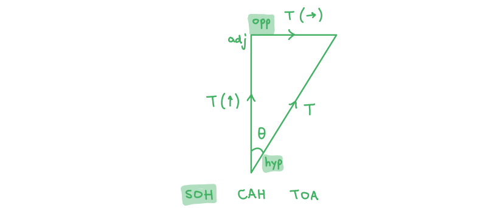

- Resolving horizontally:  $T ( \rightarrow ) = T \sin \\theta = 6400 \mathrm{N}$ **[1 mark]**
- $T ( \rightarrow ) = \frac{6400}{\sin \\theta }$ **[1 mark]**

**[Total: 4 marks]**
(i) Determine the angle *θ* the cable makes with the vertical:

- Equate the expressions for *T*:  $\frac{19620}{\mathrm{cos}θ}=\frac{6400}{\mathrm{sin}θ}$
- Rearrange to get tan *θ*:  $\frac{\mathrm{sin}θ}{\mathrm{cos}θ}=\mathrm{tan}θ=\frac{6400}{19620}$ **[1 mark]**
- Use the inverse tan function:  $\\theta = \tan ^{- 1} ( \frac{6400}{19 620} )$ = 18.1° **[1 mark]**

(ii) Determine the magnitude of the tension *T* in the cable:

- Use either expression for *T*:  $T=\frac{19620}{\mathrm{cos}θ}$ **OR  **$T=\frac{6400}{\mathrm{sin}θ}$
- Substitute in the angle:  $T=\frac{19620}{\mathrm{cos}18.1^{\circ}}$ **[1 mark]**
- Magnitude of tension, *T* = 20 637 = 21 000 N (2 s.f.) **[1 mark]**

**[Total: 4 marks]**

> *In part (ii), you could also get the same result by using Pythagoras:*

$T=\sqrt{19620^{2}+6400^{2}}=20637N$
The correct vector triangle is as follows:

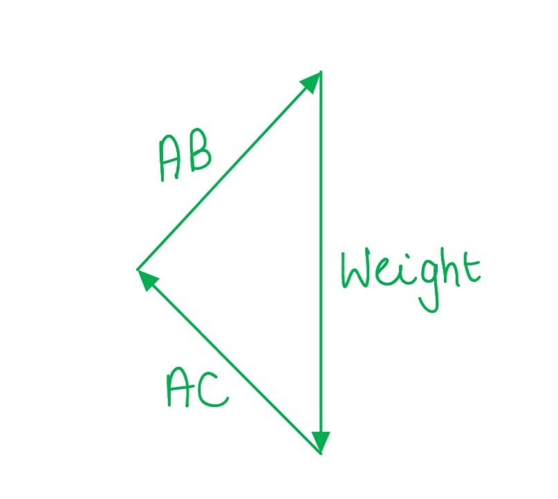

- All vectors are the correct size by eye; **[1 mark]**
- The vector triangle is closed and all vectors are joined tip to tail; **[1 mark]**
- All three vectors are correctly labelled; **[1 mark]**

**[Total: 3 marks]**

> *The key to answering this question correctly is realising that the weight of the beam will act vertically straight down. The other two vectors can then be slotted into the correct position.*
Calculate the resultant force required to keep the system in equilibrium:

List the known quantities:

- Magnitude **AB** = 9 N
- Magnitude **AC** = 12 N

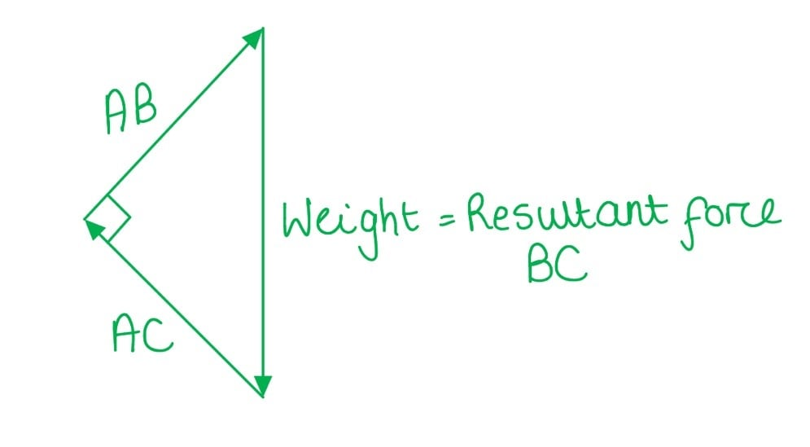

- Force **BC** is the resultant force of **AB** and **AC **and is equal to the magnitude of the weight of the beam

Use Pythagoras to calculate resultant force:

- Resultant **BC** = $\sqrt{AB^{2}+AC^{2}}=\sqrt{9^{2}+12^{2}}$ **[1 mark]**
- Resultant **BC **= 15 N **[1 mark]**

**[Total: 2 marks]**

> *Remember you only need to be able to resolve and calculate resultant components of vectors for right angle triangles. If you have an exam question about this you will most often need to use Pythagoras.*
