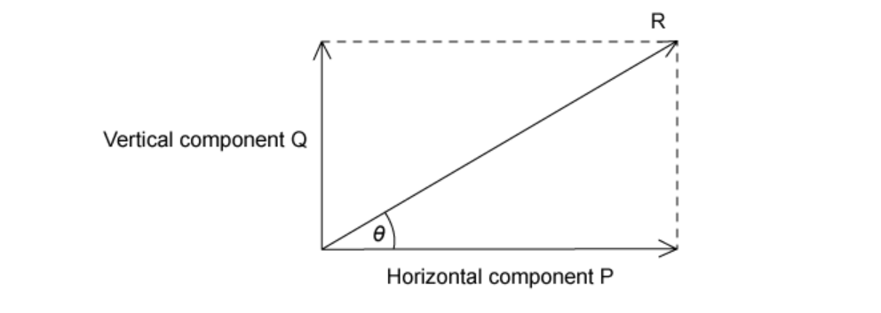
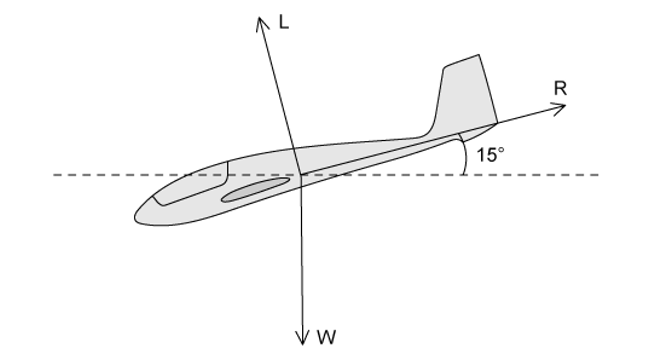
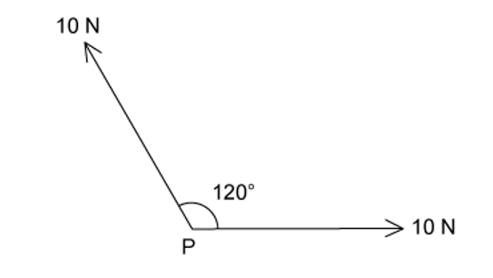
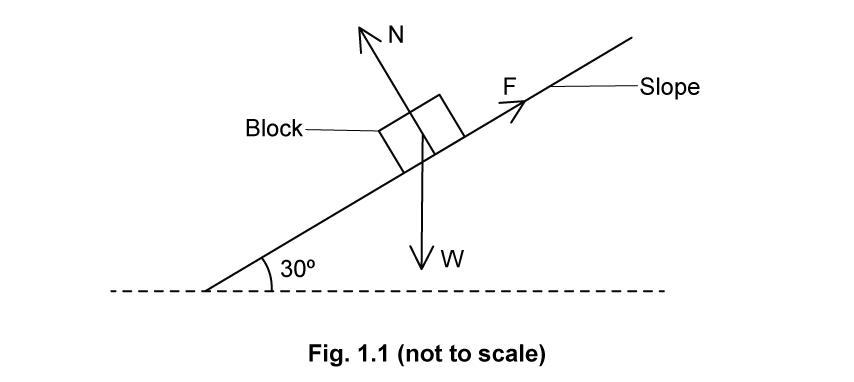
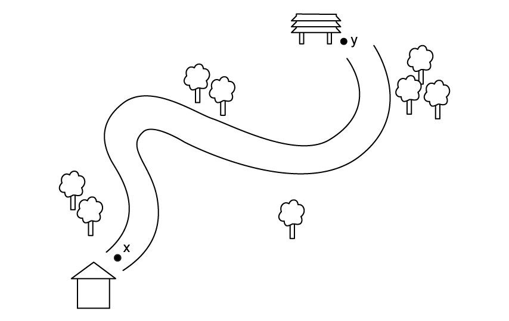
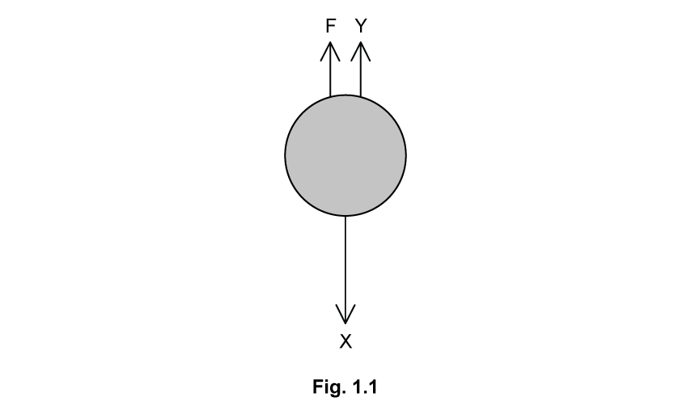
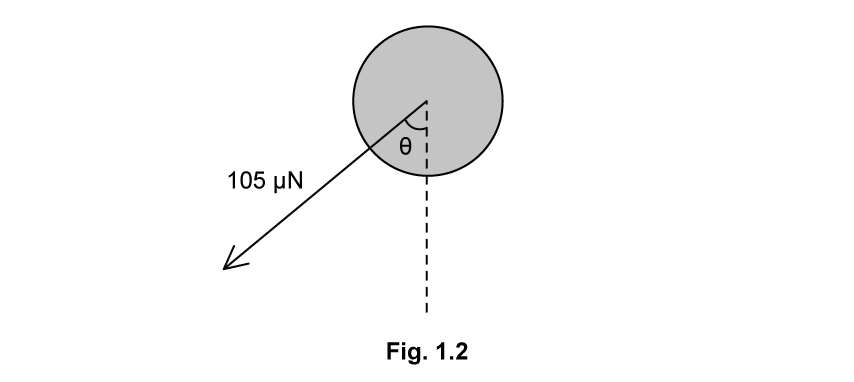
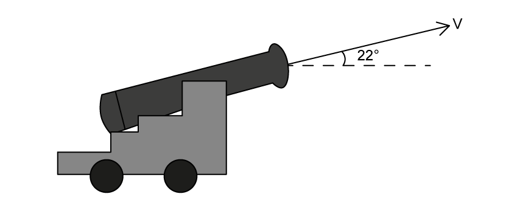
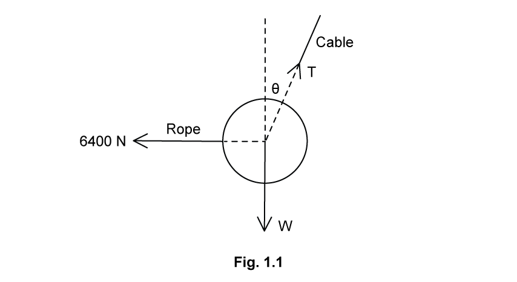
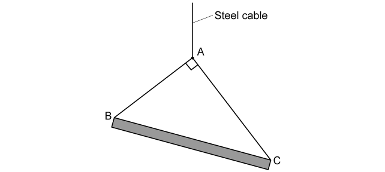

# Exam Questions — Scalars & Vectors
**1. Physical Quantities & Units** · Cambridge (CIE) A-LEVEL physics (9702)
> Source: [https://www.savemyexams.com/a-level/physics/cie/25/topic-questions/](https://www.savemyexams.com/a-level/physics/cie/25/topic-questions/) · 22 questions across 2 sets

## Multiple Choice Questions (16 questions)

### Q1 — easy — 1 marks

**Q1** [1 mark]

Two physical quantities **P** and **Q** are added together. The sum of **P** and **Q** is **R**, as shown in the diagram.

Which quantity could be represented by **P** and by **Q**?

### Q2 — hard — 1 marks

**Q2** [1 mark]

The diagrams represent systems of coplanar forces acting at a point. The lengths of the force vectors represent the magnitudes of the forces.

Which system of forces is in equilibrium?

### Q3 — medium — 1 marks

**Q3** [1 mark]

A ship’s speed in still water is 20 km h−1. A current coming from the east pushes the ship at a constant speed of 5 km h−1. At what bearing should the captain direct the ship so that it travels perfectly due north?

### Q4 — medium — 1 marks

**Q4** [1 mark]

Vectors **P** and **Q** are drawn to scale.

Which diagram represents the vector (**P** – **Q**)?

### Q5 — medium — 1 marks

**Q5** [1 mark]

A resultant force of 20 N is 30° to the horizontal.

What is the horizontal and vertical component of the resultant force?

|   | **Horizontal**  **Component / N** | **Vertical Component / N** |
|---|---|---|
| **A** | 17 | 10 |
| **B** | 10 | 17 |
| **C** | 11.5 | 10 |
| **D** | 17 | 11.5 |

### Q6 — medium — 1 marks

**Q6** [1 mark]

The speed of an aeroplane in still air is 200 km h-1. The wind blows from the west at a speed of 85.0 km h-1.

In which direction must the pilot steer the aeroplane in order to fly due north?

### Q7 — easy — 1 marks

**Q7** [1 mark]

The arrow represents the vector **R**.

Which diagram does **not** represent **R** as two perpendicular components?

### Q8 — easy — 1 marks

**Q8** [1 mark]

Which one of the following statements is **true**?

### Q9 — easy — 1 marks

**Q9** [1 mark]

Which pair contains one vector and one scalar quantity?

| **A** | Displacement | Acceleration |
|---|---|---|
| **B** | Force | Kinetic energy |
| **C** | Momentum | Velocity |
| **D** | Power | Speed |

### Q10 — medium — 1 marks

**Q10** [1 mark]

A vector has magnitude **R** and perpendicular components **P** and **Q**, as shown in the diagram.

Which row correctly describes the perpendicular components?

|   | **Vertical component** | **Horizontal component** |
|---|---|---|
| **A**  **B**  **C**  **D** | *Q*  *R *cos *θ*  *R *cos *θ*  *R *sin *θ* | sin *θ*  *P*  *R *sin *θ*  *R *cos *θ* |

### Q11 — medium — 1 marks

**Q11** [1 mark]

Fig 1.1 shows three coplanar forces which are in equilibrium.

What is the value of force *F*?

### Q12 — hard — 1 marks

**Q12** [1 mark]

Figure 1.1 shows two coplanar forces, *R* and *N*, which act at point *P*. The angle between the forces is $θ$, where $θ>90$ .

What is the magnitude of the resultant force *F* equal to?

### Q13 — hard — 1 marks

**Q13** [1 mark]

A glider is descending at a constant speed at an angle of 15° to the horizontal. The diagram shows the directions of the lift **L**, air resistance **R** and weight **W** acting on the glider.

Which vector triangle could represent the forces acting on the glider?

### Q14 — easy — 1 marks

**Q14** [1 mark]

The diagram shows a resultant force *F* at an angle of *θ* to the horizontal. The horizontal component $F_{x}$* *and vertical component $F_{y}$ are labelled on the diagram.

What is the horizontal component of *F*?

### Q15 — hard — 1 marks

**Q15** [1 mark]

A boat is being pulled along by two equal forces of 700 kN, both at angle* *$θ$ to the direction of motion. The boat experiences a resistive force of 40 kN. The net force on the boat is 1270 kN.

What is the value of $θ$?

### Q16 — hard — 1 marks

**Q16** [1 mark]

Two forces, each of 10 N, act at a point *P* as shown in the diagram. The angle between the force vectors is 120°

What is the magnitude of the resultant force?

## Structured Questions (6 questions)

### Q1 — medium — 6 marks

**Q1** [2 marks]

(i) State the difference between a scalar quantity and a vector quantity.

[1]

(ii) Underline all the vectors in the list below.

| power | length | density | velocity | momentum |
|---|---|---|---|---|

[1]

**Q1** [4 marks]

Two gusts of wind exert forces of magnitude 5.5 N and 11.9 N on a wind turbine at a point O. Both forces act away from point O and the angle between them is 30°.

Fig. 1.1 shows two lines at an angle of 30° to one another.

**Fig. 1.1**

On Fig. 1.1, draw a vector diagram to determine the magnitude of the resultant of the two forces.

### Q2 — easy — 16 marks

**Q2** [2 marks]

Distinguish between scalar and vector quantities.

**Q2** [6 marks]

(i) Energy is a scalar quantity. State **three** other scalar quantities.

[3]

(ii) Force is a vector quantity. State **three** other vector quantities.

[3]

**Q2** [4 marks]

Fig. 1.1 shows a block at rest on a slope.

Three forces, weight *W*, normal contact force *N* and the frictional force *F* act on the block. The forces are in equilibrium.

(i) Explain what is meant by 'the forces are in equilibrium'.

[2]

(ii) Complete the vector triangle in Fig. 1.2. Label the missing vector and the angle between *W* and *N*.

[2]

**Q2** [4 marks]

**Extract:**

Fig. 1.1 shows a block at rest on a slope. Three forces, weight W, normal contact force N and the frictional force F act on the block. The forces are in equilibrium. (ii) Complete the vector triangle in Fig. 1.2. Label the missing vector and the angle between W and N. Mark scheme: Angle labelled 30°.

The frictional force has a magnitude of 60 N.

By resolving the vector, calculate the component of the force that acts

(i) horizontally

[2]

(ii) vertically.

[2]

### Q3 — easy — 9 marks

**Q3** [2 marks]

State the definition of a vector quantity.

**Q3** [3 marks]

A list of vector quantities and their SI unit is given.

| **Quantity** | **SI unit** |
|---|---|
| Tension |   |
|   | kg m s-1 |
| Magnetic flux density |   |

Complete the information missing from the table.

**Q3** [2 marks]

A person cycles along a path every day, from their front garden at X to a bench by the nearby lake at Y, as shown in Fig. 1.1.

**Fig. 1.1**

(i) Sketch a line on the image that would indicate the distance travelled by the person between X and Y. Label this distance *d*.

[1]

(ii) State whether the distance travelled *d* by the person is greater than, equal to, or less than their displacement between X and Y.

[1]

**Q3** [2 marks]

**Extract:**

A person cycles along a path every day, from their front garden at X to a bench by the nearby lake at Y, as shown in Fig. 1.1.

The person continues their journey and walks along the same path back home, from Y to X. The total distance for their complete journey which was logged by their smartwatch is 4.3 km. State and explain what the total displacement for their journey is.

### Q4 — medium — 9 marks

**Q4** [7 marks]

The resistive force $F$ acting on a spherical raindrop falling vertically in the air can be described by the relationship

$F=krv$

where $r$ is the radius of the raindrop, $v$ is the velocity of the raindrop, and $k$ is a constant.

Fig. 1.1 shows the forces acting on the raindrop as it accelerates downwards.

The raindrop has a radius of 1.5 mm and falls at a velocity of 3.5 m s−1. The constant *k* has a magnitude of 0.0124 in air.

Other than the resistive force *F*, two other forces, X and Y, act on the raindrop drop as it falls through the air.

(i) State the names of forces X and Y.

[2]

(ii) Calculate the magnitude of the resistive force *F* in µN.

[2]

(iii) Force X has a value of 137 µN and force Y has a value of 0.18 µN.

Using Fig. 1.1, determine the magnitude and direction of the resultant force on the raindrop.

[3]

**Q4** [2 marks]

**Extract:**

(iii) Determine the magnitude and direction of the resultant force on the raindrop: Resultant force = X − Y − F. Resultant force = 137 − 0.18 − 65.1 = 71.72 µN. Magnitude of the resultant = 72 µN (2 s.f.). Direction of the resultant = downwards / in the direction of X.

On a windy day, the resultant force on the raindrop is 105 µN at an angle of *θ* to the vertical as shown in Fig. 1.2.

Use your answer to **(a)iii** to show that the angle *θ* between the resultant and the vertical is about 47°.

### Q5 — easy — 7 marks

**Q5** [2 marks]

A small cannon fires a projectile at an angle of 22° to the horizontal with an initial velocity *v*.

Calculate the vertical component of velocity if its initial velocity has a magnitude of *v* = 15 m s–1.

**Q5** [1 mark]

**Extract:**

A small cannon fires a projectile at an angle of 22° to the horizontal with an initial velocity *v*.

State the direction of the horizontal component of velocity.

**Q5** [2 marks]

The cannon fires a second projectile. The initial horizontal component of velocity is 8.4 m s-1 and the initial vertical component of velocity is 5.8 m s-1.

Calculate the initial velocity, *v*2, of the second projectile.

**Q5** [2 marks]

**Extract:**

The cannon fires a second projectile. The initial horizontal component of velocity is 8.4 m s^-1^ and the initial vertical component of velocity is 5.8 m s^-1^. Calculate the initial velocity, v2, of the second projectile. v2 = √(5.8^2 + 8.4^2) = 10.2 m s^-1

Calculate the angle to the horizontal that the second projectile was fired at.

### Q6 — medium — 13 marks

**Q6** [4 marks]

Fig. 1.1 shows a 2 tonne wrecking ball being used on a demolition site.

The ball is suspended from a cable which makes an angle *θ* with the vertical. The ball is pulled into the position shown by a rope that is kept horizontal. The tension in the rope is 6400 N.

Write expressions for tension *T* using

(i) the vertical component of the tension in the cable

[2]

(ii) the horizontal component of the tension in the cable.

[2]

**Q6** [4 marks]

**Extract:**

Fig. 1.1 shows a 2 tonne wrecking ball being used on a demolition site. The ball is suspended from a cable which makes an angle θ with the vertical. The ball is pulled into the position shown by a rope that is kept horizontal. The tension in the rope is 6400 N.

Mass of the wrecking ball, m = 2 tonne = 2000 kg. Tension in horizontal rope = 6400 N.

Vertical component: W = mg = 2000 × 9.81 = 19620 N; T(↑) = T cos θ = W, so T = 19620/cos θ.

Horizontal component: T(→) = T sin θ = 6400 N, so T = 6400/sin θ.

Determine

(i) the angle *θ* the cable makes with the vertical

[2]

(ii) the magnitude of the tension *T* in the cable

[2]

**Q6** [3 marks]

On the same demolition site, there is a uniform beam supported by two light cables, **AB** and **AC**, which are attached to a single steel cable from a crane, as shown in Fig. 1.2.

The beam is stationary and in equilibrium.

**Fig. 1.2**

Draw the vector triangle for this situation labelling the tension in both cables and the weight of the beam.

**Q6** [2 marks]

**Extract:**

On the same demolition site, there is a uniform beam supported by two light cables, **AB** and **AC**, which are attached to a single steel cable from a crane, as shown in Fig. 1.2. The beam is stationary and in equilibrium.

The tension in the cable **AB** is 9 N and the tension in the cable **AC** is 12 N.

Calculate the resultant force required in the beam **BC **to keep the system in equilibrium.
