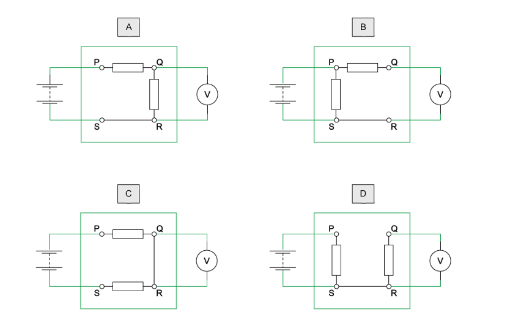
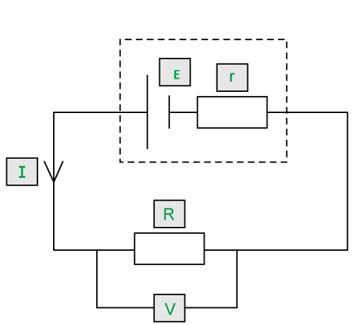
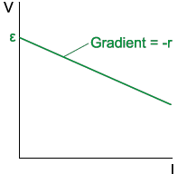

# Mark Schemes — Practical Circuits
**10. D.C. Circuits** · Cambridge (CIE) A-LEVEL physics (9702)

## Multiple Choice Questions (16 questions)

### Q1
**Final answer:** **The correct answer is ****C ****because:**

- Current is equal to $I=\frac{Q}{t}$
- A charge of 6.0 C flows through the resistor in a time of 2.0 minutes
- So, the current through the resistor is $I=\frac{6.0}{2\times60}=0.05A$
- Power dissipated in a resistor is equal to $P=I^{2}R$
- Power is also equal to $\frac{energy}{time}$

  - So, energy dissipated $= P \times t = ( I^{ 2} R ) \times t = 48 \mathrm{J}$
  - $( 0.05 )^{2} = R \times ( 2 \times 60 ) = 48$
  - Therefore, resistance `R = (48)/(( 0.05 ) ^2 x ( 2 x 60 )) = 160 capital omega`
- The internal resistance of the battery and the resistor are in series, hence, the same current flows through them
- So, the sum of p. d. across these two resistors is equal to the e. m .f in the circuit

  - $E = I \times ( R + r ) = 9.0 \mathrm{V}$
  - `( R + r ) = (9.0)/(0.05) = 180 capital omega`
  - $160+r=180$
- Therefore, the internal resistance is equal to *r* = 180 – 160 = 20 Ω

### Q2
**Final answer:** **The correct answer is ****A ****because:**

- The best approach to this question is to draw the battery and voltmeter in each of the four circuits, as shown below
- The reading on the voltmeter across QR is $\frac{E}{2}$
- Ohm's Law states $V=IR$

  - This means that half of the resistance, or one resistor, is across QR
- Consider circuit **A**:

  - The voltmeter is connected across one of the two resistors, and the circuit is complete
  - The reading on the voltmeter would therefore be $\frac{E}{2}$
  - So, option A is correct

**B **&** C **are incorrect because to get a reading of $\frac{E}{2}$   there would need to be just one resistor across QR

**D **is incorrect because this is not a complete circuit, so the reading would be zero

### Q3
**Final answer:** **The correct answer is ****A ****because:**

- The internal resistance of the supply is *r* = 2 Ω
- The resistance of the load resistor, *R* varies from 0.5 Ω to 4 Ω
- Power *P* dissipated in the load resistor is equal to $I^{2}R$
- The power dissipated is maximum when the load resistance is equal to the internal resistance, *R* = *r* = 2 Ω
- Since 2 Ω lies within the range 0.5 Ω - 4 Ω, the graph peaks at 2 Ω, as illustrated in option **A**

**B** is incorrect because this graph shows that the power reaches a minimum value when the load resistance equals the internal resistance

**C & D** are incorrect because at a glance of the equation between power and resistance $P=I^{2}R$ , you might initially think the relationship is directly proportional. However, we have to consider the internal and external resistors as two resistors in series. Initially, the value of *R* is zero, so the power dissipated across it is also zero. Similarly, if the value of *R* is infinite, the power dissipated is also zero as the current will then also be zero. So, the power dissipated must increase and then decrease as *R* increases from zero. As the value of *R* increases, the current *I* decreases and hence the p. d. across the external resistor increases. The p .d. across the internal resistor *r* decreases and the power dissipated in *r* (given by $I^{2}r$  ) decreases. Therefore, the maximum power dissipated across R occurs when *R* = *r*

### Q4
**Final answer:** **The correct answer is ****A ****because:**

- To obtain the resistance of resistor R from the set-up shown, the potential difference and current flowing through the resistor are measured

  - Ohm's law states $V=IR$ , so resistance $R=\frac{V}{I}$
- In this circuit the voltmeter is connected in parallel with *R* (reading the true potential difference across it), while the ammeter sits in the main line and reads the **total** current — the current through *R* plus the current diverted through the voltmeter
- Ideally, a voltmeter should have infinite resistance so that it draws negligible current; if its resistance is finite, some current bypasses the ammeter reading and the measured value of *R* is too low
- For the diverted current to be negligible, the voltmeter resistance must be much larger than *R*, so that *I*V ≪ *I*R
- Therefore, in order to obtain an accurate value of *R*, the necessary condition is that *R* should be much smaller than *R*V

**B** & **D** are incorrect because *R*A does not affect the result. The voltmeter reads the potential difference across *R* directly, and the ammeter sits in the main supply line, so its resistance *R*A only reduces the total current drawn from the supply — it does not change the ratio $\frac{V}{I}$, and so the measured value of *R* is unaffected by whether *R*A is small or large

**C** is incorrect because an ideal voltmeter has infinite resistance, so *R* could not be higher than this

> *Note that the ammeter is not in series with resistor **R** alone — it is in series with the parallel combination of the voltmeter and the resistor. So the ammeter measures **I**R** + **I**V**, not the current through R*

### Q5
**Final answer:** **The correct answer is ****D ****because:**

- The resistance of an LDR decreases as the light intensity increases
- The circuit is a series connection, so the same current flows through all the components
- From Ohm's Law or $V=IR$or $I=\frac{V}{R}$
- Therefore, as the light intensity decreases, the resistance of LDR increases and so current *I* decreases
- The ratio of *V**1* to *V**2* is equal to  $\frac{V_{1}}{V_{2}}=\frac{IR_{1}}{IR_{2}}=\frac{R_{1}}{R_{2}}$
- The light intensity affects the current in the circuit, but the ratio does not depend on current
- Therefore, the ratio $\frac{V_{1}}{V_{2}}$  is independent of the light intensity

**A **is incorrect because the current *I *decreases when the light intensity decreases, so light intensity and current are directly proportional

**B **is incorrect because the LDR is not an ohmic conductor (it does not follow Ohm's Law)

**C **is incorrect  because since current *I *decreases as the light intensity on the LDR decreases, which causes the resistance of LDR to increase, $V_{2}=IR_{2}$  will also decrease

### Q6
**Final answer:** **The correct answer is ****B ****because:**

- A component whose resistance is designed to change with temperature is called a thermistor
- The symbol for a thermistor is given by option **B**

**A **is incorrect because this is the symbol for a potentiometer

**C **is incorrect because this is the symbol for a diode

**D **is incorrect because this is the symbol for an LDR

### Q7
**Final answer:** **The correct answer is ****B ****because:**

- Potential difference (p.d.) is defined as the work done per unit charge by the charge moving from one point to another
- It involves the transfer of energy to components

  - So, statements 1 and 4 refer to p. d.
- Electromotive force (e .m .f.) is defined as the energy per unit charge to move charge right around a circuit
- It involves the transfer of energy into the circuit

  - So, statements 2 and 3 refer to e .m .f.

### Q8
**Final answer:** **The correct answer is ****D ****because:**

- The sum of p. d. across the internal and external resistors is equal to the e. m. f in the circuit

  - $E = I ( R + r ) = 12 \mathrm{V}$
  - So, the values must add up to 12 V
- Consider option D

  - Internal resistance *r* = 2.0 Ω
  - External resistance *R* = 4.0 Ω
  - Current *I* = 1.8 A
- $E = I ( R + r ) = 1.8 ( 4 + 2 ) = 10.8 \mathrm{V}$
- This is less than the stated e. m. f., so this combination is incorrect

**A **is incorrect because  $E = I ( R + r ) = 1 ( 10 + 2 ) = 12 \mathrm{V}$

**B **is incorrect because  $E = I ( R + r ) = 1.2 ( 8 + 2 ) = 12 \mathrm{V}$

**C **is incorrect because  $E = I ( R + r ) = 1.5 ( 6 + 2 ) = 12 \mathrm{V}$

### Q9
**Final answer:** **The correct answer is ****D ****because:**

- From the diagram, X is connected to the positive terminal of the power supply, and Y is connected to the negative terminal of the power supply
- So, if the potential at X is 24 V, which it is for all options, then there must be no break in the positive wire
- Now, consider a break in the negative wire of the cable
- The circuit is not complete, and so, there is no current passing through the circuit
- So, there is no drop in potential across the pump motor (in other words, the potential at Y is the same as the potential at X)
- Therefore, a break in the negative wire of the cable would give a potential of 24 V at Y, as well as 24 V at X

**A **is incorrect because if there was a break in the positive wire, the voltmeter reading when connected to X or Y would be zero

**B **is incorrect because if there was a break in the negative wire, the potential at Y would be the same as the potential at X (24 V)

**C **is incorrect because if there was a break in the connection within the pump motor X would be at 24 V and Y would be at 0 V

### Q10
**Final answer:** **The correct answer is ****C ****because:**

- A charge of 240 C flows through the resistor in a time of 2 minutes = 120 s
- Calculating current:

  - $Q=It\rightarrowI=\frac{Q}{t}=\frac{240}{120}=2A$
- Power dissipated is $P=I^{2}R$  and $P=\frac{E}{t}$

  - $\frac{E}{t}=I^{2}R\rightarrowR=\frac{E}{I^{2}t}$
  - `R = ( 1440)/(( 2 ) ^2 x 120) = 3 capital omega`
- The emf of the circuit, $E = I ( R + r ) = 9.0 \mathrm{V}$

  - Therefore, the total resistance in the circuit, `( R + r ) = ( E)/(I) = ( 9.0)/(2) = 4.5 capital omega`
- Therefore, since *R* = 3 Ω

  - `r = ( R + r ) - R = 4.5 - 3 = 1.5 capital omega`

**A **is incorrect as this is the resistance of the resistor and not the internal resistance of the e.m.f

**B **is incorrect as this is the current in the circuit and not the internal resistance of the e.m.f.

**D **is incorrect as this is the total resistance in the circuit and not the internal resistance of the e.m.f.

### Q11
**Final answer:** **The correct answer is ****C ****because:**

- In the cable, two of the wires are used to supply power to the relay
- So, the circuit is connected as follows:

  - One terminal of power supply — 1st wire — relay — 2nd wire — other terminal of power supply, therefore, it is a series connection
- The resistance of each of these wires is 0.0050 Ω per meter and each wire measures 800 m long

  - So, the total resistance of one wire $=800\times0.0050=4\text{Ω}$
  - Therefore, the total resistance due to both wires = 4 + 4 = 8 Ω
- There will be a p.d. across the wires and since this is a series connection, the same current flows through the whole circuit

  - So, the p.d. across the two wires $=IR=0.60\times8=4.8V$
- The sum of p.d. across the whole circuit should be equal to the minimum e.m.f

  - Therefore, the minimum output e.m.f. = 16.0 + 4.8 = 20.8 V

### Q12
**Final answer:** **The correct answer is ****C ****because:**

- Most cells tend to have some internal resistance
- The overall e. m. f. provided by the cell is therefore measured as lower than its stated rating
- The e .m .f. of a cell is equal to $E=\frac{W}{Q}$ , therefore, energy is needed to drive charge through the cell

**A **is incorrect because cells discharge over time with continued use, and while this may affect the value of the internal resistance, it is not the reason for the difference between the stated e. m .f. and the measured e. m .f.

**B & D **are incorrect because the question is in reference to the cell, so the wires and resistor have nothing to do with it

### Q13
**Final answer:** **The correct answer is ****D ****because:**

- The e.m.f. is defined as the total energy provided by the cell per unit charge
- In equation form, this can be written

  - $E=\frac{W}{Q}$
- So, the total energy dissipation in the cell and the external circuit is equal to

  - $W=EQ$

**A & B **are incorrect because the e .m .f. provides energy across both the cell and the external circuit

**C **is incorrect because the unit for *EQ *is equal to the joule J, not the Ohm Ω

### Q14
**Final answer:** **The correct answer is ****B**** because:**

- Potential difference is the energy per unit charge transferred to the components
- e.m.f. is the energy required per unit charge for the charges to flow against the electrostatic force through the cell
- Therefore, it can be summarised as e.m.f. is the energy transferred into the circuit and potential difference is the energy transferred away from the circuit

  - This is answer **B**

**A** is incorrect because the descriptions are the wrong way around

**C** is incorrect because potential difference and e.m.f. are not the same thing (potential difference and voltage are the same thing)

**D** is incorrect because the descriptions provided are the wrong way around

- You need to be clear about the difference between potential difference and e.m.f. so take some time to make sure you can explain it

### Q15
**Final answer:** **The correct answer is ****A**** because:**

- The known quantities are

  - E.m.f, ε = 15 V
  - Resistance of the resistor, *R* = 8.0 Ω
  - Current, *I* = 1.5 A
- The e.m.f of a circuit is equal to

  - *ε = I *(*R + r*)
- The internal resistance is

  - $\frac{ε}{I}=R+r$
  - $r=\frac{ε}{I}-R$
  - $r=\frac{15}{1.5}-8.0=2Ω$
- The lost volts from the battery is

  - *V* = *I r*
  - V = 1.5 × 2 V
- This is option **A**

### Q16
**Final answer:** **The correct answer is ****A ****because: **

- A battery being marked 9.0 V means that each coulomb of charge from the battery supplies 9.0 J of energy to the whole circuit (this includes the internal resistance of the battery)

**B **is incorrect because this would mean that the amount of energy that the battery supplies to an external circuit for each coulomb of charge is not 9.0 V

**C **is incorrect because if there is no internal resistance in the battery (and the wires have negligible resistance), the sum of p.d. across the components connected to the battery will be 9.0 V

**D **is incorrect because the e.m.f of a battery does not tell anything about its internal resistance. If the battery has some internal resistance, the p.d. across the battery terminals will not be exactly 9.0 V, but less

## Structured Questions (5 questions)

### Q1
Definitions and units for the variables:

(i) *I  *is:

- Current **AND** (Measured in) Amps / A; **[1 mark]**

(ii) *R  *is:

- <u>Load</u> resistance / resistance of load **AND** (Measured in) Ohms / Ω; **[1 mark]**

(iii) *r * is:

- <u>Internal</u> resistance **AND** (Measured in) Ohms / Ω; **[1 mark]**** **

**[Total: 3 marks]**
A sketch that would score 5 marks should look like:

- **[1 mark] **for each variable in its correct box** **

**[Total: 5 marks]**
List the known quantities:

- Current, *I* = 0.6 mA
- Resistance, *R* = 2.5 kΩ** **

Convert *I* into amps and *R* into ohms:

- *I* = 0.6 mA = 0.6 × 10–3 A **AND** *R* = 2.5 kΩ = 2.5 × 103 Ω **[1 mark]**** **

Calculate the terminal potential difference, *V* :

- Recall the equation for Ohm's Law:* V* = *IR*
- *V* = (0.6 × 10–3) × (2.5 × 103) **[1 mark]**
- *V *= 1.5 V **[1 mark]**** **

**[Total: 3 marks]**
List the known quantities:

- Terminal potential difference *V* = 1.5 V (from part (c))
- Internal resistance, *r* = 1.3 kΩ
- Current, *I* = 0.6 mA = 0.6 × 10–3 A

Convert *r*  into ohms:

- *r* = 1.3 kΩ = 1.3 × 103 Ω **[1 mark]**

Calculate the emf, *E*:

- *ε* = *IR* + *Ir* = *V* + *Ir*
- *ε* = 1.5 + (0.6 × 10–3) × (1.3 × 103) **[1 mark]**
- *ε *= 2.28 = 2.3 V **[1 mark]**** **

**[Total: 3 marks]**

### Q2
The terminal p.d of a cell may be different to the e.m.f of the cell because:

- The terminal p.d is <u>less</u> than the e.m.f (of the cell); **[1 mark]**
- (Because) there are lost volts **OR** energy is used / dissipated within the cell; **[1 mark]**
- Due to internal resistance (in the cell) when a current is supplied; **[1 mark]**

**[Total: 3 marks]**
List the known quantities:

- Electromotive force (e.m.f), *E* = 6.2 V
- Resistance of resistor, *R* = 11 Ω
- Internal resistance, *r* = 7.0 Ω

(i) Determine the internal resistance *r* of the battery

- $E = I ( R + r )$ **[1 mark]**
- $I=\frac{E}{R+r}=\frac{6.2}{11+7.0}$ **[1 mark]**
- $I$ = 0.34 A **[1 mark]**

(ii) Determine the terminal p.d. of the battery

- $V=IR$ **[1 mark]**
- *V* = 0.34 × 11 = 3.74 = 3.7 V **[1 mark]**

**[Total: 5 marks]**

> *The e.m.f. equation is **not** given in your data and formulae sheet, so you must memorise this for your exam and be confident in rearranging it for any variable.*
The **resistance **in the circuit:

- Increases from (7 + 11 =) 18 Ω to (7 + 11 + 11 =) 29 Ω; **[1 mark]**

The **current **in the circuit:

- Decreases from $( \frac{6.2}{18} = )$ 0.34 A to $( \frac{6.2}{29} = )$ 0.21 A; **[1 mark]**

**[Total: 2 marks]**

> *'Quantitatively' means with regards to **numbers**. This implies you must do a calculation to support your answer. Therefore, only using the terms 'increases' or 'decreases' without any numerical justification will not be enough to get the mark here.*
When the 11 Ω resistor is added in parallel to the initial 11 Ω resistor:

- The battery heats up / there is a heating effect / gets hotter; **[1 mark]**
- Because the (circuit) resistance decreases; **[1 mark]**
- So the current / $I$ increases; **[1 mark]**

**[Total: 3 marks]**

> *The current increase affects all components of the circuit, including the battery. Heating effects are always related to the **current** (which links to the power dissipated).*

> *'Qualitatively' means no calculations are required in this question, however, it may help you to use numerical relationships to help you form your answer. Remember that when resistors are connected in **parallel**, their overall resistance is **less** than the resistance of each resistor. You can calculate the total resistance for these two resistors connected in parallel to prove this - you should get a value of 5.5 Ω.*

### Q3
The e.m.f of a cell with internal resistance may be more than the terminal p.d. of the cell because:

- There are lost volts within the cell **OR** energy used / spent on internal resistance; **[1 mark]**
- When the cell drives a current; **[1 mark]**

**[Total: 2 marks]**
Comparing the definitions of e.m.f and p.d.:

- E.m.f is the transfer of (chemical) energy from the cell to (electrical) energy in the circuit; **[1 mark]**
- Whilst p.d. is the transfer of (electrical) energy from the circuit to the surroundings via the components; **[1 mark]**
- Per unit charge; **[1 mark]**

**[Total: 3 marks]**
Internal resistance is:

- The resistance <u>of a cell </u>causing loss of voltage / energy loss; **[1 mark]**

**[Total: 1 mark]**
To calculate *r* of the battery:

List the known quantities:

- Electromotive force, *E* = 15.2 V
- Current through resistor *A, I* = 400 mA = 0.4 A
- Power dissipated, *P* = 6 W

Calculate the potential difference *V *through resistor A:

- $P=IV\RightarrowV=\frac{P}{I}$
- $V=\frac{6}{0.4}=15V$ **[1 mark]**

Calculate the internal resistance, *r*:

- $E=V+Ir\Rightarrowr=\frac{E-V}{I}$
- $r=\frac{15.2-15}{0.4}$ **[1 mark]**
- $r=0.5Ω$ **[1 mark]**

**[Total: 3 marks]**

### Q4
Internal resistance:

- The battery has <u>internal resistance;</u> **[1 mark]**

Lost volts:

**Final answer:** **Any ****one**** from:**

- Some p.d. is used (or lost) to pass current (or charge) through the internal resistance; **[1 mark]**
- The internal resistance results in / leads to lost volts; **[1 mark]**
- Terminal p.d. *V* = e.m.f. – lost volts (= e.m.f. ­– (current × internal resistance)); **[1 mark]**

Difference in lost volts between circuits X and Y:

- In X, there is no current / it is an open circuit (therefore) no p.d. is lost; **[1 mark]** **OR**
- In** **Y, there is a current (therefore) p.d. is lost; **[1 mark]**

**[Total: 3 marks]**

> *If you use an equation to explain something in an exam question, either use the worded version of the equation, or make sure you define each term. If you do not do this, you may not be awarded the mark. *
List the known quantities:

- Terminal p.d., *V* = 4.9 V
- E.m.f., *ε* = 12 V
- Current, *I *= 0.41 A

Rearrange e.m.f. equation for internal resistance *r*:

- *ε* *= V + Ir  *therefore, *r = *$\frac{ε-V}{I}$**[1 mark]*** *

Determine the internal resistance *r*:

- *r *= $\frac{12-4.9}{0.41}$ = 17.32*  ***[1 mark]**

Internal resistance *r* of a single cell:

- There are 4 cells
- So, $\frac{r}{4}$ =* *17.32* × *$\frac{1}{4}$ = 4.329 = 4.3 Ω (2 s.f.) **[1 mark]**** **

**[Total: 3 marks]**
List the known quantities:

- Total internal resistance, *r* = 17.32 Ω (from part (b))
- p.d. across each cell, p.d. = $\frac{12}{4}$ = 3.0 V
- Resistance of load resistor, *R* = 5.2 Ω

Determine the new e.m.f., *ε*:

- Voltmeter reading in circuit** **X = 3.0 + 3.0 + 3.0 – 3.0 = 6.0 V = new e.m.f. in Y **[1 mark]**

Rearrange e.m.f. equation for current *I*:

- *ε* =* V *+* Ir *=* IR *+* Ir*
- *I *=* *$\frac{ε}{R+r}$* *

Calculate current *I *in circuit Y:

- *I *= $\frac{6.0}{5.2+17.32}$* ***[1 mark]**
- *I* = 0.27 A **[1 mark]**** **

**[Total: 3 marks]**** **

> *The sum of the p.d. in a closed loop must equal the sum of the e.m.f. (Kirchhoff’s second law). The e.m.f. of each cell can be treated like a vector and the vector sum gives the total e.m.f. of the four connected cells. Despite one of the cells in the battery reversing, the internal resistances are still added up in series. *
Graph:

- Straight line graph; **[1 mark]**
- With a negative gradient; **[1 mark]**

** **Values of *ε* and *r*:

- E.m.f. *ε* is the intercept on the voltage /  y-axis; **[1 mark]**
- Internal resistance *r* is the gradient; **[1 mark]**** **

**[Total: 4 marks]**

### Q5
List the known quantities:

- Current, *I* = 2.3 A
- E.m.f., *ε* = 60.0 V

Calculate total resistance *R* of the circuit:

- Resistance of parallel combination: $\frac{1}{R_{T}}=\frac{1}{R_{1}}+\frac{1}{R_{2}}=\frac{1}{5.0}+\frac{1}{3.0}=\frac{8}{15}$
- *R**T** *= $\frac{15}{8}$= 1.875 Ω
- Total resistance *R * of circuit = 1.875 + 2.0 + 7.0 = 10.875 Ω **[1 mark]**

Calculate terminal pd *V*:

- *V = I ×* *R* = 2.3 × 10.875 = 25.0125 V **[1 mark]**

Calculate the internal resistance *r*:

- *ε* *= V + Ir*, therefore *r =   *$\frac{ε-V}{I}$
- *r*  = $\frac{60.0-25.0125}{2.3}$ **[1 mark]**
- *r* = 15.2 Ω = 15 Ω (2 s.f.) **[1 mark]**** **

**[Total: 4 marks]**
List the known quantities:

- Time, *t* = 4.0 minutes = 4 × 60 = 240 s
- Current, *I* = 2.3 A (from part (a))
- Internal resistance, *r* = 15.2 Ω (from part (a))

Energy dissipation calculation:

- Energy dissipated in the battery = energy dissipated by internal resistance
- *P* = *I**2**R*
- Energy = power × time = (*I**2** × * *r) ×* *t* **[1 mark]**
- Energy = (2.3)2 × 15.2 × 240 = 19297.92 J = 19 000 J (2 s.f.) **[1 mark]**** **

**[Total: 2 marks]**
List the known quantities:

- Time, *t* = 4.0 minutes = 4 × 60 = 240 s
- Current, *I* = 2.3 A  (from part (a))
- E.m.f.,  ε = 60.0 V (from part (a))
- Energy dissipated by battery = 19297.92 J (from part (b))

Calculate total energy transformed by battery:

- *P *= *IV *so here *P *= *Iε*
- Energy = power × time = *I  × ε*  ×* t*
- *W* = 2.3 × 60.0 × 240 = 33 120 J **[1 mark]**

Calculate the percentage that is dissipated:

- $\frac{energydissipatedininternalresistance}{energytransformedbybattery}$× 100 = $\frac{19297.92}{33120}$ × 100 = 58.3 % (58 %) **[1 mark]**** **

**[Total: 2 marks]**
Cause of internal resistance:

- Internal resistance is due to chemicals / components inside the battery; **[1 mark]**
- The charge carriers collide (with ions) inside the battery as the current passes through causing internal resistance; **[1 mark]**** **

How efficiency is affected:

**Final answer:** **Any ****one**** from:**

- The internal resistance of the battery dissipates energy (which is wasted); **[1 mark]**
- The voltage across the circuit is reduced; **[1 mark]**
- The terminal p.d. is reduced; **[1 mark]**
- This results in lost volts; **[1 mark]**** **

**[Total: 3 marks]**
