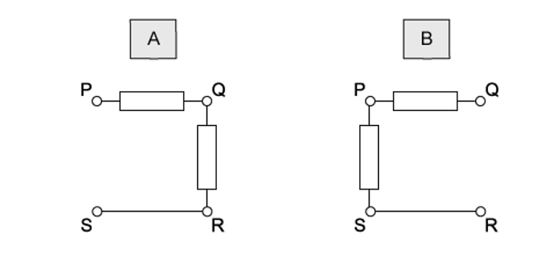
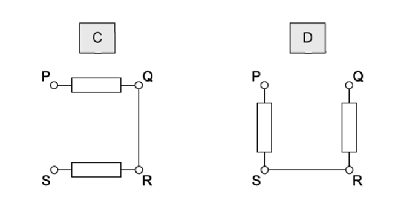
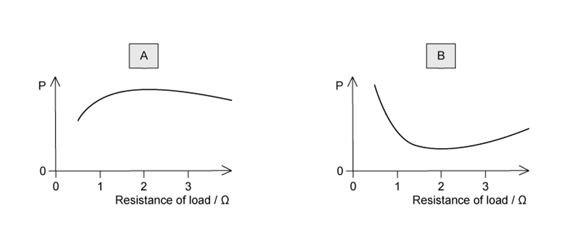
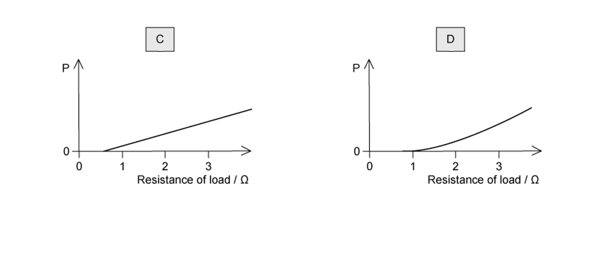
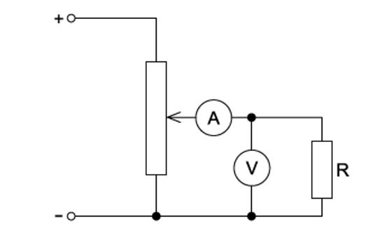
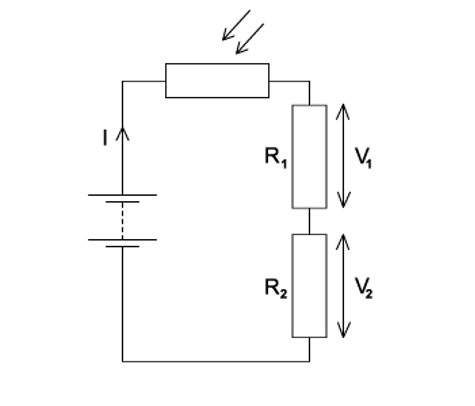
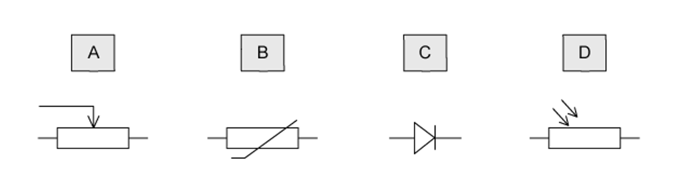
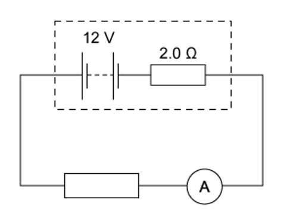
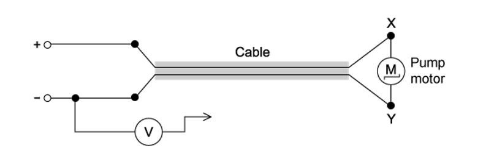

# Exam Questions — Practical Circuits
**10. D.C. Circuits** · Cambridge (CIE) A-LEVEL physics (9702)
> Source: [https://www.savemyexams.com/a-level/physics/cie/25/topic-questions/](https://www.savemyexams.com/a-level/physics/cie/25/topic-questions/) · 16 questions across 1 sets

## Multiple Choice Questions (16 questions)

### Q1 — medium — 1 marks

**Q1** [1 mark]

A simple circuit is formed by connecting a resistor of resistance *R* between the terminals of a battery of electromotive force (e .m .f.) 9.0 V and constant internal resistance *r *.

A charge of 6.0 C flows through the resistor in a time of 2.0 minutes, causing it to dissipate 48 J of thermal energy.

What is the internal resistance *r* of the battery ?

### Q2 — hard — 1 marks

**Q2** [1 mark]

A box with four terminals P, Q, R and S contains two identical resistors.

When a battery of electromotive force (e .m. f.) *E* and negligible internal resistance is connected across PS, a high-resistance voltmeter connected across QR reads  $\frac{E}{2}$

Which diagram shows the correct arrangement of the two resistors inside the box ?

### Q3 — hard — 1 marks

**Q3** [1 mark]

A power supply of electromotive force (e .m .f.) 12 V and internal resistance 2 Ω is connected in series with a load resistor. The value of the load resistor is varied from 0.5 Ω to 4 Ω.

Which graph shows how the power *P* dissipated in the load resistor varies with the resistance of the load resistor ?

### Q4 — hard — 1 marks

**Q4** [1 mark]

In the circuit below, a voltmeter of resistance *R**V* and an ammeter of resistance *R*A are used to measure the resistance *R* of the fixed resistor.

Which condition is necessary for an accurate value to be obtained for *R *?

### Q5 — easy — 1 marks

**Q5** [1 mark]

In the circuit shown, a light-dependent resistor (LDR) is connected to two resistors R1 and R2.

The potential difference (p. d.) across R1 is *V**1* and the p .d. across R2 is *V**2*. The current in the circuit is *I *.

Which statement about this circuit is correct ?

### Q6 — easy — 1 marks

**Q6** [1 mark]

Which symbol represents a component whose resistance is designed to change with temperature?

### Q7 — easy — 1 marks

**Q7** [1 mark]

Four statements about potential difference or electromotive force are listed.

| **1** | It involves the transfer of energy to components |
|---|---|
| **2** | It involves the transfer of energy into the circuit |
| **3** | It is the energy per unit charge to move charge right round a circuit |
| **4** | It is the work done per unit charge by the charge moving from one point to another |

Which statements apply to potential difference and which apply to electromotive force?

| ** ** | **Potential difference** | **Electromotive force** |
|---|---|---|
| **A**  **B**  **C**  **D** | 1 and 3  1 and 4  2 and 3  2 and 4 | 2 and 4  2 and 3  1 and 4  1 and 3 |

### Q8 — medium — 1 marks

**Q8** [1 mark]

A battery of e .m .f. 12 V and internal resistance 2.0 Ω is connected in series with an ammeter of negligible resistance and an external resistor. External resistors of various different values are used.

Which combination of current and resistor value is **not** correct?

| ** ** | **Current / A** | **External resistor value / Ω** |
|---|---|---|
| **A**  **B**  **C**  **D** | 1.0  1.2  1.5  1.8 | 10.0  8.0  6.0  4.0 |

### Q9 — hard — 1 marks

**Q9** [1 mark]

The diagram shows the electric motor for a garden pump connected to a 24 V power supply by an insulated two-core cable.

The motor does not work so, to find the fault, the negative terminal of a voltmeter is connected to the negative terminal of the power supply, and its other end is connected in turn to terminals X and Y at the motor.

Which row represents two readings and a correct conclusion?

|   | **Voltmeter reading when connected to X / V** | **Voltmeter reading when connected to Y / V** | **Conclusion** |
|---|---|---|---|
| **A** | 24 | 0 | break in positive wire of cable |
| **B** | 24 | 12 | break in negative wire of cable |
| **C** | 24 | 24 | break in connection within the motor |
| **D** | 24 | 24 | break in negative wire of cable |

### Q10 — medium — 1 marks

**Q10** [1 mark]

A resistor *R* is connected to the terminals of a battery of emf 9.0 V and internal resistance *r*.

A charge of 240 C passes through the circuit in two minutes. During this time, 1440 J of energy is transferred to the external resistor. What is the internal resistance *r* of the battery?

### Q11 — hard — 1 marks

**Q11** [1 mark]

A relay is required to operate 800 m from its power supply. The power supply has negligible internal resistance. The relay requires 16.0 V and a current of 0.60 A to operate.

A cable connects the relay to the power supply, and two of the wires in the cable are used to supply power to the relay.

The resistance of each of these wires is 0.0050 Ω per meter.

What is the minimum output e .m .f. of the power supply ?

### Q12 — easy — 1 marks

**Q12** [1 mark]

A cell is connected to a resistor.

At any given moment, the potential difference across the cell is less than its electromotive force.

Which statement explains this ?

### Q13 — easy — 1 marks

**Q13** [1 mark]

A cell of e. m .f. *E *delivers a charge *Q* to an external circuit.

Which statement is correct?

### Q14 — medium — 1 marks

**Q14** [1 mark]

Which answer option summarises the difference between potential difference and e.m.f?

### Q15 — medium — 1 marks

**Q15** [1 mark]

A battery and a resistor are in series. The e.m.f of the circuit is 15 V and the resistance of the resistor is 8.0 Ω.

Given that the current through the circuit is 1.5 A, what is the value of the lost volts from the battery?

### Q16 — easy — 1 marks

**Q16** [1 mark]

A battery is marked 9.0 V.

What does this mean ?
