# Mark Schemes — Kirchhoff’s Laws
**10. D.C. Circuits** · Cambridge (CIE) A-LEVEL physics (9702)

## Multiple Choice Questions (18 questions)

### Q1
**Final answer:** **The correct answer is ****C ****because:**

- Let the total resistance of the circuit be R
- For resistors in parallel : `1 over R equals 1 over R subscript 1 plus 1 over R subscript 2 plus times times times plus 1 over R subscript n`

  - $\frac{1}{R}=\frac{1}{1}+\frac{1}{2}+\frac{1}{5}=1.7$
  - So, the total resistance is $R=\frac{1}{1.7}=0.588Ω$
- In other words, the three resistors in parallel is equivalent to a single resistor of resistance 0.588 Ω
- A current of 5.0 A flows through this resistor

  - So, the p. d. across the branches $=IR=5.0\times0.588=2.94V$
- As the resistors are in parallel, the p. d. across each branch is the same

  - $I=\frac{V}{R}=\frac{2.94}{2.0}=1.47A$
- Therefore, the current through ammeter is 1.5 A

### Q2
**Final answer:** **The correct answer is ****A ****because:**

- The physics principle involved in deriving Kirchhoff's Laws for 3 different resistors connected in series is the conservation of charge
- The shared e .m .f. source V causes a current I to flow through all three resistors, by the conservation of charge, this must be the same at all points in a series circuit
- From Ohm's Law $V=IR$
- The e. m .f. is split into V1, V2 and V3 between the three resistors

  - $V_{1}=IR_{1}$       $V_{2}=IR_{2}$      $V_{3}=IR_{3}$
- From Kirchoff's Second Law, we know that the voltages around a loop in a circuit add up to the e.m.f. of the supply

  - $V = V_{1} + V_{2} + V_{3} = I R_{1} + I R_{2} + I R_{3} = I ( R_{1} + R_{2} + R_{3} )$
  - $\frac{V}{I}=R_{1}+R_{2}+R_{3}$
- From Ohm's Law, we know $\frac{V}{I}$ = total resistance of the circuit

  - $R_{total}=R_{1}+R_{2}+R_{3}$

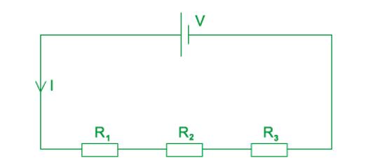

**B **is incorrect because the flow of charge in a circuit is from the positive terminal of the battery to the negative terminal

**C **is incorrect because in series combination, the p .d. across different resistors is not the same since the resistance of each one is different

**D **is incorrect because in series combination, the current through each resistor is the same

### Q3
**Final answer:** **The correct answer is ****C ****because:**

- Power dissipated in a resistor $=I^{2}R$
- Let's say the resistance of each resistor is *R*
- Two resistors in series causes the overall resistance to increase: *R* + *R* = 2*R*
- Two resistors in parallel causes the overall resistance to decrease : $[ \frac{1}{R} + \frac{1}{R} ]^{- 1} = \frac{R}{2}$
- Since the 4 resistors have the same resistance in the connection shown, the p .d. across each parallel connection will be the same

  - Overall the resistance in the circuit is $=\frac{R}{2}+\frac{R}{2}=R$
- Let's say the e .m .f. in the circuit is *E,* so, the current in the circuit is $I=\frac{E}{R}$
- The total current splits at the parallel combination

  - Power dissipated in X $= ( 1 \frac{1}{2} )^{2} R = \frac{I^{ 2} R}{4} = 0.25 I^{ 2} R$
  - This is the power dissipated in all the resistors
- When W is removed, the overall resistance of the parallel combination of W and X changes from 0.5*R* to *R* as only X is left
- Total resistance in new circuit = *R* + 0.5*R* = 1.5*R*

  - Current in circuit $=\frac{E}{1.5R}=\frac{2}{3}I$
- The overall current in the circuit will also change — it decreases since the overall resistance in the complete circuit has increased. This current flows through X but is split into half at the combination of Y and Z, so, the current through Y and Z is half that through X, so:

  - Power dissipated in X $= ( \frac{2}{3} I )^{2} R = \frac{4}{9} I^{ 2} R = 0.44 I^{ 2} R$
- Half the current flows through Y and Z, and the same power is dissipated through both resistors, so:

  - Power dissipated in Y $= [ 1 \frac{1}{2} ( \frac{2}{3} I ) ]^{2} R = \frac{1}{9} I^{ 2} R = 0.11 I^{ 2} R$
- Therefore, the power in X increases and the power in Y and Z decreases

### Q4
**Final answer:** **The correct answer is ****A ****because:**

- Kirchhoff's First Law states: the algebraic sum of currents into a junction is zero

  - This is a consequence of charge conservation

**B **is incorrect because Kirchhoff's First Law is not a consequence of energy conservation

**C **&** D **are incorrect because these two options describe Kirchhoff's Second Law

**Exam Tip: **Remember Kirchhoff's First and Second Laws like this:

- Kirchhoff's First Law = Current Law = charge conservation $( Q = I t )$
- Kirchhoff's Second Law = Voltage Law = energy conservation $( W = V Q )$

### Q5
**Final answer:** **The correct answer is ****A ****because:**

- ** **Kirchhoff's First Law states that the total current entering a junction is equal to the total current leaving the same junction
- In other words the algebraic sum of all the current entering and leaving a junction must be equal to zero, so :  $\sumI_{IN}=\sumI_{OUT}$
- At the top junction, indicated in the diagram, *I*1 splits into *I*2 and *I*3

  - $I_{1}=I_{2}+I_{3}$
- At the bottom junction, indicated in the diagram, *I*3 and *I*4 join up to become *I*5

  - $I_{5}=I_{3}+I_{4}$

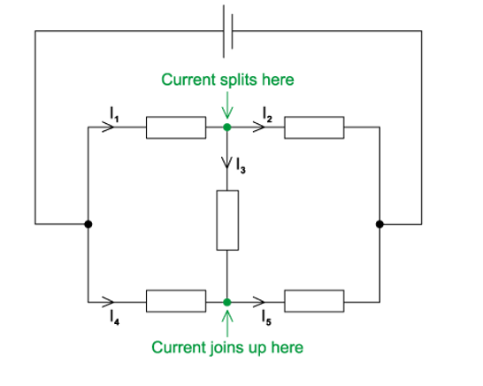

**B **is incorrect because current *I* 2 is equal to $I_{2}=I_{1}-I_{3}$

**C **is incorrect because current *I* 3 is equal to  $I_{3}=I_{5}-I_{4}$

**D **is incorrect because current *I* 4 is equal to  $I_{4}=I_{5}-I_{3}$

### Q6
**Final answer:** **The correct answer is ****A ****because:**

- First, we must find the equivalent resistance of all the resistors combined
- We'll start with the two 4.0 Ω resistors, let's call these *R**1** *and *R**2*
- For resistors in parallel : `1 over R equals 1 over R subscript 1 plus 1 over R subscript 2 plus times times times plus 1 over R subscript n`

  - $\frac{1}{R_{1+2}}=\frac{1}{R_{1}}+\frac{1}{R_{2}}=\frac{1}{4}+\frac{1}{4}=\frac{1}{2}$
  - So, $R_{1+2}=2.0$ Ω
- Next, we'll add the combined *R**1* and *R**2* in series with *R**3*
- For resistors in series : `R equals R subscript 1 plus R subscript 2 plus times times times plus R subscript n`

  - So, $R_{1+2+3}=2+2=4.0$ Ω
- And then, to get the total resistance, we'll add the combined 3 resistors in parallel with *R**4*

  - So, $\frac{1}{R_{total}}=\frac{1}{R_{1+2+3}}+\frac{1}{R_{4}}=\frac{1}{4}+\frac{1}{2}=\frac{3}{4}$
- Therefore, the total resistance is $R_{total}=\frac{4}{3}$ Ω
- Now, we must find the value of the current *I* through *R**2*
- Ohm's Law states $I=\frac{V}{R}$

  - So, the current through the cell is equal to $I=\frac{V}{R}=\frac{2.0V}{\frac{4}{3}Ω}=1.5A$
- If we consider there to be three resistors of 2.0 Ω each, the current through each resistor will be $\frac{2}{6}\times1.5=0.5A$
- Since the resistance is equal in both branches, the current will divide equally

  - So, $I=\frac{0.5}{2}=0.25A$

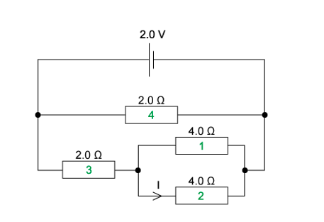

### Q7
**Final answer:** **The correct answer is ****D ****because:**

- The voltmeters are used to give the potential difference across the resistors. The voltmeter reading *V* gives the e.m.f of the battery
- The resistors connection in the circuit forms two different loops as shown in the diagram below (the voltmeters are not considered)

  - Loop 1: battery — resistor R (in parallel) — resistor R
  - Loop 2: battery — resistor 2R (in parallel) — resistor R
- From Kirchhoff's Laws, the sum of p. d. in any loop should be equal to the e. m .f in the circuit

  - $V=V_{2}+V_{1}$
  - $V=V_{3}+V_{1}$
  - $V-V_{1}=V_{3}$

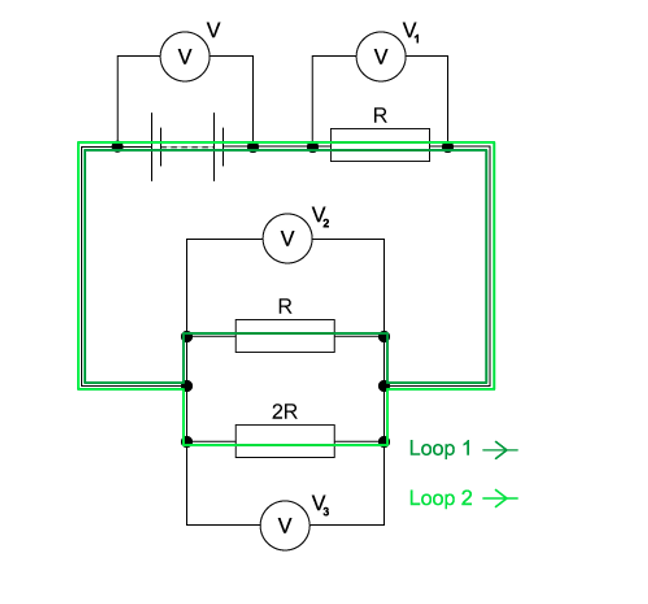

### Q8
**Final answer:** **The correct answer is ****B ****because:**

- The statement "p. *d. of 12 V is connected between P and Q *" means that the difference in potential between P and Q is 12 V
- So, any potential can be assigned to P and Q as long as the difference is 12 V

  - Let's assign a potential of 0 V at P and 12 V at Q
- So, when we go from P to Q, the potential should increase and point X would be at a potential between 0 and 12 V
- The same is true for point Y; hence, it can be concluded that points P, Q, X and Y are all at different potentials
- The circuit consists of a parallel combination of resistors

  - So, the total p. d. across the upper and lower parts of the circuit are both 12 V
- Now, both the upper and lower part of the circuit each consist of two resistors in series
- For series connection of two resistors R1 and R2, the p. d. across R1 is given by the potential divider equation

  - $V = ( \frac{R_{1} }{R_{1} + R_{2} } ) \times E$  where *E* is the e. m. f. of the supply
- The potential at point X = p. d. across 500 Ω in the upper part

  - Potential at point X$= ( \frac{500}{500 + 1000} ) \times 12 = 4 \mathrm{V}$
- Similarly, the potential at point Y = p. d. across 2000 Ω in the lower part

  - Potential at point Y$= ( \frac{2000}{2000 + 1000} ) \times 12 = 8 \mathrm{V}$
- So, the p .d. between X and Y is the difference in potential at point X and point Y

  - Therefore, p .d. between X and Y = 8 – 4 = 4 V** **

**Exam Tip:** Note that 0 V could be assigned at Q and 12 V at P, but the process discussed would have to be reversed

### Q9
**Final answer:** **The correct answer is ****A ****because:**

- To obtain the potential difference between terminals X and Y, we first need to know the values of the potential at X and Y

  - The positive terminal of the cell can be taken to be at a potential of 2 V and the negative terminal to be at a potential of 0 V
- It can be seen that the circuit consists of 2 loops, with a junction at the top and one at the bottom

  - Since there are no components connected between the upper junction and the positive terminal of the cell, the upper junction must be at a potential of 2 V, and the lower junction must be at a potential of 0 V
- Therefore, in any loop, going from up to down, the potential decreases across each component until it is zero at the lower junction
- From Kirchhoff's Law, the sum of p .d. in any loop is equal to the e. m .f in the circuit
- Consider the first loop (where terminal X is connected):
- From the potential divider equation:

  - p. d. across the upper resistor $= ( \frac{R_{1} }{R_{1} + R_{2} + R_{3} } ) \times E = ( \frac{5}{5 + 5 + 5} ) \times 2 = \frac{2}{3} V$
  - Note that this is the potential difference across the upper resistor. It is also the p. d. across each resistor since they all have the same resistance
- Since the upper junction is at a potential of 2 V, the p .d. at terminal X is equal to $=2-\frac{2}{3}=\frac{4}{3}V$
- Consider the second loop (where terminal Y is connected):
- From the upper junction to terminal Y, there are 2 resistors and the p. d. across each is $\frac{2}{3}V$

  - So, the p. d. at terminal Y $= 2 - 2 ( \frac{2}{3} ) = \frac{2}{3} V$
- Therefore, the p .d. between X and Y$=\frac{4}{3}-\frac{2}{3}=\frac{2}{3}V$

### Q10
**Final answer:** **The correct answer is ****D ****because:**

- Ohm's Law states $V=IR$ , so, the current in the whole circuit is $I=\frac{V}{R_{T}}$

  - Where *R**T* is the combined resistance of the resistors
- Let the resistance of a resistor = *R* and the e .m. f of the supply = *E*
- In circuit **D**, the 2 resistors are in a parallel combination, so the combined resistance is

  - $\frac{1}{R_{T}}=\frac{1}{R}+\frac{1}{R}=\frac{2}{R}$  , therefore, $R_{T}=\frac{R}{2}$
- Therefore, the current in the circuit is $I=\frac{E}{\frac{R}{2}}=\frac{2E}{R}$
- This is the same current as circuit **C**, however, at a junction, the current splits
- In circuit **D**, the ammeter is connected directly to the positive terminal, so it reads the value of the current flowing in the whole circuit, whereas the current in **C** will read half the total current

  - Therefore, the ammeter in circuit **D** will have the greatest reading

**A **&** B **are incorrect because these two circuits are in a series arrangement, the current will be the lower than in a parallel arrangement:

- Circuit **A**: $R_{T}=R+R=2R$ , so, the current $I=\frac{E}{2R}$
- Circuit **B**: $R_{T}=R+0=R$  , so, the current  $I=\frac{E}{R}$

**C **is incorrect because in circuit **C** the current splits at a junction, so, the ammeter in circuit **C** gives only half the total current in the circuit

### Q11
**Final answer:** **The correct answer is ****D ****because:**

- Current flows from the positive terminal of the battery, so, the current in A2 should have the highest value
- Let the resistance of each resistor be *R*
- The left-hand side of the circuit, in the (A1 - A2) loop, there are two resistors in series, so their total resistance is *R* + *R* = 2*R*

  - The current in the (A1 - A2) loop = 0.6A, as read by ammeter A1
- So, from Ohm's Law $V=IR$  , the potential difference in the (A1 -  A2) loop is equal to $V = 0.6 ( 2 R ) = 1.2 R$
- From Kirchhoff's Second Law, the potential difference is the same as the e .m .f in the circuit for any loop, so, the e. m .f. in the circuit is 1.2*R,* and this is also the potential difference across all loops
- Consider the (A2 - A3) loop:

  - Current in A3 $=\frac{V}{R}=\frac{1.2R}{R}=1.2A$
- Similarly, consider the (A2 - A4) loop:

  - Current in A4 $=\frac{1.2R}{3R}=0.4A$
- Therefore, current in A2 = total current = 0.6 + 1.2 + 0.4 = 2.2A

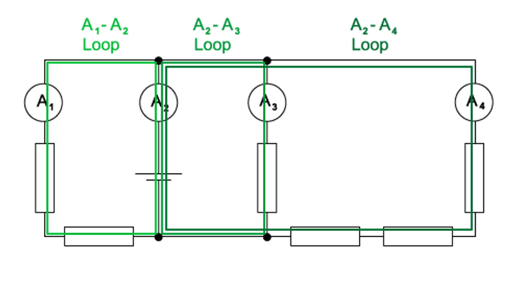

### Q12
**Final answer:** **The correct answer is ****D ****because:**

- The ammeter connected close to the battery gives the total current in the circuit while the ammeter connected between terminals 3 and 4 gives the current passing through terminal 3 to 4
- The current in this one will only be equal to the one close to the battery only if all components are connected in series in the whole circuit, including within the box
- Consider circuit **D **:

  - The 2 ammeters are in series with the resistor between terminals 1 and 3
  - So, the same current flows through components connected in series
  - Therefore, option **D** is correct

**A **is incorrect because the section from terminal 2 to 4 and finally to 3 is short-circuited (since 1 and 3 are not connected), so, no current flows through the ammeter

**B **is incorrect because the ammeter connected to 3 and 4 is short-circuited since the wires (which have negligible resistance) are connected between 1 to 3, 3 to 4 and 4 to 2

**C **is incorrect because a parallel connection is formed between the 2 resistors between 1 to 3 and 1 to 2, so, the current splits up at junction 1. The second ammeter is connected in series with one of the resistors, so it only gives the current flowing in one resistor

### Q13
**Final answer:** **The false answer is ****C ****because:**

- The resistors between **P** and **Q **are not connected in series

  - Therefore, the total resistance is not equal to the sum of each resistance

**A **is true because the branch **PQ** is in parallel with the branch **XY**. Therefore, the potential difference across each branch is are equal **B **is true because the resistors between **X** and **Y** are connected in series; therefore, the total resistance $R_{T}=R_{1}+R_{2}$

**D** is true because two of the resistors connected between **P **and **Q** are connected in **parallel**. Therefore, the total resistance here is **less** than one individual resistor. This means overall, there is less resistance along **PQ **than there is along **XY**

### Q14
**Final answer:** **The correct answer is ****B ****because:**

- Each resistor in parallel has the same p .d. applied to it, but the total current is split amongst them
- Let the current through resistor R1 be I1 and the current through R2 be I2
- The p. d. across both R1 and R2 is equal to the supply voltage V
- Therefore from Ohm's Law

  - $I_{1}=\frac{V}{R_{1}}$ and $I_{2}=\frac{V}{R_{2}}$
- But from Kirchhoff's Current Law, we know the current entering a junction is equal to the current leaving the junction

  - Therefore, $I=I_{1}+I_{2}$
- Substituting the values derived for I1 and I2 gives us'

  - $I = \frac{V}{R} _{1} + \frac{V}{R} _{2} = V ( \frac{1}{R} _{1} + \frac{1}{R} _{2} )$
- Rearranging gives us

  - $\frac{I}{V}=\frac{1}{R_{1}}+\frac{1}{R_{2}}$
- From Ohm's Law, we know $\frac{V}{I}=$ total resistance of the circuit

  - $\frac{1}{R_{total}}=\frac{1}{R_{1}}+\frac{1}{R_{2}}$

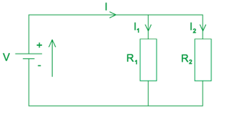

**A **is incorrect because in parallel combination, the current through each resistor is different

**C **is incorrect because the supply current is split between the resistors according to the ratio between the supply p. d. and the resistance of each resistor $I = \frac{V}{R} _{1} + \frac{V}{R} _{2} = V ( \frac{R_{1} + R_{2} }{R_{1} R_{2} } )$

**D **is incorrect because the equation for power is not required in this derivation

### Q15
**Final answer:** **The correct answer is ****B ****because:**

- Let the resistance of each resistor be *R*
- The p .d. across a resistor is *V**2* = 1.0 V
- The p. d. across the resistor just left of *V**2* is also 1.0 V since the resistance is the same and they are in the same branch, so, the same current flows through them both

  - So, the total p. d. in the lower branch of the parallel combination is equal to = 1.0 + 1.0 = 2.0 V
- The total p .d. across any branch of a parallel combination is the same according to Kirchhoff's Second Law

  - Therefore, *V**4* = 2.0 V
- The complete circuit may be described as a series combination of the two single resistor and the parallel combination (as shown in the diagram)
- The p .d. across the vertical resistor is the same as *V**3* since they have the same resistance.

  - *V**1* = total e. m .f in circuit = 8.0 V
- The sum of p .d. in any loop is equal to the e. m .f  in the circuit

  - *V**3* + *V**3* + 2.0 = 8.0 V
  - 2*V**3* = 6.0 V
- So, *V**3* = 3.0 V

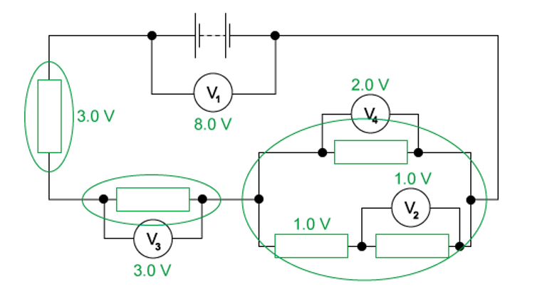

### Q16
**Final answer:** **The correct answer is ****A ****because:**

- Kirchhoff's First Law (or current Law) states that current flowing into a junction must be equal to current flowing out of it

  - This is a consequence of charge conservation
  - It is well known in physics that charge will always be conserved. In the context of circuits this means that, since the current is the rate of flow of charge, the current flowing into a point must be the same as the current flowing out of that point
- Kirchhoff's Second Law (or voltage Law) states that the sum of all voltages around any closed loop in a circuit must equal the e.m.f. of the supply

  - This is a consequence of the principle of conservation of energy
  - This is due to the fact that work is done $( W = V Q )$  on charge carriers by the electric forces inside the circuit components meaning* *they either gain or lose electrical energy, depending upon the type of component

### Q17
**Final answer:** **The correct answer is ****D ****because:**

- The lamps are both lit dimly as they are connected in series
- From Kirchhoff's Second Law, the total e.m.f. is now shared across two lamps in series
- Each of the lights now receive a voltage lower than 12 V
- Previously, all the 12 V was being provided to a single lamp which would cause it to be brighter

**A **&** B **are incorrect because both lamps are connected in series; hence they will both be lit

**C **is incorrect because both lamps are connected in series, but now the voltage is shared between them; hence they cannot have the same brightness as the single lit lamp previously

### Q18
**Final answer:** **The correct answer is ****A ****because:**

- In diagram 1, the voltmeter reads zero because the potential difference across it is zero, meaning that both of its junctions are at the same potential
- From Kirchhoff's First Law, current splits at a junction
- Since the resistors are identical, the current splits equally into the two branches

  - The ammeter reads a current of 1.0 A, so the total current in the circuit is 1.0 + 1.0 = 2.0 A
- Now, let's consider diagram 2: current flows from the positive terminal of the supply and is split equally at a junction, so, the ammeter still reads the current that has been split equally into two

  - This current is equal to $\frac{2.0}{2}=1.0A$
- From the junction connected to the positive terminal of the supply, the current splits at the bottom junction and rejoins again at the top junction to return to the negative terminal
- Since the same amount of current flows through identical resistors the potential of the left and right junctions would be the same

  - Therefore, the potential difference across the voltmeter is zero

**B **&** D **are incorrect because the total current in diagram 1 and 2 is 2.0 A so when the current splits at the junction, the reading on both ammeters is  $\frac{2.0}{2}=1.0A$

**C **is incorrect because to detect a potential difference, the voltmeter would need to be connected across one component at a time

## Structured Questions (7 questions)

### Q1
Draw a diagram to determine the direction of the potential difference in loop 1:

A diagram that would score 1 mark should look like this:

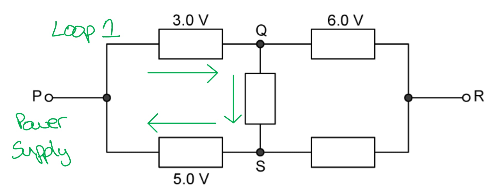

- 3 V potential difference pointing to the right **AND**
- 5 V potential difference pointing to the left; **[1 mark]**

Calculate the missing potential difference of the resistor, *x*:

- + 3 + *x *+ − 5 = 0
- *x *= 2 V **[1 mark]**

Draw a diagram to determine the direction of the potential difference in loop 2:

A diagram that would score 1 mark should look like this:

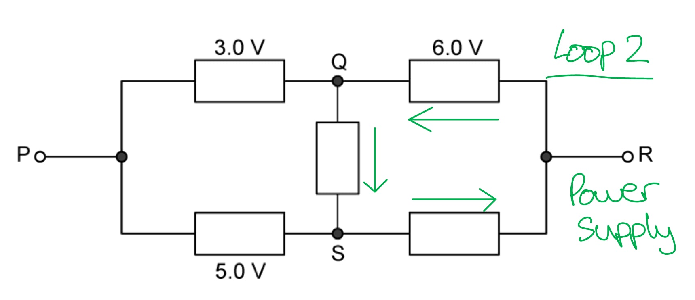

- A 6 V potential difference pointing to the left **AND**
- A 2 V potential difference pointing from Q to S; **[1 mark]**

Calculate the missing potential difference of the resistor, *y*:

- − 6 + 2 + *y *= 0
- *y *= 6 − 2 = 4 V **[1 mark]**

**[Total: 4 marks]**

> *Remember if there is just one power supply in a circuit then the resistors can be reduced to a single equivalent resistor but if there is more than one power supply then part of one branch can be combined to one resistor. Kirchhoff's Laws are then applied to each loop. *

> *Kirchhoff's second law states that the sum of all potential differences around a complete loop is equal to 0. *
List the known quantities:

- Current through QS, *I*1* *= 3.0 A
- p.d. across QS, *V*QS* *= 2.0 V (from part a)
- p.d. across the LHS branch, *V*LHS* *= 3 V + 5 V = 8 V
- p.d. across the RHS branch, *V*RHS* *= 6 V + 4 V = 10 V (from part a)

Calculate the resistance of the branch QS:

- Recall: *V *= *IR*
- $R_{QS} = \frac{V_{QS}}{I_{1}}$
- $R_{QS} = \frac{2}{3}$ Ω **[1 mark]**

Determine the ratio of resistance on each side of the outer loop:

- *V*LHS* *: *V*RHS* *= *R*LHS* *: *R*RHS
- 8 : 10 = 4 : 5 **[1 mark]**

Calculate the LHS and RHS resistances as fractions of *r*:

- $R_{LHS} = \frac{4}{9} r$
**AND**
$R_{RHS} = \frac{5}{9} r$ **[1 mark]**

Calculate the total resistance of all the resistors in the circuit:

- The QS branch is the single shared resistor between the two loops, so it is counted once
- $R=R_{LHS}+R_{RHS}+R_{QS}$
- $R = \frac{4}{9} r + \frac{5}{9} r + \frac{2}{3}$
- $R = r + \frac{2}{3}$ Ω **[1 mark]**

**[Total: 4 marks]**

> *The two power supplies mean the resistors on each side of the outer loop carry different currents, but the ratio given in the question lets you partition **r** without solving for the individual resistor values. *

> *The QS branch is a single resistor in the network. When summing the resistances of the circuit, count it once — it does not appear in both loops separately. *

> *This question is probably harder than anything you will encounter in your exam, but that makes it great practice! *
List the known quantities:

- *V**1* = 0.5 V
- *V**2* = 1 V
- *V**3*  = 2 V
- Resistance of each resistor, *R *= 0.25 Ω

Label the diagram to show the loops, polarity of the batteries and directions of each current:

A diagram that would score 1 mark should look like this:

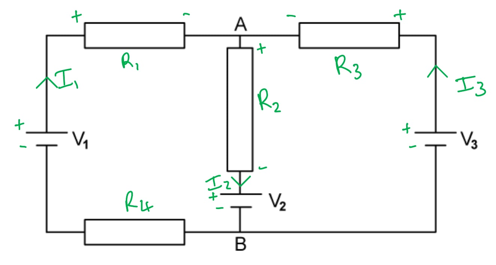

- Currents *I**1*, *I**2*  and *I**3  *are* *labelled as shown with arrows in the correct direction **AND**
- Positive and negative battery and resistor terminals should be indicated correctly with the positive side of the resistor the side where the current enters; **[1 mark]**

Use Kirchhoff's first law to obtain an equation for the currents at junction A:

- *I**1** + I**3* = *I**2** ***[1 mark]**

Use Kirchhoff's second law to obtain an equation for the sum of the potential differences in loops 1 and 2:

- Recall Ohm's Law: *V *= *IR*
- Loop 1: **AND**

  - *V**1** *− *I**1**R**1** *− *I**2**R**2* − *V**2* − *I**1**R**4* = 0
  - 0.5 − (0.25*I**1*) − (0.25*I**2*) − 1 − (0.25*I**1*) = 0
  - −0.5 − 0.5*I**1 *− 0.25*I**2* = 0
  - 0.5*I**1* + 0.25*I**2* = −0.5
- Loop 2:

  - *V**3* − *I**3**R**3* − *I**2**R**2* − *V**2* = 0
  - 2 − (0.25*I**3*) − (0.25*I**2*) − 1 = 0
  - 1 − (0.25*I**3*) − (0.25*I**2*) = 0
  - 1 = 0.25*I**3 *+ 0.25*I**2*
  - *I**3 *+ *I**2* = 4 **[1 mark]**

Substitute for *I**3* into the equation for current:

- From loop 2: *I**3* = 4 − *I**2*
- Equation for current: *I**1** + I**3* = *I**2*
- So, *I**1* + (4 − *I**2*) = *I**2*
- *I**1* = 2*I**2* − 4 **[1 mark]**

Now substitute for *I**1** *from above into the equation for loop 1:

- From loop 1: 0.5*I**1* + 0.25*I**2* = −0.5
- 0.5(2*I**2* − 4) + 0.25*I**2* = −0.5
- *I**2** *− 2 + 0.25*I**2* = −0.5
- 1.25*I**2* = −0.5 + 2
- *I**2* = 1.2 A **[1 mark]**

Now substitute for *I**2* to obtain *I**1*:

- *I**1* = (2 × 1.2) − 4
- *I**1* = −1.6 A **[1 mark]**

Substitute for *I**2* into the equation for loop 2:

- From loop 2:* I**3 *+ *I**2* = 4
- *I**3* = 4 − 1.2
- *I**3** *= 2.8 A **[1 mark]**

**[Total: 7 marks]**

> *You can label your circuit in any way but make sure the direction of the current is consistent all the way around.*

> *When obtaining an equation for the sum of the potential differences if you cross from:*

- *− terminal of one resistor to the + terminal of another resistor *$\rightarrow$* the change in potential difference is + *
- *+ terminal of one resistor to the − terminal of another resistor *$\rightarrow$* the change in potential difference is −*

> *It is always a good idea to check your answer at the end. Here you can do this by using the equation for current:*

- *I**1** + I**3** = **I**2*
- *So, −1.6 + 2.8 = 1.2 which is correct*

### Q2
Determine expressions for the gradient and the y-intercept:

- $V = ( \frac{P}{P + Q} ) E = \frac{P E}{P + Q} \Leftrightarrow \frac{1}{V} = \frac{P + Q}{P E} = \frac{1}{E} + \frac{Q}{P E}$
- $\frac{1}{V}=\frac{1}{E}+\frac{Q}{PE}\Rightarrow\frac{1}{V}=(\frac{Q}{E})\frac{1}{P}+\frac{1}{E}\,y=mx+c$

Determine the gradient and y-intercept:

- Hence, the gradient = $\frac{Q}{E}$  **AND  **y-intercept = $\frac{1}{E}$ **[1 mark]**

**[Total: 1 mark]**
Calculate and record values of $\frac{1}{P}$ / 10–3 Ω–1 in Table 2.1.

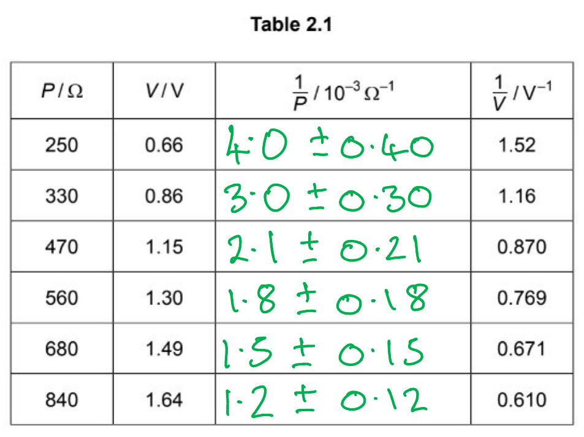

- All values and uncertainties correct; **[1 mark]**
- All values and uncertainties quoted to 2 significant figures; **[1 mark]**

**[Total: 2 marks]**

> *Don't be fooled by the equation. Calculating *$\frac{1}{P}$* **is simple, just find the reciprocal of values of **P** from **column 1**.*

> *P** is given to **2 s.f**. so *$\frac{1}{P}$*should also be given as the same*

> *The **absolute uncertainty** of *$\frac{1}{P}$* is calculated by finding **10%** of each value of *$\frac{1}{P}$
(i) Plot a graph of 1/V against 1/P:

A graph that would score 2 marks should look like this:

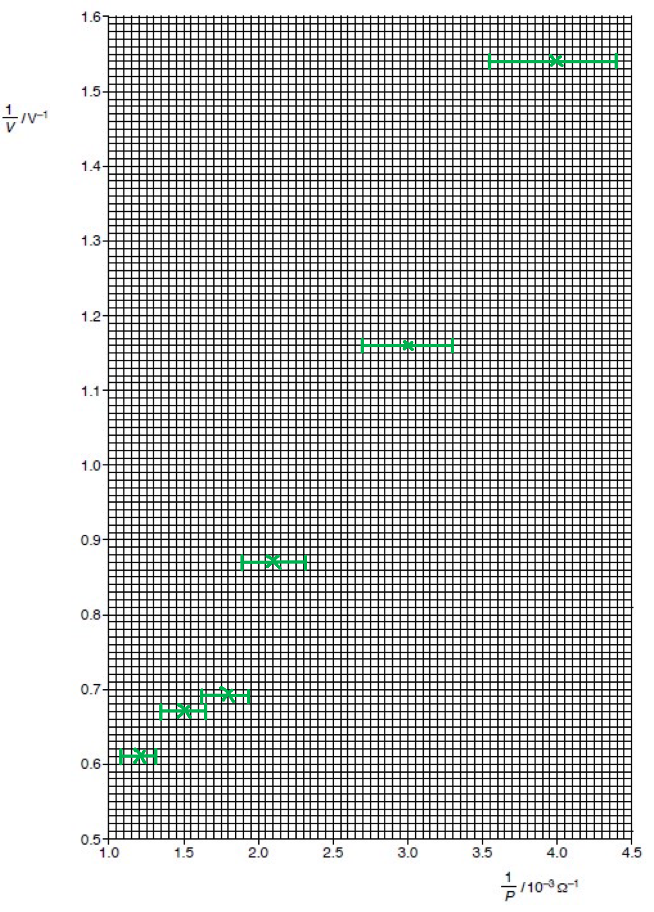

Plotted points:

**All ****three ****for 1 mark:**

- All six points from **(b) **plotted correctly
- Each point must be accurate to within half a small square
- The diameter of the point must be less than half a small square; **[1 mark]**

Error bars:

**All ****three ****for 1 mark:**

- All uncertainties for $\frac{1}{P}$ are plotted correctly as error bars
- All error bars are plotted
- The length of the bar must be accurate to less than half a small square and symmetrical;** [1 mark]**

(ii) Draw the straight line of best fit and a worst acceptable straight line on your graph. Label both lines:

A graph that would score 1 mark should look like this:

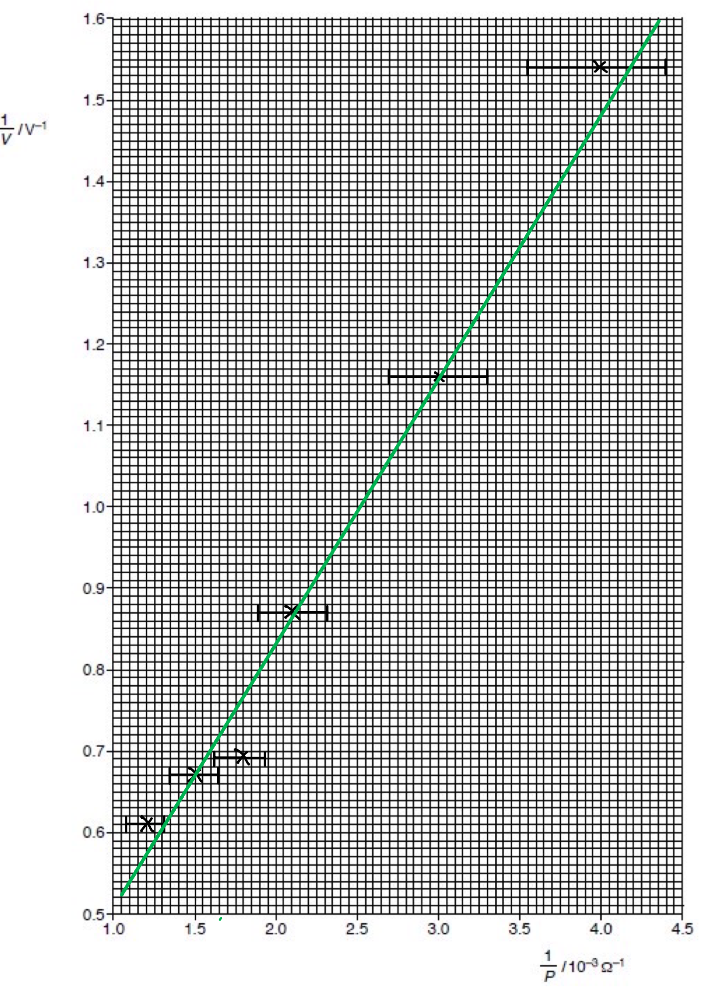

Straight line of best fit drawn:

- Lower end of line must pass between (1.50, 0.70) and (1.65, 0.70) and upper end of line must pass between (3.60, 1.40) and (3.80, 1.40); **[1 mark]**

A graph that would score 1 mark should look like this:

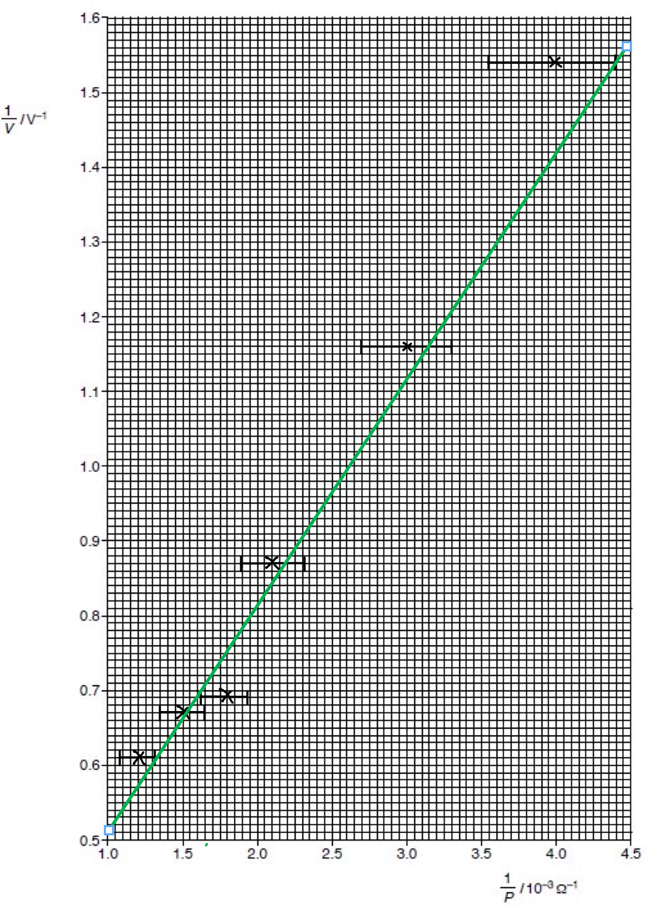

Worst acceptable line drawn:

- Steepest possible line that passes through all the error bars **AND** all error bars must be plotted;** [1 mark]**

(iii) Determine the gradient of the line of best fit. Include the absolute uncertainty in your answer.

Draw lines on the graph to obtain a gradient triangle for the line of best fit:

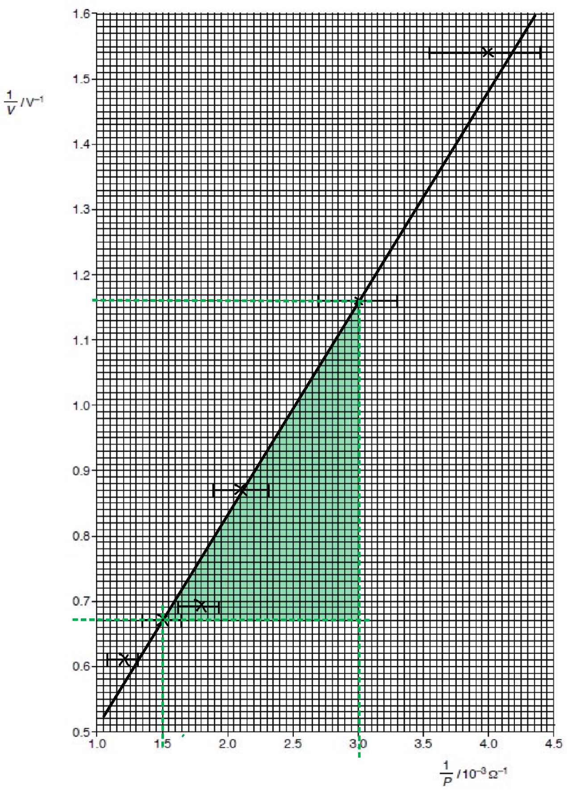

Calculate the gradient of the best fit line:

- Point 1: (1.5, 0.671)
- Point 2: (3.0, 1.16)
- $gradient=m=\frac{\Deltay}{\Deltax}=\frac{y_{2}-y_{1}}{x_{2}-x_{1}}=\frac{1.16-0.671}{3-1.5}$ = 0.326 **[1 mark]**

Draw lines on the graph to obtain a gradient triangle for the line of worst fit:

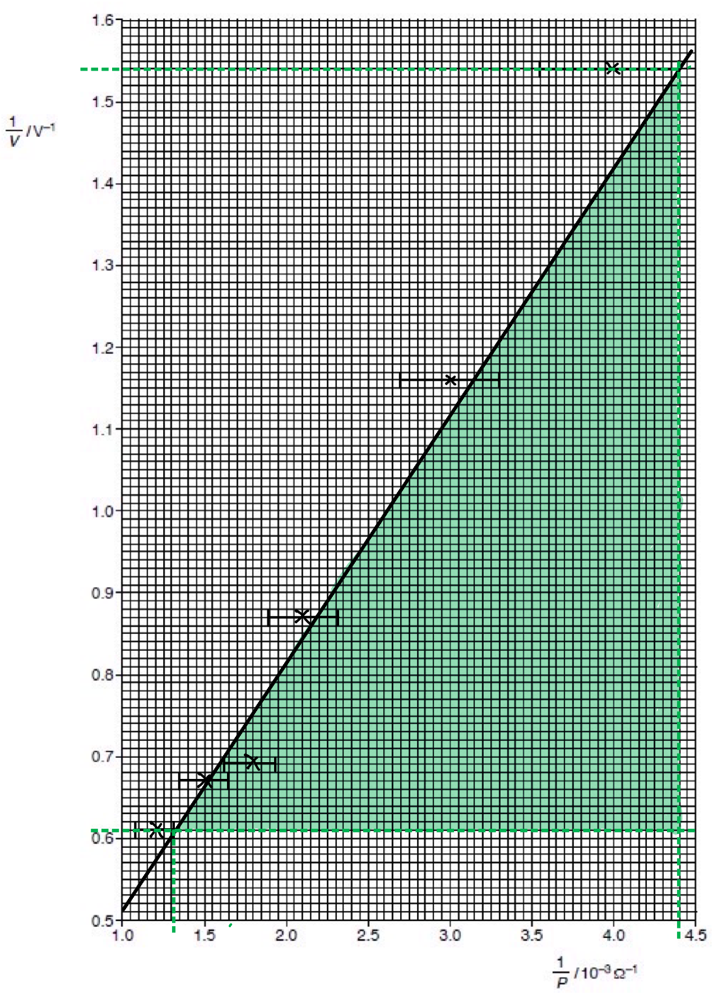

Calculate the gradient of the worst fit line:

- Point 1: (1.3, 0.61)
- Point 2: (4.4, 1.54)
- $gradient=m=\frac{\Deltay}{\Deltax}=\frac{y_{2}-y_{1}}{x_{2}-x_{1}}=\frac{1.54-0.61}{4.4-1.3}$ = 0.3

Calculate the uncertainty in the gradient of the best fit line:

- Uncertainty = gradient of best fit line − gradient of worst fit line
- Uncertainty = 0.326 − 0.3
- Uncertainty = ±0.026 **[1 mark]**

(iv) Determine the y-intercept of the line of best fit. Include the absolute uncertainty in your answer:

List the known quantities:

Line of best fit:

- Point 1: (1.5, 0.671)
- Gradient, $m$ = 0.326

Line of worst fit:

- Point 1: (1.3, 0.61)
- Gradient, $m$ = 0.3

Substitute quantities from point 1 on the line of best fit into the standard equation of a straight line:

- $y=mx+c$
- $y-mx=c$
- $0.671 - ( 0.326 \times 1.5 ) = c$
- y-intercept for the line of best fit, $c=0.182V^{-1}$ **[1 mark]**

Substitute quantities from point 1 on the line of worst fit into the standard equation of a straight line:

- $y-mx+c$
- $0.61 - ( 0.3 \times 1.3 ) = c$
- y-intercept for line of worst fit, $c=0.22V^{-1}$

Calculate the uncertainty in the y-intercept:

- Uncertainty = y-intercept of best-fit line − y-intercept of worst-fit line
- Uncertainty = 0.182 − 0.22
- Uncertainty = ±0.038 **[1 mark]**

**[Total: 8 marks]**

- *It is **difficult** to draw the line of best fit with an **equal **number of **points above and below**. *
- *An **attempt** to do this and have the line between the coordinates indicated will award you the **mark*

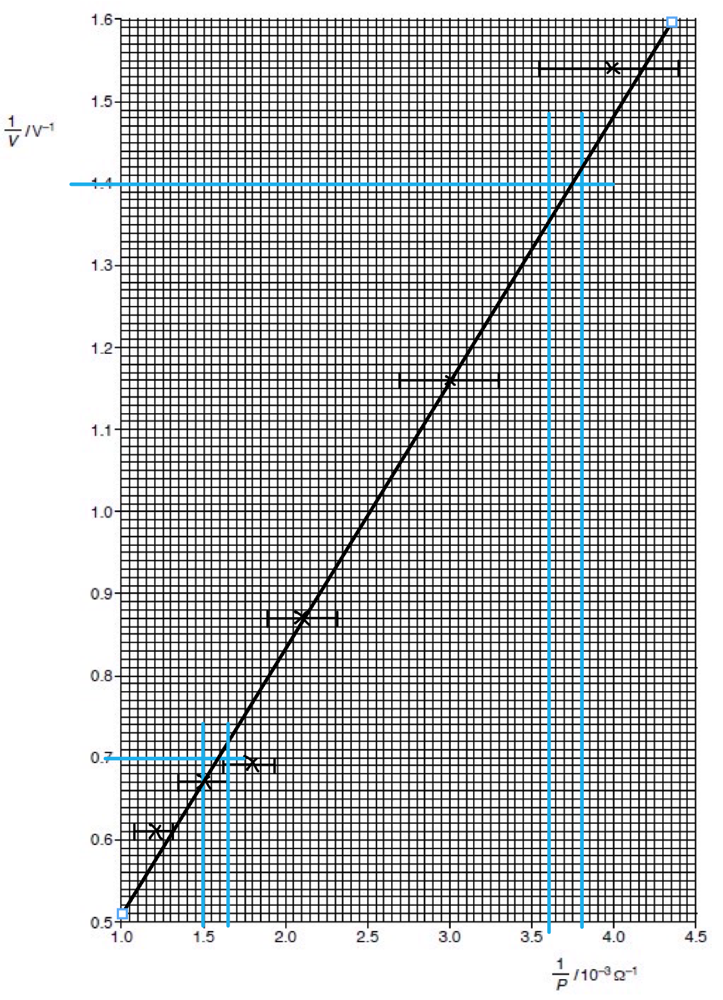

- *When drawing a gradient triangle it is best to use **plotted points** that lie **exactly** on the line of best fit*

- *There is a range within which a** line of best fit is accepted**, so your **gradient and y-intercept values** will be **different** to those calculated.*
- *Not many students will draw exactly the same line of best fit. *
- *If you have followed the **same steps as above, **even though your **values are different**, you will be awarded the marks*
(i) Using your answers to **(a), (c)(iii)** and **(c)(iv)**, determine the values of E and Q. Include appropriate units:

List the known quantities:

- y-intercept = $\frac{1}{E}$ (from part (a))
- y-intercept, $c$ = 0.182 V−1 (from part b, iv)
- Gradient = $\frac{Q}{E}$ (from part (a))
- Gradient, $m$ = 0.326 (from part b, iii)

Use the expression for y-intercept and the known quantity to calculate $E$:

- $E=\frac{1}{c}$
- $E=\frac{1}{0.182}$
- $E=5.49V$ **[1 mark]**

Use the expression for gradient and the known quantities to calculate, $Q$:

- $Q=m\timesE$
- $Q=0.326\times5.49$
- $Q=1.79Ω$ **[1 mark]**

(ii) Determine the percentage uncertainty in *E*:

List the known quantities:

- y-intercept, $c$ = 0.182
- Uncertainty in y-intercept, $\Deltac$ = 0.038

Calculate the percentage uncertainty in y:

- % uncertainty in *E *= % uncertainty in y-intercept
- % uncertainty in y-intercept = $\frac{\Deltac}{c}\times100$
- % uncertainty = $\frac{0.038}{0.182}\times100$
- % uncertainty = 20.8 % = 21 % (2s.f.) **[1 mark]**

(iii) Determine the absolute uncertainty in *Q:*

List the known quantities:

- Absolute uncertainty in gradient, $\Deltam$ = ±0.026
- Gradient of best-fit line, $m$ = 0.326
- % uncertainty in *E *= % uncertainty in y-intercept = 21 %

Calculate the % uncertainty in the gradient of the best flt line:

- % uncertainty = $\frac{\Deltam}{m}\times100$
- % uncertainty = $\frac{0.026}{0.326}\times100$
- % uncertainty = 7.98 % = 8.0 % (2s.f.)

Calculate the % uncertainty in *Q*:

- % uncertainty in *Q *= % uncertainty in *E *+ % uncertainty in gradient
- % uncertainty in *Q *= 21 + 8 = 29%

Calculate the absolute uncertainty in *Q*:

- Absolute uncertainty = $\frac{percentageuncertaintyinQ}{100}\timesQ$
- Absolute uncertainty = $\frac{29}{100}\times1.79$
- Absolute uncertainty = ±0.5191 Ω = ±0.52 Ω (2s.f.) **[1 mark]**

**[Total: 4 marks]**

- *You may obtain **slightly different values** than those above as a result of:*

  - *A different** line of best fit*
  - *A different **line of worst fit*
  - *Giving a **different gradient*
  - *And a** different y-intercept*
- *If you have followed the **same steps **you will be awarded the marks* * *
- *Remember when **multiplying / dividing quantities** you must **add the uncertainties** to combine them*
- *Converting from % to absolute uncertainty requires the inverse % to be found:*

$\% u n c e r t a i n t y = \frac{a b s o l u t e}{q u a n t i t y} \times 100$

$\frac{\% u n c e r t a i n t y \times q u a n t i t y}{100} = a b s o l u t e$

### Q3
(i) Kirchhoff's first law states that:

- The sum of currents into a junctions equals the sum of the currents out of a junction;** [1 mark]** ** **

(ii) The quantity conserved by this law is:

- Charge; **[1 mark]**

**[Total: 2 marks]**

> *It is common to mistakenly say that 'current' is conserved in this law. Although that's true, current is just the flow of **charge**, which is the fundamental conservation linked with Kirchhoff's first law. Therefore, for part (ii), 'current' will **not** get the mark.*
(i) Kirchhoff's second law states that:

- The sum of e.m.f's equals the sum of the p.d's around a loop / circuit;** [1 mark]** ** **

(ii) The quantity conserved by this law is:

- Energy; **[1 mark]**

**[Total: 2 marks]**

> *It is common to mistakenly say that 'p.d' is conserved in this law. However, p.d. is the measure of energy per unit charge transferred between two points in a circuit. Therefore, it is technically **energy **that is conserved.*
The correct circuit symbols are:

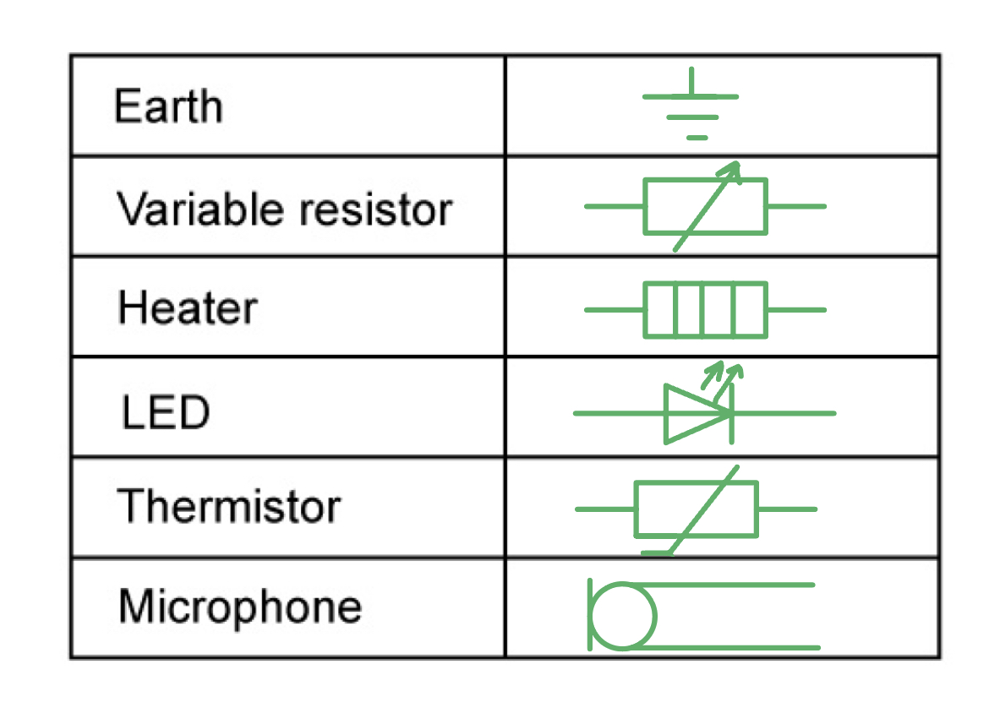

- **One mark for each correct circuit**** ****symbol**

**[Total: 6 marks]**

> *There are some niche circuit symbols required in this question, however, they are all required according to the CIE IAL syllabus. The end of the syllabus has a list of all the circuit symbols that you should recognise in your exam questions, make sure to familiarise yourself with **all** of them.*
The relation between:

(i) *I*1, *I*2 and *I*3 is:

- $I_{1}+I_{2}=I_{3}$ **[1 mark]**

(ii) *E*2, *R*, *I*2 and *I*3 in loop YZABY is:

- $E_{2}=I_{2}R+I_{3}R$ **[1 mark]**

**[Total: 2 marks]**

> *Remember from Ohm's law that **V** = **IR**.*

> *Part (i) is using Kirchhoff's first law, whilst part (ii) is using Kirchhoff's second law.*

### Q4
List the known quantities:

- Current in *R**2*  and *R**3* = 0.40 A
- P.d. across *R**1*  and *R**4* = 3.2 V

Determine the unlabelled values of current and potential difference:

- Current in *R**1*  and *R**4* = 2 × 0.40 = 0.80 A **[1 mark]**

- P.d. across *R**2**  *and *R**3*  = $\frac{3.2}{2}$ = 1.6 V** [1 mark]**

Calculate the resistance *R**1**  *and *R**4*:

- Recall: *V *= *IR *$\rightarrow$* *$R=\frac{V}{I}$
- $R=\frac{3.2}{0.80}=4$* *Ω **[1 mark]**

Calculate the resistance *R**2**  *and *R**3*:

- Hence, $R=\frac{1.6}{0.40}=4$Ω **[1 mark]**

**[Total: 4 marks]**

> *The question tells you that **R **should be the same for all the resistors, so calculate **R** for all of them just to check. *
List the known quantities:

- P.d. across *R**1*  and *R**4** *= 3.2 V (From part (a))
- P.d. across *R**2*  and *R**3* = 1.6 V (From part (a))

Calculate the total p.d. in the circuit:

- Total p.d. = e.m.f.
- e.m.f. = p.d. across *R**1*  + p.d. across *R**2*  + p.d. across *R**3*  + p.d. across *R**4*
- e.m.f. = 3.2 + 1.6 + 3.2 + 1.6 **[1 mark]**
- e.m.f. = 9.6 V **[1 mark]**

**[Total: 2 marks]**

> *This question can also be solved by finding the total resistance of the combination and using the equation:*

> *V **= **IR*
List the known quantities:

- Current through *R**3*  = 0.40 A

Total current through *R**1*  and *R**4*:

- Total current = 0.40 + 0.40 + 0.40 = 1.2 A **[1 mark]**

This is because:

- According to <u>Kirchhoff's first law</u>: The sum of the currents entering a junction is always equal to the sum of the currents out of the junction; **[1 mark]**
- In this circuit the current through each branch of the parallel components of the circuit is the <u>same</u> because each resistor has a resistance <u>*R*</u>; **[1 mark]**

**[Total: 3 marks]**
This will change the total power produced by the battery because:

- The total resistance in the circuit has increased; **[1 mark]**
- So the current in the battery decreases; **[1 mark]**
- Hence, the total power decreases; **[1 mark]**

**[Total: 3 marks]**

> *Consider the equations:*

> *V **= **IR*

> *When **R **increases then **I **decreases for the battery to provide a constant p.d.*

> *P **= **IV*

> *So an increase in **I **results in a decrease in **P**. *

### Q5
Derive the expression for total resistance *R* in parallel:

- The total current in the circuit $I$ is equal to the sum of the currents through each resistor:

  - $I=I_{1}+I_{2}+I_{3}$ **[1 mark]**

Consider Ohm's Law and substitute into the expression for current, $I$:

- $\frac{V}{R}=\frac{V}{R_{1}}+\frac{V}{R_{2}}+\frac{V}{R_{3}}$ **AND**
- $\frac{1}{R}=\frac{1}{R_{1}}+\frac{1}{R_{2}}+\frac{1}{R_{3}}$ **[1 mark]**

**[Total: 2 marks]**

- *The potential difference across the parallel combination is *$V$*, so:*

  - $V_{1}=V_{2}=V_{3}=V$
List the known quantities:

- e.m.f., $V$ = 6.0 V
- Charge, $Q$ = 2.5 kC = 2.5 × 103 C
- Elementary charge, $e$ = 1.6 × 10−19 C
- Combined resistance, $R$ = 4.8 Ω
- Resistance of resistor, $R_{1}$ = 12 Ω

(i) Explain why the potential difference across the terminals of the battery is less than the e.m.f:

- The energy (inside the battery) is dissipated in the internal resistance; **[1 mark]**

(ii) Calculate:

- the total energy transferred by the battery:

  - $V=\frac{W}{Q}$
  - $W=VQ$ **[1 mark]**
  - $W = 6 \times ( 2.5 \times 10^{3} )$
  - $W=1.5\times10^{4}J$ **[1 mark]**
- the number of electrons that pass through the battery:

  - $numberofelectrons=\frac{Q}{e}$
  - $numberofelectrons=\frac{2.5\times10^{3}}{1.6\times10^{-19}}$
  - $n u m b e r o f e l e c t r o n s = 1.56 \times 10^{22} = 1.6 \times 10^{22} ( 2 s. f. )$ **[1 mark]**

(iii) Calculate the resistance of X:

- $\frac{1}{R}=\frac{1}{R_{1}}+\frac{1}{R_{2}}$
- $\frac{1}{4.8}=\frac{1}{12}+\frac{1}{R_{X}}$
- $\frac{1}{R_{X}}=\frac{1}{8}$
- $R_{X}=8Ω$ **[1 mark]**

(iv) Determine the ratio $\frac{\mathrm{power} \mathrm{dissipated} \mathrm{in} \mathrm{thermistor}X}{\mathrm{power} \mathrm{dissipated} \mathrm{in}12Ω\mathrm{resistor}}$:

- $P=\frac{V^{2}}{R}$ **[1 mark]**
- $P_{X}=\frac{6^{2}}{8}=4.5W$
- $P_{1}=\frac{6^{2}}{12}=3W$
- $\frac{P_{X}}{P_{1}}=\frac{4.5}{3}=1.5$ **[1 mark]**

(v) As the temperature of the thermistor decreases:

- The resistance increases; **[1 mark]**
- This means the total resistance (in the circuit) increases **OR** the total current (in the battery) decreases; **[1 mark]**
- (Hence) the power decreases; **[1 mark]**

**[Total: 10 marks]**

- *In part (v) *$P=\frac{V^{2}}{R}$* so when *$R$* increases *$P$* decreases*

### Q6
The total resistance *R* is given by the equation $R=R_{1}+R_{2}+R_{3}$ because:

- The total potential difference in the circuit, *V* is equal to the sum of the potential differences across each resistor:

  - $V=V_{1}+V_{2}+V_{3}$** [1 mark]**

Consider Ohm's Law and substitute into the expression for current, *V*:

- $IR=IR_{1}+IR_{2}+IR_{3}$ **[1 mark**
- $R=R_{1}+R_{2}+R_{3}$ **[1 mark]**

**[Total: 3 marks]**
A complete Table 1.1 should look like:

| Position of switches |   |   |
|---|---|---|
| S1 | S2 | Total resistance / kΩ |
| open | closed | **Final answer:** **4.0** |
| closed | open | **Final answer:** **5.0** |
| closed | closed | **Final answer:** **2.2** |

**One mark for each correct row**

**[Total: 3 marks]**

> *If you're struggling with the total resistances when both switches are closed, split the circuit into parallel and series sections.*

1. *First, combine the series resistors. This is 3.0 + 2.0 = 5.0 kΩ. This acts like 1 resistor with a resistance of 5.0 kΩ.*
2. *This is now in parallel with the 4.0 kΩ resistor which is calculated in parallel. i.e. *$\frac{1}{R_{T}}=\frac{1}{5.0}+\frac{1}{4.0}=0.45$*. *$R_{T}=\frac{1}{0.45}=2.2\mathrm{kΩ}$
The current when

(i) switch S1 is closed is:

List the known quantities:

- Total resistance, *R* = 5.0 kΩ = 5.0 × 103 Ω (from part b)

Calculate the current:

- $V=IR\RightarrowI=\frac{V}{R}$
- $I = \frac{10 }{5.0 \times 10^{3}} = 2 \times 10^{- 3} \mathrm{A} ( 2 \text{mA} )$** [1 mark]**

(ii) switch S1 and S2 are closed is:

List the known quantities:

- Total resistance, *R* = 2.2 kΩ = 2.2 × 103 Ω (from part b)

Calculate the current:

- $I = \frac{10}{2.2 \times 10^{3}} = 4.545 \times 10^{- 3} = 4.5 \times 10^{- 3} \mathrm{A} ( 4.5 \text{mA} )$ **[1 mark]**

**[Total: 2 marks]**

> *Due to Kirchhoff's second law, the total potential difference across the branch with S**1** and S**2** is the same. Therefore, **V** in the equation for both is 10 V.*
The current from the cell if switch S2 is closed is:

List the known quantities:

- The current when S1 is closed, *I*1 = 2.0 × 10–3 A (from part c)
- The current when S1 and S2 is closed, *I* = 4.5 × 10–3 A (from part c)

Calculate the current when S2 is closed, *I*2:

- Kirchhoff's first law: $I=I_{1}+I_{2}$ **[1 mark]**
- $I_{2} = I - I_{1} = ( 4.5 \times 10^{- 3} ) - ( 2.0 \times 10^{- 3} )$ **[1 mark]**
- $I_{2} = 2.5 \times 10^{- 3} \mathrm{A} ( 2.5 \text{mA} )$ **[1 mark]**

**[Total: 3 marks]**

> *Although you can get this same answer by doing *$V=\frac{I}{R}=\frac{10}{4.0\times10^{3}}=2.5\times10^{-3}V$*, the question specifically states by using your answers to part (c) – this implies Kirchhoff's first law. You can, of course, check your answer with Ohm's law, but you cannot gain any marks for reaching an answer this way.*

### Q7
List the known quantities:

- e.m.f-1 = 6.0 V
- e.m.f-2 = 2.0 V
- Resistance-1 = 10 Ω
- Resistance-2 = 30 Ω

Consider the circuit diagram and identify currents *I**1*, *I**2* and *I**3*:

A diagram that would score 3 marks should look like this:

- To determine the direction of the current first identify the positive and negative terminals of each power supply

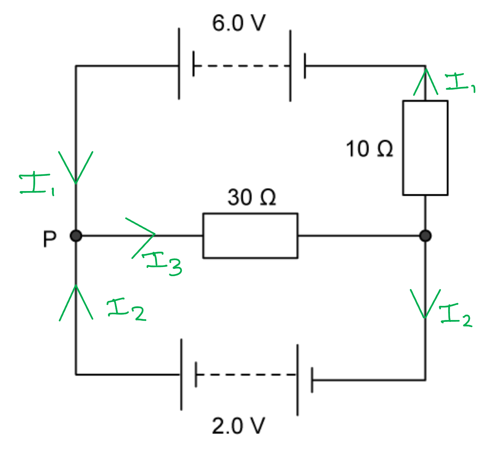

- Current *I**1  *is identified as both going into P from the positive side of the 6.0 V power supply and in the same branch as the 10 Ω resistor; **[1 mark]**
- Current *I**2  *is identified as both going into P from the positive side of the 2.0 V power supply and going into the negative side of the 2.0 V power supply; **[1 mark]**
- Current *I*3  is identified as going out of P in the 30 Ω resistor branch; **[1 mark]**

Apply Kirchoff's first law for the current to obtain an expression for the current at P:

- Current at P = *I**3* = *I**1* + *I**2* (Equation 1) **OR**
- If currents have been labelled the opposite way around to the diagram above: Current at P = *I**1* = *I**2* + *I**3*  **[1 mark]**

**[Total: 4 marks]**

> *Remember that current comes from the positive side of the battery. It can be helpful to mark the currents for each power supply and each branch. The sign convention shown in the solution makes the most sense but it is also possible to note the currents in the opposite directions and obtain the second equation. As long as you are consistent it does not matter. *
List the known quantities:

- e.m.f-1 = 6.0 V
- e.m.f-2 = 2.0 V
- Resistance-1 = 10 Ω
- Resistance-2 = 30 Ω
- Current at P = *I**3* = *I**1* + *I**2*  (Equation 1) (from part a)

Apply Kirchoff's second law for the potential difference in the top loop of the circuit:

- Recall Ohm's Law: *V *= *IR*
- e.m.f-1 = *I**1**R**1* + *I**3**R**3*
- 6.0 = *(I**1* × 10) + (*I**3 *× 30)
- 6.0 = 10*I**1* + 30*I**3*  (Equation 2) **[1 mark]**

Apply Kirchoff's second law for the potential difference in the bottom loop of the circuit:

- e.m.f-2 = *I**2**R**2* + *I**3**R**3*
- 2.0 = (*I**2* × 0) + *(I**3* × 30)
- 2.0 = 30*I**3*
- *I**3* = 0.07 A **[1 mark]**

Substitute for *I**3* into Equation 2:

- 6.0 = 10*I**1* + (30 × 0.07)
- 6.0 = 10*I**1* + 2.1
- 4 = 10*I**1 *
- *I**1 *= 0.39 A **[1 mark]**

Substitute for *I**1* and *I**3* into equation 1:

- 0.07 = 0.39 + *I**2*
- *I**2* = −0.32 A** [1 mark]**

**[Total: 4 marks]**

> *Remember that you need to have as many equations as unknown currents. Then solve these equations simultaneously. All the energy given out by the battery is used up by the components of the circuit. *
Recall the pattern of resistance when identical resistors are placed in parallel:

- Single resistor, *R**tot* = *R*
- Two resistors,  *R**tot* = ½ *R*
- Three resistors, *R**tot* =  ⅓ *R*
- Four resistors, *R**tot* =  ¼ *R*

Under the diagram, write the values of the combinations as fractions:

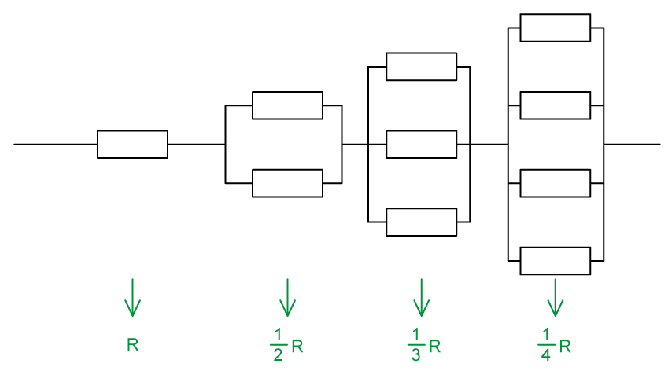

Write the full equation for resistance in series:

- $totalresistance=250=R+\frac{1}{2}R+\frac{1}{3}R+\frac{1}{4}R$ **[1 mark]**

Write all fractions in terms of a common denominator:

- $250=\frac{12}{12}R+\frac{6}{12}R+\frac{4}{12}R+\frac{3}{12}R$

Gather the terms:

- $250=\frac{25}{12}R$

Rearrange and cancel:

- $\frac{250\times12}{25}=R$
- $R=10\times12=120$ Ω **[1 mark]**

**[Total: 2 marks]**

> *If you went straight to the correct answer by identifying the combinations in terms of fractions of **R**, and then calculating for a **set of resistors in series**, as shown above, well done!*

> *But you may have laboriously worked out the value of resistance of each combination in parallel, using *$\frac{1}{R_{total}}=\frac{1}{R_{1}}+\frac{1}{R_{2}}+...$*, this must have taken a long time, and created the opportunity for mistakes to be made. *

> *It is important to recognise that the sum of three resistors in parallel is given by *$3R$* because:*

$\frac{1}{R_{T}}=\frac{1}{R}+\frac{1}{R}+\frac{1}{R}$

$\frac{1}{R_{T}}=\frac{1}{3R}$

$R_{T}=3R$

> *The fact that this answer is only awarded two marks is a clue that there is a quicker way.*

> *Always pause and think before starting. A moment's thought should be enough to see the pattern of the combinations, and recall the fact that since the resistors are **identical**, a pattern of resistance follows, as described in the solution above.*

> *Always be ready to apply every part of your knowledge in any situation. This-open minded approach will make you a much better scientist.*
List the known quantities:

- Voltage supplied by power source in Circuit 1, $V_{S1}$= 8.0 V
- Voltage on voltmeter in Circuit 1, $V_{1}$= 5.0 V
- Current flowing through power supply in Circuit 1, $I_{1}$= 0.50 A
- Voltage supplied by power source in Circuit 2, $V_{S2}$= 10 V
- Voltage on voltmeter in Circuit 2, $V_{2}$= 4.0 V

Consider Circuit 1:

- If the voltmeter has an infinitely high resistance, then current will flow through both $R_{1}$and $R_{2}$:

Calculate the resistance of $R_{2}$:

- Recall: *V *= *IR*
- $R_{2}$= $\frac{V_{1}}{I_{1}}$ = $\frac{5.0}{0.5}$ = 10 Ω **[1 mark]**

Calculate the resistance of $R_{1}$:

- Voltage across $R_{1}$, $V_{R1}$=$V_{S1}$ – $V_{1}$= 8.0 – 5.0 = 3.0 V
- $R_{1}$= $\frac{V_{R1}}{I_{1}}$ = $\frac{3.0}{0.5}$ = 6 Ω **[1 mark]**

Consider Circuit 2:

- If the voltmeter has an infinitely high resistance, then current will flow through both $R_{2}$ and $R_{3}$:

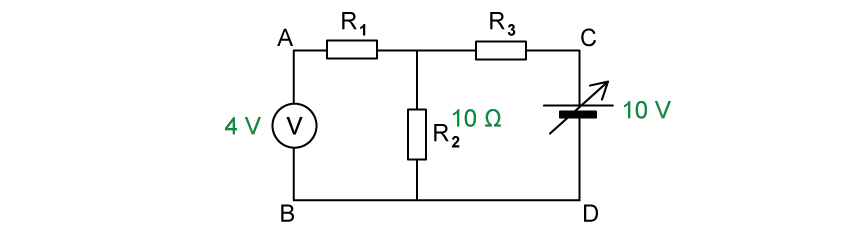

Calculate the current, *I*, flowing through $R_{2}$:

- *I* = $\frac{V_{2}}{R_{2}}$= $\frac{4}{10}$ = 0.4 A **[1 mark]**

Calculate the resistance of $R_{3}$:

**EITHER**

- Voltage across $R_{3}$, $V_{R3}$= $V_{S2}$ – $V_{2}$ = 10 – 4.0 = 6.0 V
- $R_{3}$= $\frac{V_{R3}}{I}$ = $\frac{6.0}{0.4}$ = 15 Ω **[1 mark]**

**   ****OR**

- Total resistance of  $R_{2}+R_{3}$, $R_{2+3}$= $\frac{V_{S2}}{I}$ = $\frac{10}{0.4}$ = 25 Ω
- Resistance, $R_{3}$= $R_{2+3}$ – $R_{2}$ = 25 – 10 = 15 Ω **[1 mark]**

Conclusion:

- $R_{1}$= 6 Ω
- $R_{2}$= 10 Ω
- $R_{3}$= 15 Ω

**[Total: 4 marks]**
