# Exam Questions — Kirchhoff’s Laws
**10. D.C. Circuits** · Cambridge (CIE) A-LEVEL physics (9702)
> Source: [https://www.savemyexams.com/a-level/physics/cie/25/topic-questions/](https://www.savemyexams.com/a-level/physics/cie/25/topic-questions/) · 18 questions across 1 sets

## Multiple Choice Questions (18 questions)

### Q1 — medium — 1 marks

**Q1** [1 mark]

The diagram shows part of a current-carrying circuit. The ammeter has negligible resistance.

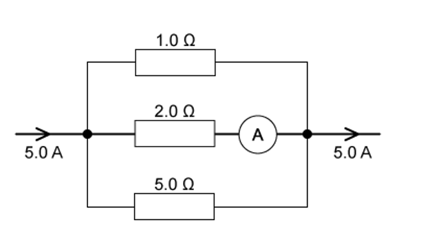

What is the reading on the ammeter ?

### Q2 — easy — 1 marks

**Q2** [1 mark]

In deriving a formula for the combined resistance of three different resistors in series, Kirchhoff's Laws are used.

Which physics principle is involved in this derivation ?

### Q3 — hard — 1 marks

**Q3** [1 mark]

Four resistors of equal value are connected as shown.

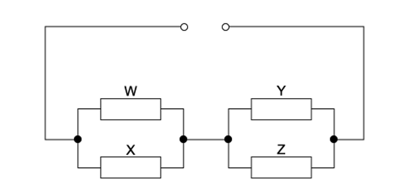

How will the powers to the resistors change when resistor W is removed?

### Q4 — easy — 1 marks

**Q4** [1 mark]

Each of Kirchhoff's two Laws presumes that some quantity is conserved.

Which row states Kirchhoff's **first** Law and names the quantity that is conserved ?

| ** ** | **Statement** | **Quantity** |
|---|---|---|
| **A** | The algebraic sum of currents into a junction is zero | charge |
| **B** | The algebraic sum of currents into a junction is zero | energy |
| **C** | The e. m. f. in a loop is equal to the algebraic sum of the product of current and resistance around the loop | charge |
| **D** | The e .m .f. in a loop is equal to the algebraic sum of the product of current and resistance around the loop | energy |

### Q5 — medium — 1 marks

**Q5** [1 mark]

The diagram shows currents *I* 1, *I* 2, *I* 3, *I* 4 and *I* 5 in different branches of a circuit.

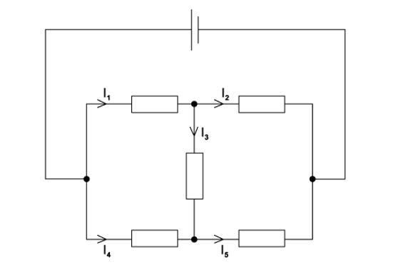

Which one of the following is correct?

### Q6 — medium — 1 marks

**Q6** [1 mark]

A cell of e .m .f. 2.0 V and negligible internal resistance is connected to a network of resistors as shown.

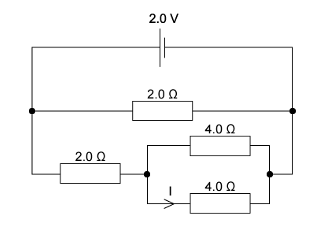

What is the current *I *?

### Q7 — medium — 1 marks

**Q7** [1 mark]

The diagram shows a circuit with four voltmeter readings *V*, *V*1, *V*2 and *V*3.

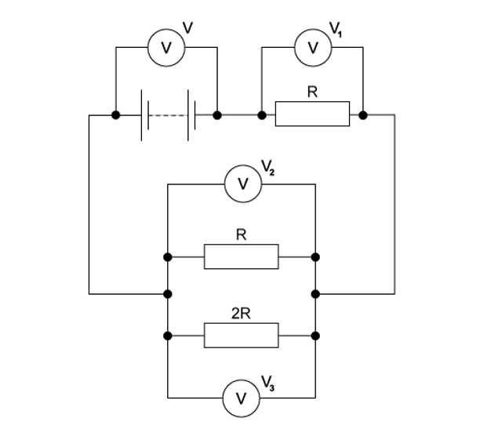

Which equation relating the voltmeter readings must be true?

### Q8 — hard — 1 marks

**Q8** [1 mark]

A p. d. of 12 V is connected between P and Q.

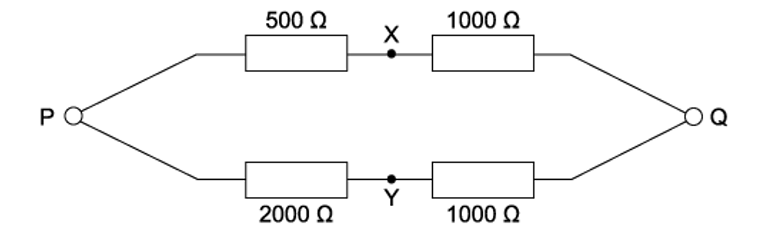

What is the p. d. between X and Y?

### Q9 — hard — 1 marks

**Q9** [1 mark]

Six resistors, each of resistance 5 Ω, are connected to a 2 V cell of negligible internal resistance.

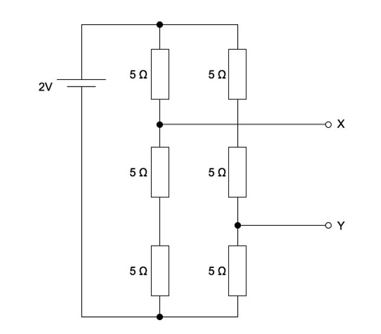

What is the potential difference between terminals X and Y ?

### Q10 — medium — 1 marks

**Q10** [1 mark]

A cell, two resistors of equal resistance and an ammeter are used to construct four circuits. The resistors are the only parts of the circuits that have resistance.

In which circuit will the ammeter show the greatest reading ?

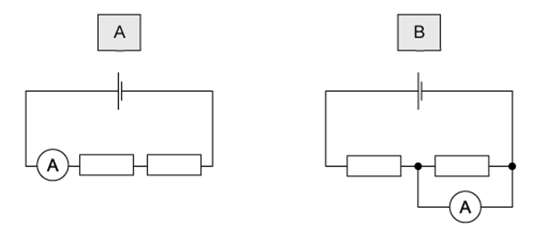

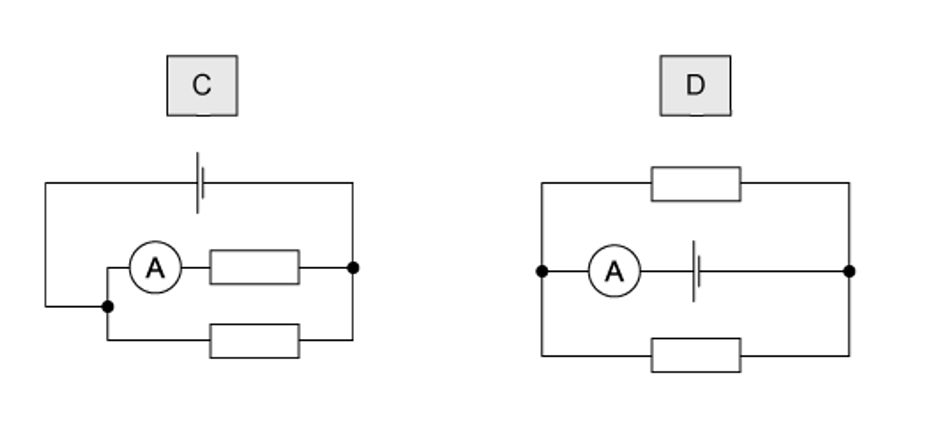

### Q11 — medium — 1 marks

**Q11** [1 mark]

In the circuit shown, all the resistors are identical and all the ammeters have negligible resistance.

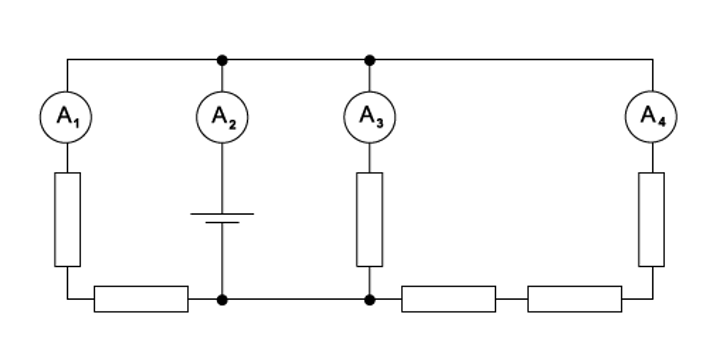

The reading on ammeter A1 is 0.6 A.

What are the readings on the other ammeters?

| ** ** | **Reading on ammeter A****2**** / A** | **Reading on ammeter A****3**** / A** | **Reading on ammeter A****4**** / A** |
|---|---|---|---|
| **A**  **B**  **C**  **D** | 1.0  1.4  1.8  2.2 | 0.3  0.6  0.9  1.2 | 0.1  0.2  0.3  0.4 |

### Q12 — hard — 1 marks

**Q12** [1 mark]

The diagram shows a four-terminal box connected to a battery and two ammeters.

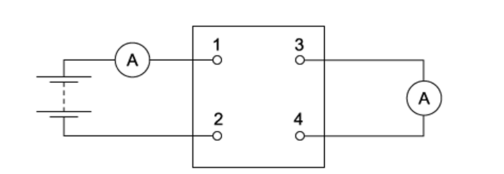

The currents in the two meters are identical.

Which circuit, within the box, will give this result ?

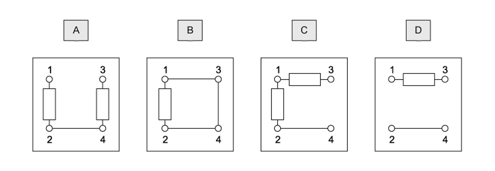

### Q13 — easy — 1 marks

**Q13** [1 mark]

A circuit consisting of five **identical **resistors is shown:

Which of the following statements is **false**?

### Q14 — easy — 1 marks

**Q14** [1 mark]

The combined resistance *R*T of two resistors of resistances *R*1 and *R*2 connected in parallel is given by the formula

$\frac{1}{R_{T}}=\frac{1}{R_{1}}+\frac{1}{R_{2}}$

Which statement is used in the derivation of this formula?

### Q15 — medium — 1 marks

**Q15** [1 mark]

In the circuit shown, all the resistors are identical.

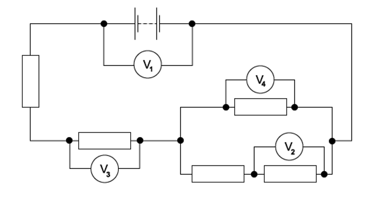

The reading on voltmeter V1 is 8.0 V and the reading on voltmeter V2 is 1.0 V. What are the readings on the other voltmeters?

| ** ** | **Reading on voltmeter V****3**** / V** | **Reading on voltmeter V****4**** / V** |
|---|---|---|
| **A**  **B**  **C**  **D** | 1.5  3.0  4.5  6.0 | 1.0  2.0  3.0  4.0 |

### Q16 — easy — 1 marks

**Q16** [1 mark]

The principles of conservation of which two quantities are associated with Kirchhoff's first and second Laws?

| ** ** | **First Law** | **Second Law** |
|---|---|---|
| **A**  **B**  **C**  **D** | charge  charge  energy  voltage | energy  voltage  charge  charge |

### Q17 — hard — 1 marks

**Q17** [1 mark]

The diagram shows the circuit for a signal to display a green or a red light. It is controlled by the switch S.

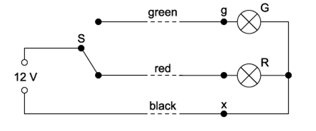

The signal is some way from S to which it is connected by a cable with green, red and black wires. At the signal, the green and red wires are connected to the corresponding lamp and the black wire is connected to a terminal x to provide a common return. The arrangement is shown correctly connected and with the switch set to illuminate the red lamp.

During maintenance, the wires at the signal are disconnected and, when reconnected, the black wire is connected in error to the green lamp (terminal g) instead of terminal x. The red wire is connected correctly to its lamp and connections at S remain as in the diagram.

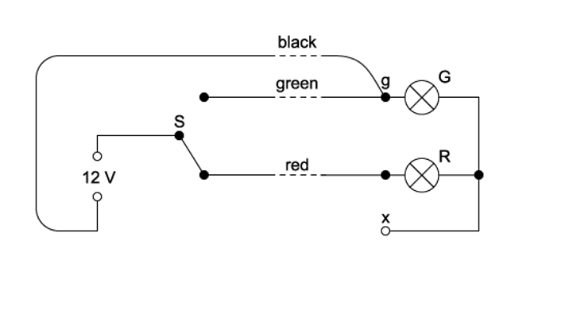

When the system is tested with the switch connection to the red wire, what does the signal show ?

### Q18 — medium — 1 marks

**Q18** [1 mark]

When four identical resistors are connected as shown in diagram 1, the ammeter reads 1.0 A, and the voltmeter reads zero.

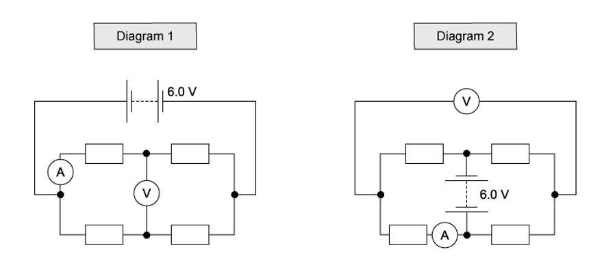

The resistors and meters are reconnected to the supply, as shown in diagram 2.

What are the meter readings in diagram 2?

| ** ** | **Voltmeter reading / V** | **Ammeter reading / A** |
|---|---|---|
| **A**  **B**  **C**  **D** | 0  3.0  3.0  6.0 | 1.0  0.5  1.0  0 |
