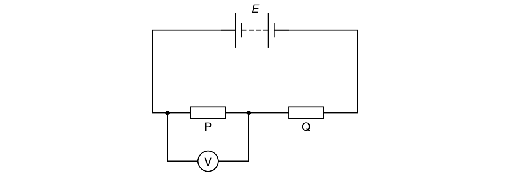
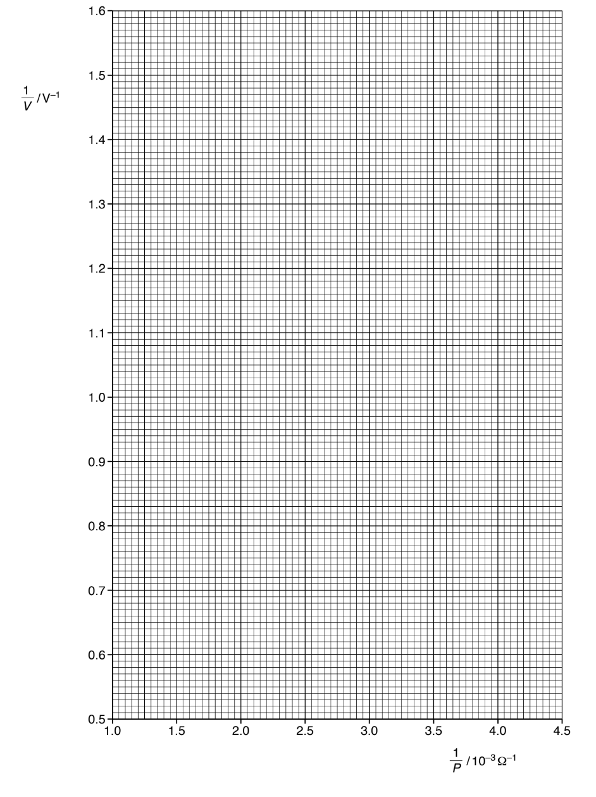
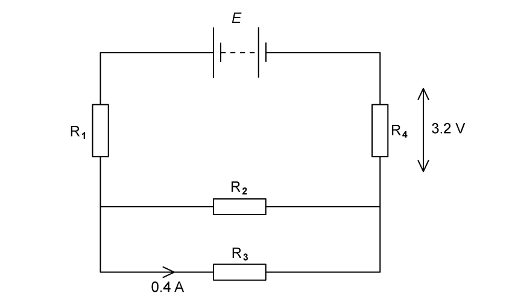
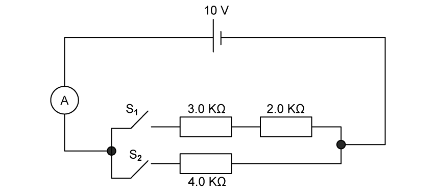

# Exam Questions — Kirchhoff’s Laws
**10. D.C. Circuits** · Cambridge (CIE) A-LEVEL physics (9702)
> Source: [https://www.savemyexams.com/a-level/physics/cie/25/topic-questions/](https://www.savemyexams.com/a-level/physics/cie/25/topic-questions/) · 25 questions across 2 sets

## Multiple Choice Questions (18 questions)

### Q1 — medium — 1 marks

**Q1** [1 mark]

The diagram shows part of a current-carrying circuit. The ammeter has negligible resistance.

What is the reading on the ammeter ?

### Q2 — easy — 1 marks

**Q2** [1 mark]

In deriving a formula for the combined resistance of three different resistors in series, Kirchhoff's Laws are used.

Which physics principle is involved in this derivation ?

### Q3 — hard — 1 marks

**Q3** [1 mark]

Four resistors of equal value are connected as shown.

How will the powers to the resistors change when resistor W is removed?

### Q4 — easy — 1 marks

**Q4** [1 mark]

Each of Kirchhoff's two Laws presumes that some quantity is conserved.

Which row states Kirchhoff's **first** Law and names the quantity that is conserved ?

| ** ** | **Statement** | **Quantity** |
|---|---|---|
| **A** | The algebraic sum of currents into a junction is zero | charge |
| **B** | The algebraic sum of currents into a junction is zero | energy |
| **C** | The e. m. f. in a loop is equal to the algebraic sum of the product of current and resistance around the loop | charge |
| **D** | The e .m .f. in a loop is equal to the algebraic sum of the product of current and resistance around the loop | energy |

### Q5 — medium — 1 marks

**Q5** [1 mark]

The diagram shows currents *I* 1, *I* 2, *I* 3, *I* 4 and *I* 5 in different branches of a circuit.

Which one of the following is correct?

### Q6 — medium — 1 marks

**Q6** [1 mark]

A cell of e .m .f. 2.0 V and negligible internal resistance is connected to a network of resistors as shown.

What is the current *I *?

### Q7 — medium — 1 marks

**Q7** [1 mark]

The diagram shows a circuit with four voltmeter readings *V*, *V*1, *V*2 and *V*3.

Which equation relating the voltmeter readings must be true?

### Q8 — hard — 1 marks

**Q8** [1 mark]

A p. d. of 12 V is connected between P and Q.

What is the p. d. between X and Y?

### Q9 — hard — 1 marks

**Q9** [1 mark]

Six resistors, each of resistance 5 Ω, are connected to a 2 V cell of negligible internal resistance.

What is the potential difference between terminals X and Y ?

### Q10 — medium — 1 marks

**Q10** [1 mark]

A cell, two resistors of equal resistance and an ammeter are used to construct four circuits. The resistors are the only parts of the circuits that have resistance.

In which circuit will the ammeter show the greatest reading ?

### Q11 — medium — 1 marks

**Q11** [1 mark]

In the circuit shown, all the resistors are identical and all the ammeters have negligible resistance.

The reading on ammeter A1 is 0.6 A.

What are the readings on the other ammeters?

| ** ** | **Reading on ammeter A****2**** / A** | **Reading on ammeter A****3**** / A** | **Reading on ammeter A****4**** / A** |
|---|---|---|---|
| **A**  **B**  **C**  **D** | 1.0  1.4  1.8  2.2 | 0.3  0.6  0.9  1.2 | 0.1  0.2  0.3  0.4 |

### Q12 — hard — 1 marks

**Q12** [1 mark]

The diagram shows a four-terminal box connected to a battery and two ammeters.

The currents in the two meters are identical.

Which circuit, within the box, will give this result ?

### Q13 — easy — 1 marks

**Q13** [1 mark]

A circuit consisting of five **identical **resistors is shown:

Which of the following statements is **false**?

### Q14 — easy — 1 marks

**Q14** [1 mark]

The combined resistance *R*T of two resistors of resistances *R*1 and *R*2 connected in parallel is given by the formula

$\frac{1}{R_{T}}=\frac{1}{R_{1}}+\frac{1}{R_{2}}$

Which statement is used in the derivation of this formula?

### Q15 — medium — 1 marks

**Q15** [1 mark]

In the circuit shown, all the resistors are identical.

The reading on voltmeter V1 is 8.0 V and the reading on voltmeter V2 is 1.0 V. What are the readings on the other voltmeters?

| ** ** | **Reading on voltmeter V****3**** / V** | **Reading on voltmeter V****4**** / V** |
|---|---|---|
| **A**  **B**  **C**  **D** | 1.5  3.0  4.5  6.0 | 1.0  2.0  3.0  4.0 |

### Q16 — easy — 1 marks

**Q16** [1 mark]

The principles of conservation of which two quantities are associated with Kirchhoff's first and second Laws?

| ** ** | **First Law** | **Second Law** |
|---|---|---|
| **A**  **B**  **C**  **D** | charge  charge  energy  voltage | energy  voltage  charge  charge |

### Q17 — hard — 1 marks

**Q17** [1 mark]

The diagram shows the circuit for a signal to display a green or a red light. It is controlled by the switch S.

The signal is some way from S to which it is connected by a cable with green, red and black wires. At the signal, the green and red wires are connected to the corresponding lamp and the black wire is connected to a terminal x to provide a common return. The arrangement is shown correctly connected and with the switch set to illuminate the red lamp.

During maintenance, the wires at the signal are disconnected and, when reconnected, the black wire is connected in error to the green lamp (terminal g) instead of terminal x. The red wire is connected correctly to its lamp and connections at S remain as in the diagram.

When the system is tested with the switch connection to the red wire, what does the signal show ?

### Q18 — medium — 1 marks

**Q18** [1 mark]

When four identical resistors are connected as shown in diagram 1, the ammeter reads 1.0 A, and the voltmeter reads zero.

The resistors and meters are reconnected to the supply, as shown in diagram 2.

What are the meter readings in diagram 2?

| ** ** | **Voltmeter reading / V** | **Ammeter reading / A** |
|---|---|---|
| **A**  **B**  **C**  **D** | 0  3.0  3.0  6.0 | 1.0  0.5  1.0  0 |

## Structured Questions (7 questions)

### Q1 — hard — 15 marks

**Q1** [4 marks]

There is current flowing from P to R in the resistor network shown. The potential differences across three of the resistors are 3.0 V, 6.0 V and 5.0 V as shown in Fig. 1.1.

**Fig. 1.1**

Determine the potential difference across the other two resistors.

**Q1** [4 marks]

**Extract:**

There is current flowing from P to R in the resistor network shown. The potential differences across three of the resistors are 3.0 V, 6.0 V and 5.0 V as shown in Fig. 1.1. Fig. 1.1. Determine the potential difference across the other two resistors.
Mark scheme: x = 2 V (potential difference across QS branch); y = 4 V. LHS branch p.d. = 3 V + 5 V = 8 V; RHS branch p.d. = 6 V + 4 V = 10 V; QS p.d. = 2.0 V.

The current through the branch QS is 3.0 A. The total combined resistance of the resistors in the outer loop of the circuit is *r*. The resistance in the outer loop of the circuit is split according to the ratio of the magnitudes of the potential differences of the resistors on each side of the loop.

Obtain an expression, in terms of *r*, for the total resistance of all the resistors in the circuit.

**Q1** [7 marks]

Diagram 1.2 shows a circuit where *V**1*  is a battery of 0.5 V, *V**2*  a battery of 1 V and *V**3*  a battery of 2 V. Each resistor has a resistance of 0.25 Ω.

**Fig. 1.1**

Determine the value of each current at junction A.

### Q2 — medium — 15 marks

**Q2** [1 mark]

A student investigates the potential difference in a circuit. The circuit is set up as shown in Fig. 2.1.

**Fig. 2.1**

Two resistors P and Q are connected in series to a power supply of electromotive force (e.m.f.) *E* and negligible internal resistance. Resistor P has resistance *P*.

The potential difference *V* across resistor P is measured. The experiment is repeated for different values of *P*.

It is suggested that *V* and *P *are related by the equation

$V = ( \frac{P}{P + Q} ) E$

where *Q* is the resistance of resistor Q. The value of *Q* is kept constant.

A graph is plotted of $\frac{1}{V}$ on the y-axis against $\frac{1}{P}$ on the x-axis.

Determine expressions for the gradient and the y-intercept.

gradient = ............................................

y-intercept = .......................................

*Source: Specimen 2022 Paper 5 Q2A*

**Q2** [2 marks]

Values of P, V and $\frac{1}{V}$ are given in Table 2.1.

**Table 2.1**

| ***P***** / Ω** | ***V***** / V** | $\frac{1}{P}$** / 10****–3**** Ω****–1** | $\frac{1}{V}$** / V****–1** |
|---|---|---|---|
| 250 | 0.66 |   | 1.52 |
| 330 | 0.86 |   | 1.16 |
| 470 | 1.15 |   | 0.870 |
| 560 | 1.30 |   | 0.769 |
| 680 | 1.49 |   | 0.671 |
| 840 | 1.64 |   | 0.610 |

Each value of *P* has an uncertainty of ±10%.

Calculate and record values of $\frac{1}{P}$ / 10–3 Ω–1 in Table 2.1.

Include the absolute uncertainties in $\frac{1}{P}$ .

*Source: Specimen 2022 Paper 5 Q2B*

**Q2** [8 marks]

**Extract:**

Values of P, V and 1/V are given in Table 2.1.
Table 2.1
P / Ω | V / V | 1/P / 10^–3 Ω^–1 | 1/V / V^–1
250 | 0.66 | | 1.52
330 | 0.86 | | 1.16
470 | 1.15 | | 0.870
560 | 1.30 | | 0.769
680 | 1.49 | | 0.671
840 | 1.64 | | 0.610
Each value of P has an uncertainty of ±10%.

(i) Plot a graph of $\frac{1}{V}$ / V–1 against $\frac{1}{P}$ / 10–3 Ω–1.

Include error bars for $\frac{1}{P}$ .

[2]

(ii) Draw the straight line of best fit and a worst acceptable straight line on your graph. Label both lines.

[2]

(iii) Determine the gradient of the line of best fit. Include the absolute uncertainty in your answer.

gradient = ......................................... [2]

(iv) Determine the y-intercept of the line of best fit. Include the absolute uncertainty in your answer.

y-intercept = ......................................... [2]

*Source: Specimen 2022 Paper 5 Q2C*

**Q2** [4 marks]

**Extract:**

It is suggested that V and P are related by the equation V = (P/(P+Q))E where Q is the resistance of resistor Q. A graph is plotted of 1/V on the y-axis against 1/P on the x-axis. Hence, the gradient = Q/E AND y-intercept = 1/E.

(c)(iii) gradient of line of best fit m = 0.326, with uncertainty = ±0.026.

(c)(iv) y-intercept for the line of best fit, c = 0.182 V⁻¹, with uncertainty = ±0.038.

(i) Using your answers to **(a), (c)(iii)** and **(c)(iv)**, determine the values of E and Q. Include appropriate units.

E = .............................................

Q = ............................................

[2]

(ii) Determine the percentage uncertainty in *E*.

percentage uncertainty in *E* = ......................................... % [1]

(iii) Determine the absolute uncertainty in *Q*.

absolute uncertainty in *Q* = ........................................ [1]

*Source: Specimen 2022 Paper 5 Q2D*

### Q3 — easy — 12 marks

**Q3** [2 marks]

(i) State Kirchhoff's first law.

[1]

(ii) State the quantity that is conserved by this law.

[1]

**Q3** [2 marks]

(i) State Kirchhoff's second law.

[1]

(ii) State the quantity that is conserved by this law.

[1]

**Q3** [6 marks]

Fig 1.1 shows a list of circuit components.

**Fig 1.1**

In the right hand column, sketch the circuit symbol for the component in the left hand column of Fig 1.1.

**Q3** [2 marks]

Two cells of e.m.f. *E*1 and *E*2 are negligible internal resistance are connected to resistors *R* in a circuit shown in Fig 1.2.

**Fig 1.2**

Use Kirchhoff's laws to state the relation between

(i) *I*1, *I*2 and *I*3

[1]

(ii) *E*2, *R*, *I*2 and *I*3 in loop YZABY.

[1]

### Q4 — medium — 12 marks

**Q4** [4 marks]

The circuit shown in Fig. 1.1 contains a battery with an e.m.f. *E  *and negligible internal resistance *r* connected to four resistors *R**1*, *R**2*, *R**3*  and *R**4*, each of resistance *R*.

**Fig. 1.1**

The current in *R**3*  is 0.40 A and the potential difference across *R*4 is 3.2 V.

Determine the resistance *R  *of each of the fixed resistors.

**Q4** [2 marks]

**Extract:**

The circuit shown in Fig. 1.1 contains a battery with an e.m.f. E and negligible internal resistance r connected to four resistors R1, R2, R3 and R4, each of resistance R. The current in R3 is 0.40 A and the potential difference across R4 is 3.2 V. P.d. across R1 and R4 = 3.2 V; P.d. across R2 and R3 = 1.6 V.

Determine the e.m.f. of the battery.

**Q4** [3 marks]

**Extract:**

The circuit shown in Fig. 1.1 contains a battery with an e.m.f. E and negligible internal resistance r connected to four resistors R1, R2, R3 and R4, each of resistance R. The current in R3 is 0.40 A and the potential difference across R4 is 3.2 V.

A fifth resistor *R**5*  also with resistance *R  *is now added in parallel to *R**2*  and *R**3*. The current through *R**3*  remains at 0.40 A.

Determine the total current in this circuit. Explain your answer.

**Q4** [3 marks]

**Extract:**

The circuit shown in Fig. 1.1 contains a battery with an e.m.f. *E  *and negligible internal resistance *r* connected to four resistors *R*~*1*~, *R*~*2*~, *R*~*3*~  and *R*~*4*~, each of resistance *R*.

The battery in the circuit is now replaced by one with the same e.m.f. but internal resistance is not negligible.

Explain whether this will change the total power produced by the battery.

### Q5 — medium — 12 marks

**Q5** [2 marks]

Three resistors of resistances *R*1, *R*2 and *R*3 are connected as shown in Fig. 1.1.

The currents in the resistors are *I*1, *I*2 and *I*3. The total current in the combination of resistors is *I* and the potential difference across the combination is *V*.

Show that the total resistance *R* of the combination is given by the equation

$\frac{1}{R}=\frac{1}{R_{1}}+\frac{1}{R_{2}}+\frac{1}{R_{3}}$

*Source: Specimen 2022 Paper 2 Q6A*

**Q5** [10 marks]

A battery of electromotive force (e.m.f.) 6.0 V and internal resistance *r* is connected to an external resistor of resistance 12 Ω and a thermistor X, as shown in Fig. 1.2.

**Fig. 1.2**

(i) By considering energy, explain why the potential difference across the terminals of the battery is less than the e.m.f.

[1]

(ii) A charge of 2.5 kC passes through the battery.

Calculate:

- the total energy transferred by the battery

energy = ............................................................ J

- the number of electrons that pass through the battery.

number = .......................................

[3]

(iii) The combined resistance of the external resistor and thermistor X connected in parallel is 4.8 Ω.

Calculate the resistance of X.

resistance = ........................................ Ω [1]

(iv) Use your answer in **(b)(iii)** to determine the ratio

$\frac{\mathrm{power} \mathrm{dissipated} \mathrm{in} \mathrm{thermistor}X}{\mathrm{power} \mathrm{dissipated} \mathrm{in}12Ω\mathrm{resistor}}$

ratio = .................................. [2]

(v) The temperature of thermistor X is now decreased.

State and explain the effect, if any, of this temperature change on the total power produced by the battery.

[3]

*Source: Specimen 2022 Paper 2 Q6B*

### Q6 — easy — 11 marks

**Q6** [3 marks]

Three resistors of resistances *R*1, *R*2 and *R*3 are connected as shown in Fig. 1.1.

**Fig 1.1**

The potential difference across the resistors are *V*1, *V*2 and *V*3. The current in the combination of resistors is *I.*

Show that the total resistance *R* of the combination is given by the equation.

$R=R_{1}+R_{2}+R_{3}$

**Q6** [3 marks]

Three resistors are placed in a circuit with a cell of 10 V and negligible internal resistance and two switches S1 and S2. This is shown in Fig 1.1.

**Fig 1.1**

Complete table 1.1.

**Table 1.1**

| Position of switches |   |   |
|---|---|---|
| S1 | S2 | Total resistance / kΩ |
| open | closed |   |
| closed | open |   |
| closed | closed |   |

**Q6** [2 marks]

**Extract:**

Three resistors are placed in a circuit with a cell of 10 V and negligible internal resistance and two switches S1 and S2.

A complete Table 1.1 (Total resistance / kΩ):
S1 open, S2 closed: 4.0
S1 closed, S2 open: 5.0
S1 closed, S2 closed: 2.2

The cell has an e .m .f of 10 V and negligible internal resistance.

Calculate the current from the cell when

(i) switch S1 is closed,

[1]

(ii) both S1 and S2 are closed.

[1]

**Q6** [3 marks]

**Extract:**

The cell has an e.m.f of 10 V and negligible internal resistance.

Calculate the current from the cell when (i) switch S1 is closed, (ii) both S1 and S2 are closed.

The current when (i) switch S1 is closed is: I = 10 / (5.0 × 10^3) = 2 × 10^-3 A (2 mA). (ii) switch S1 and S2 are closed is: I = 10 / (2.2 × 10^3) = 4.5 × 10^-3 A (4.5 mA).

Using your answers in part (c), determine the current from the cell if just switch S2 is closed.

### Q7 — hard — 14 marks

**Q7** [4 marks]

A circuit containing a junction P has two power supplies with e.m.f 6.0 V and 2.0 V and two resistors with resistance 30 Ω and 10 Ω is shown in Fig. 1.1.

**Fig. 1.1**

Draw on the diagram to label the currents in each branch of the circuit and obtain an expression for the current at P.

**Q7** [4 marks]

**Extract:**

A circuit containing a junction P has two power supplies with e.m.f 6.0 V and 2.0 V and two resistors with resistance 30 Ω and 10 Ω is shown in Fig. 1.1. Draw on the diagram to label the currents in each branch of the circuit and obtain an expression for the current at P.

Current at P = I3 = I1 + I2 (Equation 1). e.m.f-1 = 6.0 V, e.m.f-2 = 2.0 V, Resistance-1 = 10 Ω, Resistance-2 = 30 Ω. Current I1 goes into P from the positive side of the 6.0 V power supply and in the same branch as the 10 Ω resistor; Current I2 goes into P from the positive side of the 2.0 V power supply; Current I3 goes out of P in the 30 Ω resistor branch.

Determine the values of the currents at P for the circuit in part a).

**Q7** [2 marks]

A combination of identical resistors each with resistance *R*  has a total resistance of 250 Ω as shown in Fig. 1.2.

**Fig. 1.2**

Show, without the use of a calculator, how to find the value of resistance of each resistor and hence determine the value of *R*.

**Q7** [4 marks]

A student wishes to determine the resistance for three different resistors. They connect the resistors in a ‘T’ arrangement and change the position of the power source and the voltmeter, as shown in Fig. 1.1**,** to obtain two sets of results, as shown in Table 1.1. The power supply in Circuit 1 causes a current of 0.50 A in one branch of a circuit.

**Fig. 1.1**

**Table 1.1**

| **Circuit** | **Voltage supplied by power source /V** | **Reading on voltmeter /V** |
|---|---|---|
| 1 | 8.0 | 5.0 |
| 2 | 10 | 4.0 |

Calculate the resistance of resistors $R_{1}$, $R_{2}$ and $R_{3}$.

You may assume the voltmeter has an infinitely high resistance.
