# Mark Schemes — Potential Dividers
**10. D.C. Circuits** · Cambridge (CIE) A-LEVEL physics (9702)

## Multiple Choice Questions (29 questions)

### Q1
**Final answer:** **The correct answer is ****B ****because:**

- Since the two resistors are in series, the total e.m.f in the circuit is divided between them
- The variable resistor controls the range of the output voltage, so X and Y must be placed across the variable resistor
- Consider option B:

  - When the resistance of the top resistor is maximized to R, the potential difference between X and Y = 3.0 V
  - When the resistance of the top resistor is minimized to 0, the potential difference between X and Y = 0 V
- Therefore, option **B** is correct

**A **is incorrect because the range of output voltage of this circuit would be 3 - 6 V as it includes both resistors

**C **&** D **are incorrect because the variable resistor controls the range of the output voltage, so X and Y must be placed across the variable resistor

### Q2
**Final answer:** **The correct answer is ****C ****because:               **

- A variable potential divider (potentiometer) can be used to vary the brightness of a light bulb between zero and normal brightness
- The moveable contact, represented by the arrowhead, splits the resistor in two allowing it to act as though there were two resistors in the circuit and hence like a variable potential divider or potentiometer
- Changing the resistance of the potentiometer changes the potential difference of the lamp
- This is represented by circuit **C** as the lamp needs to be directly connected to the potentiometer

**A **&** B **are incorrect because a potentiometer is represented by an arrow pointing to a resistor

**D **is incorrect because the wire with the arrowhead needs to connect the lamp directly to the potentiometer in order to vary the potential difference of the lamp

### Q3
**Final answer:** **The correct answer is ****B ****because:**

- When the galvanometer reading is zero, this means that the p.d. across XT of the wire is the same as the e.m.f. E2 connected to the galvanometer
- To calculate the potential difference per unit length on the wire XY, we need to know the length of the wire, and the p.d. across it
- The p.d. across XT is equal to the e.m.f. E2 when the galvanometer reading is zero
- So, we need to know the e. m .f. of the cell E2* *to know the p. d. across the wire

### Q4
**Final answer:** **The correct answer is ****D ****because:**

- The potential divider equation is given by
- $V_{o u t} = V_{i n} \times ( \frac{R_{1} }{R_{1} + R_{2} } )$

  - Where *R**1* = 10 kΩ, *R**2* = 15 kΩ and *V **out *= 4.8 V
- $V_{i n} = V_{o u t} \div ( \frac{R_{1}{R_{1} + R_{2} } ) = V_{o} u t} \times ( \frac{R_{1} + R_{2} }{R_{1} } )$
- $V_{i n} = V_{o u t} ( \frac{R_{1} + R_{2} }{R_{1} } ) = \frac{4.8 ( 10 + 15 )}{10} = 12 \mathrm{V}$
- Therefore, the input voltage is 12 V

### Q5
**Final answer:** **The correct answer is ****D ****because:**

- At the balance length, the p.d. across the wire is equal to the e.m.f. of the cell
- The p .d. is directly proportional to the length of the wire i.e. $VαL$

  - This is because p. d. is proportional to work done which is in turn proportional to distance i.e. $VαWαd$
- Cell X: $1.1Vα0.70m$                  **(1)**
- Cell Y: $e.m.fα0.90m$                  **(2)**
- To find the ratio, divide equation **(2)** by **(1)**:

  - $\frac{e.m.f}{1.1}=\frac{0.90}{0.70}$
  - $e.m.f=\frac{0.90}{0.70}\times1.1=1.41V$
- Therefore, the e. m. f. of cell Y is 1.4 V

### Q6
**Final answer:** **The correct answer is ****B ****because:**

- The potential divider equation is given by

  - $V_{2 = V_{e.} m. f} \times ( \frac{R_{1} }{R_{1} + R_{2} } )$
- Let the resistance of the variable resistor be *R**1* and let the resistance of the fixed resistor be *R**2*

  - *R**1* varies from  0- 4 kΩ, *R**2* = 1 kΩ and the e. m .f is *V* = 25 V
- The potential difference between the terminals P and Q is *V**2*
- The p. d. across a component is proportional to its resistance $V=IR$

  - So, the higher the resistance, the greater the p. d.
- For *V**2* to be maximum, the resistance of the variable resistor, *R**1* should be 4 kΩ

  - So the maximum p. d. is $V_{2} = 25 \times ( \frac{4}{4 + 1} ) = 20 V$
- For *V**2* to be minimum, the smallest resistance is chosen, so, *R**1* is zero

  - So, the minimum p. d. is $V_{2} = 25 \times ( \frac{0}{0 + 1} ) = 0 V$

### Q7
**Final answer:** **The correct answer is ****A ****because:**

- When the slider is at X, where the resistance of the potentiometer is taken to be zero, the voltmeter must read 4 V
- The current flows: from the positive terminal — through the moving jack until the point it is connected on resistor P — from P to end X — through the voltmeter and back to the negative terminal of the supply, as shown in the diagram below

  - Note at no point does the current go through Q
- When the slider is moved to Y, the potentiometer P and the voltmeter are in series
- Still, no current flows through Q — resistor Q can be said to be short-circuited in both cases, with almost all the resistance in the voltmeter and hence the p.d. across the voltmeter is still 4 V
- Therefore, the voltmeter reading remains 4 V as the slider is moved from X to Y

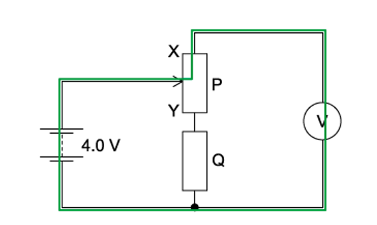

**Exam Tip:** In a properly set up circuit, a voltmeter is usually connected in parallel to the component we want to know about. Connecting a voltmeter in series results in the above situation where the voltmeter always reads 4 V

### Q8
**Final answer:** **The correct answer is ****D ****because:**

- Since the variable resistor and the fixed resistor are in series, the total e.m.f in the circuit is divided between them
- The potential difference across each of the resistors may be obtained from the potential divider equation :$V_{P} = V \times ( \frac{R_{P} }{R_{P} + R_{Q} } )$
- Let's say *R**P* is the resistance of the variable resistor and *R**Q* is the resistance of the fixed resistor
- As *R**P** *is decreased, the p. d. across it decreases $( V = I R )$

  - When *R**P* = 0, *V**P* = 0, therefore, the voltmeter reading of P should give zero - option D shows this
  - Decreasing *R**P* should also cause the p .d. across the fixed resistor to increase - this is also shown by option **D**

**A, B & C **are incorrect because as *R**P* decreases, the p. d. across it also decreases, whereas these graphs all show the p .d. increasing

### Q9
**Final answer:** **The correct answer is ****B ****because:**

- For the galvanometer to give a null reading, the potential difference across it should be zero
- This can only occur when the position at which it is connected on the wire gives a potential difference (on the wire) equal to the cell of e .m .f. *E*
- The cell should be connected such that its potential opposes the potential on the wire
- When the potential difference across the galvanometer is zero, no current flows through it, and the galvanometer records a null reading

  - This set up is demonstrated by circuit **B**

**A **is incorrect because current flows from the positive terminal to the negative terminal, so, the positive terminal of the cell cannot be connected directly to the galvanometer because this will always cause a current to flow through it

**C **&** D **are incorrect because the galvanometer cannot be connected directly to the negative terminal of the main supply because all the current would return to the negative terminal of the main supply, causing the galvanometer always to give a non-zero reading

### Q10
**Final answer:** **The correct answer is ****A ****because:**

- The galvanometer and the internal resistance of the cell can be treated as two resistors in series
- So, the total resistance *R* in the circuit = 6 + 30 = 36 Ω
- Ohm's law states $V=IR$

  - So, current $I=\frac{V}{R}=\frac{9.0\times10^{-3}}{36}=2.5\times10^{-4}A=250\times10^{-6}A$
- In a series circuit, the same current flows through the cell and the galvanometer

  - Therefore, the current in the galvanometer is 250 μA

### Q11
**Final answer:** **The correct answer is ****D ****because:**

- For the lamp to be off, the potential difference across it should be zero so that no current flows through it

  - This means, the potential at the junction of *R**1* and *R**2* should be equal to the potential at the sliding contact J
- The p. d. across *R**1* is *V**1* and the p .d. across *R**2* is *V**2*, so, *V**1* should be equal to the p. d. across XJ and *V**2* should be equal to the p .d. across JY
- Since point X is connected to the negative terminal of the supply, it can be considered to be at a potential of 0, while point Y is at the maximum potential, equal to the e .m. f. of the supply
- The wire XY, together with the sliding contact J, can be considered as a potential divider
- Resistance *R* of the wire $=\frac{ρL}{A}$ and from Ohm's Law$V=IR$ , so, the p. d. across the wire is proportional to the length of wire $VαL$
- A length of *L* corresponds to a p. d. equal to the e .m .f. *E* of the supply and a length of *x* corresponds to a p. d. equal of $( \frac{E}{L} ) \times x = ( \frac{x}{L} ) \times E$
- Since X is at a potential of zero, point J would be at a potential of:

  - $V_{1} = [ ( \frac{x}{L} ) \times E ] - 0 = ( \frac{x}{L} ) \times E$
- Now, the part JY of the wire corresponds to a length (*L* – *x*) of the wire. A length of (*L* – *x*) corresponds to a p.d. equal to

  - $V_{2} = ( \frac{E}{L} ) \times ( L - x ) = \frac{( L - x )}{L} \times E$
- Therefore, the ratio $= \frac{V_{1}}{V_{2}} = ( \frac{x}{L} ) E \div \frac{ ( L - x ) }{L} E = \frac{x}{L - x}$

### Q12
**Final answer:** **The correct answer is ****D ****because: **

- This symbol represents a thermistor

**A **is incorrect because the symbol for a diode is

**B **is incorrect because the symbol for a potentiometer is

**C **is incorrect because the symbol for a galvanometer is

### Q13
**Final answer:** **The correct answer is ****C ****because:**

- When the switch is opened, current passes through both resistors in the circuit
- Let the resistance of one resistor be R, and we will assume they are of the same resistance

  - When the switch is opened, the total resistance *R**T* in the circuit = *R* + *R* = 2*R*
- Ohm's law states $V=IR$

  - This gives a current $I=\frac{E}{R_{T}}$  where *E* is the e .m. f. of the supply
- The total e .m .f in the circuit is divided as p. d. across each of the resistor
- When the switched is closed, the resistor connected in parallel to the wire is short-circuited
- That means, all current would pass through the wire (of negligible resistance) instead of passing through that resistor

  - When the switch is closed, the total resistance *R**T** *in circuit = *R* + 0 = *R*
- This gives a current *I* which is now greater than before, since *R**T* is less
- Since the current *I* through the resistor in parallel is now zero, the p .d. across it now also decreases to zero

### Q14
**Final answer:** **The correct answer is ****C ****because:**

- For the ammeter to read zero, the potential difference across it should be zero; hence, the terminals of the ammeter are at the same potential
- The resistance of an LDR decreases when the light intensity on it increases, so, as the LDR is covered up, the light intensity decreases - this causes its resistance to increase
- Considering the resistor and the LDR in the middle section, an increase in the resistance of the LDR causes the p. d. across it to increase $( V = I R )$

  - So, the terminal connected between the LDR and the resistor is now at a higher potential than before
- To return the ammeter reading to zero, the sliding contact should be moved in such a way that it is at a higher potential (and equal to the new potential of the other terminal of the ammeter)
- The right end of the uniform metal wire is connected to the negative terminal of the supply and so, is at a potential of zero
- The left end of the wire is connected to the positive terminal of the supply and is at the maximum potential (equal to the e. m .f of the supply)
- So, as we move from right to left, the potential increases

  - Therefore, to increase the potential of the sliding contact, we need to move it to the left

### Q15
**Final answer:** **The correct answer is ****C**** because:**

- For point X, the voltmeter is merely measuring the voltage between the terminals of the battery as there are no electrical components in between

  - Hence, the reading is that of the voltage of the battery, which is 12 V
- For point Y, there is a lamp in between the ends of the voltmeter
- However, due to the broken filament of lamp L, no current flows in the circuit
- According to $V=IR$ , the voltage across the lamp between X and Y will be zero

  - Hence, the voltage measured by the voltmeter will still be that between the terminals of the battery, which is 12 V
- Finally, placing the contact at point Z has the same effect as placing it at the negative terminal, so, the voltmeter will read the voltage between the negative terminal and itself

  - Hence, the reading registered will be 0 V

### Q16
**Final answer:** **The correct answer is ****D ****because:**

- Let's say the resistance of the variable resistor = *R*

  - e. m .f of driver cell = p .d. across variable resistor + p .d. across wire XY
- As the resistance *R* of the variable resistor is increased, the p. d. across it also increases $( V = I R )$  and hence, the p. d. across the wire XY decreases
- For the galvanometer to show zero deflection, the potential difference across it should be zero, i.e. no current flowing through it

  - This means the potential at one side of the galvanometer should be equal to the potential on the other side, making the potential difference zero
- Initially, before the resistance of the variable resistor is increased, the galvanometer showed zero deflection

  - So, the potential difference across it was zero and the p. d. across XN was equal to the e .m .f. of the cell
- But an increase in the resistance of the variable resistor causes the p. d. across XY to decrease

  - So, to cause the galvanometer to show zero deflection again, the p .d. across wire XN should be increased so that it becomes equal to the e .m .f of the cell again
- Using the equations  $V=IR$ and $R=\frac{ρL}{A}$, we can see that $VαL$

  - Therefore, to increase the p. d. the length must be increased
  - This is done by moving the contact closer to end Y

**A **&** B **are incorrect because when the resistance *R* increases, the p. d. across it also increases and hence, the p. d. across the wire XY decreases

**C **is incorrect because to cause the galvanometer to show zero deflection again, the moveable contact must move nearer to Y since  $VαL$

### Q17
**Final answer:** **The correct answer is ****B ****because:**

- We want to find the proportion of output p. d. which is equal to the p. d. across resistor *R**1*
- For this reason, the *R**1* is on the top of the fraction in the potential divider equation
- The potential divider equation is given by

  - $V = V_{0} \times ( \frac{R_{1} }{R_{1} + R_{2} } )$
- Therefore, V is equal to

  - $V=\frac{V_{0}R_{1}}{R_{1}+R_{2}}$

### Q18
**Final answer:** **The correct answer is ****B ****because:**

- The potential divider equation is given by

  - $V_{o u t} = V_{0} \times ( \frac{R_{1} }{R_{1} + R_{2} } )$
- In order to increase the value of *V **out*, the value of *R**1* should be maximized, while the value of *R**2* should be minimized as:

  - $V_{out}αR_{1}$ and $V_{o u t} \\alpha \frac{1}{( R_{1} + R_{2} )}$
- Consider option **B**

  - $V_{o u t} \\alpha \frac{2 R_{1} }{( 2 R_{1} + 1 \frac{1}{2} R_{2} )}$
- Let’s use some test values. If *R**1* = 10 kΩ and *R**2* = 10 kΩ

  - $V_{o u t} \\alpha ( \frac{R_{1} }{R_{1} + R_{2} } ) = ( \frac{10}{10 + 10} ) = 0.5$
- So, 2*R**1* = 20 kΩ and $\frac{1}{2}$ *R**2* = 5 kΩ

  - $V_{o u t} \\alpha \frac{2 R_{1} }{( 2 R_{1} + 1 \frac{1}{2} R_{2} )} = ( \frac{20}{20 + 5} ) = 0.8$
- Therefore, doubling *R**1* and halving *R**2* leads to an increase in *V **out*

### Q19
**Final answer:** **The correct answer is ****B ****because:**

- The potential divider equation is given by

  - $V_{2 = V_{e.} m. f} \times ( \frac{R_{1} }{R_{1} + R_{2} } )$
- Let the resistance of the variable resistor be *R**1* and let the resistance of the fixed resistor be *R**2*

  - *R**1* varies from 0 - 50 kΩ, *R**2* = 10 kΩ and the e. m. f is *V* = 9.0 V
- The potential difference between the terminals P and Q is *V**2*
- The p .d. across a component is proportional to its resistance $V=IR$

  - So, the higher the resistance, the greater the p. d.
- For *V**2* to be maximum, the resistance of *R**1* should be 50 kΩ

  - So the maximum p .d. is $V_{2} = 9 \times ( \frac{50}{50 + 10} ) = 7.5 \mathrm{V}$
- For *V**2* to be minimum, the smallest resistance is chosen, so, *R**1* is zero

  - So, the minimum p. d. is  $V_{2} = 9 \times ( \frac{0}{10 + 0} ) = 0 \mathrm{V}$
- Therefore, the minimum output of the variable resistor is 0 V, and the maximum output is 7.5 V

### Q20
**Final answer:** **The correct answer is ****A ****because:**

- A potentiometer is different than a regular resistor in that the potentiometer can allow for different values of resistance
- Current always chooses the easiest way, that is, the path is the smallest resistance
- The best way to approach this question is to draw out the path of the current in each circuit
- As we can see from the diagram, the path of the current is the same in W and X; therefore, they will give identical graphs

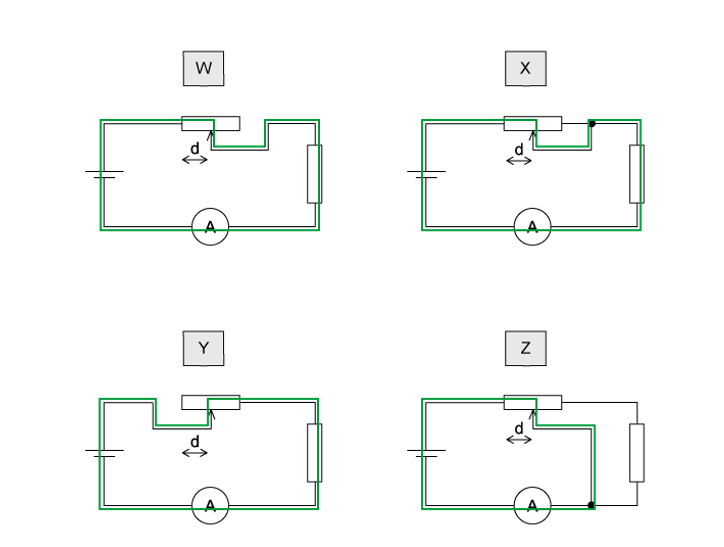

**B **&** C **are incorrect because in arrangement Y, the path other than the distance *d* on the wire of the potentiometer is connected to the circuit. So, this arrangement is different from those of W and X. Even if the circuit is complete, the results obtained on a graph would not be identical to that of W or X

**D **is incorrect because in arrangement Z, current flows from the positive terminal of the battery, then along a distance *d* on the potentiometer, but here, the current does not flow through the fixed resistor; hence it would not give the same graph as in Y

### Q21
**Final answer:** **The correct answer is ****A ****because:**

- The power supplied to the heater is $P=VI=\frac{V^{2}}{R}$
- From the potential divider equation:

  - $V_{h e a t e r} = V_{e. m. f} \times ( \frac{R_{1} }{R_{1} + R_{2} } )$
  - $V_{h e a t e r} = 20 \times ( \frac{6.5}{6.5 + 1.5} ) = 16.25 \mathrm{V}$
- So, $P = \frac{V^{2}}{R} = \frac{( 16.25 )^{2}}{6.5} = 40.625 \mathrm{W}$
- Therefore, the power supplied to the heater is 41 W

### Q22
**The correct answer is ****C**** because:**

- When P is connected to Q, the potential difference across the balance length is equal to the potential difference across the 100 Ω resistor

  - $\frac{l}{XY}\timesE_{1}=\frac{100}{100+R}\timesE_{2}\,$              **(1)**
- When P is connected to R, the potential difference across the balance length is equal to the potential difference across the 100 Ω resistor and the unknown resistor (which is the same as the e. m .f. as cell E)

  - $\frac{l'}{XY}\timesE_{1}=E_{2}$                                           **(2)**
- Substitute equation **(2)** into **(1)**

  - $\frac{l}{XY}\timesE_{1}=\frac{100}{100+R}\times\frac{l'}{XY}\timesE_{1}$
  - $\frac{30.0}{XY}\timesE_{1}=\frac{100}{100+R}\times\frac{48.3}{XY}\timesE_{1}$
- The E1 and XY terms cancel out, so we have:

  - $30.0=\frac{100}{100+R}\times48.3$
  - $100+R=\frac{100\times48.3}{30.0}=161$
  - $R=161-100=61Ω$
- Therefore, the resistance *R* of the unknown resistor is 61 Ω

### Q23
**Final answer:** **The correct answer is ****B**

- The potentiometer wire PQ:

  - Length =100.0 cm
  - Resistance = 5.0 Ω
  - Emf supplied by battery =  2.000 V through resistor *R*
- Current through the wire

$I=\frac{2.000}{R+5.0}$

- Potential gradient along the wire

$k=\frac{I\times5.0}{100.0}$

- Balance point at PS = 40.0 cm requires:

$V_{solar}=k\times40.0$

- Solar cell e.m.f.

$V_{solar}=5.0\mathrm{mV}$

- Voltage across whole potentiometer wire

$V_{wire}=I\times5.0=\frac{2.0\times5.0}{R+5.0}$

- Potential gradient

$k = \frac{ V_{w i r e} }{100.0} = \frac{ 10}{100 ( R + 5 )} = \frac{ 0.1}{R + 5}$

- Substitute 5.0 mV = 5.0 × 10-³ V

$5.0\times10^{-3}=\frac{0.1}{R+5}\times40$

$5.0\times10^{-3}=\frac{4.0}{R+5}$

- Solve

$R+5=\frac{4.0}{5.0\times10^{-3}}=800$

$R=795Ω$

> **[exam-tip]**
> This is not a standard potential-divider situation.
> 
> A potentiometer wire is not acting as a fixed resistor in series with R.
> 
> Instead:
> 
> - The potentiometer wire always carries a constant current from the supply.
> - The voltage along the wire varies linearly with distance.
> - The galvanometer reads zero when the p.d. per unit length × balancing length equals the emf of the solar cell.
> 
> The potential divider equation applies only when:
> 
> - both resistors are fixed
> - they are in series
> - the voltage is measured across one of the fixed resistors
> 
> A potentiometer wire is not a fixed resistor used as a divider. It is a uniform resistance wire supplying a linear potential scale.
> 
> This distinction is examined frequently in CIE papers.

### Q24
**Final answer:** **The correct answer is ****D ****because:**

- Ohm's law states $V=IR$ , so, as the resistance of a component increases the p. d. across it increases
- So, as the value of external resistance *R* is increased, the p. d. across it increases, while the p. d. across the internal resistance decreases
- The external resistance *R* and the internal resistance r form a potential divider
- Power dissipated in external resistor $=I^{2}R$

  - Initially, the value of *R* is zero, so the power dissipated across it is also zero
  - Similarly, if the value of *R* is infinite, the power dissipated is also zero as the current will then also be zero
- So, the power dissipated must increase and then decrease as *R* increases from zero

  - As the value of *R* increases, the current I decreases and hence the p. d. across the external resistor increases
  - The p. d. across the internal resistor *r* decreases and the power dissipated in *r* (given by $I^{2}R$ ) decreases
  - The maximum power dissipated across R occurs when *R* = *r*
- Overall, the only correct statement is that the power dissipated in R increases and then decreases

**A **&** B **are incorrect because the sum of p .d. in a circuit is equal to the e .m .f. in the circuit, so as the p .d. of one component rises, the other will fall

**C **is incorrect because as the value of *R* increases, the p d. across the external resistor increases, so the p. d. across the internal resistor decreases and the power dissipation across it also decreases

### Q25
**Final answer:** **The correct answer is ****A ****because:**

- The resistance of the LDR decreases as the light intensity increases
- Ohm's law states $V=IR$
- Since the resistance of the LDR decreases, the potential difference across it also decreases
- Therefore, as the LDR resistance decreases, the voltmeter reading decreases

### Q26
**Final answer:** **The correct answer is ****A ****because:**

- We can treat the three components as two sets of components in series (*R**1* and the parallel combination of *R**2* and the voltmeter)
- So, the total resistance in the circuit`= 100 + [ 1 / 100 + 1 / 100 ] ^ - 1 = 100 + 50 = 150 k capital omega`
- Ohm's law states $V=IR$

  - Therefore, the total current in circuit *I = *$\frac{6.0}{150}=40\mathrm{μA}$
- This current of 40 µA flows through resistor *R**1*, but it splits at the junction of *R**2* and the voltmeter, which are in parallel
- Since both have the same resistance, the current splits equally

  - So, the current in *R**2 *$=\frac{40}{2}=20\mathrm{μA}$

### Q27
**Final answer:** **The correct answer is ****B ****because:**

- The potential at the top of the circuit (+ terminal) is 9 V, and the potential at the bottom of the circuit (- terminal) is 0 V
- There will be a p. d. across each of the fixed resistors
- Potential divider equation for three resistors: $V_{o u t} = V \times ( \frac{R_{1} + R_{2} }{R_{1} + R_{2} + R_{3} } )$
- The output voltage is maximum at the maximum value of the variable resistor = 3.0 Ω

  - Maximum output voltage $= 9.0 \times ( \frac{2 + 3}{2 + 3 + 4} ) = 5.0 \mathrm{V}$
- The output voltage is minimum when the minimum value of the variable resistor is taken = 0 Ω

  - Minimum output voltage $= 9.0 \times ( \frac{2 + 0}{2 + 3 + 4} ) = 2.0 \mathrm{V}$

### Q28
**Final answer:** **The correct answer is ****B ****because:**

- The potential divider equation is given by

  - $V_{o u t} = V_{i n} \times ( \frac{R_{1} }{R_{1} + R_{2} } )$
  - Where *R**1* = 5 kΩ, *R**2* = 5 kΩ and *V**in *= 9.0 V
  - $V_{o u t} = 9 \times ( \frac{5}{5 + 5} ) = 4.5 \mathrm{V}$
- Therefore, the minimum output of the variable resistor is 0 V, and the maximum output is 4.5 V

### Q29
**Final answer:** **The correct answer is ****C**** because:**

- Section A is made up of a 1.5 kΩ fixed resistor and the thermistor
- Section B is made up of the variable resistor and another 1.5 kΩ fixed resistor

  - If the output is to be set at 6.0 V, then across the section A, the voltage drop needs to be 3.0 V
- From the graph, at 0730, the resistance of the thermistor = 1.5 kΩ
- From Ohm's Law: $V=IR$
- The current flowing through section A:

  - $I = \frac{V}{R} = \frac{3.0 V}{( 1500 + 1500 )} = 0.001 A$
- Similarly, the same current flows through section B:

  - $6.0 V = I R = ( 0.001 ) ( R_{v} + 1500 )$
  - $0.001 R_{V} = 6.0 - ( 1500 \times 0.001 ) = 4.5$
  - $R_{V}=\frac{4.5}{0.001}=4500Ω=4.5kΩ$
- Therefore, at 0730 the variable resistor should be set to 4.5 kΩ

## Structured Questions (9 questions)

### Q1
Kirchhoff's second law states:

- The sum of the electromotive force(s) is equal to the sum of the potential difference(s) around a (closed) loop **[1 mark]**

**[Total: 1 mark]**
To derive an expression for the total resistance $R_{T}$ of the combination:

- Use Kirchhoff's second law to write an expression for the total p.d. across the combination
- The total p.d. across the resistors = the sum of the p.d.s across each resistor

  - $V=V_{1}+V_{2}$ **[1 mark]**

- Use Ohm's law to determine an expression for the resistances

  - Ohm's law: $V=IR$

Since, the current is the same in a series combination of resistors

- $IR_{T}=IR_{1}+IR_{2}$ so $R_{T}=R_{1}+R_{2}$

**OR**

- $\frac{V}{I}=\frac{V_{1}}{I}+\frac{V_{2}}{I}$ so $R_{T}=R_{1}+R_{2}$ **[1 mark]**

**[Total: 2 marks]**
List the known quantities:

- e.m.f. of the battery, $E$ = 12.0 V
- p.d. across the fixed resistor, $V_{1}$ = 9.00 V
- Resistance of the fixed resistor, $R_{1}$ = 2.40 kΩ = 2400 Ω
- Resistance of the LDR, $R_{2}=R_{L}$

(i) To calculate the current in the circuit:

$I=\frac{V_{1}}{R_{1}}$

$I=\frac{9.00}{2400}$

$I=$ $3.75\times10^{-3}A$ **[1 mark]**

(ii) To calculate the resistance $R_{L}$ of the LDR:

- Recall the potential divider equation:

$V_{1} = ( \frac{R_{1} }{R_{1} + R_{2} } ) E$ **[1 mark]**

- Substitute the known quantities into the equation to calculate $R_{L}$

$\frac{9.0}{12.0}=\frac{2400}{2400+R_{L}}$

$R_{L}=\frac{2400\times12.0}{9.0}-2400$

$R_{L}=$ $800Ω$ **[1 mark]**

**[Total: 3 marks]**
As the light intensity decreases, the voltmeter reading:

- Decreases **[1 mark]**

Explanation:

- The resistance of the LDR / $R_{L}$ increases **[1 mark]**
- The current (in the circuit) decreases (so the p.d. across $R_{1}$ decreases) **[1 mark]**

**[Total: 3 marks]**

### Q2
Label the direction of currents on Fig. 1.1:

- Labels on Fig. 1.1 which would score full marks are shown below:

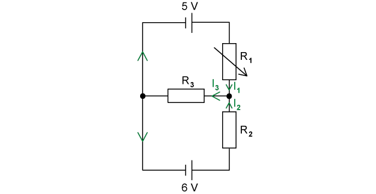

- Arrows indicating correct directions for currents <u>in both loops</u> shown; **[1 mark]**
- Three distinct currents labelled at the junction between $R_{1}$ and $R_{2}$ as shown (any subscript is acceptable as long as distinct); **[1 mark]**

Write down the relationship between the currents at the junction between $R_{1}$  and $R_{2}$  :

- Using Kirchhoff’s first law, the sum of currents into a junction must equal the sum of currents out of the junction
- Therefore, $I_{1}$  + $I_{2}$  = $I_{3}$  (or any equation consistent with correct labelling on Fig. 1.1); **[1 mark]**

**[Total: 3 marks]**

> *When you see 'junction', this should be a hint to apply Kirchhoff's first law. No calculation is needed at this stage, the question only asks for an expression and a labelled diagram.*
List the known quantities:

- $R_{1}$= 0 Ω
- $R_{2}$= 10 Ω
- $R_{3}$= 30 Ω

Apply Kirchhoff's second law to the top loop:

- Kirchhoff's second law states that, in a closed loop, the total e.m.f. is equal to the sum of potential differences

  - In the top loop, e.m.f. is 5 V so $ε=5=V_{1}+V_{3}$
- $V_{1}$ must be 0 V, as resistor 1 has no resistance so there is no change in potential across it

  - Therefore $V_{3}=5V$ **[1 mark]**

Apply Kirchhoff's second law to the bottom loop:

- In the bottom loop, e.m.f. is 6 V so $ε=6=V_{2}+V_{3}$

  - $V_{3}$ is 5 V so $6=V_{2}+5$
  - $V_{2}=1V$ **[1 mark]**

Calculate the current through resistor $R_{2}$:

- Using Ohm’s law across $R_{2}$  : $V_{2}$ = $I_{2}R_{2}$
- Therefore, 1 = $I_{2}$ × 10
- $I_{2}$= $\frac{1}{10}$  = 0.10 A **[1 mark]**

**[Total: 3 marks]**

> *Equally, you could have applied the second law to the bottom loop then the top loop, or a loop around the whole circuit. All should produce the same potential differences across each resistor. *
State what happens to the potential difference across $R_{2}$ :

- The potential difference across $R_{2}$  <u>increases</u> (as the potential difference across $R_{1}$  increases); **[1 mark]**

To explain, describe how the potential difference across $R_{1}$  changes:

- As the resistance of  $R_{1}$ increases, the potential difference ($V_{1}$) across it increases; **[1 mark]**

Describe how the potential difference across $R_{1}$  affects the potential difference across $R_{3}$ :

- (Because of Kirchhoff’s second law) the potential difference across $R_{3}$= 5 V – potential difference across $R_{1}$ **AND**
- Therefore, as the potential difference across $R_{1}$ increases, the potential difference across $R_{3}$ <u>decreases</u>; **[1 mark]**

Describe how the potential difference across $R_{3}$ affects the potential difference across $R_{2}$ :

- (Because of Kirchhoff’s second law) the potential difference across $R_{2}$ = 6 V – potential difference across $R_{3}$ **AND**
- Therefore as the potential difference across $R_{3}$ decreases, the potential difference across $R_{2}$ increases<u>;</u>** [1 mark]**

**[Total: 4 marks]**

> *This is a potential divider question in an unfamiliar context when you just consider the top loop. As **R**1** ** increases in resistance, the potential difference across it increases. There is only a total e.m.f. of 5 V in this top loop, so less is available to be 'spent' on **R**3**. *

> *Then, this becomes a potential divider question for the lower loop. If **R**3**  has a greater potential difference, there is less available for **R**2**  following the conservation of energy.*

> *The thought process for this question is simple, however this mark scheme is large because you needs to **explain** every step:*

- *If p.d. across **R**1** increases then p.d. across **R**3** decreases*
- *This is because the potential difference in the loop remains constant from **V = IR *
- *So, p.d. across **R**2** will also increase by the same logic*
List the known quantities:

- $R_{1}$= 10 Ω
- $R_{2}$= 10 Ω
- $R_{3}$= 30 Ω
- EMF1, $ε_{1}$ = 5 V
- EMF2, $ε_{2}$ = 6 V

Apply Kirchhoff’s second law to the loop containing EMF1:

- Kirchhoff’s second law says the total EMF in a closed circuit (loop) equals the sum of potential differences across each component
- Therefore, *ϵ*1 = *V*1 + *V*3 (where *V*1 and *V*3 are the voltages across *R*1 and *R*3 respectively)
- Using Ohm’s Law, *ϵ*1 = *I*1*R*1 + *I*3*R*3
- Therefore 5 = 10*I*1 + 30*I*3 (equation 1) **[1 mark]**

Apply Kirchhoff’s second law to the loop containing EMF2:

- *ϵ*2 = *V*2 + *V*3 (where *V*2 and *V*3 are the voltages across *R*2 and *R*3 respectively)
- Again, using Ohm’s Law, *ϵ*2 = *I*2*R*2 + *I*3*R*3
- Therefore 6 = 10*I*2 + 30*I*3 (equation 2) **[1 mark]**

Substitute the expression from part (a) into equation 1 and equation 2:

- Since there are three unknowns, there needs to be three independent equations to solve simultaneously
- Therefore, from part (a), *I*1 + *I*2 = *I*3 can be substituted for *I*3 in equation 2 and equation 1
- Equation 2 becomes: 6 = 10*I*2 + 30(*I*1 + *I*2) = 10*I*2 + 30*I*1 + 30*I*2
- Simplifying, 6 = 40*I*2 + 30*I*1 (equation 3) **AND**
- Equation 1 becomes: 5 = 10*I*1 + 30(*I*1 + *I*2) = 10*I*1 + 30*I*1 + 30*I*2

- Simplifying, 5 = 30*I*2 + 40*I*1 (equation 4) **[1 mark]**

Solve equation 3 and equation 4 simultaneously:

- (Equation 3) × 3 gives: 18 = 120*I*2 + 90*I*1 (equation 5)
- (Equation 4) × 4 gives: 20 = 120*I*2 + 160*I*1 (equation 6)
- (Equation 6) – (Equation 5) gives: (20 –18) = (120*I*2 – 120*I*2) + (160*I*1 – 90*I*1)
- Therefore 2 = 70*I*1
- *I*1= $\frac{2}{70}$ = 0.029 A (2 s.f.) **[1 mark]**

Substitute the value for *I*1 into any equation to calculate *I*2:

- Any equation can be used to calculate *I*2 using the value for *I*1
- Substituting *I*1 = 0.029 into equation 4 gives: 5 = 30*I*2 + 40(0.029)
- 5 = 30*I*2 + 1.16
- *I*2 = $\frac{5-1.16}{30}$ = 0.13 A (2 s.f.) **[1 mark]**

Calculate *I*3 using values for *I*1 and *I*2:

- Using the equation from part (a): *I*1 + *I*2 = *I*3
- Therefore, $I_{3}$ = 0.13 + 0.029 = 0.16 A (2 s.f.) **[1 mark]**

**[Total: 6 marks]**

> *This question is certainly very challenging; while circuits on the A Level paper are unlikely to require this level of analysis, there is nothing here outside the scope of your physics syllabus – notice, it only requires a very careful application of Kirchhoff’s laws and Ohm’s law. The image below shows how to apply Kirchhoff’s second law to closed loops in a circuit:*

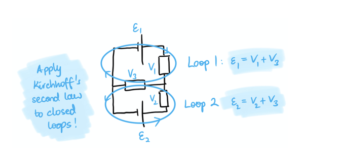

> *Notice that the loops ‘go in the direction’ of conventional current in the loop, and also that EMFs (power supplies) are distinct to the potential differences across components (sometimes called voltage drops, because energy from the current is transferred away from it to the component itself).*

> *Another key takeaway from this question, which is a very useful problem-solving tool to bear in mind generally, is that there are three unknowns – i.e., the currents **I**1**, **I**2** and **I**3**. The number of unknown variables in any system tells you how many ‘independent’ (unique) equations you need to set up, in which every unknown appears at least once. So, in this question, we needed to set up **three** independent equations; after we did this, it was just a case of some mathematical juggling to solve for each unknown. The image below recaps the three unknowns and the three independent equations we set up:*

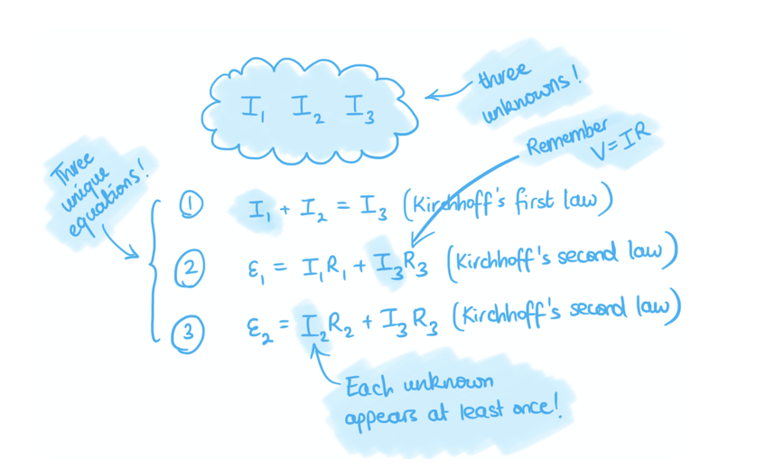

> *There are of course multiple equivalent ways to solve simultaneous equations (depending on which variable you choose to eliminate first, and which equation to substitute into, etc.) but you should in principle be comfortable with solving simultaneous equations (two for two unknowns and three for three unknowns!). Have a look at the Save My Exam GCSE and / or A-level maths notes to refresh your knowledge on these if you are stuck!*

### Q3
The circuit symbols for:

(i) the potentiometer is:

- Correct circuit symbol as shown above; **[1 mark]**

(ii) the galvanometer is:

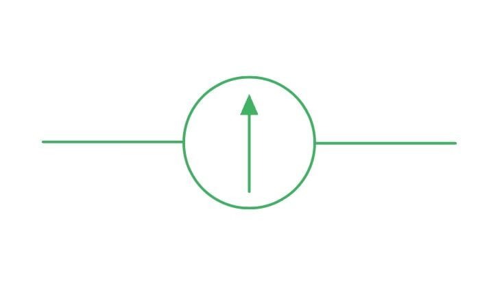

- Correct circuit symbol as shown above; **[1 mark]**

**[Total: 2 marks]**
The voltage output at:

(i) A is:

- 0 V **[1 mark]**

(ii) B is:

- 14 V **[1 mark]**

(iii) C is:

- 28 V **[1 mark]**

**[Total: 3 marks]**
A graph of the voltmeter reading *V* and length *l* of the jockey as it is moved from A to C is

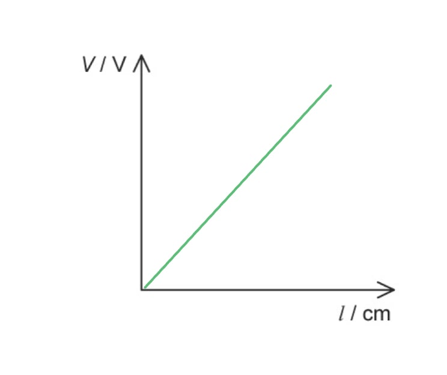

- Straight line with a positive gradient;** [1 mark]**
- Through the origin;** [1 mark]**

**[Total: 2 marks]**
(i) The student will not be able to find a point where the current in zero because:

- The test cell is the wrong way around / the test cell needs to be reversed;** [1 mark]** **  **

(ii) The e.m.f of the test cell is:

List the known quantities:

- Length AB at first balance point, *l*1 = 25.6 cm
- E.m.f of standard cell, *E*2 = 1.545 V
- Length AB at second balance point, *l*2 = 37.2 cm

Determine the equation linking the length and e.m.fs:

- $\frac{l_{1}}{l_{2}}=\frac{E.m.foftestcell}{E_{2}}$ **[1 mark]**
- $E.m.foftestcell=E_{2}\times\frac{l_{1}}{l_{2}}$

Substitute in the values:

- $E.m.foftestcell=1.545\times\frac{25.6}{37.2}$ **[1 mark]**
- $E.m.foftestcell=1.06V$ **[1 mark]**

**[Total: 4 marks]**

### Q4
Show that the e.m.f of the battery is 30 V

List the known quantities:

- Potential difference across R2, *V*out = 18 V
- Resistance of R1, *R*1 = 8.0 kΩ
- Resistance of R2, *R*2 = 12.0 kΩ

State the potential divider equation:

- `V_{o u t} = V_{i n} \times \left(\frac{R_{2}}{R_{1} + R_{2}}\right)` **[1 mark]**

Rearrange for the e.m.f of the battery, *V*in and substitute in the values:

- `V_{i n} = \frac{ V_{o u t}}{\left(\frac{R_{2}}{R_{1} + R_{2}}\right)} = \frac{18 . 0 }{\left(\frac{12 . 0}{8 . 0 + 12 . 0}\right)}` = 30 V **[1 mark]**

**[Total: 2 marks]**

> *You do not need to convert from kΩ into Ω, since the fraction *$\frac{R_{2}}{R_{1}+R_{2}}$* will have no units (they cancel out) as long as they're all in kΩ.*
Calculate the resistance of the LDR.

List the known quantities:

- Resistance of R1, *R*1 = 8.0 kΩ
- Resistance of R2, *R*2 = 12.0 kΩ
- Current in the battery, *I* = 1.94 mA = 1.94 × 10–3 A
- E.m.f of the battery, *V* = 30 V (from part a)

Calculate the total resistance in the circuit, RT:

- $R_{T}=\frac{V}{I}=\frac{30}{1.94\times10^{-3}}=15.46\mathrm{kΩ}$ **[1 mark]**

Calculate the resistance of the LDR, *R*LDR:

- $15.46=R_{\mathrm{parallel}}+8.0\RightarrowR_{parallel}=15.46-8.0=7.46\mathrm{kΩ}$
- $\frac{1}{R_{parallel}}=\frac{1}{R_{2}}+\frac{1}{R_{LDR}}\Rightarrow\frac{1}{7.46}=\frac{1}{12.0}+\frac{1}{R_{LDR}}$
- $R_{\mathrm{LDR}}=\frac{1}{\frac{1}{7.46}-\frac{1}{12.0}}$ **[1 mark]**
- $R_{\mathrm{LDR}}=19.7=20\mathrm{kΩ}$ **[1 mark]**

**[Total: 3 marks]**

> *You should be confident in combining resistors in parallel and in series. It is better to set out the values algebraically before substituting in values.*
State and explain the effect, if any, of the increase in light intensity on the power produced by the battery

- The LDR resistance decreases; **[1 mark]**
- (So the total resistance decreases) so the current increases (in the battery); **[1 mark]**
- Therefore, (since *P* = *IV* and *V* is constant) so the power increases; **[1 mark]**

**[Total: 3 marks]**
If the light intensity on the LDR decreases:

- The resistance of the LDR increases; **[1 mark]**
- The combined resistance of the 12.0 kΩ / R2 and the LDR increases; **[1 mark]**
- Therefore, the potential difference across R1 decreases / R1 receives a smaller share of the potential difference; **[1 mark]**

**[Total: 3 marks]**

> *The key to understanding potential divider questions is - if the resistance increases then so does the share of the potential difference (of the power supply) to that component. *

### Q5
Show that the resistance of R2 is 16 Ω

List the known quantities:

- Resistance, *R*1 = 6.5 Ω
- Voltage across R1, *V*out = 7.0 V
- E.m.f of the power supply, *V*in = 24.0 V

State the correct potential divider equation:

- $V_{o u t} = V_{i n } \times ( \frac{R_{1} }{R_{1} + R_{2} } )$

Rearrange the potential divider equation for R2:

- $R_{2 = ( \frac{R_{1} \times V_{i} n} }{V_{o u t} } ) - R_{1}$

Substitute the values into the R2 equation:

- $R_{2} = ( \frac{6.5 \times 24.0}{7.0} ) - 6.5$ **[1 mark]**
- $R_{2}=15.786=16Ω$ **[1 mark]**

**[Total: 2 marks]**

> *You must be confident with rearranging the potential divider equation. If you are struggling with this one, have a look at the sketch below:*

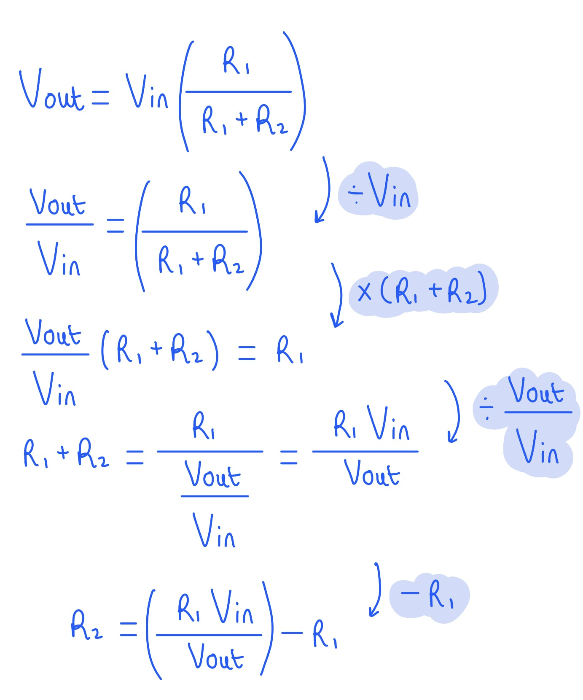
The current in lamp B is:

List the known quantities:

- Current in the battery, *I* = 4.12 A
- E.m.f of the battery = 24.0 V

Determine the potential difference through lamp B:

- Since the slider is exactly in the middle, both lamps have a potential difference of $\frac{24.0}{2}=12V$

Determine the current through lamp B at 12 V from the graph:

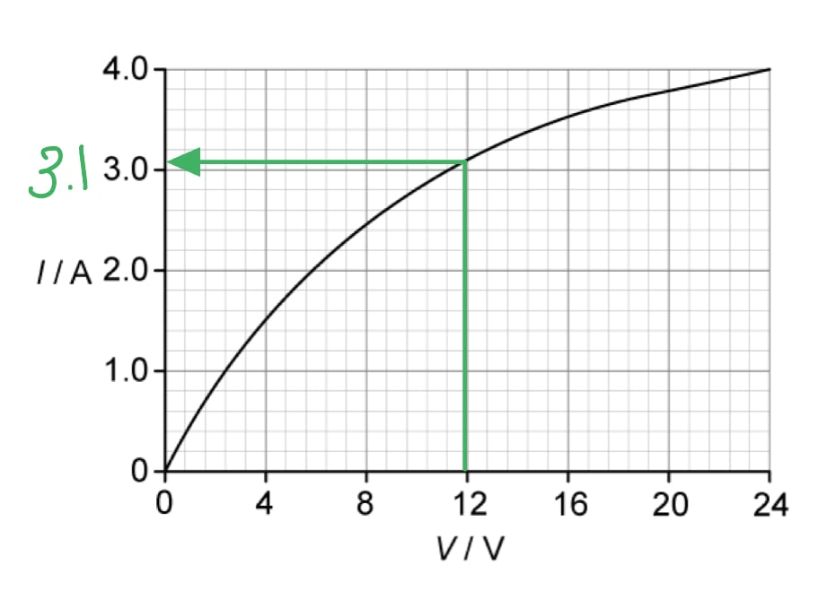

- 3.10 A **[1 mark]**

**[Total: 1 mark]**
Calculate the total resistance in the circuit

List the known quantities:

- Current through lamp B, *I*B = 3.10 A
- Current in the battery, *I* = 4.12 A
- E.m.f of the battery, *V* = 24.0 V

Calculate the resistance of the potentiometer between its ends X and Y, *R*XY*:*

- Current through XY, *I*XY = *I – I*B = 4.12 – 3.10 = 1.02 A
- $R_{\mathrm{XY}}=\frac{V}{I_{\mathrm{XY}}}=\frac{24.0}{1.02}=23.529Ω$ **[1 mark]**

Calculate the resistance of each lamp, *R*L:

- $R_{L}=\frac{V}{I}=\frac{12}{3.10}=3.87Ω$ **[1 mark]**

Calculate the combined resistance, *R*T:

- `R _ s e r i e s end _ = R _ L ( l a m p A ) + R _ L ( l a m p B ) = 3.87 + 3.87 = 7.74 capital omega`
- $\frac{1}{R_{T}}=\frac{1}{R_{series}}+\frac{1}{R_{XY}}=\frac{1}{7.74}+\frac{1}{23.529}$
- $\frac{1}{R_{T}}=0.1712$
- $R_{T}=5.824=5.82Ω$ **[1 mark]**

**[Total: 3 marks]**

> *Read carefully which current the question is referring to. Since the potentiometer is connected in **parallel** with the lamps, the current from the **battery** will **split** between them (Kirchhoff's first law). Lamp A and B will have the same current through them.*
State and explain the effect on the current of lamps A and B when the slider of the potentiometer is moved to end X

For lamp A:

- The p.d. across lamp A decreases to zero **AND** so the current is 0 **[1 mark]**

For lamp B:

- p.d. across lamp B increases to 24.0 V **AND **so the current is 4.0 A **[1 mark]**

**[Total: 2 marks]**

> *It is important you understand how the sliding contact works for a potentiometer. When it is at point X, **all** the p.d. from the power supply is available only to lamp B, so there is 0 for lamp A. *

> *Where you **can** give values for a 'state and explain' question, make sure you do! In this case, just saying 'the p.d. across lamp B increases and so a current flows' will **not** be enough detail to obtain the marks, as you can state specific values.*

> *The 4.0 A is read from the I-V graph when lamp B has a voltage of 24 V.*

### Q6
(i) Calculate the minimum possible current:

- $V=IR\RightarrowI=\frac{V}{R}$
- $I\propto\frac{1}{R}$ so minimum current occurs with maximum resistance
- In series:  *R*max = 8 + 12 = 20 Ω **[1 mark]**

Calculate the minimum current:

- $I_{min}=\frac{16}{20}$
- $I_{min}=0.8A$ **[1 mark]**

(ii) Calculate the maximum possible current:

- Maximum current occurs with minimum resistance, *R*min = 8 Ω
- $I_{max}=\frac{16}{8}$ **[1 mark]**
- $I_{max}=2.0A$ **[1 mark]**

**[Total: 4 marks]**
The variation with *R* of current *I *in the circuit should look like:

List the known quantities:

- Maximum current = 2.0 A (from part a)
- Minimum current = 0.8 A (from part a)

- Starting point at (0, 2.0) and end point at (12, 0.8); **[1 mark]**
- Curve with decreasing gradient; **[1 mark]**

**[Total: 2 marks]**
Galvanometers are used in null methods by:

- The galvanometer has no deflection;** [1 mark]**
- When there is no current flow / no potential difference; **[1 mark]**

**[Total: 2 marks]**

### Q7
Use Fig 1.2 to state and explain the variation of the p.d. across resistor P as *R* is **decreased**

**EITHER**

- (As *R* decreases,) the current *I *increases; **[1 mark]**
- So the p.d. (across P) increases; **[1 mark]**

**OR**

- The parallel resistance of (of Q and *R*) decreases; **[1 mark]**
- The p.d. across the parallel resistors decreases, so p.d. across P increases; **[1 mark]**

**[Total: 2 marks]**
For *R* = 7.0 Ω, calculate the p.d. between points Y and Z

List the known quantities:

- Resistance of variable resistor, *R* = 7.0 Ω
- Resistance of resistor P, *R*P = 7.5 Ω
- E.m.f of the power supply, *V* = 32 V

Use the graph to determine the current *I* when *R* = 7.0 Ω:

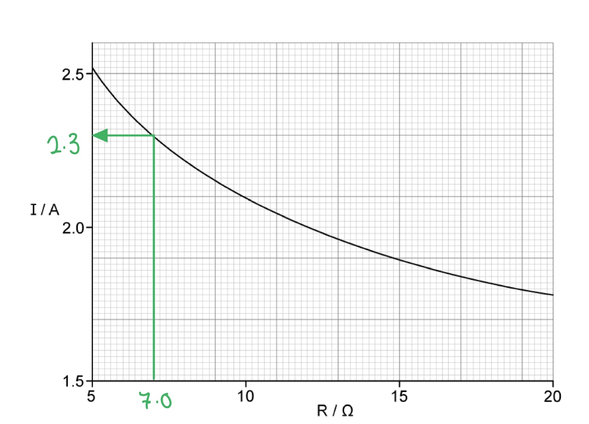

- *I* = 2.3 A **[1 mark]**

**Method 1: Calculating p.d from current *****I***

Calculate the p.d. across YZ:

- P.d across YZ = p.d across XZ – p.d. across XY
- P.d across YZ = 32 – (2.3 × 7.5) = 14.75 = 15 V **[1 mark]**

**Method 2: Calculate p.d. from resistance**

Determine the total resistance in the circuit, *R*T:

- $R_{T}=\frac{V}{I}=\frac{32}{2.3}=13.91Ω$

Calculate the p.d. across YZ:

- Resistance in Q-R parallel combination, *R*QR = 13.91 – 7.5 = 6.41 Ω
- P.d across YZ = *I *×* R*QR* = *2.3 × 6.41 = 14.74 = 15 V **[1 mark]**

**[Total: 2 marks]**
Show that the resistance of Q is 95 Ω

List the known quantities:

- Resistance of variable resistor, *R* = 7.0 Ω
- P.d. across YZ = 15 V (from part b)
- Current, *I* = 2.3 A (from part b)

Calculate the total resistance of Q and R parallel combination, *R*T :

- $R_{T}=\frac{V}{I}=\frac{15}{2.3}=6.52Ω$ **[1 mark]**

Calculate the resistance of resistor Q, *R*Q :

- $\frac{1}{R_{T}} = \frac{1}{R_{Q}} + \frac{1}{R}$ **[1 mark]**
- $R_{Q}=\frac{1}{\frac{1}{R_{T}}-\frac{1}{R}}=\frac{1}{\frac{1}{6.52}-\frac{1}{7.0}}=95Ω$ **[1 mark]**

**[Total: 3 marks]**

> *This question can also be done by calculating the current through Q, and then using *$R = \frac{V}{I}$* to calculate the resistance through resistor Q.*
State and explain qualitatively how the power provided by the battery changes as the resistance *R* is decreased

- The power increases **AND **
- Because the e.m.f is constant / power = *V *×* *current and the current (*I*) increases **OR **power = $\frac{V^{2}}{resistance}$ and the resistance decreases;** [1 mark]**

**[Total: 1 mark]**

### Q8
As the temperature increases:

- The resistance of the thermistor decreases; **[1 mark]**
- So *V*out increases;** [1 mark]**

**[Total: 2 marks]**

> *Potential dividers are all about the **sharing** of the potential from the battery (hence the name). When the resistance of the thermistor decreases, this means the voltage through it also decreases (from **V** = **IR** where **I** is the same for both resistors). *

> *However, the battery has a set voltage. Therefore, the voltage of the fixed resistor must **increase** so the combined voltage of the thermistor and fixed resistor remains the same. **V**out** is the reading of the voltage from the fixed resistor.*
The resistance of the LDR when the light intensity is 120 lux is:

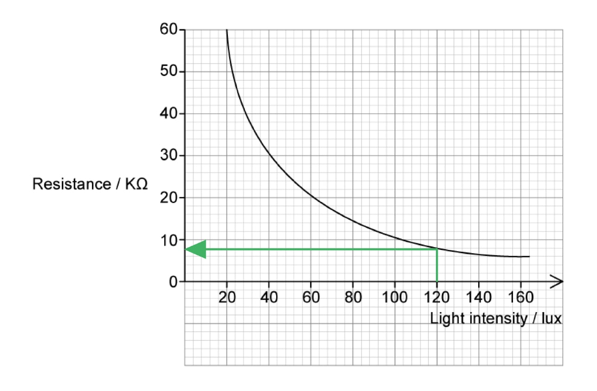

- 8 kΩ **[1 mark]**

**[Total: 1 mark]**
*V*out when the light intensity is 120 lux is:

List the known quantities:

- Resistance of the LDR, *R*1 = 8.0 kΩ (from part b)
- Resistance of the fixed resistor, *R*2* *= 6.0 kΩ
- Voltage of the power supply, *V*in = 32 V

Determine the equation for *V*out:

- $V_{out}=\frac{R_{1}}{R_{1}+R_{2}}\timesV_{in}$ **[1 mark]**

Substitute in the values:

- $V_{out}=\frac{8.0}{8.0+6.0}\times32$ **[1 mark]**
- $V_{out}=18.2857=18V$ **[1 mark]**

**[Total: 3 marks]**
The voltage across the 6.0 kΩ resistor is:

List the known quantities:

- Voltage across the LDR, *V*out = 18 V
- Voltage of the power supply, *V*in = 32 V

Calculate the voltage across the 6.0 kΩ resistor:

- $V_{6.0\mathrm{kΩ}}=V_{in}-V_{out}=32-18$* ***[1 mark]**
- $V_{6.0\mathrm{kΩ}}=14V$** ****[1 mark]**

**[Total: 2 marks]**

### Q9
- A graph which would score 2 marks should look like:

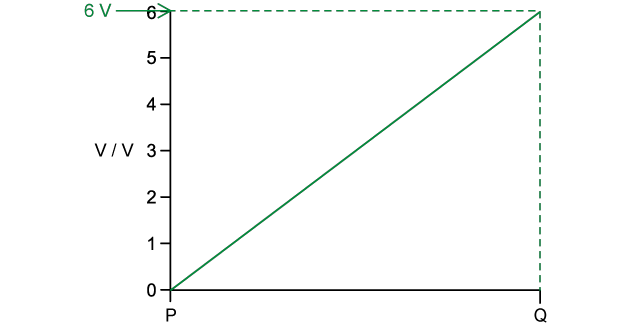

- Straight line with a positive gradient; **[1 mark]**
- At P, *V* = 0 V **AND** at Q, *V* = 6 V **[1 mark]**

**[Total: 2 marks]**

> *This circuit is a potential divider, because there are two resistors in series sharing the same EMF. As the slider moves, the potential is ‘divided’ between them. *

> *By inspection, the resistances are in the ratio 1:2, so the potential is also split in the ratio 1:2 (with the bigger share of voltage across the larger resistance). Hence, the 9 V EMF is divided as 3 V and 6 V. This can be seen more explicitly using the potential divider equation, shown below:*

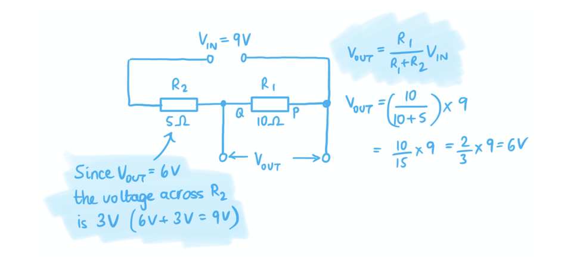

> *Note that if the sliding contact C in Fig. 1.1 is at position P, then there is no potential difference across the variable pd (the voltage supplied is 0 V). The output pd (in parallel with the resistor) increases as more of the resistor is included between one end (position P) and the sliding C. This is illustrated below:*

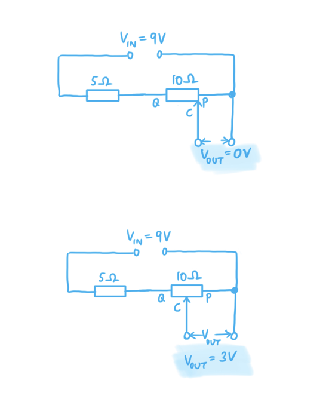

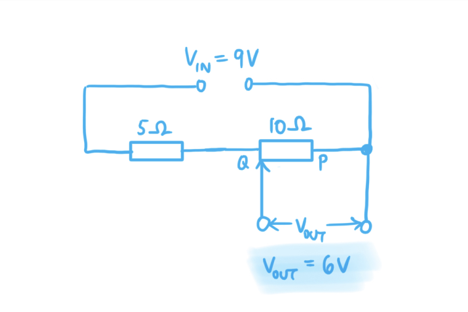

> *Therefore, the potentiometer can provide a variable potential difference output between 0 V and 6 V.*
List the known quantities:

- $V_{IN}$ = 12 V
- Resistor $R_{1}$ = 4 Ω
- Resistor $R_{2}$ = 2 Ω
- Resistor $R_{3}$ = 3 Ω
- Resistor $R_{4}$ = 1 Ω

**Method 1 (clockwise current)**

Determine the potential difference across $R_{1}$ :

- The potential divider equation for resistor $R_{1}$ (which is in a series loop with resistor $R_{2}$ ) is  $V_{OUT}$ =$\frac{R_{1}}{R_{1}+R_{2}}V_{IN}$
- Therefore  p.d. across *R**1**  *is $V_{1}$ = $\frac{4}{4+2}$ × 12 = $\frac{4}{6}$ × 12 = 8 V **[1 mark]**

Determine the potential difference across $R_{3}$ :

- The potential divider equation for resistor $R_{3}$ (which is in a series loop with resistor $R_{4}$) is  $V_{OUT}$ = $\frac{R_{3}}{R_{3}+R_{4}}V_{IN}$
- Therefore p.d. across *R**3*  is $V_{3}$ = $\frac{3}{3+1}$ × 12 = $\frac{3}{4}$ × 12 = 9 V **[1 mark]**

Determine the potential at X and Y:

- Charge transfers 8 V across resistors $R_{1}$
- The potential at X is therefore 12 V – 8 V = 4 V **AND**
- Similarly, charge transfers 9 V of potential across resistor $R_{3}$
- The potential at Y is therefore 12 V – 9 V = 3 V **[1 mark]**

Show the potential difference between X and Y is 1 V:

- The potential difference between X and Y is therefore *V**OUT * = 4 V – 3 V = 1 V **[1 mark]**** **

**Method 2 (anticlockwise current)**

Determine the potential difference across $R_{2}$ :

- The potential divider equation for resistor $R_{2}$ (which is in a series loop with resistor $R_{1}$ ) is  $V_{OUT}$ =$\frac{R_{2}}{R_{2}+R_{1}}V_{IN}$
- Therefore p.d. across *R**2* is $V_{2}$ = $\frac{2}{2+4}$ × 12 = $\frac{2}{6}$ × 12 = 4 V **[1 mark]**

Determine the potential difference across $R_{4}$ :

- The potential divider equation for resistor $R_{4}$ (which is in a series loop with resistor $R_{3}$ ) is  $V_{OUT}$ =$\frac{R_{4}}{R_{4}+R_{3}}V_{IN}$
- Therefore p.d. across *R**4*  is $V_{4}$ = $\frac{1}{1+3}$ × 12 = $\frac{1}{4}$ × 12 = 3 V **[1 mark]**

Determine the potential at X and Y:

- Charge transfers 4 V across resistor $R_{2}$
- The potential at X is therefore 12 V – 4 V = 8 V **AND**
- Charge transfers 3 V across resistor $R_{4}$
- The potential at X is therefore 12 V – 3 V = 9 V **[1 mark]**

Show the potential difference between X and Y is 1 V:

- The potential difference between X and Y is therefore *V**OUT*  = 9 V – 8 V = 1 V **[1 mark]**

**[Total: 4 marks]**

> *Method 1** assumes that the current flows in a clockwise direction through the circuit: in other words, that the terminals of the power supply are oriented as shown in the sketch below. You should work your way through the four steps, to convince yourself that the potential at point X is 4V **if the current flows clockwise** through the circuit.*

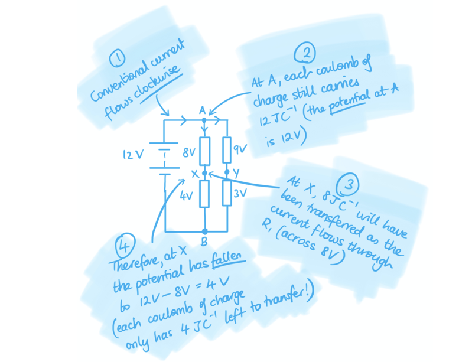

> *Following this reasoning, you should be able to check and see that the potential at Y is 12 V – 9 V = 3 V, so the potential **difference **between X and Y is 1 V. *

> *Method 2** assumes the current flows in an anti-clockwise direction through the circuit; in that case, simply reverse the direction of the current in the illustration above and you should see that the potential at X is 12 V – 4 V = 8 V. Similarly, the potential at Y is 12 V – 3 V = 9 V, giving a potential difference between X and Y as 1 V again. *

> *Clearly, either assumption is valid and will give the correct **potential difference **between **X** and **Y**. This question introduces you to a fact you will explore more in A Level physics: ‘potential’ as a quantity is relative (i.e., it depends on how you define directions), but potential **difference** is always absolute – so long as your working is consistent!*
List the known quantities:

- Resistance of the thermistor (at room temperature), *R* = 5 kΩ = 5000 Ω
- Resistance between AC = 20 kΩ = 20 000 Ω
- Resistance between CE = 20 kΩ = 20 000 Ω
- Resistance between BD = 10 kΩ = 10 000 Ω
- EMF of the battery = 12 V

Determine the series resistances:

- Resistors in series $R_{T} = R_{1} + R_{2} + R_{3} + \times \times \times$
- There are two resistors in series between** **A and E, so $R_{T}=R_{1}+R_{2}$
- Therefore, the total resistance between** **A and E = resistance between AC + resistance between CE = 20 000 + 20 000 = 40 000 Ω **AND**
- There are two resistors in series between B and F, so $R_{T}=R_{1}+R_{2}$
- Therefore, the total resistance between B and F = resistance between BD + resistance of the thermistor (at room temperature) = 10 000 + 5000 = 15 000 Ω **[1 mark]**

Determine the total resistance of the circuit:

- Resistors in parallel `1 over R subscript T equals 1 over R subscript 1 plus 1 over R subscript 2 plus 1 over R subscript 3 plus times times times`
- The resistance between** **A and E is in parallel to the resistance between B and F
- Therefore $\frac{1}{R_{T}}=\frac{1}{R_{1}}+\frac{1}{R_{2}}=\frac{1}{40000}+\frac{1}{15000}=\frac{11}{120000}$
- Therefore *R*T = $\frac{120000}{11}$ = 10 909 Ω **[1 mark]**

Determine the current through the battery:

- Using Ohm’s law across the battery, *V* = *IR*
- *V* is the EMF *ϵ *of the cell
- Therefore 12 = *I* × 10 909
- *I* = $\frac{12}{10909}$ = 1.1 × 10–3 A **[1 mark]**

**[Total: 3 marks]**
