# Exam Questions — Potential Dividers
**10. D.C. Circuits** · Cambridge (CIE) A-LEVEL physics (9702)
> Source: [https://www.savemyexams.com/a-level/physics/cie/25/topic-questions/](https://www.savemyexams.com/a-level/physics/cie/25/topic-questions/) · 29 questions across 1 sets

## Multiple Choice Questions (29 questions)

### Q1 — hard — 1 marks

**Q1** [1 mark]

A potential divider has a constant supply of 6.0 V, as shown in the diagrams.

Which circuit will provide a potential difference between X and Y that can be varied between zero and 3.0 V ?

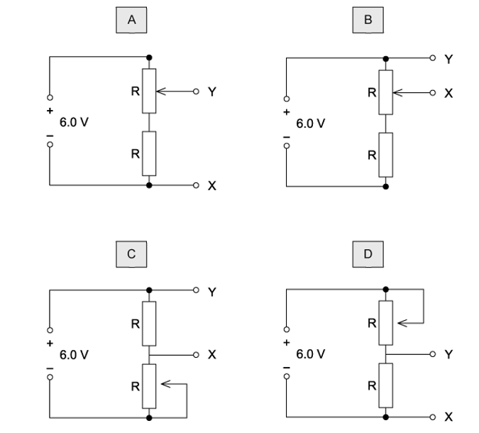

### Q2 — easy — 1 marks

**Q2** [1 mark]

Which diagram shows a potential divider circuit that can vary the voltage across the lamp ?

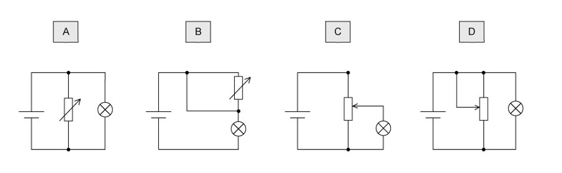

### Q3 — easy — 1 marks

**Q3** [1 mark]

The diagram shows a potentiometer circuit.

The contact T is placed on the wire and moved along the wire until the galvanometer reading is zero. The length XT is then noted.

In order to calculate the potential difference per unit length of the wire XY, which value must also be known?

### Q4 — easy — 1 marks

**Q4** [1 mark]

The circuit is designed to trigger an alarm system when the input voltage exceeds some preset value. It does this by comparing *V *out with a fixed reference voltage, which is set at 4.8 V .

*V *out is equal to 4.8 V.

What is the input voltage *V*in?

### Q5 — medium — 1 marks

**Q5** [1 mark]

A potentiometer is used as shown to compare the e. m. f. s of two cells.

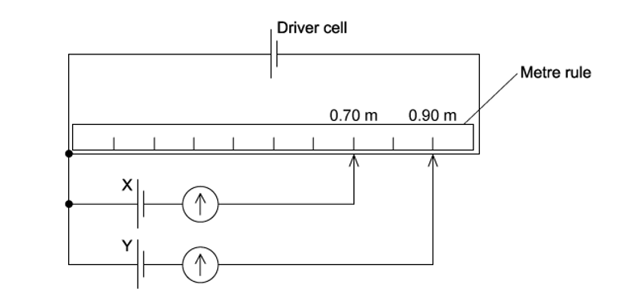

The balance points for cells X and Y are 0.70 m and 0.90 m respectively.

If the e. m .f. of cell X is 1.1 V, what is the e .m. f. of cell Y ?

### Q6 — medium — 1 marks

**Q6** [1 mark]

The diagram shows a potential divider circuit which, by adjustment of the contact X, can be used to provide a variable potential difference between the terminals P and Q.

What are the limits of this potential difference?

### Q7 — medium — 1 marks

**Q7** [1 mark]

In the circuit below, P is a potentiometer of total resistance 10 Ω and Q is a fixed resistor of resistance 10 Ω. The battery has an e .m f. of 4.0 V and negligible internal resistance. The voltmeter has a very high resistance .

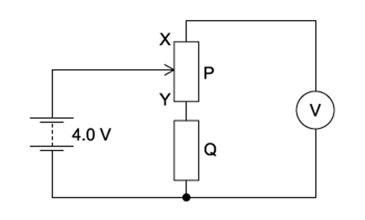

The slider on the potentiometer is moved from X to Y, and a graph of voltmeter reading *V* is plotted against slider position.

Which graph would be obtained ?

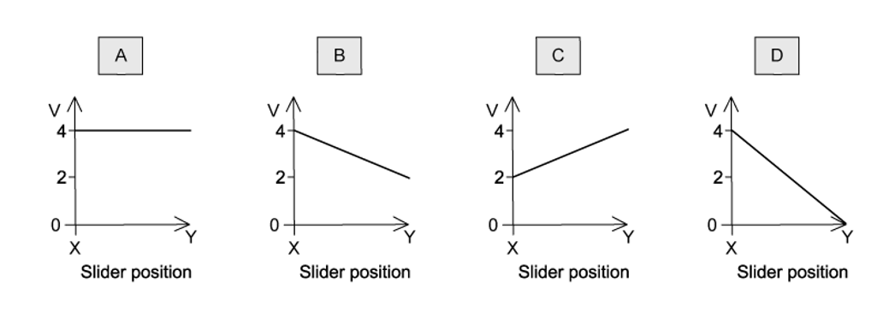

### Q8 — medium — 1 marks

**Q8** [1 mark]

A 12 V battery is in series with an ammeter, a 2 W fixed resistor and a 0 – 10 W variable resistor. High-resistance voltmeters P and Q are connected across the variable resistor and the fixed resistor, respectively, as shown.

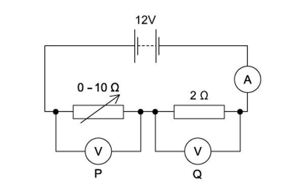

The resistance of the variable resistor is changed from its maximum value to zero.

Which graph shows the variation with current of the voltmeter readings?

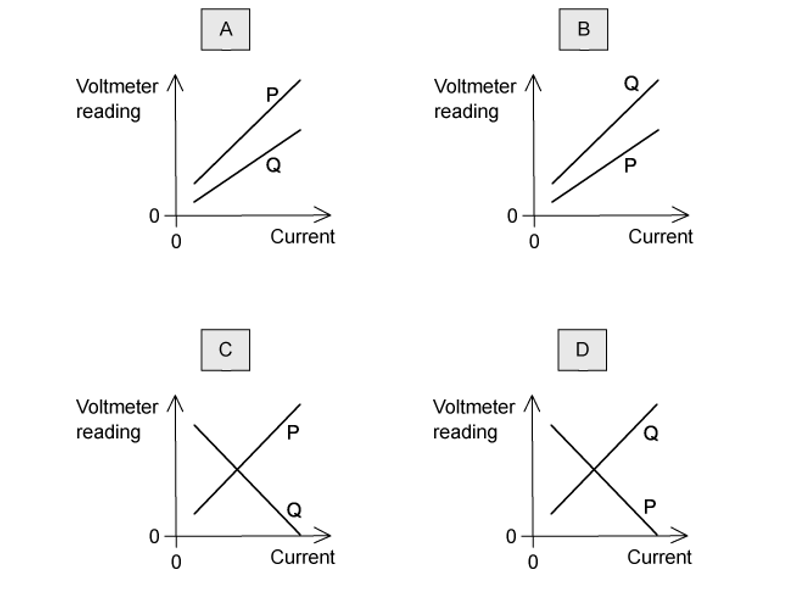

### Q9 — easy — 1 marks

**Q9** [1 mark]

The unknown e.m.f. *E* of a cell is to be determined using a potentiometer circuit. The balance length is to be measured when the galvanometer records a null reading.

What is the correct circuit to use ?

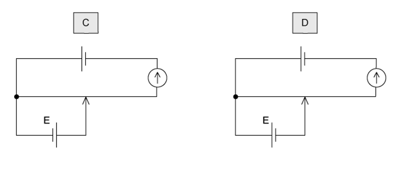

### Q10 — easy — 1 marks

**Q10** [1 mark]

A source of e.m.f. 9.0 mV has an internal resistance of 6.0 Ω.

It is connected across a galvanometer of resistance 30 Ω.

What is the current in the galvanometer?

### Q11 — hard — 1 marks

**Q11** [1 mark]

In the circuit shown, XY is a length *L* of uniform resistance wire. R1 and R2 are unknown resistors. J is a sliding contact that joins the junction of R1 and R2 to points on XY through a small signal lamp S.

To determine the ratio  $\frac{V_{1}}{V_{2}}$  of the potential differences across R1 and R2, a point is found on XY at which the lamp is off. This point is at a distance *x* from *X*.

What is the value of the ratio $\frac{V_{1}}{V_{2}}$   ?

### Q12 — easy — 1 marks

**Q12** [1 mark]

Which electrical component is represented by the following symbol ?

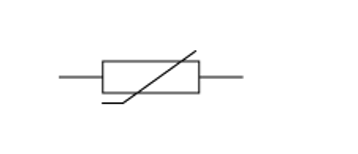

### Q13 — medium — 1 marks

**Q13** [1 mark]

In the circuit below, the ammeter reading is *I,* and the voltmeter reading is *V*.

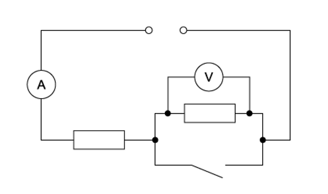

When the switch is closed, which row describes what happens to *I* and *V*?

| ** ** | ***I*** | ***V*** |
|---|---|---|
| **A**  **B**  **C**  **D** | decreases  increases  increases  stays the same | decreases to zero  stays the same  decreases to zero  increases |

### Q14 — hard — 1 marks

**Q14** [1 mark]

In the potentiometer circuit shown, the reading on the ammeter is zero.

The light-dependent resistor (LDR) is then covered up, and the ammeter gives a non-zero reading.

Which change could return the ammeter reading to zero?

### Q15 — hard — 1 marks

**Q15** [1 mark]

The contact is connected one at a time to points X, Y and Z to test the circuit. The lamps do not light up because lamp L is blown.

Which of the following are the readings of the voltmeter when the contact is connected to each of the points?** **

| ** ** | **X** | **Y** | **Z** |
|---|---|---|---|
| **A**  **B**  **C**  **D** | 12 V  8 V  12 V  8 V | 8 V  8 V  12 V  12 V | 4 V  0 V  0 V  4 V |

### Q16 — hard — 1 marks

**Q16** [1 mark]

In the potentiometer circuit below, the moveable contact is placed at N on the bare wire XY, such that the galvanometer shows zero deflection.

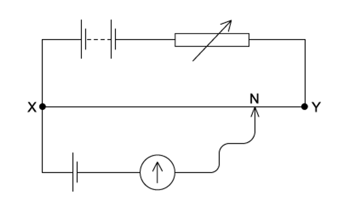

The resistance of the variable resistor is now increased.

What is the effect of this increase on the potential difference across the wire XY and on the position of the moveable contact for zero deflection ?

| ** ** | **Potential difference across XY** | **Position of moveable contact** |
|---|---|---|
| **A**  **B**  **C**  **D** | increases  increases  decreases  decreases | nearer to X  nearer to Y  nearer to X  nearer to Y |

### Q17 — medium — 1 marks

**Q17** [1 mark]

A potential divider consisting of resistors of resistance *R*1 and *R*2 is connected to an input potential difference of *V*0 and gives an output p .d. of *V*.

What is the value of *V *?

### Q18 — medium — 1 marks

**Q18** [1 mark]

A potential divider consists of resistors of resistance *R*1 and *R*2 connected in series across a source of potential difference *V*0. The potential difference across *R*1 is *V *out .

Which changes to *R*1 and *R*2 will increase the value of *V *out ?

| ** ** | ***R*****1** | ***R*****2** |
|---|---|---|
| **A**  **B**  **C**  **D** | doubled  doubled  halved  halved | doubled  halved  doubled  halved |

### Q19 — medium — 1 marks

**Q19** [1 mark]

The diagram shows a potential divider connected to a 9.0 V supply of negligible internal resistance.

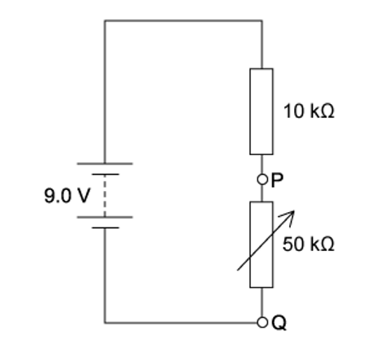

What range of voltages can be obtained between P and Q?

### Q20 — hard — 1 marks

**Q20** [1 mark]

The diagrams show the same cell, ammeter, potentiometer and fixed resistor connected in different ways.

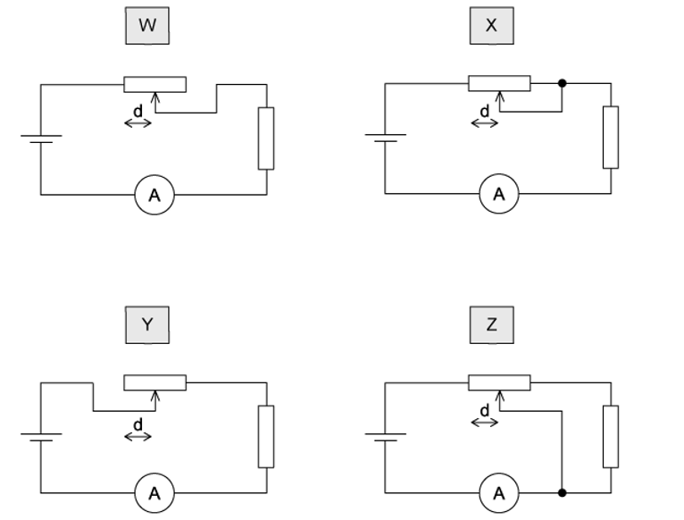

The distance *d* between the sliding contact and a particular end of the potentiometer is varied. The current measured is then plotted against the distance *d*.

For which two circuits will the graphs be identical ?

### Q21 — easy — 1 marks

**Q21** [1 mark]

A low-voltage supply with an e. m. f. of 20 V and an internal resistance of 1.5 Ω is used to supply power to a heater of resistance 6.5 Ω in a fish tank.

What is the power supplied to the water in the fish tank ?

### Q22 — hard — 1 marks

**Q22** [1 mark]

The resistance *R* of an unknown resistor is compared with a fixed 100 Ω resistor using the circuit as shown in the diagram.

The balance length *l* is 30.0 cm and 48.3 cm when P is connected to Q and R, respectively.

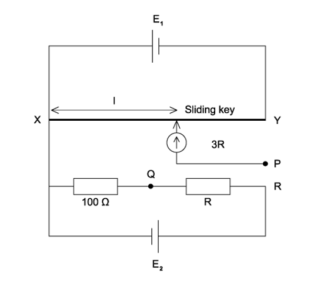

The length of the wire XY is 100 cm and has a resistance of 40 Ω. The two cells E1 and E2, have negligible internal resistances.

What is the value of resistance *R *?

### Q23 — hard — 1 marks

**Q23** [1 mark]

A power supply and a solar cell are compared using the potentiometer circuit shown.

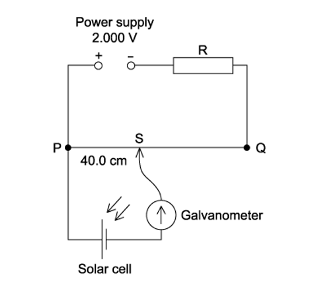

The e.m.f. produced by the solar cell is measured on the potentiometer.

The potentiometer wire PQ is 100.0 cm long and has a resistance of 5.00 Ω. The power supply has an e. m .f. of 2.000 V, and the solar cell has an e .m. f. of 5.00 mV.

Which resistance *R* must be used so that the galvanometer reads zero when PS = 40.0 cm ?

### Q24 — medium — 1 marks

**Q24** [1 mark]

A battery with e.m.f. *E* and internal resistance *r* is connected in series with an external variable resistor.

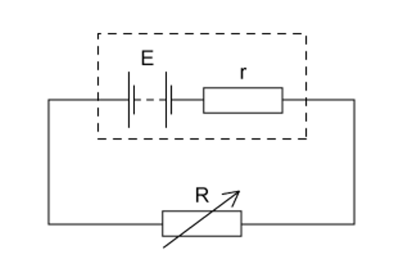

The value of the external resistance *R* is slowly increased from zero.

Which statement is correct ? (Ignore any temperature effects.)

### Q25 — easy — 1 marks

**Q25** [1 mark]

A potential divider consists of a fixed resistor R and a light-dependent resistor (LDR)

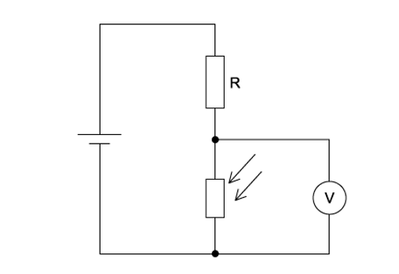

What happens to the voltmeter reading, and why does it happen, when the intensity of light on the LDR increases?

### Q26 — easy — 1 marks

**Q26** [1 mark]

In the circuit shown, the 6.0 V battery has negligible internal resistance. Resistors R1 and R2 and the voltmeter have resistance 100 kΩ.

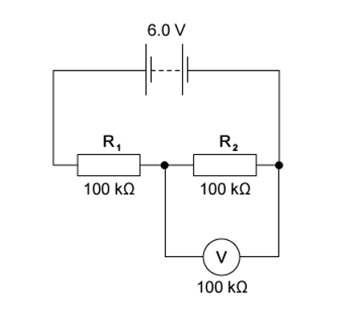

What is the current in the resistor R2?

### Q27 — medium — 1 marks

**Q27** [1 mark]

A potential divider circuit consists of fixed resistors of resistance 2.0 Ω and 4.0 Ω connected in series with a 3.0 Ω resistor fitted with a sliding contact. These are connected across a battery of e. m .f. 9.0 V and zero internal resistance, as shown.

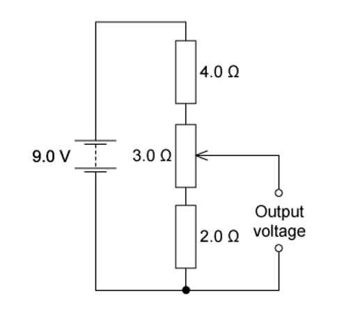

What are the maximum and the minimum output voltages of this potential divider circuit?

| ** ** | **Maximum voltage / V** | **Minimum  voltage / V** |
|---|---|---|
| **A**  **B**  **C**  **D** | 4.0  5.0  9.0  9.0 | 2.0  2.0  0  2.0 |

### Q28 — easy — 1 marks

**Q28** [1 mark]

The diagram shows a potential divider circuit designed to provide a variable output p. d.

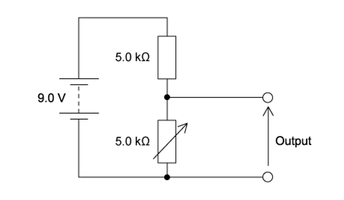

Which gives the available range of output p. d ?

| ** ** | Maximum output | Minimum output |
|---|---|---|
| **A**  **B**  **C**  **D** | 3.0 V  4.5 V  9.0 V  9.0 V | 0  0  0  4.5 V |

### Q29 — hard — 1 marks

**Q29** [1 mark]

The graph below shows how resistance *R* of a thermistor varies during part of a day.

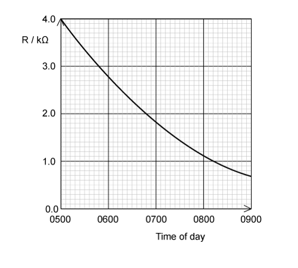

The thermistor is connected to the potential divider circuit as shown.

At 0730, an output of 6.0 V is required.

What value of the variable resistor should be set at this time?
