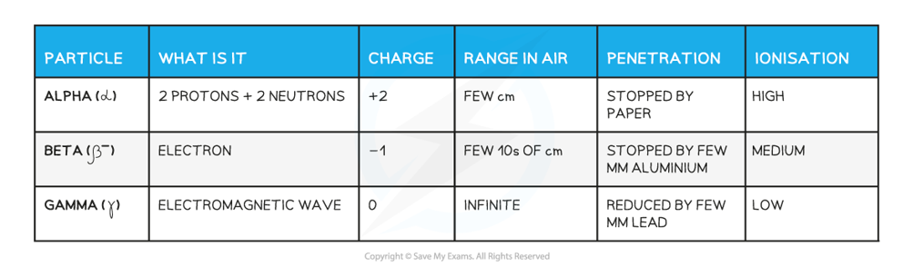

# Mark Schemes — Atoms, Nuclei & Radiation
**11. Particle Physics** · Cambridge (CIE) A-LEVEL physics (9702)

## Multiple Choice Questions (35 questions)

### Q1
**Final answer:** **The correct answer is ****C because:**

- An α-particle is made of two protons and two neutrons, `alpha presubscript 2 presuperscript 4`

  - `X _ Z ^ A -> Y _ Z - 2 ^ A - 4 + alpha _ 2 ^ 4`
- The nucleon number is reduced by 4, emitting two neutrons and 2 protons
- In β− decay, a neutron decays to become a proton, β− particle `( beta _ - 1 ^ 0 )` and antineutrino $\vec{v}_{e}$

  - `X _ Z ^ A -> Y _ Z + 1 ^ A + beta _ - 1 ^ 0 + top v _ e`
- The mass is not changed, but the proton number increases by one and the number of neutrons decrease by one

  - If the first decay emits an β-particle, it will increase the proton number by 1
  - If the second decay emits an α-particle, it will decrease the proton number by 2
  - If the third stage emits an β-particle, it will increase the proton number by 1
- The number of protons will remain the same after three decays, 1 α decay and 2 β decays

  - This makes them isotopes of each other

### Q2
**Final answer:** **The correct answer is ****C because:**

- In β− decay, a neutron decays to become a proton, β− particle `( beta _ - 1 ^ 0 )` and antineutrino $( \vec{v}_{e} )$

  - `X _ Z ^ A -> Y _ Z + 1 ^ A + beta _ - 1 ^ 0 + top v _ e`
- The mass is not changed, but the proton number increases by one and the number of neutrons decrease by one

  - Nucleus X goes from  `X presubscript 90 presuperscript 234` and undergoes two β− decays
  - The nucleon number will not change, so, it will still be 234
  - The proton number will increase by two, so, it will be 92
- Therefore, option **C** correct

### Q3
**Final answer:** **The correct answer is ****D**** because:**

- Alpha, beta and gamma have different properties as shown in the table below

- An α-particle is made of two protons and two neutrons, `alpha presubscript 2 presuperscript 4`

  - It is absorbed by card and has a positive charge
- A β− particle is made of an electron, `beta presubscript negative 1 end presubscript presuperscript 0`

  - It is absorbed by aluminium and is negatively charged
- A γ-ray is an electromagnetic wave

  - It is not fully absorbed by lead and has no charge

### Q4
**Final answer:** **The correct answer is ****B**** because:**

- The question states that after decay it is an isotope of thorium which has a proton number of 90
- An α-particle is made of two protons and two neutrons, `alpha presubscript 2 presuperscript 4`

  - `X _ Z ^ A -> Y _ Z - 2 ^ A - 4 + alpha _ 2 ^ 4`
- The nucleon number is reduced by 232 – 228 = 4, so, two neutrons and two protons are emitted

  - This would result in a proton number of 88, this is not correct as the final isotope should also have a proton number of 90
  - Therefore, two beta particles must be emitted to make up the final proton number
- In β− decay, a neutron decays to become a proton, β− particle `( beta _ - 1 ^ 0 )` and antineutrino $( \vec{v}_{e} )$

  - `X _ Z ^ A -> Y _ Z + 1 ^ A + beta _ - 1 ^ 0 + top v _ e`
- The mass is not changed, but the proton number increases by one and the number of neutrons decrease by one

  - So, this would result in a proton number of 90

Therefore, one alpha particle and two beta particles are emitted

**A **is incorrect because in this option the final proton number would be 94

**C **is incorrect because in this option the final proton number would be 89

**D **is incorrect because in this option the final proton number would be 87

### Q5
**Final answer:** **The correct answer is ****A because:**

- An α-particle is made of two protons and two neutrons, `alpha presubscript 2 presuperscript 4`

  - `X _ Z ^ A -> Y _ Z - 2 ^ A - 4 + alpha _ 2 ^ 4`
- The nucleon number is reduced by 4, emitting two neutrons and 2 protons
- In β− decay, a neutron decays to become a proton, β− particle `( beta _ - 1 ^ 0 )` and antineutrino $\vec{v}_{e}$

  - `X _ Z ^ A -> Y _ Z + 1 ^ A + beta _ - 1 ^ 0 + top v _ e`
- The mass is not changed, but the proton number increases by one and the number of neutrons decrease by one
- Astatine decays to form polonium emitting an `beta presubscript negative 1 end presubscript presuperscript 0` and `alpha presubscript 2 presuperscript 4`

  - Stage 1 : `A _ 85 ^ 218 t -> X _ 86 ^ 218 + beta _ - 1 ^ 0`
  - Stage 2 : $X_{86}^{218} \rightarrow P_{84}^{214} o + \\alpha pre_{2} pre^{4}$

### Q6
**Final answer:** **The correct answer is ****A**** because:**

- An α-particle is made of two protons and two neutrons, `alpha presubscript 2 presuperscript 4`

  - `X _ Z ^ A -> Y _ Z - 2 ^ A - 4 + alpha _ 2 ^ 4`
- In β− decay, a neutron decays to become a proton, β− particle `( beta _ - 1 ^ 0 )` and antineutrino $( \bar{v}_{e} )$

  - `X _ Z ^ A -> Y _ Z + 1 ^ A + beta _ - 1 ^ 0 + v -bar _ e`
  - The mass is not changed, but the proton number increases by one
- The original nucleus Q will contain `X presubscript A presuperscript Z` protons and neutrons

  - `Q -> R + alpha _ 2 ^ 4 + 2 beta _ - 1 ^ 0`
- Isotopes are nuclei with the same proton number and a different number of neutrons and therefore mass

  - So, alpha decay will decrease the proton number by 2
- Then, beta decay will turn two neutrons into two protons and two beta particles

  - There is no change to the proton number, so, R is an isotope of Q

**B **is incorrect as there will be a change in the nucleon number as the nucleon will have decreased by four in R.

**C **is incorrect as beta decay occurs when a neutron is changed to a proton

**D **is incorrect as there will be a mass defect which results in the release of energy so the total mass will not be conserved

### Q7
**Final answer:** **The correct answer is ****A**** because:**

- Alpha, beta and gamma have different properties as shown in the table below

- Diagram 1 shows the absorbance of the radiation by solids:

  - W is an alpha particle stopped by paper
  - X is a beta particle stopped by 1 mm of aluminium
  - Y is a gamma-ray reduced by lead
- Diagram 2 shows the radiations passing an electric field:

  - L is a beta-particle attracted to the positive terminal
  - M is a gamma-ray not deflected by the electric field
  - N is an alpha particle attracted to the negative terminal
- Diagram 3 shows:

  - R is a beta particle deflected by the magnetic field
  - P is an alpha particle deflected by the magnetic field
  - Q is a gamma-ray is not deflected by the magnetic field
- The correct option is therefore** A**

### Q8
**Final answer:** **The correct answer is ****D**** because:**

- An α-particle is made of two protons and two neutrons, `alpha presubscript 2 presuperscript 4`

  - `X _ Z ^ A -> Y _ Z - 2 ^ A - 4 + alpha _ 2 ^ 4`
- The nucleon number is reduced by 4 making this 235
- The proton number is reduced by 2 making this 92

  - $P_{94}^{239} u \rightarrow X_{92}^{235} + \\alpha pre_{2} pre^{4}$

### Q9
**Final answer:** **The correct answer is ****B**** because:**

- The gold foil experiment directed parallel beams of α-particles at a piece of gold foil only 10−6 m thick
- Most of the α-particles went straight through the foil

  - This is due to the small size of the nucleus of the atom
- Some of the α-particles were deflected through large angles

  - This is due to the path occasionally being close to the nucleus

**A **is incorrect because alpha particles are deflected by the positive charge when it is close enough to the nucleus

**C **is incorrect because the alpha particles did not bounce off the nuclei but were deflected due to repulsion from positively charged protons

**D **is incorrect because the gold foil used was only a few atoms thick to reduce the density of the particles

### Q10
**Final answer:** **The correct answer is ****A**** because:**

- An α-particle is made of two protons and two neutrons, `alpha presubscript 2 presuperscript 4`
- When the `A presubscript 13 presuperscript 27 l` is bombarded with these particles the nuclei increases in mass and proton number as shown in the equation

  - $A_{13}^{27} l + \\alpha pre_{2} pre^{4} \rightarrow P_{15}^{30} + X pre_{A} pre^{Z}$
- 27 + 4 = 30 + Z

  - So, Z = 1
- 13 + 2 = 15 + A

  - So, A = 0
- Therefore, `X presubscript 0 presuperscript 1` is a neutron

### Q11
**Final answer:** **The correct answer is ****C**** because:**

- Isotopes are nuclei with the same proton number and a different number of neutrons and therefore mass
- The first nucleus has a nucleon number of 186 and 112 neutrons, so, this will make a total of 186 – 112 = 74 protons
- The second nucleus has a nucleon number of 182 and 108 neutrons, so, this will make a total of 182 – 108 = 74 protons

  - They have the same number of protons, therefore, they are isotopes of each other

| **A **is incorrect as | 186 – 112 = 74  180 – 118 = 62  these nuclei are not isotopes of each other |
|---|---|
| **B **is incorrect as | 184 – 110 = 74  187 – 110 = 77  these nuclei are not isotopes of each other |
| **D **is incorrect as | 186 – 110 = 76  186 – 112 = 74  these nuclei are not isotopes of each other |

### Q12
**Final answer:** **The correct answer is ****C because:**

- An α-particle is made of two protons and two neutrons, `alpha presubscript 2 presuperscript 4`

  - `X _ Z ^ A -> Y _ Z - 2 ^ A - 4 + alpha _ 2 ^ 4`
- The nucleon number is reduced by 4, emitting two neutrons and 2 protons
- In β− decay, a neutron decays to become a proton, β− particle `( beta _ - 1 ^ 0 )` and antineutrino $( \vec{v}_{e} )$

  - `X _ Z ^ A -> Y _ Z + 1 ^ A + beta _ - 1 ^ 0 + top v _ e`
- The mass is not changed, but the proton number increases by one and the number of neutrons decrease by one
- The first stage emits an α-particle reducing the proton number by 2
- The next two stages both emit a β increasing the proton number by 2

  - The final nucleus must have the same number of protons and a different number of neutrons, therefore, option **C **is correct

### Q13
**Final answer:** **The correct answer is ****B**** because:**

- An α-particle is made of two protons and two neutrons, `alpha presubscript 2 presuperscript 4`

  - `X _ Z ^ A -> Y _ Z - 2 ^ A - 4 + alpha _ 2 ^ 4`
  - $U_{92}^{258} \rightarrow X_{90}^{254} + \\alpha pre_{2} pre^{4}$
- So, the proton number decreases by two

  - Therefore, atom X has 90 protons
- So, nucleon number will reduce by four

  - Therefore, atom X has a nucleon number of 254

### Q14
**Final answer:** **The correct answer is ****B**** because:**

- An *α*-particle is a helium nucleus, which is represented by `H presubscript 2 presuperscript 4 e`
- A neutron is represented by `n presubscript 0 presuperscript 1`
- Since the *α*-particle is supposed to cause the reaction, it should appear on the left of the equation as a reactant

  - Hence, only option **A** or **B** can be correct
- In option **A**, the symbol of the neutron is wrongly represented as `n presubscript 1 presuperscript 1`

  - Therefore, since option **A** is not possible, this leaves only option **B**
- We can confirm this by comparing the nucleon numbers on each side

  - LHS: 17 + 4 = 21
  - RHS: 20 + 1 = 21
- Nucleon number is conserved, so option **B** is correct

**A** is incorrect because the symbol of the neutron is wrongly represented as `n presubscript 1 presuperscript 1`

**C & D **are incorrect because the *α*-particle causes the reaction, so, it should appear on the left of the equation as a reactant

### Q15
**Final answer:** **The correct answer is ****C**** because:**

- The gold foil experiment directed parallel beams of *α*-particles at a piece of gold foil only 10−6 m thick
- The observations were as follows:

  - Most of the *α*-particles went straight through the foil - so, the largest value of *n* is at small angles
  - Some of the *α*-particles were deflected slightly - here, *n* drops quickly with increasing angle of deflection *θ*
  - Some *α*-particles, about 1 in 20 000, were deflected by more than 90˚, appearing to bounce back off the foil - so, the value of *n* is very small at large angles
- Therefore, the graph that matches this description is **C**

**A & B** are incorrect because these graphs show the majority of *α*-particles were deflected through large angles which is the opposite of what was observed

**D **is incorrect because this graph shows many particles were deflected through a variety of angles, however, the observations show that the majority of particles passed straight through the foil with little to no deflection

### Q16
**Final answer:** **The correct answer is ****D**** because:**

- During *α*-decay, a helium nucleus `H presubscript 2 presuperscript 4 e` is released from each starting atom

  - The mass number decreases by 4 and the proton number by 2
- During *β* radiation, an electron (or positron) is released

  - There is a gain of 1 proton because a neutron splits to form a proton and electron
  - There is no change in atomic number
- During *γ* radiation, *γ* rays are emitted but there is no change in atomic or proton number
- We can draw a flow diagram of the processes involved: `T _ 90 ^ 232 h -> with alpha on top R _ 88 ^ 228 a -> with beta on top A _ 89 ^ 228 c -> with beta on top T _ 90 ^ 228 h -> with gamma on top T _ 90 ^ 228 h -> with alpha on top R _ 88 ^ 224 a`
- Therefore, the end nuclide is `R presubscript 88 presuperscript 224 a`

### Q17
**Final answer:** **The correct answer is ****D**** because:**

- In β− decay, a neutron decays to become a proton, β− particle `( beta _ - 1 ^ 0 )` and antineutrino $( \vec{v}_{e} )$

  - `X _ Z ^ A -> Y _ Z + 1 ^ A + beta _ - 1 ^ 0 + top v _ e`
- The mass is not changed, but the proton number increases by one and the number of neutrons decrease by one
- This type of decay would result  `L presubscript 3 presuperscript 8 i` in having one extra proton and one less neutron, so, the only correct option is **D**

### Q18
**Final answer:** **The correct answer is ****C**** because:**

- In β− decay, a neutron decays to become a proton, β− particle `( beta _ - 1 ^ 0 )` and antineutrino $( \bar{v}_{e} )$

  - `X _ Z ^ A -> Y _ Z + 1 ^ A + beta _ - 1 ^ 0 + top v _ e`
  - The mass is not changed, but the proton number increases by one; so the Z number has increased from 91 to 92
- An α-particle is made of two protons and two neutrons,

  - `X _ Z ^ A -> Y _ Z - 2 ^ A - 4 + alpha _ 2 ^ 4`
- The nucleon number is reduced by 4 making this 230
- The proton number is reduced by 2 making this 90

  - Graph **C **is therefore the correct option

### Q19
**Final answer:** **The correct answer is ****A**** because:**

- The gold foil experiment directed parallel beams of α-particles at a piece of gold foil only 10−6 m thick
- The observations made in the experiment were as follows:

  - Most of the α-particles went straight through the foil
  - Some of the α-particles were deflected slightly
  - Some, about 1 in 20 000, were deflected by more than 90˚, appearing to bounce back off the foil
- In order to increase the proportion of α-particles that are deflected by a larger angle, more nuclei would need to present

  - Thicker foil would mean that more nuclei are present

**B **is incorrect as fewer particles in the nuclei would have less of a deflection

**C **is incorrect as the number of nuclei is not changing so the kinetic energy of the α-particle will have no effect

**D **is incorrect as the number of nuclei is not changing, so the higher activity of the α-particle will have no effect.

### Q20
**Final answer:** **The correct answer is ****C**** because:**

- An antiparticle is a subatomic particle having the same mass as one of the particles of ordinary matter but opposite electric charge and magnetic movement
- A positron is the antiparticle of the negatively charged electron
- They only differ in their charge

  - The positron has a + ve charge and the electron a - ve charge

**A **is incorrect because the mass of an electron and positron are the same

**B **is incorrect because the magnitude of charge is the same; the positron has a charge of +1 and the electron -1

**D **is incorrect because the positron and electron both have the same spin of ½

### Q21
**Final answer:** **The correct answer is ****D**** because:**

- The gold foil experiment directed parallel beams of α-particles at a piece of gold foil only 10−6 m thick
- The observations were as follows:

  - Most of the α-particles went straight through the foil
  - Some of the α-particles were deflected slightly
  - Some, about 1 in 20 000, were deflected by more than 90˚, appearing to bounce back off the foil
- These results confirmed that the atom was made up of empty space and that the nucleus only occupied a very small fraction of the atom

**A **is incorrect as the results obtained do not confirm the presence of both protons and neutrons

**B **is incorrect as Bohr first proposed the presence of electrons in orbit in 1913

**C **is incorrect as the evidence from the gold foil experiment did not support the presence of **isotopes**

### Q22
**Final answer:** **The correct answer is ****B ****because:**

- In β− decay, a neutron decays to become a proton, β− particle `( beta _ - 1 ^ 0 )` and antineutrino $( \vec{v}_{e} )$

  - `X _ Z ^ A -> Y _ Z + 1 ^ A + beta _ - 1 ^ 0 + top v _ e`
- The mass is not changed, but the proton number increases by one and the number of neutrons decrease by one
- An α-particle is made of two protons and two neutrons, `alpha presubscript 2 presuperscript 4`

  - `X _ Z ^ A -> Y _ Z - 2 ^ A - 4 + alpha _ 2 ^ 4`
- The nucleon number is reduced by 4, emitting two neutrons and 2 protons
- An γ-ray is usually emitted after alpha or beta decay to release excess energy from the nuclei
- The nucleon number is not changed in this case

  - The option that will result in the highest number of neutrons remaining in nucleus Y is therefore **B**

### Q23
**Final answer:** **The correct answer is ****C**** because:**

- In β− decay, a neutron decays to become a proton, β− particle `( beta _ - 1 ^ 0 )`  and antineutrino $( \vec{v}_{e} )$

  - `X _ Z ^ A -> Y _ Z + 1 ^ A + beta _ - 1 ^ 0 + top v _ e`
- The mass is not changed, but the proton number increases by one and the number of neutrons decrease by one
- An α-particle is made of two protons and two neutrons, `alpha presubscript 2 presuperscript 4`

  - `X _ Z ^ A -> Y _ Z - 2 ^ A - 4 + alpha _ 2 ^ 4`
- The nucleon number is reduced by 4, emitting two neutrons and 2 protons
- The difference in mass between

  - `R presubscript 86 presuperscript 222 n` and `P presubscript 82 presuperscript 206 b` is 222 – 206 = 16
- As beta decay does not decrease mass, the change must be due to alpha decay

  - Number of alpha particles released$=\frac{16}{4}=4$
- The difference in atomic number

  - `R presubscript 86 presuperscript 222 n` and `P presubscript 82 presuperscript 206 b` is 86 – 82 = 4
  - The four alpha particles released would have emitted 4 × 2 = 8 protons
- The number of beta particles released must, therefore, be 4 to increase the proton number to 82

  - Therefore, the total number of stages = 8

### Q24
**Final answer:** **The correct answer is ****B**** because:**

- When E absorbs a neutron the new isotope is `E presubscript 14 presuperscript 29`
- An α-particle is made of two protons and two neutrons, `alpha presubscript 2 presuperscript 4`

  - `X _ Z ^ A -> Y _ Z - 2 ^ A - 4 + alpha _ 2 ^ 4`
- When the new isotope emits an alpha particle, the nucleon number is reduced by 4

  - So, the new nucleon number is 29 – 4 = 25
- The proton number is reduced by 2

  - So, the new proton number is 14 – 2 = 12
- Therefore, the new atom $( M_{12}^{25} )$  is nuclei M

**A **is incorrect as 24 is the nucleon or mass of atom Q, the number of electrons in an uncharged atom of Q will be 13

**C **is incorrect as nuclei G and M have different proton numbers making them different atoms not isotopes

**D **is incorrect as in β− decay, a neutron decays to become a proton and emits a β− particle and an anti-electron neutrino. The mass is not changed, but the proton number increases by one. Nucleus M after β− decay would be `X presubscript 13 presuperscript 25`

### Q25
**Final answer:** **The correct answer is ****C**** because:**

- An α-particle is made of two protons and two neutrons, `alpha presubscript 2 presuperscript 4`

  - `X _ Z ^ A -> Y _ Z - 2 ^ A - 4 + alpha _ 2 ^ 4`
- α-particles have a slower speed than that of gamma or beta due to its mass

  - The typical speed of an α-particle is 106 m s−1 to 107 m s−1

**A **is incorrect as the energy of an α-particle changes as the particle moves away from the nucleus it was emitted from

**B **is incorrect as α-particles have a higher ionising power than β-particles

**D **is incorrect as the charge on an α-particle is +2e, a charge of 3.2 × 10−19

### Q26
**Final answer:** **The correct answer is ****C**** because:**

- Alpha, beta and gamma have different properties as shown in the table below
- Alpha radiation has the greatest ionising power

### Q27
**Final answer:** **The correct answer is ****D**** because:**

- Alpha, beta and gamma have different properties as shown in the table below

- Alpha and beta radiation would be entirely stopped by a few mm of lead
- The emission of gamma radiation would only be reduced as some would still be detected through 2 mm of lead

  - Therefore, option **D** is correct

### Q28
**Final answer:** **The correct answer is ****B**** because:**

- The symbol `C presubscript 55 presuperscript 133 s`  give the mass number of 133 and an atomic number of 55

  - So, the nucleus contains 55 protons
- As the atom is neutral the number of electrons will be 55
- The mass of the atom is calculated by adding the number of neutrons to protons

  - 133 – 55 = 78 neutrons

### Q29
**Final answer:** **The correct answer is ****A**** because:**

- In β− decay, a neutron decays to become a proton, β− particle `( beta _ - 1 ^ 0 )` and antineutrino $( \bar{v}_{e} )$

  - `X _ Z ^ A -> Y _ Z + 1 ^ A + beta _ - 1 ^ 0 + v -bar _ e`
- The mass is not changed, but the proton number increases by one
- Therefore, nucleon numbers are unchanged by the emission of β-particles

**B **is incorrect as in a nuclear reaction, the total energy is conserved. The apparent loss of mass is conserved in kinetic energy

**C **is incorrect as an atom’s mass number can never be smaller than its atomic number

**D **is incorrect as if the atom has a different number of protons, then it is a different atom

### Q30
**Final answer:** **The correct answer is ****D**** because:**

- The gold nucleus will cause a repulsive force on the alpha particle as they are all positively charged
- The gold nucleus would deflect the alpha particle away.
- The closer the particle the stronger the force and therefore the deflection
- The paths will not stay parallel due to a greater repulsive force on some of the particles

**A **is incorrect because the diagram shows an attraction towards the gold nucleus

**B **is incorrect because the diagram shows the paths not being crossed by the greater repulsive force, and an attraction of the alpha particle towards the nucleus

**C **is incorrect because the diagram shows the paths not being crossed by the greater repulsive force

### Q31
**Final answer:** **The correct answer is ****C**** because:**

- When α-decay occurs

  - A helium `H presubscript 2 presuperscript 4 e` particle is emitted
  - The atomic number decreases by two and the mass number by four
- When β− -decay occurs

  - A neutron transforms into a proton and an electron
  - The mass number remains the same but the atomic number increases by one
- When γ-decay occurs

  - A γ ray is emitted so there is no change in the mass or atomic number
- The end nuclide is Thorium-228

  - The isotope can be written as `T presubscript 90 presuperscript 228 h`
- The flow diagram for the decay of `X presubscript Z presuperscript A`is $N_{93}^{236} p \xrightarrow{ \\gamma } N_{93}^{236} p \xrightarrow{ \\beta ^{^{-} } } P_{94}^{236} u \xrightarrow{ \\alpha } U_{92}^{232} \xrightarrow{ \\alpha } T_{90}^{228} h \xrightarrow{ \\gamma } T_{90}^{228} h$
- Therefore the original isotope is Neptunium-236
- This is option **C  **

- In order to find the original unknown isotope, you will need to work backwards from `T presubscript 90 presuperscript 228 h`

  - For α-decay add four onto the mass number and two onto the atomic number
  - For β−-decay minus one from the atomic number and keep the mass number the same

### Q32
**Final answer:** **The correct answer is ****D because:**

- An α-particle is made of two protons and two neutrons, `alpha presubscript 2 presuperscript 4`

  - `X _ Z ^ A -> Y _ Z - 2 ^ A - 4 + alpha _ 2 ^ 4`
- The nucleon number is reduced by 4, emitting two neutrons and 2 protons

  - Nucleus S goes from `S presubscript 84 presuperscript 134`  to `X presubscript 82 presuperscript 132`  , so the first stage is α decay
- In β− decay, a neutron decays to become a proton, β− particle  `( beta _ - 1 ^ 0 )` and antineutrino $( \vec{v}_{e} )$

  - `X _ Z ^ A -> Y _ Z + 1 ^ A + beta _ - 1 ^ 0 + top v _ e`
- The mass is not changed, but the proton number increases by one and the number of neutrons decrease by one

  - Nucleus X goes from `X presubscript 82 presuperscript 132`  to `T presubscript 84 presuperscript 130` , so two β− particles must have been released

### Q33
**Final answer:** **The correct answer is ****A**** because:**

- An α-particle is made of two protons and two neutrons, `alpha presubscript 2 presuperscript 4`

  - `X _ Z ^ A -> Y _ Z - 2 ^ A - 4 + alpha _ 2 ^ 4`
- The nucleon number is reduced by 4, emitting two neutrons and 2 protons
- In β− decay, a neutron decays to become a proton, β− particle `( beta _ - 1 ^ 0 )` and antineutrino $( \vec{v}_{e} )$

  - `X _ Z ^ A -> Y _ Z + 1 ^ A + beta _ - 1 ^ 0 + top v _ e`
- The mass is not changed, but the proton number increases by one and the number of neutrons decrease by one

  - The first stage emits an β-particle increasing the proton number by 1
  - The next stage emits an α-particle decreasing the proton number by 2
  - The final stage emits an β-particle increasing the proton number by 1
- The number of protons in Z are the same as W, but with a different number of neutrons

  - Therefore, W and Z are isotopes of each other

### Q34
**Final answer:** **The correct answer is ****B**** because:**

- Nuclei are made up of nucleons; protons and neutrons
- In β− decay, a neutron decays to become a proton, β− particle `( beta _ - 1 ^ 0 )` and antineutrino $( \bar{v}_{e} )$

  - `X _ Z ^ A -> Y _ Z + 1 ^ A + beta _ - 1 ^ 0 + v -bar _ e`
  - The mass is not changed, but the proton number increases by one, the nucleon number stays the same

### Q35
**Final answer:** **The correct answer is ****B**** because:**

- By the Principle of Conservation of Momentum :
- Total momentum before *α*-emission = Total momentum after *α*-emission

  - Total momentum before *α*-emission = 0
  - Total momentum after *α*-emission$=MV-mv$
- Where *M* and *V* are the mass and velocity of `P presubscript 82 presuperscript 206 b` and *m* and *v* are the mass and velocity of the *α*-particle

  - $0=MV-mv$
  - $MV=mv$
  - $M^{2}V^{2}=m^{2}v^{2}$
  - $M ( 1 \frac{1}{2} M V^{ 2} ) = m ( 1 \frac{1}{2} m v^{2} )$
- Therefore, $\frac{KEofPb-206}{KEofα}=\frac{massofα}{massofPb-206}$

  - $\frac{K E ( P b )}{K E ( \\alpha )} = \frac{4}{206} = 0.0194$
- From Conservation of Energy : $K E ( P b ) + K E ( \\alpha ) = E_{k}$

  - $K E ( \\alpha ) = \frac{K E ( P b )}{0.0194}$
  - $K E ( P b ) + \frac{K E ( P b )}{0.0194} = E_{k}$
  - $K E ( P b ) [ 1 + \frac{1}{0.0194} ] = E_{k}$
  - So, $K E ( P b ) = \frac{E_{k} }{( 1 + \frac{1}{0.0194} )} = 0.0190 E_{k}$
- Therefore, the kinetic energy of `P presubscript 82 presuperscript 206 b` is between 0 and $\frac{E_{k}}{2}$
