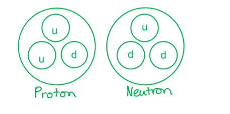
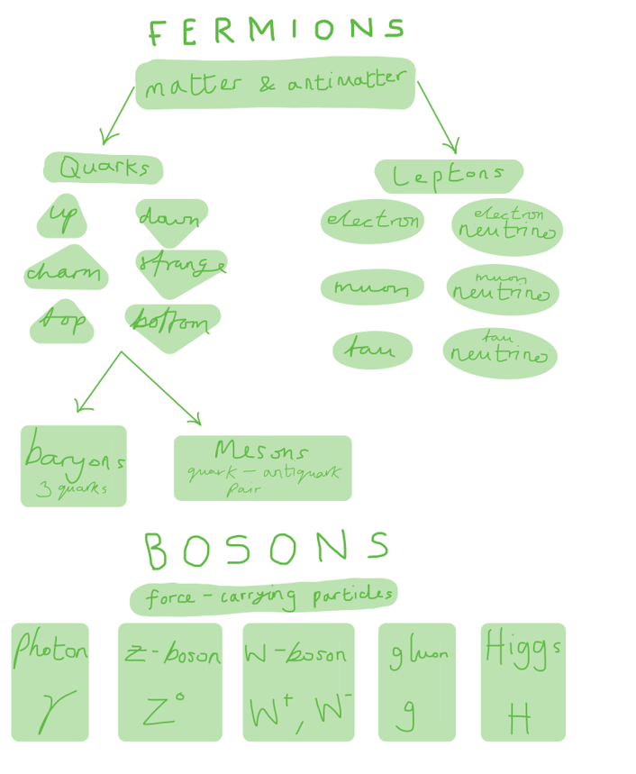
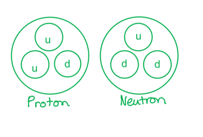
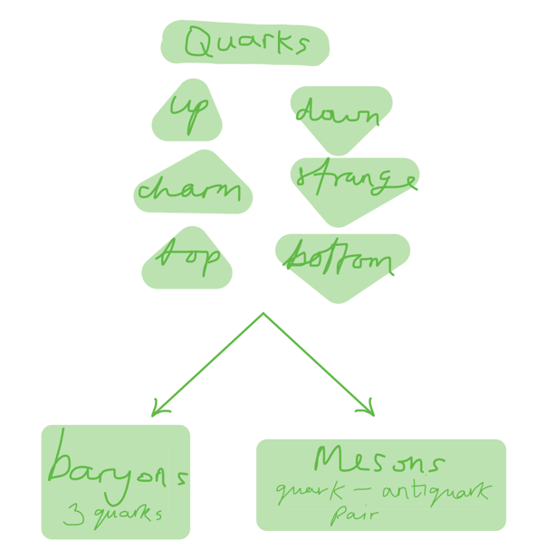
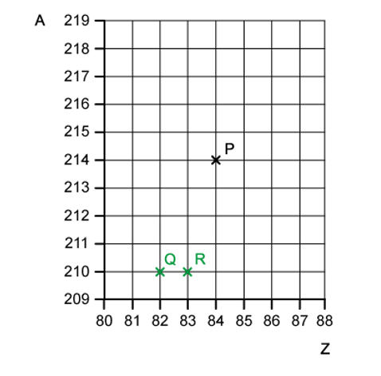
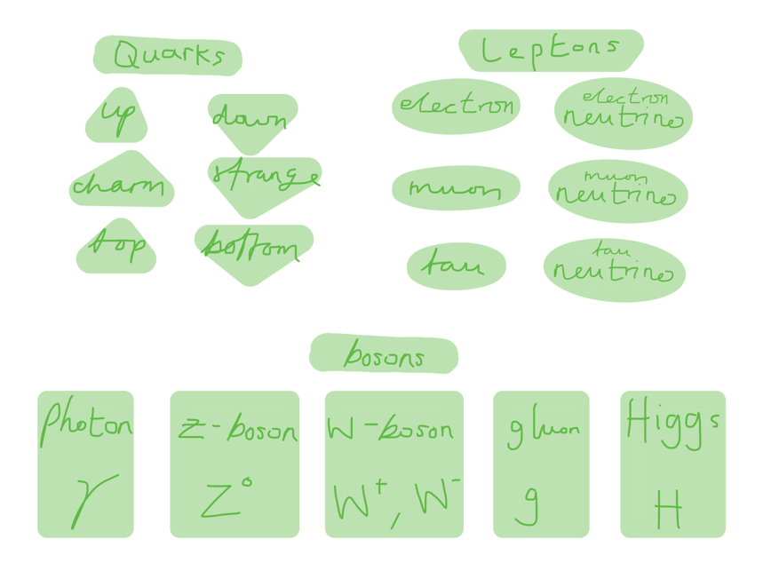
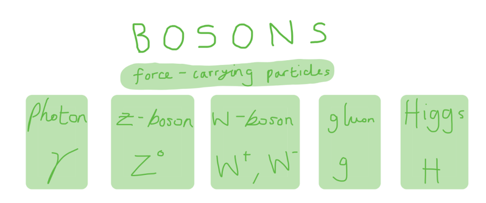

# Mark Schemes — Fundamental Particles
**11. Particle Physics** · Cambridge (CIE) A-LEVEL physics (9702)

## Multiple Choice Questions (22 questions)

### Q1
**Final answer:** **The correct answer is ****B**** because:**

- Protons and neutrons are not antiparticles of each other, instead the weak interaction between quarks gives rise to a change in quark composition

  - Quark composition of neutron$=udd$
  - Quark composition of proton$=uud$
- In β– decay, a neutron turns into a proton `open parentheses u d d space rightwards arrow space u u d close parentheses`
- Whereas, in β+ decay, a proton turns into a neutron `open parentheses u u d space rightwards arrow space u d d close parentheses`
- Since electrons and neutrinos are both leptons, they are fundamental particles
- The a β– particle is simply an electron (e–), and a β+ particle is its antiparticle – a positron (e+)
- In β– decay, an anti-electron neutrino is produced, so, in β+ decay an electron neutrino is produced
- Therefore, the overall equation for β+ decay is:

  - $p\rightarrown+e^{+}+v_{e}$

**A **is incorrect because in beta-minus and beta-plus decay, a neutron turns into a proton or a proton turns into a neutron due to the weak interaction, their antiparticles are not involved

**C **is incorrect because as it is a decay equation, the β+ particle must be on the right hand side as a product of the reaction

**D **is incorrect because in β– decay, an anti-electron neutrino is produced, so, in β+ decay an electron neutrino is produced, an antiparticle is represented by the line above the symbol

### Q2
**Final answer:** **The correct answer is ****D**** because:**

- Protons and neutrons are composed of two types of quarks held together by gluons:

  - Up quarks
  - Down quarks
- They are both made of three quarks as shown in the diagram

### Q3
**Final answer:** **The correct answer is ****A**** because:**

- Protons and neutrons are composed of two types of quarks held together by gluons:

  - Up quarks
  - Down quarks
- They are both made of three quarks as shown in the diagram

- Tritium is known as hydrogen-3, therefore, it has 2 neutrons and 1 proton

  - Each neutron has two down quarks, making a total of 4
  - The proton has one down quark, giving an overall total of 5
- Therefore, a tritium nucleus contains 5 ‘down’ quarks

### Q4
**Final answer:** **The correct answer is ****B**** because:**

- Protons and neutrons are baryons composed of up and down quarks held together by gluons
- They are both made of three quarks as shown in the diagram

- A proton consists of two up quarks and one down quark,

  - $\frac{2}{3}e+\frac{2}{3}e-\frac{1}{3}e=+e$
- This gives an overall charge of +*e*, therefore, a proton has a quark combination of $uud$

### Q5
**Final answer:** **The correct answer is ****A ****because: **

- An **elementary particle** or **fundamental particle** is a subatomic particle which cannot be broken down further into constituent particles

### Q6
**Final answer:** **The correct answer is ****A**** because:**

- The 'up' quark has a charge of $\frac{2}{3}e$
- The 'down' quark has a charge of $-\frac{1}{3}e$

  - Where *e* is the elementary charge, + 1.6 × 10–19 C
- The 'strange' quark has a charge of $-\frac{1}{3}e$
- Consider option **A**:

  - $\frac{2}{3}e+\frac{2}{3}e+\frac{2}{3}e=+2e$
- This is correct as it not neutral as it is double + 1.6 × 10−19 C

| **B **is incorrect because | $\frac{2}{3}e+\frac{2}{3}e-\frac{1}{3}e=+e$  a quark combination of up, up down is the combination in a proton and would have a charge of + 1.6 × 10−19 C |
|---|---|
| **C **is incorrect because | $\frac{2}{3}e-\frac{1}{3}e-\frac{1}{3}e=0$  a quark combination of up, strange, strange would give a charge of zero |
| **D **is incorrect because | $\frac{2}{3}e-\frac{1}{3}e-\frac{1}{3}e=0$  a quark combination of up, down, down would give a charge of zero |

### Q7
**Final answer:** **The correct answer is ****A**** because:**

- Quarks are the building blocks for protons and neutrons
- Protons and neutrons are composed of two types of quarks (up and down) held together by gluons: 

### Q8
**Final answer:** **The correct answer is ****C ****because: **

- Trillions of neutrinos are produced every second in nuclear reactions at the center of stars and in supernova explosions when stars die

**A **is incorrect because atoms are not fundamental particles as they are made up of quarks and electrons

**B **is incorrect because mesons are not fundamental particles as they are made up of quarks

**D **is incorrect because while a quark is a fundamental particle, it is not found in as high numbers as the neutrino

### Q9
**Final answer:** **The correct answer is ****B ****because:**

- Electrons are a type of **lepton**

### Q10
**Final answer:** **The correct answer is ****C ****because:**

- There are six types, or flavours , of quarks that differ from one another in their mass and charge characteristics
- These **six quark **flavours can be grouped in three pairs:

  - Up and down, charm and strange, and top and bottom

### Q11
**Final answer:** **The correct answer is ****A**** because:**

- Hadrons are subatomic particles made from 2 or more quarks which are bound by gluons
- There are two types of hadron:

  - Baryons: three quarks or three antiquarks
  - Mesons: a quark and an anti-quark pair
- They only exist for short periods of time and are produced through very high energy interactions such as those caused by cosmic rays or in particle accelerators
- Therefore, mesons are a type of composite particle produced by high energy

**B **is incorrect because gluons are a type of boson (force-carrying particle)

**C **&** D **are incorrect because neutrinos and anti-electrons (positrons) are types of lepton

### Q12
**Final answer:** **The correct answer is ****C ****because:**

- Protons and neutrons are composed of two types of quarks held together by gluons:

  - Up quarks
  - Down quarks
- They are both made of three quarks as shown in the diagram

- Therefore, neutrons consist of two 'down' quarks and one 'up' quark

### Q13
**Final answer:** **The correct answer is ****A**** because:**

- Hadrons are particles are particles made of quarks such as baryons or mesons
- The 'up' quark has a charge of $\frac{2}{3}e$
- The 'down' quark has a charge of $-\frac{1}{3}e$
- The 'strange' quark has a charge of $-\frac{1}{3}e$

  - Where *e* is the elementary charge, + 1.6 × 10−19 C
- Consider option **A**:

  - $\frac{2}{3}e+\frac{2}{3}e-\frac{1}{3}e=+e$
- Therefore, the only option that would have a charge of + 1.6 × 10−19 C is **A**

| **B **is incorrect because | $\frac{2}{3}e-\frac{1}{3}e-\frac{1}{3}e=0$  a quark combination of up, strange, strange would give a charge of zero |
|---|---|
| **C **is incorrect  because | $-\frac{1}{3}e-\frac{1}{3}e-\frac{1}{3}e=-1e$  a quark combination of down, strange, strange would be a Σ -  baryon with a −1 charge |
| **D **is incorrect because | $-\frac{1}{3}e-\frac{1}{3}e-\frac{1}{3}e=-1e$  a quark combination of down, down, strange would be a Σ -  particle with a charge of −1 |

### Q14
**Final answer:** **  The correct answer is ****B**** because:**

- A meson contains one quark and one anti-quark bound by a gluon
- The 'up' quark has a charge of $\frac{2}{3}e$

  - Where *e* is the elementary charge + 1.6 × 10–19 C
- The anti-'down' quark has a charge of $\frac{1}{3}e$

  - $\frac{2}{3}e+\frac{1}{3}e=+1e$
- Therefore, the π+ particle must have one up quark and one anti-down quark to have an overall charge of +1*e*

**A **is incorrect because  a meson with a  `u space top enclose u` combination would be a π0 particle

**C **is incorrect because a meson with a  `size 22px d size 22px space top enclose size 22px u size 22px space` combination would be a π− particle

**D **is incorrect because a meson with a  `d space top enclose d space` combination would be a π0 particle

### Q15
**Final answer:** **The correct answer is ****C ****because :**

- Hadrons are quark-based particles, and protons and neutrons are both made of different types of quarks

  - Baryons are a type of hadron
- Lithium contains three protons and four neutrons giving a total of seven hadrons and baryons

**A **&** B **are incorrect because a meson contains one quark and one anti-quark bound by a gluon; lithium does not contain any mesons

### Q16
**Final answer:** **The correct answer is ****B ****because:**

- Every fermion has an antimatter equivalent e.g. the proton has a quark composition of $uud$  (up, up, down) and the antiproton has a quark composition of `top enclose u` `top enclose u` `top enclose d`   (anti-up, anti-up, anti-down)

  - Antimatter is produced synthetically in particles accelerators for experiments
  - It is also produced naturally through the radioactive decay of potassium 40, cosmic ray interactions in the atmosphere and thunderstorms
  - It has also been detected in the Earth's Van Allen radiation belts
- Therefore, antimatter does not just exist as a result of particle accelerator experiments

**A **is incorrect because antimatter is normal matter but with an opposite charge, for example, the antimatter particle of an electron, which has a negative charge, is the positron, which has a positive charge - both particles are identical in every other way

**C **is incorrect because matter and antimatter annihilate each other when they come into contact

**D **is incorrect because equal amounts of matter and antimatter would have been created in the Big Bang (however, it is still unknown why we live in a universe dominated by matter with almost zero antimatter)

### Q17
**Final answer:** **The correct answer is ****C ****because:**

- There are two types of hadron:

  - Baryons: three quarks or three antiquarks
  - Mesons: a quark and an anti-quark pair
- Protons and neutrons are baryons composed of up and down quarks held together by gluons:
- They are both made of three quarks as shown in the diagram

- Therefore, option **C** is correct

**A **is incorrect because a neutron has three quarks, two down and one up

**B **is incorrect because a neutron is not a type of meson; a meson contains one quark and one anti-quark bound by a gluon

**D **is incorrect because a positive pion is a meson but consists of one $u$  and one `begin mathsize 20px style top enclose d end style`  quark

### Q18
**Final answer:** **The correct answer is ****C**** because:**

- Nucleus P has a nucleon number *A* = 214 and a proton number *Z* = 84
- It decays via *α*-emission to form nucleus Q:

  - `P presubscript 84 presuperscript 214 space rightwards arrow space Q presubscript 82 presuperscript 210 space plus space alpha presubscript 2 presuperscript 4`
- Overall, the emission of an *α*-particle from a nucleus will cause the proton number to decrease by two and the nucleon number to decrease by four, as shown on the diagram

  - So, nucleus Q has a nucleon number *A* = 210 and a proton number *Z* = 82
- It then decays via *β*-emission to form nucleus R

  - `Q presubscript 82 presuperscript 210 space rightwards arrow space R presubscript 83 presuperscript 210 space plus space beta presubscript negative 1 end presubscript presuperscript 0`
- Overall, the emission of a *β*-particle from a nucleus will cause the proton number to increase by one and the nucleon number to stay the same, as shown on the diagram

  - So, nucleus R has a nucleon number *A* = 210 and a proton number *Z* = 83
- During the decay of Q into R, a neutron is changed into a proton

  - Quark composition of neutron$=udd$
  - Quark composition of proton$=uud$
- Therefore, a *d*-quark has changed into a *u*-quark

### Q19
**Final answer:** **The correct answer is ****D**** because:**

- The hadronic calorimeter measures the energy of hadrons

  - Hadrons are particles made of quarks such as baryons or mesons
- No electromagnetic signal was detected, so, the particle must not have a charge
- The only hadron in the list is a neutron; a neutron is made up of two down quarks and one up quark and is neutrally charged overall

  - Therefore, the detected particle must be a neutron

**A **is incorrect because a pion is a type of meson; a meson contains one quark and one anti-quark bound by a gluon

**B **is incorrect because neutrinos are leptons with no charge

**C **is incorrect because photons are the smallest discrete amount or quantum of electromagnetic radiation; it is the basic unit of all light

### Q20
**Final answer:** **The correct answer is ****A**** because:**

- Atoms are made up of **elementary particles** or **fundamental particles**
- The elementary particles that make up an atom are quarks, gluons, and electrons

  - Quarks and gluons that make up protons and neutrons and are found in the nucleus of the atom
  - Gluons are a type of boson (force-carrying particle)
  - Electrons are a type of lepton which orbit around the nucleus
- The 12 fundamental particles are as follows :

**B **is incorrect because protons, neutrons and electrons are not all elementary particles

**C **is incorrect because photons are not a fundamental particle in an atom

**D **is incorrect because neutrinos are not a fundamental particle in an atom

### Q21
**Final answer:** **The correct answer is ****B**** because: **

- Electrons are a type of **lepton**

### Q22
**Final answer:** **The correct answer is ****C ****because:**

- Photons are the smallest discrete amount or quantum of electromagnetic radiation

  - It is the basic unit of all light
- Photons are always in motion and travel at 3.0 × 108 m s−1 in a vacuum
- Photons are a type of boson

**A **is incorrect because quarks are fermions which cannot exist on their own, instead they combine to make hadrons (e.g. protons, neutrons)

**B **is incorrect because leptons are fermions (e.g. electrons, neutrinos)

**D **is incorrect because the question asks for the specific particle that makes up light — photons are the specific particle type. While photons are a type of boson, simply saying bosons is too broad and imprecise as the answer to a question about light
