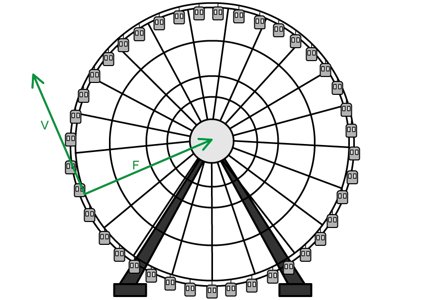
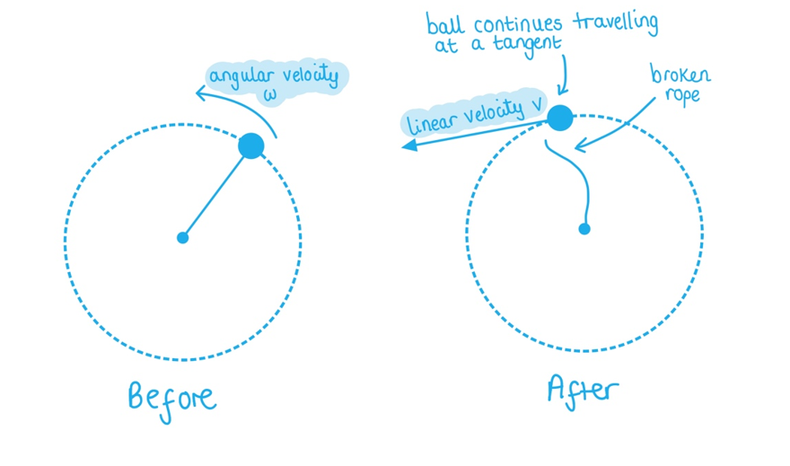
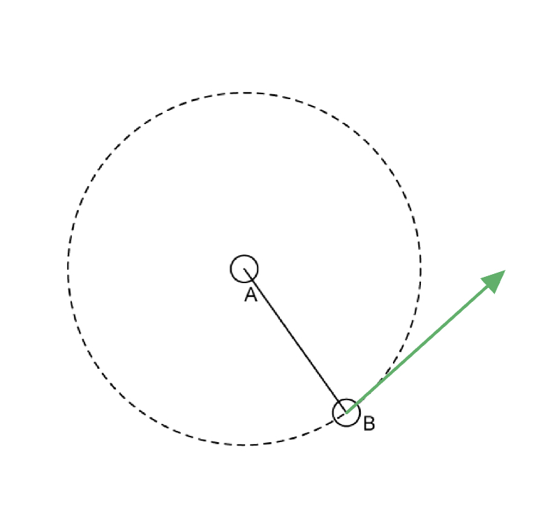

# Mark Schemes — Kinematics of Uniform Circular Motion
**12. Motion in a Circle** · Cambridge (CIE) A-LEVEL physics (9702)

## Structured Questions (5 questions)

### Q1
One complete revolution is equivalent to an angular displacement of 2π rad because:

- Arc length is* rθ *so for one complete revolution arc = 2π*r* **AND **so $θ=\frac{2πr}{r}=2π$* ***[1 mark]**

**[Total: 1 mark]**
Express this angle in degrees (°):

List the known quantities:

- Angular displacement = 0.22 rad

State the equation converting from radians into degrees:

- `theta ( r a d ) = theta ( degrees ) x ( pi / 180 ) <-> theta ( degrees ) = theta ( rad ) x ( 180 / pi )`

Substitute in the values:

- `theta ^ ring operator = 0.22 x ( 180 / pi ) = 12.605 ^ ring operator` **[1 mark]**

State your final answer to the appropriate number of significant figures:

- $θ=13^{\circ}$ (2 s.f) **[1 mark]**

**[Total: 2 marks]**

> *The appropriate number of significant figures is always the lowest number of the numbers used in the calculation. In this case, 0.22 rad is used, which is to 2 s.f, so the final answer almost must be to 2 s.f.*
Calculate the percentage error that is made when the angle 0.22 rad:

List the known quantities:

- Angle 0.22 rads in degrees, *θ*° = 12.605° (from part b)

Calculate the value of tan(*θ*°):

- tan(12.605) = 0.2236 (4 s.f.)

Calculate the percentage error:

- $\% e r r o r = \frac{d i f f e r e n c e i n v a l u e s }{o r i g i n a l v a l u e} \times 100 \%$
- $\% e r r o r = \frac{0.2236 - 0.22 }{0.22} \times 100 \%$ ** [1 mark]**
- $\% e r r o r = 1.636 = 1.6 \%$ (2 s.f.)** [1 mark]**

**[Total: 2 marks]**

> *When calculating % differences, it is better to use the **unrounded** values from previous subparts, because the differences are often very small. The number of significant figures for the final answer asked for in the question is vital for the final mark. *

> *Since 12.605 is the angle in **degrees** ensure your calculator is in **degrees **mode when using any trigonometric functions.*
Calculate the frequency of the particle:

List the known quantities:

- Time, *t* = 60 ms = 60 × 10–3 s

Calculate the angular velocity of the particle:

- $ω=\frac{Δθ}{Δt}=\frac{0.22}{60\times10^{-3}}$ **[1 mark]**
- $ω=3.667\mathrm{rad}s^{-1}$ **[1 mark]**

Calculate the frequency:

- $ω=2πf\Rightarrowf=\frac{ω}{2π}$
- $f=\frac{3.667}{2π}=0.58\mathrm{Hz}$ **[1 mark]**

**[Total: 3 marks]**

> *The angle** θ **in all equations in the circular motion topic **must** be in radians. Make sure not to incorrectly use your angle in degrees found in part (b) for this question.*

### Q2
The difference between angular velocity and linear velocity is:

- Angular velocity is the rate of change of <u>angular</u> displacement swept out by a <u>radius</u>; **[1 mark]**
- Whilst linear velocity is the rate of change (linear) displacement with respect to time when the object moves / for motion in a <u>straight</u> path; **[1 mark]**

**[Total: 2 marks]**
Use the data from Fig 1.1. the angular velocity of Europa in its orbit around Jupiter

List the known quantities:

- Radius of Io's orbit, *r*i = 422 000 km = 422 000 × 103 m
- Radius of Europe's orbit, *r*e = 670 900 km = 670 900 × 103 m
- Time period of Io's orbit, *T*i = 42.5 hours

Calculate the angular speed of Io, *ω*i:

- $ω=\frac{2π}{T}=\frac{2π}{42.5\times3600}=4.1\times10^{-5}\mathrm{rad}s^{-1}$ **[1 mark]**

Determine the equation for the angular speed of Europa, *ω**e*:

- If *r*3*ω*2* *= constant then *r*i *3**ω*i 2* *= *r**e** *3*ω**e** *2
- $ω_{e}=\sqrt{\frac{r_{i}^{3}ω_{i}^{2}}{r_{e}^{3}}}$

Substitute the values and calculate the angular speed, *ω**e*:

- $\omega_{e} = \sqrt{ \frac{( 422 000 \times 10^{3} )^{3} \times ( 4.1 \times 10^{- 5} )^{2}}{( 670 900 \times 10^{3} )^{3}} }$ **[1 mark]**
- $ω_{e}=2.0\times10^{-5}\mathrm{rad}s^{-1}$ **[1 mark]**

**[Total: 3 marks]**

> *Unless otherwise specified in the question, the angular speed is measured in rad s**–1**. This means the time period T must be in seconds (not hours, minutes or years).*
Calculate the time period of Europa

List the known quantities:

- The angular speed of Europa, *ω* = 2.0 × 10–5 rad s–1

Calculate the time period in seconds:

- $ω=\frac{2π}{T}\RightarrowT=\frac{2π}{ω}$
- $T=\frac{2π}{2.0\times10^{-5}}=314.159\times10^{3}s$ **[1 mark]**

Convert the time period into years:

- $T=\frac{314.159\times10^{3}}{365\times24\times60\times60}=9.96\times10^{-3}\mathrm{years}$ **[1 mark]**

**[Total: 2 marks]**
The radius of orbit of a moon that had double the linear speed of Io but a third of the time period is:

List the known quantities:

- Radius of Io's orbit, *r*i = 422 000 km

Determine the change in radius:

- $v=rω=\frac{2πr}{T}$
- $r=\frac{vT}{2π}$
- $r_{moon}=\frac{2v\times\frac{1}{3}T}{2π}=\frac{2}{3}\times\frac{vT}{2π}=\frac{2}{3}r_{i}$ **[1 mark]**

Calculate the radius of the moon, *r*moon:

- $r_{m o o n} = \frac{2}{3} \times ( 422 000 ) = 281 333 = 280 000 \text{km}$**[1 mark]**

**[Total: 2 marks]**

> *The final answer in metres will also be accepted.*

> *Questions like this are also very common in multiple-choice questions. You must first find the equation that links all the variables you are looking for (in this case, orbital radius, linear speed and time period) and compare them from there.*

> *If the linear speed was doubled and the time period was **halved** instead, you can see that 2 × *$\frac{1}{2}$* will cancel out and actually the orbital radius would be the same. Watch out for this as well.*

### Q3
To calculate the speed of each passenger in the capsules:

List the known quantities:

- Radius of rotation, *r* = 68 m
- Angular speed, *ω *= 3.5 × 10–3 rad s–1

Recall and rearrange the angular speed equation for linear velocity, *v*:

- Magnitude of angular speed, *ω* =$\frac{v}{r}$
- *v* = *rω ***[1 mark]**

Substitute in the values:

- *v* = 68 × (3.5 × 10–3) **[1 mark]**
- *v* = 0.238 = 0.24 m s–1 **[1 mark]**** **

**[Total: 3 marks]**** **
A diagram that would score 2 marks:

(i) The direction of the centripetal force

- Arrow towards the centre of the London Eye, labelled F; **[1 mark]**

(ii) The direction of the linear speed

- Arrow perpendicular to the centripetal force in the clockwise direction, labelled v; **[1 mark]**** **

**[Total: 2 marks]**
List the known quantities:

- Angular speed, *ω *= 3.5 × 10–3 rad s–1 (From part (a))

Rearrange the angular speed equation to make time period, *T, *the subject:

- *ω*  = 2π*f  *=$\frac{2π}{T}$
- *T* = $\frac{2π}{ω}$ **[1 mark]**

Substitute in the values to calculate the time period, *T*:

- *T* = $\frac{2π}{3.5\times10^{-3}}$**[1 mark]**
- *T *= 1795.196 s **[1 mark]**

Convert *T* from seconds into minutes:

- *T* = $\frac{1795.196}{60}$= 29.92 = 30 minutes **[1 mark]**

Conclusion:

- Yes, Dan has enough time because 30 minutes < 40 minutes; **[1 mark]**** **

**[Total: 5 marks]**

> *Remember to always write a conclusion for questions like this and give an adequate explanation (preferably with numbers) as to why you have reached that conclusion. Just a ‘Yes’ or ‘No’ will not be enough for some examiners to award you the final mark. *

> *This question can also be answered by using the linear velocity **v** calculated from part (a) and using **ω** = *$\frac{2π}{T}$* = *$\frac{v}{r}$*  therefore **v** = *$\frac{2\mathrm{πr}}{T}$* instead. This will still get you full marks.*

### Q4
The equation linking *ω*, *θ* and *t* is:

- (Angular speed)* ω* = $\frac{\Deltaθ}{\Deltat}$ **[1 mark]**** **

**[Total: 1 mark]**** **

> *Remember that angular speed, *$ω=\frac{\Deltaθ}{\Deltat}=\frac{2π}{T}=2πf$
State the value for 30º in radians, in terms of π:

Convert *θ*  into radians:

- *θº* × $\frac{π}{180}$= *θ *rad
- *θ* = 30º × $\frac{π}{180}$ **[1 mark]**
- *θ *=$\frac{π}{6}$ rad **[1 mark]**** **

**[Total: 2 marks]**** **

> *It’s very useful to remember that 180º is equal to π rad – from here you can easily figure out radian conversions which are multiples of 30º *

> *The conversions are:*

- *degrees to radians: **θº** × *$\frac{π}{180}$* = **θ **rad*
- *radians to degrees: **θ **rad × *$\frac{180}{π}$* = **θº** *
To calculate *ω*  and state an appropriate unit:

List the known quantities:

- Rotation angle, *θ  *= $\frac{π}{6}$ rad (from part (b))
- Time, *t* = 0.7 s
- Angular velocity, *ω*  = $\frac{\Deltaθ}{\Deltat}$  (from part (a))

Substitute values into angular velocity equation:

- *ω*  = $\frac{π}{6}\div0.7$ **[1 mark]**
- *ω  *= 0.748 = 0.75 **[1 mark]**

State the correct unit:

- rad s–1 **[1 mark]**** **

**[Total: 3 marks]**
Calculate the initial velocity of the ball if it was to suddenly separate from the rope:

List the known quantities:

- Length of rope (radius of the circle), *r* = 80 cm = 0.8 m
- Angular velocity, *ω *= 0.748 rad s–1 (from part (c))

Recall and rearrange the angular speed equation to make linear velocity, *v,* the subject:

- Angular speed, *ω* = $\frac{v}{r}$
- *v* = *rω ***[1 mark]**

Substitute values into the equation:

- *v *= 0.8 × 0.748 **[1 mark]**
- *v *= 0.5984 = 0.60 m s–1 **[1 mark]**** **

**[Total: 3 marks]**** **

> *When an object is no longer in circular motion, it will exit the circle in a straight line from the point it left the circle, or in other words, at a **tangent **to the circle. Since the linear velocity is the velocity in the direction of travel, the ball would therefore travel at its linear velocity when the rope breaks. *

> *This can be seen from a bird’s eye view of the swing ball set up:*

### Q5
Calculate the time taken for child B to travel a distance of 0.45 m

List the known quantities:

- Distance, Δ*s* = 0.45 m
- Time period, *T* = 1.5 s
- Radius, *r* = 70 cm = 0.70 m

Calculate the angular velocity, *ω*:

- $ω=\frac{2π}{T}=\frac{2π}{1.5}=4.189\mathrm{rad}s^{-1}$ ** [1 mark]**

Calculate the time taken:

- $\Deltaθ=ω\Deltat=\frac{\Deltas}{r}$
- $\Deltat=\frac{\Deltas}{rω}=\frac{0.45}{0.70\times4.189}$ ** [1 mark]**
- $\Deltat=0.1535=0.15s$** [1 mark]**

**[Total: 3 marks]**

> *None of the circular motion equations will be given on your data sheet, so make sure you remember these, and be confident in rearranging them.*
Show that the angular displacement, Δ*θ *in this time is 37°

List the known quantities:

- Angular velocity, *ω* = 4.189 rad s–1
- Time, Δ*t* = 0.1535 s

Calculate the angular displacement, Δ*θ*:

- $ω=\frac{\Deltaθ}{\Deltat}\Rightarrow\Deltaθ=ω\Deltat$ **[1 mark]**
- $\Deltaθ=4.189\times0.1535=0.643\mathrm{rad}$ **[1 mark]**

Convert Δ*θ *from radians to degrees:

- `theta ( deg ) = theta ( rad ) x ( 180 / pi ) = 0.643 x ( 180 / pi )` = 36.8° = 37° **[1 mark]**

**[Total: 3 marks]**
Calculate the linear speed of child B

List the known quantities:

- Radius, *r* = 70 cm = 0.70 m

Calculate the frequency, *f*:

- Frequency is the number of revolutions in 1 second
- 5 revolutions in 2 seconds so *f* is $\frac{5}{2}=2.5$revolutions per second (2.5 s–1) **[1 mark]**

Calculate the linear speed, *v*:

- $v = \\omega r = ( 2 \mathrm{\pi } f ) r$
- $v=2π\times2.5\times0.70$ **[1 mark]**
- $v=10.996=11ms^{-1}$ **[1 mark]**

**[Total: 3 marks]**
Sketch on the diagram the direction child B will continue to travel in the instance the rope is snapped.

A sketch that would score 1 mark should look like:

- Arrow tangent to be pointed anti-clockwise; **[1 mark] **

**[Total: 1 mark]**
