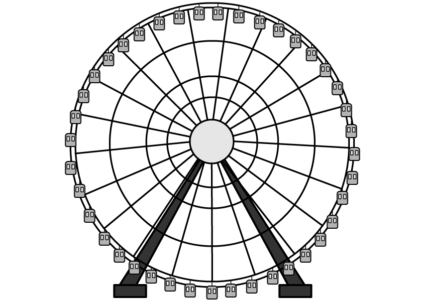
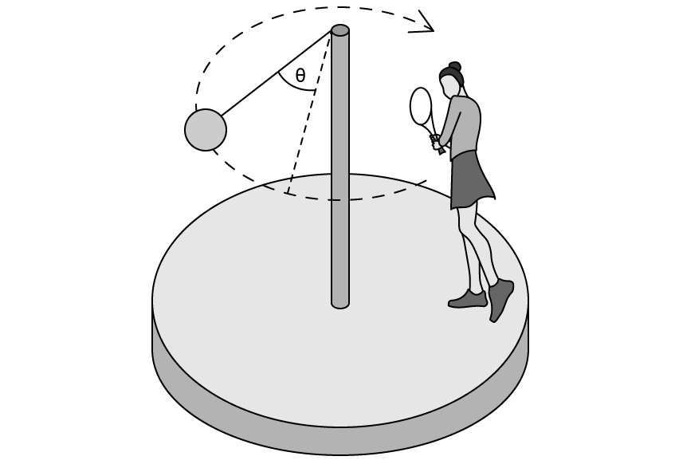
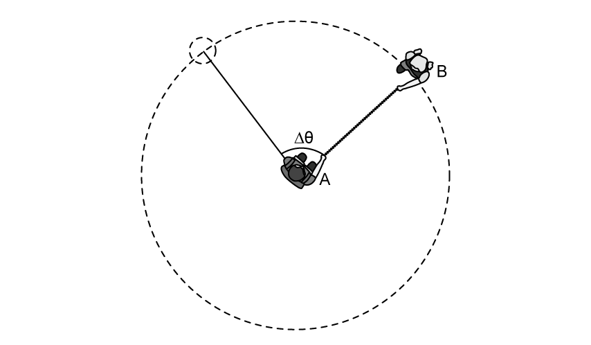

# Exam Questions — Kinematics of Uniform Circular Motion
**12. Motion in a Circle** · Cambridge (CIE) A-LEVEL physics (9702)
> Source: [https://www.savemyexams.com/a-level/physics/cie/25/topic-questions/](https://www.savemyexams.com/a-level/physics/cie/25/topic-questions/) · 5 questions across 1 sets

## Structured Questions (5 questions)

### Q1 — medium — 8 marks

**Q1** [1 mark]

Explain why one complete revolution is equivalent to an angular displacement of 2π rad.

**Q1** [2 marks]

A particle following a circular path is observed to have an angular displacement of 0.22 rad.

Express this angle in degrees (°). Show your working and give your answer to an appropriate number of significant figures.

**Q1** [2 marks]

**Extract:**

A particle following a circular path is observed to have an angular displacement of 0.22 rad. Express this angle in degrees (°). θ(degrees) = θ(rad) × (180/π); θ° = 0.22 × (180/π) = 12.605°

Calculate the percentage error that is made when the angle 0.22 rad, as measured in degrees (*θ°*<u>)</u>, is assumed to be equal to tan(*θ*°) to four significant figures. Give your final answer to two significant figures.

**Q1** [3 marks]

**Extract:**

A particle following a circular path is observed to have an angular displacement of 0.22 rad.

The particle travels the angle in part **(b)** in 60 ms.

Calculate the frequency of the particle.

### Q2 — medium — 9 marks

**Q2** [2 marks]

State the difference between *angular velocity* and *linear velocity*.

**Q2** [3 marks]

A moon is in a circular orbit *r* about a planet. The angular speed of the moon in its orbit is *ω.* The planet and its moon may be considered to be point masses that are isolated in space.

*r* and *ω *are related by the expression

*      r*3*ω*2 = constant

Io and Europa are moons that are in circular orbits around the planet Jupiter.

Data for Io and Europa are shown in Fig 1.1.

| moon | radius of orbit / km | period of rotation around Jupiter / hours |
|---|---|---|
| Io | 422 000 | 42.5 |
| Europa | 670 900 |   |

**Fig 1.1**

Use the data from Fig 1.1. to determine the angular speed of Europa in its orbit around Jupiter.

**Q2** [2 marks]

**Extract:**

Use the data from Fig 1.1. to determine the angular speed of Europa in its orbit around Jupiter. The angular speed of Europa, ω = 2.0 × 10^–5 rad s^–1.

Calculate the time period of Europa.

*T* = ................................ years

**Q2** [2 marks]

**Extract:**

Io and Europa are moons that are in circular orbits around the planet Jupiter. Data for Io and Europa are shown in Fig 1.1.

moon | radius of orbit / km | period of rotation around Jupiter / hours
Io | 422 000 | 42.5
Europa | 670 900 | (blank)

Fig 1.1

Determine the radius of the orbit of a moon that had double the linear speed of Io but a third of its time period.

### Q3 — easy — 10 marks

**Q3** [3 marks]

The London Eye shown in Fig. 1.1 has a radius of approximately 68 m and the passengers in the capsules travel at an angular speed of 3.5 × 10–3 rad s–1.

**Fig. 1.1**

Calculate the speed of each passenger in the capsules.

**Q3** [2 marks]

**Extract:**

The London Eye shown in Fig. 1.1 has a radius of approximately 68 m and the passengers in the capsules travel at an angular speed of 3.5 × 10^–3^ rad s^–1^.

{align=center} **Fig. 1.1**

Sketch on any capsule in Fig. 1.1:

(i) The direction of the centripetal force. Label this F.

[1]

(ii) The direction of the linear speed. Label this v.

Assume the London Eye is rotating clockwise.

[1]

**Q3** [5 marks]

**Extract:**

The London Eye shown in Fig. 1.1 has a radius of approximately 68 m and the passengers in the capsules travel at an angular speed of 3.5 × 10^–3^ rad s^–1^.

Dan has travelled to London to watch an exciting Physics show. Being an eager tourist, he arrives early and plans to ride the London Eye. When he gets to the front of the queue however, he realises he only had 40 minutes before he needs to leave for the show.

State, with a calculation, whether Dan is still able to ride the London Eye and leave to see the show on time.

### Q4 — easy — 9 marks

**Q4** [1 mark]

Melody is playing a game of swing ball. The game consists of a ball attached by a short rope to the top of a pole to rotate around it. The ball is kept it motion in a circular path after being hit by a bat, as shown in Fig. 1.1.

**Fig. 1.1**

State the equation linking the angular velocity of the ball* ω, *rotation angle, *θ  *and time, *t*.

**Q4** [2 marks]

The ball rotates by 30º in 0.7 s.

State the value for 30º in radians, in terms of π.

**Q4** [3 marks]

**Extract:**

State the equation linking the angular velocity of the ball ω, rotation angle, θ and time, t. Answer: (Angular speed) ω = Δθ/Δt

The ball rotates by 30º in 0.7 s. State the value for 30º in radians, in terms of π. Answer: θ = π/6 rad

Calculate *ω*  and state an appropriate unit.

**Q4** [3 marks]

**Extract:**

*ω*  = \$\$\frac{\pi}{6} \div 0 . 7\$\$; *ω  *= 0.748 = 0.75 rad s^–1

The rope is 80 cm long.

Calculate the initial velocity of the ball if it was to suddenly separate from the rope.

### Q5 — medium — 10 marks

**Q5** [3 marks]

Two children A and B hold both sides of a rope 70 cm long. Child B swings around child A in a circular path, as shown Fig 1.1.

**Fig 1.1**

Child B travels a full rotation in 1.5 s.

Calculate the time taken for child B to travel a distance of 0.45 m.

**Q5** [3 marks]

**Extract:**

Two children A and B hold both sides of a rope 70 cm long. Child B swings around child A in a circular path, as shown Fig 1.1. Child B travels a full rotation in 1.5 s. Calculate the time taken for child B to travel a distance of 0.45 m.

Distance, Δs = 0.45 m; Time period, T = 1.5 s; Radius, r = 70 cm = 0.70 m. Angular velocity, ω = 2π/T = 2π/1.5 = 4.189 rad s^-1. Δt = Δs/(rω) = 0.45/(0.70 × 4.189) = 0.1535 = 0.15 s.

Show that the angular displacement, Δ*θ *in this time is 37°.

**Q5** [3 marks]

**Extract:**

Two children A and B hold both sides of a rope 70 cm long. Child B swings around child A in a circular path, as shown Fig 1.1.

Child A now swings child B round till they are making 5 revolutions every 2 seconds.

Calculate the linear speed of child B.

**Q5** [1 mark]

**Extract:**

Two children A and B hold both sides of a rope 70 cm long. Child B swings around child A in a circular path, as shown Fig 1.1.

As the children are spinning anti-clockwise, the rope suddenly snaps at the position of child A and B shown in Fig 1.2.

**Fig 1.2**

Draw the direction child B will continue to travel in the instance the rope is snapped.
