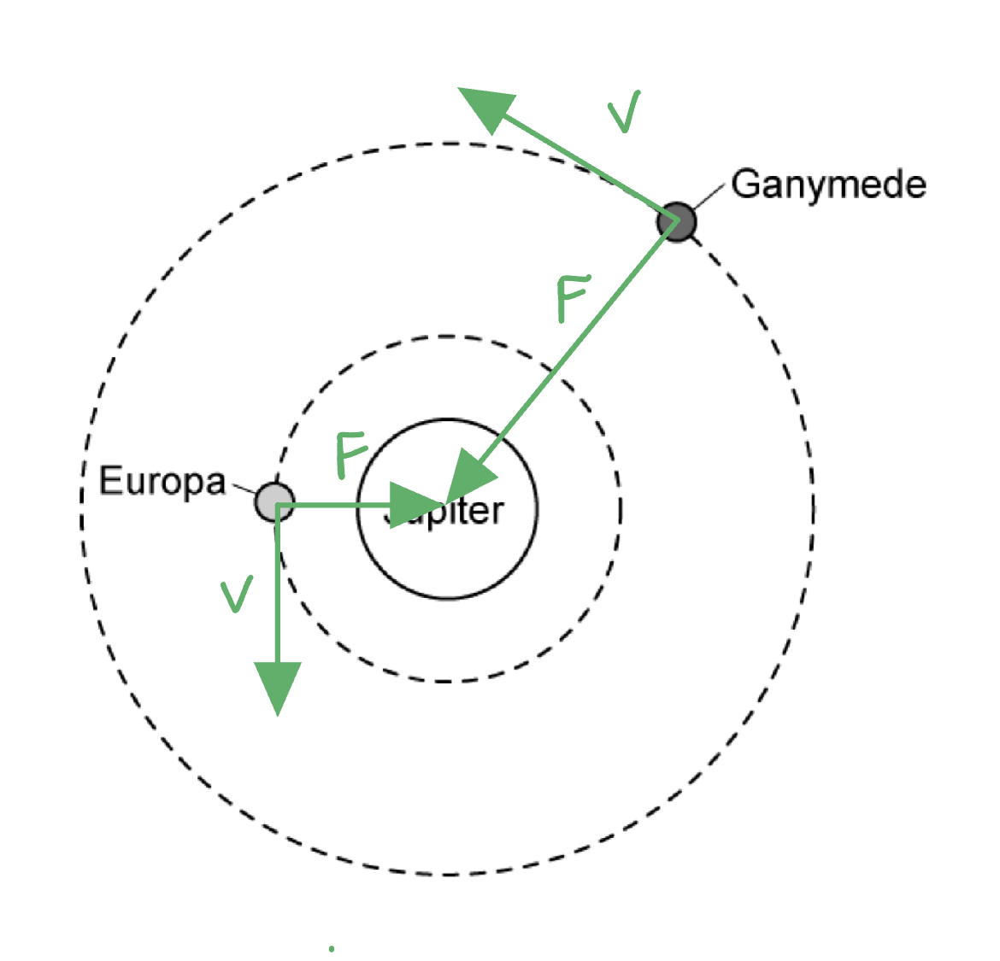
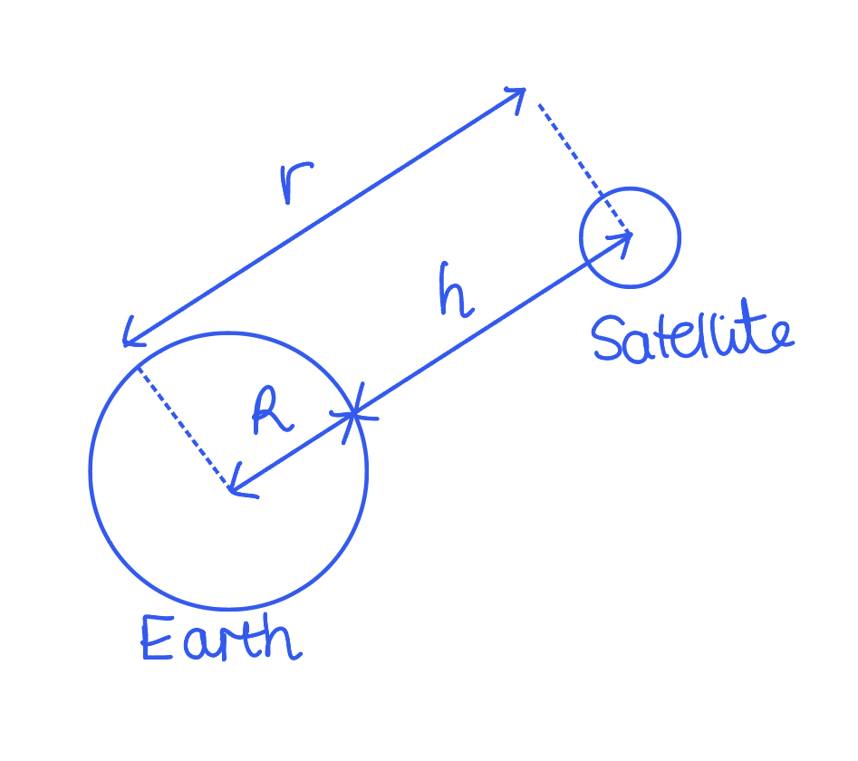
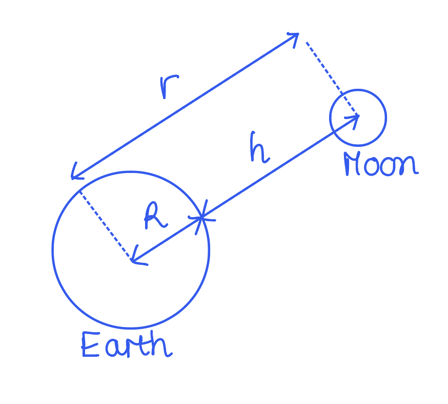
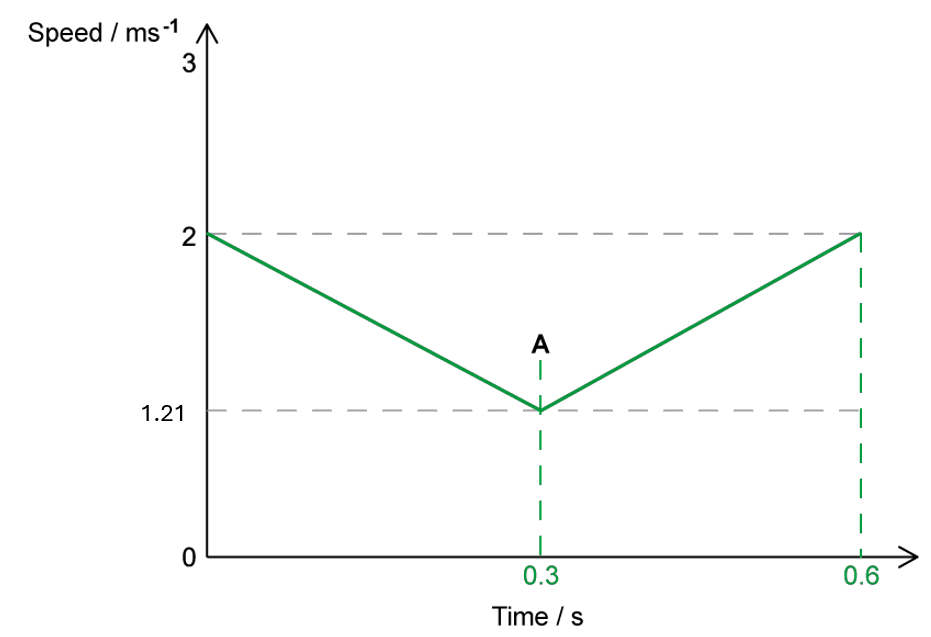
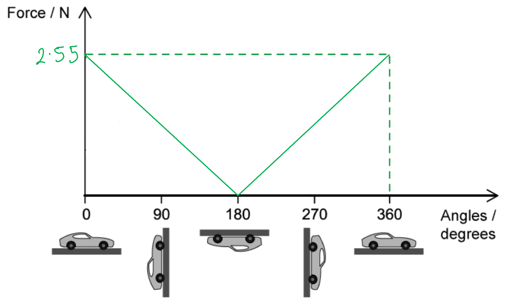
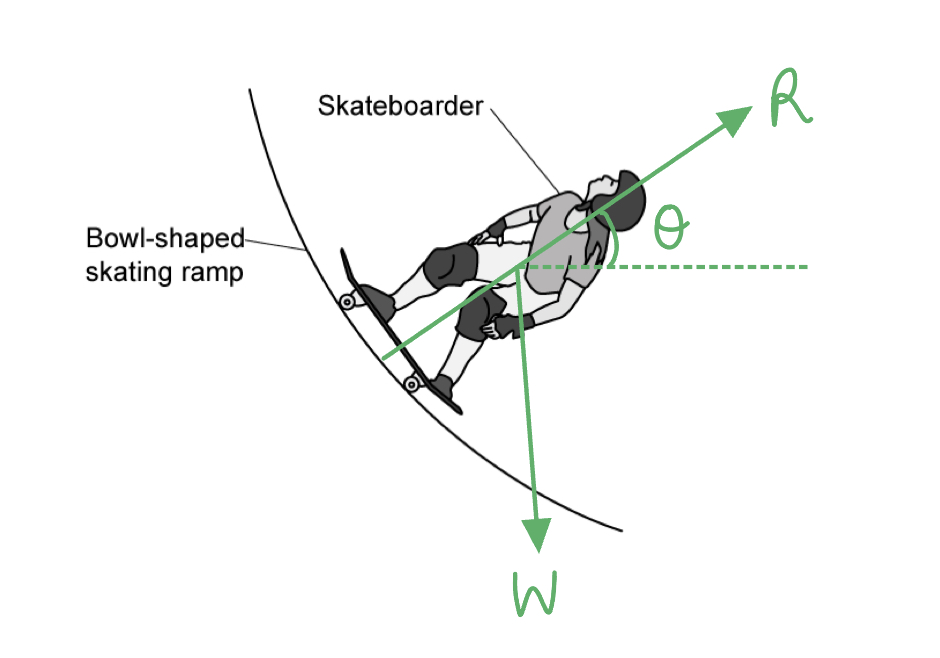
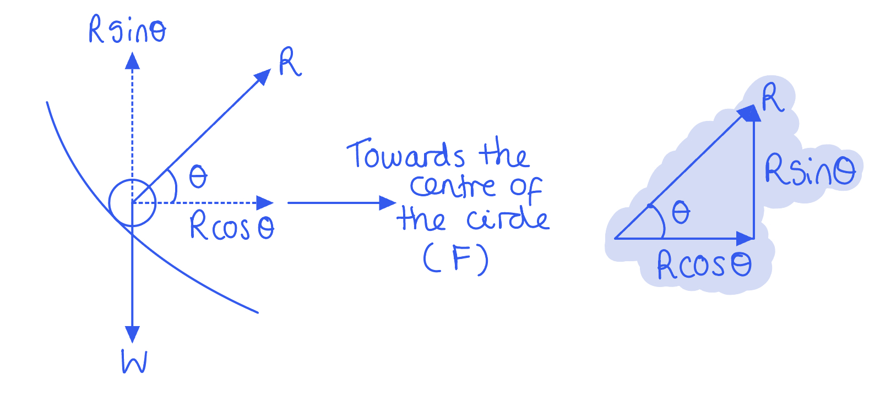

# Mark Schemes — Centripetal Acceleration
**12. Motion in a Circle** · Cambridge (CIE) A-LEVEL physics (9702)

## Structured Questions (8 questions)

### Q1
A sketch that would score 4 marks should look like:

(i) The centripetal force on each moon is sketched as:

- Arrow drawn from the centre of each moon to the centre of Jupiter; **[1 mark]**
- Arrow pointed towards the centre of Jupiter **AND **labelled *F*; **[1 mark]**

(ii) The linear velocity of each moon is sketched as:

- Arrow drawn from the centre of each moon and perpendicular to *F*; **[1 mark]**
- Arrow pointed in the counter-clockwise direction to *F* **AND **labelled *v*; **[1 mark]**

**[Total: 4 marks]**
The moon with the longer time period is:

- Ganymede; **[1 mark]**

Explanation:

- The radius of the orbit (*r*) is directly proportional to the time period (*T*) / $r\proptoT$ **AND **as the linear velocity (*v*) is the same; **[1 mark]**
- Ganymede has a larger orbital radius (*r*) (so a larger time period); **[1 mark]**

**[Total: 3 marks]**

> *We can see Ganymede has a larger orbital radius from Fig 1.1. *

> *We have been given their linear velocity and we want to see how the time periods compare. The equation *$v=\frac{2πr}{T}$* links all three of these variables.*

> *Multiplying both sides by **T** gives *$Tv=2πr$*. Since **v**, and 2π are constant, **T** and **r** are directly proportional.*
The centripetal force on Ganymede is:

List the known quantities:

- Centripetal acceleration, *a* = 0.11 m s–2
- Mass, *m* = 1.48 x 1023 kg

Calculate the centripetal force, *F*:

- `F space equals space m a space equals space open parentheses 1.48 space cross times space 10 to the power of 23 close parentheses space cross times space 0.11` **[1 mark]**
- $F=1.628\times10^{22}=1.6\times10^{22}N$ **[1 mark]**

**[Total: 2 marks]**

> *The difference between the equation for centripetal force *$F=\frac{mv^{2}}{r}$* and centripetal acceleration *$a=\frac{v^{2}}{r}$* is the **m**. They are related by Newton's second law, *$F=ma=\frac{mv^{2}}{r}$*.*
The relation between the centripetal force and the angular speed is $F=mrω^{2}$.

- Since the object has the same mass *m* and orbital radius *r*, we have the relation $F\proptoω^{2}$ **[1 mark]**
- As angular speed *ω* is doubled it becomes (2*ω*)2 = 4*ω*2. This means the centripetal force will be four times greater / quadrupled **[1 mark]**

**[Total: 2 marks]**

### Q2
Two properties of the centripetal force that cause a centripetal acceleration are:

- (It must be) constant in magnitude; **[1 mark]**
- It must be perpendicular to the direction of motion **OR** towards the centre of the circle; **[1 mark]**

**[Total: 2 marks]**
(i) The equation for centripetal acceleration is:

- $a=rω^{2}$ **OR **$a=\frac{v^{2}}{r}$ **[1 mark]**

** **

(ii) The definition and unit for each variable are:

- *a* is (centripetal) acceleration **AND **in m s–2 **[1 mark]**
- *r* is the radius of the (circular) orbit **AND **in m **[1 mark]**
- *v* is the linear speed **AND **in m s–1 **[1 mark]**

**[Total: 4 marks]**
The angular speed of an object in a geostationary orbit is:

Determine the time period of the satellite:

- A geostationary orbit has a time period 24 hours (1 day)
- 24 hours = 24 × 60 × 60 = 86 400 s **[1 mark]**

Determine the equation for the angular speed:

- $ω=2πf=\frac{2π}{T}$

Substitute in the values:

- $ω=\frac{2π}{86400}$ **[1 mark]**
- $ω=7.272\times10^{-5}=7.3\times10^{-5}\mathrm{rad}s^{-1}$ **[1 mark]**

**[Total: 3 marks]**
The centripetal acceleration of the satellite is:

List the known quantities:

- Angular speed of the satellite, *ω* = 7.272 × 10–5 rad s–1
- Radius of Earth, *R* = 6400 km = 6400 × 103 m
- Altitude of the satellite, *h* = 36 000 km = 36 000 × 103 m

Determine the radius of the satellite's circular orbit, *r*:

- `r space equals space R space plus space h space equals space open parentheses 6400 space cross times space 10 cubed close parentheses space plus space open parentheses 36 space 000 space cross times space 10 cubed close parentheses space equals space 42.4 space cross times space 10 to the power of 6 space straight m` **[1 mark]**

Substitute values into the centripetal acceleration equation, *a*:

- `a space equals space r omega squared space equals space open parentheses 42.4 space cross times space 10 to the power of 6 close parentheses space cross times space open parentheses 7.272 space cross times 10 to the power of negative 5 end exponent close parentheses squared` **[1 mark]**
- $a=0.2242=0.22ms^{-2}$ **[1 mark]**

**[Total: 3 marks]**

> *Always make sure you use the correct value for the radius of orbit, **r**. This is the distance from the **centre** of the two bodies.*

> *Therefore, if you want the **radius** of the satellite's orbit, you must add the radius of Earth to the altitude of the satellite.*

### Q3
Centripetal force is:

- A (resultant) force that acts on / is required to keep a body moving in a <u>circular</u> path;** [1 mark]**
- That is directed towards the <u>centre</u> around which the body is moving / of the circle;** [1 mark]**

**[Total: 2 marks]**
The centripetal force when:

(i) Venus orbits the Sun is:

- Gravitational force (of the Sun); **[1 mark]**

(ii) A car driving around a roundabout is:

- Friction / frictional force; **[1 mark]**

(iii) Rotating a ball tied to the end of a piece of string:

- Tension (in the string); **[1 mark]**

**[Total: 3 marks]**
The path of the moon is circular because:

- The field lines show that the (gravitational) force acts towards the centre of the planet **OR **the velocity of the Moon is perpendicular to the field lines; **[1 mark] **
- The force is perpendicular to the velocity which causes centripetal <u>acceleration;</u> **[1 mark] **

**[Total: 2 marks]**
The distance of the Moon from the surface of the Earth is:

List the known quantities:

- Centripetal force on the Moon, *F* = 2.21 × 1020 N
- Mass of the Moon, *m* = 7.35 × 1022 kg
- Radius of the Earth, *R* = 6.38 × 106 m
- Linear speed of the Moon, *v* = 1.023 km s–1 = 1023 m s–1

Determine the equation for the radius of the Moon's orbit, *r*:

- $F=\frac{mv^{2}}{r}\Rightarrowr=\frac{mv^{2}}{F}$ **[1 mark]**

Substitute in the values:

- `r space equals space fraction numerator open parentheses 7.35 space cross times 10 to the power of 22 close parentheses space cross times space open parentheses 1023 close parentheses squared space over denominator 2.21 space cross times 10 to the power of 20 end fraction` **[1 mark]**
- $r$ = 3.4805 × 108 m **[1 mark]**

Calculate the distance from the surface of the Earth, *h*:

- $r=R+h\Rightarrowh=r-R$
- $h$ = (3.4805 × 108) – (6.38 × 106) = 3.42 × 108 m (3 s.f.) **[1 mark]**

**[Total: 4 marks]**

> *Always make sure you use the correct value for the radius of orbit, **r**. This is the distance from the **centre** of the two bodies.*

> *Therefore, if you want the distance from the **surface** of the Earth to the Moon, you must subtract the radius of Earth from the value of **r** calculated.*

### Q4
(i) List the known quantities:

- Radius of the circle, *r *= 0.15 m
- Initial speed, $S_{1}$= 2.0 m s–1
- Speed at A, $S_{A}$*= *1.21 m s–1
- Final speed, $S_{2}$= 2.0 m s–1

Determine the average speed for the journey, *v*:

- The car undergoes constant deceleration to A at the halfway point and then an acceleration to the bottom of the loop
- Average speed , *v *= $\frac{2.0+1.21}{2}$ = 1.61 m s–1 **[1 mark]**

Determine an expression for the time taken* *to A, , *t**1/2** *:

- Circumference of ½ circle = `1 half space cross times space open parentheses 2 pi space r close parentheses space equals space pi space r`
- Time taken to A, *t**1/2*  = $\frac{distance}{averagespeed}$ = $\frac{\mathrm{πr}}{s}$ = $\frac{π\times0.15}{1.61}=0.29$ = 0.3 s **[1 mark]**

Calculate the total time taken, *t*:

- *t  *= 2 × *t**1/2*
- *t  *= 2 × 0.29
- *t  *= 0.58 = 0.6 s **[1 mark]**

(ii) Sketch a speed-time graph of the journey through the loop:

- Straight lines drawn, values for speed and time labelled, and A marked halfway at the turning point for the line; **[1 mark]**** **

**[Total: 4 marks]**** **

> *You should be able to work out the total distance travelled by recognising that it is equal to the circumference of the circular loop.*
(i) The origin of the centripetal force is:

- Always directed towards the centre of the circle
- In the bottom half of the loop the force is caused by the <u>normal reaction force</u> from the track <u>minus</u> the <u>weight</u> of the car; **[1 mark]**
- In the top half of the track the <u>weight</u>** **of the car <u>and</u> the <u>normal</u> reaction force provide the centripetal force; **[1 mark]**

(ii) Determine the minimum and maximum values of the reaction force:

List the known quantities:

- Mass of car, *m  *= 70 g = 70 × 10−3 kg
- Radius of track, *r  *= 0.15 m
- Linear velocity of car at bottom, *v**1**  *= 2.0 m s−1
- Linear velocity of car at top, *v**2* = 1.21 m s−1
- Acceleration due to free-fall, *g  *= 9.81 m s−2

The minimum reaction force:

- Occurs at the <u>top</u> of the loop
- At the minimum speed of 1.21 m s−1
- When the weight supplies all the centripetal force
- To 2 s.f. $\frac{mv^{2}}{r}=mg$
- So, reaction force = 0 N **[1 mark]**

The maximum reaction force:

- Occurs at the <u>bottom</u> of the loop
- When the normal reaction force = centripetal force + weight
- Maximum reaction force = $\frac{mv^{2}}{r}+mg$
- Maximum reaction force = `fraction numerator open parentheses 70 space cross times space 10 to the power of negative 3 end exponent close parentheses space cross times space 2 squared over denominator 0.15 end fraction space plus space open parentheses 70 space cross times space 10 to the power of negative 3 end exponent close parentheses space cross times space 9.81` = 2.55 N **[1 mark]**** **

**[Total: 4 marks]**** **

> *The **origin **of the centripetal force will **change** throughout the loop, but it is always directed towards the **centre** of the loop. It can be difficult to determine the direction of each of the three forces in the different positions as the car travels around the track. There is a **constant downward force** caused by **gravity** but a **varying normal force**. It is important to recognise that upward forces ≠ downward forces on a conventional force diagram because the car is accelerating towards the centre of the loop. *

> *At the **top** where reaction force is minimum: **Centripetal force = reaction force + weight *

> *At the **bottom** where reaction force is maximum: **Centripetal force = reaction force - weight*
A graph that would earn 3 marks should look like this:

- The graph has a V shape; **[1 mark]**
- Reaction force between 2.55 N and 0 N at 90° and 270°; **[1 mark]**
- Graph starts and ends at labelled maximum value 2.55 N **AND** Labelled minimum value of zero at 180°; **[1 mark]**** **

**[Total: 3 marks]**

> *The question states you only need to show the general shape of the graph. This means you can draw either straight or curved lines as long as the correct values are indicated on the graph.*
Determine an expression for minimum velocity:

- The minimum velocity of the car is at the <u>top</u> of the loop
- At the top of the loop, centripetal force = weight
- *mg* =$\frac{mv^{2}}{r}$
- *v* =$\sqrt{gr}$ **[1 mark]**

Deduce the change in gravitational potential energy, Δ*E**p**:*

- *E**p* at start = *mgh*
- *E**p* at top of loop = *mg2r*
- Δ*E**p* = *mgh* – *mg2r ***[1 mark]**

Equate change in Δ*E**p*  to *E**k*:

- The kinetic energy of the car at the top of loop is equal to the gravitational potential energy lost when falling a distance *h*
- *E**k* = $\frac{1}{2}$*mv**2* = *mgh* – *mg2r ***[1 mark]**

Substitute in the expression for minimum velocity into the kinetic energy expression:

- `1 half m v squared space equals space 1 half m open parentheses square root of g r end root close parentheses squared space equals space m g h space minus space m g 2 r`
- $\frac{1}{2}$*mgr*  = *mgh* – *mg2r*
- $\frac{5}{2}$*mgr*  = *mgh*
- *h *= $\frac{5}{2}$*r ***[1 mark]**** **

**[Total: 4 marks]**** **

> *Remember that on long ‘show that’ questions, it is important to structure your working out so that the examiner can see the steps you have gone through. You may be asked to apply equations from other areas of the course, but you will not be expected to derive those equations.*

### Q5
Show that the maximum speed at which the runners can move around the track without sliding is 0.17 m s–1.

List the known quantities:

- Mass of each runner, *m* = 75 kg
- Radius of circular motion, *r* = 36.50 + 1.2 = 37.7 m
- Frictional (centripetal) force, *F* = 57 mN = 57 × 10–3 m

Determine an equation for the maximum speed, *v*:

- $F = \frac{mv^{2}}{r} \Rightarrow v = \sqrt{\frac{Fr}{m}}$ **[1 mark]**
- `v equals square root of fraction numerator open parentheses 57 cross times 10 to the power of negative 3 end exponent close parentheses cross times 37.7 over denominator 75 end fraction end root equals 0.169 equals 0.17 space straight m space straight s to the power of negative 1 end exponent` **[1 mark]**

**[Total: 2 marks]**
The comparison between the centripetal acceleration and maximum speed of the runner on path X compared to path Y is:

- They both have the <u>same</u> centripetal acceleration; **[1 mark]**
- The runner on path X has a smaller <u>maximum</u> speed (than the runner on path Y); **[1 mark]**

**[Total: 2 marks]**
Calculate the time taken for the runner in path X to complete 1 lap

List the known quantities:

- Mass of each runner, *m* = 75 kg
- Radius of circular motion, *r* = 36.50 m
- Frictional (centripetal) force, *F* = 57 mN = 57 × 10–3 m

Determine an equation for the time period, *T*:

- `F space equals space m omega squared r space equals space m open parentheses fraction numerator 2 pi over denominator T end fraction close parentheses squared r`
- $T=\sqrt{\frac{m4π^{2}r}{F}}$

Substitute the values into the time period equation:

- $T=\sqrt{\frac{75\times4π^{2}\times36.50}{57\times10^{-3}}}$ **[1 mark]**
- $T=1376.95s$

Convert the time period into minutes:

- $T=\frac{1376.95}{60}=22.95=23\mathrm{minutes}$ **[1 mark]**

**[Total: 2 marks]**

> *Make sure you read the question carefully! This is now talking about the runner on path X, so we are now using a different value of **r** (but both runners still have the same **F**).*

> *Always look out for the units required in the final answer. Although time period will normally be given in seconds, we must convert it into **minutes** here.*
Determine their new centripetal acceleration

List the known quantities:

- Mass, *m* = 75 kg
- Previous frictional (centripetal) force, *F* = 57 mN = 57 × 10–3 m

Calculate the previous centripetal acceleration, *a*p :

- $F=ma\Rightarrowa=\frac{F}{m}$
- $a_{p}=\frac{57\times10^{-3}}{75}=7.6\times10^{-4}ms^{-2}$ **[1 mark]**

Determine the change in centripetal acceleration:

- `a space equals space r omega squared space equals space r open parentheses fraction numerator 2 straight pi over denominator T end fraction close parentheses squared space equals fraction numerator space r 4 straight pi squared over denominator T squared end fraction`
- $a\propto\frac{1}{T^{2}}$
- Therefore, if *T *doubles, then *a* decreases by 4

Calculate the new centripetal acceleration, *a*:

- $a=\frac{a_{p}}{4}=\frac{7.6\times10^{-4}}{4}$ **[1 mark]**
- $a=1.9\times10^{-4}ms^{-2}$ **[1 mark]**

**[Total: 3 marks]**

### Q6
Sketch *W*, *R* and *θ *on Fig 1.2

A sketch that would score 3 marks should look like:

- *R* from the skating ramp directed normal to the skating ramp; **[1 mark]**
- *W* directly downwards from the centre of mass of skateboarder; **[1 mark]**
- *θ *labelled between a horizontal line and *R*; **[1 mark]**

**[Total: 3 marks]**

> *R** is the reaction force from the skating ramp on the skateboarder. Therefore, it must start **on the ramp** and not at the centre of the mass of the skateboarder as the weight does! If the arrows are from an incorrect point, you will not get all the marks.*
Determine an equation for *W *in terms of *θ* and the resultant force,* F *on the skateboarder

Equate the components of *R* to *F* and *W*:

- *F* = *R* cos*θ ***[1 mark]**
- *W* = *R* sin*θ* **[1 mark]**

Determine an equation in terms of *W*, *θ *and *F*:

- $\frac{W}{F}=\frac{R}{R}\frac{\mathrm{sin}θ}{\mathrm{cos}θ}=\mathrm{tan}θ$
- $W=F\mathrm{tan}θ$ **[1 mark]**

**[Total: 3 marks]**

> *The horizontal component, **R** cos**θ **is in the same direction as the resultant force, **F** (towards the centre of the circle). The vertical component **R** sin**θ **is equal to the weight **W**, because these forces are balanced (there is no resultant force in the vertical direction). This might be easier to relate to with a sketch:*

> * *
Force *F* is significant to the motion of the skateboarder because:

- It <u>provides</u> the centripetal force; **[1 mark]**
- To keep the skateboarder moving in a circle; **[1 mark]**

**[Total: 2 marks]**
Show that the angle *θ *is 32°

List the known quantities:

- Radius of the path, *r *= 2.3 m
- Speed of the skateboarder, *v* = 6.0 m s–1
- Acceleration of free fall, *g* = 9.81 m s–2

Determine an equation for the angle, *θ*:

- $W=F\mathrm{tan}θ$ (from part b)
- $W = m g$ and $F = \frac{mv^{2}}{r}$
- $mg=\frac{mv^{2}}{r}\mathrm{tan}θ$
- `tan theta equals fraction numerator r g over denominator v squared end fraction rightwards double arrow theta equals tan to the power of negative 1 end exponent open parentheses fraction numerator r g over denominator v squared end fraction close parentheses` **[1 mark]**

Calculate the angle, *θ:*

- `theta equals tan to the power of negative 1 end exponent open parentheses fraction numerator r g over denominator v squared end fraction close parentheses equals tan to the power of negative 1 end exponent open parentheses fraction numerator 2.3 cross times 9.81 over denominator 6.0 squared end fraction close parentheses` = 32° **[1 mark]**

**[Total: 2 marks]**

### Q7
List the known quantities:

- Period, *T*  = 200 minutes  = 12 000 s
- Mass of Earth, $m_{E}$ *=  *6.0 × 1024 kg
- Radius of the Earth, $R_{E}$ *=*  6400 km
- Newton’s Gravitational constant, *G*  = 6.67 × 10-11 m3 kg-1 s-2

Equate Newton’s Law of Gravitation with centripetal force:

- Law of Gravitation: $F_{grav}$= *G *$\frac{m_{1}m_{2}}{r^{2}}$
- Centripetal force: $F_{cent}$ = $\frac{mv^{2}}{r}$
- Centripetal force = Gravitational force
- $\frac{mv^{2}}{r}$ = *G*$\frac{m_{1}m_{2}}{r^{2}}$* ***[1 mark]**

Substitute in the equation for orbital velocity, *v *into the equation for centripetal force, *F**cent** *:

- Recall the equation for orbital velocity: $v=\frac{2πr}{T}$
- `F subscript c e n t end subscript space equals space fraction numerator m space open parentheses fraction numerator 2 pi r over denominator T end fraction close parentheses squared over denominator r end fraction`
- $F_{cent}=\frac{4mπ^{2}r^{2}}{T^{2}}\times\frac{1}{r}$ **[1 mark]**

Combine the equations for centripetal and gravitational force:

- $\frac{4mπ^{2}r^{2}}{rT^{2}}$ = *G *$\frac{m_{E}m}{r^{2}}$
- $\frac{4π^{2}r^{3}}{T^{2}}=Gm_{E}$
- $r^{3}=\frac{Gm_{E}T^{2}}{4π^{2}}$
- *r  =  *`cube root of fraction numerator G m subscript E T squared over denominator 4 straight pi squared end fraction end root`**[1 mark]**
- *r  =  *`cube root of fraction numerator open parentheses 6.67 cross times 10 to the power of negative 11 end exponent close parentheses cross times open parentheses 6.0 cross times 10 to the power of 24 close parentheses cross times open parentheses 12 space 000 close parentheses squared over denominator 4 straight pi squared end fraction end root`* *= 11 343 836 m **[1 mark]**

Determine the height of the orbit by subtracting the radius of Earth:

- *h*  = *r* – $R_{E}$ = 11 343 836 ­– 6 400 000 = 4 943 836 m = 5000 km **[1 mark]**** **

**[Total: 5 marks]**** **

> *Remember to show your work clearly throughout longer questions to pick up marks even if you don’t get to the correct answer. This will make it easier to see where you’ve gone wrong when looking back at it. Steps like the final subtraction here are easily forgotten, so make sure to check through your work afterwards. Substitute each equation step by step, don't rush. *
List the known quantities:

- Period, *T* = 200 minutes = 12 000 s
- Radius of orbit, *r *= 11 343 836 m = 11.343 × 106 m

Calculate the angular speed of the satellite, *ω:*

- Recall: $ω=\frac{2π}{T}$
- $ω=\frac{2π}{12000}$
- $ω=5.24\times10^{-4}$ rad s−1 **[1 mark]**

Calculate the acceleration, *a*:

- Recall: *a *= *ω**2**r *
- *a* = (5.24 × 10−4)2 × (11.343 × 106)
- *a* = 3.11 m s−2 **[1 mark]**

**[Total: 2 marks]**

> *Make sure you use the** radius** of the orbit and not the **height** of orbit. *
List the known quantities:

- Angular velocity in orbit, *ω**o* = 5.24 × 10−4 rad s−1
- Time period of Earth's rotation, *T**E*  = 24 hours = 24 × 60 × 60 = 86 400 s

Calculate the angular velocity of the satellite on the Earth's surface, *ω**E*:

- Recall: $ω=\frac{2π}{T}$
- $ω_{E}=\frac{2π}{86400}$
- $ω_{E}=7.27\times10^{-5}$ rad s−1 **[1 mark]**

Obtain the ratio of angular velocity on Earth, *ω**E* and angular velocity in orbit, *ω**o*:

- $\frac{ω_{E}}{ω_{o}}=\frac{7.27\times10^{-5}}{5.24\times10^{-4}}$
- $\frac{ω_{E}}{ω_{o}}=0.139$ **[1 mark]**

Explain your answer:

Angular speed on Earth < Angular speed in orbit because:

- When the satellite is in orbit above the Earth it is covering the same angular displacement (as when it is on the Earth's surface) but in a much **shorter** time / orbital period; **[1 mark]**

**[Total: 3 marks]**

> *If the object is on the surface of the Earth then it will be travelling at the same speed as the Earth. *

### Q8
To calculate the number of times the roundabout revolves in one minute:

List the known quantities:

- Linear velocity, *v* = 1.23 m s–1
- Radius, *r* = 0.167 m

Calculate frequency (revolutions per second):

- *v* = $ω$r =  $\frac{2πr}{T}$ **OR  **$2πrf$ **[1 mark]**
- *f* =$\frac{v}{2\mathrm{πr}}$ = $\frac{1.23}{2π\times0.167}$  rev s–1 **OR **1.17 rev s-1 **[1 mark]**

Calculate revolutions per minute:

- Revolutions per minute = $\frac{1.23}{2π\times0.167}$ × 60 = 70.3 revolutions per minute **[1 mark]**** **

**[Total: 3 marks]**

> *Pay particular attention to the units, remember to convert to revolutions per minute by multiplying the revolutions per second by 60. This is an easy omission to make and a frustrating mark to lose.*
The direction of the resultant horizontal force on the child is:

- Radial arrow from B towards centre of the roundabout; **[1 mark]**** **

**[Total: 1 mark]**

> *Remember, centripetal force (and acceleration) **always** acts towards the centre of the circle, which is perpendicular to the direction of linear speed.*
List the known quantities:

- Linear velocity, *v* = 1.23 m s–1 (from part (a))
- Radius, *r* = 0.167 m (from part (a))
- Mass, *m* = 23.4 kg

Calculate centripetal acceleration:

- *a* =$\frac{v^{2}}{r}$ = `fraction numerator open parentheses 1.23 close parentheses squared over denominator 0.167 end fraction` (**OR** *a = *$ω^{2}$*r*) **[1 mark]**
- *a =* 9.06 m s–2 **[1 mark]**

Calculate centripetal force:

- *F* =$\frac{mv^{2}}{r}$ (**OR **F = $mω^{2}r$) =* ma*
- *F* = 23.4 × `fraction numerator open parentheses 1.23 close parentheses squared over denominator 0.167 end fraction` = 212 N **[1 mark]**** **

**[Total: 3 marks]**
Whilst the roundabout is rotating:

State which railing would be easier to hold onto:

- The **inner **railing at the centre of the roundabout would be easier to hold onto (whilst the roundabout is rotating); **[1 mark]**

Suggest why this would be the case:

- (Because) it is closer to the centre (small *r*), the child experiences a smaller centripetal force / larger frictional force (therefore) easier to hold onto; **[1 mark]**

- The angular velocity $ω$ is constant along the entire roundabout **OR** The required centripetal force / linear velocity is proportional to *r* (*v ∝*  *r*); **[1 mark]**
- Further away from the centre / greater *r*, the child experiences a larger centripetal force / smaller frictional force (therefore) it would be more difficult to hold onto the railing; **[1 mark]**** **

**[Total: 4 marks]**** **

> *Remember to always look back at the relevant equations to see how variables change with respect to each other. In this case **F** = *$\frac{mv^{2}}{r}$*  is used to compare **F** and **r**.*

> *The 'suggest' command word used in this question implies that you may not have necessarily learnt this, but you need to apply your knowledge from this topic to this situation.*
