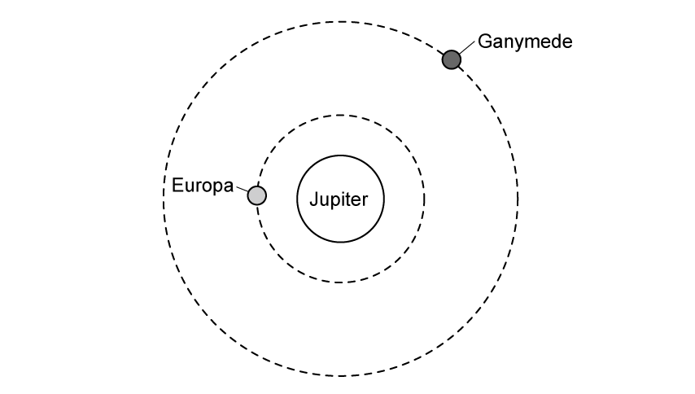
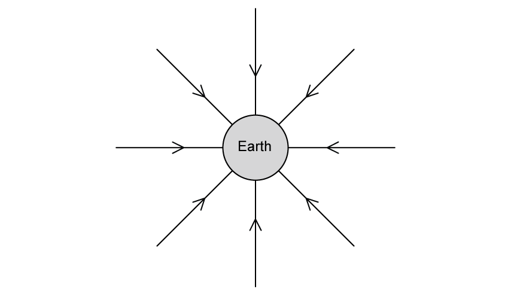
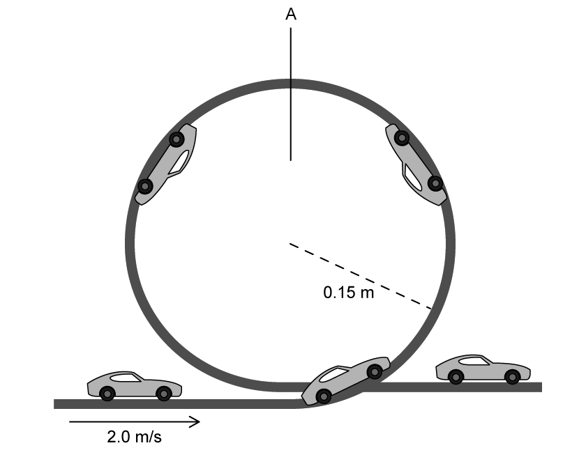
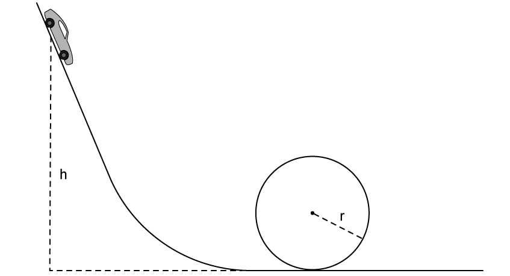
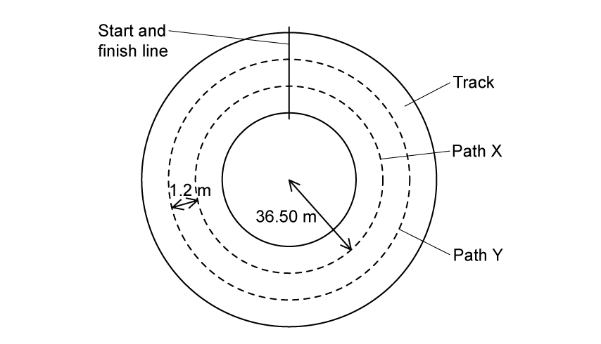
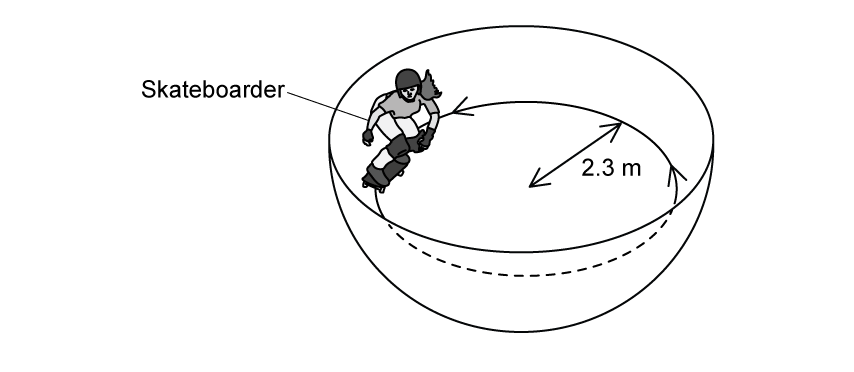
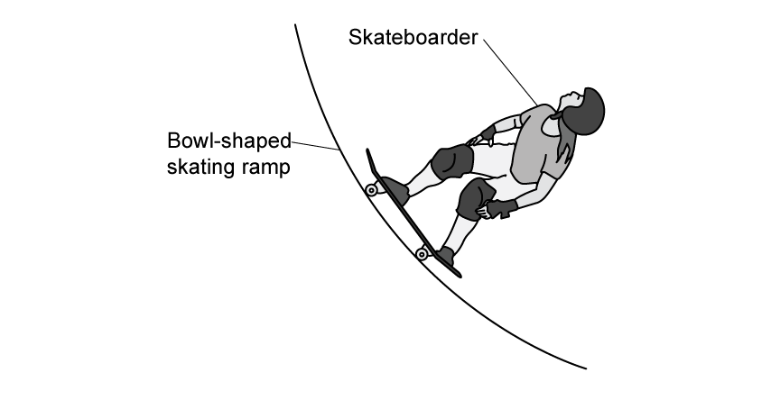
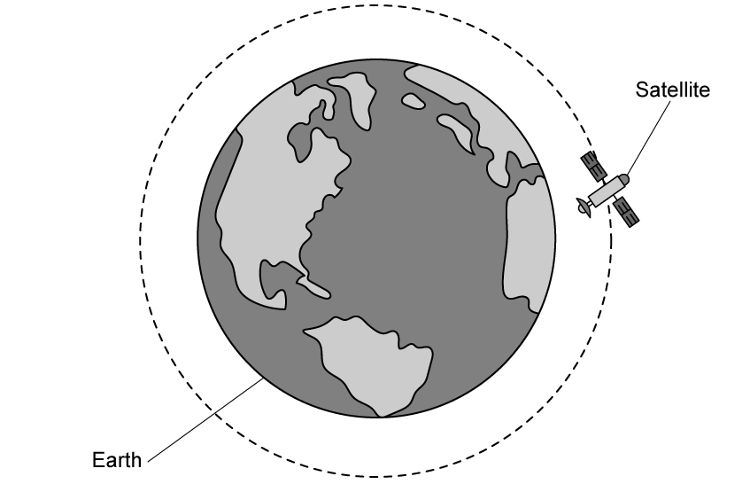

# Exam Questions — Centripetal Acceleration
**12. Motion in a Circle** · Cambridge (CIE) A-LEVEL physics (9702)
> Source: [https://www.savemyexams.com/a-level/physics/cie/25/topic-questions/](https://www.savemyexams.com/a-level/physics/cie/25/topic-questions/) · 8 questions across 1 sets

## Structured Questions (8 questions)

### Q1 — easy — 11 marks

**Q1** [4 marks]

Two of Jupiter's moons, Ganymede and Callisto orbit around Jupiter in a circular path, as shown in Fig 1.1.

Fig 1.1 shows the North pole of Jupiter, where both moons orbit counter-clockwise.

**Fig 1.1**

Identify, by drawing arrows, the following:

(i) the centripetal force on each moon. Label this *F*.

[2]

(ii) the linear velocity of each moon. Label this *v*.

[2]

**Q1** [3 marks]

**Extract:**

Two of Jupiter's moons, Ganymede and Callisto orbit around Jupiter in a circular path, as shown in Fig 1.1. Fig 1.1 shows the North pole of Jupiter, where both moons orbit counter-clockwise.

Both of Jupiter's moons travel at a speed of roughly 10 000 m s–1.

State which moon will have a longer time period. Explain your answer.

**Q1** [2 marks]

The centripetal acceleration of Ganymede is 0.11 m s–2.

The mass of Ganymede is 1.48 x 1023 kg.

Determine the centripetal force on Ganymede.

**Q1** [2 marks]

**Extract:**

Two of Jupiter's moons, Ganymede and Callisto orbit around Jupiter in a circular path, as shown in Fig 1.1.

Explain how the centripetal force of an object with the same mass and orbit as Ganymede would compare if it travelled with twice the angular speed.

### Q2 — easy — 12 marks

**Q2** [2 marks]

A centripetal force causes a centripetal acceleration.

State **two **properties of the centripetal force that is required for this.

**Q2** [4 marks]

(i) State the equation for centripetal acceleration.

[1]

(ii) State the definition and unit of each variable in part **(i)         **

[3]

**Q2** [3 marks]

Calculate the angular speed of a satellite in a geostationary orbit.

**Q2** [3 marks]

**Extract:**

Calculate the angular speed of a satellite in a geostationary orbit. The angular speed of an object in a geostationary orbit is: A geostationary orbit has a time period 24 hours (1 day), 24 hours = 24 × 60 × 60 = 86 400 s. ω = 2πf = 2π/T = 2π/86 400 = 7.272 × 10^–5 = 7.3 × 10^–5 rad s^–1

The satellite has an altitude of 36 000 km.

Calculate the centripetal acceleration of the satellite.

Radius of Earth = 6400 km

### Q3 — easy — 11 marks

**Q3** [2 marks]

State what is meant by *centripetal force*.

**Q3** [3 marks]

State the centripetal force in each of the following situations

(i) Venus orbiting the Sun

[1]

(ii) a car driving around a roundabout

[1]

(iii) rotating a ball tied to the end of a piece of string.

[1]

**Q3** [2 marks]

The Moon orbits the Earth in a circular path.

Explain, with reference to Fig 1.1, why the path of the moon is circular.

**Fig 1.1**

**Q3** [4 marks]

The centripetal force that acts on the Moon to keep it in orbit around the Earth is 2.21 × 1020 N.

Calculate the distance of the Moon from the surface of the Earth.

- Mass of the Moon = 7.35 × 1022 kg
- Radius of Earth = 6.38 × 106 m
- Linear speed of the Moon = 1.023 km s–1

### Q4 — hard — 15 marks

**Q4** [4 marks]

A ‘loop the loop’ is a vertical circular path. Fig. 1.1 shows a toy car of mass 70 g completing a ‘loop the loop’ which has a radius of 0.15 m.

**Fig. 1.1**

The car enters the loop with a speed of 2.0 m s–1 and then undergoes a constant deceleration until it passes** **A** **with a speed of 1.21 m s–1.

After A, the car undergoes a constant acceleration before leaving the loop with a speed of 2.0 m s–1

(i) Calculate the time taken for a car to complete the ‘loop the loop’.

[3]

(ii) Sketch a speed-time graph for the journey through the loop. Mark the time to the nearest tenth of a second and indicate at which time the car passes position A.

[1]

**Q4** [4 marks]

**Extract:**

A 'loop the loop' is a vertical circular path. Fig. 1.1 shows a toy car of mass 70 g completing a 'loop the loop' which has a radius of 0.15 m. The car enters the loop with a speed of 2.0 m s^–1^ and then undergoes a constant deceleration until it passes A with a speed of 1.21 m s^–1^. After A, the car undergoes a constant acceleration before leaving the loop with a speed of 2.0 m s^–1^

(i) Describe the origin of the centripetal force that keeps the car on the track throughout the loop.

[2]

(ii) Determine the minimum and maximum values of the reaction force experienced by the car as it makes its loop.

[2]

**Q4** [3 marks]

**Extract:**

A 'loop the loop' is a vertical circular path. Fig. 1.1 shows a toy car of mass 70 g completing a 'loop the loop' which has a radius of 0.15 m. The car enters the loop with a speed of 2.0 m s^–1^ and then undergoes a constant deceleration until it passes A with a speed of 1.21 m s^–1^. After A, the car undergoes a constant acceleration before leaving the loop with a speed of 2.0 m s^–1^.

(b)(ii) Determine the minimum and maximum values of the reaction force experienced by the car as it makes its loop. The minimum reaction force occurs at the top of the loop, at the minimum speed of 1.21 m s^−1^, when the weight supplies all the centripetal force, so reaction force = 0 N. The maximum reaction force occurs at the bottom of the loop, when the normal reaction force = centripetal force + weight = (mv²/r) + mg = 2.55 N.

For the journey through the loop, sketch a graph to show how the reaction force on the car varies with the angle rotated by the car around the loop.

Include the values for the maximum and minimum forces on the car.

Only show the general shape between these values.

**Q4** [4 marks]

A student is investigating the energy changes in a ‘loop the loop’, as shown in Fig. 1.2.

They want to determine the minimum height, *h,* required for a toy car of mass *m* to complete a loop the loop of radius *r*, when starting from rest.** **

**Fig. 1.2**

Show that the minimum height, *h* is:

$h=\frac{5}{2}r$

### Q5 — medium — 9 marks

**Q5** [2 marks]

Two runners are running around a circular track. One runner follows path X and the other follows path Y, as shown in Fig. 1.1.

**Fig 1.1**

The radius of path X is 36.50 m. Path Y is parallel to, and 1.2 m outside, path X. Both runners have mass 75 kg. The maximum lateral (sideways) friction force *F* that the runners can experience without sliding is 57 mN.

Show that the maximum speed at which the runner on path Y can move is 0.17 m s–1.

**Q5** [2 marks]

**Extract:**

Two runners are running around a circular track. One runner follows path X and the other follows path Y, as shown in Fig. 1.1. The radius of path X is 36.50 m. Path Y is parallel to, and 1.2 m outside, path X. Both runners have mass 75 kg. The maximum lateral (sideways) friction force F that the runners can experience without sliding is 57 mN. Show that the maximum speed at which the runner on path Y can move is 0.17 m s^–1.

Compare the centripetal acceleration and maximum speed of the runner on path X compared to path Y.

**Q5** [2 marks]

**Extract:**

Two runners are running around a circular track. One runner follows path X and the other follows path Y, as shown in Fig. 1.1. The radius of path X is 36.50 m. Path Y is parallel to, and 1.2 m outside, path X. Both runners have mass 75 kg. The maximum lateral (sideways) friction force *F* that the runners can experience without sliding is 57 mN.

Calculate the time taken for the runner in path X to complete 1 lap.

*T* = ............................. minutes

**Q5** [3 marks]

**Extract:**

Two runners are running around a circular track. One runner follows path X and the other follows path Y. The radius of path X is 36.50 m. Path Y is parallel to, and 1.2 m outside, path X. Both runners have mass 75 kg. The maximum lateral (sideways) friction force F that the runners can experience without sliding is 57 mN.

The runner on path Y has an ankle injury that has come back with a vengeance, so it takes them twice as long to complete 1 lap.

Determine their new centripetal acceleration.

### Q6 — medium — 10 marks

**Q6** [3 marks]

A bowl-shaped skating ramp can be modelled as a hollow sphere.

A skateboarder with a horizontal speed follows a circular path inside the bowl of radius 2.3 m, as shown in Fig 1.1.

**Fig 1.1**

The forces acting on the skateboarder are their weight *W* and the normal reaction force *R* of the ramp on the skateboarder. *R* is at an angle *θ *to the horizontal.

Sketch *W*, *R* and *θ *on Fig 1.2.

**Fig 1.2**

**Q6** [3 marks]

**Extract:**

A bowl-shaped skating ramp can be modelled as a hollow sphere. A skateboarder with a horizontal speed follows a circular path inside the bowl of radius 2.3 m. The forces acting on the skateboarder are their weight *W* and the normal reaction force *R* of the ramp on the skateboarder. *R* is at an angle *θ* to the horizontal.

Determine an equation for *W *in terms of *θ *and the resultant force, *F *on the skateboarder.

**Q6** [2 marks]

**Extract:**

A bowl-shaped skating ramp can be modelled as a hollow sphere. A skateboarder with a horizontal speed follows a circular path inside the bowl of radius 2.3 m. The forces acting on the skateboarder are their weight W and the normal reaction force R of the ramp on the skateboarder. R is at an angle θ to the horizontal.
Determine an equation for W in terms of θ and the resultant force, F on the skateboarder. F = R cosθ; W = R sinθ. The horizontal component R cosθ is in the same direction as the resultant force, F (towards the centre of the circle).

Explain why force *F* is significant to the motion of the skateboarder.

**Q6** [2 marks]

**Extract:**

A skateboarder with a horizontal speed follows a circular path inside the bowl of radius 2.3 m, as shown in Fig 1.1. The forces acting on the skateboarder are their weight W and the normal reaction force R of the ramp on the skateboarder. R is at an angle θ to the horizontal.
Determine an equation for W in terms of θ and the resultant force, F on the skateboarder. W = F tanθ

For the radius of the ramp in Fig 1.1, the skateboarder travels at a speed of 6.0 m s–1.

Show that the angle *θ *is 32°.

### Q7 — hard — 9 marks

**Q7** [4 marks]

A satellite orbits the Earth, as shown in Fig. 1.1. It remains in orbit due to the gravitational field of the Earth.

**Fig. 1.1**

It takes the satellite 200 minutes to complete one full revolution around the Earth. The mass of the Earth is 6.0 × 1024 kg and the radius of the Earth is 6400 km.

Show that the distance of the satellite from the surface of the Earth is approximately 5000 km.

**Q7** [2 marks]

**Extract:**

A satellite orbits the Earth, as shown in Fig. 1.1. It remains in orbit due to the gravitational field of the Earth. It takes the satellite 200 minutes to complete one full revolution around the Earth. The mass of the Earth is 6.0 × 10^24 kg and the radius of the Earth is 6400 km. Show that the distance of the satellite from the surface of the Earth is approximately 5000 km. From the mark scheme: r = 11 343 836 m = 11.343 × 10^6 m; Period T = 200 minutes = 12 000 s.

Calculate the acceleration due to the Earth's gravity of the satellite at its orbiting altitude from part a).

**Q7** [3 marks]

**Extract:**

Calculate the angular speed of the satellite, ω: ω = 2π/T = 2π/12 000 = 5.24 × 10^−4^ rad s^−1^

The satellite crashes into the surface of the Earth and becomes embedded in the ground.

Determine a ratio for the angular speed of the satellite on the surface of the Earth and the angular speed of the satellite when it was in orbit in part a). Explain your answer.

### Q8 — medium — 11 marks

**Q8** [3 marks]

Fig. 1.1 below shows a child at position B** **on a rotating playground roundabout. Frictional forces act on the child to keep them in the same position.

**Fig 1.1**

The child is at a distance of 0.167 m from the centre of the roundabout. The linear speed of the child at B is 1.23 m s–1.

Calculate the number of times the roundabout revolves in one minute.

**Q8** [1 mark]

**Extract:**

Fig. 1.1 below shows a child at position B on a rotating playground roundabout. Frictional forces act on the child to keep them in the same position. Fig 1.1 The child is at a distance of 0.167 m from the centre of the roundabout. The linear speed of the child at B is 1.23 m s^–1^.

Mark an arrow on Fig. 1.1** **to show the direction of the resultant horizontal force on the child.

**Q8** [3 marks]

**Extract:**

The child is at a distance of 0.167 m from the centre of the roundabout. The linear speed of the child at B is 1.23 m s^–1^.

The child has a mass of 23.4 kg.

Calculate the centripetal acceleration and centripetal force at position B.

**Q8** [4 marks]

**Extract:**

Fig. 1.1 below shows a child at position B on a rotating playground roundabout. Frictional forces act on the child to keep them in the same position. The child is at a distance of 0.167 m from the centre of the roundabout. The linear speed of the child at B is 1.23 m s^–1^.

The roundabout has an inner railing to hold onto at its centre. There is another railing near the outer edge.

Whilst the roundabout is rotating, state which railing would be easier to hold onto for the child and suggest why.
