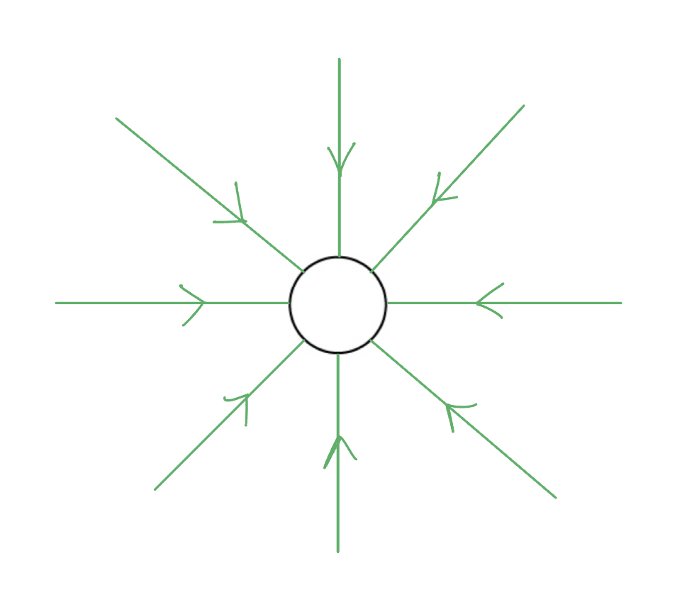
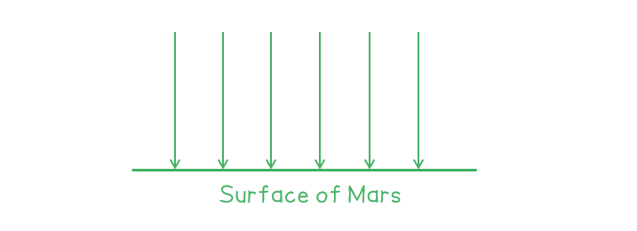
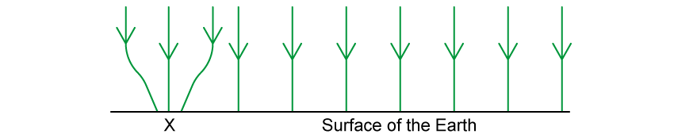

# Mark Schemes — Gravitational Field
**13. Gravitational Fields** · Cambridge (CIE) A-LEVEL physics (9702)

## Structured Questions (5 questions)

### Q1
A gravitational field is:

- A region / area / volume of space; **[1 mark]**
- where a <u>mass</u> experiences a <u>force</u>; **[1 mark]**

**[Total: 2 marks]**
Gravitational field strength is:

- The force per unit mass (on an object);** [1 mark]**

**[Total: 1 mark]**
(i) The acceleration due to gravity on Saturn is:

- 10.5 m s–2 **[1 mark]**

** **

(ii) The mass of Saturn is:

List the known quantities:

- Gravitational field strength, *g* = 10.5 N kg–1
- Radius of Saturn, *r* = 58 000 km = 58 000 × 103 m
- gravitational constant, G = 6.67 × 10–11 N m2 kg–2

Determine the equation for the mass of Saturn, *M:*

- $g=\frac{GM}{r^{2}}\RightarrowM=\frac{gr^{2}}{G}$ **[1 mark]**

Substitute in the values:

- `M space equals space fraction numerator 10.5 space cross times space open parentheses 58 space 000 space cross times 10 cubed close parentheses squared space over denominator 6.67 space cross times space 10 to the power of negative 11 end exponent end fraction` **[1 mark]**
- $M=5.296\times10^{26}=5.3\times10^{26}\mathrm{kg}$ **[1 mark]**

**[Total: 4 marks]**
The gravitational field lines around Saturn should look like:

- Lines drawn radially outwards from the centre of the circle; **[1 mark]**
- Arrows pointing towards the centre of the circle; **[1 mark]**

**[Total: 2 marks]**

### Q2
The completed equation is:

$\mathrm{gravitational} \mathrm{field} \mathrm{strength}=\frac{\mathrm{force} \mathrm{acting} \mathrm{on} \mathrm{an} \mathrm{object} \mathrm{with} \mathrm{mass}}{\mathrm{mass} \mathrm{of} \mathrm{object}}$

X is:

- Force acting on an object with mass; **[1 mark]**

Y is:

- Mass of object; **[1 mark]**

**[Total: 2 marks]**
Definitions of the terms:

- *g *= gravitational field strength (N kg−1) **AND**
- *F* = gravitational force on the mass (N) **AND**
- *m *= mass (kg) **[1 mark]**

**[Total: 1 mark]**
**Each correct sentence scores ****one**** mark:**

- A gravitational field is a region of space in which objects with **mass **will experience a force; **[1 mark]**
- The direction of the gravitational field is always directed **towards** the centre of the mass; **[1 mark]**
- Gravitational forces are **always **attractive; **[1 mark]**
- Gravitational fields around a point mass are** ****radial**; **[1 mark]**

**[Total: 4 marks]**

### Q3
To explain the effect on astronaut A's mass as they travel from Earth to the moon:

- The mass of the astronaut will not change;** [1 mark]**
- Because mass is not affected by gravitational field strength;** [1 mark]**

To explain the effect on astronaut A's weight as they travel from Earth to the moon:

- The weight of the astronaut will be less on the Moon than it is on Earth; **[1 mark]**
- Because weight = mass × gravitational field strength  **OR**  $W=mg$; **[1 mark]**
- And the gravitational field strength of the Moon is less (because the Moon is less massive than Earth);** [1 mark]**

**[Total: 5 marks]**
To determine the gravitational field strength of the moon:

List the known quantities:

- Weight of astronaut on Earth, $F_{gEarth}$= 770 N
- Weight of astronaut on Moon, $F_{gMoon}$= 128 N
- Gravitational field strength on Earth, $g$= 9.81 N kg−1

Calculate the mass of the astronaut:

- $g=\frac{F_{g}}{m}\rightarrowm=\frac{F_{g}}{g}$  **OR**  $W=mg\rightarrowm=\frac{W}{g}$
- $m=\frac{770}{9.81}$ **[1 mark]**
- $m=78.5\mathrm{kg}$ **[1 mark]**

Calculate the value of $g$ on the Moon:

- $g=\frac{128}{78.5}$ **[1 mark]**
- `g space equals space 1.63 space straight N space kg to the power of negative 1 end exponent space open parentheses 3 space straight s. straight f. close parentheses` **[1 mark]**

**[Total: 4 marks]**
Suggest what this implies about the gravitational field strength on Mars:

- The gravitational field strength / *g* on Mars is greater than the gravitational field strength / *g *on the Moon; **[1 mark]**
- Because more work is done to raise the spacecraft / an object through the gravitational field of Mars than the Moon; **[1 mark]**
- The gravitational field strength / *g* on Mars is less than the gravitational field strength / *g *on the Earth; **[1 mark]**
- Because less work is done to raise the spacecraft / an object through the gravitational field of Mars than Earth; **[1 mark]**

**[Total: 4 marks]**
A sketch diagram scoring 2 marks:

- At least three parallel lines equally spaced; **[1 mark]**
- Lines pointing towards the surface of Mars; **[1 mark]**

**[Total: 2 marks]**

### Q4
i) The Earth's gravitational field at the surface:

A diagram scoring two marks:

- At least 3 parallel field lines equally spaced;** [1 mark]**
- Field lines arrows pointing toward the surface of the Earth; **[1 mark]**

ii) The Earth's gravitational field as a sphere:

A diagram scoring two marks:

- At least 4 radial field lines equally spaced; **[1 mark]**
- Field lines point inwards towards the sphere; **[1 mark]**

**[Total: 4 marks]**
The gravitational field at the surface of Lamentis:

A diagram scoring 1 mark:

- At least 3 parallel field lines equally spaced

**AND**

- Drawn with arrows pointing towards the surface

**AND**

- Field lines are closer together than the field lines drawn in part (a)(i); **[1 mark]**

**[Total: 1 mark]**

### Q5
An image that would score 3 marks would look like:

- Equally spaced parallel lines; **[1 mark]**
- Arrows pointing towards Earth’s surface; **[1 mark]**
- Converging arrows at **X**;** ****[1 mark]**** **

**[Total: 3 marks]**
List the known quantities:

- Initial mass of shuttle, *m* = 3.24 × 107 kg
- Mass of shuttle upon surface of Venus = 0.95*m*
- Weight of shuttle upon surface of Venus, *W* = 270 MN = 270 × 106 N

To calculate the gravitational field strength on Venus:

- Gravitational field strength, $g=\frac{F_{g}}{m}=\frac{W}{m}$
- `g space equals space fraction numerator 270 cross times 10 to the power of 6 over denominator 0.95 space cross times space open parentheses 3.24 cross times 10 to the power of 7 close parentheses end fraction` **[1 mark]**
- `g space equals space 8.8 space straight N space kg to the power of negative 1 end exponent space open parentheses 2 space straight s. straight f. close parentheses` **[1 mark]**

**[Total: 2 marks]**
List the known quantities:

- Radius of Venus, $R_{V}$= 6.3 × 106 m
- Altitude = 250 km = 250 × 103 m
- Force (weight) acting on shuttle at the surface of Venus, *F*s = 270 × 106 N (from part (b))
- Mass of shuttle at altitude is equal to mass of shuttle at surface, *m*A = *m*S = 0.95*m *(from part (b))
- Initial mass of shuttle, *m* = 3.24 × 107 kg

Construct an equation to find the gravitational force on the shuttle at altitude, *F*A:

- $F\propto\frac{1}{r^{2}}$
- $\frac{F_{A}}{F_{S}}=\frac{1}{r^{2}}\div\frac{1}{R_{V}^{2}}=\frac{1}{r^{2}}\times\frac{R_{V}^{2}}{1}=\frac{R_{V}^{2}}{r^{2}}$
- `F subscript A space equals space fraction numerator F subscript S open parentheses R subscript V close parentheses squared over denominator r squared end fraction`** [1 mark]**

Substitute in the known values to calculate the force on the shuttle at altitude:

- `F subscript A space equals space fraction numerator open parentheses 270 cross times 10 to the power of 6 close parentheses space cross times space open parentheses 6.3 cross times 10 to the power of 6 close parentheses squared over denominator open parentheses open parentheses 6.3 cross times 10 to the power of 6 close parentheses space plus space open parentheses 250 cross times 10 cubed close parentheses close parentheses squared end fraction` **[1 mark]**

  - The total *r* is the radius of Venus plus the altitude
- $F_{A}=2.49\times10^{8}N$ **OR** 249 MN **[1 mark]**

Use this value of force to calculate *g* at altitude:

- `g space equals fraction numerator space F subscript g over denominator m end fraction space equals space fraction numerator 2.49 cross times 10 to the power of 8 over denominator 0.95 space cross times space open parentheses 3.24 cross times 10 to the power of 7 close parentheses end fraction`
- `g space equals space 8.1 space straight N space kg to the power of negative 1 end exponent space open parentheses 2 space straight s. straight f. close parentheses` **[1 mark]**

**[Total: 4 marks]*** *

> *Remember to always do a quick sanity check on your answers. From part (c), **g** on the surface of Venus was calculated to be 8.8 N kg**–1**. Therefore, above its surface you would expect it to be slightly less. If you get an answer that is greater than 8.80 N kg**–1** or drastically less, something may have gone wrong in your calculation. *

> *A common mistake is to also use the altitude as **r** and forget to add on the radius of the planet. **r** is the total distance from the centre of Venus to the shuttle.*
