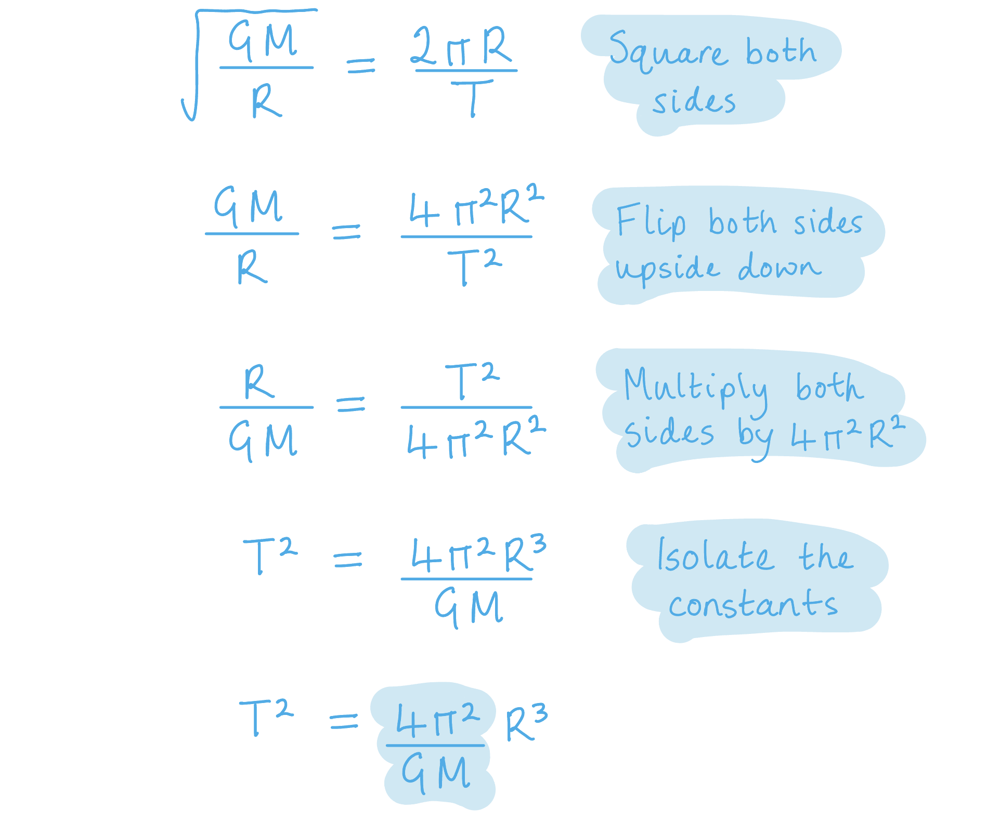
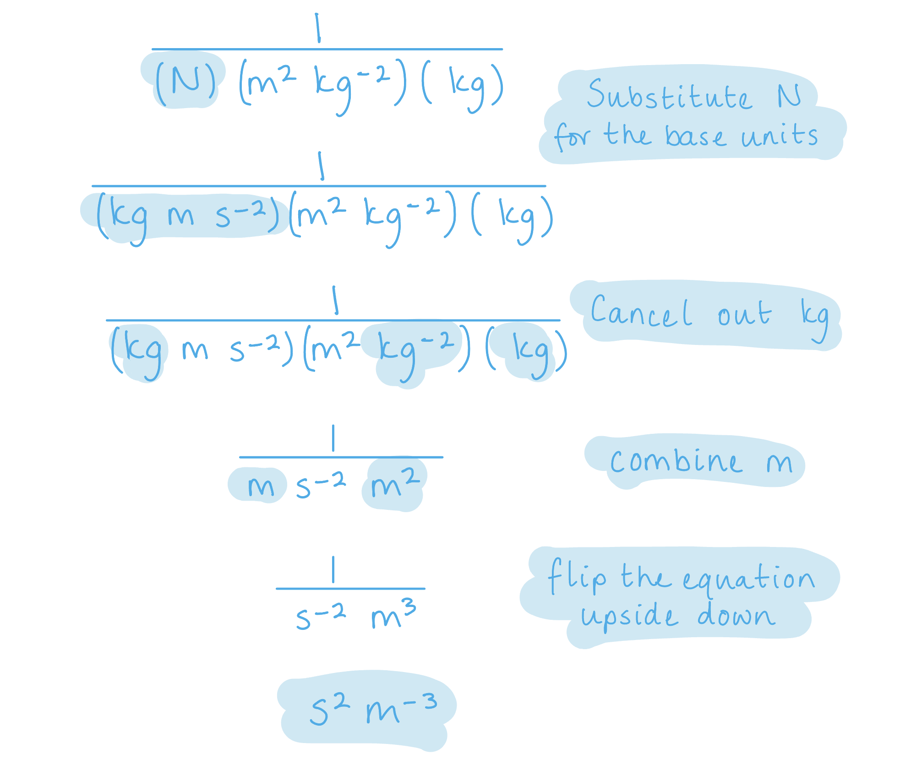
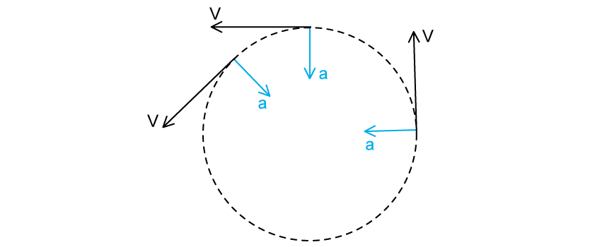

# Mark Schemes — Gravitational Force Between Point Masses
**13. Gravitational Fields** · Cambridge (CIE) A-LEVEL physics (9702)

## Structured Questions (7 questions)

### Q1
Justify how Newton's law of gravitation can be applied to a satellite orbiting Venus, when neither the satellite nor the planet are point masses:

- Planets are <u>spherical masses</u>, which act as point masses;** [1 mark]**
- A satellite has a much <u>smaller mass</u> than Venus so can be <u>approximated</u> to a point mass; **[1 mark]**

**[Total: 2 marks]**
List the known quantities:

- Mass of Venus, *M*V = 4.9 × 1024 kg
- Gravitational constant, *G* = 6.67 × 10−11 N m2 kg−2

Equate centripetal force with Newton's law of gravitation and rearrange to make velocity, $v$the subject:

- Centripetal force, $F=\frac{mv^{2}}{R}$
- Newton's law of gravitation, $F=G\frac{Mm}{R^{2}}$
- $\frac{mv^{2}}{R}=\frac{GMm}{R^{2}}$
- $v=\sqrt{\frac{GM}{R}}$**[1 mark]**

Substitute the orbital time and orbital radius into the distance, speed, time equation to find another expression for $v$:

- $v=\frac{d}{t}$
- $v=\frac{2πR}{T}$**[1 mark]**

Equate the two equations for $v$and rearrange to make *T**2* the subject:

- $\sqrt{\frac{GM}{R}}=\frac{2πR}{T}$
- $\frac{GM}{R}=\frac{4π^{2}R^{2}}{T^{2}}$
- $T^{2}=\frac{4π^{2}}{GM}R^{3}$ **[1 mark]**

Isolate the constant, *k*:

- $k=\frac{4π^{2}}{GM}$ **[1 mark]**

Substitute in the known values to calculate *k*:

- `k space equals space fraction numerator 4 straight pi squared over denominator open parentheses 6.67 cross times 10 to the power of negative 11 end exponent close parentheses space cross times space open parentheses 4.9 cross times 10 to the power of 24 close parentheses end fraction`
- *k* = 1.21 × 10−13 **[1 mark]**

Determine the SI base units for *k*:

- [*k*] = $\frac{1}{Nm^{2}\mathrm{kg}^{-2}\times\mathrm{kg}}$
- Substituting the base units for N gives, [*k*] = `fraction numerator 1 over denominator open parentheses kg space straight m space straight s to the power of negative 2 end exponent close parentheses space straight m squared space kg to the power of negative 2 end exponent space cross times space kg end fraction`
- Hence, [*k*] = $\frac{1}{m^{3}s^{-2}}$
- Therefore, the units for *k* = s2 m−3 **[1 mark]**

**[Total: 6 marks]**

> *If you need a reminder of the algebra for deriving the expression for k:*

> *If you need a reminder of the algebra for determining the SI base units:*

> *However, you may have also just used the given equation to find **k **'s SI units! The equation needs identical units either side, the left has units of s**2** so **k**  needs units of s**2** m**−3** to give the right side units of s**2** to match the left.*
List the known quantities:

- Day on Venus = 116 days and 18 hours
- *k* = 1.21 × 10−13 (from part (b))

Rearrange the equation from part (a) to solve for *R*3:

- $T^{2}=kR^{3}$
- $R^{3}=\frac{T^{2}}{k}$

Convert the orbital time, *T*, into seconds, s:

- Orbital time = Day on Venus = 116 days and 18 hours
- $116\mathrm{days}\times\frac{24\mathrm{hrs}}{1\mathrm{day}}=2784$
- Plus 18 hours

  - 2784 + 18 = 2802 hrs
- Therefore, $2802\mathrm{hrs}\times\frac{60\mathrm{min}}{1\mathrm{hr}}\times\frac{60s}{1\mathrm{min}}$
- *T* = 10 087 200 s = 1.009 × 107 s

Substitute the known values into the *R*3 equation:

- `R cubed space equals space fraction numerator open parentheses 1.009 cross times 10 to the power of 7 close parentheses squared over denominator 1.21 cross times 10 to the power of negative 13 end exponent end fraction space equals space`8.414 × 1026
- `R space equals space cube root of 8.414 cross times 10 to the power of 26 end root`
- *R* = 9.44 × 108 m **[1 mark]**

Combine the linear speed and angular speed equations to calculate the orbital speed:

- Linear speed, $v=ωr$
- Angular speed, $ω=\frac{2π}{T}$
- $v=\frac{2πr}{T}$
- $v=\frac{2π\times9.44\times10^{8}}{1.009\times10^{7}}$
- *v* = 588 m s−1 **[1 mark]**

**[Total: 2 marks]**

> *You could also have calculated the orbital speed by using *`v space equals space square root of fraction numerator G M over denominator R end fraction end root space equals space square root of fraction numerator open parentheses 6.67 cross times 10 to the power of negative 11 end exponent close parentheses space cross times space open parentheses 4.9 cross times 10 to the power of 24 close parentheses over denominator 9.44 cross times 10 to the power of 8 end fraction end root`
List the known quantities:

- Radius of orbit, *R* = 9.44 × 108 m (From part c)
- Gravitational potential energy, *E**p* = −2.08 × 108 J

Substitute the known quantities into the standard equation for gravitational potential energy, *E**p* and work done:

- *E**p* = *WD *= *Fd *
- $F=\frac{E_{p}}{R}$
- $F=\frac{-2.08\times10^{8}}{9.44\times10^{8}}$
- $F=0.220$ N **[1 mark]**

Explain your answer:

Venus exerts a small gravitational force on the satellite because:

- Its orbital velocity is small **AND**
- Its radius of orbit is big; **[1 mark]**

**[Total: 2 marks]**

> *If you found your answer by substituting the known quantities into the equation for gravitational potential energy *$E_{p}=\frac{-GM_{V}m}{R}$* to find mass and then calculated the centripetal force you are correct but this is a much longer method. *

### Q2
Newton's law of gravitation states that:

- The (gravitational) force is proportional to the product of the masses; **[1 mark]**
- And inversely <u>proportional to</u> the <u>square</u> of their separation; **[1 mark]**

**[Total: 2 marks]**
The law still applies to planet in our Solar System because:

- The separation of the planets (from the Sun) is <u>much</u> greater than the radius of the Sun / planet; **[1 mark]**

**[Total: 1 mark]**

> *When the orders of magnitude are so different, it is fine to approximate values, such as here where we can treat the planet as a point mass, as their radii are so much smaller than the distance between two planets or a planet and the Sun.*
*g* is approximately constant for small changes in height near the Earth's surface because:

- Changes in height on the Earth's surface are <u>much</u> smaller than the radius of the Earth; **[1 mark]**

**[Total: 1 mark]**
The radius of the Earth's orbit around the Sun is:

List the known quantities:

- Gravitational force between Earth and Sun, *F* = 3.52 × 1022 N
- Mass of Earth, *m*1 = 6.0 × 1024 kg
- Mass of Sun, *m*2 = 2.0 × 1030 kg

Determine the equation for the radius of the Earth's orbit, *r*:

- $F=\frac{Gm_{1}m_{2}}{r^{2}}\Rightarrowr=\sqrt{\frac{Gm_{1}m_{2}}{F}}$**[1 mark]**

Substitute in the values:

- `r space equals space square root of fraction numerator open parentheses 6.67 space cross times space 10 to the power of negative 11 end exponent close parentheses space cross times space open parentheses 6.0 space cross times space 10 to the power of 24 close parentheses space cross times space open parentheses 2.0 space cross times space 10 to the power of 30 close parentheses over denominator 3.52 space cross times space 10 to the power of 22 end fraction end root`**[1 mark]**
- $r=1.5\times10^{11}m$ **[1 mark]**

**[Total: 3 marks]**

> *r** is always measured from the **centre** of the two masses that we are calculating the gravitational force for. The radius of orbit of the Earth around the Sun is also measured in this way. You must recognise different wording for the same thing!*

> *To help, look at what variables you have already been given. Although you could use a circular motion equation, we haven't been given the linear speed which could make this difficult. However, since we have been given the gravitational force, we can also use Newton's law of gravitation.*

### Q3
A satellite can be in a circular orbit around a planet due to:

- The gravitational force (of attraction between the satellite and the planet); **[1 mark]**
- Which causes a centripetal acceleration (of the satellite around the planet); **[1 mark]**

**[Total: 2 marks]**
Show that the mean density *ρ* of the Earth is given by the expression $ρ=\frac{3πn^{3}}{GT^{2}}$:

List the known quantities:

- Mass of moon = $m$
- Radius of moon's orbit = $nR$
- Mass of Earth = $M$
- Radius of Earth = $R$

Determine an expression for *M* in terms of *ρ* and *R*:

- $ρ=\frac{M}{V}$
- $V=\frac{4}{3}πR^{3}$
- $M=\frac{4}{3}πR^{3}\timesρ$ **[1 mark]**

Consider the centripetal and gravitational forces acting on the moon from the Earth:

- $F_{centripetal}=mnRω^{2}$
- `F subscript g r a v i t a t i o n a l end subscript space equals space fraction numerator G M m over denominator open parentheses n R close parentheses squared end fraction`
- `up diagonal strike m n R omega squared space equals space fraction numerator G M up diagonal strike m over denominator open parentheses n R close parentheses squared end fraction`
- `n R omega squared space equals space fraction numerator G M over denominator open parentheses n R close parentheses squared end fraction`** [1 mark]**

Substitute the equation for angular velocity $ω$ into the equation and rearrange for *M*:

- $ω=\frac{2π}{T}$ **[1 mark]**
- `n R open parentheses fraction numerator 2 pi over denominator T end fraction close parentheses squared space equals space fraction numerator G M over denominator open parentheses n R close parentheses squared end fraction` ** **
- $M=\frac{4π^{2}n^{3}R^{3}}{GT^{2}}$

Substitute in the expression for* *$M$* *and rearrange for* *$ρ$:

- $\frac{4}{3}πR^{3}\timesρ=\frac{4π^{2}n^{3}R^{3}}{GT^{2}}$
- `rho space equals space fraction numerator up diagonal strike 4 straight pi to the power of up diagonal strike 2 end exponent n cubed up diagonal strike R cubed end strike over denominator G T squared end fraction space cross times space fraction numerator 3 over denominator up diagonal strike 4 pi R cubed end strike end fraction`
- $ρ=\frac{3πn^{3}}{GT^{2}}$** [1 mark]**

**[Total: 4 marks]**

- *Start with the main equation for **density*
- *Then, figure out what you know about **M** and **V*
- *The question tells us that *$F_{centripetal}=F_{gravitational}$* so we know we can **combine** these equations*
- *Circular motion states that *$Angularvelocityω=\frac{distance}{time}=\frac{circumferenceoforbit}{timeperiod}$
Use the expression in **(b)** to calculate *ρ:*

List the known quantities:

- Radius of Earth, $R$ = 6.38 × 106 m
- Radius of Moon's orbit, $nR$ = 3.84 × 108 m
- Period of Moon's orbit around the Earth, $T$ = 27.3 days = (27.3 × 24 × 3600) s
- Gravitational constant, $G$ = 6.67 × 10−11 N m2 kg−2

Calculate the value of $n$ in the radius of the Moon's orbit:

- `n space equals space fraction numerator open parentheses n R close parentheses over denominator R end fraction space equals space fraction numerator open parentheses 3.84 space cross times space 10 to the power of 8 close parentheses over denominator 6.38 space cross times space 10 to the power of 6 end fraction` = 60.19 **[1 mark]**

Substitute the known quantities into the expression for density, $ρ$:

- $ρ=\frac{3πn^{3}}{GT^{2}}$
- `rho space equals space fraction numerator 3 straight pi cross times open parentheses 60.19 close parentheses cubed over denominator open parentheses 6.67 space cross times space 10 to the power of negative 11 end exponent close parentheses open parentheses 27.3 cross times 24 cross times 3600 close parentheses squared end fraction` **[1 mark]**
- $ρ=5538\mathrm{kg}m^{-3}=5.54\times10^{3}\mathrm{kg}m^{-3}$ **[1 mark]**

**[Total: 3 marks]**

- *Don't forget to convert time to **seconds*
- *You do **know** *$n$*, as you have the information for *$nR$* and *$R$

### Q4
Europa moves with uniform circular motion because:

- The gravitational attraction between Jupiter and Europa provides a centripetal force; **[1 mark]**
- (Which is) directed towards the centre of Jupiter; **[1 mark]**
- (And) perpendicular to the direction of orbit hence the (linear) speed is constant;** [1 mark]**

** ****[Total: 3 marks]**** **

*Make sure you can explain why objects move in uniform circular motion - perhaps write the three points above on a flashcard. The first two points are relatively straightforward. The final point is asking you to consider the directions of the centripetal and gravitational forces and the linear velocity. You can see from the diagram they are perpendicular to each other.*

Show that the orbital speed of Europa is 14 km s–1:

List the known quantities:

- Europa orbital period = 85 hours = 85 × 60 × 60 = 306 000 s
- Europa orbital radius = 670 900 km

Determine the equation for orbital speed in terms of time period:

- $\mathrm{speed}=\frac{\mathrm{distance}}{\mathrm{time}}$
- Orbital speed: * *$v=\frac{2πr}{T}$**[1 mark]**

Substitute values into orbital speed equation:

- Substitute:  `v equals fraction numerator 2 straight pi cross times open parentheses 670900 close parentheses over denominator 306000 end fraction` = 13.8 km s–1 (3 s.f) **[1 mark]**

**[Total: 2 marks]**** **

> *It is best to leave the orbital radius in kilometres (km) instead of converting to metres (m) because the final answer is required in km s**–1**. Make sure you state clearly that the final answer is the answer the examiner was asking for.*
Determine the mass of Jupiter:

List the known quantities:

- Europa orbital radius, *r* = 670 900 km = 6.709 × 108 m
- Europa orbital speed, *v* = 13.8 km s–1 = 13.8 × 103 m s–1 (from part b)
- Gravitational constant, *G *= 6.67 × 10–11 N m2 kg–2 (from the data page)

Equate the equations for gravitational and centripetal force:

- Gravitational force:  $F=\frac{GMm}{r^{2}}$
- Centripetal force:  $F=\frac{mv^{2}}{r}$
- Equate:  $\frac{GMm}{r^{2}}=\frac{mv^{2}}{r}$
- Cancel *m* on both sides:  $\frac{GM}{r^{2}}=\frac{v^{2}}{r}$
- Mass:  $M=\frac{v^{2}r}{G}$ **[1 mark]**

Substitute the values into the mass equation:

- Mass of Jupiter:  `M space equals space fraction numerator open parentheses 13.8 cross times 10 cubed close parentheses squared cross times left parenthesis 6.709 cross times 10 to the power of 8 right parenthesis over denominator 6.67 cross times 10 to the power of negative 11 end exponent end fraction`  **[1 mark]**
- Mass of Jupiter:  $M$* *= 1.92 × 1027 kg** [1 mark]**

** ****[Total: 3 marks]**
Determine the ratio of the radii of Ganymede and Europa:

List the known quantities:

- Orbital radius of Europa = 670 900 km = 6.709 × 108 m
- Ganymede orbital period, *T* = 7.15 days = 7.15 × 24 × 60 × 60
- Ganymede orbital speed, *v* = 10.880 km s–1 = 10.88 × 103 m s–1

Rearrange the orbital speed equation for radius *r*:

- Orbital speed: * *$v=\frac{2πr}{T}\Rightarrowr=\frac{vT}{2π}$ **[1 mark]**

Calculate the orbital radius of Ganymede:

- Substitute:  `r space equals space fraction numerator left parenthesis 10.88 cross times 10 cubed right parenthesis cross times open parentheses 7.15 cross times 24 cross times 60 cross times 60 close parentheses over denominator 2 straight pi end fraction`
- Orbital radius of Ganymede: * r *= 1.07 × 109 m **[1 mark]**

Determine the ratio of the radii:

- $\frac{\mathrm{orbital} \mathrm{radius} \mathrm{of} \mathrm{Europa}}{\mathrm{orbital} \mathrm{radius} \mathrm{of} \mathrm{Ganymede}}=\frac{6.709\times10^{8}}{1.07\times10^{9}}=0.627$ **[1 mark]**

** ****[Total: 3 marks]**

> *Make sure to check your units! Especially when carrying out the final ratio calculation, make sure the radii are both in metres or kilometres*

### Q5
A geostationary orbit is:

- An equatorial orbit / orbit about the equator; **[1 mark]**
- Where a satellite moves from west to east / in the same direction as the Earth spins; **[1 mark]**
- With a period of 24 hours / 1 day; **[1 mark]**

**[Total: 3 marks]**
*M* is given by $M=\frac{v^{2}r}{G}$ because:

Equate the centripetal and gravitational force:

- $F=\frac{mv^{2}}{r}=\frac{GMm}{r^{2}}$ **[1 mark]**

Cancel and rearrange for mass *M*:

- `fraction numerator up diagonal strike m v squared over denominator r end fraction space equals fraction numerator space G M up diagonal strike m over denominator r squared end fraction`
- $v^{2}=\frac{GM}{r}$
- $M=\frac{v^{2}r}{G}$ **[1 mark]**

**[Total: 2 marks]**
*M* can also be written as $M=\frac{4π^{2}r^{3}}{T^{2}G}$ because:

Determine an equation for *v* in terms of *T*:

- $ω=\frac{\Deltaθ}{T}$
- So for 1 revolution $\Deltaθ=2π$
- $v=ωr=\frac{2πr}{T}$ **[1 mark]**

Substitute this equation into the equation for *M* in terms of *v*:

- `M space equals fraction numerator space v squared r over denominator G end fraction space space space rightwards double arrow space space space M space equals fraction numerator space open parentheses fraction numerator 2 pi r over denominator T end fraction close parentheses squared r over denominator G end fraction`
- $M=\frac{\frac{4π^{2}r^{2}}{T^{2}}r}{G}=\frac{4π^{2}r^{3}}{T^{2}G}$ **[1 mark] **

**[Total: 2 marks]**

> *Since satellites travel roughly in a circular path, you will need to be familiar with all the circular motion equations for this section of gravitational fields as well.*
The radius of a geostationary orbit around Earth is:

List the known quantities:

- Mass of the Earth, *M* = 6.0 × 1024 kg
- Time period of a geostationary orbit, *T* = 24 hours
- gravitational constant, *G* = 6.67 × 10–11 N m2 kg–2

Calculate the time period in seconds, *T*:

- *T* = 24 hours = 24 × 60 × 60
- *T* = 86 400 s **[1 mark]**

Rearrange the mass equation for the radius or orbit, *r*:

- $MT^{2}G=4π^{2}r^{3}$
- $\frac{MT^{2}G}{4π^{2}}=r^{3}$
- `r space equals cube root of fraction numerator space M T squared G over denominator 4 pi squared end fraction end root`**[1 mark]**

Substitute values into the radius equation:

- `r space equals space cube root of fraction numerator open parentheses 6.0 space cross times space 10 to the power of 24 close parentheses space cross times space open parentheses 86 space 400 close parentheses squared space cross times space open parentheses 6.67 space cross times space 10 to the power of negative 11 end exponent close parentheses space over denominator 4 pi squared end fraction end root` **[1 mark]**
- $r=4.2\times10^{7}m$  **[1 mark]**

**[Total: 4 marks]**

### Q6
List the known quantities:

- Distance between the Earth's surface and the centre of S, *d* = 3.5 km = 3500 m
- Radius of S, *r* = 2 km = 2000 m
- Density of the rock in S, *ρ *= 2500 kg m–3
- Mass of kilogram, *m* = 1 kg
- Gravitational constant, *G *= 6.67 × 10−11 N m2 kg−2

Calculate the mass of rock in S, *M*:

- *M* = *ρ* × *V  *where *V*  is the volume enclosed by S
- Volume: * *$V=\frac{4}{3}πr^{3}=\frac{4}{3}π\times(2000)^{3}$
- Hence, `M space equals space 2500 cross times 4 over 3 straight pi cross times open parentheses 2000 close parentheses cubed`* *= 8.4 × 1013 kg **[1 mark]**

Approximate the force between *M* and *m *using a sensible radial separation:

- The radius of the kilogram mass *m* <u>is very small compared to</u> the radial distance between the centre of S and the centre of *m*
- Hence, `F space equals space fraction numerator G M m over denominator d squared end fraction space equals space fraction numerator left parenthesis 6.67 cross times 10 to the power of negative 11 end exponent right parenthesis left parenthesis 8.4 cross times 10 to the power of 13 right parenthesis open parentheses 1 close parentheses over denominator left parenthesis 3500 right parenthesis squared end fraction space almost equal to space fraction numerator open parentheses 6.67 cross times 10 to the power of negative 11 end exponent close parentheses open parentheses 8.4 cross times 10 to the power of 13 close parentheses over denominator left parenthesis 3500 right parenthesis squared end fraction` **[1 mark]**
- *F* = 4.6 × 10–4 N **[1 mark]**

**[Total: 3 marks]**

> *You should note that the radius of the kilogram mass is not given in this question, which raises alarm bells because there is no way of calculating an **exact** radial separation between the centre of **m** and the centre of **M**, enclosed by S. Therefore, you **must approximate** this radial separation, and **justify** that this is ok because – in effect – the radius of **m** is so small compared to the distance to S that it would have a negligible impact on the value of **F** calculated. *
The student is incorrect because:

- (There is now a hollow in the sphere S so) the centre of mass is no longer in the centre of the sphere, but further to the left side of the shape; **[1 mark]**
- Therefore the separation is greater; **[1 mark]**
- So the force *F *between *m *and S is weaker; **[1 mark]**
- Because force is inversely proportional to the square of separation **OR** because gravitational force follows an inverse square law; **[1 mark]**

**[Total: 4 marks]**
List the known quantities:

- Distance between the Earth's surface and the centre of S, *d* = 3.5 km
- $F_{new}=\frac{49}{64}F_{old}$

Equate equations using Newton's law of Gravitation for *F**old *and *F**new*:

- $F_{old}=\frac{GMm}{d^{2}}$ and $F_{new}=\frac{GMm}{d'^{2}}$

  - Where $d'$ is the distance between the new centre of mass of S and the mass *m*

- $\frac{GMm}{d'^{2}}=\frac{49}{64}\times\frac{GMm}{d^{2}}$ **[1 mark]**

Determine the value of *d'*:

- `open parentheses fraction numerator d over denominator d apostrophe end fraction close parentheses squared space equals space 49 over 64`
- $\frac{d}{d'}=\frac{7}{8}$
- $d'=d\times\frac{8}{7}=3.5\times\frac{8}{7}=4.0\mathrm{km}$ **[1 mark]**

Determine the distance between the two centres of masses, *x*:

- $x=d'-d$
- *x *= 4.0 − 3.5 = 0.5 km **[1 mark]**

**[Total: 3 marks]**

### Q7
(i) A geostationary orbit is one that is:

- Above the equator; **[1 mark]**
- Moves from west to east / in the same direction as the Earth's spin; **[1 mark]**
- Has a period of 24 hours / has the same time period to spin as the Earth;** [1 mark]**

(ii) It is preferable to have a satellite in this orbit for TV and telephone signals because:

- The satellite would remain in a fixed position above the Earth's surface; **[1 mark]**
- (Therefore), you wouldn't need to alter the angle / move the receiver; **[1 mark]**

**[Total: 5 marks]**
The time period *T* of the orbit of the satellite is given by the expression `T squared space equals space open parentheses fraction numerator 4 pi squared R cubed over denominator G M end fraction close parentheses` because:

Equate the centripetal and gravitational force:

- The gravitational force provides the centripetal force on the satellite; **[1 mark]**
- $F=\frac{GMm}{R^{2}}=mRω^{2}$ **[1 mark]**
- $ω=\frac{2π}{T}$
- `fraction numerator G M over denominator R squared end fraction equals R omega squared space equals space R open parentheses fraction numerator 2 pi over denominator T end fraction close parentheses squared` **[1 mark]**

Rearrange to make *T*2 the subject:

- `fraction numerator G M over denominator R squared end fraction space equals space R open parentheses fraction numerator 2 pi over denominator T end fraction close parentheses squared space equals space R open parentheses fraction numerator 4 pi squared over denominator T squared end fraction close parentheses`
- `G M space equals space R cubed open parentheses fraction numerator 4 pi squared over denominator T squared end fraction close parentheses`
- $T^{2}=\frac{R^{3}4π^{2}}{GM}$ **[1 mark]**

**[Total: 4 marks]**

> *Since this question specifically asks you to 'explain your working' - don't just jump straight into equations. State **why** you are equating centripetal force and gravitational force for a mark.*

> *Make sure you lay out any algebra clearly for the examiner. You want to make it easy for them to follow through with your working. This will also help you determine where something may have gone wrong in your final answer if you do not get the required equation.*
The mass of the Earth is:

List the known quantities:

- Time period of a geostationary orbit, *T* = 24 hours = 24 × 60 × 60 = 86 400 s
- Radius of a geostationary orbit from the centre of the Earth, *R* = 4.2 × 107 m

Rearrange the equation from part (b) for the mass *M*:

- `T squared space equals space open parentheses fraction numerator 4 pi squared R cubed over denominator G M end fraction close parentheses`
- $T^{2}GM=4π^{2}R^{3}$
- $M=\frac{R^{3}4π^{2}}{GT^{2}}$

Substitute in the values:

- `M space equals space fraction numerator open parentheses 4.2 space cross times space 10 to the power of 7 close parentheses cubed space cross times space 4 pi squared space over denominator open parentheses 6.67 space cross times space 10 to the power of negative 11 end exponent close parentheses cross times space open parentheses 86400 close parentheses squared end fraction` **[1 mark]**
- $M=5.874\times10^{24}=5.9\times10^{24}\mathrm{kg}$ **[1 mark]**

**[Total: 2 marks]**
The ratio $\frac{\mathrm{gravitational} \mathrm{field} \mathrm{strength} \mathrm{of} \mathrm{satellite} \mathrm{on} \mathrm{the} \mathrm{Earth}'s\mathrm{surface}}{\mathrm{gravitational} \mathrm{field} \mathrm{strength} \mathrm{of} \mathrm{the} \mathrm{satellite} \mathrm{at} \mathrm{the} \mathrm{geostationary} \mathrm{orbit}}$ is:

List the known quantities:

- Radius of the Earth, *R* = 6400 km = 6400 × 103 m
- Radius of the geostationary orbit, *h* = 4.2 × 107 m

Determine an equation with the ratio of the orbits:

- Let *g**1** *be the gravitational field strength of the satellite on the Earth's surface and *g*2 the gravitational field strength of the satellite in the geostationary orbit
- $g_{1}=\frac{GM}{R^{2}}$ and $g_{2}=\frac{GM}{h^{2}}$
- $\frac{g_{1}}{g_{2}}=\frac{\frac{GM}{R^{2}}}{\frac{GM}{h^{2}}}=\frac{h^{2}}{R^{2}}$ **[1 mark]**

Substitute the values into the ratio equation:

- `g subscript 1 over g subscript 2 space equals space fraction numerator open parentheses 4.2 space cross times space 10 to the power of 7 close parentheses squared space over denominator open parentheses 6400 space cross times space 10 cubed close parentheses squared end fraction` **[1 mark]**
- $\frac{g_{1}}{g_{2}}=43$ **[1 mark]**

**[Total: 3 marks]**

> *You could of course do this question by calculating **g** at both positions of the satellite using *$g=\frac{GM}{r^{2}}$*, and you would still receive full marks. However, there's a lot more room for calculation errors with large powers that could go wrong. The method in this mark scheme recognises that G and M are going to cancel anyways, but you must be confident with dividing fractions to achieve this. *
